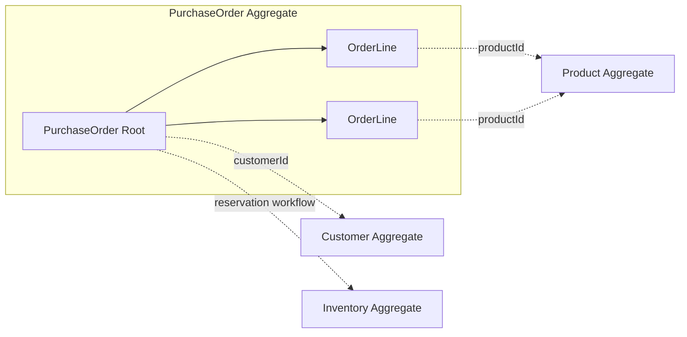

# Choosing Aggregate Boundaries and Application Service Responsibilities

## 1. What Is an Aggregate in a Data Model?

In Domain-Driven Design (DDD), an **aggregate** is a group of domain objects treated as a single consistent unit. This group has a root object called the **aggregate root**. External operations go through the aggregate root to modify the group's state and protect its business rules.

Aggregates help answer three important design questions:

- Which objects must be modified together so that a business rule always holds true?
- Which object is responsible for controlling those modifications?
- Where is the boundary of a single unit of update and data consistency?

For example, an order may consist of order header details and multiple order lines. A rule such as "an empty order cannot be confirmed" needs to be protected alongside the status and the list of order lines. In that case, `PurchaseOrder` can be the aggregate root, while `OrderLine` is an object belonging to the order aggregate.

Conversely, `Customer`, `Product`, and `Inventory` usually have independent lifecycles and modification rules. An order does not need to contain full `Customer`, `Product`, or `Inventory` objects inside its aggregate. The order can hold the IDs of those aggregates and coordinate with them through an application service.

An aggregate is not merely a group of tables connected by foreign keys. It is a domain-model boundary and a business-consistency boundary. Table structures can support aggregates, but tables alone do not dictate how aggregates should be designed.

## 2. The Aggregate Root and Protecting Invariants

An **invariant** is a rule that must always remain true for the state of the domain. The aggregate root is responsible for protecting the aggregate's invariants by controlling state-changing operations.

Suppose an order has these rules:

- Only an order in the `DRAFT` state may add or remove order lines.
- The quantity of each order line must be greater than 0.
- An order must have at least one order line before it can be confirmed.
- A confirmed order cannot revert to draft via normal editing operations.

If a service or controller can directly mutate the list of order lines and the status, these rules are easily bypassed. Instead, the aggregate root provides business methods to govern every change.

Illustrative example:

```java
public class PurchaseOrder {

    private Long id;
    private OrderStatus status;
    private final List<OrderLine> lines = new ArrayList<>();

    public void addLine(Long productId, int quantity, BigDecimal unitPrice) {
        if (status != OrderStatus.DRAFT) {
            throw new IllegalStateException("Only draft orders can be changed");
        }
        if (quantity <= 0) {
            throw new IllegalArgumentException("Quantity must be positive");
        }
        if (unitPrice == null || unitPrice.signum() < 0) {
            throw new IllegalArgumentException("Unit price must not be negative");
        }

        lines.add(new OrderLine(productId, quantity, unitPrice));
    }

    public void confirm() {
        if (status != OrderStatus.DRAFT) {
            throw new IllegalStateException("Order is not a draft");
        }
        if (lines.isEmpty()) {
            throw new IllegalStateException("An empty order cannot be confirmed");
        }

        status = OrderStatus.CONFIRMED;
    }
}
```

This is a condensed example; in a real application, you need to define constructors, ID types, getters, mappings, and appropriate domain exceptions. The main point is that `addLine` and `confirm` place rules where sufficient information exists to protect the order state.

A controller can call an application service, but it should not perform checks itself and then modify individual fields of the aggregate. If multiple call paths perform the same business action, placing rules inside the aggregate root ensures they share a single mechanism for protecting invariants.

## 3. How to Choose Aggregate Boundaries

Do not lump every related object into one large aggregate. Boundaries should be chosen based on business rules and required consistency, rather than simply whether tables are related.

### 3.1. Group Objects That Must Change Together

If a business operation must update multiple objects to maintain an invariant and intermediate states are unacceptable, those objects usually belong in the same aggregate.

For example, `PurchaseOrder` and `OrderLine` can share an aggregate if order lines have no independent lifecycle, exist only within an order, and must be added/removed according to order rules. When confirming the order, the root can inspect all order lines before transitioning status.

### 3.2. Separate Objects with Independent Lifecycles

If an object can be created, updated, searched, or deleted independently in the domain, it usually fits best as its own aggregate.

For example:

- `Customer` can update its address and contact info without loading all of its orders.
- `Product` can change its name or description without updating every historical order.
- `Inventory` can be updated by receiving, sales, and stock-adjustment workflows.
- `PurchaseOrder` has its own states and lifecycle from draft to confirmed, shipped, or cancelled.

These aggregates may interact within the same use case, but that does not mean they must become a single aggregate.

### 3.3. Consider Data Load and Concurrency

When loading an aggregate, the application needs to fetch enough data to execute business behavior. If an aggregate is too large, every operation may read lots of unrelated data, hold connections longer, and cause frequent update conflicts.

An aggregate with tens of thousands of child rows is usually a sign to revisit the boundary. Some data might need to become a separate aggregate, some might only need to be queried on demand, or the workflow might need batch processing.

Smaller boundaries can reduce update scope and contention, but they increase the need for coordination between aggregates. The design must balance immediate consistency against the complexity of distributed workflows.

### 3.4. An Aggregate Has One External Entry-Point Root

Objects inside an aggregate are modified through the root. If `OrderLine` belongs to the `PurchaseOrder` aggregate, external components should not look up and mutate an order line as an independent entity. They ask `PurchaseOrder` to perform the appropriate operation.

If an order line needs to be edited independently, has its own status, is directly referenced by multiple aggregates, or has an independent lifecycle, evaluate whether it is actually an independent aggregate. When splitting it out, clearly define the new consistency rules.

## 4. Order Model Example

A sales model can be divided into aggregates as follows:



In this example:

- `PurchaseOrder` is the root of the order.
- `OrderLine` belongs to the order and has no independent lifecycle.
- `Customer`, `Product`, and `Inventory` are separate aggregates.
- The order stores `customerId` and each order line stores `productId` instead of holding full object graphs of other aggregates.

When a customer changes their address, there is no need to load and save all of their orders. When a product changes its name, old orders retain the snapshot information needed at purchase time, if required by business rules. When stock checks are needed, the application service invokes the inventory aggregate's use case or a corresponding service.

For an order, snapshots such as product name, unit price, and tax at purchase time can be stored. This snapshot is historical data belonging to the order, different from embedding the entire `Product` aggregate inside `PurchaseOrder`. Choosing what to snapshot depends on invoicing, auditing, and order recalculation requirements.

## 5. References Between Aggregates

One aggregate typically references another aggregate by identifier. This keeps boundaries clear and avoids accidentally expanding the scope of loads, edits, or saves.

Example:

```java
public class PurchaseOrder {
    private Long id;
    private Long customerId;
    private OrderStatus status;
    private List<OrderLine> lines;
}

public class OrderLine {
    private Long productId;
    private int quantity;
    private BigDecimal unitPrice;
}
```

`PurchaseOrder` holds `customerId`, and `OrderLine` holds `productId`. When a customer's name is needed for display, the application can query `Customer` by ID or use an appropriate projection/read model. When the current price of a product is needed, the application queries `Product` or calls a pricing service per business rules.

Referencing by ID does not mean JOINs are forbidden in all queries. A read query can JOIN multiple tables to render a screen or report. What should be avoided is turning an aggregate into an object graph authorized to arbitrarily update other aggregates. Write models and read models can use different retrieval paths.

### 5.1. Do Not Keep Mutable Copies of Other Aggregates

If `PurchaseOrder` holds an entire mutable `Customer` object, an order update operation risks accidentally modifying customer info or saving stale customer state. Holding an ID and necessary snapshot data clearly distinguishes:

- Reference information to another aggregate, e.g., `customerId`.
- Historical data belonging to the current aggregate, e.g., `customerNameAtPurchase` if needed on the order.
- Current data to be queried from another aggregate when displaying or processing.

### 5.2. Handling Missing Referenced Aggregates

An ID is a logical reference; the database may or may not have a foreign key depending on the design. When creating an order with `customerId`, the use case must define how to verify that the customer exists and is eligible to place an order.

If verification and order creation require immediate consistency within the same database, they can be executed inside an appropriate transaction. If the aggregates reside in different services or databases, you cannot rely on a local R2DBC transaction to guarantee cross-system atomicity; a coordination workflow and handling for references changing after verification are required.

## 6. Aggregates and Repositories in Spring Data R2DBC

In Spring Data Relational, repositories are typically defined for aggregate roots. A repository provides a way to load and save the root; objects belonging to the aggregate are mapped using relational metadata.

Condensed declaration example:

```java
@Table("purchase_order")
public class PurchaseOrder {

    @Id
    private Long id;

    @Version
    private Long version;

    private Long customerId;

    private OrderStatus status;

    @MappedCollection(idColumn = "order_id")
    private List<OrderLine> lines = new ArrayList<>();

    // Domain methods and constructors
}
```

```java
public interface PurchaseOrderRepository
        extends ReactiveCrudRepository<PurchaseOrder, Long> {
}
```

`@Table` maps the root to the `purchase_order` table; `@Id` marks the identifier; `@Version` supports optimistic locking when supported by the mapping and database; `@MappedCollection` describes the collection of objects belonging to the aggregate according to Spring Data Relational mapping.

In this model, `OrderLine` is saved as part of `PurchaseOrder`. Normally, the application only needs `PurchaseOrderRepository` to operate on the order aggregate; do not create `OrderLineRepository` if order lines have no independent lifecycle.

Spring Data Relational has specific rules for how aggregates are saved, including handling objects mapped via `@MappedCollection`. Exact SQL statements and how child rows are inserted/updated/deleted depend on the version, mapping, and operation called. Verify the schema, SQL, and behavior of the Spring Data R2DBC version in use, especially when collections are large or have special performance requirements.

Other repositories can be defined for `Product` or `Customer` if they are separate aggregate roots:

```java
public interface ProductRepository
        extends ReactiveCrudRepository<Product, Long> {
}

public interface CustomerRepository
        extends ReactiveCrudRepository<Customer, Long> {
}
```

Having multiple repositories does not mean every use case must call all of them. The application service coordinates only the aggregates required for a specific business action.

## 7. Responsibilities of an Application Service

An **application service** executes a system use case. It orchestrates the steps needed to complete the action, but should not become the home for all internal domain rules.

Responsibilities that typically belong to an application service:

- Receive commands or input data for the use case.
- Identify the required aggregates/repositories.
- Load the necessary aggregate roots.
- Invoke domain methods to perform valid state changes.
- Coordinate multiple aggregates or external services when the use case requires.
- Define transaction boundaries at the application layer.
- Save aggregates and publish or forward events per the workflow.
- Transform domain results into output types suitable for the calling layer.

An application service generally should not rewrite invariants such as "a confirmed order cannot add order lines." That rule belongs to `PurchaseOrder`. The service calls `order.addLine(...)` and lets the aggregate protect its own state.

### 7.1. Example Service Coordinating a Single Aggregate

```java
@Service
public class OrderApplicationService {

    private final PurchaseOrderRepository orderRepository;

    public OrderApplicationService(PurchaseOrderRepository orderRepository) {
        this.orderRepository = orderRepository;
    }

    @Transactional
    public Mono<PurchaseOrder> addLine(AddOrderLineCommand command) {
        return orderRepository.findById(command.orderId())
                .switchIfEmpty(Mono.error(
                        new OrderNotFoundException(command.orderId())))
                .flatMap(order -> {
                    order.addLine(
                            command.productId(),
                            command.quantity(),
                            command.unitPrice());
                    return orderRepository.save(order);
                });
    }
}
```

This example illustrates orchestration responsibilities. In a real application, `unitPrice` should not be blindly trusted from an external request; the service should fetch the price from an authoritative source or validate a price snapshot according to business rules. The transaction annotation must be placed on a Spring-managed bean and the method must return a publisher so the reactive transaction interceptor can manage its lifecycle.

The application service does not call `subscribe()` inside the method. It returns `Mono<PurchaseOrder>` so the caller or framework manages the subscription. This allows errors and transactions to attach to the publisher lifecycle.

### 7.2. Example Service Coordinating Two Aggregates

A use case may need to read a product to obtain its current price and then add an order line to an order. `Product` and `PurchaseOrder` remain two separate aggregates; the service merely coordinates them:

```java
@Service
public class OrderApplicationService {

    private final ProductRepository productRepository;
    private final PurchaseOrderRepository orderRepository;

    public OrderApplicationService(
            ProductRepository productRepository,
            PurchaseOrderRepository orderRepository) {
        this.productRepository = productRepository;
        this.orderRepository = orderRepository;
    }

    @Transactional
    public Mono<PurchaseOrder> addProduct(AddProductToOrderCommand command) {
        return Mono.zip(
                        productRepository.findById(command.productId())
                                .switchIfEmpty(Mono.error(
                                        new ProductNotFoundException(command.productId()))),
                        orderRepository.findById(command.orderId())
                                .switchIfEmpty(Mono.error(
                                        new OrderNotFoundException(command.orderId())))
                )
                .flatMap(tuple -> {
                    Product product = tuple.getT1();
                    PurchaseOrder order = tuple.getT2();

                    order.addLine(
                            product.getId(),
                            command.quantity(),
                            product.getCurrentPrice());

                    return orderRepository.save(order);
                });
    }
}
```

The example assumes both repositories participate in the same reactive transaction and that product prices are read according to the use case's consistency policy. If the price must be locked or guaranteed not to change between reading and confirmation, additional mechanisms such as versioning, price re-validation, or a dedicated pricing workflow must be added. A database transaction alone does not solve all business rules concerning concurrent changes.

If `Product` lives in a different service or database, R2DBC's `@Transactional` does not create a distributed transaction between the two systems. In that scenario, separate communication, timeout, retry, idempotency, and failure handling must be designed.

## 8. How Is an Application Service Different from a Domain Service?

These two service types have similar names but serve different purposes.

| Component | Focus | Example Responsibilities |
| --- | --- | --- |
| Application service | Orchestrating use cases and application infrastructure | Loading orders, calling domain methods, managing transactions, saving results |
| Domain service | Domain rules that do not naturally belong to a single entity or value object | Calculating discount allocation policies across multiple domain components |
| Aggregate root/entity | State and behavior tied to a domain object | Checking whether an order can be confirmed |
| Repository | Loading and saving aggregate roots | Finding an order by ID, saving an order |

A domain service should contain pure business logic that can be tested without starting Spring or connecting to a database. An application service can invoke a domain service when a rule does not belong solely to one aggregate.

Do not create an `OrderService` class and dump all logic into it just to avoid writing methods on entities. If a rule belongs to the order's state, put it in the aggregate root. If a rule coordinates steps of a use case, put it in the application service. If a domain rule involves multiple objects and does not naturally belong to any one of them, consider a domain service.

## 9. Transaction Boundaries and Data Consistency

Aggregates are usually designed so their invariants can be protected within a single unit of update. With Spring Data R2DBC, reactive transactions allow multiple database operations to join the same transaction if they share the same transaction manager and reactive context.

For example, an operation changing order status and order lines within the same aggregate can be executed in one transaction:

```java
@Transactional
public Mono<PurchaseOrder> confirmOrder(Long orderId) {
    return orderRepository.findById(orderId)
            .switchIfEmpty(Mono.error(new OrderNotFoundException(orderId)))
            .flatMap(order -> {
                order.confirm();
                return orderRepository.save(order);
            });
}
```

If saving fails, the transaction can roll back statements executed within that transaction. If it completes normally, the transaction commits. The method returns a publisher so Spring manages the reactive transaction lifecycle.

### 9.1. One Aggregate per Transaction Is a Useful Design Principle

DDD often recommends updating one aggregate per transaction to keep consistency scopes small and easy to reason about. This is a design principle, not a hard technical limitation of R2DBC.

A single transaction can update multiple aggregates in the same database, but doing so creates tight coupling between them and increases contention. Choose this only when the business truly requires immediate atomicity and can accept the locking overhead, connection hold times, and lower concurrency.

If two aggregates can evolve independently and only need to converge after a short delay, consider updating them separately and using domain events, an outbox, or an orchestration workflow to synchronize.

### 9.2. When Eventual Consistency Is Needed

Suppose confirming an order requires reserving inventory. `PurchaseOrder` and `Inventory` may be two separate aggregates. The use case can proceed in steps:

1. Record the request to confirm the order.
2. Send a reservation request to the inventory aggregate.
3. If reservation succeeds, transition the order to confirmed.
4. If reservation fails, keep the order in an appropriate state or transition it to a state requiring attention.
5. If a step fails after an earlier step has already committed, perform a compensating action or controlled retry.

This is a multi-step workflow (saga/process manager). Each step can commit its own transaction. The system needs intermediate states, idempotency keys, and the ability to handle duplicate or delayed messages.

Do not keep an R2DBC transaction open for long durations while waiting on HTTP calls to an inventory service or payment gateway. Database transactions do not span remote systems, and holding connections while waiting on the network increases resource contention.

## 10. Concurrent Updates and Optimistic Locking

Two requests can load the same aggregate, modify it, and save it concurrently. Without conflict detection, the later save can overwrite the earlier save's changes.

Spring Data Relational supports optimistic locking via `@Version` on the aggregate root:

```java
@Table("purchase_order")
public class PurchaseOrder {

    @Id
    private Long id;

    @Version
    private Long version;

    private OrderStatus status;
}
```

On save, Spring Data uses the version value to verify that the record is still at the version the entity read. If another operation updated it first, the current operation can fail with an optimistic locking error instead of silently overwriting data.

The application service must decide how to respond to conflicts: return an error so the client reloads and retries, or re-run the use case according to business policy. Do not blindly retry a write command if the new state may have made the action invalid.

Optimistic locking is especially useful when aggregates are read frequently but updated concurrently only rarely. If conflicts happen constantly, review the aggregate boundary, concurrency level, or update strategy.

## 11. Domain Events and Coordination Between Aggregates

When an aggregate completes a significant change, it can record a domain event such as `OrderConfirmed`. An event represents something that happened in the domain and allows other components to react without the event-producing aggregate knowing every consumer directly.

Example:

```java
public record OrderConfirmed(Long orderId, Long customerId) {
}
```

After an order is confirmed, the system may need to:

- Send a notification to the customer.
- Request the warehouse service to prepare the shipment.
- Update a read model for an admin dashboard.
- Send data to an analytics system.

If these side effects run directly before the transaction commits, notifications could be sent even though the transaction saving the order rolls back. One solution is a transactional outbox: write the aggregate changes and an event record in the same database transaction; a separate process reads the outbox and publishes the event. This helps prevent losing events between data commit and message dispatch.

Consumers should handle events idempotently because events may be redelivered. Event IDs, processing states, or business keys are needed to prevent duplicate side effects.

## 12. Reading Data Differs from Aggregate Update Boundaries

Aggregate boundaries primarily guide how state is modified and invariants are protected. They do not mean every read query must load the entire aggregate root.

For example, an order list screen may only need:

- Order ID.
- Customer name.
- Creation date.
- Status.
- Total amount.

Instead of loading the entire `PurchaseOrder` and all `OrderLine` instances, the application can use projections, DTO queries, or SQL queries via `DatabaseClient` to fetch just the columns needed for display.

This distinguishes the write model from the read model. The write model protects aggregate behavior and invariants; the read model optimizes data for screens, searches, and reports. A read query can JOIN multiple aggregates or tables without altering aggregate boundaries in the domain model.

With Spring Data R2DBC, repository projections or `DatabaseClient` can be used for dedicated read queries. Ensure write paths still pass through the aggregate root whenever an operation affects invariants.

## 13. Signs an Aggregate Is Too Large or Too Small

### Signs an Aggregate Is Too Large

- A small operation must load many unrelated objects.
- Different users update different parts yet constantly conflict on the same root.
- The aggregate has a collection that grows unboundedly over time.
- Saving a tiny change triggers many statements or large data updates.
- Transactions hold connections for a long time due to reading and writing too much data.

Consider splitting parts with independent lifecycles into separate aggregates, holding references by ID, or moving historical data into a read model. Do not split solely because there are many tables; determine which invariants truly need to be protected together.

### Signs an Aggregate Is Too Small

- A single invariant always requires updating multiple aggregates without a clear consistency workflow.
- Many use cases must coordinate multiple repositories just to perform a simple internal change.
- The system constantly repairs intermediate states because parts that should change together were separated.

Consider grouping related objects if they truly must change atomically to preserve a domain rule. If grouping is impossible due to system boundaries or distribution needs, model the multi-step workflow explicitly.

## 14. Common Misconceptions

### An Aggregate Equals One Table

One aggregate can map to multiple tables. One table can also store data serving multiple domain concepts. Aggregate boundaries are determined by behavior and invariants, not table count.

### Every Object Connected by a Foreign Key Must Be in the Same Aggregate

Foreign keys represent data relationships in the database. Aggregates represent consistency boundaries in the domain. `PurchaseOrder` can reference `Customer` by ID even though both are stored in separate tables and belong to separate aggregates.

### The Application Service Must Contain All Business Rules

The application service orchestrates use cases. Rules protecting state should live in the aggregate/entity or an appropriate domain service. If every condition sits in the application service, different call paths can accidentally bypass rules.

### One Transaction Can Guarantee Consistency Across Microservices

R2DBC's reactive transaction manager manages database transactions within the configured connection and context. It does not automatically create distributed transactions over HTTP, message brokers, or independent databases. Cross-system workflows require sagas, outboxes, or corresponding coordination mechanisms.

### Using IDs Means JOINs Are Forbidden

Referencing by ID preserves update boundaries. Read queries can still JOIN or use projections to optimize returned data.

### A Repository for Every Class

Repositories are generally for aggregate roots. A child object only gets its own repository when it truly has an independent lifecycle and consistency boundary.

## 15. Applying This When Designing an R2DBC Use Case

When starting a new feature, you can follow these steps:

1. Describe the business action in domain language, such as "add product to order" or "confirm order."
2. List the invariants that must hold before and after the action.
3. Identify which object has sufficient information to protect each invariant; that object is usually the aggregate root.
4. Separate objects with independent lifecycles into separate aggregates and reference them by ID.
5. Determine which operations need immediate consistency in one transaction and which can be handled eventually.
6. Define repositories for aggregate roots, entity mappings, and child object relationships using Spring Data Relational.
7. Write the application service to load aggregates, invoke domain methods, coordinate needed services, and manage reactive transactions.
8. Use `Mono` or `Flux` throughout the use case; return the publisher to the caller rather than calling `subscribe()` or `block()` inside the reactive flow.
9. Add optimistic locking, idempotency, domain events, or an outbox when concurrency and multi-step coordination require them.
10. Test invariants at the domain level and run persistence/transaction integration tests against a real driver and database.

Choosing proper aggregate boundaries ensures business rules are protected in their authoritative home and reduces loading and updating unrelated data. The application service plays the role of use-case orchestrator, while the aggregate root holds responsibility for protecting the aggregate's own state. In Spring Data R2DBC, repositories and reactive transactions provide the mechanisms to load, save, and coordinate those operations; domain design still decides which objects change together and when a multi-aggregate coordination workflow is needed.
