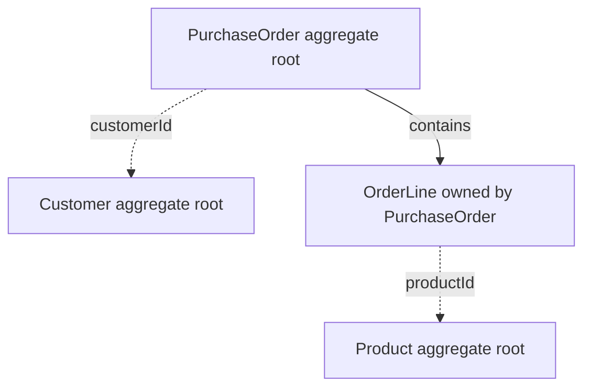

# Representing Relationships by Identifier Instead of Assuming Object Graph Management

In a relational model, two records are linked via primary keys and foreign keys. When designing a Spring Data R2DBC application, a clear representation is to store the **identifier of the referenced object** inside the current entity. For example, an order stores `customerId` to indicate the customer who owns the order. When customer information is needed, the application explicitly queries the customer using that identifier.

This approach aligns with Spring Data Relational's aggregate model. An aggregate root manages data within its own scope; references to another aggregate are represented by ID. Spring Data R2DBC does not operate like a full ORM that automatically loads and synchronizes an entire object graph via `@ManyToOne`, `@OneToMany`, or lazy loading. The application decides when to run additional queries, which join queries to use, and how read results are assembled into DTOs or read models.

## 1. Database Relationships and Java References

Suppose a sales system has two tables:

```sql
CREATE TABLE customer (
    id BIGINT GENERATED BY DEFAULT AS IDENTITY PRIMARY KEY,
    name VARCHAR(200) NOT NULL
);

CREATE TABLE purchase_order (
    id BIGINT GENERATED BY DEFAULT AS IDENTITY PRIMARY KEY,
    customer_id BIGINT NOT NULL,
    status VARCHAR(30) NOT NULL,
    created_at TIMESTAMP NOT NULL,
    CONSTRAINT fk_purchase_order_customer
        FOREIGN KEY (customer_id) REFERENCES customer(id)
);
```

The `purchase_order.customer_id` column is a foreign key referencing `customer.id`. At the database layer, the relationship is protected by a constraint. At the Java layer, the order entity can store the `customerId` value:

```java
@Table("customer")
public record Customer(
        @Id Long id,
        String name
) {}

@Table("purchase_order")
public record PurchaseOrder(
        @Id Long id,
        @Column("customer_id") Long customerId,
        String status,
        @Column("created_at") LocalDateTime createdAt
) {}
```

In this example, `PurchaseOrder` holds a `Long customerId` value. It does not hold a `Customer` object expected to load automatically from the database. When reading an order, Spring Data R2DBC maps the `customer_id` column to the identifier value.

The two classes relate to each other in two ways across two layers:

- The database ensures `customer_id` points to an existing customer via a foreign key.
- Java code uses `customerId` to request a customer query when business logic needs that information.

An identifier is a plain data value. It can be passed through services, stored in messages, used to invoke repositories, or placed in DTOs without holding a large object graph in memory.

## 2. Why You Should Not Assume ORM Object Graph Management

In an ORM such as Hibernate, developers often declare entity relationships with annotations like `@ManyToOne` and `@OneToMany` and may configure lazy loading, cascading, or dirty checking. The ORM manages a persistence context and can load additional objects when a relationship is accessed.

Spring Data R2DBC uses a simpler relational mapping model:

- No ORM-style persistence context tracking the entire entity graph.
- No automatic lazy loading when accessing a relationship property.
- No automatic change synchronization across all related objects like ORM dirty checking.
- No automatic cascading of save/delete operations across other aggregate roots.
- Fetching data from multiple tables must be expressed via queries or repository operations deliberately coordinated by the application.

This does not mean the application cannot return an object containing combined data. The application can still build an `OrderDetail` DTO containing both the order and the customer, but it must explicitly fetch the data and combine the results.

For example, the following declaration reflects an ORM-style expectation:

```java
// Do not treat this as a relationship automatically managed by Spring Data R2DBC.
class PurchaseOrder {
    private Long id;
    private Customer customer;
}
```

If `customer` is an independent aggregate root, the clearer model is:

```java
class PurchaseOrder {
    private Long id;
    private Long customerId;
}
```

When the customer's name needs to be displayed, a service or read query loads that information explicitly.

## 3. Aggregate Roots and Data Ownership Boundaries

An aggregate is a consistency boundary in the domain model. An aggregate root is the object the application uses to access and modify members of the aggregate. In Spring Data Relational, the aggregate root is the starting point for saving and loading an aggregate.

For example:

- `Customer` can be an independent aggregate root.
- `PurchaseOrder` can be an independent aggregate root.
- `OrderLine` can be a member belonging to the `PurchaseOrder` aggregate if its lifecycle and business rules depend on the order.
- `Product` is typically a separate aggregate root; an order line stores `productId` instead of owning the entire product.

Diagram:



Solid arrows indicate members belonging to the same aggregate in the example. Dashed arrows indicate identifier references to independent aggregates.

When modifying an aggregate, the application should respect the consistency rules of that specific aggregate. For example, adding a line item to an order is an operation on `PurchaseOrder`; changing customer details is an operation on `Customer`. Do not assume saving an order will automatically save or update the referenced customer.

Aggregate boundaries are a domain decision, not just an annotation placement decision. If two objects must always change together and require consistency in a single operation, evaluate whether they truly belong to the same aggregate. If they are two separate aggregates, define an appropriate coordination and transaction workflow.

## 4. Relationships Inside an Aggregate vs. Between Aggregates

Not every relationship needs to be converted into an ID. Distinguish members belonging to the same aggregate from references to independent aggregates.

### Members Belonging to the Same Aggregate

An order typically owns its order lines. An order line has no independent meaning outside the order and has a lifecycle tied to the order. Spring Data Relational can map collections belonging to an aggregate using `@MappedCollection`.

Illustrative example:

```java
@Table("purchase_order")
public class PurchaseOrder {

    @Id
    private Long id;

    private String status;

    @MappedCollection(idColumn = "order_id")
    private List<OrderLine> lines = new ArrayList<>();

    // constructors, getters and domain methods
}

public class OrderLine {

    @Column("product_id")
    private Long productId;

    private int quantity;

    private BigDecimal unitPrice;

    // constructors and accessors
}
```

Here, `OrderLine` is data belonging to the `PurchaseOrder` aggregate. The `order_id` column in the order line table links lines to the aggregate root. Actual table names and column configurations must match the schema; `keyColumn` can also be configured when storing collection keys such as a Map or ordered index.

### References to Other Aggregates

Customers and products have their own lifecycles. An order only needs to know which customer placed it, and an order line only needs to know which product was purchased:

```java
@Table("purchase_order")
public record PurchaseOrder(
        @Id Long id,
        @Column("customer_id") Long customerId,
        String status
) {}

public record OrderLine(
        @Column("product_id") Long productId,
        int quantity,
        BigDecimal unitPrice
) {}
```

There is no need to embed the entire `Customer` or `Product` into the aggregate merely to express a relationship. When descriptive data is needed, the application reads the related aggregate by ID.

## 5. Loading Referenced Objects via Repositories

Suppose repositories are declared as follows:

```java
public interface PurchaseOrderRepository
        extends ReactiveCrudRepository<PurchaseOrder, Long> {
}

public interface CustomerRepository
        extends ReactiveCrudRepository<Customer, Long> {
}
```

A service can load the order first, then use `customerId` to load the customer:

```java
public record OrderDetail(
        Long orderId,
        String status,
        Long customerId,
        String customerName
) {}

@Service
public class OrderQueryService {

    private final PurchaseOrderRepository orderRepository;
    private final CustomerRepository customerRepository;

    public OrderQueryService(
            PurchaseOrderRepository orderRepository,
            CustomerRepository customerRepository) {
        this.orderRepository = orderRepository;
        this.customerRepository = customerRepository;
    }

    public Mono<OrderDetail> findOrderDetail(Long orderId) {
        return orderRepository.findById(orderId)
                .switchIfEmpty(Mono.error(
                        new OrderNotFoundException(orderId)
                ))
                .flatMap(order ->
                        customerRepository.findById(order.customerId())
                                .switchIfEmpty(Mono.error(
                                        new CustomerNotFoundException(
                                                order.customerId()
                                        )
                                ))
                                .map(customer -> new OrderDetail(
                                        order.id(),
                                        order.status(),
                                        customer.id(),
                                        customer.name()
                                ))
                );
    }
}
```

The flow performs two sequential queries:

1. Find the order by primary key.
2. Read `customerId` from the order and find the customer.
3. Combine the two results into `OrderDetail`.

Each repository returns a publisher. `flatMap` chains the customer query onto the stream after the order arrives; there is no need to call `block()` to extract the ID before querying.

This example also distinguishes two not-found cases: the order does not exist, and the referenced customer does not exist. With a schema containing foreign keys and valid data, the second case should not happen, yet it still needs handling because legacy data, missing constraints, or integration bugs can produce unexpected states.

## 6. Using JOIN Queries for Read Models

If a screen frequently needs order details and customer names together, two sequential queries may not be the most efficient option. You can write a SQL JOIN and map it directly to a DTO:

```java
public Mono<OrderDetail> findOrderDetail(Long orderId) {
    return databaseClient.sql("""
            SELECT o.id AS order_id,
                   o.status AS order_status,
                   c.id AS customer_id,
                   c.name AS customer_name
            FROM purchase_order o
            JOIN customer c ON c.id = o.customer_id
            WHERE o.id = :orderId
            """)
            .bind("orderId", orderId)
            .map((row, metadata) -> new OrderDetail(
                    row.get("order_id", Long.class),
                    row.get("order_status", String.class),
                    row.get("customer_id", Long.class),
                    row.get("customer_name", String.class)
            ))
            .one();
}
```

The JOIN query uses one query and one database round trip for this case. `DatabaseClient` returns a DTO without requiring an entity graph with auto-loading relationships.

Choose `JOIN` when the data needed for display can be fetched efficiently in a single query. Choose multiple repository calls when you need separate business logic, step-by-step aggregate loading, or want to reuse domain operations. The decision depends on the read goal, row counts, and how the database executes the SQL.

If using `LEFT JOIN`, watch out for columns from the joined side being `null`. Java types and mapping logic must allow for that case. With `INNER JOIN`, order rows without a valid customer will not appear in the results.

## 7. Avoiding N+1 When Loading Multiple Objects

A common performance mistake is loading a list of orders and then querying the customer separately for each order:

```java
public Flux<OrderDetail> findRecentOrderDetails() {
    return orderRepository.findAll()
            .flatMap(order ->
                    customerRepository.findById(order.customerId())
                            .map(customer -> new OrderDetail(
                                    order.id(),
                                    order.status(),
                                    customer.id(),
                                    customer.name()
                            ))
            );
}
```

If there are 100 orders, this code can generate one query for orders and around 100 additional queries for customers. This is the N+1 query problem. `flatMap` lets the sub-queries run asynchronously and potentially concurrently, but it does not eliminate the query count.

Common alternatives:

- Use a single SQL JOIN to fetch the data needed for the list.
- Collect the list of IDs and query in batch using an appropriate method, such as `findAllById(ids)`.
- Use a dedicated query returning a projection or DTO rather than loading every full aggregate.
- Paginate the data to limit the number of records to combine.

Example repository with a dedicated query:

```java
public interface PurchaseOrderRepository
        extends ReactiveCrudRepository<PurchaseOrder, Long> {

    @Query("""
            SELECT o.id AS order_id,
                   o.status AS order_status,
                   c.id AS customer_id,
                   c.name AS customer_name
            FROM purchase_order o
            JOIN customer c ON c.id = o.customer_id
            WHERE o.status = :status
            ORDER BY o.created_at DESC
            """)
    Flux<OrderDetail> findDetailsByStatus(String status);
}
```

Projection mapping capability depends on the projection type and the Spring Data Relational version in use. If mapping a DTO directly does not fit the project's repository setup, the same SQL can be implemented with `DatabaseClient` and explicit row mapping as shown earlier.

When batch querying, stay mindful of the ID list size. Collecting tens of thousands of orders into one collection and binding every ID can create huge queries and high memory usage. Paginate or process in bounded batches.

## 8. Writing Data with ID References

When creating an order, the service must verify that the customer exists and write `customerId` into the order. Saving the order does not automatically save the referenced customer.

Example:

```java
public Mono<PurchaseOrder> createOrder(Long customerId, String status) {
    return customerRepository.findById(customerId)
            .switchIfEmpty(Mono.error(
                    new CustomerNotFoundException(customerId)
            ))
            .then(Mono.defer(() ->
                    orderRepository.save(new PurchaseOrder(
                            null,
                            customerId,
                            status
                    ))
            ));
}
```

`then(Mono.defer(...))` executes the order save only after the customer-check publisher completes successfully. If the customer is missing, the publisher errors and saving the order is never executed.

Database foreign keys remain crucial. Checking beforehand via a repository produces clear business errors, yet a race condition can still occur: the customer could be deleted after the check and before the order insert. The foreign key constraint protects integrity at the actual moment of writing.

If the business logic requires checking and writing inside one transaction, a reactive transaction can be used:

```java
@Transactional
public Mono<PurchaseOrder> createOrder(Long customerId, String status) {
    return customerRepository.findById(customerId)
            .switchIfEmpty(Mono.error(
                    new CustomerNotFoundException(customerId)
            ))
            .then(Mono.defer(() ->
                    orderRepository.save(new PurchaseOrder(
                            null,
                            customerId,
                            status
                    ))
            ));
}
```

For reactive methods returning `Mono` or `Flux`, Spring can apply reactive transactions through an appropriate transaction manager. Transactions do not replace foreign keys; they coordinate multiple database operations into a commit/rollback unit according to configuration and database isolation level.

## 9. Handling Missing Referenced Aggregates

When an entity stores the ID of another aggregate, the application must define behavior if that ID becomes invalid.

For example:

- When displaying an order, return an inconsistent-data error if the customer is missing.
- When deleting a customer, the database may reject the operation because a foreign key still references it.
- Business rules may forbid deleting customers with existing orders, or allow storing a deactivated status.
- In some systems, order history keeps a snapshot of name and address at purchase time so historical data does not change when the customer profile is updated.

Do not choose `ON DELETE CASCADE` mechanically. Deleting a customer may not be allowed to wipe out historical orders. Deletion rules must reflect business requirements and be enforced consistently between the database and services.

If a reference is optional, the foreign key column can be nullable and the entity uses a corresponding nullable type:

```java
@Table("purchase_order")
public record PurchaseOrder(
        @Id Long id,
        @Column("customer_id") Long customerId,
        String status
) {}
```

In the example above, `customerId` can be `null` if the schema allows it. When reading details, the service must distinguish an order with no attached customer from an order that has an ID whose customer cannot be found.

## 10. Identifiers and Historical Data Snapshots

Storing only an ID is not always sufficient for business requirements. For example, an order may need to preserve the recipient name and shipping address at the time of ordering. If it only references the customer profile, updating the customer's address could cause the history screen to show the new address instead of the one used when purchasing.

A common pattern combines both:

- `customerId` to identify which customer placed the order.
- Snapshot fields such as `shipping_name` and `shipping_address` to preserve delivery details at order creation time.

```sql
CREATE TABLE purchase_order (
    id BIGINT GENERATED BY DEFAULT AS IDENTITY PRIMARY KEY,
    customer_id BIGINT NOT NULL REFERENCES customer(id),
    shipping_name VARCHAR(200) NOT NULL,
    shipping_address VARCHAR(500) NOT NULL,
    status VARCHAR(30) NOT NULL
);
```

A snapshot is not a copy of the entire aggregate. Store only the values that must remain immutable in a historical context. Clearly define which fields always reflect the current profile and which must record a past event.

## 11. Transactions and Consistency Boundaries

Referencing by ID does not mean transactions across multiple operations are never needed. If a use case must create an order and write another record in the same database, a reactive transaction can ensure both operations commit or roll back together.

Conceptual example:

```java
@Transactional
public Mono<PurchaseOrder> createOrderAndAudit(
        Long customerId,
        String status) {

    return customerRepository.findById(customerId)
            .switchIfEmpty(Mono.error(
                    new CustomerNotFoundException(customerId)
            ))
            .then(orderRepository.save(
                    new PurchaseOrder(null, customerId, status)
            ))
            .flatMap(order ->
                    auditRepository.save(
                            new OrderAudit(null, order.id(), "CREATED")
                    ).thenReturn(order)
            );
}
```

The example assumes `OrderAudit` and `PurchaseOrder` are managed within the same database and an appropriate reactive transaction manager. If aggregates live in independent services or databases, a local transaction cannot guarantee cross-system atomicity; consider events, an outbox, or a saga workflow depending on requirements.

Avoid holding a transaction open while calling an external HTTP service whenever possible. Doing so holds connections and transactions longer, increasing the risk of pool exhaustion and database locks.

## 12. Designing DTOs and APIs Around Read Needs

Persistence entities and API responses do not have to share the exact same structure. An order entity may store only `customerId`, while the API returns the queried customer info:

```json
{
  "id": 501,
  "status": "CONFIRMED",
  "customer": {
    "id": 42,
    "name": "Nguyen An"
  }
}
```

This DTO is constructed by a service or query handler. It does not prove that the order entity has an automatically loaded object relationship.

For different screens, different read models can be created:

- An order list only needs `orderId`, `status`, and `customerName`.
- A detail screen needs the address, order lines, and total amount as well.
- Reports need grouping by customer or status.

A dedicated JOIN query or projection can serve each read model more efficiently than loading an entire entity graph and discarding unused data.

## 13. Testing the ID-Reference Model

Tests should verify both the persisted data and how the service resolves references:

1. Create a customer and save it to obtain an ID.
2. Create an order with that `customerId`.
3. Read the order back and assert the `customerId` value.
4. Call the detail service and assert the DTO contains the customer information.
5. Test the case where the customer does not exist.
6. Verify that the foreign key rejects an invalid ID if the schema has the constraint.

Example testing a publisher with Reactor Test:

```java
StepVerifier.create(orderQueryService.findOrderDetail(orderId))
        .assertNext(detail -> {
            assertEquals(orderId, detail.orderId());
            assertEquals(customerId, detail.customerId());
            assertEquals("An", detail.customerName());
        })
        .verifyComplete();
```

Because these test database interactions, keep test data isolated and clean up after each test or use appropriate test transactions. For JOIN queries, also test empty results, missing relationships, and nullable columns where applicable.

## 14. Common Mistakes

1. **Treating the `customerId` field as an automatic relationship.** It is only an identifier; to get `Customer`, you must query or JOIN.
2. **Using ORM annotations as if R2DBC had lazy loading.** Do not assume `@ManyToOne` or `@OneToMany` will automatically load related objects in Spring Data R2DBC.
3. **Saving one aggregate and expecting another aggregate to be saved automatically.** Each aggregate root has its own persistence lifecycle; save every part that changes explicitly.
4. **Skipping foreign keys because Java checks the ID.** Service-level checks do not replace database constraints.
5. **Using `flatMap` per row without noticing N+1.** Reactive concurrency does not reduce the number of queries.
6. **JOINing every table in every query.** Fetch only the data needed for the use case; write queries and read queries can have different goals.
7. **Confusing aggregate members with independent aggregates.** Order lines may belong to an order, whereas customers and products usually have independent lifecycles.
8. **Failing to define deletion rules.** Database cascades might delete history the business needs to preserve.
9. **Storing only IDs when historical snapshots are needed.** Certain data such as the shipping address at order time must be stored separately.
10. **Calling `block()` to get an ID before querying next.** Use `flatMap`, `zip`, or appropriate reactive operators to keep the pipeline non-blocking.

## Design Rules

- Use primary/foreign keys in the database to represent and protect data relationships.
- Inside entities, store the ID of referenced independent aggregates.
- Use `@MappedCollection` for collections belonging to the same aggregate when the domain model warrants it.
- Load related aggregates via repositories or JOIN queries when the use case needs them.
- Create DTOs/read models tailored to API needs rather than forcing persistence entities to carry full object graphs.
- Avoid N+1 using JOINs, projections, or bounded batch queries.
- Keep reactive transactions short and clearly define consistency boundaries.
- Store snapshots for data that must remain preserved as of the business event time.

Representing relationships by identifier helps a Spring Data R2DBC model clearly reflect relational structure and aggregate boundaries. The database takes responsibility for guaranteeing links with foreign keys; the application deliberately decides when to load referenced objects and how to assemble data for each use case. This approach makes query counts, data lifecycles, and consistency behavior transparent rather than relying on assumptions that an object graph is automatically managed like in an ORM.
