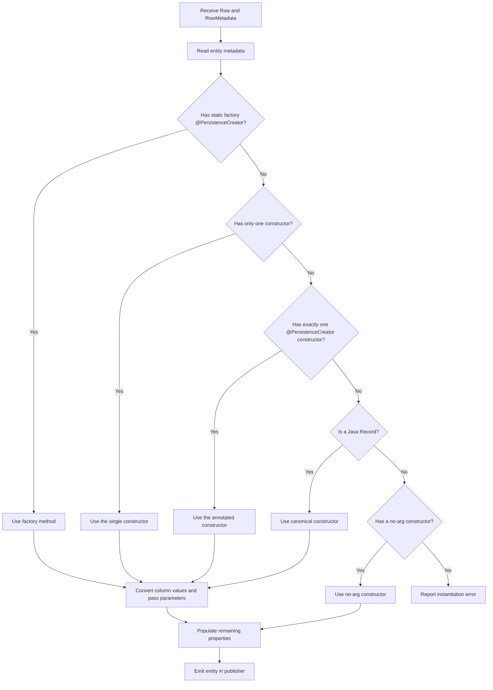

# Constructor Selection Rules and Entity Instantiation from Results

Spring Data R2DBC converts data received from the database into Java objects through Spring Data Relational's mapping mechanism. When a query returns a row of data, the framework must determine the class to instantiate, select the appropriate constructor or factory method, convert each column's value, and assign them to the entity's properties.

Constructor selection rules directly affect how an entity is instantiated. If a class has multiple constructors, parameters do not match property names, or there are immutable fields, the application may encounter mapping errors even when the SQL statement executes successfully.

This lesson explains how Spring Data selects constructors, how parameter names are linked to properties, how a `Row` is converted into an entity, and key considerations for immutable entities, Java records, and database-generated primary keys.

## 1. How Is an Entity Instantiated?

In Spring Data R2DBC, a repository query typically returns `Mono<T>` or `Flux<T>`. When the driver receives results, Spring Data uses its mapping infrastructure to convert each row in the result into an object of type `T`.

General flow:

1. Repository or `DatabaseClient` executes the SQL statement.
2. The R2DBC driver returns a `Result`, containing `Row` instances and column metadata.
3. Spring Data reads the entity's metadata to determine the table, properties, data types, and mapping rules.
4. The framework extracts column values and converts them to the corresponding Java types.
5. The framework selects a constructor or factory method to create the entity.
6. Properties not initialized via the constructor are assigned through an appropriate property population mechanism.
7. The constructed entity is emitted in the reactive publisher.

For example, with the `customers` table:

```sql
CREATE TABLE customers (
    id BIGINT PRIMARY KEY,
    first_name VARCHAR(100),
    email VARCHAR(180)
);
```

Corresponding entity:

```java
@Table("customers")
public class Customer {

    @Id
    private Long id;

    @Column("first_name")
    private String firstName;

    private String email;

    // Constructor and accessors omitted.
}
```

When a query returns a row, Spring Data needs to know how to instantiate `Customer`, then assign `id`, `firstName`, and `email` from that row's data.

## 2. Constructor and Factory Method Selection Rules

Spring Data uses a deterministic algorithm to select how an entity is created. Common rules are evaluated in the following order:

1. If the class has a static factory method annotated with `@PersistenceCreator`, the framework uses that factory method.
2. If the class has only one constructor, that constructor is used.
3. If the class has multiple constructors and exactly one constructor is annotated with `@PersistenceCreator`, that constructor is used.
4. For a Java record, the canonical constructor is used.
5. If none of the above apply and the class has a no-argument constructor, the no-argument constructor is used; remaining constructors are ignored.
6. If no suitable creation mechanism exists, entity instantiation fails.

`@PersistenceCreator` belongs to the `org.springframework.data.annotation` package. This annotation tells Spring Data which constructor or factory method is intended for data materialization.

### 2.1. Class with a Single Constructor

If a class declares only one constructor, Spring Data uses that constructor, even if it has parameters.

```java
@Table("customers")
public class Customer {

    @Id
    private final Long id;
    private final String name;
    private final String email;

    public Customer(Long id, String name, String email) {
        this.id = id;
        this.name = name;
        this.email = email;
    }

    public Long getId() {
        return id;
    }

    public String getName() {
        return name;
    }

    public String getEmail() {
        return email;
    }
}
```

This is an immutable entity: fields are `final`, there are no setters, and they are initialized directly in the constructor. Spring Data extracts values from the data row and passes them into the constructor.

### 2.2. Class with Multiple Constructors

When a class has multiple constructors, explicitly mark the constructor used for reading data with `@PersistenceCreator`.

```java
import org.springframework.data.annotation.Id;
import org.springframework.data.annotation.PersistenceCreator;
import org.springframework.data.relational.core.mapping.Table;

@Table("customers")
public class Customer {

    @Id
    private final Long id;
    private final String name;
    private final String email;

    public Customer(String name, String email) {
        this(null, name, email);
    }

    @PersistenceCreator
    public Customer(Long id, String name, String email) {
        this.id = id;
        this.name = name;
        this.email = email;
    }

    public Long getId() {
        return id;
    }

    public String getName() {
        return name;
    }

    public String getEmail() {
        return email;
    }
}
```

The two-argument constructor is convenient for business code creating a new customer. The three-argument constructor receiving `id` as well is selected by Spring Data to reconstruct the entity from the database.

If there are multiple constructors without annotating the appropriate one, Spring Data may fall back to a no-argument constructor if the class provides one. That could cause the framework to instantiate an empty object and assign properties via fields or setters instead of calling the full constructor the developer intended.

### 2.3. Static Factory Method

You can use a static factory method annotated with `@PersistenceCreator` when you want to control object creation or hide constructors.

```java
@Table("customers")
public class Customer {

    @Id
    private final Long id;
    private final String name;

    private Customer(Long id, String name) {
        this.id = id;
        this.name = name;
    }

    @PersistenceCreator
    public static Customer fromDatabase(Long id, String name) {
        return new Customer(id, name);
    }

    public static Customer newCustomer(String name) {
        return new Customer(null, name);
    }

    public Long getId() {
        return id;
    }

    public String getName() {
        return name;
    }
}
```

The factory method must be static and return the corresponding entity type. Parameters of the factory method are mapped by property name just like constructor parameters.

### 2.4. No-Argument Constructor

If there is no single constructor, annotated constructor, or suitable factory method, Spring Data can use a no-argument constructor. After creating the object, the framework populates the remaining properties.

```java
@Table("customers")
public class Customer {

    @Id
    private Long id;
    private String name;

    public Customer() {
    }

    public Customer(String name) {
        this.name = name;
    }

    public Long getId() {
        return id;
    }

    public String getName() {
        return name;
    }

    public void setId(Long id) {
        this.id = id;
    }

    public void setName(String name) {
        this.name = name;
    }
}
```

With the class above, if `@PersistenceCreator` is absent, the no-argument constructor is used and properties are assigned afterward. If you want the one-argument constructor to be used to instantiate entities from data, annotate that constructor.

### 2.5. Java Record

A Java record is an immutable data type with an automatically generated canonical constructor. Spring Data uses the canonical constructor to instantiate records.

```java
import org.springframework.data.annotation.Id;
import org.springframework.data.relational.core.mapping.Table;

@Table("customers")
public record Customer(
        @Id Long id,
        String name,
        String email
) {
}
```

Record component names also serve as canonical constructor parameter names and carry clear metadata. As a result, records are generally well suited for simple immutable entities or projections.

Records have no setters. When the database generates a primary key or a value needs updating after creating a record, use the object returned from the save operation rather than assuming the original record will be mutated in place.

### 2.6. Kotlin Data Class

With Kotlin, Spring Data prefers the primary constructor of a data class. Parameters in the primary constructor are mapped by property name.

```kotlin
@Table("customers")
data class Customer(
    @Id val id: Long? = null,
    val name: String,
    val email: String
)
```

Kotlin supports default parameters and nullability in the language. Full use of Kotlin metadata depends on whether the project has Kotlin reflection and the required dependencies. When there are multiple constructors or secondary constructors for business purposes, verify the primary constructor selection rules and use the appropriate annotation if you need to specify how the entity is constructed.

## 3. `@PersistenceCreator` and How to Use It

`@PersistenceCreator` is the annotation for marking the constructor or static factory method that Spring Data should use when materializing an object.

Import:

```java
import org.springframework.data.annotation.PersistenceCreator;
```

Guidelines:

- Use when a class has multiple constructors and you want to designate the constructor for mapping.
- Can be placed on a static factory method if you prefer object creation through a factory.
- Do not annotate multiple constructors/factory methods as though all are valid choices; the framework needs one unambiguous choice.
- The annotation does not automatically fix parameter names. Parameter names must still match the properties Spring Data needs to initialize.
- If a class has only one constructor, the annotation is usually unnecessary.

Do not confuse `@PersistenceCreator` with `@Id`, `@Table`, or `@Column`. These annotations serve different roles:

| Annotation | Role |
| --- | --- |
| `@PersistenceCreator` | Specifies the constructor or factory method used to instantiate the object |
| `@Table` | Maps the entity to a database table |
| `@Column` | Maps a property to a database column |
| `@Id` | Marks the primary key property |
| `@Version` | Marks the version property for optimistic locking |

## 4. Mapping Constructor Parameters to Properties

After selecting a constructor, Spring Data must bind each parameter to the corresponding entity property. Parameter names are crucial.

Example:

```java
public Customer(Long id, String firstName, String email) {
    this.id = id;
    this.firstName = firstName;
    this.email = email;
}
```

Spring Data needs to identify `id`, `firstName`, and `email` as the corresponding properties. In Java, enable the `-parameters` compiler option to retain parameter names in bytecode.

With Gradle:

```groovy
tasks.withType(JavaCompile).configureEach {
    options.compilerArgs.add("-parameters")
}
```

With the Maven Compiler Plugin:

```xml
<plugin>
    <groupId>org.apache.maven.plugins</groupId>
    <artifactId>maven-compiler-plugin</artifactId>
    <configuration>
        <parameters>true</parameters>
    </configuration>
</plugin>
```

Another option in some cases is JavaBeans' `@ConstructorProperties` annotation to explicitly declare property names in parameter order. However, for new projects, enabling `-parameters` is simpler to configure and maintain.

### 4.1. Parameter Names Must Match Property Names, Not Necessarily SQL Column Names

Spring Data distinguishes entity property names from physical column names. Example:

```java
@Table("customers")
public class Customer {

    @Id
    private final Long id;

    @Column("first_name")
    private final String firstName;

    private final String email;

    public Customer(Long id, String firstName, String email) {
        this.id = id;
        this.firstName = firstName;
        this.email = email;
    }
}
```

The constructor uses the name `firstName`, which is the Java property name. The `@Column("first_name")` annotation specifies the physical column in the database. You do not need to rename the parameter to `first_name`.

If `@Column` is omitted, Spring Data Relational applies the default naming strategy to map Java property names to column names. For camelCase names, the default convention usually converts to snake_case—for instance, `firstName` to `first_name`. You can configure a different naming strategy application-wide.

### 4.2. Parameter Types and Data Conversion

In addition to names, column values must be convertible to parameter types. For instance, a `BIGINT` column typically maps to `Long`, `VARCHAR` to `String`, and temporal columns to compatible temporal types.

If the database returns an incompatible type, a custom converter may be required. Spring Data R2DBC supports `R2dbcCustomConversions` along with reading and writing converters to transform specialized data types.

Do not use primitive types like `long` or `int` for properties that can receive SQL `NULL`, because Java primitives cannot represent null. Use wrapper types such as `Long`, `Integer`, or another suitable type to avoid errors when materializing nullable data.

## 5. How Spring Data Populates Properties After the Constructor

Not every property has to be a constructor parameter. After creating the instance, Spring Data can assign remaining properties via property population.

For properties not initialized in the constructor, the framework selects a write mechanism based on entity metadata and accessibility. Common mechanisms include:

- Calling a setter if the property has an appropriate setter.
- Assigning directly to the field if mapping metadata uses field access.
- Calling a wither if an immutable entity provides a method returning a copy with a new property value.
- Creating a new instance via the constructor when updating an immutable property that lacks a wither.

### 5.1. Mutable Entity Using Setters

```java
@Table("customers")
public class Customer {

    @Id
    private Long id;
    private String name;

    public Customer() {
    }

    public Long getId() {
        return id;
    }

    public String getName() {
        return name;
    }

    public void setId(Long id) {
        this.id = id;
    }

    public void setName(String name) {
        this.name = name;
    }
}
```

Spring Data can invoke the no-argument constructor, then populate `id` and `name` via setters or field access per mapping metadata.

### 5.2. Immutable Entity Using Withers

An immutable entity can provide a wither to create a new instance when a property needs updating:

```java
@Table("customers")
public class Customer {

    @Id
    private final Long id;
    private final String name;

    @PersistenceCreator
    public Customer(Long id, String name) {
        this.id = id;
        this.name = name;
    }

    public Customer withId(Long newId) {
        return new Customer(newId, this.name);
    }

    public Long getId() {
        return id;
    }

    public String getName() {
        return name;
    }
}
```

`withId` does not mutate the current object. It returns a new object with the updated ID. This fits the immutable model and can be used by Spring Data when setting a value generated after insert.

### 5.3. Constructor-Only and Immutable Properties

If an immutable property is neither passed via the constructor nor has a wither, the framework cannot update that property in the normal way. Therefore, include required properties in the persistence constructor or provide an appropriate copying mechanism.

For entities with many immutable attributes, a full constructor usually makes mapping clearer and reduces mistakes from forgotten field assignments.

## 6. From R2DBC `Row` to Entity

At the R2DBC SPI layer, query results consist of `Row` and `RowMetadata`. Spring Data R2DBC uses `MappingR2dbcConverter` along with mapping metadata to turn each row into an entity.

### 6.1. Repository Automatically Materializes Entities

Repository example:

```java
public interface CustomerRepository
        extends ReactiveCrudRepository<Customer, Long> {

    Flux<Customer> findByEmailEndingWith(String suffix);
}
```

Spring Data generates the implementation and maps result columns to `Customer`. Application code simply receives `Flux<Customer>` without reading individual `Row` instances manually.

### 6.2. Mapping with `DatabaseClient`

When using `DatabaseClient`, you can map directly to an entity type:

```java
public Flux<Customer> findAll(DatabaseClient client) {
    return client.sql("SELECT id, first_name, email FROM customers")
            .map((row, metadata) -> {
                Long id = row.get("id", Long.class);
                String firstName = row.get("first_name", String.class);
                String email = row.get("email", String.class);
                return new Customer(id, firstName, email);
            })
            .all();
}
```

The code above illustrates manual mapping. As the number of columns or conversion rules grows, you can use `MappingR2dbcConverter` or a repository to reuse mapping metadata instead of reading each column manually.

`Row` is data tied to the driver's result reading pass. Read values inside the mapping callback and return the converted object; do not retain `Row` for use after the callback finishes.

### 6.3. Selecting All Columns Required by the Constructor

If the persistence constructor requires `id`, `firstName`, and `email`, the SQL query should return all corresponding columns:

```sql
SELECT id, first_name, email
FROM customers
WHERE id = :id;
```

If the query selects only a subset of columns, constructor parameters corresponding to missing columns may not receive the expected values. Especially with primitives or non-nullable properties, missing data can cause errors or invalid values.

If you only need to read a small set of columns, create a projection/DTO with a constructor matching that subset of columns, or use explicit manual mapping.

### 6.4. SQL NULL vs. Column Absent from Result

SQL `NULL` is a value present in the data row representing the absence of a specific value. It is different from the SQL query not returning that column at all.

When a nullable column is mapped to a Java type, use a type capable of representing null such as `Long`, `Integer`, `String`, or an appropriate reference type. With primitives, ensure the database always returns a non-null value or convert explicitly before instantiation.

If business logic needs to distinguish a null value from an unselected column, design explicit projections and SQL queries rather than relying on implicit constructor behavior.

## 7. Auto-Generated Primary Keys and Immutable Entities

With tables using identity/auto-increment, new entities are commonly constructed with an `id` of `null`. On insert, the database generates the ID and Spring Data retrieves the returned value to update the entity.

Example:

```java
@Table("customers")
public record Customer(
        @Id Long id,
        String name,
        String email
) {
}
```

Creating a new record:

```java
Customer draft = new Customer(null, "Lan", "lan@example.com");

Mono<Customer> saved = repository.save(draft);
```

The value emitted by `save()` is the saved entity, which can contain the database-generated ID. Because the entity is immutable, do not assume `draft` is mutated in place.

Use the returned object:

```java
return repository.save(draft)
        .doOnNext(savedCustomer ->
                log.info("Created customer with id {}", savedCustomer.id()));
```

For immutable entity classes that are not records, you can provide a wither for the ID property or an appropriate copy/constructor mechanism. For mutable entities, the ID can be written via setter or field access.

Do not assign an ID before insert if the database is configured to auto-generate primary keys, unless the project's business requirements and ID strategy call for application-assigned IDs.

## 8. Mapping Version and Database-Managed Values

In addition to IDs, certain properties can be updated by the framework or database during saving, such as a version used for optimistic locking.

```java
@Table("customers")
public class Customer {

    @Id
    private final Long id;

    @Version
    private final Long version;

    private final String name;

    @PersistenceCreator
    public Customer(Long id, Long version, String name) {
        this.id = id;
        this.version = version;
        this.name = name;
    }

    public Customer withId(Long id) {
        return new Customer(id, version, name);
    }

    public Customer withVersion(Long version) {
        return new Customer(id, version, name);
    }

    public Long getId() {
        return id;
    }

    public Long getVersion() {
        return version;
    }

    public String getName() {
        return name;
    }
}
```

This example illustrates designing an immutable entity with withers. The version type and initial value must align with Spring Data Relational configuration and the actual schema. When saving, use the returned entity to keep the latest ID/version.

## 9. Custom Conversions When Database Types Do Not Match Directly

Not every database type maps directly to the desired domain type. For example, an application might store an enum status as a string, a value object in a single column, or a database-specific type.

Spring Data R2DBC supports custom conversions. You can define a reading converter from the database value to the Java type and a writing converter from the Java type to the database value.

Example converter reading an enum from a string:

```java
@ReadingConverter
public class StringToCustomerStatusConverter
        implements Converter<String, CustomerStatus> {

    @Override
    public CustomerStatus convert(String source) {
        return CustomerStatus.valueOf(source);
    }
}
```

Writing converter in the reverse direction:

```java
@WritingConverter
public class CustomerStatusToStringConverter
        implements Converter<CustomerStatus, String> {

    @Override
    public String convert(CustomerStatus source) {
        return source.name();
    }
}
```

Register converters in `R2dbcCustomConversions` using the configuration approach suited to your project's Spring Data version. Reading/writing converters allow constructors to receive proper domain types without manually converting individual columns in every repository.

## 10. Common Errors in Constructor Selection

| Symptom | Possible Cause | Resolution |
| --- | --- | --- |
| Unable to instantiate entity | Multiple constructors exist without an unambiguous choice | Annotate the persistence constructor with `@PersistenceCreator` or provide a no-arg constructor as intended |
| Constructor receives unexpected null values | Parameter names were not retained or do not match properties | Enable `-parameters` and check parameter names and metadata |
| Mapping error with primitives | SQL column can be null while the constructor uses a primitive | Use a wrapper type or ensure the column is non-null |
| Entity has null fields after reading | Property was not passed to the constructor and lacks an assignment mechanism | Add the property to the constructor or add setter/field mapping/wither |
| Record lacks new ID after insert | Code continues using the input record instead of the `save()` result | Use the entity emitted by `save()` |
| Column not found | Physical column name and mapping rules do not match | Check `@Column`, naming strategy, and SELECT clause |
| Value has wrong type | Database type cannot be converted to the parameter type | Use a compatible type or custom converter |
| Constructor is valid but query fails to map | SQL returns only a subset of columns needed for the entity | Select all required columns or use a separate projection/DTO |

### 10.1. Lombok and Generated Constructors

Lombok can generate constructors via `@NoArgsConstructor`, `@RequiredArgsConstructor`, or `@AllArgsConstructor`. When combining multiple annotations, a class may end up with multiple constructors that the developer does not directly see in source code.

Example:

```java
@NoArgsConstructor
@AllArgsConstructor
@Getter
@Setter
public class Customer {
    private Long id;
    private String name;
}
```

Here there are both a no-argument constructor and an all-arguments constructor. If you want Spring Data to use the all-arguments constructor, specify which generated constructor should be annotated or write the constructor explicitly and annotate it with `@PersistenceCreator` where appropriate.

Do not mechanically add `@AllArgsConstructor` to every entity. Decide which constructor is for business creation and which constructor is for materialization from the database.

## 11. Testing Constructor Mapping

Write integration tests to verify that entities are instantiated properly from database data, especially when classes have multiple constructors, immutable properties, or custom converters.

### 11.1. Testing Repositories with StepVerifier

Example:

```java
@DataR2dbcTest
class CustomerRepositoryTest {

    @Autowired
    CustomerRepository repository;

    @Test
    void shouldMaterializeCustomerUsingPersistenceCreator() {
        Customer customer = new Customer(null, "Lan", "lan@example.com");

        StepVerifier.create(repository.save(customer)
                        .flatMap(saved -> repository.findById(saved.getId())))
                .assertNext(found -> {
                    assertThat(found.getName()).isEqualTo("Lan");
                    assertThat(found.getEmail()).isEqualTo("lan@example.com");
                })
                .verifyComplete();
    }
}
```

Tests require an appropriate R2DBC database, schema, and data. `StepVerifier` asserts that the publisher emits the expected entity and completes, without calling `.block()` in application code.

### 11.2. Scenarios to Test

- Entity with a single parameterized constructor.
- Entity with multiple constructors and one marked `@PersistenceCreator`.
- Entity with a no-argument constructor and setters.
- Java record with canonical constructor.
- Nullable properties and required properties.
- camelCase property names mapped to snake_case column names.
- Custom converters for enums or value objects.
- ID and version updated after a save operation.
- Query projections selecting only a subset of columns.

These tests help catch mapping errors when changing constructors, adding Lombok annotations, or updating schemas.

## 12. Entity Design Recommendations

When designing entities for Spring Data R2DBC, you can apply these principles:

1. Prefer a single clear constructor if the class is simple.
2. Use `@PersistenceCreator` when there are multiple constructors or factory methods.
3. Enable `-parameters` for Java so Spring Data can read parameter names.
4. Keep parameter names aligned with Java property names; use `@Column` to map physical column names.
5. For immutable entities, pass required properties through the constructor and provide withers if database-generated values need updating.
6. Use wrapper types for properties that may receive SQL `NULL`.
7. Always use the entity returned by `save()` when ID or version may change.
8. Use separate projections/DTOs when a query returns only a subset of data.
9. Write integration tests for important mapping rules.

## 13. Constructor Selection and Entity Materialization Flow



The diagram depicts the main cases of the object creation rules. When applying them in a project, consult the Spring Data documentation for your exact version, as certain language support or mapping details can differ by version.

## 14. Conclusion

Spring Data R2DBC uses Spring Data Relational's mapping infrastructure to turn each result row into an entity. The framework selects a constructor or factory method according to precedence rules; when multiple constructors exist, `@PersistenceCreator` makes object creation explicit. Parameter names must map to properties, data types must be convertible, and properties outside the constructor need an appropriate population mechanism.

For immutable entities, records, or entities whose ID/version is updated by the database, design matching constructors and withers and always use the object returned from `save()`. When queries fetch only a subset of columns, use a dedicated projection/DTO or intentional manual mapping. Integration testing against an actual database ensures instantiation rules remain sound as schemas and models evolve.
