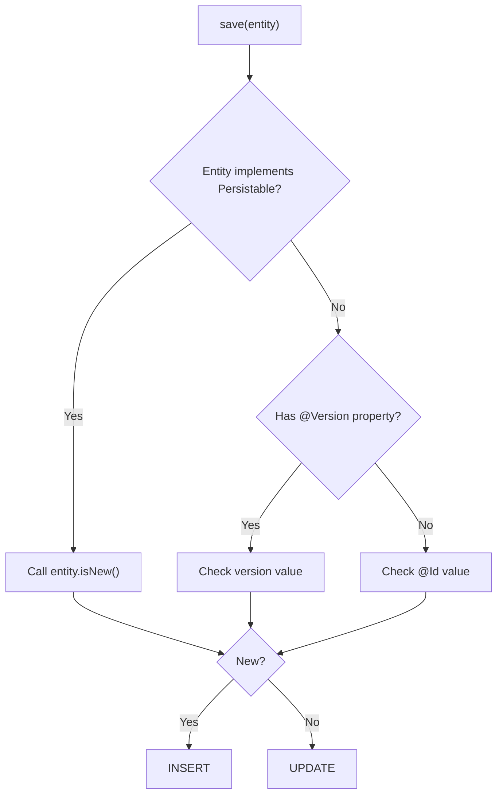

# Default Mechanism for Detecting New Entities

When calling `save(entity)` in Spring Data Relational R2DBC, the framework needs to decide whether the entity represents a new record or an existing record. This decision determines whether the next operation is `INSERT` or `UPDATE`. Spring Data calls this process *entity state detection* or *newness detection*.

Spring Data does not, by default, query the database to check whether the ID already exists. Instead, the framework uses the entity's state according to a prioritized set of rules: if the entity implements `Persistable`, use the entity's `isNew()`; otherwise, inspect the `@Version` property; if there is no version property, use the identifier annotated with `@Id`.

Understanding this rule is especially important when using database-generated keys, application-assigned UUIDs, entities with `@Version`, or immutable models. An entity with a non-`null` ID is not necessarily an existing entity, and an entity with a `null` ID is not necessarily treated as new if version state or a custom strategy indicates otherwise.

## 1. Why Does Spring Data Need to Detect New Entities?

A repository provides the `save` method to persist an entity without forcing the caller to choose `insert` or `update` separately:

```java
public interface CustomerRepository
        extends ReactiveCrudRepository<Customer, Long> {
}
```

When calling:

```java
Mono<Customer> result = customerRepository.save(customer);
```

Spring Data needs to know which statement to generate:

- **New entity:** create a new row with `INSERT`.
- **Existing entity:** update the corresponding row with `UPDATE`, usually based on the identifier.

Choosing the right operation avoids duplicate-key inserts or updating a nonexistent row. It also determines when the database has the opportunity to generate a new key and when Spring Data applies optimistic locking.

In R2DBC, `save` returns a publisher such as `Mono<T>`. The decision and SQL execution take place while the publisher is being consumed. Merely creating the `Mono` does not execute the save operation; subscribing starts the pipeline.

## 2. Priority Order of the Default Mechanism

For entities that do not provide a custom strategy, Spring Data Relational uses the following order:

1. If the entity implements `Persistable`, use the `isNew()` result provided by the entity.
2. If the entity does not implement `Persistable` but has a property annotated with `@Version`, use the version value to determine new/existing state.
3. If the entity has no `@Version`, use the value of the property annotated with `@Id`.

This can be visualized as a diagram:



This order is critical. When an entity has `@Version`, Spring Data prioritizes the version property for newness detection instead of looking solely at the ID. When an entity implements `Persistable`, the result of `isNew()` is the authoritative source under the custom strategy.

## 3. Without `Persistable` and Without `@Version`: Checking the ID

If an entity does not implement `Persistable` and does not declare a version property, Spring Data uses the identifier annotated with `@Id`.

General rules:

- If the ID is `null`, the entity is considered new.
- If the ID is a primitive numeric type such as `long`, the default value `0` is considered new.
- If the ID has a non-`null` value (or non-`0` for a primitive numeric type), the entity is considered existing.

Example entity using a database-generated key:

```java
import org.springframework.data.annotation.Id;
import org.springframework.data.relational.core.mapping.Table;

@Table("customer")
public class Customer {

    @Id
    private Long id;

    private String name;

    public Customer() {
    }

    public Customer(String name) {
        this.name = name;
    }

    public Customer(Long id, String name) {
        this.id = id;
        this.name = name;
    }

    public Long getId() {
        return id;
    }

    public String getName() {
        return name;
    }

    public void setId(Long id) {
        this.id = id;
    }

    public void setName(String name) {
        this.name = name;
    }
}
```

When creating `new Customer("Lan")`, the default value of `id` is `null`. Spring Data detects the entity as new and selects insert when the publisher is subscribed to.

Conversely:

```java
Customer existing = new Customer();
existing.setId(42L);
existing.setName("Lan updated");

Mono<Customer> result = customerRepository.save(existing);
```

Under the default ID strategy, the non-`null` ID `42L` causes the entity to be treated as existing. `save` chooses update by ID. The framework does not need to run a `SELECT` beforehand just to ask whether this ID is already in the database.

### Primitive ID vs. Wrapper ID

A wrapper ID such as `Long` can represent the unassigned state with `null`. A primitive ID such as `long` cannot be null and therefore has a default value of `0`.

| ID Declaration | Initial Value | Default Detection Without `@Version` |
| --- | --- | --- |
| `Long id` | `null` | New |
| `Long id` | `25L` | Existing |
| `long id` | `0` | New |
| `long id` | `25` | Existing |

With database-generated keys, wrapper types usually express the intent more clearly because `null` denotes no ID yet. Do not assign a dummy value to a wrapper ID to represent a new entity.

The value `0` is merely a newness-detection convention for primitive identifiers under the default strategy. If `0` is a valid business key, choose a wrapper type or provide an explicit state strategy to avoid ambiguity.

## 4. When `@Version` Is Present: Version Takes Precedence Over ID

Spring Data Relational supports optimistic locking via a property annotated with `@Version`. This property stores the row's version and helps detect when an entity has been updated by another transaction.

The version property also participates in newness detection. If an entity has `@Version`, Spring Data uses the version to determine whether the entity is new or existing before considering the ID:

- A wrapper version that is `null` causes the entity to be treated as new.
- A primitive integer version with value `0` causes the entity to be treated as new.
- A version that already has a value (or a non-`0` primitive) causes the entity to be treated as existing.

Example:

```java
import org.springframework.data.annotation.Id;
import org.springframework.data.annotation.Version;
import org.springframework.data.relational.core.mapping.Table;

@Table("inventory")
public class InventoryItem {

    @Id
    private Long id;

    @Version
    private Long version;

    private Integer quantity;

    public InventoryItem() {
    }

    public InventoryItem(Long id, Long version, Integer quantity) {
        this.id = id;
        this.version = version;
        this.quantity = quantity;
    }
}
```

Suppose an entity has `id = 100L` but `version = null`. Under the default strategy with `@Version`, the entity is still considered new because version is the prioritized property. That is why you cannot look solely at the ID to infer whether `save` will insert or update.

Conversely, an entity with `id = null` but an existing version value will be classified as an existing entity under the version strategy. That state is typically invalid for an entity to be updated because it lacks an identifier; keep ID and version consistent.

### Version in INSERT and UPDATE

When inserting a new entity with a version property, Spring Data manages the initial version value according to the mapping and supported version type. When updating an entity that already has a version, the update statement can use both the ID and current version in the condition to guarantee the row has not changed since the entity was read.

Conceptually:

```sql
UPDATE inventory
SET quantity = ?, version = ?
WHERE id = ? AND version = ?
```

If another transaction has updated the row and the version changed, the `WHERE` condition no longer matches. The update operation fails to affect the expected row and Spring Data can emit an `OptimisticLockingFailureException`.

Do not increment the version manually in business code if Spring Data is managing optimistic locking for the entity. Let the framework manage the version according to its rules and use the entity emitted by the save operation downstream in the pipeline.

## 5. `save` Does Not Check Actual Existence of the ID

Newness detection relies on entity state, not a database lookup query. Therefore, the following two situations can occur:

**Entity is treated as existing, but the row does not exist.** For example, the ID is non-`null`, there is no `@Version`, and the entity does not implement `Persistable`. Spring Data selects update. If no row has that ID, the update cannot create a new row as a fallback. With versioning, failing to update a row can be reported as an optimistic locking error.

**Entity is treated as new, but the key already exists.** Spring Data selects insert. If the database already has a row with that key, the primary key constraint rejects the insert and the publisher emits a database/driver error.

Hence, `isNew` is not an `existsById` check. The two concepts serve different purposes:

| Mechanism | Question Answered |
| --- | --- |
| Newness detection | Should Spring Data execute INSERT or UPDATE for this entity? |
| `existsById(id)` | Does the database currently contain a row with this ID? |

If business logic needs to ensure an ID does not already exist before creating a row, it can check with the appropriate API or rely on a database unique constraint to handle concurrency. Performing `existsById` before `save` does not by itself eliminate race conditions: another transaction can still insert the same ID after the check. A database constraint remains the final safeguard.

## 6. Entities with Pre-Assigned IDs

Some systems generate IDs in the application rather than waiting for the database to generate them, such as UUIDs:

```java
UUID id = UUID.randomUUID();
AssignedCustomer customer = new AssignedCustomer(id, "Lan");
```

Suppose `AssignedCustomer` has a `UUID` `@Id` property and neither `@Version` nor `Persistable`:

```java
@Table("customer")
public class AssignedCustomer {

    @Id
    private UUID id;

    private String name;

    public AssignedCustomer(UUID id, String name) {
        this.id = id;
        this.name = name;
    }
}
```

If the entity has no `@Version` and does not implement `Persistable`, a non-`null` ID causes the default strategy to treat the entity as existing. When calling `save`, Spring Data chooses update, even though that row has never been inserted.

This is a common situation when migrating from database-generated IDs to application-assigned UUIDs. You must explicitly decide how new entities will be detected.

### Option 1: Use an Explicit Insert Operation

If the code is definitely creating a new row, you can use `R2dbcEntityTemplate.insert(...)`:

```java
Mono<Customer> inserted = entityTemplate.insert(
        new AssignedCustomer(UUID.randomUUID(), "Lan")
);
```

An insert operation directly expresses the intent to create a row without relying on `save`'s newness detection. If the key already exists, the database still rejects it per the constraint.

### Option 2: Implement `Persistable<ID>`

`Persistable<ID>` allows the entity to provide its identifier and new/existing state via `getId()` and `isNew()`. When an entity implements this interface, Spring Data uses `isNew()` instead of the default version/ID strategy.

Example with an application-generated UUID:

```java
import java.util.UUID;

import org.springframework.data.annotation.Id;
import org.springframework.data.annotation.Transient;
import org.springframework.data.domain.Persistable;
import org.springframework.data.relational.core.mapping.Table;

@Table("customer")
public class Customer implements Persistable<UUID> {

    @Id
    private UUID id;

    private String name;

    @Transient
    private boolean newEntity = true;

    protected Customer() {
    }

    public Customer(UUID id, String name) {
        this.id = id;
        this.name = name;
    }

    @Override
    public UUID getId() {
        return id;
    }

    @Override
    public boolean isNew() {
        return newEntity;
    }

    public void markNotNew() {
        this.newEntity = false;
    }
}
```

The `newEntity` property is annotated with `@Transient` so it is not mapped to a database column. The application must manage transitioning the state after a successful insert. Example in a service:

```java
public Mono<Customer> createCustomer(Customer customer) {
    return customerRepository.save(customer)
            .doOnNext(Customer::markNotNew);
}
```

`doOnNext` changes the state only after the `save` publisher emits the saved entity. If the insert fails, this callback does not run and the entity retains its new state. In applications with immutable entities or multiple save paths, design the state update accordingly; you can use Spring Data callbacks/lifecycle mechanisms rather than mutating the object directly.

`Persistable` is a powerful customization mechanism, so `isNew()` must accurately reflect persistence state. If it always returns `true`, every `save` attempts an insert. If it always returns `false`, new entities are treated as updates. Both can cause data errors.

## 7. Immutable Entities and Constructors

Immutable entities typically have no setters, and properties are supplied via constructor. Newness detection still relies on the entity's metadata: `Persistable`, the version property, or the ID property in the order stated earlier.

Example of a record with a database-generated ID:

```java
import org.springframework.data.annotation.Id;
import org.springframework.data.relational.core.mapping.Table;

@Table("customer")
public record Customer(@Id Long id, String name) {
}
```

When creating `new Customer(null, "Lan")`, the null ID causes the entity to be treated as new if there is no version property and it does not implement `Persistable`. After inserting, Spring Data can create a new instance containing the ID returned by the database. Use the instance emitted by `save`:

```java
return customerRepository.save(new Customer(null, "Lan"))
        .flatMap(saved -> customerRepository.findById(saved.id()));
```

For an immutable entity using a pre-assigned UUID, an existing ID value can still cause the default strategy to detect the entity as existing. You can use `Persistable` with properly managed newness state or call an explicit insert operation.

## 8. Relationship Between Newness Detection and Optimistic Locking

`@Version` has two related yet distinct roles:

1. **Detecting new entities:** a null version (or zero for primitive types) is used to classify a new entity under the default strategy.
2. **Controlling concurrent updates:** the current version is included in the update condition and incremented under optimistic locking rules.

Example of a new entity:

```java
InventoryItem item = new InventoryItem(10L, null, 5);
```

With this entity, the null version causes the default strategy to treat it as new even though the ID already has a value. When the insert succeeds, Spring Data manages the initial version according to the mapping. After reading the entity back, the version has a value and the entity is treated as existing on the next `save`.

This demonstrates why you should not assign versions arbitrarily. If the version is initialized incorrectly, the framework may misclassify the entity or construct an invalid optimistic locking condition. Let Spring Data manage the version unless there is a special, explicitly supported requirement.

If the entity implements `Persistable`, `isNew()` takes precedence over both version and ID. That means the application is responsible for ensuring the `isNew()` state matches the entity lifecycle while still letting Spring Data use `@Version` for optimistic locking during updates.

## 9. How to Inspect New/Existing State

When a `save` call chooses the wrong insert or update branch, determine which strategy the entity is actually using.

**Does the entity implement `Persistable`?** If so, inspect `isNew()` at the time `save` is called. Check whether the state property is set incorrectly or was not transitioned after insert.

**Does the entity have `@Version`?** If so, check the version value before calling `save`. The version property takes precedence over the ID in the default strategy.

**If neither applies, what is the ID?** Verify the exact property annotated with `@Id`, its data type, null/zero value, and the repository's generic `ID` type.

**Does the schema match the mapping?** Verify the primary key column, data type, generated identity/sequence, and related constraints.

You can log state at the service layer during investigation, while avoiding logging sensitive data. If using `Persistable`, logging both the ID value and `isNew()` lets you observe the entity's decision directly.

## 10. Testing Newness Detection and `save`

Tests should prove both the insert/update branches and edge cases around ID and version.

### Entity with Null ID Is Inserted

```java
StepVerifier.create(customerRepository.save(new Customer(null, "Lan")))
        .assertNext(saved -> {
            assertThat(saved.getId()).isNotNull();
            assertThat(saved.getName()).isEqualTo("Lan");
        })
        .verifyComplete();
```

This example assumes the schema has an ID generation mechanism and the driver supports returning generated values. The publisher must be verified so the query executes.

### Entity with Pre-Assigned ID Is Treated as Existing

For an entity without `@Version` and not implementing `Persistable`, you can verify that `save` takes the update branch by preparing the corresponding row beforehand, modifying a property, and saving it again. Then read it back by ID and confirm the value changed.

If an entity has an assigned ID that does not yet exist, do not rely on a `save` test expecting an insert. Verify your newness strategy or use an explicit insert API.

### Version Takes Precedence Over ID

Create an entity with a null wrapper `@Version` and a populated ID, then confirm insert behavior under the version strategy. Next, verify that the entity after insert/re-read has a version set and that the subsequent save takes the update branch.

### `Persistable` Supplies Custom State

Verify `isNew()` returns true before insert, the state transitions after a successful save, and the next save does not attempt to insert again. Also test the failure path: if insert fails, the entity must not be erroneously marked as saved.

## 11. Common Errors

| Symptom | Possible Cause | Resolution |
| --- | --- | --- |
| `save` runs UPDATE when INSERT was wanted | ID was pre-assigned and entity has no version/Persistable | Use explicit insert or implement `Persistable` |
| `save` runs INSERT when UPDATE was wanted | Null/primitive-zero ID or null/primitive-zero version | Check ID/version state before saving |
| Insert fails with duplicate key | Entity was detected as new but key already exists | Check `isNew`, ID, and database constraints |
| Update affects no rows | Entity was detected as existing but row is missing or ID is wrong | Verify row and ID, and use insert if intent is creation |
| Assigned UUID is always treated as existing | Non-null ID and no custom strategy | Use `Persistable` or `R2dbcEntityTemplate.insert` |
| `Persistable` repeatedly inserts | `isNew()` always returns true or state is never updated | Transition state after successful insert |
| Optimistic locking failure | Old version, stale entity, or update no longer matches version | Reload latest entity and resolve conflict per business logic |
| Version produces a different outcome than ID | Version property takes precedence in newness detection | Inspect version before drawing conclusions from ID |

An important note: do not use `existsById` as a default workaround for newness detection. Querying existence and deciding insert/update are two different tasks; if you need exact business state, express it via entity state or choose the operation explicitly.

## 12. Choosing the Right Strategy

| Entity Type | Common Suitable Strategy |
| --- | --- |
| Database-generated ID, wrapper ID initially null | Use default based on `@Id` |
| Entity with `@Version` managed by Spring Data | Use default based on version |
| Application-assigned UUID where new entity already has an ID | Use `Persistable` or explicit insert operation |
| Immutable entity with database-generated ID | Use null ID and consume the instance emitted by `save` |
| Need to always create a new row in a specific operation | Use `R2dbcEntityTemplate.insert` or explicit SQL insert |
| New/existing state depends on custom business rules | Implement `Persistable` and manage state lifecycle carefully |

No single strategy fits every entity. For database-generated keys, the default ID-based rule is usually simple. For assigned IDs, make new entities explicit via `Persistable` or calling insert. For entities using optimistic locking, remember that the version property takes precedence during state detection.

## 13. Key Takeaways

- Newness detection determines whether `save` executes INSERT or UPDATE.
- Spring Data does not, by default, query the database to verify whether an ID exists before choosing an operation.
- If an entity implements `Persistable`, `isNew()` provided by the entity is used to determine state.
- If it does not implement `Persistable` but has `@Version`, version takes precedence over ID: null (or zero for primitive types) usually indicates a new entity.
- If there is no `@Version`, Spring Data uses `@Id`: null (or zero for primitive numeric types) usually indicates a new entity.
- Having an ID value does not by itself prove a row exists; it only affects the default detection rule.
- Assigned UUIDs usually require `Persistable` or an explicit insert operation if new entities already have an ID.
- `@Version` participates in both newness detection and optimistic locking; do not manage version in business code if Spring Data is handling it.
- `existsById` checks data in the database, whereas `isNew` decides the save operation type; the two concepts do not replace each other.
- In R2DBC, the publisher from `save` executes only when subscribed to; test by consuming the publisher and checking both insert and update branches.

Whenever you need to explain why `save` chose INSERT or UPDATE, check in order: `Persistable`, `@Version`, then `@Id`. That is the decision order for an entity's new/existing state in Spring Data Relational's default mechanism and the foundation for properly handling database-generated IDs, pre-assigned IDs, and optimistic locking.
