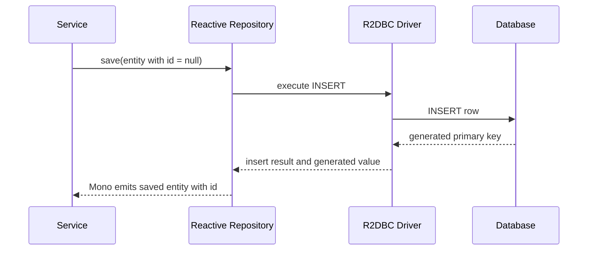

# Receiving Database-Generated Keys After Insert

In Spring Data Relational R2DBC, a table commonly has a primary key that the database generates automatically when a new record is inserted. For example, PostgreSQL has `IDENTITY` columns and MySQL has `AUTO_INCREMENT`. When an application inserts an entity that does not yet have an ID, the database creates the primary key value and returns it through the R2DBC driver. Spring Data R2DBC maps the generated key onto the resulting entity and emits that entity via a `Mono`.

The important point is to continue processing from the entity emitted after the insert operation. Saving data is asynchronous; the ID is not available immediately when creating the input entity or calling `save()`. Only after the publisher completes the insert operation and emits the result can the application use the generated primary key to create related data, return an HTTP response, or write business logs.

## 1. What Is a Database-Generated Primary Key?

A primary key uniquely identifies a row in a table. The application can supply the key value itself—such as generating a UUID before inserting—or let the database generate the key upon insert. With auto-incrementing numeric keys, the database manages a value generator and issues a new ID for each row.

PostgreSQL example:

```sql
CREATE TABLE customer (
    id BIGINT GENERATED BY DEFAULT AS IDENTITY PRIMARY KEY,
    name VARCHAR(200) NOT NULL,
    email VARCHAR(320) NOT NULL
);
```

`GENERATED BY DEFAULT AS IDENTITY` declares the `id` column as an identity column. When an insert statement omits `id`, PostgreSQL generates a value for this column. `PRIMARY KEY` guarantees that values are unique and non-null.

With MySQL, the equivalent declaration typically uses `AUTO_INCREMENT`:

```sql
CREATE TABLE customer (
    id BIGINT NOT NULL AUTO_INCREMENT,
    name VARCHAR(200) NOT NULL,
    email VARCHAR(320) NOT NULL,
    PRIMARY KEY (id)
);
```

The syntax for declaring an auto-generated column depends on the database engine. Spring Data R2DBC does not create an identity strategy automatically just because an entity has an `id` field; the database schema must be designed properly, typically managed via migrations.

## 2. Declaring the ID in an Entity

Spring Data Relational uses the `@Id` annotation to recognize the primary key property. For database-generated keys, use a reference type such as `Long` to clearly represent the "no ID yet" state with `null`.

```java
import org.springframework.data.annotation.Id;
import org.springframework.data.relational.core.mapping.Table;

@Table("customer")
public class Customer {

    @Id
    private Long id;

    private String name;

    private String email;

    public Customer(Long id, String name, String email) {
        this.id = id;
        this.name = name;
        this.email = email;
    }

    public Long getId() {
        return id;
    }

    public String getName() {
        return name;
    }

    public String getEmail() {
        return email;
    }
}
```

`@Id` here is the Spring Data annotation (`org.springframework.data.annotation.Id`), not JPA's `@Id` annotation. Spring Data Relational uses this metadata when identifying keys and building persistence operations.

You do not need to add JPA's `@GeneratedValue` to ask Spring Data R2DBC to generate keys. The key generation mechanism is declared in the database schema (identity, auto increment, sequence, or an appropriate default); Spring Data and the driver handle retrieving the generated value according to the dialect.

For a new entity, create the object without an ID:

```java
Customer customer = new Customer(null, "An Nguyen", "an@example.com");
```

`id == null` allows Spring Data to detect the entity as new under its default ID-based mechanism. When the insert succeeds, the database assigns the key and Spring Data places that key into the resulting entity.

### Why Prefer `Long` Over `long`?

The primitive type `long` always has a numeric value, defaulting to `0`. It cannot represent the unassigned-ID state with `null`. Spring Data has rules for detecting primitive default values in certain cases, but a reference type makes the new state clearer and avoids confusing `0` with an issued ID. For identity keys, `Long` is usually the clearest choice.

## 3. Declaring the Repository

A reactive repository can extend `ReactiveCrudRepository`:

```java
import org.springframework.data.repository.reactive.ReactiveCrudRepository;

public interface CustomerRepository
        extends ReactiveCrudRepository<Customer, Long> {
}
```

The first type parameter is the entity `Customer`; the second is the ID type (`Long`). The `save` method returns `Mono<Customer>` because an insert operation takes time to execute and can produce errors from the database or driver.

## 4. Receiving the ID via `save()`

For a new entity with a null ID, `save()` executes an insert under Spring Data's new-entity detection mechanism. Use the entity emitted by the returned `Mono`:

```java
public Mono<Customer> createCustomer(String name, String email) {
    Customer customer = new Customer(null, name, email);

    return customerRepository.save(customer);
}
```

When the insert completes, the publisher emits `Customer` populated with its primary key. For instance, the caller can read the ID using `map`:

```java
public Mono<Long> createCustomerAndReturnId(String name, String email) {
    Customer customer = new Customer(null, name, email);

    return customerRepository.save(customer)
            .map(Customer::getId);
}
```

Conceptual execution flow:



The ID value is received from the database/driver insert result. The application does not need to guess the next ID or run a separate query after inserting.

## 5. Use the Returned Entity; Do Not Read the ID Too Early

Calling `save()` returns a publisher; it does not mean the insert has completed at that line of code:

```java
Customer customer = new Customer(null, "An Nguyen", "an@example.com");
Mono<Customer> savedPublisher = customerRepository.save(customer);

// At this point, you cannot assume the database has assigned an ID yet.
```

Do not write logic that depends on the ID immediately after calling `save()`:

```java
Customer customer = new Customer(null, "An Nguyen", "an@example.com");
Mono<Customer> saved = customerRepository.save(customer);

Long id = customer.getId(); // Do not read a generated ID this way.
```

The input object is not a reliable source for reading the newly generated key before the publisher completes. With immutable entities, Spring Data can create a new instance containing the ID instead of mutating the original instance. Even when the entity is mutable, code must rely on the value emitted by the publisher to guarantee proper execution order.

The right way:

```java
return customerRepository.save(customer)
        .flatMap(savedCustomer -> {
            Long generatedId = savedCustomer.getId();
            return createWelcomeRecord(generatedId)
                    .thenReturn(savedCustomer);
        });
```

`flatMap` runs the callback only when `save` emits the resulting entity. Therefore `generatedId` is ready for use in the next step.

## 6. Receiving the ID with `R2dbcEntityTemplate`

When not using a repository or when custom entity operations are needed, `R2dbcEntityTemplate` also returns the entity after insert:

```java
import org.springframework.data.r2dbc.core.R2dbcEntityTemplate;
import org.springframework.stereotype.Service;
import reactor.core.publisher.Mono;

@Service
public class CustomerWriteService {

    private final R2dbcEntityTemplate template;

    public CustomerWriteService(R2dbcEntityTemplate template) {
        this.template = template;
    }

    public Mono<Customer> insert(Customer customer) {
        return template.insert(Customer.class).using(customer);
    }
}
```

`using(customer)` executes the insert operation and emits the entity processed according to the mapping metadata, including the database-generated key if the driver and dialect support returning generated values.

You can retrieve the ID directly from the result:

```java
public Mono<Long> insertAndGetId(Customer customer) {
    return template.insert(Customer.class)
            .using(customer)
            .map(Customer::getId);
}
```

In terms of usage, both repository and template let you continue processing via `Mono`. Choose a repository for standard CRUD; choose the template when you need the query DSL or more flexible control over entity operations.

## 7. What Happens Under the Hood When the Database Generates a Key?

At a lower level, the R2DBC driver sends the insert statement to the database. The database generates the identity/sequence value and the driver supplies the generated value according to the capabilities of the database engine and driver. Spring Data Relational uses the dialect and entity metadata to request and map that value onto the `@Id` property.

The R2DBC SPI has a `Statement.returnGeneratedValues(...)` mechanism to ask the driver to return generated columns. Exact execution differs by driver. Some databases support `RETURNING` syntax; other drivers use their database engine's corresponding generated-keys mechanism. Typical application code does not need to call this SPI directly when using repositories or `R2dbcEntityTemplate`.

For example, PostgreSQL can execute a statement like:

```sql
INSERT INTO customer (name, email)
VALUES ('An Nguyen', 'an@example.com')
RETURNING id;
```

`RETURNING id` instructs PostgreSQL to return the newly generated key within the same insert operation. This is safe under concurrent inserts because the returned value belongs to the exact row just inserted by that statement.

The ability to retrieve generated values depends on a compatible database, driver, and dialect. If the ID remains null after inserting, check the schema, annotations, data types, driver version, and generated-values support of the database engine. Do not add a manual `SELECT` query based on insert timing without understanding how the driver works.

## 8. Using the Generated ID to Save Related Records

A common scenario is creating a parent record first, then using its ID to create child records. For example, an order with multiple order lines:

```java
public Mono<Order> createOrder(NewOrderCommand command) {
    Order order = new Order(null, command.customerId(), command.createdAt());

    return orderRepository.save(order)
            .flatMap(savedOrder -> {
                Flux<OrderLine> lines = Flux.fromIterable(command.lines())
                        .map(line -> new OrderLine(
                                null,
                                savedOrder.getId(),
                                line.productId(),
                                line.quantity()
                        ));

                return orderLineRepository.saveAll(lines)
                        .then(Mono.just(savedOrder));
            });
}
```

Here, `savedOrder.getId()` is the database-assigned key. Each `OrderLine` receives that order ID as a foreign key. `saveAll` emits the saved line entities; `.then(Mono.just(savedOrder))` waits for the line-saving publisher to complete before emitting the order again.

If the order and order lines must be saved atomically, wrap the entire pipeline in a reactive transaction:

```java
public Mono<Order> createOrder(NewOrderCommand command) {
    Order order = new Order(null, command.customerId(), command.createdAt());

    return transactionalOperator.transactional(
            orderRepository.save(order)
                    .flatMap(savedOrder -> {
                        Flux<OrderLine> lines = Flux.fromIterable(command.lines())
                                .map(line -> new OrderLine(
                                        null,
                                        savedOrder.getId(),
                                        line.productId(),
                                        line.quantity()
                                ));

                        return orderLineRepository.saveAll(lines)
                                .then(Mono.just(savedOrder));
                    })
    );
}
```

If a child line violates a constraint or an insert fails, the error propagates through the publisher and the transaction manager can roll back all participating operations. Do not call `subscribe()` separately on `saveAll`, because doing so detaches the child inserts from the transaction and the service loses control over completion timing.

## 9. Distinguishing Database-Generated IDs from Application-Assigned IDs

Not all systems use auto-incrementing numeric keys. Some systems generate UUIDs in the application before writing:

```java
UUID id = UUID.randomUUID();
Customer customer = new Customer(id, "An Nguyen", "an@example.com");
```

With an application-assigned ID, the key already exists before inserting. This differs from a database-generated identity. The benefit of UUIDs is generating IDs without a round trip to the database before knowing the identifier; in exchange, you must choose an appropriate storage type, indexing, and UUID generation strategy.

If the application assigns the ID yet uses `repository.save()`, Spring Data needs to know the entity is new in order to choose insert rather than update. The default mechanism normally relies on ID state and any version property. When the ID is already non-null, Spring Data may treat the entity as existing. If you need self-assigned IDs while still using `save()` for new entities, you can implement `Persistable<ID>` and define `isNew()` according to the entity lifecycle, or use an explicit insert operation when appropriate.

With database-generated IDs, leave the ID null before inserting and use the returned result. Do not assign a dummy value to the ID just to avoid null; doing so can cause Spring Data to choose the update path or produce duplicate-key errors.

## 10. `save()` Can Insert or Update

`ReactiveCrudRepository.save()` does not mean an insert statement is always issued. Spring Data checks whether the entity is new to decide between insert and update. With a null ID and no custom newness rules, an entity is normally treated as new. With an existing ID, an entity can be treated as existing and take the update path.

This matters when working with database-generated keys:

```java
Customer newCustomer = new Customer(null, "An Nguyen", "an@example.com");
Mono<Customer> inserted = customerRepository.save(newCustomer);
```

This is the right pattern for a new insert. However, if `id` is accidentally populated before calling `save`, the repository may perform an update. If the goal is definitely an insert, you can use the template or repository insert API according to an appropriate design.

Do not use `save()` as a "try insert, update on failure" mechanism unless there is explicit business logic for it. Understand your entity's newness detection, especially when using assigned IDs, version properties, or `Persistable`.

## 11. Why Not Use `SELECT MAX(id)` to Retrieve the Generated Key?

An unsafe approach is inserting and then running:

```sql
SELECT MAX(id) FROM customer;
```

The result is the largest ID in the table at query time, which is not guaranteed to belong to the current request's insert. If another request inserts between the two statements, `MAX(id)` can return that other request's ID.

Similarly, do not rely on computing `id + 1`, reading a sequence manually outside the database's mechanism, or assuming IDs are issued contiguously without gaps. Transaction rollbacks, sequence caching, and concurrent operations can all produce gaps in IDs; contiguity is not a property guaranteed by primary keys.

Use the generated value returned directly from the insert operation (`save()` or `template.insert(...)`). The driver and database are responsible for associating the generated value with the exact row just added.

## 12. Schema Configuration and Data Types Must Be Compatible

The entity and schema must agree on the ID type. For instance, `Long` in Java usually corresponds to `BIGINT` in the database. If the database generates UUIDs, the Java type and converter must match the UUID type supported by the driver.

PostgreSQL example with a numeric identity key:

```sql
CREATE TABLE product (
    id BIGINT GENERATED ALWAYS AS IDENTITY PRIMARY KEY,
    name VARCHAR(200) NOT NULL
);
```

`GENERATED ALWAYS` requires the database to generate the value on normal inserts; if you want to allow the application to supply explicit values in controlled cases, PostgreSQL offers the `BY DEFAULT` option. Choose according to the system's identity policy.

MySQL example:

```sql
CREATE TABLE product (
    id BIGINT NOT NULL AUTO_INCREMENT,
    name VARCHAR(200) NOT NULL,
    PRIMARY KEY (id)
);
```

Do not declare an `id` column simply as `NOT NULL` and expect the database to auto-increment it. The schema needs an identity, auto-increment, sequence, or default expression appropriate for the database engine.

## 13. Using Direct SQL and Retrieving the Generated Key

When using `DatabaseClient` instead of a repository or template, the application takes more direct responsibility for the SQL and how results are read. With PostgreSQL, you can use `RETURNING`:

```java
public Mono<Long> insertCustomer(String name, String email) {
    return databaseClient.sql("""
            INSERT INTO customer (name, email)
            VALUES (:name, :email)
            RETURNING id
            """)
            .bind("name", name)
            .bind("email", email)
            .map((row, metadata) -> row.get("id", Long.class))
            .one();
}
```

This example depends on PostgreSQL and Java 15+ text block syntax. `RETURNING id` returns the inserted row's key in the same statement. With other databases or drivers, the syntax and API for retrieving generated values may differ; consult the corresponding documentation.

When using `DatabaseClient`, never concatenate input data directly into SQL. Bind parameters as shown in the example to avoid escaping bugs and SQL injection. If you need full entity mapping, a repository or `R2dbcEntityTemplate` usually reduces manual conversion work.

## 14. Handling Insert Failures

An insert publisher can emit an error instead of emitting an entity. Common causes include:

- Unique constraint or foreign key violations.
- A `NOT NULL` column with no value supplied.
- Incompatible data types or data exceeding column length.
- Database unreachable, timeouts, or transaction rollback.
- Identity/sequence or generated-value configuration incompatible with the driver.

You can translate infrastructure errors into business errors at the service layer:

```java
public Mono<Customer> createCustomer(String name, String email) {
    Customer customer = new Customer(null, name, email);

    return customerRepository.save(customer)
            .onErrorMap(DuplicateKeyException.class,
                    error -> new EmailAlreadyRegisteredException());
}
```

This snippet merely illustrates handling a duplicate key. Verify the driver and exception translation of the Spring Data version in use; do not map every database error into the same business exception. Other errors should be categorized and mapped according to the API contract.

If the insert fails, there is no resulting entity and no valid generated ID to proceed with creating related data. Let the error propagate through the pipeline or handle it using operators like `onErrorMap` or `onErrorResume` at the appropriate boundary.

## 15. Common Errors When Receiving Generated IDs

| Symptom | Possible Cause | Resolution |
| --- | --- | --- |
| ID in the resulting entity remains null | Missing `@Id`, schema lacks identity configuration, driver/dialect does not return generated values, or incompatible data types | Check mapping, DDL, driver version, and generated-keys support |
| Input entity's ID remains null | Reading the original object instead of the entity emitted by the publisher; immutable entities may yield a new instance | Use `savedEntity` inside `map`/`flatMap` |
| Repository performs update instead of insert | ID was already assigned or newness detection evaluated the entity as existing | Leave ID null for identity; check version/`Persistable.isNew()` or use explicit insert |
| No result received when calling service | Publisher was not subscribed to by the framework or caller | Return `Mono` to the controller/caller and let the framework manage subscription |
| Wrong ID retrieved via a subsequent query | Using `SELECT MAX(id)` or assuming IDs increment contiguously | Use the generated value from the insert itself |
| Parent insert succeeds but child insert fails | Wrong foreign key, detached child publisher, or transaction does not wrap both | Use the ID from the saved parent entity and compose operations within the same reactive transaction |
| Code works on one database but fails on another | Differences in identity, generated keys, `RETURNING`, or driver support | Verify the specific dialect and driver with integration tests |

## 16. Testing Generated Key Retrieval

Unit tests can verify that a service uses the ID from the resulting entity and chains downstream steps in the right order. However, mocking a repository to return an entity with an ID does not prove the driver and database actually return generated keys.

You should write integration tests against an R2DBC-compatible database:

1. Create a schema with an identity/auto-increment column matching the database engine.
2. Create a new entity with a null ID.
3. Call repository `save()` or template `insert()` and verify the publisher emits an entity with a non-null ID.
4. Read the record back using that ID to confirm the row was persisted.
5. Create multiple entities concurrently and verify each result receives its own distinct ID.
6. Test saving child records using the emitted parent entity's ID.
7. Test constraint failures and rollback when an operation inside a transaction fails.

You can use Reactor Test's `StepVerifier` to assert reactive outcomes:

```java
StepVerifier.create(customerService.createCustomer("An Nguyen", "an@example.com"))
        .assertNext(saved -> {
            assertThat(saved.getId()).isNotNull();
            assertThat(saved.getName()).isEqualTo("An Nguyen");
        })
        .verifyComplete();
```

This test assumes AssertJ and Reactor Test. Integration tests should run against the exact driver and database the application intends to support, because generated-key retrieval behavior depends on the dialect and driver.

## 17. Best Practices

- Mark the primary key with `org.springframework.data.annotation.Id`.
- For database-generated identity keys, construct new entities with a null ID; wrapper types like `Long` express this state clearly.
- Declare an appropriate identity/auto-increment/sequence/default column in the database schema via migrations.
- Use the right R2DBC driver and a version compatible with your database engine.
- Use the entity emitted by `repository.save()` or `R2dbcEntityTemplate.insert()` to obtain the generated key.
- Use `map` when simply transforming the result into an ID; use `flatMap` when performing a follow-up reactive operation with that ID.
- Do not read the ID immediately after creating the entity or calling `save()`; the publisher must complete the insert first.
- Do not assume the input entity is always mutated; rely on the returned entity, especially with immutable models.
- Do not use `SELECT MAX(id)`, `id + 1`, or manual sequence reads to guess the key of the current insert.
- Distinguish database-generated IDs from application-assigned IDs and understand `save()` newness detection.
- Compose parent and child inserts in the same reactive transaction when atomicity is required.
- Test generated keys with integration tests against a real database/driver or compatible environment.

## 18. Conclusion

When using database-generated primary keys, new entities must be clearly marked by an absent ID state, usually `null`. Spring Data R2DBC uses `@Id`, metadata, and the dialect to execute the insert; the driver returns the generated value from the database and Spring Data emits the resulting entity with the primary key populated. Both repository `save()` and `R2dbcEntityTemplate.insert()` allow continued processing via a reactive publisher.

Retrieve the ID from the emitted entity, then use `map` or `flatMap` to chain operations that depend on that key. This approach preserves asynchronous ordering, stays safe under concurrent inserts, and integrates cleanly with reactive transactions. The database schema, driver, and type mappings must all be compatible for generated keys to be returned accurately.
