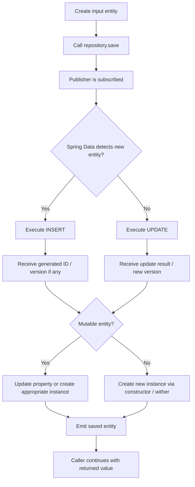

# Distinguishing the Passed-In Entity from the Returned Entity After Saving

In Spring Data R2DBC, the `save()` method accepts an entity and returns a publisher containing the saved entity. The entity passed in and the entity emitted by `save()` can be the same object or two different objects, depending on how the entity is designed and how Spring Data updates database-generated values.

This point is especially important for immutable entities. A record or class with only `final` fields cannot be mutated in place when the database generates a primary key or when a version changes. Spring Data can create a new instance containing the updated values and emit that instance via `Mono` or `Flux`.

Therefore, always continue processing with the entity returned from `save()`. Never assume the input object was modified in place or already has a new ID immediately after calling the method.

## 1. What Does `save()` Do in Spring Data R2DBC?

Reactive repositories typically declare `save()` through `ReactiveCrudRepository`:

```java
public interface CustomerRepository
        extends ReactiveCrudRepository<Customer, Long> {
}
```

The `save()` method has the general signature:

```java
<S extends T> Mono<S> save(S entity);
```

It accepts an entity and returns a `Mono` containing the entity after the save operation completes. With `saveAll()`, the result is a `Flux` containing the saved entities.

Spring Data needs to decide whether the entity represents a new record or an existing record:

- New entities are normally persisted via an `INSERT` operation.
- Existing entities are normally persisted via an `UPDATE` operation.

This is a save operation based on the entity's new/existing state, not a general-purpose upsert command guaranteeing that the database automatically chooses insert or update across any unique key. How new state is detected and which SQL statement runs depend on entity metadata, identity strategy, and the driver/database.

### 1.1. `save()` Is Reactive and Lazy

Calling `save()` only builds a publisher describing the operation. Database access begins when the publisher is subscribed to.

```java
Customer customer = new Customer(null, "Lan", "lan@example.com");

Mono<Customer> result = repository.save(customer);
```

At the point `result` is created, do not assume the SQL has executed or that `customer` already has an ID. The operation runs when the publisher is consumed by the web framework, another pipeline, or a subscriber.

In reactive applications, compose publishers with `map`, `flatMap`, `zip`, and appropriate operators. Do not call `.block()` just to obtain the entity synchronously inside a WebFlux request thread.

## 2. Where Do the Passed-In Entity and Returned Entity Differ?

Two roles can be distinguished:

| Entity | Meaning |
| --- | --- |
| Input entity | The object the application passes to `save()`; it represents data and state before saving |
| Output entity | The object emitted once the save operation completes; it may contain IDs, versions, or values updated during persistence |

With mutable entities, Spring Data can write new values into the input object's fields or properties. In that case, the returned entity often shares the same reference as the input object.

With immutable entities, Spring Data cannot mutate final fields in place. The framework constructs a new instance via a constructor, wither, or appropriate copy mechanism and returns that instance. The input entity keeps its original values.

Do not write code that depends on whether the two variables share the same reference. Treat the returned value as the authoritative entity state after saving.

## 3. Example with a Mutable Entity

A mutable entity allows changing its properties after creation:

```java
import org.springframework.data.annotation.Id;
import org.springframework.data.relational.core.mapping.Table;

@Table("customers")
public class Customer {

    @Id
    private Long id;

    private String name;
    private String email;

    public Customer() {
    }

    public Customer(Long id, String name, String email) {
        this.id = id;
        this.name = name;
        this.email = email;
    }

    public Long getId() {
        return id;
    }

    public void setId(Long id) {
        this.id = id;
    }

    public String getName() {
        return name;
    }

    public void setName(String name) {
        this.name = name;
    }

    public String getEmail() {
        return email;
    }

    public void setEmail(String email) {
        this.email = email;
    }
}
```

Suppose the database generates `id` on insert. You can call:

```java
Customer input = new Customer(null, "Lan", "lan@example.com");

return repository.save(input)
        .map(saved -> {
            log.info("Saved customer id={}", saved.getId());
            return saved;
        });
```

Spring Data can populate the generated ID onto the mutable entity and emit the saved entity. Even so, read the ID from the `saved` variable inside the pipeline. That keeps your code independent of whether the framework mutates the input object directly or returns a different instance.

Do not write:

```java
repository.save(input);
return input;
```

This snippet discards the publisher from `save()`. Because publishers are lazy, the save operation might never execute; even if subscribed elsewhere, `input` is not a reliable source for updated post-save values.

## 4. Example with an Immutable Entity

Immutable entities prevent state changes after initialization. This design is helpful when you want predictable objects, want to prevent unintended mutations, and model data by value.

### 4.1. Using a Java Record

```java
import org.springframework.data.annotation.Id;
import org.springframework.data.relational.core.mapping.Table;

@Table("customers")
public record Customer(
        @Id Long id,
        String name,
        String email
) {
}
```

Create a new entity:

```java
Customer input = new Customer(null, "Lan", "lan@example.com");
```

On save, the database can generate an ID. A record has no setters, and the `id` component cannot change after construction. Spring Data uses a mechanism to construct a new instance with the received ID and emits that instance from `save()`.

```java
return repository.save(input)
        .doOnNext(saved -> {
            log.info("Generated id: {}", saved.id());
        });
```

After saving:

- `input.id()` is still `null`.
- `saved.id()` holds the database-generated ID if the driver and configuration support returning that value.
- `saved` is the entity that must be used in subsequent business steps.

### 4.2. Using an Immutable Class and a Wither

With a standard class, you can provide a wither to create a new instance with an updated value:

```java
@Table("customers")
public class Customer {

    @Id
    private final Long id;
    private final String name;
    private final String email;

    @PersistenceCreator
    public Customer(Long id, String name, String email) {
        this.id = id;
        this.name = name;
        this.email = email;
    }

    public Customer withId(Long newId) {
        return new Customer(newId, name, email);
    }

    public Long getId() {
        return id;
    }

    public String getName() {
        return name;
    }

    public String getEmail() {
        return email;
    }
}
```

`withId()` does not mutate the current object. It creates a new object with the same business data and a different ID. Spring Data can use a wither or an equivalent copy mechanism to apply generated values.

When using immutable entities, include the necessary properties in the persistence constructor and provide withers for values the framework needs to update after insert/update if the entity design calls for them.

## 5. Auto-Generated Primary Keys

A table with identity/auto-increment typically generates primary keys on insert. The input entity usually leaves ID as `null`:

```java
Customer draft = new Customer(null, "Lan", "lan@example.com");
```

After saving, the database returns the generated value via the generated-values mechanism supported by the driver. Spring Data assigns that value onto the saved entity and emits the entity through the publisher.

```java
Mono<Customer> savedPublisher = repository.save(draft);

return savedPublisher.flatMap(saved -> {
    Long generatedId = saved.getId();
    return auditService.recordCustomerCreated(generatedId)
            .thenReturn(saved);
});
```

This example illustrates using the ID after insert completes. `flatMap` runs only after `save()` emits the saved entity.

### 5.1. Do Not Read the ID Too Early

The following code is unsafe:

```java
Customer input = new Customer(null, "Lan", "lan@example.com");
Mono<Customer> saved = repository.save(input);

Long id = input.getId(); // No guarantee the ID has been generated yet.
```

The publisher might not have been subscribed to yet, so the SQL may not have run. Even if the publisher is subscribed elsewhere, with immutable entities the input object retains its old ID.

Read the ID inside a callback processing the emitted value:

```java
return repository.save(input)
        .map(saved -> saved.getId());
```

### 5.2. Do Not Assign an ID Yourself If the Database Is Responsible for Generating It

If the application assigns a non-`null` ID to an entity, Spring Data may treat the entity as existing and choose an update operation, depending on the new/existing state detection strategy. Therefore, with database-generated primary keys, leave the ID in its new state per entity conventions.

If business logic requires application-assigned IDs such as UUIDs, configure an explicit newness strategy so Spring Data still knows the entity needs to be inserted.

## 6. How Spring Data Detects New vs. Existing Entities

`save()` needs to know whether to insert or update. Spring Data Relational uses a new-state detection mechanism before running the operation.

### 6.1. Based on the `@Id` Property

For a regular entity without a version property and not implementing `Persistable`, the ID value is the primary basis:

- ID is `null`: the entity is typically treated as new and inserted.
- ID has a value: the entity is typically treated as existing and updated.

With primitive IDs, `null` cannot be represented; a default value such as `0` may be used to detect new state under Spring Data's strategy. Still, a wrapper like `Long` usually expresses intent more clearly when the database generates IDs.

### 6.2. The `@Version` Property

If an entity has a `@Version` property, Spring Data can use the version to determine new state before checking the ID. An uninitialized version value (such as `null`, or the corresponding default for primitive types) indicates a new entity under the version strategy.

Version is also used to perform optimistic locking during updates. When a save succeeds, the version is updated and the returned entity holds the new version value.

```java
@Table("customers")
public record Customer(
        @Id Long id,
        @Version Long version,
        String name
) {
}
```

When working with versions, always use the entity returned from `save()` for the next update. Reusing the old entity can send a stale version and lead to optimistic locking failures.

### 6.3. Using `Persistable` When IDs Are Application-Assigned

With UUIDs or primary keys created by the application before insert, the ID already has a value even though the record does not exist yet. Relying solely on ID can cause Spring Data to treat the entity as existing and run an update.

In that case, the entity can implement `Persistable<ID>` to supply its new state via `isNew()`:

```java
public class Customer implements Persistable<UUID> {

    @Id
    private UUID id;

    @Transient
    private boolean newEntity = true;

    private String name;

    @Override
    public UUID getId() {
        return id;
    }

    @Override
    public boolean isNew() {
        return newEntity;
    }

    // Constructors, getters, and state-update methods omitted.
}
```

`@Transient` marks the `newEntity` flag as not a database column. When implementing this approach, the application must manage when the flag switches to `false` after a successful save, via lifecycle callbacks or a mechanism suited to the design. If the flag always stays `true`, subsequent `save()` calls may keep being treated as inserts.

You do not need to implement `Persistable` for entities using database-generated IDs under standard conventions. Use it only when your application's identity strategy requires explicit newness control.

## 7. Version and the Returned Entity After Update

`@Version` supports optimistic locking. When two operations update the same record concurrently, the version detects when one operation is acting on stale data.

Entity example:

```java
@Table("customers")
public class Customer {

    @Id
    private final Long id;

    @Version
    private final Long version;

    private final String name;

    @PersistenceCreator
    public Customer(Long id, Long version, String name) {
        this.id = id;
        this.version = version;
        this.name = name;
    }

    public Customer withVersion(Long newVersion) {
        return new Customer(id, newVersion, name);
    }

    public Long getId() {
        return id;
    }

    public Long getVersion() {
        return version;
    }

    public String getName() {
        return name;
    }
}
```

When an update succeeds, the version increments per Spring Data Relational's rules. With immutable entities, the new version value is placed on a new instance. Use the entity emitted by `save()` rather than the entity from before the update.

If the database finds no row matching the expected ID and version, Spring Data can raise `OptimisticLockingFailureException`. This signals that the entity is stale or the record was modified or deleted by another operation.

## 8. Continuing the Pipeline with the Saved Entity

Because `save()` returns a publisher, the proper pattern is composing operations that depend on the new ID or version inside the pipeline.

### 8.1. Using `flatMap` When the Next Step Is Also Asynchronous

```java
public Mono<CustomerView> createCustomer(CreateCustomerRequest request) {
    Customer customer = new Customer(null, request.name(), request.email());

    return customerRepository.save(customer)
            .flatMap(saved -> preferenceService.createDefault(saved.getId())
                    .thenReturn(new CustomerView(
                            saved.getId(),
                            saved.getName(),
                            saved.getEmail()
                    )));
}
```

`flatMap` receives the saved entity and then calls another service using the actual ID. There is no need to block a thread waiting for the repository result.

### 8.2. Using `map` When Simply Transforming Values

```java
public Mono<CustomerResponse> create(CreateCustomerRequest request) {
    Customer customer = new Customer(null, request.name(), request.email());

    return repository.save(customer)
            .map(saved -> new CustomerResponse(
                    saved.getId(),
                    saved.getName(),
                    saved.getEmail()
            ));
}
```

`map` is suitable when the next step is a synchronous transformation, such as constructing a DTO from the saved entity.

### 8.3. Returning the Saved Entity from a Controller

```java
@PostMapping("/customers")
public Mono<Customer> create(@RequestBody CreateCustomerRequest request) {
    Customer customer = new Customer(null, request.name(), request.email());
    return repository.save(customer);
}
```

Spring WebFlux subscribes to the publisher and writes the emitted value to the HTTP response. The controller does not need to call `.block()` or subscribe manually.

### 8.4. Do Not Detach Subscriptions from the Main Flow

Another anti-pattern is:

```java
public Customer create(CreateCustomerRequest request) {
    Customer customer = new Customer(null, request.name(), request.email());
    repository.save(customer).subscribe();
    return customer;
}
```

This snippet creates an independent subscription, returns the input object immediately, and does not wait for the save result. Database errors may not propagate to the caller, the ID may not be present yet, and transaction/request context may no longer behave as expected.

Return the publisher from the service/controller or compose it within a pipeline with clear ownership.

## 9. `saveAll()` Also Returns the Post-Save Entities

For multiple entities, `saveAll()` returns `Flux<S>`:

```java
Flux<Customer> saveAll(Iterable<Customer> entities);
```

When the database generates IDs or immutable entities must be recreated, the elements emitted by `saveAll()` are the data source to continue using downstream.

```java
return repository.saveAll(customers)
        .map(saved -> new CustomerSummary(saved.getId(), saved.getName()))
        .collectList();
```

Do not ignore the resulting `Flux` and keep processing the input list assuming every object was updated. Furthermore, `saveAll()` is not necessarily a single atomic transaction for the entire list unless the application establishes an appropriate transaction boundary.

## 10. `save()` Is Not an Entity Refresh Mechanism

Spring Data Relational has no JPA-style persistence context that automatically tracks every object change and re-synchronizes objects whenever the database changes.

`save()` executes an insert or update based on entity state and returns the entity after the save operation. Do not assume it reloads the entire row after the database runs triggers, computed columns, or updates other columns.

If you need values computed or updated by the database beyond what Spring Data receives from the save operation, query explicitly again:

```java
return repository.save(customer)
        .flatMap(saved -> repository.findById(saved.getId()));
```

Whether generated values other than the ID are returned depends on the database, driver, and generated statement. If business logic depends on default values or triggers, verify database/driver behavior and perform a post-save select when needed.

## 11. Common Pitfalls

| Symptom | Cause | Fix |
| --- | --- | --- |
| ID remains `null` after calling `save()` | Publisher was not subscribed to or code reads input entity too early | Read ID from the emitted entity in `map`/`flatMap` |
| Input entity's ID remains null | Entity is immutable and Spring Data returns a new instance | Use the entity returned by `save()` |
| New record is treated as an update | ID already has a value and newness detection treats entity as existing | Check ID, `@Version`, or implement `Persistable` when needed |
| Same entity inserted multiple times | `Persistable.isNew()` still returns `true` after first save | Update newness state after successful save |
| Update fails with stale version | Caller keeps using pre-save entity | Use the returned entity containing the new version |
| Errors do not propagate to controller | Service calls standalone `subscribe()` and returns synchronously | Return the publisher and compose it inside the pipeline |
| Trigger/default columns missing on object | Save does not auto-refresh all database columns | Re-query the record when post-trigger/default values are needed |
| `save()` does not insert even though ID is assigned | Spring Data treats entity as existing | Choose a newness strategy appropriate for application-assigned IDs |

## 12. Testing Differences Between Input and Output Entities

You should test this behavior against a real R2DBC database, especially when entities are immutable or use generated IDs/versions.

### 12.1. Testing a Mutable Entity

```java
@DataR2dbcTest
class CustomerRepositoryTest {

    @Autowired
    CustomerRepository repository;

    @Test
    void shouldReturnSavedCustomerWithGeneratedId() {
        Customer input = new Customer(null, "Lan", "lan@example.com");

        StepVerifier.create(repository.save(input))
                .assertNext(saved -> {
                    assertThat(saved.getId()).isNotNull();
                    assertThat(saved.getName()).isEqualTo("Lan");
                })
                .verifyComplete();
    }
}
```

This test checks that the publisher result has an ID and valid business data. There is no need to assert `saved == input`, because object identity is not a contract business code should depend on.

### 12.2. Testing an Immutable Entity

With a record or immutable class, you can verify that the input object retains its old value while the returned entity has an ID:

```java
@Test
void shouldUseReturnedRecordAfterInsert() {
    Customer input = new Customer(null, "Lan", "lan@example.com");

    StepVerifier.create(repository.save(input))
            .assertNext(saved -> {
                assertThat(input.id()).isNull();
                assertThat(saved.id()).isNotNull();
                assertThat(saved.name()).isEqualTo(input.name());
            })
            .verifyComplete();
}
```

This test assumes `Customer` is a record and the database has an ID generation mechanism compatible with the driver. It illustrates why callers must use the value emitted by `save()`.

### 12.3. Testing Versions

For entities with `@Version`, verify the initial version, post-insert version, and post-update version according to the rules of the Spring Data version in use. Also test two copies with the same version competing to update so you confirm optimistic locking works as expected.

Do not hardcode one version assumption across all data types and framework versions. Write assertions based on the versioning strategy configured in the project.

## 13. Usage Guide

| Scenario | Approach |
| --- | --- |
| Mutable entity, database-generated ID | Use the entity emitted by `save()` to obtain the ID and continue processing |
| Immutable entity or Java record | Always replace the input object with the returned entity in the pipeline |
| Entity with `@Version` | Use the returned entity after each save to keep the latest version |
| Application assigns UUID before insert | Configure newness explicitly; consider `Persistable` |
| Need to call another service with the generated ID | Use `flatMap` after `save()` |
| Only need to construct a DTO from the saved entity | Use `map` after `save()` |
| Need values updated by triggers/defaults | Re-query after saving if the driver does not return those values |
| Saving multiple entities | Consume elements from `saveAll()` instead of assuming the input list was updated |

## 14. Processing Flow from Input Entity to Post-Save Entity



The diagram shows the high-level flow. Exact SQL statements, generated values, and how objects are updated depend on mapping metadata, entity type, and driver/database capabilities.

## 15. Conclusion

In Spring Data R2DBC, the entity passed into `save()` represents pre-save state; the entity emitted from the publisher represents post-save state. For mutable entities, Spring Data may update properties on the object. For immutable entities, the framework creates a new instance to carry the ID, version, or updated values.

Always return and use the entity from `save()` or `saveAll()`. Read IDs and versions inside `map`/`flatMap` after the publisher emits the result, define an explicit new/existing entity strategy when using application-generated IDs, and re-query when you need database values not returned by the save operation. This approach keeps reactive pipelines accurate and avoids bugs caused by using stale input objects.
