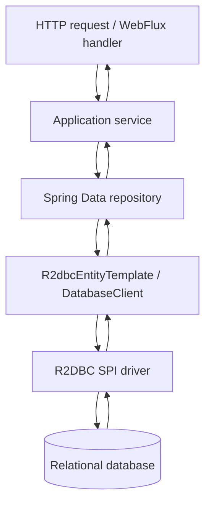

# Từ yêu cầu lưu trữ đến luồng truy cập dữ liệu phản ứng

Spring Data Relational R2DBC giúp ứng dụng làm việc với cơ sở dữ liệu quan hệ bằng các thao tác bất đồng bộ, không chặn luồng thực thi. Để sử dụng đúng, cần bắt đầu từ yêu cầu lưu trữ của nghiệp vụ, chọn cách biểu diễn dữ liệu và ranh giới aggregate, rồi thiết kế luồng truy cập xuyên suốt từ API đến cơ sở dữ liệu. Chỉ thay kiểu trả về từ `T` sang `Mono<T>` hoặc `Flux<T>` chưa đủ để tạo ra một hệ thống phản ứng.

Bài học này đi theo hành trình đó: xác định yêu cầu, chọn kiến trúc, cấu hình kết nối, ánh xạ dữ liệu, xây dựng repository và service, sau đó xử lý giao dịch, lỗi, backpressure và kiểm thử.

## 1. Bắt đầu từ yêu cầu lưu trữ

Trước khi chọn repository hay viết câu SQL, hãy làm rõ dữ liệu cần được lưu và cách ứng dụng sử dụng dữ liệu đó. Một yêu cầu như “lưu đơn hàng và hiển thị các đơn hàng mới nhất của khách hàng” chứa nhiều quyết định thiết kế hơn một thao tác `INSERT` và `SELECT`.

| Câu hỏi cần làm rõ | Ảnh hưởng đến thiết kế |
| --- | --- |
| Dữ liệu có quan hệ và cần ràng buộc toàn vẹn không? | Chọn mô hình bảng, khóa chính, khóa ngoại, unique constraint và transaction phù hợp. |
| Đối tượng nào phải được lưu nhất quán cùng nhau? | Xác định aggregate và ranh giới giao dịch. |
| Ứng dụng đọc một bản ghi hay một tập kết quả? | Chọn `Mono<T>` cho kết quả tối đa một phần tử và `Flux<T>` cho luồng nhiều phần tử. |
| Truy vấn cần lọc, sắp xếp, phân trang hoặc tổng hợp như thế nào? | Thiết kế index, query method hoặc SQL tường minh. |
| Tải đồng thời và thời gian chờ cơ sở dữ liệu ra sao? | Lập kế hoạch cho connection pool, timeout, giới hạn truy vấn và backpressure. |
| Có cần nhiều thay đổi dữ liệu cùng thành công hoặc cùng thất bại không? | Thiết kế reactive transaction. |
| Cơ sở dữ liệu và driver có hỗ trợ R2DBC không? | Xác nhận khả năng triển khai truy cập bất đồng bộ thực sự. |

Yêu cầu phi chức năng cũng quan trọng. Một endpoint trả về hàng trăm nghìn dòng cần cách truyền dữ liệu khác với endpoint trả về một đơn hàng. Một thao tác chuyển tiền cần tính nguyên tử; một màn hình tìm kiếm có thể chấp nhận kết quả theo từng đợt. Hãy đưa các khác biệt này vào thiết kế trước khi viết code.

### Khi nào R2DBC phù hợp?

R2DBC phù hợp khi ứng dụng làm việc với cơ sở dữ liệu quan hệ, driver R2DBC tương ứng có sẵn và hệ thống cần giữ luồng xử lý bất đồng bộ từ đầu đến cuối. Đây là lựa chọn tự nhiên trong một ứng dụng Spring WebFlux hoặc một dịch vụ đã sử dụng Reactor.

R2DBC là một API truy cập cơ sở dữ liệu quan hệ. Nó không tự biến mọi phần còn lại của ứng dụng thành reactive. Nếu một request đi qua WebFlux, sau đó gọi JDBC hoặc JPA đồng bộ trên luồng xử lý, đoạn truy cập đó vẫn chặn luồng. Tương tự, bọc một lời gọi JDBC bằng `Mono.fromCallable` không biến driver JDBC thành driver không chặn.

Hãy xác nhận driver R2DBC hỗ trợ đúng hệ quản trị cơ sở dữ liệu, kiểu dữ liệu, cú pháp SQL và tính năng mà ứng dụng cần. Nếu hệ thống phụ thuộc sâu vào một thư viện chỉ có JDBC hoặc vào hành vi ORM của JPA, cần đánh giá chi phí chuyển đổi trước khi chọn R2DBC.

## 2. Thiết kế luồng truy cập dữ liệu

Một luồng truy cập dữ liệu phản ứng thường có các lớp sau:



Khi request được xử lý, các lớp phía trên ghép nối những `Publisher` để mô tả công việc cần thực hiện. Khi framework đăng ký vào publisher, quá trình mới được kích hoạt: lấy kết nối, gửi câu lệnh, nhận kết quả, ánh xạ từng hàng thành đối tượng và phát tín hiệu về phía gọi.

Có thể nhìn luồng này theo hai chiều:

- **Chiều yêu cầu:** controller gọi service; service gọi repository; repository chuyển yêu cầu thành thao tác R2DBC; driver gửi câu lệnh đến cơ sở dữ liệu.
- **Chiều kết quả:** cơ sở dữ liệu trả kết quả; driver phát dữ liệu; Spring Data ánh xạ dữ liệu; service và controller tiếp tục chuỗi xử lý rồi trả kết quả cho client.

`Mono` và `Flux` là các kiểu publisher phổ biến của Project Reactor:

| Kiểu | Ý nghĩa | Ví dụ |
| --- | --- | --- |
| `Mono<T>` | Không có hoặc có tối đa một giá trị `T`. | Tìm một đơn hàng theo ID, lưu một đơn hàng. |
| `Flux<T>` | Không có hoặc có từ nhiều giá trị `T`. | Liệt kê đơn hàng của khách hàng, đọc các dòng kết quả. |
| `Mono<Void>` | Biểu thị hoàn tất hoặc lỗi mà không phát giá trị dữ liệu. | Xóa dữ liệu hoặc hoàn tất một lệnh cập nhật. |

Publisher trong Reactor thường có tính lazy: việc xây dựng chuỗi xử lý chưa đồng nghĩa với việc truy vấn đã chạy. Một subscriber, chẳng hạn WebFlux khi ghi response, sẽ kích hoạt chuỗi đó. Vì vậy, không nên tự gọi `subscribe()` trong controller hoặc service. Framework ở biên ứng dụng chịu trách nhiệm đăng ký và quản lý vòng đời request.

## 3. Chọn mức trừu tượng truy cập dữ liệu

Spring Data R2DBC cung cấp một số cách làm việc với cơ sở dữ liệu. Hãy chọn mức trừu tượng theo độ phức tạp của truy vấn.

| Công cụ | Phù hợp khi | Đặc điểm |
| --- | --- | --- |
| `ReactiveCrudRepository` | CRUD và truy vấn dẫn xuất từ tên phương thức đáp ứng được nhu cầu. | Ít code lặp, khai báo phương thức theo quy ước Spring Data, trả về `Mono` hoặc `Flux`. |
| `R2dbcEntityTemplate` | Cần thao tác có lập trình với entity, điều kiện, mapping hoặc câu lệnh theo cách Spring Data Relational quản lý. | Linh hoạt hơn repository cho các thao tác động và mapping entity. |
| `DatabaseClient` | Cần SQL cụ thể, join, biểu thức đặc thù của hệ quản trị hoặc kiểm soát mapping từng cột. | Làm việc trực tiếp với SQL và kết quả hàng, hỗ trợ bind tham số. |

Không cần đưa mọi truy vấn xuống SQL thủ công. Repository là điểm bắt đầu tốt cho thao tác thông thường. Khi một truy vấn có yêu cầu đặc biệt, có thể dùng `@Query`, `R2dbcEntityTemplate` hoặc `DatabaseClient` tại đúng vị trí cần thiết.

### Mô hình aggregate trong Spring Data Relational

Spring Data Relational tập trung vào việc lưu và tải các aggregate. Nó không cung cấp toàn bộ hành vi ORM của JPA: không có persistence context kiểu JPA, dirty checking tự động, lazy loading quan hệ hay cascade entity theo cùng cách đó.

Vì vậy, hãy xác định rõ aggregate root và những dữ liệu cần được lưu cùng nhau. Với quan hệ giữa các aggregate, ứng dụng thường lưu khóa tham chiếu rồi truy vấn dữ liệu liên quan một cách tường minh. Cách này giúp luồng truy cập dễ dự đoán và tránh việc một lần đọc bất ngờ kích hoạt nhiều truy vấn.

## 4. Khai báo dependency và cấu hình kết nối

Ví dụ dưới đây sử dụng Spring Boot, Spring Data R2DBC và driver PostgreSQL. Phiên bản thư viện nên được quản lý bởi Spring Boot dependency management để các thành phần tương thích với nhau.

```kotlin
dependencies {
    implementation("org.springframework.boot:spring-boot-starter-data-r2dbc")
    runtimeOnly("org.postgresql:r2dbc-postgresql")
}
```

Nếu ứng dụng cung cấp HTTP API bằng WebFlux, thêm starter WebFlux theo cấu trúc dependency của dự án. R2DBC có thể được dùng trong các ứng dụng reactive khác; WebFlux không phải thành phần bắt buộc của chính driver R2DBC.

Cấu hình kết nối có thể đặt trong `application.yml`:

```yaml
spring:
  r2dbc:
    url: r2dbc:postgresql://localhost:5432/orders
    username: ${DB_USERNAME}
    password: ${DB_PASSWORD}
```

URL R2DBC có scheme riêng, ví dụ `r2dbc:postgresql://...`; không dùng URL JDBC `jdbc:postgresql://...` cho thuộc tính này. Thông tin xác thực nên lấy từ biến môi trường hoặc hệ thống quản lý secret, không commit mật khẩu thật vào repository.

Spring Boot có thể tự cấu hình `ConnectionFactory` từ cấu hình và driver có trên classpath. Ở mức thấp hơn, `ConnectionFactory` là điểm tạo kết nối mà Spring Data và driver sử dụng. Với môi trường có nhiều request đồng thời, cần đánh giá việc dùng connection pool, giới hạn số kết nối, thời gian chờ lấy kết nối và timeout truy vấn. Pool phải phù hợp với giới hạn kết nối của cơ sở dữ liệu; tăng pool vô hạn không làm hệ thống nhanh hơn.

R2DBC không thay thế quy trình quản lý schema. Hãy tạo và thay đổi bảng bằng migration có kiểm soát, chẳng hạn Flyway, Liquibase hoặc công cụ migration tương đương. Một số công cụ migration sử dụng JDBC, nên ứng dụng có thể cần cấu hình kết nối migration riêng bên cạnh kết nối R2DBC dùng cho truy cập dữ liệu lúc chạy.

## 5. Ánh xạ bảng và đối tượng miền

Giả sử nghiệp vụ cần lưu đơn hàng và truy vấn đơn hàng theo khách hàng. Bảng có thể được định nghĩa như sau:

```sql
CREATE TABLE orders (
    id BIGINT GENERATED BY DEFAULT AS IDENTITY PRIMARY KEY,
    customer_id BIGINT NOT NULL,
    total NUMERIC(12, 2) NOT NULL,
    status VARCHAR(20) NOT NULL,
    created_at TIMESTAMP NOT NULL
);

CREATE INDEX idx_orders_customer_created
    ON orders (customer_id, created_at DESC);
```

Index phục vụ mẫu truy vấn lọc theo `customer_id` và sắp xếp theo `created_at`. Cấu trúc index thực tế cần được quyết định dựa trên truy vấn và dữ liệu thật, không nên tạo index cho mọi cột.

Có thể ánh xạ bảng bằng một record Java:

```java
import java.math.BigDecimal;
import java.time.LocalDateTime;

import org.springframework.data.annotation.Id;
import org.springframework.data.relational.core.mapping.Column;
import org.springframework.data.relational.core.mapping.Table;

@Table("orders")
public record Order(
    @Id Long id,
    @Column("customer_id") Long customerId,
    BigDecimal total,
    OrderStatus status,
    @Column("created_at") LocalDateTime createdAt
) {}
```

```java
public enum OrderStatus {
    NEW,
    PAID,
    CANCELLED
}
```

`@Table` chỉ ra tên bảng; `@Id` đánh dấu khóa chính; `@Column` ánh xạ thuộc tính Java với tên cột. Spring Data R2DBC hỗ trợ mapping các kiểu dữ liệu được driver tương ứng cung cấp. Cần kiểm tra mapping khi dùng kiểu đặc thù, enum, JSON, kiểu thời gian hoặc kiểu dữ liệu riêng của hệ quản trị.

Trong ví dụ, `id` là `null` khi tạo đơn hàng mới. Với cột identity được cơ sở dữ liệu sinh, thao tác insert có thể trả về entity đã có ID. Khi cập nhật, cần cung cấp ID và tuân theo quy tắc xác định entity mới hay đã tồn tại của Spring Data.

## 6. Xây dựng reactive repository

Repository mô tả các thao tác cần có trên aggregate. Spring Data tạo phần triển khai dựa trên interface và quy ước tên phương thức:

```java
import reactor.core.publisher.Flux;
import reactor.core.publisher.Mono;

import org.springframework.data.repository.reactive.ReactiveCrudRepository;

public interface OrderRepository extends ReactiveCrudRepository<Order, Long> {

    Flux<Order> findByCustomerIdOrderByCreatedAtDesc(Long customerId);

    Mono<Order> findByIdAndStatus(Long id, OrderStatus status);
}
```

Các thao tác kế thừa từ `ReactiveCrudRepository` cũng trả về kiểu reactive. Ví dụ, `findById` trả về `Mono<Order>`, `findAll` trả về `Flux<Order>`, còn `save` trả về `Mono<Order>`. Tên phương thức truy vấn dẫn xuất phải khớp với thuộc tính của entity, không nhất thiết khớp trực tiếp với tên cột trong bảng.

Một repository nên phản ánh nhu cầu truy cập của nghiệp vụ. Tránh tạo một phương thức tổng quát nhận chuỗi SQL tùy ý cho mọi tình huống; điều đó làm mất lợi ích của interface rõ ràng và khiến việc kiểm soát truy vấn khó hơn.

## 7. Ghép repository vào service và API

Service phối hợp thao tác lưu trữ với quy tắc nghiệp vụ. Nó trả publisher về cho lớp gọi và không tự đăng ký vào publisher.

```java
import java.math.BigDecimal;
import java.time.LocalDateTime;

public record CreateOrderRequest(Long customerId, BigDecimal total) {}
```

```java
import reactor.core.publisher.Flux;
import reactor.core.publisher.Mono;

import org.springframework.stereotype.Service;

@Service
public class OrderService {

    private final OrderRepository orders;

    public OrderService(OrderRepository orders) {
        this.orders = orders;
    }

    public Mono<Order> create(CreateOrderRequest request) {
        Order order = new Order(
            null,
            request.customerId(),
            request.total(),
            OrderStatus.NEW,
            LocalDateTime.now()
        );

        return orders.save(order);
    }

    public Mono<Order> findById(Long id) {
        return orders.findById(id);
    }

    public Flux<Order> findByCustomer(Long customerId) {
        return orders.findByCustomerIdOrderByCreatedAtDesc(customerId);
    }
}
```

Controller WebFlux có thể nhận và trả publisher trực tiếp:

```java
import java.net.URI;

import reactor.core.publisher.Flux;
import reactor.core.publisher.Mono;

import org.springframework.http.ResponseEntity;
import org.springframework.web.bind.annotation.*;

@RestController
@RequestMapping("/orders")
public class OrderController {

    private final OrderService service;

    public OrderController(OrderService service) {
        this.service = service;
    }

    @PostMapping
    public Mono<ResponseEntity<Order>> create(
            @RequestBody Mono<CreateOrderRequest> request) {
        return request
            .flatMap(service::create)
            .map(order -> ResponseEntity
                .created(URI.create("/orders/" + order.id()))
                .body(order));
    }

    @GetMapping("/{id}")
    public Mono<ResponseEntity<Order>> findById(@PathVariable Long id) {
        return service.findById(id)
            .map(ResponseEntity::ok)
            .defaultIfEmpty(ResponseEntity.notFound().build());
    }

    @GetMapping("/customer/{customerId}")
    public Flux<Order> findByCustomer(@PathVariable Long customerId) {
        return service.findByCustomer(customerId);
    }
}
```

Trong ví dụ này, `flatMap` nối request body với thao tác lưu; `map` chuyển entity đã lưu thành HTTP response. Khi repository hoàn tất, WebFlux ghi kết quả về client. Không cần gọi `block()` để lấy kết quả đồng bộ và cũng không cần gọi `subscribe()` thủ công.

`map` dùng khi chuyển đổi một giá trị đồng bộ. `flatMap` dùng khi hàm chuyển đổi trả về một publisher khác và cần nối publisher đó vào cùng chuỗi. Nhầm hai toán tử này là lỗi phổ biến khi mới làm quen với Reactor.

## 8. Dùng SQL tường minh khi cần

Một truy vấn phức tạp hoặc phụ thuộc cú pháp của hệ quản trị có thể phù hợp hơn với `DatabaseClient`. Ví dụ, truy vấn các đơn hàng của một khách hàng bằng tham số có tên:

```java
import java.math.BigDecimal;
import java.time.LocalDateTime;

import org.springframework.r2dbc.core.DatabaseClient;
import org.springframework.stereotype.Repository;

import reactor.core.publisher.Flux;

@Repository
public class OrderQueryRepository {

    private final DatabaseClient databaseClient;

    public OrderQueryRepository(DatabaseClient databaseClient) {
        this.databaseClient = databaseClient;
    }

    public Flux<Order> findRecentByCustomer(Long customerId) {
        return databaseClient.sql("""
                SELECT id, customer_id, total, status, created_at
                FROM orders
                WHERE customer_id = :customerId
                ORDER BY created_at DESC
                """)
            .bind("customerId", customerId)
            .map((row, metadata) -> new Order(
                row.get("id", Long.class),
                row.get("customer_id", Long.class),
                row.get("total", BigDecimal.class),
                OrderStatus.valueOf(row.get("status", String.class)),
                row.get("created_at", LocalDateTime.class)
            ))
            .all();
    }
}
```

`bind` truyền giá trị vào tham số SQL. Dùng bind parameter giúp driver xử lý giá trị đúng cách và tránh ghép dữ liệu đầu vào trực tiếp vào chuỗi SQL. Tên bảng, tên cột hoặc phần `ORDER BY` động thường không thể truyền như một giá trị bind; nếu cần lựa chọn động, hãy ánh xạ đầu vào qua danh sách cho phép và tạo câu SQL có kiểm soát.

`map` chuyển mỗi `Row` thành đối tượng miền, còn `all()` trả về `Flux` chứa các hàng kết quả. Nếu truy vấn chỉ trả tối đa một hàng, có thể dùng `one()`; cần xử lý rõ trường hợp không có kết quả hoặc có nhiều kết quả ngoài dự kiến.

## 9. Quản lý giao dịch phản ứng

Một nghiệp vụ gồm nhiều câu lệnh có thể cần tính nguyên tử. Ví dụ chuyển tiền cần ghi nợ tài khoản nguồn và ghi có tài khoản đích trong cùng một giao dịch. Nếu bước ghi có thất bại, bước ghi nợ phải được rollback.

Với phương thức trả về `Mono` hoặc `Flux`, Spring có thể áp dụng `@Transactional` thông qua reactive transaction manager:

```java
import java.math.BigDecimal;

import org.springframework.stereotype.Service;
import org.springframework.transaction.annotation.Transactional;

import reactor.core.publisher.Mono;

@Service
public class TransferService {

    private final AccountRepository accounts;

    public TransferService(AccountRepository accounts) {
        this.accounts = accounts;
    }

    @Transactional
    public Mono<Void> transfer(
            Long sourceId,
            Long destinationId,
            BigDecimal amount) {

        return accounts.debit(sourceId, amount)
            .then(accounts.credit(destinationId, amount))
            .then();
    }
}
```

Điều kiện quan trọng là các thao tác phải tham gia cùng reactive transaction và cùng hạ tầng kết nối phù hợp. Reactive transaction manager gắn thông tin giao dịch với Reactor Context; nó không dựa đơn thuần vào `ThreadLocal` như mô hình imperative truyền thống. Vì thế, không tách một phần công việc ra khỏi chuỗi reactive rồi mong phần đó tự tham gia giao dịch.

Có thể dùng `TransactionalOperator` khi muốn thể hiện ranh giới giao dịch ngay trong chuỗi xử lý:

```java
return transactionalOperator.transactional(
    accounts.debit(sourceId, amount)
        .then(accounts.credit(destinationId, amount))
        .then()
);
```

Hãy giữ transaction ngắn, chỉ bao gồm các thao tác cần tính nguyên tử. Không giữ transaction mở trong lúc chờ gọi dịch vụ HTTP bên ngoài hoặc xử lý công việc kéo dài. Những thao tác như gửi email hay phát thông báo thường cần được tổ chức bằng cơ chế phù hợp sau khi dữ liệu đã commit.

## 10. Backpressure, lỗi và tài nguyên kết nối

Reactive Streams có cơ chế backpressure để subscriber điều tiết số phần tử muốn nhận. Với `Flux`, điều này hữu ích khi đọc nhiều dòng dữ liệu. Tuy nhiên, backpressure không tự giải quyết mọi vấn đề về bộ nhớ hoặc tải cơ sở dữ liệu.

Một số lưu ý thực tế:

- Tránh gọi `collectList()` trên kết quả không có giới hạn nếu tập dữ liệu có thể rất lớn. Thao tác này giữ toàn bộ kết quả trong bộ nhớ.
- Dùng lọc, giới hạn, phân trang hoặc truy vấn theo cursor phù hợp với nhu cầu. Nếu cần tổng số bản ghi, hãy cân nhắc chi phí của một truy vấn đếm riêng.
- Không giả định mọi driver đều truyền dữ liệu từ máy chủ cơ sở dữ liệu đến client theo cùng một cách. Hãy kiểm tra hành vi buffering, fetch và backpressure của driver cụ thể.
- Theo dõi thời gian chờ lấy connection, thời gian thực thi SQL, số connection đang sử dụng và số request đồng thời.
- Đặt timeout ở những nơi phù hợp và xử lý lỗi có chủ đích. Không biến mọi lỗi thành một danh sách rỗng vì như vậy sẽ che mất lỗi vận hành.

Trong Reactor, lỗi được truyền dưới dạng tín hiệu `onError`. Có thể dùng `onErrorMap` để chuyển loại lỗi, `onErrorResume` để cung cấp phương án dự phòng hoặc `retryWhen` để thử lại khi điều kiện phù hợp. Chỉ retry lỗi tạm thời và phải xem xét tính idempotent của thao tác. Retry một lệnh ghi không được thiết kế idempotent có thể tạo dữ liệu trùng hoặc thực hiện nghiệp vụ nhiều lần.

Một số thao tác đồng bộ không thể tránh khỏi có thể cần được cô lập trên scheduler phù hợp, nhưng đó là giải pháp cho ranh giới blocking đã biết. Không dùng `Schedulers.boundedElastic()` để che giấu việc gọi JDBC trong luồng R2DBC; hãy xác định rõ thành phần nào đang blocking và xử lý nguyên nhân ở đúng lớp.

## 11. Kiểm thử luồng reactive

Không nên kiểm thử publisher bằng cách gọi `block()` trong mọi test. Reactor cung cấp `StepVerifier` để đăng ký vào publisher và kiểm tra các tín hiệu phát ra:

```java
import org.junit.jupiter.api.Test;
import reactor.test.StepVerifier;

class OrderServiceTest {

    @Test
    void returnsOrderWhenItExists() {
        Mono<Order> result = service.findById(10L);

        StepVerifier.create(result)
            .expectNextMatches(order -> order.id().equals(10L))
            .verifyComplete();
    }
}
```

Ví dụ trên giả định service và dữ liệu kiểm thử đã được cấu hình. Với kiểm thử repository, nên dùng cơ sở dữ liệu thật tương thích thông qua Testcontainers hoặc môi trường tích hợp tương đương để xác minh SQL, kiểu dữ liệu, mapping và hành vi transaction của driver. Mock repository phù hợp để kiểm thử logic điều phối ở service, nhưng không chứng minh câu SQL hoặc cấu hình R2DBC hoạt động đúng.

Các tình huống nên kiểm tra gồm: tìm thấy và không tìm thấy bản ghi; insert trả về ID; cập nhật và xóa; truy vấn rỗng; lỗi ràng buộc dữ liệu; rollback khi một bước trong transaction thất bại; và truy vấn nhiều dòng.

## 12. Những lỗi thiết kế thường gặp

| Lỗi | Hậu quả | Cách xử lý |
| --- | --- | --- |
| Gọi `block()` trong request path | Chặn luồng đang xử lý request, làm mất lợi ích non-blocking. | Trả và ghép `Mono`/`Flux` xuyên suốt các lớp. |
| Gọi `subscribe()` bên trong service | Tách công việc khỏi vòng đời request, khó truyền lỗi và kiểm soát hoàn tất. | Trả publisher để lớp ở biên đăng ký. |
| Dùng JDBC/JPA bên trong chuỗi reactive | Tạo điểm blocking và có thể làm nghẽn event loop. | Dùng driver R2DBC cho thao tác cần non-blocking hoặc cô lập rõ ranh giới blocking. |
| Giả định R2DBC có đầy đủ tính năng ORM của JPA | Thiết kế dựa vào lazy loading, dirty checking hoặc cascade không tồn tại theo cách mong đợi. | Thiết kế aggregate và truy vấn quan hệ tường minh. |
| Dùng `collectList()` cho dữ liệu không giới hạn | Tăng bộ nhớ theo kích thước toàn bộ kết quả. | Giới hạn truy vấn, phân trang hoặc xử lý từng phần tử. |
| Retry mọi lỗi | Có thể lặp lại nghiệp vụ ghi và tạo dữ liệu sai. | Phân loại lỗi, kiểm tra idempotency và giới hạn chính sách retry. |
| Mở transaction quá lâu | Giữ connection và khóa lâu, làm giảm khả năng phục vụ request khác. | Thu hẹp transaction vào các thao tác dữ liệu cần nguyên tử. |

## 13. Quy trình chuyển yêu cầu thành giải pháp

Khi bắt đầu một tính năng lưu trữ mới, có thể đi theo trình tự sau:

1. **Mô tả hành vi nghiệp vụ:** dữ liệu nào được tạo, đọc, sửa, xóa; điều kiện hợp lệ và kết quả cần trả về là gì?
2. **Xác định mô hình dữ liệu:** bảng, khóa, ràng buộc, index, kiểu dữ liệu và ranh giới aggregate.
3. **Xác nhận nền tảng:** hệ quản trị có driver R2DBC phù hợp không; các tính năng SQL cần dùng có được hỗ trợ không?
4. **Thiết kế luồng reactive:** xác định API trả `Mono` hay `Flux`, repository nào phụ trách truy vấn và service nào phối hợp nghiệp vụ.
5. **Chọn công cụ truy cập:** dùng repository cho CRUD và query method thông thường; dùng template hoặc SQL tường minh cho truy vấn phức tạp.
6. **Xác định transaction và lỗi:** thao tác nào cần atomicity, lỗi nào có thể retry, timeout và giới hạn connection đặt ở đâu?
7. **Kiểm thử với driver và cơ sở dữ liệu thực tế:** kiểm tra mapping, SQL, transaction và trường hợp dữ liệu biên.
8. **Quan sát khi vận hành:** theo dõi latency, pool, lỗi truy vấn, lượng dữ liệu trả về và mức độ đồng thời.

Hành trình từ yêu cầu lưu trữ đến luồng truy cập dữ liệu phản ứng là một chuỗi quyết định liên quan với nhau. Mô hình bảng quyết định cách ánh xạ; cách ánh xạ và truy vấn quyết định repository; repository được ghép vào service bằng publisher; transaction bảo vệ các thay đổi cần nguyên tử; còn backpressure, pool và quan sát vận hành giúp luồng đó hoạt động ổn định dưới tải. Khi từng phần được thiết kế nhất quán, Spring Data R2DBC trở thành một lớp truy cập dữ liệu rõ ràng trong kiến trúc reactive của ứng dụng.
