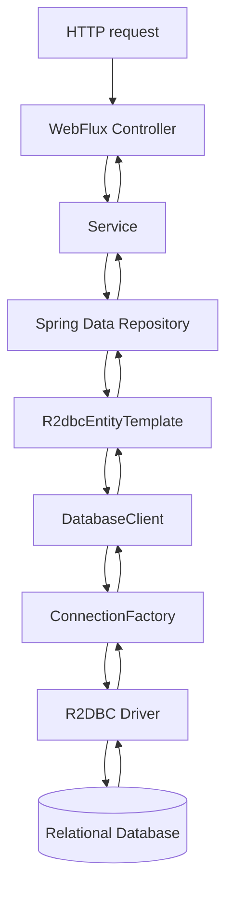

# Các thành phần chính và mối liên hệ trong một ứng dụng R2DBC

R2DBC (Reactive Relational Database Connectivity) là đặc tả giúp ứng dụng Java truy cập cơ sở dữ liệu quan hệ theo mô hình reactive. Khi dùng Spring Data R2DBC, ứng dụng vẫn làm việc với bảng, hàng, câu lệnh SQL và transaction như một ứng dụng quan hệ thông thường, nhưng các thao tác I/O được biểu diễn bằng `Publisher`, thường được sử dụng qua `Mono` và `Flux` của Project Reactor.

Để hiểu một ứng dụng R2DBC hoạt động như thế nào, cần phân biệt các lớp chịu trách nhiệm kết nối cơ sở dữ liệu, thực thi SQL, ánh xạ dữ liệu và cung cấp API cho tầng nghiệp vụ. Spring Data R2DBC kết nối các lớp này thành một chuỗi thống nhất; mỗi thành phần có một vai trò riêng và thường được ứng dụng sử dụng thông qua thành phần ở mức cao hơn.

## 1. Bức tranh kiến trúc tổng thể

Một ứng dụng Spring Data R2DBC thường có các thành phần chính sau:

| Thành phần | Trách nhiệm |
|---|---|
| WebFlux hoặc tầng giao tiếp reactive | Nhận yêu cầu và trả về `Mono` hoặc `Flux` cho framework xử lý |
| Service | Điều phối nghiệp vụ, kết hợp nhiều thao tác dữ liệu và xác định ranh giới transaction |
| Repository hoặc `R2dbcEntityTemplate` | Cung cấp API thao tác với entity ở mức Spring Data |
| `MappingR2dbcConverter` và `RelationalMappingContext` | Đọc metadata và chuyển đổi giữa entity Java với dữ liệu hàng trong bảng |
| `DatabaseClient` | Thực thi SQL, bind tham số và đọc kết quả ở mức Spring Framework |
| `ConnectionFactory` và R2DBC Driver | Tạo kết nối và chuyển các thao tác R2DBC tới hệ quản trị cơ sở dữ liệu |
| Cơ sở dữ liệu quan hệ | Lưu trữ và xử lý dữ liệu bằng SQL |

Luồng gọi điển hình có thể hình dung như sau:



Trong sơ đồ này, Repository là cách truy cập dữ liệu quen thuộc cho các thao tác theo entity. Nếu cần truy vấn linh hoạt, Service hoặc một lớp chuyên trách có thể dùng trực tiếp `R2dbcEntityTemplate`. Với câu lệnh SQL tùy chỉnh ở mức thấp hơn, ứng dụng có thể dùng `DatabaseClient`.

Các thành phần ánh xạ và transaction hỗ trợ luồng trên theo cách riêng. Converter và mapping context được dùng khi Spring Data chuyển đổi dữ liệu giữa hàng trong cơ sở dữ liệu và đối tượng Java. Transaction manager phối hợp với `ConnectionFactory` để quản lý transaction cho một chuỗi thao tác reactive.

## 2. R2DBC SPI, driver và ConnectionFactory

R2DBC SPI là lớp nền tảng định nghĩa cách một ứng dụng Java giao tiếp với cơ sở dữ liệu quan hệ theo mô hình reactive. SPI không định nghĩa cách tổ chức nghiệp vụ hay repository. Nó cung cấp các abstraction cấp thấp để lấy kết nối, tạo statement, bind giá trị và nhận kết quả.

Các kiểu quan trọng gồm:

- **`ConnectionFactory`**: điểm vào để tạo hoặc lấy một `Connection`. Ứng dụng thường cấu hình một bean `ConnectionFactory` cho cơ sở dữ liệu đang sử dụng.
- **`Connection`**: đại diện cho một kết nối tới cơ sở dữ liệu. Từ kết nối này, driver tạo statement và thực hiện các thao tác SQL.
- **`Statement`**: đại diện cho câu lệnh cần thực thi; hỗ trợ bind giá trị vào các tham số của câu lệnh.
- **`Result`**: biểu diễn kết quả thực thi câu lệnh, có thể chứa các hàng dữ liệu hoặc số hàng bị tác động.
- **`Row`** và **`RowMetadata`**: lần lượt cung cấp giá trị của một hàng và metadata mô tả các cột trong kết quả.

Mỗi hệ quản trị cơ sở dữ liệu cần một R2DBC driver tương ứng, chẳng hạn driver cho PostgreSQL, H2 hoặc Microsoft SQL Server. Driver hiện thực SPI và xử lý giao tiếp cụ thể với hệ quản trị đó. Vì vậy, code ở tầng Spring Data có thể dùng các abstraction chung, trong khi driver đảm nhiệm chi tiết giao thức và kiểu dữ liệu của từng hệ quản trị.

`ConnectionFactory` cũng có thể được bọc bởi connection pool, ví dụ R2DBC Pool. Pool tái sử dụng kết nối để tránh tạo kết nối vật lý mới cho từng thao tác. Pool không thay thế driver; nó quản lý việc cấp phát và thu hồi các kết nối do driver cung cấp.

Ví dụ cấu hình kết nối bằng Spring Boot:

```yaml
spring:
  r2dbc:
    url: r2dbc:postgresql://localhost:5432/customer_db
    username: app_user
    password: change_me
```

Ứng dụng cần khai báo dependency driver phù hợp với URL. Spring Boot có thể tự cấu hình `ConnectionFactory` từ các thuộc tính này khi có driver tương ứng trên classpath. Trong cấu hình thủ công, ứng dụng có thể tạo bean `ConnectionFactory` và truyền bean đó cho các thành phần Spring R2DBC khác.

## 3. DatabaseClient: thực thi SQL ở mức Spring Framework

`DatabaseClient` thuộc Spring Framework, cung cấp API thuận tiện hơn R2DBC SPI để thực thi SQL. Nó nhận `ConnectionFactory`, quản lý việc lấy và giải phóng kết nối cho thao tác, hỗ trợ bind tham số và chuyển kết quả thành đối tượng do ứng dụng chỉ định.

Ví dụ truy vấn trực tiếp bằng `DatabaseClient`:

```java
@Repository
public class PersonSqlRepository {

    private final DatabaseClient databaseClient;

    public PersonSqlRepository(DatabaseClient databaseClient) {
        this.databaseClient = databaseClient;
    }

    public Mono<Person> findById(Long id) {
        return databaseClient.sql("""
                SELECT id, first_name, version
                FROM people
                WHERE id = :id
                """)
            .bind("id", id)
            .map((row, metadata) -> new Person(
                row.get("id", Long.class),
                row.get("first_name", String.class),
                row.get("version", Long.class)
            ))
            .one();
    }
}
```

Ở ví dụ này:

1. `sql(...)` khai báo câu SQL cần chạy.
2. `bind(...)` gắn giá trị cho tham số. Bind tham số giúp truyền dữ liệu đúng kiểu và tránh ghép trực tiếp dữ liệu đầu vào vào chuỗi SQL.
3. `map(...)` đọc `Row` và tự chuyển các cột thành `Person`.
4. `one()` yêu cầu tối đa một kết quả và trả về `Mono<Person>`.

`DatabaseClient` phù hợp khi cần SQL tùy chỉnh, cần kiểm soát rõ câu truy vấn hoặc muốn ánh xạ kết quả theo cấu trúc riêng. Tuy nhiên, nó không tự cung cấp toàn bộ quy tắc ánh xạ entity của Spring Data. Trong ví dụ trên, lập trình viên tự đọc từng cột và tạo đối tượng `Person`.

## 4. MappingR2dbcConverter và RelationalMappingContext

Khi dùng Spring Data R2DBC, ứng dụng thường thao tác với entity Java thay vì đọc từng cột từ `Row`. Hai thành phần hỗ trợ việc này là `RelationalMappingContext` và `MappingR2dbcConverter`.

**`RelationalMappingContext`** lưu metadata về cách entity liên hệ với cấu trúc quan hệ. Metadata được xây dựng từ kiểu Java, quy ước đặt tên và các annotation như `@Table`, `@Column`, `@Id` hoặc `@Version`. Nhờ metadata này, Spring Data biết entity tương ứng với bảng nào, thuộc tính nào tương ứng với cột nào và thuộc tính nào là định danh.

**`MappingR2dbcConverter`** sử dụng metadata đó để chuyển đổi dữ liệu. Khi đọc, converter tạo entity từ giá trị của các cột trong hàng kết quả. Khi ghi, converter chuyển các thuộc tính entity thành các giá trị phù hợp để đưa vào câu lệnh SQL. Các kiểu dữ liệu đặc thù hoặc kiểu miền riêng có thể cần custom conversion.

Ví dụ một entity được ánh xạ tới bảng `people`:

```java
import org.springframework.data.annotation.Id;
import org.springframework.data.annotation.Version;
import org.springframework.data.relational.core.mapping.Column;
import org.springframework.data.relational.core.mapping.Table;

@Table("people")
public record Person(
    @Id Long id,
    @Column("first_name") String firstName,
    @Version Long version
) {}
```

Trong ví dụ này, `@Table` chỉ định tên bảng, `@Id` đánh dấu định danh, `@Column` ánh xạ tên thuộc tính Java sang tên cột và `@Version` đánh dấu trường phiên bản dùng cho optimistic locking. Nếu tên bảng hoặc cột tuân theo naming strategy mặc định, một số annotation có thể được lược bỏ.

Spring Data R2DBC là công nghệ ánh xạ quan hệ theo hướng aggregate, không phải một ORM có persistence context như JPA/Hibernate. Ứng dụng cần thiết kế rõ cách nạp dữ liệu liên quan và thường biểu diễn liên kết giữa các aggregate bằng định danh. Không nên mặc định rằng truy cập một thuộc tính quan hệ sẽ tự kích hoạt lazy loading hoặc cascade như trong JPA.

## 5. R2dbcDialect: khác biệt giữa các hệ quản trị cơ sở dữ liệu

Các hệ quản trị cơ sở dữ liệu có khác biệt về cú pháp SQL, ký hiệu bind parameter, cách trả về giá trị được sinh tự động và một số kiểu dữ liệu. Spring Data R2DBC dùng abstraction **`R2dbcDialect`** để đóng gói các khác biệt này.

Dialect giúp các thành phần Spring Data tạo hoặc điều chỉnh câu SQL theo hệ quản trị đang sử dụng. Nhờ vậy, Repository và `R2dbcEntityTemplate` có thể cung cấp API tương đối nhất quán giữa các driver. Khi viết SQL thủ công, lập trình viên vẫn phải chú ý cú pháp và khả năng tương thích của hệ quản trị đích.

Dialect thường được phát hiện từ cấu hình kết nối hoặc được cung cấp trong cấu hình tùy chỉnh khi cần. Nếu ứng dụng dùng tính năng đặc thù của một hệ quản trị, cần kiểm tra driver và dialect có hỗ trợ tính năng đó hay không.

## 6. R2dbcEntityTemplate và R2dbcEntityOperations

`R2dbcEntityTemplate` là API thao tác dữ liệu ở mức entity do Spring Data R2DBC cung cấp. Nó kết hợp `DatabaseClient`, converter, mapping metadata và dialect để thực hiện các thao tác insert, select, update và delete.

`R2dbcEntityOperations` là abstraction mô tả các thao tác entity mà template cung cấp. Nhờ lập trình theo abstraction này, code tùy chỉnh có thể phụ thuộc vào hợp đồng thao tác dữ liệu thay vì gắn chặt với một cách triển khai cụ thể.

Ví dụ sử dụng template:

```java
import static org.springframework.data.relational.core.query.Criteria.where;
import static org.springframework.data.relational.core.query.Query.query;
import static org.springframework.data.relational.core.query.Update.update;

@Service
public class PersonDataService {

    private final R2dbcEntityTemplate template;

    public PersonDataService(R2dbcEntityTemplate template) {
        this.template = template;
    }

    public Mono<Person> create(Person person) {
        return template.insert(Person.class).using(person);
    }

    public Flux<Person> findByLastName(String lastName) {
        return template.select(Person.class)
            .matching(query(where("lastName").is(lastName)))
            .all();
    }

    public Mono<Long> rename(Long id, String newFirstName) {
        return template.update(Person.class)
            .matching(query(where("id").is(id)))
            .apply(update("firstName", newFirstName));
    }
}
```

Template hữu ích khi cần xây dựng truy vấn động, kết hợp điều kiện theo tham số hoặc thực hiện thao tác entity mà không muốn tạo một repository method riêng cho từng trường hợp. API query của Spring Data làm việc với metadata ánh xạ, vì vậy tên thuộc tính trong điều kiện và phần cập nhật thường là tên thuộc tính của entity; Spring Data chuyển chúng sang tên cột tương ứng.

Có thể dùng `R2dbcEntityTemplate` trực tiếp trong một service hoặc đóng gói nó trong lớp truy cập dữ liệu riêng. Khi chỉ cần CRUD thông thường và truy vấn theo quy ước, Repository thường làm code ngắn gọn hơn.

## 7. Reactive Repository và cách Spring Data nối các lớp

Spring Data R2DBC hỗ trợ Repository reactive. Một interface thường kế thừa `ReactiveCrudRepository<T, ID>` để nhận các thao tác CRUD trả về kiểu reactive.

```java
import org.springframework.data.repository.reactive.ReactiveCrudRepository;
import org.springframework.data.r2dbc.repository.Query;
import reactor.core.publisher.Flux;

public interface PersonRepository
        extends ReactiveCrudRepository<Person, Long> {

    Flux<Person> findByLastName(String lastName);

    @Query("SELECT * FROM people WHERE status = :status")
    Flux<Person> findByStatus(String status);
}
```

Spring Data tạo implementation cho interface Repository khi ứng dụng khởi động. Implementation mặc định thực hiện các thao tác entity thông qua hạ tầng Spring Data R2DBC, trong đó có `R2dbcEntityOperations` và `R2dbcEntityTemplate`. Vì vậy, code ứng dụng có thể gọi `save`, `findById`, `findAll`, `deleteById` hoặc các query method mà không cần tự viết phần lấy connection và ánh xạ từng hàng.

Repository hỗ trợ hai cách khai báo truy vấn phổ biến:

- **Derived query**: Spring Data phân tích tên method, ví dụ `findByLastName`, để tạo truy vấn tương ứng theo thuộc tính entity.
- **`@Query`**: lập trình viên cung cấp SQL khi cần kiểm soát câu lệnh hoặc dùng cú pháp riêng của hệ quản trị.

Repository là lựa chọn phù hợp cho các thao tác gắn với một aggregate và có quy tắc truy vấn ổn định. Khi truy vấn có nhiều nhánh điều kiện hoặc được lắp ghép động, có thể chuyển phần đó sang `R2dbcEntityTemplate` hoặc `DatabaseClient`.

## 8. Service và Controller giữ cho luồng reactive liền mạch

Repository, template và `DatabaseClient` trả về kiểu reactive. Tầng Service nên tiếp tục kết hợp các kết quả bằng các toán tử Reactor như `map`, `flatMap`, `zip`, `then` hoặc `onErrorResume`, rồi trả lại `Mono` hay `Flux` cho tầng gọi.

```java
@Service
public class PersonService {

    private final PersonRepository repository;

    public PersonService(PersonRepository repository) {
        this.repository = repository;
    }

    public Mono<Person> getPerson(Long id) {
        return repository.findById(id);
    }

    public Flux<Person> searchByLastName(String lastName) {
        return repository.findByLastName(lastName);
    }
}
```

Nếu ứng dụng dùng Spring WebFlux, Controller có thể trả trực tiếp các kiểu này:

```java
@RestController
@RequestMapping("/people")
public class PersonController {

    private final PersonService service;

    public PersonController(PersonService service) {
        this.service = service;
    }

    @GetMapping("/{id}")
    public Mono<Person> getById(@PathVariable Long id) {
        return service.getPerson(id);
    }

    @GetMapping
    public Flux<Person> search(@RequestParam String lastName) {
        return service.searchByLastName(lastName);
    }
}
```

`Mono<T>` biểu diễn một kết quả bất đồng bộ có thể có hoặc không có giá trị; `Flux<T>` biểu diễn một chuỗi gồm không, một hoặc nhiều phần tử. Các publisher thường chỉ bắt đầu thực thi khi có subscriber. Trong WebFlux, framework đăng ký và ghi kết quả HTTP theo publisher được Controller trả về.

Không nên gọi `block()` hoặc tự `subscribe()` trong luồng xử lý request thông thường. `block()` chặn thread đang gọi; `subscribe()` tự tách luồng thực thi và có thể khiến tầng gọi không còn kiểm soát thời điểm hoàn tất, lỗi hoặc transaction. Hãy trả publisher về cho tầng trên và ghép các thao tác bằng toán tử reactive.

## 9. Transaction trong ứng dụng R2DBC

Một nghiệp vụ có thể cần thực hiện nhiều câu SQL như một đơn vị: tất cả cùng commit nếu thành công hoặc rollback nếu có lỗi. Spring quản lý transaction R2DBC thông qua `R2dbcTransactionManager`, được cấu hình với `ConnectionFactory` tương ứng.

Với phương thức reactive được quản lý bởi Spring, có thể dùng `@Transactional`:

```java
@Service
public class TransferService {

    private final AccountRepository accounts;

    public TransferService(AccountRepository accounts) {
        this.accounts = accounts;
    }

    @Transactional
    public Mono<Void> transfer(Long fromId, Long toId, BigDecimal amount) {
        return accounts.debit(fromId, amount)
            .then(accounts.credit(toId, amount))
            .then();
    }
}
```

Ví dụ minh họa ranh giới transaction; các method `debit` và `credit` cần được triển khai sao cho publisher chỉ hoàn tất khi câu lệnh tương ứng đã thực thi. Transaction reactive được gắn với Reactor Context và subscription của publisher, thay vì dựa vào thread-local như cách quản lý transaction imperative truyền thống.

Vì vậy, toàn bộ thao tác cần nằm trong cùng chuỗi reactive thuộc ranh giới transaction. Nếu tự gọi `subscribe()` bên trong phương thức hoặc tách công việc sang một subscription độc lập, thao tác đó có thể nằm ngoài transaction mong muốn. Cũng cần bảo đảm các thao tác tham gia cùng một `ConnectionFactory` và được thực thi qua hạ tầng Spring có hỗ trợ tham gia transaction.

Với cách điều khiển tường minh, có thể dùng `TransactionalOperator` để bọc một publisher. Cả `@Transactional` và `TransactionalOperator` đều cần được dùng đúng với kiểu trả về reactive; transaction manager JDBC không thay thế cho `R2dbcTransactionManager`.

## 10. Entity callbacks và auditing

Trong một số ứng dụng, entity cần được điều chỉnh ở các thời điểm nhất định của vòng đời lưu hoặc đọc dữ liệu. Spring Data R2DBC cung cấp cơ chế entity callback để thực hiện công việc trước hoặc sau các giai đoạn chuyển đổi và lưu entity. Ví dụ, ứng dụng có thể chuẩn hóa dữ liệu trước khi chuyển entity thành giá trị SQL, hoặc bổ sung xử lý sau khi entity được đọc.

Auditing là trường hợp sử dụng phổ biến. Các annotation như `@CreatedDate`, `@LastModifiedDate`, `@CreatedBy` và `@LastModifiedBy` có thể được dùng để ghi nhận thời điểm hoặc người tạo/cập nhật. Ứng dụng cần bật cấu hình auditing R2DBC và cung cấp thông tin người dùng hiện tại nếu muốn theo dõi `createdBy` hoặc `lastModifiedBy`.

Callback nên phục vụ các quy tắc liên quan đến vòng đời entity. Nghiệp vụ chính, gọi dịch vụ bên ngoài hoặc điều phối nhiều aggregate thường dễ kiểm soát hơn khi đặt ở tầng Service.

## 11. Cấu hình các thành phần trong ứng dụng

Trong ứng dụng Spring Boot, auto-configuration thường tạo các bean cơ bản dựa trên dependency và cấu hình `spring.r2dbc.*`. Tùy phiên bản và cách tổ chức ứng dụng, các bean thường gặp gồm:

- `ConnectionFactory`: kết nối tới cơ sở dữ liệu thông qua R2DBC driver.
- `DatabaseClient`: thực thi SQL trên `ConnectionFactory`.
- `R2dbcEntityTemplate`: cung cấp thao tác entity dựa trên `DatabaseClient`, converter và dialect.
- Repository proxy: được phát hiện và tạo từ các interface Repository đã khai báo.
- `R2dbcTransactionManager`: quản lý transaction reactive nếu ứng dụng cấu hình hoặc auto-configuration cung cấp bean phù hợp.

Nếu cần cấu hình thủ công, có thể khai báo transaction manager và bật quét Repository như sau:

```java
@Configuration
@EnableR2dbcRepositories
public class R2dbcConfiguration {

    @Bean
    R2dbcTransactionManager transactionManager(ConnectionFactory connectionFactory) {
        return new R2dbcTransactionManager(connectionFactory);
    }
}
```

Không cần khai báo lại các bean đã được Spring Boot tự cấu hình. Chỉ bổ sung cấu hình thủ công khi ứng dụng cần thay đổi cách tạo bean, vị trí quét Repository, auditing, custom conversion, connection pool hoặc transaction manager.

## 12. Chọn thành phần nào cho từng nhu cầu?

Các API có thể cùng tồn tại trong một ứng dụng. Việc chọn API phụ thuộc vào mức độ kiểm soát SQL và mức độ gắn kết của thao tác với entity.

| Nhu cầu | Thành phần nên cân nhắc | Lý do |
|---|---|---|
| CRUD thông thường cho một aggregate | Reactive Repository | API ngắn gọn, có sẵn các thao tác phổ biến và query method |
| Truy vấn động hoặc thao tác entity theo điều kiện được lắp ghép lúc chạy | `R2dbcEntityTemplate` | Tận dụng mapping metadata và API fluent của Spring Data |
| SQL tùy chỉnh, projection riêng hoặc kết quả không khớp trực tiếp với entity | `DatabaseClient` | Kiểm soát câu SQL và cách ánh xạ kết quả |
| Tích hợp trực tiếp với chức năng đặc thù của driver | R2DBC SPI | Truy cập các abstraction kết nối và statement ở mức thấp |

Thông thường, tầng nghiệp vụ chỉ cần phụ thuộc vào Repository hoặc một abstraction truy cập dữ liệu do ứng dụng định nghĩa. Chỉ đi xuống template, `DatabaseClient` hoặc SPI khi yêu cầu thực tế cần mức kiểm soát tương ứng.

## 13. Những điểm cần lưu ý khi kết hợp các thành phần

**Giữ luồng reactive xuyên suốt.** Một thao tác R2DBC trả về publisher. Nếu chặn luồng bằng `block()` hoặc chuyển sang JDBC đồng bộ trong cùng request, ứng dụng có thể mất lợi ích của mô hình non-blocking và làm nghẽn thread xử lý.

**Quản lý kết nối qua hạ tầng Spring.** Khi dùng `DatabaseClient`, Repository hoặc template, các thành phần này phối hợp với `ConnectionFactory` để quản lý vòng đời kết nối. Khi dùng SPI trực tiếp, cần bảo đảm kết nối được đóng hoặc trả về pool đúng cách, kể cả khi có lỗi hoặc hủy subscription.

**Không mặc định có hành vi của JPA.** Spring Data R2DBC không cung cấp persistence context, dirty checking, lazy loading hoặc cascade theo cách của JPA. Hãy viết rõ các thao tác cần thực hiện và thiết kế aggregate phù hợp với mô hình quan hệ.

**Transaction phụ thuộc vào subscription.** Một chuỗi publisher chỉ thuộc cùng transaction khi được chạy trong đúng ranh giới reactive transaction. Tránh tạo subscription độc lập cho một phần nghiệp vụ cần rollback cùng phần còn lại.

**Reactive không tự động làm truy vấn nhanh hơn.** R2DBC giúp sử dụng I/O non-blocking và phối hợp nhiều thao tác mà không phải giữ thread chờ I/O. Hiệu năng thực tế còn phụ thuộc vào truy vấn, chỉ mục, pool, driver, tải cơ sở dữ liệu và cách ứng dụng xử lý backpressure.

## 14. Tổng kết mối quan hệ giữa các lớp

Một ứng dụng Spring Data R2DBC thường bắt đầu từ `ConnectionFactory`, nơi driver cung cấp kết nối theo R2DBC SPI. `DatabaseClient` dùng kết nối đó để thực thi SQL. Spring Data bổ sung mapping metadata và converter để làm việc với entity, đồng thời cung cấp `R2dbcEntityTemplate` làm API thao tác entity. Repository xây dựng trên hạ tầng này để cung cấp các method CRUD và truy vấn theo tên. Service kết hợp các publisher thành nghiệp vụ; WebFlux hoặc một reactive consumer khác đăng ký và xử lý kết quả. Khi cần tính nguyên tử, `R2dbcTransactionManager` phối hợp với cùng `ConnectionFactory` để quản lý transaction cho chuỗi reactive.

Hiểu đúng trách nhiệm của từng lớp giúp lựa chọn abstraction phù hợp: Repository cho CRUD và truy vấn ổn định, template cho thao tác entity linh hoạt, `DatabaseClient` cho SQL tùy chỉnh và R2DBC SPI cho tích hợp cấp thấp. Dù chọn API nào, các thành phần đều cần phối hợp trên cùng mô hình reactive để việc quản lý kết nối, ánh xạ dữ liệu và transaction diễn ra nhất quán.
