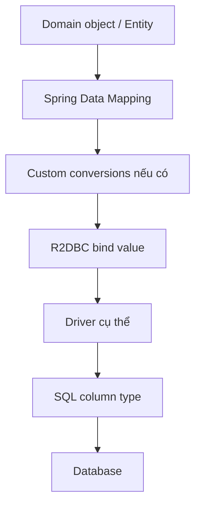

# Ánh xạ UUID, giá trị tiền tệ và kiểu số chính xác

## 1. Vì sao cần quan tâm đến kiểu dữ liệu?

Khi một entity Java được lưu bằng Spring Data R2DBC, mapping layer phải chuyển giá trị từ kiểu Java sang kiểu mà R2DBC driver và hệ quản trị cơ sở dữ liệu hỗ trợ. Khi đọc dữ liệu, quá trình diễn ra theo chiều ngược lại.

Với các kiểu đơn giản như `String` hoặc `Integer`, việc ánh xạ thường khá trực tiếp. Nhưng một số kiểu cần được lựa chọn và biểu diễn cẩn thận:

- **UUID:** định danh cần có cách lưu thống nhất giữa Java, driver và schema.
- **Giá trị tiền tệ:** cần giữ chính xác giá trị số và mã tiền tệ, đồng thời áp dụng quy tắc làm tròn đúng nghiệp vụ.
- **Kiểu số chính xác:** cần phân biệt số nguyên, số thập phân chính xác và số dấu phẩy động gần đúng.

Một lựa chọn kiểu dữ liệu sai có thể làm mất độ chính xác, gây lỗi chuyển đổi, làm sai phép so sánh hoặc khiến dữ liệu không tương thích khi đổi database/driver. Vì vậy, cần thiết kế đồng thời kiểu Java, kiểu SQL, quy tắc mapping và quy tắc nghiệp vụ.

## 2. Ánh xạ UUID trong Java và cơ sở dữ liệu

Java cung cấp kiểu `java.util.UUID` để biểu diễn định danh UUID. Một UUID có 128 bit và thường được hiển thị dưới dạng chuỗi hexadecimal có dấu gạch ngang, ví dụ:

```text
8f14e45f-ea3d-4a5b-9c2d-123456789abc
```

Trong Java:

```java
UUID id = UUID.randomUUID();
UUID parsed = UUID.fromString("8f14e45f-ea3d-4a5b-9c2d-123456789abc");
```

`UUID.randomUUID()` tạo UUID ngẫu nhiên theo cơ chế của JDK. UUID cũng có thể được cấp từ hệ thống khác, sinh theo thuật toán khác hoặc được database tạo ra tùy thiết kế. Điều quan trọng là mọi thành phần phải thống nhất cách biểu diễn và cách sinh ID.

### 2.1. Chọn kiểu cột UUID theo hệ quản trị

Không phải hệ quản trị nào cũng lưu UUID bằng cùng một kiểu SQL:

| Hệ quản trị | Kiểu lưu thường gặp | Ghi chú |
| --- | --- | --- |
| PostgreSQL | `UUID` | Có kiểu UUID native; driver PostgreSQL R2DBC hỗ trợ ánh xạ với `java.util.UUID` |
| H2 | `UUID` | Có kiểu UUID; cần dùng đúng driver R2DBC H2 và phiên bản tương thích |
| SQL Server | `UNIQUEIDENTIFIER` | Kiểu định danh riêng của SQL Server; cần xác nhận mapping của driver đang dùng |
| MySQL | `BINARY(16)` hoặc `CHAR(36)` | Thường biểu diễn UUID bằng 16 byte hoặc chuỗi; không có kiểu UUID native giống PostgreSQL |

Với PostgreSQL, schema có thể khai báo:

```sql
CREATE TABLE customer (
    id UUID PRIMARY KEY,
    name VARCHAR(200) NOT NULL
);
```

Entity Java tương ứng:

```java
@Table("customer")
public class Customer {

    @Id
    private UUID id;

    private String name;
}
```

Khi driver hỗ trợ mapping native, Spring Data R2DBC có thể chuyển giá trị `UUID` qua R2DBC SPI mà không cần tự đổi thành chuỗi. Hãy sử dụng kiểu SQL và driver phù hợp với database đang chạy.

### 2.2. UUID lưu dưới dạng `CHAR(36)`

Một số schema chọn lưu UUID dưới dạng chuỗi chuẩn có 36 ký tự:

```sql
CREATE TABLE customer (
    id CHAR(36) PRIMARY KEY,
    name VARCHAR(200) NOT NULL
);
```

Kiểu Java vẫn có thể là `UUID`, nhưng persistence layer cần chuyển đổi giữa `UUID` và `String`. Cách này dễ quan sát trong SQL dump và log, đổi lại cần nhiều dung lượng hơn dạng nhị phân và phải thống nhất chữ thường/chữ hoa, dấu gạch ngang cùng định dạng chuỗi.

Một converter ghi UUID thành chuỗi có thể được định nghĩa như sau:

```java
import org.springframework.core.convert.converter.Converter;
import org.springframework.data.convert.WritingConverter;

import java.util.UUID;

@WritingConverter
public class UuidToStringConverter implements Converter<UUID, String> {

    @Override
    public String convert(UUID source) {
        return source.toString();
    }
}
```

Converter đọc chiều ngược lại:

```java
import org.springframework.core.convert.converter.Converter;
import org.springframework.data.convert.ReadingConverter;

import java.util.UUID;

@ReadingConverter
public class StringToUuidConverter implements Converter<String, UUID> {

    @Override
    public UUID convert(String source) {
        return UUID.fromString(source);
    }
}
```

Các converter cần được đăng ký vào `R2dbcCustomConversions` của ứng dụng. Ví dụ cấu hình theo dialect đang sử dụng:

```java
@Configuration
public class R2dbcMappingConfiguration {

    @Bean
    R2dbcCustomConversions r2dbcCustomConversions(R2dbcDialect dialect) {
        return R2dbcCustomConversions.of(
                dialect,
                List.of(
                        new UuidToStringConverter(),
                        new StringToUuidConverter()
                )
        );
    }
}
```

Các import và cách lấy `R2dbcDialect` có thể khác theo phiên bản Spring Data R2DBC. Khi bổ sung custom conversions, cần bảo đảm cấu hình giữ lại các converter mặc định và converter do dialect cung cấp theo cách mà phiên bản đang dùng yêu cầu.

Chỉ nên dùng cách chuyển UUID sang `String` khi schema thực sự lưu chuỗi. Nếu driver đã hỗ trợ UUID native, converter không cần thiết và có thể làm sai kiểu bind nếu đăng ký không phù hợp.

### 2.3. UUID lưu dưới dạng `BINARY(16)`

Một lựa chọn khác là lưu 128 bit UUID vào 16 byte:

```sql
CREATE TABLE customer (
    id BINARY(16) PRIMARY KEY,
    name VARCHAR(200) NOT NULL
);
```

Dạng nhị phân tiết kiệm dung lượng và có thể có lợi cho index so với chuỗi dài. Tuy nhiên, cần thống nhất chính xác thứ tự byte khi chuyển từ `UUID` sang `byte[]` và ngược lại. Một số hệ quản trị hoặc hàm UUID có thể sử dụng quy tắc sắp xếp byte riêng; không được giả định mọi cách chuyển đổi đều tương thích.

Nếu tự viết converter UUID/byte array, phải kiểm thử round-trip với UUID đã biết và xác nhận dữ liệu đọc từ các client khác có cùng quy ước. Đặc biệt, không được thay đổi thứ tự byte giữa các phiên bản ứng dụng khi database đã chứa dữ liệu cũ.

Với schema MySQL, hãy xác nhận driver R2DBC hỗ trợ bind `byte[]` cho `BINARY(16)` và chọn một quy ước chuyển đổi thống nhất. Nếu hệ thống cần khả năng đọc dữ liệu từ nhiều công cụ, lưu chuỗi `CHAR(36)` có thể dễ vận hành hơn dù tốn dung lượng.

### 2.4. UUID do ứng dụng tạo hay database tạo?

Có hai cách thường gặp:

**Ứng dụng tạo UUID trước khi insert:**

```java
Customer customer = new Customer();
customer.setId(UUID.randomUUID());
customer.setName("Lan Nguyen");
return customerRepository.save(customer);
```

Ưu điểm là ID có sẵn trước khi ghi database, có thể dùng trong event, log hoặc phối hợp nhiều thao tác. Ứng dụng cũng có thể tạo ID khi chưa kết nối database. Cần bảo đảm schema cho phép insert ID do ứng dụng cung cấp.

**Database tạo UUID:**

PostgreSQL có thể sử dụng hàm sinh UUID làm default, ví dụ:

```sql
CREATE TABLE customer (
    id UUID PRIMARY KEY DEFAULT gen_random_uuid(),
    name VARCHAR(200) NOT NULL
);
```

Để database áp dụng default, câu INSERT phải bỏ cột `id` hoặc yêu cầu `DEFAULT`. Nếu Spring Data gửi một UUID tường minh, database sẽ dùng giá trị đó thay vì gọi default. Khả năng lấy lại ID được sinh phụ thuộc cách Spring Data, dialect và driver thực thi INSERT; hãy kiểm tra generated-value handling của phiên bản đang dùng.

Nếu ứng dụng cần ID ngay khi tạo aggregate, tạo UUID ở Java thường đơn giản hơn. Nếu database là nguồn có thẩm quyền cho ID, hãy cấu hình thao tác insert để database sinh và trả giá trị đó về theo cơ chế được hỗ trợ.

## 3. Kiểu số nguyên và số thập phân trong Java

Java có nhiều kiểu số, nhưng chúng không có cùng đặc tính:

| Kiểu Java | Đặc điểm | Trường hợp thường dùng |
| --- | --- | --- |
| `byte`, `short`, `int`, `long` | Số nguyên có dấu, độ rộng cố định | Bộ đếm, số lượng, khóa số, giá trị nguyên có giới hạn |
| `BigInteger` | Số nguyên độ lớn tùy ý | Số nguyên vượt phạm vi `long` |
| `float`, `double` | Số dấu phẩy động nhị phân, gần đúng | Đo lường, tính toán khoa học, đồ họa khi sai số được chấp nhận |
| `BigDecimal` | Số thập phân độ chính xác tùy ý theo precision/scale | Tiền tệ, tỷ lệ và phép tính cần độ chính xác thập phân |

Đối với dữ liệu tiền tệ và các con số nghiệp vụ cần so sánh chính xác, `BigDecimal` thường phù hợp hơn `float` hoặc `double`.

## 4. Vì sao không dùng `float` hoặc `double` cho tiền?

`float` và `double` biểu diễn số theo chuẩn dấu phẩy động nhị phân. Nhiều phân số thập phân không thể được biểu diễn chính xác trong hệ nhị phân hữu hạn. Ví dụ quen thuộc:

```java
double total = 0.1 + 0.2;
System.out.println(total); // có thể hiển thị 0.30000000000000004
```

Sai số này không phải lỗi của Java; đó là đặc tính của biểu diễn dấu phẩy động. Với tiền, sai số nhỏ có thể tích lũy qua nhiều phép tính, dẫn tới tổng tiền, thuế hoặc số dư không khớp.

Không nên dùng:

```java
double price = 19.99;
double tax = price * 0.1;
```

Thay vào đó, dùng `BigDecimal`:

```java
BigDecimal price = new BigDecimal("19.99");
BigDecimal taxRate = new BigDecimal("0.10");
BigDecimal tax = price.multiply(taxRate);
```

Hãy tạo `BigDecimal` từ chuỗi hoặc từ giá trị nguyên phù hợp. Tránh `new BigDecimal(0.1)` vì constructor nhận `double` sẽ giữ biểu diễn nhị phân gần đúng của giá trị đầu vào. Nếu buộc phải nhận `double`, `BigDecimal.valueOf(double)` thường dễ dự đoán hơn, nhưng dữ liệu tiền tệ nên được nhận và truyền bằng chuỗi, số nguyên đơn vị nhỏ nhất hoặc `BigDecimal` ngay từ đầu.

## 5. Ánh xạ `BigDecimal` với DECIMAL/NUMERIC

SQL có các kiểu số thập phân chính xác như `DECIMAL(p, s)` hoặc `NUMERIC(p, s)`. Trong đó:

- `p` (precision) là tổng số chữ số có nghĩa được lưu.
- `s` (scale) là số chữ số ở bên phải dấu thập phân.
- Số chữ số tối đa ở phần nguyên là `p - s`.

Ví dụ `DECIMAL(12, 2)` cho phép tối đa 12 chữ số, trong đó 2 chữ số ở phần thập phân. Phần nguyên có tối đa 10 chữ số.

Schema PostgreSQL:

```sql
CREATE TABLE invoice_line (
    id BIGINT GENERATED BY DEFAULT AS IDENTITY PRIMARY KEY,
    quantity INTEGER NOT NULL,
    unit_price NUMERIC(19, 4) NOT NULL,
    line_total NUMERIC(19, 4) NOT NULL
);
```

Entity Java:

```java
@Table("invoice_line")
public class InvoiceLine {

    @Id
    private Long id;

    private Integer quantity;

    @Column("unit_price")
    private BigDecimal unitPrice;

    @Column("line_total")
    private BigDecimal lineTotal;
}
```

Spring Data R2DBC và driver hỗ trợ kiểu `BigDecimal` có thể ánh xạ trực tiếp tới cột `NUMERIC`/`DECIMAL`. Cần xác nhận khả năng và quy tắc của driver cho database cụ thể, đặc biệt khi dùng kiểu số có precision/scale lớn.

### 5.1. Chọn precision và scale

Ví dụ:

| Kiểu SQL | Phần nguyên tối đa | Phần thập phân tối đa | Ví dụ giá trị phù hợp |
| --- | ---: | ---: | --- |
| `DECIMAL(10, 2)` | 8 chữ số | 2 chữ số | `12345678.90` |
| `DECIMAL(12, 4)` | 8 chữ số | 4 chữ số | `12345678.1234` |
| `DECIMAL(19, 4)` | 15 chữ số | 4 chữ số | `123456789012345.6789` |
| `DECIMAL(30, 8)` | 22 chữ số | 8 chữ số | Giá trị có độ chính xác cao hơn |

Không nên chọn `DECIMAL(19, 2)` cho mọi con số chỉ vì đó là cấu hình thường thấy. Hãy xem xét:

- Giá trị lớn nhất và nhỏ nhất theo nghiệp vụ.
- Số chữ số thập phân cần lưu trước và sau khi tính toán.
- Đơn vị đo và độ chính xác của nguồn dữ liệu.
- Quy tắc làm tròn và thời điểm làm tròn.
- Khả năng của database, driver và công cụ báo cáo.

Nếu giá trị vượt precision của cột, database có thể từ chối INSERT/UPDATE hoặc báo lỗi số học. Một số database có thể làm tròn giá trị về scale cột trước khi lưu. Hành vi cụ thể cần được xác nhận trên hệ quản trị đang sử dụng; không nên dựa vào việc database sẽ tự xử lý theo cách mong muốn.

## 6. Dùng BigDecimal đúng cách

`BigDecimal` là immutable: các phép toán trả về object mới thay vì sửa object hiện tại.

```java
BigDecimal subtotal = new BigDecimal("125.50");
BigDecimal shipping = new BigDecimal("10.00");

BigDecimal total = subtotal.add(shipping);
```

Không viết:

```java
subtotal.add(shipping); // kết quả bị bỏ qua
```

Phải giữ giá trị trả về:

```java
subtotal = subtotal.add(shipping);
```

### 6.1. Chia số cần quy định scale và rounding

Một phép chia thập phân có thể cho kết quả vô hạn tuần hoàn. Ví dụ `1 / 3` không thể biểu diễn chính xác với một số chữ số hữu hạn. `BigDecimal.divide()` không có scale/rounding phù hợp có thể ném `ArithmeticException` khi kết quả không có biểu diễn thập phân hữu hạn.

```java
BigDecimal amount = new BigDecimal("10.00");
BigDecimal parts = new BigDecimal("3");

BigDecimal share = amount.divide(parts, 2, RoundingMode.HALF_UP);
```

Kết quả được làm tròn đến 2 chữ số thập phân theo `HALF_UP`. Quy tắc làm tròn cần được quyết định bởi nghiệp vụ hoặc quy định kế toán/thuế áp dụng; không mặc định rằng mọi trường hợp đều dùng `HALF_UP`.

Một số `RoundingMode` thường gặp:

| Rounding mode | Hành vi |
| --- | --- |
| `UP` | Làm tròn ra xa 0 nếu cần bỏ chữ số khác 0 |
| `DOWN` | Bỏ phần dư về phía 0 |
| `CEILING` | Làm tròn về phía dương vô cùng |
| `FLOOR` | Làm tròn về phía âm vô cùng |
| `HALF_UP` | Làm tròn gần nhất; trường hợp đúng giữa thì xa 0 |
| `HALF_DOWN` | Làm tròn gần nhất; trường hợp đúng giữa thì về 0 |
| `HALF_EVEN` | Làm tròn gần nhất; trường hợp đúng giữa về chữ số chẵn gần nhất |
| `UNNECESSARY` | Ném lỗi nếu phải làm tròn |

Ví dụ kiểm soát scale:

```java
BigDecimal amount = new BigDecimal("12.345");

BigDecimal rounded = amount.setScale(2, RoundingMode.HALF_EVEN);
// 12.34

BigDecimal exact = amount.setScale(2, RoundingMode.UNNECESSARY);
// Ném ArithmeticException vì cần bỏ chữ số khác 0.
```

`setScale` cũng trả về object mới. Hãy chỉ làm tròn ở ranh giới mà nghiệp vụ quy định, chẳng hạn khi ghi số tiền phải thu hoặc khi tính từng dòng hóa đơn; tránh làm tròn tùy tiện sau mỗi phép nhân/cộng vì có thể làm thay đổi tổng cuối cùng.

### 6.2. So sánh BigDecimal

`BigDecimal.equals()` xét cả giá trị và scale:

```java
new BigDecimal("10.0").equals(new BigDecimal("10.00"));
// false
```

`compareTo()` so sánh giá trị số:

```java
new BigDecimal("10.0").compareTo(new BigDecimal("10.00"));
// 0
```

Khi so sánh số tiền theo giá trị, thường dùng `compareTo()`:

```java
if (amount.compareTo(BigDecimal.ZERO) < 0) {
    throw new IllegalArgumentException("Amount must not be negative");
}
```

Nếu `BigDecimal` được dùng làm key trong collection, cần hiểu khác biệt giữa `equals()` và `compareTo()` vì nó ảnh hưởng `HashMap`, `HashSet` và `TreeMap`.

### 6.3. Scale của object và scale của cột

Hai giá trị `10.0` và `10.00` có cùng giá trị số nhưng scale khác nhau. Database `NUMERIC(p, 2)` thường trả về số có scale tương ứng với cách driver biểu diễn kết quả, nhưng hành vi cụ thể có thể khác theo hệ quản trị và driver.

Nếu ứng dụng cần định dạng tiền tệ thống nhất, hãy chuẩn hóa scale tại tầng domain hoặc presentation theo chính sách đã chọn. Không nên dùng `stripTrailingZeros()` một cách vô thức vì nó có thể tạo scale âm cho một số giá trị, ví dụ biểu diễn `1000` với scale `-3`.

## 7. Mô hình hóa giá trị tiền tệ đúng cách

Một số tiền không chỉ gồm một con số. Về mặt nghiệp vụ, tiền thường gồm:

- **Amount:** số tiền chính xác.
- **Currency:** đơn vị tiền tệ, thường được xác định bằng mã ISO 4217 như `VND`, `USD`, `JPY` hoặc `EUR`.

Không nên chỉ lưu `BigDecimal amount` mà không biết số tiền thuộc loại tiền nào nếu hệ thống có thể xử lý nhiều currency.

Ví dụ schema:

```sql
CREATE TABLE payment (
    id UUID PRIMARY KEY,
    amount NUMERIC(19, 4) NOT NULL,
    currency_code CHAR(3) NOT NULL
);
```

Entity persistence có thể ánh xạ hai cột riêng:

```java
@Table("payment")
public class Payment {

    @Id
    private UUID id;

    private BigDecimal amount;

    @Column("currency_code")
    private String currencyCode;
}
```

Ở tầng domain, có thể gói hai giá trị này thành value object `Money`:

```java
public record Money(BigDecimal amount, Currency currency) {

    public Money {
        Objects.requireNonNull(amount, "amount");
        Objects.requireNonNull(currency, "currency");

        if (amount.signum() < 0) {
            throw new IllegalArgumentException("Amount must not be negative");
        }
    }
}
```

Đây là ví dụ cho nghiệp vụ chỉ cho phép số tiền không âm; nếu domain cần khoản âm như hoàn tiền hoặc bút toán điều chỉnh, invariant phải được thiết kế khác. Persistence adapter có thể chuyển đổi giữa `Money` và hai cột `amount`, `currency_code` khi tạo/lưu entity.

### 7.1. Không giả định mọi currency có hai chữ số thập phân

Một lỗi phổ biến là luôn gọi `setScale(2)` cho mọi số tiền. Số chữ số thập phân được sử dụng trong thanh toán hoặc kế toán phụ thuộc currency và quy tắc nghiệp vụ. Ví dụ, JPY thường không dùng chữ số thập phân trong đơn vị tiền tệ thông thường, trong khi một số currency như KWD có ba chữ số thập phân.

`Currency.getDefaultFractionDigits()` trong Java có thể cung cấp số chữ số fraction mặc định theo dữ liệu currency của JDK:

```java
Currency currency = Currency.getInstance("JPY");
int fractionDigits = currency.getDefaultFractionDigits();
```

Tuy nhiên, số chữ số fraction mặc định của currency không nhất thiết quyết định mọi quy tắc làm tròn của nghiệp vụ. Một hệ thống có thể cần độ chính xác cao hơn khi tính giá, tỷ giá hoặc thuế trước khi làm tròn ở bước thanh toán.

Hãy phân biệt:

- Scale lưu trữ nội bộ của amount.
- Số chữ số hiển thị cho người dùng.
- Số chữ số được phép trong giao dịch thanh toán.
- Quy tắc làm tròn thuế, phí và tỷ giá.

Những giá trị này có thể khác nhau và cần được quy định rõ.

### 7.2. Không cộng hoặc so sánh tiền khác currency trực tiếp

Không nên cộng `10 USD` với `10 EUR` chỉ bằng cách cộng hai `BigDecimal`. Phép toán tiền tệ cần kiểm tra currency giống nhau hoặc thực hiện chuyển đổi theo tỷ giá và thời điểm có thẩm quyền.

Ví dụ logic trong value object:

```java
public Money add(Money other) {
    if (!currency.equals(other.currency())) {
        throw new IllegalArgumentException("Currencies must match");
    }

    return new Money(amount.add(other.amount()), currency);
}
```

Chuyển đổi currency cần thêm nguồn tỷ giá, thời điểm áp dụng, quy tắc làm tròn và khả năng lưu lại tỷ giá dùng cho giao dịch. Không dùng tỷ giá hiện tại để tính lại một giao dịch lịch sử nếu nghiệp vụ yêu cầu giữ tỷ giá tại thời điểm phát sinh.

## 8. Lưu tiền bằng đơn vị nhỏ nhất hay DECIMAL?

Có hai chiến lược lưu trữ phổ biến.

### 8.1. Dùng DECIMAL/NUMERIC và BigDecimal

Ví dụ:

```sql
amount NUMERIC(19, 4) NOT NULL
```

Java:

```java
private BigDecimal amount;
```

Ưu điểm:

- Biểu diễn số thập phân chính xác theo precision/scale.
- Dễ đọc và kiểm tra trực tiếp trong SQL.
- Phù hợp với giá, tỷ lệ, thuế, tỷ giá và các phép tính có scale khác nhau.

Điểm cần quản lý là precision/scale, rounding và hành vi số học của database.

### 8.2. Dùng số nguyên của đơn vị nhỏ nhất

Một số hệ thống lưu tiền bằng số nguyên, ví dụ số cent hoặc đơn vị nhỏ nhất của currency:

```sql
amount_minor BIGINT NOT NULL,
currency_code CHAR(3) NOT NULL
```

Java có thể dùng `long`:

```java
long amountMinor = 1999L; // ví dụ 19.99 nếu currency dùng 2 chữ số fraction
```

Ưu điểm là phép cộng/trừ số nguyên chính xác trong phạm vi kiểu dữ liệu và tránh sai số nhị phân. Nhưng cần biết chính xác currency dùng bao nhiêu chữ số fraction, xử lý overflow, và không dùng chiến lược này một cách máy móc cho tỷ giá hoặc phép tính trung gian cần nhiều chữ số thập phân.

Nếu cần số nguyên lớn hơn `long`, có thể cân nhắc `BigInteger` và kiểu `NUMERIC` tương ứng.

### 8.3. Chọn chiến lược theo nghiệp vụ

| Nhu cầu | Hướng phù hợp |
| --- | --- |
| Giá sản phẩm và tổng hóa đơn có scale xác định | `BigDecimal` + `NUMERIC/DECIMAL` |
| Số tiền thanh toán theo đơn vị nhỏ nhất của một currency | `long`/`BIGINT` nếu giới hạn giá trị phù hợp |
| Tỷ giá, tỷ lệ thuế hoặc tính toán nhiều chữ số | `BigDecimal` với precision/scale được thiết kế rõ |
| Tiền đa currency | Lưu amount và currency code; kiểm tra currency trong domain |
| Số lượng hàng hóa nguyên | `Integer`/`Long` nếu giới hạn phù hợp |

Không nên trộn hai chiến lược mà không có quy ước chuyển đổi rõ ràng. Nếu một bảng lưu amount theo minor units còn bảng khác lưu decimal, persistence adapter phải chịu trách nhiệm chuyển đổi nhất quán.

## 9. Ánh xạ Currency và value object bằng converter

Nếu entity persistence lưu `currency_code` dưới dạng `String` nhưng domain dùng `java.util.Currency`, có thể đăng ký converter:

```java
@WritingConverter
public class CurrencyToStringConverter implements Converter<Currency, String> {

    @Override
    public String convert(Currency source) {
        return source.getCurrencyCode();
    }
}
```

```java
@ReadingConverter
public class StringToCurrencyConverter implements Converter<String, Currency> {

    @Override
    public Currency convert(String source) {
        return Currency.getInstance(source);
    }
}
```

Sau đó đăng ký converter vào `R2dbcCustomConversions` theo dialect. `Currency.getInstance` có thể ném lỗi nếu mã currency không hợp lệ hoặc không được JDK hỗ trợ. Nếu database chứa mã cũ hoặc mã nghiệp vụ riêng, cần có chính sách kiểm tra và chuyển đổi rõ ràng.

Với value object `Money` gồm hai trường amount và currency, một converter đơn giản `Money -> BigDecimal` sẽ làm mất currency. Vì vậy, không nên dùng converter một cột nếu currency là một phần bắt buộc của giá trị domain. Hãy ánh xạ amount và currency code thành hai cột, sau đó tạo `Money` ở tầng domain hoặc dùng cơ chế mapping value object nhiều cột phù hợp với phiên bản Spring Data Relational.

## 10. Chuyển đổi kiểu trong Spring Data R2DBC

Spring Data R2DBC dựa vào mapping metadata, converter và R2DBC driver để chuyển kiểu Java thành kiểu SQL. Một luồng ghi tổng quát:



Khi đọc dữ liệu, quá trình đi ngược lại: driver cung cấp giá trị theo kiểu mà R2DBC SPI hỗ trợ, mapping layer chuyển đổi sang kiểu Java và tạo entity.

Đối với các kiểu phổ biến, driver thường đã hỗ trợ mapping trực tiếp. Chỉ thêm custom converter khi kiểu SQL và kiểu Java không được hỗ trợ trực tiếp hoặc domain cần một cách biểu diễn riêng. Converter phải được đánh dấu rõ chiều đọc/ghi nếu Spring Data không thể tự suy luận chiều chuyển đổi.

### 10.1. Khi nào cần custom converter?

Có thể cần converter khi:

- UUID lưu thành `CHAR(36)` hoặc `BINARY(16)` nhưng driver không tự ánh xạ sang `UUID` theo schema.
- Một enum hoặc value object được lưu dưới dạng chuỗi hoặc số theo quy ước riêng.
- Một kiểu domain cần chuyển thành kiểu scalar mà driver hỗ trợ.
- Database có kiểu dữ liệu riêng và driver trả về kiểu Java khác với kiểu domain.

Không cần converter chỉ vì muốn đổi tên cột. Dùng `@Column` để ánh xạ tên thuộc tính với tên cột. Cũng không nên tạo converter cho `BigDecimal` nếu driver đã hỗ trợ `BigDecimal` với cột `NUMERIC`/`DECIMAL`.

### 10.2. Tránh converter làm mất thông tin

Converter phải giữ nguyên thông tin cần thiết của giá trị. Ví dụ:

- UUID chuyển sang chuỗi phải bảo toàn chính xác 128 bit.
- UUID chuyển sang byte array phải có quy ước thứ tự byte ổn định.
- `Money` không thể chỉ chuyển thành amount nếu currency cũng là phần bắt buộc.
- `BigDecimal` không nên bị chuyển qua `double` trong quá trình mapping.
- Currency code cần được xác thực thay vì âm thầm chuyển thành một giá trị mặc định khi không nhận diện được.

Một converter có thể được gọi ở nhiều nơi và ảnh hưởng cả dữ liệu đọc lẫn ghi. Hãy kiểm thử cả hai chiều, bao gồm null handling và các giá trị biên.

## 11. Kiểu số chính xác khác

Ngoài tiền, nhiều dữ liệu nghiệp vụ cần chọn đúng kiểu số:

| Dữ liệu | Java | SQL gợi ý | Lưu ý |
| --- | --- | --- | --- |
| Số lượng nguyên | `Integer`, `Long` | `INTEGER`, `BIGINT` | Chọn phạm vi đủ lớn và ràng buộc không âm nếu cần |
| Số thứ tự hoặc bộ đếm | `Long` | `BIGINT` | Tránh tràn số khi tăng lâu dài |
| Tỷ lệ phần trăm | `BigDecimal` | `NUMERIC(p, s)` | Quy định rõ lưu `0.15` hay `15.00` |
| Tỷ giá | `BigDecimal` | `NUMERIC(p, s)` | Cần scale đủ cho độ chính xác tỷ giá |
| Đo lường gần đúng | `double` | `DOUBLE PRECISION` | Chấp nhận sai số dấu phẩy động |
| Số nguyên rất lớn | `BigInteger` | `NUMERIC(p, 0)` | Kiểm tra giới hạn precision của database |

Đối với phần trăm, nên thống nhất một quy ước. Ví dụ, `0.15` biểu diễn 15% theo tỷ lệ, còn `15.00` biểu diễn 15 điểm phần trăm. Không nên để các service khác nhau sử dụng hai quy ước cho cùng một cột.

## 12. Xử lý precision, scale và overflow

Kiểu Java và kiểu SQL có giới hạn khác nhau. `BigDecimal` có thể biểu diễn giá trị rất lớn, nhưng cột `NUMERIC(p, s)` chỉ lưu được trong phạm vi precision đã định nghĩa. Tương tự, `long` có phạm vi cố định; cộng quá giới hạn sẽ overflow.

Ví dụ kiểm tra precision trước khi ghi:

```java
public BigDecimal normalizeAmount(BigDecimal amount) {
    BigDecimal normalized = amount.setScale(2, RoundingMode.UNNECESSARY);

    if (normalized.precision() > 19) {
        throw new IllegalArgumentException("Amount exceeds supported precision");
    }

    return normalized;
}
```

Đoạn mã chỉ minh họa việc kiểm tra. Với cột `NUMERIC(19, 2)`, cần bảo đảm cả precision và scale phù hợp; `precision()` của `BigDecimal` không thay thế toàn bộ kiểm tra miền giá trị và scale. Có thể dùng `setScale` để xác định rõ số chữ số thập phân trước khi kiểm tra.

Đối với số nguyên, có thể dùng `Math.addExact` hoặc `Math.multiplyExact` để phát hiện overflow thay vì để kết quả tràn âm thầm:

```java
long total = Math.addExact(currentTotal, nextAmount);
```

Hãy kiểm tra ở tầng domain trước khi ghi nếu overflow làm thay đổi ý nghĩa nghiệp vụ. Constraint database vẫn cần được thiết kế để bảo vệ dữ liệu trước các đường ghi khác.

## 13. Kiểm thử mapping UUID và số tiền

Unit test domain có thể kiểm tra logic của value object, nhưng integration test mới xác nhận được driver và database ánh xạ đúng kiểu.

### 13.1. Kiểm thử UUID round-trip

Tạo một UUID cố định, lưu entity, đọc lại theo ID và xác nhận hai UUID bằng nhau:

```java
UUID expectedId = UUID.fromString("8f14e45f-ea3d-4a5b-9c2d-123456789abc");

Customer customer = new Customer(expectedId, "Lan Nguyen");

return customerRepository.save(customer)
        .then(customerRepository.findById(expectedId))
        .doOnNext(actual -> assertEquals(expectedId, actual.getId()));
```

Nếu UUID được lưu dạng `CHAR(36)` hoặc `BINARY(16)`, kiểm thử phải chạy với custom converter và schema thực tế. Với UUID do database tạo, cần kiểm tra cả việc generated ID được trả lại cho entity.

### 13.2. Kiểm thử BigDecimal

Có thể dùng các giá trị có scale và precision khác nhau:

```java
BigDecimal expected = new BigDecimal("123456789.1234");
```

Sau khi lưu và đọc, so sánh giá trị theo yêu cầu:

```java
assertEquals(0, expected.compareTo(actual.getAmount()));
```

Nếu scale cũng là một phần hợp đồng dữ liệu, kiểm tra thêm `scale()` hoặc `equals()` sau khi đã xác định database/driver có giữ scale như mong muốn hay không. Không nên dùng `double` trong assertion cho dữ liệu tiền tệ.

### 13.3. Kiểm thử giá trị biên

Nên kiểm tra:

- UUID hợp lệ, UUID sai định dạng và UUID null nếu schema cho phép.
- Giá trị `BigDecimal` tại giới hạn precision của cột.
- Giá trị vượt giới hạn và hành vi lỗi của database.
- Giá trị có nhiều chữ số thập phân hơn scale của cột.
- Giá trị âm, zero và dương theo quy tắc nghiệp vụ.
- Currency code hợp lệ và không hợp lệ.
- Round-trip của custom converter theo cả hai chiều.

## 14. Những lỗi thường gặp

| Triệu chứng | Nguyên nhân có thể có | Cách xử lý |
| --- | --- | --- |
| Không bind được UUID | Driver không hỗ trợ kiểu UUID cho cột đang dùng hoặc schema dùng kiểu khác | Kiểm tra kiểu SQL và driver; cân nhắc converter cho `CHAR(36)`/`BINARY(16)` |
| UUID đọc được nhưng không giống giá trị ban đầu | Thứ tự byte không thống nhất khi lưu dạng nhị phân | Chuẩn hóa quy ước byte và kiểm thử round-trip với dữ liệu cố định |
| UUID bị lưu thành chuỗi trong cột nhị phân | Converter hoặc schema không khớp kiểu | Đồng bộ kiểu cột, kiểu bind và converter |
| Tổng tiền có phần lẻ bất thường | Dùng `double`/`float` hoặc chuyển qua kiểu gần đúng | Dùng `BigDecimal` từ chuỗi và cột `NUMERIC/DECIMAL` |
| `ArithmeticException` khi chia | Phép chia không có scale/rounding cho kết quả tuần hoàn | Chọn scale và `RoundingMode` theo nghiệp vụ |
| Database báo numeric overflow | Giá trị vượt precision cột | Thiết kế lại precision hoặc kiểm tra miền giá trị trước khi ghi |
| Giá trị tiền mất chữ số thập phân | Scale cột quá nhỏ hoặc database làm tròn theo quy tắc riêng | Xem lại scale, SQL thực tế và quy tắc làm tròn |
| `equals()` trả false với hai số nhìn giống nhau | `BigDecimal` có scale khác nhau | Dùng `compareTo()` khi so sánh giá trị số |
| Không thể cộng hai Money | Currency khác nhau | Kiểm tra currency hoặc thực hiện quy trình quy đổi có tỷ giá |
| Giá trị sau đọc khác format mong muốn | Driver/database trả scale hoặc kiểu Java khác dự kiến | Chuẩn hóa ở domain/presentation và kiểm thử với driver thật |

## 15. Quy trình lựa chọn kiểu và mapping

Khi thiết kế một thuộc tính UUID hoặc số chính xác trong Spring Data R2DBC, có thể làm theo trình tự:

1. Xác định ý nghĩa domain và phạm vi giá trị hợp lệ.
2. Chọn kiểu Java phù hợp: `UUID`, `BigDecimal`, `BigInteger`, `Long` hoặc kiểu khác.
3. Chọn kiểu SQL tương ứng với hệ quản trị: `UUID`, `CHAR(36)`, `BINARY(16)`, `NUMERIC(p, s)`, `BIGINT`...
4. Kiểm tra khả năng mapping native của R2DBC driver đang sử dụng.
5. Chỉ viết custom converter khi mapping mặc định không đáp ứng schema hoặc kiểu domain.
6. Với tiền tệ, lưu currency code cùng amount và xác định scale/rounding theo nghiệp vụ.
7. Tránh chuyển qua `float`/`double` nếu yêu cầu số học thập phân chính xác.
8. Kiểm thử round-trip, giá trị biên, overflow, null và dữ liệu do database sinh.
9. Quản lý thay đổi kiểu cột và converter bằng migration có phiên bản, đồng thời duy trì tương thích dữ liệu cũ.

UUID cần một cách biểu diễn nhất quán giữa Java, driver và schema. Giá trị tiền tệ cần `BigDecimal` hoặc một biểu diễn số nguyên phù hợp, đồng thời phải mang theo currency và quy tắc làm tròn. Các kiểu số chính xác cần được thiết kế với precision, scale và phạm vi phù hợp. Khi các quyết định này được thống nhất ở domain, mapping layer và database, Spring Data R2DBC có thể chuyển dữ liệu qua lại mà không làm mất ý nghĩa hoặc độ chính xác của giá trị.
