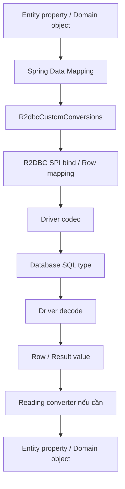

# Ánh xạ JSON, mảng và kiểu dữ liệu đặc thù trình điều khiển

Spring Data Relational R2DBC ánh xạ property của entity Java sang cột quan hệ thông qua metadata, conversion và khả năng mã hóa dữ liệu của R2DBC driver. Với các kiểu đơn giản như `String`, `Long` hoặc `LocalDate`, việc chuyển đổi thường được hỗ trợ trực tiếp. Với JSON, SQL array, enum riêng của database, kiểu mạng hoặc các kiểu đặc thù khác, ứng dụng cần hiểu rõ kiểu SQL mà cột sử dụng và kiểu Java mà driver hỗ trợ.

Điểm quan trọng là R2DBC SPI không chuẩn hóa mọi kiểu dữ liệu mở rộng của từng database thành một kiểu Java duy nhất. Driver chịu trách nhiệm codec (mã hóa/giải mã) cho kiểu SQL riêng. Spring Data có thể bổ sung lớp chuyển đổi qua `R2dbcCustomConversions`, còn `DatabaseClient` cho phép bind giá trị có kiểu một cách tường minh. Vì vậy, một entity có thể dùng kiểu Java thuần, kiểu wrapper riêng của driver hoặc domain type được chuyển đổi bằng converter.

## 1. Các lớp tham gia vào quá trình ánh xạ

Khi ghi dữ liệu, property của entity được Spring Data đọc, chuyển đổi nếu cần, sau đó bind vào statement. R2DBC driver chuyển giá trị Java thành dạng mà database hiểu. Khi đọc, driver giải mã giá trị SQL thành kiểu Java mà nó hỗ trợ; Spring Data tiếp tục chuyển đổi sang kiểu property của entity nếu có converter phù hợp.



Các thành phần có trách nhiệm khác nhau:

- **Spring Data mapping:** biết entity, table, column và property nào cần lưu hoặc đọc.
- **Custom conversions:** chuyển đổi giữa kiểu domain và kiểu store mà driver có thể bind/đọc.
- **R2DBC SPI:** cung cấp API chuẩn để tạo statement, bind tham số và tiêu thụ result.
- **Driver codec:** biết cách biểu diễn kiểu SQL của database cụ thể trên giao thức của driver.
- **Database:** quyết định kiểu cột, constraint, toán tử và cách lưu trữ dữ liệu thực tế.

Một converter Spring Data không thể tự tạo khả năng cho driver nếu driver không biết bind kiểu đích. Tương tự, driver có codec cho JSON không có nghĩa Spring Data tự động biết cách chuyển JSON đó thành bất kỳ POJO nào. Hai lớp cần được kết nối đúng.

## 2. Phân biệt JSON, JSON array và SQL ARRAY

Ba khái niệm thường bị nhầm lẫn:

| Dạng dữ liệu | Ví dụ | Ý nghĩa |
| --- | --- | --- |
| JSON object | `{"color":"blue","size":3}` | Một tài liệu JSON gồm các cặp key/value |
| JSON array | `["red","green","blue"]` | Một mảng nằm bên trong tài liệu JSON |
| SQL ARRAY | `ARRAY['red', 'green', 'blue']` hoặc giá trị bind vào cột `text[]` | Kiểu dữ liệu mảng của hệ quản trị quan hệ, có kiểu phần tử riêng |

JSON array là nội dung của một giá trị JSON/JSONB. SQL ARRAY là một kiểu SQL độc lập. Cùng chứa nhiều phần tử nhưng chúng có quy tắc kiểu, toán tử, index và khả năng hỗ trợ của driver khác nhau.

Ví dụ PostgreSQL:

```sql
CREATE TABLE product (
    id BIGINT GENERATED BY DEFAULT AS IDENTITY PRIMARY KEY,
    attributes JSONB,
    tags TEXT[]
);
```

Ở đây `attributes` là tài liệu JSONB, còn `tags` là SQL array có phần tử kiểu text. Không thể suy ra property `List<String>` sẽ tự động ánh xạ đúng cho cả hai cột. Cần chọn kiểu Java hoặc converter theo kiểu SQL đích.

## 3. Ánh xạ JSON với PostgreSQL

PostgreSQL cung cấp hai kiểu phổ biến là `json` và `jsonb`. Cả hai lưu tài liệu JSON, nhưng có khác biệt về cách lưu trữ và xử lý nội bộ. `json` giữ biểu diễn văn bản đầu vào, còn `jsonb` lưu dạng nhị phân đã phân tích và hỗ trợ các toán tử/indexing phù hợp. Lựa chọn kiểu cột nên dựa trên nhu cầu truy vấn, indexing và cách ứng dụng cập nhật tài liệu.

R2DBC PostgreSQL driver cung cấp kiểu `io.r2dbc.postgresql.codec.Json` để biểu diễn giá trị JSON. Dùng wrapper này giúp driver nhận biết giá trị cần bind là JSON thay vì mặc định coi một Java `String` là kiểu văn bản thông thường.

### Lưu JSON bằng kiểu `Json` của driver

DDL:

```sql
CREATE TABLE customer_profile (
    id BIGINT GENERATED BY DEFAULT AS IDENTITY PRIMARY KEY,
    profile JSONB NOT NULL
);
```

Entity có thể dùng trực tiếp kiểu `Json` của PostgreSQL driver:

```java
import io.r2dbc.postgresql.codec.Json;
import org.springframework.data.annotation.Id;
import org.springframework.data.relational.core.mapping.Table;

@Table("customer_profile")
public class CustomerProfile {

    @Id
    private Long id;

    private Json profile;

    public CustomerProfile() {
    }

    public CustomerProfile(Long id, Json profile) {
        this.id = id;
        this.profile = profile;
    }

    public Long getId() {
        return id;
    }

    public Json getProfile() {
        return profile;
    }

    public void setProfile(Json profile) {
        this.profile = profile;
    }
}
```

Khi tạo dữ liệu:

```java
Json profile = Json.of("""
        {"displayName":"Lan","preferences":{"language":"vi"}}
        """);

CustomerProfile customer = new CustomerProfile();
customer.setProfile(profile);
```

`Json.of(...)` tạo giá trị JSON mà driver PostgreSQL hiểu. Khi đọc cột JSON/JSONB, có thể nhận `Json` và lấy biểu diễn chuỗi bằng `asString()` để xử lý tiếp. API cụ thể của wrapper phụ thuộc phiên bản driver; hãy tham khảo tài liệu phiên bản đang dùng.

Kiểu `Json` là kiểu đặc thù của PostgreSQL driver, vì vậy entity phụ thuộc vào driver đó. Nếu ứng dụng muốn domain model độc lập với database, có thể dùng converter giữa domain object và kiểu `Json` hoặc dùng một kiểu trung gian được hỗ trợ chung.

### Bind JSON qua `DatabaseClient`

Khi dùng SQL tùy chỉnh, có thể bind `Json` trực tiếp:

```java
Json payload = Json.of("""
        {"source":"web","verified":true}
        """);

Mono<Long> updated = databaseClient.sql(
            "UPDATE customer_profile SET profile = :profile WHERE id = :id"
        )
        .bind("profile", payload)
        .bind("id", 10L)
        .fetch()
        .rowsUpdated();
```

Tên tham số `:profile` là cú pháp của `DatabaseClient`; Spring chuyển nó thành marker phù hợp với dialect. Giá trị `payload` vẫn phải là kiểu mà driver nhận diện là JSON. Nếu bind một `String`, driver có thể xử lý nó như `VARCHAR`/text và database có thể không áp dụng kiểu JSON mong muốn nếu không có cast hoặc ngữ cảnh kiểu rõ ràng.

## 4. Chuyển JSON thành domain object bằng custom converter

Domain model thường muốn làm việc với class Java có kiểu rõ ràng thay vì thao tác chuỗi JSON. Spring Data R2DBC cho phép đăng ký converter đọc và ghi để ánh xạ giữa kiểu JSON của driver và domain object.

Ví dụ domain type:

```java
public record CustomerProfileData(
        String displayName,
        Preferences preferences
) {
    public record Preferences(String language) {
    }
}
```

Converter đọc từ `Json` sang domain object:

```java
import com.fasterxml.jackson.core.JsonProcessingException;
import com.fasterxml.jackson.databind.ObjectMapper;
import io.r2dbc.postgresql.codec.Json;
import org.springframework.core.convert.converter.Converter;
import org.springframework.data.convert.ReadingConverter;

@ReadingConverter
public class JsonToCustomerProfileData
        implements Converter<Json, CustomerProfileData> {

    private final ObjectMapper objectMapper;

    public JsonToCustomerProfileData(ObjectMapper objectMapper) {
        this.objectMapper = objectMapper;
    }

    @Override
    public CustomerProfileData convert(Json source) {
        try {
            return objectMapper.readValue(
                    source.asString(), CustomerProfileData.class
            );
        } catch (JsonProcessingException exception) {
            throw new IllegalArgumentException(
                    "Không thể đọc customer profile JSON", exception
            );
        }
    }
}
```

Converter ghi từ domain object sang `Json`:

```java
import com.fasterxml.jackson.core.JsonProcessingException;
import com.fasterxml.jackson.databind.ObjectMapper;
import io.r2dbc.postgresql.codec.Json;
import org.springframework.core.convert.converter.Converter;
import org.springframework.data.convert.WritingConverter;

@WritingConverter
public class CustomerProfileDataToJson
        implements Converter<CustomerProfileData, Json> {

    private final ObjectMapper objectMapper;

    public CustomerProfileDataToJson(ObjectMapper objectMapper) {
        this.objectMapper = objectMapper;
    }

    @Override
    public Json convert(CustomerProfileData source) {
        try {
            return Json.of(objectMapper.writeValueAsString(source));
        } catch (JsonProcessingException exception) {
            throw new IllegalArgumentException(
                    "Không thể ghi customer profile JSON", exception
            );
        }
    }
}
```

`@ReadingConverter` và `@WritingConverter` làm rõ chiều chuyển đổi. Điều này quan trọng vì một số kiểu Java tổng quát có thể được chuyển đổi theo nhiều hướng và framework cần biết converter nào dùng khi đọc hoặc ghi.

Đăng ký converter với `R2dbcCustomConversions` theo dialect của ứng dụng. Ví dụ cấu hình Java ở mức khái niệm:

```java
@Bean
R2dbcCustomConversions r2dbcCustomConversions(
        R2dbcDialect dialect,
        ObjectMapper objectMapper
) {
    return R2dbcCustomConversions.of(
            dialect,
            List.of(
                    new JsonToCustomerProfileData(objectMapper),
                    new CustomerProfileDataToJson(objectMapper)
            )
    );
}
```

API khởi tạo và cách cung cấp dialect/converters có thể khác giữa các phiên bản Spring Data R2DBC và Spring Boot. Trong ứng dụng dùng `AbstractR2dbcConfiguration`, có thể đăng ký converter qua extension point mà cấu hình cung cấp; trong Spring Boot, cần tích hợp theo cơ chế custom conversions của phiên bản Boot đang dùng. Tránh khai báo thêm một bộ conversion riêng làm mất các converter mặc định của dialect.

Sau khi converter được đăng ký, entity có thể dùng domain type:

```java
@Table("customer_profile")
public class CustomerProfile {

    @Id
    private Long id;

    private CustomerProfileData profile;

    public CustomerProfile(Long id, CustomerProfileData profile) {
        this.id = id;
        this.profile = profile;
    }

    public Long getId() {
        return id;
    }

    public CustomerProfileData getProfile() {
        return profile;
    }
}
```

Khi lưu, converter ghi chuyển `CustomerProfileData` thành `Json`; khi đọc, converter đọc chuyển `Json` thành `CustomerProfileData`. Database vẫn lưu JSONB, còn code nghiệp vụ làm việc với object có kiểu.

## 5. Lưu ý khi dùng JSON

- **Kiểu cột phải đúng:** JSON và JSONB không giống `TEXT`; driver cần biết kiểu giá trị khi bind.
- **Kiểm tra JSON hợp lệ:** wrapper `Json` hoặc converter cần tạo nội dung JSON hợp lệ. JSON sai cú pháp có thể bị từ chối khi database parse.
- **Null khác JSON `null`:** SQL `NULL` là không có giá trị cột; JSON `null` là một giá trị JSON hợp lệ. Hai trạng thái có ngữ nghĩa truy vấn khác nhau.
- **Không nên serialize mọi entity graph:** JSON phù hợp với dữ liệu tài liệu hoặc thuộc tính linh hoạt; quan hệ cần join, foreign key và constraint nên được mô hình hóa bằng bảng quan hệ phù hợp.
- **Đặt giới hạn kích thước:** tài liệu JSON quá lớn làm tăng chi phí truyền, parse và lưu trữ. Chỉ lưu các thuộc tính cần thiết.
- **Quản lý schema JSON:** khi domain object thay đổi, cần nghĩ tới dữ liệu JSON cũ, field thiếu, tên field đổi và cách tương thích ngược.
- **Index và truy vấn:** nếu truy vấn sâu vào JSON thường xuyên, hãy xem toán tử/index của database như GIN index với PostgreSQL JSONB; không giả định mọi database có cùng cú pháp.

Ví dụ phân biệt SQL NULL và JSON null trong PostgreSQL:

```sql
-- SQL NULL: cột không có giá trị
UPDATE customer_profile SET profile = NULL WHERE id = 1;

-- JSON null: cột chứa một giá trị JSON null
UPDATE customer_profile SET profile = 'null'::jsonb WHERE id = 2;
```

Khi ánh xạ sang Java, cần quyết định domain model có phân biệt hai trường hợp này không. Nếu cả hai cùng trở thành `null` ở tầng Java, ứng dụng có thể mất thông tin cần thiết cho nghiệp vụ.

## 6. Ánh xạ SQL ARRAY

SQL ARRAY là kiểu dữ liệu của database có các phần tử cùng kiểu SQL cơ sở. PostgreSQL hỗ trợ nhiều kiểu array, chẳng hạn `text[]`, `integer[]`, `uuid[]` hoặc array của một số kiểu khác. R2DBC PostgreSQL driver có codec cho nhiều kiểu array được hỗ trợ và thường ánh xạ chúng sang Java array có kiểu phần tử tương ứng.

Ví dụ schema:

```sql
CREATE TABLE article (
    id BIGINT GENERATED BY DEFAULT AS IDENTITY PRIMARY KEY,
    title VARCHAR(200) NOT NULL,
    tags TEXT[] NOT NULL DEFAULT '{}'
);
```

Entity:

```java
@Table("article")
public class Article {

    @Id
    private Long id;

    private String title;

    private String[] tags;

    public Article(Long id, String title, String[] tags) {
        this.id = id;
        this.title = title;
        this.tags = tags;
    }
}
```

Khi dùng `String[]` cho cột `text[]`, driver có thể mã hóa từng phần tử theo codec tương ứng. Kiểu phần tử Java phải tương thích với kiểu SQL array. Ví dụ, `Integer[]` phù hợp với một số kiểu integer array; `UUID[]` chỉ dùng khi driver hỗ trợ codec UUID array.

### Bind array qua `DatabaseClient`

Ví dụ PostgreSQL dùng tham số có kiểu array:

```java
String[] tags = {"spring", "r2dbc", "database"};

Mono<Long> updated = databaseClient.sql(
            "UPDATE article SET tags = :tags WHERE id = :id"
        )
        .bind("tags", tags)
        .bind("id", 5L)
        .fetch()
        .rowsUpdated();
```

Driver PostgreSQL nhận mảng Java và mã hóa thành SQL array nếu phần tử thuộc kiểu được hỗ trợ. Cách bind và danh sách kiểu array được hỗ trợ phụ thuộc driver. Với driver không hỗ trợ array native, cần chọn kiểu lưu trữ khác hoặc converter phù hợp; converter chỉ giúp chuyển dữ liệu Java, không tự bổ sung khả năng SQL ARRAY vào database.

### Đọc array

Khi đọc hàng, có thể nhận giá trị array theo kiểu Java mà driver hỗ trợ:

```java
Flux<Article> articles = databaseClient.sql(
            "SELECT id, title, tags FROM article"
        )
        .map((row, metadata) -> new Article(
                row.get("id", Long.class),
                row.get("title", String.class),
                row.get("tags", String[].class)
        ))
        .all();
```

Đoạn code minh họa cách đọc một array PostgreSQL thành `String[]`. Kiểu Java cần khớp codec mà driver cung cấp. Nếu driver trả một dạng array khác hoặc không hỗ trợ trực tiếp kiểu property, hãy dùng converter đọc để chuẩn hóa sang kiểu domain.

### Dùng `List<T>` trong domain model

Nhiều domain model muốn dùng `List<String>` thay vì `String[]`. Có thể chuyển đổi giữa `List<String>` và `String[]` bằng converter có hướng rõ ràng:

```java
@WritingConverter
public class StringListToArray implements Converter<List<String>, String[]> {

    @Override
    public String[] convert(List<String> source) {
        return source.toArray(String[]::new);
    }
}

@ReadingConverter
public class ArrayToStringList implements Converter<String[], List<String>> {

    @Override
    public List<String> convert(String[] source) {
        return List.of(source);
    }
}
```

Đăng ký các converter này trong `R2dbcCustomConversions` cùng dialect phù hợp. Ví dụ trên minh họa một danh sách chuỗi không null; nếu cột hoặc phần tử có thể null, hãy chọn collection implementation và chính sách null phù hợp thay vì dùng `List.of`, vì `List.of` không cho phép phần tử null.

Với property collection, cần phân biệt collection biểu diễn SQL ARRAY với collection biểu diễn quan hệ giữa các entity. Spring Data Relational không tự suy ra rằng mọi `List<OtherEntity>` phải được lưu vào một cột array. Nếu property là danh sách entity liên quan, cần mô hình hóa quan hệ và thao tác lưu tương ứng.

## 7. SQL ARRAY và JSON array: chọn đúng mô hình

| Tiêu chí | SQL ARRAY | JSON array |
| --- | --- | --- |
| Kiểu cột | `text[]`, `integer[]`, ... | `json` hoặc `jsonb` (tùy database) |
| Kiểu phần tử | Cùng kiểu SQL cơ sở | Có thể gồm nhiều kiểu JSON khác nhau |
| Ánh xạ thường gặp | Java array như `String[]`, `Integer[]` | Driver JSON wrapper, `String` hoặc domain object qua converter |
| Ràng buộc kiểu | Database kiểm soát kiểu phần tử của array | Database kiểm tra cú pháp JSON; schema chi tiết thường cần constraint hoặc ứng dụng kiểm soát |
| Truy vấn | Toán tử array riêng của database | Toán tử JSON path/key riêng của database |
| Khả năng di chuyển | Phụ thuộc hỗ trợ SQL ARRAY của database/driver | Phụ thuộc kiểu JSON và codec của database/driver |

Chọn SQL ARRAY khi dữ liệu là tập phần tử đồng nhất, cần kiểu phần tử rõ và database/driver hỗ trợ tốt. Chọn JSON array khi cấu trúc là tài liệu JSON, phần tử có thể là object hoặc dữ liệu có hình dạng linh hoạt. Nếu cần truy vấn từng phần tử, hãy xem khả năng indexing và toán tử của database trước khi quyết định.

## 8. Enum và kiểu dữ liệu do database định nghĩa

Java enum thường có thể được lưu dưới dạng chuỗi hoặc số thông qua converter. Cách đơn giản, dễ đọc và ít phụ thuộc driver là ánh xạ enum thành `VARCHAR`:

```java
public enum OrderStatus {
    NEW,
    PAID,
    SHIPPED
}
```

Converter ghi:

```java
@WritingConverter
public class OrderStatusWriteConverter
        implements Converter<OrderStatus, String> {

    @Override
    public String convert(OrderStatus source) {
        return source.name();
    }
}
```

Converter đọc:

```java
@ReadingConverter
public class OrderStatusReadConverter
        implements Converter<String, OrderStatus> {

    @Override
    public OrderStatus convert(String source) {
        return OrderStatus.valueOf(source);
    }
}
```

Với cách này, cột database thường là `VARCHAR` hoặc kiểu chuỗi tương đương. Khi đổi tên enum constant, cần xem xét dữ liệu cũ và khả năng tương thích. Trong hệ thống lâu dài, có thể dùng một mã lưu trữ ổn định thay vì `name()` trực tiếp.

Một số database có native enum type. Ví dụ PostgreSQL cho phép tạo kiểu enum riêng ở schema. Để bind Java enum trực tiếp vào kiểu native đó, driver có thể cần codec hoặc registrar riêng. Spring Data converter và driver codec có trách nhiệm khác nhau: converter chuyển domain enum sang kiểu Java mà driver nhận biết; codec quyết định cách kiểu Java đó được truyền thành native enum trên giao thức. Hãy theo tài liệu driver về enum registration và mapping cho phiên bản đang dùng.

Các kiểu đặc thù khác có thể gồm `UUID`, `inet`, `interval`, `range`, `hstore`, kiểu hình học hoặc kiểu thời gian mở rộng. Không có một mapping Java thống nhất cho toàn bộ các kiểu này. Kiểm tra codec mà driver cung cấp và quyết định domain model nên phụ thuộc kiểu driver hay dùng converter để tách phụ thuộc.

## 9. Một số kiểu đặc thù phổ biến

| Kiểu database | Kiểu Java có thể gặp | Lưu ý |
| --- | --- | --- |
| UUID | `java.util.UUID` | Kiểm tra driver và database có codec UUID tương ứng |
| JSON/JSONB | `Json` của driver, `String` hoặc domain POJO qua converter | Nên dùng wrapper/codec đúng driver khi cần bảo đảm kiểu JSON khi bind |
| SQL ARRAY | `String[]`, `Integer[]`, `UUID[]` hoặc kiểu array được driver hỗ trợ | Phần tử phải tương thích kiểu SQL và codec |
| Native enum | Java `enum` qua codec riêng hoặc qua `String` converter | Có thể cần đăng ký codec cho native enum |
| Network address | `InetAddress` hoặc kiểu riêng của driver | Chỉ dùng nếu driver hỗ trợ codec tương ứng |
| Date/time mở rộng | `LocalDate`, `LocalTime`, `LocalDateTime`, `OffsetDateTime`, ... | Phụ thuộc kiểu SQL, timezone và hỗ trợ của driver |

Ví dụ PostgreSQL hỗ trợ kiểu `uuid` và driver PostgreSQL có codec cho `UUID` trong các phiên bản tương ứng. Entity có thể khai báo:

```java
@Id
private UUID id;
```

Với kiểu `inet`, driver có thể dùng `InetAddress`. Nếu cần lưu địa chỉ mạng, hãy kiểm tra xem codec trả về đúng kiểu nào và có bảo toàn subnet/prefix hay không. Một `InetAddress` chỉ biểu diễn địa chỉ IP; nó không nhất thiết giữ toàn bộ thông tin CIDR như `192.0.2.0/24`.

Đối với kiểu thời gian, đừng chỉ chọn Java type theo tên gần giống. Ví dụ `timestamp without time zone` và `timestamp with time zone` có ngữ nghĩa khác nhau. Hãy xác định database lưu thời điểm tuyệt đối hay thời gian địa phương, cách driver chuyển đổi timezone và kiểu Java phù hợp với quy tắc nghiệp vụ.

## 10. Custom conversions trong Spring Data R2DBC

Spring Data R2DBC sử dụng `R2dbcCustomConversions` để đăng ký converter giữa kiểu domain và kiểu store. Hai annotation thường dùng:

- `@WritingConverter`: đánh dấu converter được dùng khi ghi từ kiểu domain sang kiểu store/driver.
- `@ReadingConverter`: đánh dấu converter được dùng khi đọc từ kiểu store/driver sang kiểu domain.

Ví dụ tổng quát:

```java
@WritingConverter
public class DomainToStoreConverter
        implements Converter<MyDomainType, DriverValueType> {
    // Chuyển domain value sang kiểu driver hỗ trợ bind.
}

@ReadingConverter
public class StoreToDomainConverter
        implements Converter<DriverValueType, MyDomainType> {
    // Chuyển giá trị driver đọc được sang domain value.
}
```

Trong đó `DriverValueType` có thể là `Json`, `String[]`, `String`, `UUID` hoặc kiểu khác mà driver hỗ trợ. Không chọn kiểu đích chỉ vì nó thuận tiện trong Java; cần bảo đảm driver có thể bind kiểu đó vào cột SQL tương ứng.

### Nguyên tắc viết converter

1. Xác định rõ chiều chuyển đổi: domain → store khi ghi, store → domain khi đọc.
2. Đánh dấu `@WritingConverter` hoặc `@ReadingConverter` để tránh Spring phải suy đoán chiều dùng.
3. Xử lý dữ liệu null theo API mapping và yêu cầu nghiệp vụ; converter không nên giả định mọi đầu vào đều có giá trị.
4. Xử lý lỗi parse/serialize với thông báo có ngữ cảnh, giữ nguyên nguyên nhân gốc để chẩn đoán.
5. Đăng ký converter cùng dialect của database để giữ các converter mặc định cần thiết.
6. Kiểm thử cả chiều ghi và đọc bằng đúng driver/database trong ứng dụng.

Không nên viết converter quá tổng quát như `Converter<Object, String>` nếu không có lý do rõ ràng. Converter rộng có thể cạnh tranh với các conversion mặc định và khiến những kiểu khác bị chuyển đổi ngoài ý muốn.

## 11. Bind kiểu đặc thù trực tiếp bằng R2DBC SPI

Khi thao tác trực tiếp với `Statement`, giá trị truyền vào `bind` phải là kiểu mà driver hỗ trợ:

```java
Json json = Json.of("{\"enabled\":true}");
String[] tags = {"spring", "reactive"};

Statement statement = connection.createStatement(
        "INSERT INTO product_profile (profile, tags) VALUES ($1, $2)"
);

statement.bind(0, json);
statement.bind(1, tags);
```

Đây là ví dụ PostgreSQL với marker `$1`, `$2` trong SQL và index bind bắt đầu từ `0` theo R2DBC SPI. Marker và kiểu dữ liệu cụ thể phụ thuộc driver. Không sao chép cú pháp marker PostgreSQL sang driver khác.

### Bind giá trị null có kiểu

R2DBC SPI không cho phép dùng `bind(index, null)` như một giá trị bind thông thường. Nếu tham số SQL là null, dùng `bindNull(index, Class<?>)` và cung cấp kiểu Java tương ứng:

```java
Statement statement = connection.createStatement(
        "INSERT INTO product_profile (profile) VALUES ($1)"
);

statement.bindNull(0, Json.class);
```

Với SQL NULL cho cột JSON, driver cần biết kiểu tham số để gửi null đúng loại. Cú pháp và khả năng bind null cho kiểu đặc thù vẫn cần được kiểm tra theo driver. Nếu cần lưu JSON `null`, đó là nội dung JSON hợp lệ chứ không phải SQL NULL; hãy truyền một giá trị JSON biểu diễn `null` theo cách driver hỗ trợ.

Với `DatabaseClient`, dùng API bind null có chỉ định kiểu tương ứng của Spring. Đừng bỏ qua kiểu null khi driver không thể suy ra kiểu tham số từ ngữ cảnh SQL.

## 12. Kiểm thử mapping với đúng database và driver

Mapping kiểu đặc thù cần được kiểm thử với driver thật vì codec là thành phần phụ thuộc database. Một bài test chỉ dùng mock repository không chứng minh driver có thể bind hoặc đọc JSONB, SQL ARRAY hay native enum.

Ví dụ kiểm thử lưu rồi đọc JSON:

```java
StepVerifier.create(
        repository.save(new CustomerProfile(null,
                new CustomerProfileData("Lan",
                        new CustomerProfileData.Preferences("vi"))))
                .flatMap(saved -> repository.findById(saved.getId()))
)
        .assertNext(profile -> {
            assertThat(profile.getProfile().displayName()).isEqualTo("Lan");
            assertThat(profile.getProfile().preferences().language()).isEqualTo("vi");
        })
        .verifyComplete();
```

Kiểm thử tương tự nên bao gồm:

- Lưu JSON object và đọc lại thành domain object.
- Lưu JSON array và xác nhận cấu trúc, thứ tự phần tử nếu nghiệp vụ yêu cầu.
- Phân biệt SQL NULL với JSON null.
- Lưu và đọc SQL ARRAY, bao gồm mảng rỗng và phần tử null nếu schema cho phép.
- Kiểm tra UUID, enum hoặc kiểu đặc thù qua driver thực tế.
- Kiểm tra dữ liệu không hợp lệ và xác nhận lỗi được truyền qua publisher.
- Kiểm tra converter đọc và ghi được đăng ký trong đúng cấu hình Spring.

Có thể dùng Testcontainers hoặc một database kiểm thử tương ứng để chạy integration test. Hãy dùng đúng major version của database và driver mà ứng dụng triển khai, vì codec và kiểu SQL có thể khác giữa phiên bản.

## 13. Lỗi thường gặp và cách xử lý

| Biểu hiện | Nguyên nhân có thể | Hướng kiểm tra |
| --- | --- | --- |
| JSON bị database coi là text | Bind `String` trong khi driver cần JSON wrapper/kiểu có ngữ cảnh | Dùng kiểu JSON driver hỗ trợ hoặc cast SQL rõ ràng |
| Không đọc được JSON thành POJO | Chưa có reading converter hoặc converter dùng sai kiểu nguồn | Kiểm tra kiểu driver trả về và đăng ký `@ReadingConverter` |
| Không lưu được domain object vào JSON | Thiếu writing converter hoặc kiểu đích không được driver hỗ trợ | Chuyển domain object thành JSON wrapper/kiểu driver hỗ trợ |
| SQL ARRAY không bind được | Driver không hỗ trợ array hoặc phần tử không có codec | Kiểm tra kiểu array, kiểu phần tử và tài liệu driver |
| `List<T>` không được ánh xạ như mong đợi | Spring Data hiểu collection theo metadata khác hoặc driver cần Java array | Dùng `T[]` hoặc converter hai chiều rõ ràng |
| Native enum bị lỗi codec | Driver chưa đăng ký hoặc không hỗ trợ kiểu enum | Dùng chuỗi/VARCHAR hoặc cấu hình codec theo driver |
| Giá trị null gây lỗi bind | Gọi `bind` với null hoặc thiếu kiểu tham số | Dùng `bindNull` với kiểu Java phù hợp |
| JSON null bị nhầm SQL NULL | Domain model gộp hai trạng thái | Định nghĩa rõ semantics và kiểm thử cả hai trường hợp |
| Thời gian lệch múi giờ | Chọn sai kiểu SQL/Java hoặc giả định driver tự giữ timezone | Kiểm tra kiểu cột, timezone và codec |
| Chạy được với mock nhưng lỗi khi chạy thật | Mock không thực hiện codec của database | Thêm integration test với đúng R2DBC driver |

Khi chẩn đoán, hãy xác định kiểu SQL của cột, kiểu Java thực tế đang bind/đọc, codec của driver, converter Spring Data và cấu hình dialect. Đi theo từng lớp sẽ giúp phân biệt lỗi ở schema, driver hay mapping.

## 14. Cách chọn chiến lược ánh xạ

| Nhu cầu | Hướng tiếp cận |
| --- | --- |
| Lưu một tài liệu JSON trong PostgreSQL | Dùng `Json` của PostgreSQL driver hoặc converter sang `Json` |
| Domain muốn thao tác bằng POJO | Tạo converter đọc/ghi giữa POJO và kiểu JSON driver hỗ trợ |
| Lưu danh sách chuỗi đồng nhất trong PostgreSQL | Dùng SQL ARRAY như `text[]` với `String[]` nếu codec hỗ trợ |
| Domain muốn dùng `List<T>` nhưng cột là SQL ARRAY | Đăng ký converter giữa `List<T>` và `T[]` |
| Lưu mảng object hoặc dữ liệu nhiều hình dạng | Dùng JSON/JSONB nếu ngữ nghĩa tài liệu phù hợp |
| Dùng native enum hoặc kiểu database riêng | Xem codec/registrar của driver hoặc chuyển qua kiểu cơ sở như `String` |
| Cần giảm phụ thuộc driver trong domain model | Dùng domain type và custom conversions ở biên persistence |

Không có một kiểu Java duy nhất phù hợp với mọi database. Ưu tiên kiểu đơn giản và dễ di chuyển nếu ứng dụng cần hỗ trợ nhiều driver. Nếu cần tận dụng tính năng native của database, có thể dùng kiểu driver-specific ở tầng persistence và giữ domain model độc lập thông qua converter.

## 15. Ghi nhớ

- JSON object, JSON array và SQL ARRAY là các dạng khác nhau; JSON array là nội dung tài liệu JSON, còn SQL ARRAY là kiểu SQL riêng.
- Spring Data mapping, `R2dbcCustomConversions`, R2DBC SPI và driver codec có trách nhiệm riêng trong quá trình đọc/ghi.
- PostgreSQL R2DBC driver cung cấp `io.r2dbc.postgresql.codec.Json` để biểu diễn JSON/JSONB; dùng kiểu mà driver nhận biết khi bind JSON.
- Có thể chuyển JSON wrapper thành domain object bằng `@ReadingConverter` và chuyển ngược bằng `@WritingConverter`.
- SQL ARRAY cần codec của driver cho cả kiểu mảng và kiểu phần tử; Java array như `String[]` thường là cách biểu diễn rõ ràng khi driver hỗ trợ.
- Muốn dùng `List<T>` cho SQL ARRAY, có thể đăng ký converter hai chiều giữa list và Java array.
- Native enum, UUID, network address, range, interval và kiểu thời gian mở rộng có thể cần codec hoặc conversion riêng theo driver.
- `bindNull` cần kiểu Java; SQL NULL khác với giá trị JSON `null`.
- Đăng ký converter cùng dialect mà không làm mất các conversion mặc định; API cấu hình cần theo phiên bản Spring Data/Boot.
- Kiểm thử mapping kiểu đặc thù với đúng database và R2DBC driver, vì mock không chứng minh codec hoạt động.

Khi ánh xạ một kiểu dữ liệu đặc thù, hãy bắt đầu từ kiểu cột SQL, xác định kiểu Java mà driver hỗ trợ, rồi bổ sung converter nếu domain model cần một biểu diễn khác. Cách phân chia trách nhiệm này giúp entity dễ hiểu, câu lệnh bind đúng kiểu và ứng dụng ít gặp lỗi phụ thuộc driver khi đọc hoặc ghi dữ liệu.
