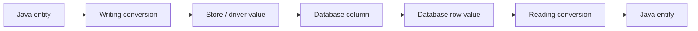

# Kiểm tra chuyển đổi hai chiều, dữ liệu null và lỗi không tương thích kiểu

Spring Data Relational R2DBC ánh xạ dữ liệu giữa các cột trong cơ sở dữ liệu và thuộc tính Java của entity. Khi ghi, giá trị Java được chuyển thành kiểu dữ liệu mà driver và database hiểu. Khi đọc, giá trị từ hàng kết quả được chuyển ngược thành kiểu Java. Nếu hai chiều không thống nhất, hoặc nếu dữ liệu có `NULL`, sai định dạng hay kiểu không được hỗ trợ, thao tác persistence có thể thất bại hoặc trả về dữ liệu khác với mong đợi.

Việc kiểm tra chuyển đổi hai chiều (round-trip conversion) giúp bảo đảm giá trị được ghi có thể đọc lại đúng theo quy tắc miền. Cần kiểm tra cả converter của Spring Data, codec của driver R2DBC, kiểu cột trong schema và cách ứng dụng biểu diễn giá trị thiếu. Một converter chạy đúng trong unit test vẫn có thể thất bại khi kết hợp với driver hoặc database thật.

## 1. Hai chiều chuyển đổi trong Spring Data R2DBC

Khi Spring Data ghi entity, `R2dbcConverter` chuyển thuộc tính của entity thành các giá trị phù hợp để tạo câu lệnh SQL và bind tham số. Khi đọc kết quả, converter chuyển các giá trị trong `Row` thành thuộc tính Java tương ứng.



Ví dụ một thuộc tính `EmailAddress` trong domain có thể được lưu ở cột `VARCHAR`. Khi ghi, Spring Data cần chuyển `EmailAddress` thành `String`; khi đọc, nó cần chuyển `String` thành `EmailAddress`.

Hai chiều này có liên quan nhưng không nhất thiết dùng cùng một kiểu nguồn và kiểu đích. Converter ghi chuyển từ kiểu domain sang kiểu store; converter đọc chuyển từ kiểu store sang kiểu domain. Kiểu store phải tương thích với kiểu cột và khả năng bind/read của driver.

## 2. Các kiểu dữ liệu được hỗ trợ sẵn

Spring Data R2DBC và driver thường đã hỗ trợ các kiểu Java phổ biến như `String`, kiểu số, `Boolean`, `LocalDate`, `LocalDateTime`, `Instant`, `UUID` và một số kiểu dữ liệu thời gian khác. Phạm vi hỗ trợ chính xác phụ thuộc phiên bản Spring Data, dialect và driver.

Ví dụ entity dùng kiểu đơn giản:

```java
import java.time.LocalDateTime;
import org.springframework.data.annotation.Id;
import org.springframework.data.relational.core.mapping.Table;

@Table("customer")
public class Customer {

    @Id
    private Long id;

    private String name;

    private LocalDateTime createdAt;

    // Constructor, getters và các phương thức cần thiết.
}
```

Nếu kiểu Java được driver hỗ trợ trực tiếp và tương thích với kiểu cột, không cần custom converter. Tuy nhiên, cùng một kiểu Java có thể được lưu hoặc đọc khác nhau tùy hệ quản trị. Ví dụ `TIMESTAMP WITHOUT TIME ZONE` và `TIMESTAMP WITH TIME ZONE` có semantics khác nhau; việc chọn `LocalDateTime`, `OffsetDateTime` hoặc `Instant` phải dựa trên ý nghĩa thời gian mà domain cần giữ.

Không nên giả định một kiểu Java có cùng độ chính xác hoặc cùng quy tắc chuyển đổi trên mọi database. Kiểm tra schema, driver và tài liệu dialect trước khi chọn kiểu dữ liệu.

## 3. Khi nào cần custom converter?

Custom converter hữu ích khi domain sử dụng kiểu riêng mà Spring Data/driver không thể ánh xạ trực tiếp, hoặc khi cách biểu diễn trong database khác với cách ứng dụng muốn sử dụng.

Ví dụ:

- `EmailAddress` trong Java được lưu thành `VARCHAR`.
- `Money` được lưu thành `DECIMAL` cùng một cột tiền tệ riêng.
- Một enum dùng mã ổn định trong database thay vì tên enum Java.
- Một value object được lưu thành JSON hoặc chuỗi có định dạng riêng.
- Một kiểu thời gian hoặc mã định danh cần chuẩn hóa trước khi ghi và khôi phục khi đọc.

Spring Data phân biệt converter đọc và converter ghi bằng annotation `@ReadingConverter` và `@WritingConverter`. Việc chỉ rõ chiều chuyển đổi giúp tránh nhầm lẫn khi cùng một cặp kiểu có thể được chuyển theo nhiều hướng.

## 4. Ví dụ chuyển đổi hai chiều cho value object

Giả sử domain có kiểu `EmailAddress`, còn database lưu email trong cột `VARCHAR`.

```java
public record EmailAddress(String value) {

    public EmailAddress {
        if (value == null || value.isBlank()) {
            throw new IllegalArgumentException("Email must not be blank");
        }
    }
}
```

Định nghĩa converter ghi từ `EmailAddress` sang `String`:

```java
import org.springframework.core.convert.converter.Converter;
import org.springframework.data.convert.WritingConverter;

@WritingConverter
public class EmailAddressWriteConverter
        implements Converter<EmailAddress, String> {

    @Override
    public String convert(EmailAddress source) {
        return source.value();
    }
}
```

Định nghĩa converter đọc từ `String` sang `EmailAddress`:

```java
import org.springframework.core.convert.converter.Converter;
import org.springframework.data.convert.ReadingConverter;

@ReadingConverter
public class EmailAddressReadConverter
        implements Converter<String, EmailAddress> {

    @Override
    public EmailAddress convert(String source) {
        return new EmailAddress(source);
    }
}
```

Hai converter biểu diễn cùng một quy tắc ở hai chiều. Converter ghi không cần biết schema; nó chỉ trả về kiểu store `String`. Converter đọc nhận kiểu mà driver trả về cho cột chuỗi rồi tạo value object.

### Đăng ký custom converter

Trong cấu hình Spring Data R2DBC dựa trên `AbstractR2dbcConfiguration`, có thể đăng ký converter qua `getCustomConverters()`:

```java
import java.util.List;
import org.springframework.data.r2dbc.config.AbstractR2dbcConfiguration;

public class R2dbcConfiguration extends AbstractR2dbcConfiguration {

    @Override
    protected List<Object> getCustomConverters() {
        return List.of(
                new EmailAddressWriteConverter(),
                new EmailAddressReadConverter()
        );
    }

    // Cấu hình ConnectionFactory theo kiến trúc của ứng dụng.
}
```

Đây là phần cấu hình converter, không phải một cấu hình `ConnectionFactory` hoàn chỉnh. `AbstractR2dbcConfiguration` yêu cầu ứng dụng cung cấp kết nối theo cấu hình tương ứng. Nếu Spring Boot đang tự động cấu hình `ConnectionFactory`, hãy dùng cơ chế đăng ký `R2dbcCustomConversions` tương thích với phiên bản Boot/Spring Data của dự án và tránh vô tình tạo thêm một `ConnectionFactory` thứ hai. API khởi tạo và extension point cụ thể có thể khác giữa các phiên bản.

Sau khi đăng ký, có thể dùng kiểu value object trong entity:

```java
@Table("customer")
public record Customer(
        @Id Long id,
        String name,
        @Column("email_address") EmailAddress email
) {
}
```

Schema cần có cột tương ứng:

```sql
CREATE TABLE customer (
    id BIGINT GENERATED BY DEFAULT AS IDENTITY PRIMARY KEY,
    name VARCHAR(200) NOT NULL,
    email_address VARCHAR(320) NOT NULL
);
```

Converter không tạo cột và không tạo constraint. Schema phải tương thích với kiểu store mà converter ghi ra.

## 5. Chuyển đổi hai chiều phải có tính nhất quán

Một phép chuyển đổi ghi rồi đọc lại nên bảo toàn ý nghĩa của giá trị miền. Có thể biểu diễn yêu cầu này như sau:

\[
read(write(x)) = normalize(x)
\]

Trong đó `normalize(x)` là giá trị chuẩn hóa theo quy tắc đã xác định. Nếu không cần chuẩn hóa, kết quả đọc lại nên tương đương với giá trị ban đầu.

Ví dụ, nếu converter ghi email bằng cách loại bỏ khoảng trắng đầu/cuối, converter đọc sẽ tạo `EmailAddress` từ chuỗi đã chuẩn hóa. Khi đó phép round-trip không nhất thiết giữ nguyên chuỗi ban đầu nhưng phải giữ đúng giá trị domain sau chuẩn hóa.

Không nên để converter ghi lowercase email trong khi converter đọc lại theo một quy tắc khác, hoặc ghi ngày giờ theo UTC nhưng đọc như giờ địa phương. Những khác biệt như vậy tạo ra lỗi dữ liệu khó phát hiện vì thao tác insert vẫn có thể thành công.

Các thuộc tính cần nhất quán gồm:

- Định dạng chuỗi, dấu phân cách và encoding.
- Độ chính xác số, scale và cách làm tròn.
- Múi giờ, offset và độ chính xác timestamp.
- Quy tắc hoa thường, Unicode và khoảng trắng.
- Mã enum hoặc mã trạng thái có thể thay đổi theo phiên bản ứng dụng.
- Cách biểu diễn giá trị vắng mặt và giá trị mặc định.

## 6. Chuyển đổi số và độ chính xác

Kiểu số là nguồn lỗi phổ biến khi kiểu Java và kiểu SQL không khớp. Ví dụ, `BigDecimal` phù hợp với giá trị tiền tệ cần giữ độ chính xác thập phân; `double`/`float` là kiểu dấu phẩy động nhị phân và có thể không biểu diễn chính xác một số thập phân như `0.1`.

Schema có thể khai báo:

```sql
CREATE TABLE invoice_line (
    id BIGINT GENERATED BY DEFAULT AS IDENTITY PRIMARY KEY,
    quantity INTEGER NOT NULL,
    unit_price NUMERIC(12, 2) NOT NULL
);
```

Entity dùng `BigDecimal` cho giá:

```java
public record InvoiceLine(
        @Id Long id,
        Integer quantity,
        BigDecimal unitPrice
) {
}
```

Nếu cột `NUMERIC(12, 2)` nhận giá trị có nhiều hơn hai chữ số thập phân, database có thể làm tròn, từ chối hoặc xử lý theo quy tắc riêng. Đừng dựa vào hành vi ngầm định nếu nghiệp vụ yêu cầu chính sách làm tròn cụ thể. Hãy chuẩn hóa scale trước khi ghi và kiểm tra giá trị sau khi đọc.

Chuyển `Long` sang `Integer` có thể gây tràn số nếu giá trị vượt phạm vi. Chuyển `BigDecimal` sang `Integer` có thể mất phần thập phân. Converter cần xác định rõ có từ chối giá trị không biểu diễn được hay cho phép làm tròn/cắt bỏ, và không âm thầm làm mất dữ liệu.

## 7. Chuyển đổi enum và mã lưu trữ ổn định

Lưu trực tiếp `Enum.name()` có thể thuận tiện, nhưng đổi tên enum trong mã Java có thể khiến dữ liệu cũ không đọc được. Nếu giá trị lưu trữ là hợp đồng lâu dài, có thể định nghĩa mã ổn định riêng:

```java
public enum OrderStatus {
    OPEN("O"),
    PAID("P"),
    CANCELLED("C");

    private final String code;

    OrderStatus(String code) {
        this.code = code;
    }

    public String code() {
        return code;
    }

    public static OrderStatus fromCode(String code) {
        return switch (code) {
            case "O" -> OPEN;
            case "P" -> PAID;
            case "C" -> CANCELLED;
            default -> throw new IllegalArgumentException(
                    "Unknown order status code: " + code);
        };
    }
}
```

Converter ghi:

```java
@WritingConverter
public class OrderStatusWriteConverter
        implements Converter<OrderStatus, String> {

    @Override
    public String convert(OrderStatus source) {
        return source.code();
    }
}
```

Converter đọc:

```java
@ReadingConverter
public class OrderStatusReadConverter
        implements Converter<String, OrderStatus> {

    @Override
    public OrderStatus convert(String source) {
        return OrderStatus.fromCode(source);
    }
}
```

Nếu database chứa mã trạng thái mới mà phiên bản ứng dụng cũ chưa hiểu, converter sẽ phát lỗi. Đây có thể là hành vi đúng để không âm thầm biến một trạng thái lạ thành trạng thái khác. Khi triển khai rolling update, cần thiết kế thứ tự migration và rollout để mọi phiên bản đang chạy đều có thể đọc các mã được ghi.

## 8. Chuyển đổi thời gian và múi giờ

Thời gian cần được mô hình hóa theo ý nghĩa miền:

| Kiểu Java | Ý nghĩa | Lưu ý khi ánh xạ |
| --- | --- | --- |
| `LocalDate` | Một ngày lịch, không có giờ và múi giờ | Phù hợp ngày sinh, ngày hóa đơn hoặc ngày nghiệp vụ |
| `LocalDateTime` | Ngày và giờ địa phương, không kèm offset/zone | Không tự xác định được một thời điểm duy nhất trên toàn cầu |
| `OffsetDateTime` | Ngày giờ cùng UTC offset | Có thể giữ offset nếu database/driver hỗ trợ kiểu tương ứng |
| `Instant` | Một thời điểm trên timeline UTC | Phù hợp timestamp sự kiện cần so sánh nhất quán toàn hệ thống |
| `ZonedDateTime` | Ngày giờ gắn với vùng múi giờ | Cần quyết định có lưu zone ID riêng hay chỉ lưu instant/offset |

Ví dụ, nếu lưu thời điểm tạo đơn hàng, `Instant` thường thể hiện rõ ý nghĩa một thời điểm tuyệt đối. Nếu lưu lịch hẹn lúc 9 giờ sáng tại một địa điểm, có thể cần cả ngày giờ địa phương và zone ID để xử lý thay đổi giờ mùa hè.

Database có thể cắt bớt độ chính xác timestamp. Một giá trị Java có nano giây có thể được lưu với độ chính xác micro giây hoặc mili giây tùy cột và hệ quản trị. Khi đọc lại, không nên so sánh bằng cách đòi hỏi mọi chữ số nano đều giữ nguyên nếu schema không hỗ trợ.

Kiểm thử cần bao gồm thời điểm sát ranh giới ngày, offset khác UTC, thời điểm chuyển giờ mùa hè nếu có và giá trị có độ chính xác cao. Đặc biệt tránh chuyển `LocalDateTime` thành `Instant` bằng cách giả định múi giờ mặc định của máy chủ.

## 9. Dữ liệu `NULL` trong database và `null` trong Java

SQL `NULL` biểu diễn việc cột không có giá trị. Trong Java, `null` thường được dùng để biểu diễn trạng thái tương tự đối với kiểu tham chiếu. Tuy nhiên, cách ứng dụng xử lý `null` cần được xác định rõ.

Ví dụ một cột số điện thoại có thể để trống:

```sql
CREATE TABLE customer_contact (
    id BIGINT PRIMARY KEY,
    email VARCHAR(320) NOT NULL,
    phone_number VARCHAR(30) NULL
);
```

Entity có thể dùng kiểu tham chiếu:

```java
public record CustomerContact(
        @Id Long id,
        String email,
        String phoneNumber
) {
}
```

Nếu `phone_number` là SQL `NULL`, thuộc tính `phoneNumber` có thể nhận `null`. Với kiểu tham chiếu, Java biểu diễn được trạng thái này. Với kiểu nguyên thủy như `int`, `long` hoặc `boolean`, Java không thể lưu `null`; tùy đường ánh xạ, giá trị null có thể gây lỗi khi chuyển đổi hoặc tạo ra hành vi không mong đợi. Dùng `Integer`, `Long` hoặc `Boolean` cho thuộc tính có thể null.

### `NULL` khác với không có hàng kết quả

Hai trường hợp sau không giống nhau:

- Truy vấn tìm thấy một hàng nhưng một cột trong hàng có SQL `NULL`.
- Truy vấn không tìm thấy hàng nào và publisher `Mono` hoàn tất rỗng.

`Mono.empty()` biểu diễn không có phần tử được phát ra; nó không biểu diễn một hàng có một cột null. Reactor không cho phép `Mono.just(null)`. Vì vậy, đừng dùng `Mono.empty()` để thay thế một giá trị cột null nếu nghiệp vụ cần phân biệt hai trường hợp.

### `NULL` khác với chuỗi rỗng hoặc giá trị 0

`NULL`, `''`, `0` và `false` là các trạng thái khác nhau. Không nên tự động chuyển null thành chuỗi rỗng hoặc số 0 nếu nghiệp vụ phân biệt “chưa có dữ liệu” với “có dữ liệu bằng 0”. Nếu cần giá trị mặc định, hãy xác định nó ở tầng domain hoặc schema theo một quy tắc rõ ràng.

## 10. Xử lý null trong custom converter

Không nên giả định custom converter sẽ luôn được gọi với `null`. Spring Data mapping và conversion service thường xử lý null riêng và có thể bỏ qua converter cho giá trị null. Vì vậy, converter nên tập trung chuyển đổi các giá trị thực, còn tính nullable được thiết kế ở entity, schema và tầng nghiệp vụ.

Ví dụ `EmailAddress` ở trên từ chối null trong constructor. Nếu cột `email_address` cho phép null, entity cần biểu diễn thuộc tính đó có thể vắng mặt và service cần quyết định khi nào tạo `EmailAddress`. Nếu cột bắt buộc, dùng `NOT NULL` để database từ chối dữ liệu thiếu.

Nếu một kiểu domain cần biểu diễn rõ ba trạng thái như “không cung cấp”, “xóa giá trị hiện tại” và “giữ nguyên”, một biến `null` đơn giản có thể không đủ. Đặc biệt với lệnh cập nhật từng phần, cần một kiểu command riêng hoặc wrapper biểu diễn sự hiện diện của trường thay vì dùng null cho mọi ý nghĩa.

### Default ở database và SQL NULL

Không gửi cột trong câu lệnh `INSERT` có thể khiến database áp dụng `DEFAULT`. Gửi cột với giá trị SQL `NULL` thường lưu null và không dùng default. Hai hành vi khác nhau. Cách Spring Data tạo câu lệnh insert phụ thuộc metadata và thao tác; nếu cần database default, hãy xác nhận SQL được sinh và dùng API/schema phù hợp. Không giả định converter trả `null` sẽ kích hoạt default của database.

## 11. Kiểm tra kiểu dữ liệu giữa entity, converter và schema

Một thuộc tính có ít nhất ba điểm cần khớp:

1. **Kiểu domain/Java:** kiểu thuộc tính trong entity, ví dụ `EmailAddress`, `BigDecimal` hoặc `Instant`.
2. **Kiểu store:** kiểu mà converter ghi ra và nhận vào, ví dụ `String`, `BigDecimal`, `LocalDateTime` hoặc kiểu driver đặc thù.
3. **Kiểu SQL:** kiểu cột trong schema, ví dụ `VARCHAR`, `NUMERIC`, `TIMESTAMP` hoặc `JSONB`.

Ví dụ hợp lệ:

| Lớp | Kiểu |
| --- | --- |
| Domain | `EmailAddress` |
| Writing converter | `EmailAddress` → `String` |
| Store/driver value | `String` |
| SQL column | `VARCHAR(320)` |
| Reading converter | `String` → `EmailAddress` |

Nếu converter ghi ra `String` nhưng cột là `INTEGER`, database có thể từ chối hoặc driver/database thực hiện cast không mong muốn. Nếu driver trả `BigDecimal` nhưng converter đọc chỉ đăng ký nguồn `Double`, conversion có thể không được tìm thấy. Cần kiểm tra kiểu thực tế mà driver trả về, không chỉ kiểu mà ứng dụng nghĩ cột sẽ có.

Với JSON, array, enum native hoặc kiểu đặc thù database, driver có thể yêu cầu codec hoặc wrapper riêng. Ví dụ PostgreSQL R2DBC có kiểu `Json` của driver cho một số thao tác JSON/JSONB. Một converter trả `Map` chung chung không nhất thiết tự động được driver hiểu là JSONB. Hãy dùng kiểu store và codec mà driver hỗ trợ, hoặc cấu hình custom codec theo tài liệu driver.

## 12. Lỗi không tương thích kiểu thường gặp

| Biểu hiện | Nguyên nhân có thể | Hướng xử lý |
| --- | --- | --- |
| Không tìm thấy converter | Chưa đăng ký converter, sai chiều source/target hoặc driver trả kiểu khác dự kiến | Kiểm tra kiểu Java, kiểu store, annotation đọc/ghi và đăng ký custom conversions |
| `ConversionFailedException` hoặc lỗi mapping | Giá trị nguồn không thể chuyển sang kiểu thuộc tính đích | Kiểm tra dữ liệu thực tế, định dạng và logic converter |
| Driver báo lỗi bind/codec | Kiểu giá trị gửi vào không được driver hỗ trợ cho cột hoặc database type | Dùng kiểu store được driver hỗ trợ hoặc cấu hình codec phù hợp |
| Lỗi SQL datatype mismatch | Kiểu tham số và kiểu cột không tương thích | Kiểm tra DDL, converter ghi và kiểu bind |
| Numeric overflow hoặc precision loss | Giá trị vượt phạm vi hoặc scale của cột/kiểu Java | Điều chỉnh schema, validate giới hạn và chính sách làm tròn |
| Lỗi parse chuỗi | Dữ liệu cũ sai định dạng hoặc converter giả định format không đúng | Chuẩn hóa dữ liệu, xử lý phiên bản format và báo lỗi rõ ràng |
| Lỗi khi đọc SQL `NULL` | Thuộc tính Java không nullable hoặc dùng primitive | Dùng kiểu wrapper, thay đổi nullability hoặc dữ liệu/schema |
| Thời gian lệch giờ hoặc mất độ chính xác | Không thống nhất timezone/offset hoặc precision của timestamp | Chọn kiểu thời gian theo domain và kiểm tra schema/driver |
| Enum không đọc được | Database chứa mã chưa được phiên bản ứng dụng hỗ trợ | Quản lý rollout/migration và xử lý mã không biết có chủ đích |

Tên exception cụ thể phụ thuộc tầng phát sinh và driver. Spring có thể bọc lỗi chuyển đổi trong exception mapping, còn driver có thể phát lỗi R2DBC khi bind hoặc đọc cột. Không nên chỉ bắt một class exception rồi giả định mọi lỗi kiểu đều đi qua cùng một đường.

## 13. Lỗi chuyển đổi xuất hiện trong reactive pipeline

Vì repository và template trả `Mono`/`Flux`, lỗi có thể xảy ra khi publisher được subscribe và database trả kết quả, không nhất thiết xảy ra ngay tại dòng gọi phương thức. Lỗi được truyền dưới dạng tín hiệu `onError`.

Ví dụ ánh xạ lỗi định dạng thành lỗi miền:

```java
public Mono<Customer> findCustomer(Long id) {
    return customerRepository.findById(id)
            .onErrorMap(ConversionFailedException.class,
                    error -> new InvalidStoredCustomerDataException(error));
}
```

Đoạn mã chỉ minh họa ranh giới chuyển lỗi. Trong thực tế, cần kiểm tra exception gốc và driver; có thể cần xử lý `DataAccessException`, lỗi mapping hoặc exception riêng của R2DBC. Không nên bắt `Throwable` rồi trả entity mặc định vì điều đó che giấu dữ liệu hỏng và làm pipeline báo thành công giả.

Nếu muốn dự phòng một giá trị khi dữ liệu không hợp lệ, hãy xác định rõ nghiệp vụ cho phép bỏ qua bản ghi, dùng giá trị thay thế hay từ chối toàn bộ thao tác. Ví dụ `onErrorResume` có thể biến lỗi thành giá trị mặc định, nhưng chỉ nên làm khi việc thay thế đó không làm mất tính đúng đắn dữ liệu.

Không gọi `block()` để kiểm tra lỗi converter trong service reactive. Hãy dùng `StepVerifier` hoặc để WebFlux xử lý publisher, nhờ đó lỗi được quan sát đúng theo vòng đời reactive.

## 14. Kiểm thử converter ở mức đơn vị

Unit test giúp xác minh từng chiều chuyển đổi độc lập:

```java
class EmailAddressConverterTest {

    private final EmailAddressWriteConverter writer =
            new EmailAddressWriteConverter();
    private final EmailAddressReadConverter reader =
            new EmailAddressReadConverter();

    @Test
    void convertsDomainValueToStoreValue() {
        EmailAddress email = new EmailAddress("an@example.com");

        assertThat(writer.convert(email)).isEqualTo("an@example.com");
    }

    @Test
    void convertsStoreValueBackToDomainValue() {
        EmailAddress email = reader.convert("an@example.com");

        assertThat(email).isEqualTo(new EmailAddress("an@example.com"));
    }
}
```

Các test này kiểm tra logic thuần của converter, không kiểm tra Spring Data đã đăng ký converter hay driver có thể bind kiểu store. Nên kiểm thử cả dữ liệu biên như chuỗi rỗng, khoảng trắng, ký tự Unicode, định dạng cũ và dữ liệu không hợp lệ.

Nếu converter có chuẩn hóa, viết test cho quy tắc chuẩn hóa và tính idempotent nếu phù hợp. Ví dụ, nếu ghi email đã chuẩn hóa thì đọc và ghi lại lần nữa không nên tiếp tục thay đổi giá trị.

## 15. Kiểm thử round-trip với database thật

Integration test xác minh toàn bộ chuỗi: entity → converter ghi → driver → database column → driver row value → converter đọc → entity. Đây là cách phát hiện lỗi do schema, dialect hoặc codec mà unit test không thể thấy.

Ví dụ dùng repository và Reactor Test:

```java
@Test
void savesAndReadsEmailAddress() {
    Customer customer = new Customer(
            null,
            "An Nguyen",
            new EmailAddress("an@example.com")
    );

    StepVerifier.create(customerRepository.save(customer)
                    .flatMap(saved -> customerRepository.findById(saved.id())))
            .assertNext(loaded -> {
                assertThat(loaded.email())
                        .isEqualTo(new EmailAddress("an@example.com"));
            })
            .verifyComplete();
}
```

Test giả định `Customer` là record có accessor `id()` và `email()`, converter đã được đăng ký, cùng schema phù hợp. Chạy test với đúng loại database/driver của môi trường triển khai; H2 hoặc một database khác có thể không tái hiện semantics kiểu dữ liệu, timezone hoặc JSON của production.

Nên có thêm test đọc dữ liệu được tạo bằng SQL trực tiếp hoặc dữ liệu cũ để xác nhận converter đọc được những định dạng thực tế. Chỉ lưu rồi đọc lại bằng cùng một converter có thể che giấu lỗi nếu cả hai chiều cùng thực hiện một phép biến đổi sai nhưng đối xứng.

## 16. Kiểm thử SQL NULL và dữ liệu biên

Với thuộc tính nullable, nên tạo hàng có SQL `NULL` trực tiếp trong database rồi đọc qua repository để xác nhận mapping. Đồng thời thử insert/update với thuộc tính Java null và quan sát SQL được sinh cũng như giá trị lưu.

Các trường hợp nên kiểm tra:

- Cột nullable có SQL `NULL` được ánh xạ thành null trong kiểu tham chiếu.
- Cột `NOT NULL` từ chối giá trị thiếu theo đúng constraint.
- Giá trị null không bị biến thành chuỗi rỗng, số 0 hoặc `false` ngoài ý muốn.
- `Mono.empty()` được xử lý như không có hàng, không nhầm với một thuộc tính null.
- Giá trị số ở giới hạn nhỏ nhất/lớn nhất và vượt phạm vi.
- Chuỗi dài đúng giới hạn cột và vượt giới hạn.
- Timestamp ở các offset và độ chính xác khác nhau.
- Enum/mã trạng thái không được phiên bản hiện tại biết.
- Dữ liệu cũ có định dạng khác sau một lần thay đổi converter.

## 17. Thay đổi converter và tương thích dữ liệu cũ

Converter là một phần của hợp đồng lưu trữ. Nếu đổi format, ví dụ trước đây lưu enum bằng tên `PAID` nhưng sau này lưu mã `P`, dữ liệu cũ vẫn tồn tại trong database. Phiên bản ứng dụng mới cần đọc được dữ liệu cũ trong giai đoạn chuyển đổi hoặc migration phải chuyển dữ liệu trước khi converter mới được triển khai.

Một chiến lược an toàn có thể gồm:

1. Xác định format cũ và mới, cùng các phiên bản ứng dụng có thể chạy đồng thời.
2. Triển khai converter đọc được cả format cũ và mới trong giai đoạn chuyển tiếp.
3. Chuyển dữ liệu bằng migration hoặc job có kiểm soát.
4. Sau khi xác nhận không còn dữ liệu cũ và không còn instance cũ ghi format cũ, thu gọn converter về format mới.
5. Kiểm thử rollback và triển khai theo môi trường trước production.

Không thay đổi converter ghi sang format mới nếu các instance cũ vẫn đang đọc dữ liệu theo format cũ mà không có kế hoạch tương thích. Với rolling deployment, các phiên bản chạy đồng thời phải có khả năng đọc những giá trị mà phiên bản khác ghi ra.

## 18. Theo dõi lỗi trong production

Khi gặp lỗi chuyển đổi trong production, cần thu thập đủ thông tin để xác định tầng phát sinh mà không làm lộ dữ liệu nhạy cảm:

- Entity và thuộc tính đang được ánh xạ.
- Kiểu Java đích và kiểu store/SQL dự kiến.
- Database, driver và phiên bản Spring Data R2DBC.
- Tên cột và kiểu cột trong schema.
- Mã lỗi hoặc loại exception gốc, stack trace ở mức phù hợp.
- Profile/cấu hình converter đang được dùng.
- Có hay không giá trị SQL `NULL`, dữ liệu cũ hoặc giá trị vượt giới hạn.

Tránh log toàn bộ giá trị cột nếu đó là email, thông tin cá nhân, token hoặc dữ liệu bí mật. Có thể log tên cột, loại dữ liệu, constraint hoặc correlation ID để tìm bản ghi liên quan qua quy trình truy cập an toàn.

## 19. Nguyên tắc thực hành

- Hiểu rõ kiểu Java, kiểu store mà converter sử dụng và kiểu SQL của cột.
- Chỉ dùng custom converter khi kiểu mặc định hoặc codec của driver không đáp ứng yêu cầu.
- Đánh dấu rõ `@WritingConverter` và `@ReadingConverter` để thể hiện chiều chuyển đổi.
- Đăng ký converter qua cơ chế cấu hình tương thích với phiên bản Spring Data R2DBC/Spring Boot đang dùng.
- Bảo đảm `read(write(x))` giữ nguyên ý nghĩa domain hoặc tuân theo quy tắc chuẩn hóa đã định nghĩa.
- Dùng `BigDecimal` cho giá trị thập phân cần độ chính xác và kiểm soát scale/rounding.
- Chọn kiểu thời gian theo semantics UTC, offset hoặc giờ địa phương; kiểm tra precision của database.
- Dùng kiểu tham chiếu cho thuộc tính có thể SQL `NULL`; không nhầm null với chuỗi rỗng, số 0 hoặc `Mono.empty()`.
- Không giả định converter sẽ được gọi với null; thiết kế nullability ở entity, schema và nghiệp vụ.
- Kiểm thử riêng converter, sau đó kiểm thử round-trip trên đúng database và driver.
- Kiểm thử dữ liệu cũ, giá trị biên và format trong giai đoạn rolling deployment.
- Giữ nguyên exception gốc hoặc ánh xạ có chủ đích; không che lỗi chuyển đổi bằng giá trị mặc định tùy tiện.

## 20. Kết luận

Chuyển đổi dữ liệu trong Spring Data R2DBC có hai chiều: từ kiểu Java sang kiểu store khi ghi và từ giá trị database về kiểu Java khi đọc. Custom converter cho phép ánh xạ value object hoặc kiểu miền riêng, nhưng phải được đăng ký đúng chiều và tương thích với driver cùng schema. Một phép round-trip tốt bảo toàn ý nghĩa dữ liệu, kể cả khi có quy tắc chuẩn hóa.

SQL `NULL`, Java `null`, chuỗi rỗng, giá trị mặc định và publisher rỗng là những trạng thái khác nhau. Cần xác định nullability rõ ràng, dùng kiểu Java phù hợp và không dựa vào converter để tự giải quyết mọi trường hợp thiếu dữ liệu. Kết hợp unit test cho converter, integration test với database thật, kiểm thử dữ liệu cũ và xử lý lỗi reactive có chủ đích sẽ giúp phát hiện sớm lỗi không tương thích kiểu và giữ dữ liệu nhất quán.
