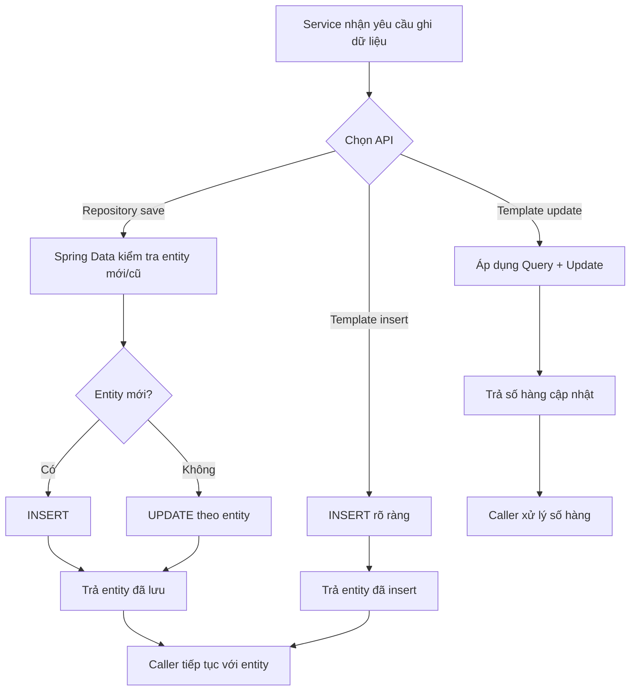

# Phân biệt save của Repository với insert và update của Template

Spring Data R2DBC cung cấp hai cách phổ biến để ghi dữ liệu quan hệ: dùng repository với phương thức `save()` hoặc dùng `R2dbcEntityTemplate` với các thao tác `insert()` và `update()`.

Hai cách đều sử dụng hạ tầng mapping của Spring Data Relational và đều trả về publisher reactive. Khác biệt chính nằm ở cách ứng dụng diễn đạt ý định ghi dữ liệu:

- **Repository `save()`** nhận một entity và để Spring Data xác định entity mới hay đã tồn tại, sau đó chọn insert hoặc update theo chiến lược nhận diện trạng thái mới.
- **Template `insert()` và `update()`** cho phép ứng dụng chỉ định rõ thao tác cần thực hiện. `insert()` luôn diễn đạt ý định thêm bản ghi; `update()` diễn đạt ý định cập nhật các cột được chỉ định cho những hàng khớp điều kiện.

Chọn API phù hợp giúp code thể hiện đúng nghiệp vụ, tránh vô tình cập nhật hoặc chèn dữ liệu sai, đồng thời kiểm soát được số hàng bị tác động và cách xử lý giá trị do database sinh.

## 1. Repository và Template trong Spring Data R2DBC

### 1.1. Repository là abstraction theo domain

Repository cung cấp API hướng tới thao tác trên một loại aggregate hoặc entity. Ví dụ:

```java
public interface CustomerRepository
        extends ReactiveCrudRepository<Customer, Long> {
}
```

`ReactiveCrudRepository` cung cấp các thao tác CRUD cơ bản như `findById`, `findAll`, `save`, `saveAll` và `deleteById`. Spring Data tạo implementation cho interface dựa trên metadata entity và cấu hình repository.

Repository phù hợp khi nghiệp vụ chủ yếu cần lưu hoặc tải entity theo ID, query method và các truy vấn có cấu trúc ổn định. Service có thể làm việc với interface repository mà không cần biết chi tiết câu SQL được tạo.

### 1.2. `R2dbcEntityTemplate` là API thao tác dữ liệu linh hoạt hơn

`R2dbcEntityTemplate` là API cấp cao của Spring Data R2DBC để thực hiện các thao tác trên entity, query và update. Nó sử dụng `DatabaseClient` cùng mapping infrastructure để ánh xạ giữa hàng database và object Java.

Template hữu ích khi cần:

- Chỉ định rõ thao tác insert hay update.
- Cập nhật một tập thuộc tính cụ thể thay vì lưu toàn bộ trạng thái entity.
- Xây dựng điều kiện `Query` và biểu thức `Update` động.
- Thực hiện thao tác dữ liệu mà repository abstraction không diễn đạt thuận tiện.
- Kết hợp select, insert, update và delete trong một luồng xử lý rõ ràng.

Trong ứng dụng Spring Boot có starter R2DBC, `R2dbcEntityTemplate` thường được auto-configure và có thể inject vào service.

```java
@Service
public class CustomerService {

    private final R2dbcEntityTemplate template;

    public CustomerService(R2dbcEntityTemplate template) {
        this.template = template;
    }
}
```

## 2. `save()` của Repository hoạt động như thế nào?

Repository reactive định nghĩa `save()` với kiểu trả về tổng quát:

```java
<S extends T> Mono<S> save(S entity);
```

Phương thức nhận entity và trả về `Mono` chứa entity sau khi thao tác lưu hoàn tất. Với `saveAll()`, repository trả về `Flux` các entity đã lưu.

Trước khi ghi dữ liệu, Spring Data cần xác định entity có phải entity mới hay không. Từ trạng thái đó, repository chọn thao tác insert hoặc update.

### 2.1. Cách nhận diện entity mới

Với entity thông thường, Spring Data Relational thường dựa trên các thông tin sau:

1. Nếu entity có thuộc tính `@Version`, giá trị version chưa được khởi tạo là dấu hiệu entity mới.
2. Nếu không có version property, giá trị ID thường được dùng để xác định trạng thái mới: ID null biểu thị entity mới; ID có giá trị biểu thị entity đã tồn tại.
3. Nếu entity triển khai `Persistable`, phương thức `isNew()` có thể cung cấp trạng thái mới theo logic của ứng dụng.

Chi tiết còn phụ thuộc kiểu ID/version và phiên bản Spring Data. Với ID primitive, giá trị mặc định có thể được dùng để biểu diễn trạng thái mới; wrapper như `Long` giúp biểu diễn `null` rõ ràng hơn.

Ví dụ entity có ID do database sinh:

```java
@Table("customers")
public class Customer {

    @Id
    private Long id;

    private String name;
    private String email;

    public Customer(Long id, String name, String email) {
        this.id = id;
        this.name = name;
        this.email = email;
    }

    public Long getId() {
        return id;
    }

    public String getName() {
        return name;
    }

    public String getEmail() {
        return email;
    }
}
```

Khi ID là `null`, repository thường xem object là mới:

```java
Customer customer = new Customer(null, "Lan", "lan@example.com");

Mono<Customer> saved = customerRepository.save(customer);
```

Khi entity có ID hợp lệ, repository thường xem đó là entity đã tồn tại và chọn update:

```java
Customer customer = new Customer(42L, "Lan Nguyen", "lan@example.com");

Mono<Customer> saved = customerRepository.save(customer);
```

`save()` không phải lệnh upsert tổng quát dựa trên mọi unique key của database. Quyết định insert/update dựa trên chiến lược nhận diện entity mới của Spring Data, không phải việc database tự tìm một bản ghi trùng email rồi tự chọn thao tác.

### 2.2. Repository `save()` thường lưu trạng thái entity

Khi dùng repository `save()` cho entity đã tồn tại, Spring Data tạo thao tác update theo mapping metadata của entity. Đây không phải API chuyên để cập nhật một field đơn lẻ. Nếu muốn thay đổi một thuộc tính, thông thường ứng dụng tải entity, thay đổi giá trị rồi gọi `save()`; cách này diễn đạt việc lưu trạng thái entity.

Spring Data Relational không có persistence context kiểu JPA để theo dõi dirty fields và tự động chỉ cập nhật các thuộc tính đã thay đổi. Vì vậy, nếu yêu cầu là cập nhật một vài cột có điều kiện, `R2dbcEntityTemplate.update()` thường diễn đạt ý định rõ hơn.

### 2.3. Giá trị trả về của `save()`

`save()` trả về entity sau khi lưu. Giá trị trả về có thể chứa:

- ID được database sinh khi insert.
- Version mới sau thao tác lưu nếu entity sử dụng `@Version`.
- Giá trị đã được cập nhật thông qua mapping/callback trong quá trình lưu.

Với entity immutable, Spring Data có thể tạo instance mới để mang các giá trị được cập nhật. Vì vậy, luôn sử dụng entity phát ra từ `save()` thay vì giả định object đầu vào đã được thay đổi tại chỗ.

```java
return customerRepository.save(customer)
        .flatMap(saved -> auditService.recordCreated(saved.getId())
                .thenReturn(saved));
```

Publisher reactive là lazy: thao tác database chỉ chạy khi có subscription. Hãy giữ thao tác lưu trong pipeline và không gọi `.subscribe()` độc lập trong service rồi trả entity đầu vào.

## 3. `insert()` của `R2dbcEntityTemplate`

Template `insert()` thể hiện rõ ý định thêm một bản ghi mới. Với fluent API, có thể viết:

```java
Mono<Customer> inserted = template.insert(Customer.class)
        .using(customer);
```

Hoặc trong một service:

```java
public Mono<Customer> create(Customer customer) {
    return template.insert(Customer.class).using(customer);
}
```

Khác với repository `save()`, `insert()` không cần suy luận entity mới hay cũ để chọn thao tác. Ứng dụng đã chỉ định insert.

### 3.1. ID được database sinh

Nếu bảng sử dụng identity hoặc auto-increment, entity đầu vào thường có ID null. Khi insert thành công, driver/database có thể trả về generated ID và Spring Data ánh xạ giá trị đó vào entity được trả về.

```java
return template.insert(Customer.class)
        .using(new Customer(null, "Lan", "lan@example.com"))
        .map(inserted -> new CustomerResponse(
                inserted.getId(),
                inserted.getName(),
                inserted.getEmail()
        ));
```

Với entity immutable, kết quả trả về có thể là instance mới chứa ID vừa sinh. Hãy dùng `inserted` trong pipeline.

### 3.2. Insert với ID do ứng dụng cấp

Nếu nghiệp vụ sử dụng UUID hoặc khóa chính do ứng dụng tạo, có thể truyền entity đã có ID vào `insert()`:

```java
Customer customer = new Customer(UUID.randomUUID(), "Lan", "lan@example.com");

return template.insert(Customer.class).using(customer);
```

`insert()` vẫn thể hiện ý định thêm bản ghi. Nếu khóa chính hoặc unique constraint đã tồn tại, database thường trả lỗi vi phạm constraint. Template không tự chuyển thao tác này thành update chỉ vì ID đã có giá trị.

Đây là điểm khác biệt quan trọng so với repository `save()`, vốn có thể xem entity có ID là entity đã tồn tại theo chiến lược newness mặc định.

### 3.3. Khi nào insert phù hợp?

Chọn `insert()` khi nghiệp vụ chắc chắn đang tạo bản ghi mới, ví dụ:

- Tạo đơn hàng mới sau khi kiểm tra đầu vào.
- Ghi một sự kiện hoặc bản ghi audit mới.
- Thêm một dòng dữ liệu với ID được ứng dụng sinh.
- Thực hiện bulk insert theo từng entity hoặc batch phù hợp.

Nếu ý định là tạo mới và bản ghi trùng khóa phải được xem là lỗi, `insert()` thể hiện quy tắc đó rõ hơn `save()`.

## 4. `update()` của `R2dbcEntityTemplate`

Template `update()` cho phép chỉ định điều kiện tìm các hàng cần cập nhật và các thuộc tính cần thay đổi.

```java
Mono<Long> rowsUpdated = template.update(Customer.class)
        .matching(query(where("id").is(customerId)))
        .apply(Update.update("name", "Lan Nguyen"));
```

Trong ví dụ, ứng dụng yêu cầu cập nhật cột tương ứng với property `name` cho hàng có ID khớp. Kết quả là `Mono<Long>` biểu diễn số hàng được cập nhật.

Các import thường dùng:

```java
import static org.springframework.data.relational.core.query.Criteria.where;
import static org.springframework.data.relational.core.query.Query.query;
import static org.springframework.data.relational.core.query.Update.update;
```

### 4.1. Cập nhật nhiều thuộc tính

Có thể xây dựng `Update` với nhiều thuộc tính:

```java
Update changes = Update.update("name", "Lan Nguyen")
        .set("email", "lan.nguyen@example.com");

return template.update(Customer.class)
        .matching(query(where("id").is(customerId)))
        .apply(changes);
```

Chỉ các thuộc tính được đưa vào `Update` mới là mục tiêu của thao tác. Điều này hữu ích khi cần cập nhật một phần dữ liệu mà không phải tải toàn bộ entity.

### 4.2. Điều kiện update phức tạp

`Query` có thể chứa nhiều điều kiện để giới hạn hàng bị ảnh hưởng:

```java
Query criteria = query(
        where("id").is(customerId)
                .and("status").is("ACTIVE")
);

return template.update(Customer.class)
        .matching(criteria)
        .apply(Update.update("status", "INACTIVE"));
```

Điều kiện này chỉ cập nhật bản ghi có ID tương ứng và trạng thái hiện tại là `ACTIVE`. Nếu không có hàng nào thỏa mãn, số hàng cập nhật thường là `0`.

Hãy dùng điều kiện đủ chặt chẽ, đặc biệt khi cập nhật dữ liệu theo tenant, quyền sở hữu hoặc trạng thái nghiệp vụ. Một điều kiện thiếu có thể làm thay đổi nhiều hàng hơn dự kiến.

### 4.3. Kiểm tra số hàng được cập nhật

`apply()` trả về `Mono<Long>`. Có thể dùng số hàng để quyết định bước tiếp theo:

```java
public Mono<Void> renameCustomer(Long id, String newName) {
    return template.update(Customer.class)
            .matching(query(where("id").is(id)))
            .apply(Update.update("name", newName))
            .flatMap(rows -> {
                if (rows == 0) {
                    return Mono.error(new CustomerNotFoundException(id));
                }

                return Mono.empty();
            })
            .then();
}
```

Nếu thao tác cập nhật chỉ nên tác động đúng một hàng, có thể kiểm tra `rows == 1`. Nếu `rows > 1`, điều kiện có thể không đủ chặt hoặc nghiệp vụ cho phép cập nhật nhiều hàng; hãy xử lý theo hợp đồng của ứng dụng.

Không nên bỏ qua số hàng được cập nhật khi nghiệp vụ cần xác nhận bản ghi có tồn tại hoặc trạng thái trước đó có đúng hay không.

## 5. So sánh `save()` với `insert()` và `update()`

| Tiêu chí | Repository `save()` | Template `insert()` | Template `update()` |
| --- | --- | --- | --- |
| Ý định | Lưu entity, Spring Data xác định mới/cũ | Thêm bản ghi mới | Cập nhật các thuộc tính được chỉ định |
| Chọn INSERT/UPDATE | Dựa trên newness detection | Luôn insert | Luôn update theo điều kiện |
| Đầu vào | Entity | Entity | Query điều kiện và Update definition |
| Phạm vi dữ liệu | Theo trạng thái entity | Các property của entity được insert | Các property được nêu trong Update |
| Kết quả | `Mono<S>` | `Mono<T>` | `Mono<Long>` số hàng cập nhật |
| Generated ID | Có thể trả về trong entity đã lưu | Có thể trả về trong entity được insert | Không phải mục tiêu thông thường của update fluent API |
| Cập nhật một vài cột | Không phải mục tiêu chính | Không áp dụng | Phù hợp |
| Kiểm soát điều kiện | Theo ID/newness và mapping | Không có query matching thông thường | Điều kiện `Query` rõ ràng |
| Trường hợp thường dùng | CRUD theo entity/aggregate | Tạo mới có chủ đích | Partial update hoặc điều kiện nghiệp vụ |

Các API đều reactive và dùng mapping infrastructure. Bảng trên mô tả ý định và kiểu kết quả chính; chi tiết generated values, callbacks và transaction cần được xác nhận theo driver/database và phiên bản Spring Data.

## 6. Ví dụ cùng nghiệp vụ bằng Repository và Template

Giả sử cần quản lý khách hàng với schema:

```sql
CREATE TABLE customers (
    id BIGINT GENERATED BY DEFAULT AS IDENTITY PRIMARY KEY,
    name VARCHAR(120) NOT NULL,
    email VARCHAR(180) NOT NULL UNIQUE,
    status VARCHAR(20) NOT NULL
);
```

Entity:

```java
@Table("customers")
public class Customer {

    @Id
    private Long id;
    private String name;
    private String email;
    private String status;

    public Customer(Long id, String name, String email, String status) {
        this.id = id;
        this.name = name;
        this.email = email;
        this.status = status;
    }

    public Long getId() { return id; }
    public String getName() { return name; }
    public String getEmail() { return email; }
    public String getStatus() { return status; }
    public void setId(Long id) { this.id = id; }
    public void setName(String name) { this.name = name; }
    public void setEmail(String email) { this.email = email; }
    public void setStatus(String status) { this.status = status; }
}
```

### 6.1. Tạo mới bằng Repository `save()`

```java
public Mono<Customer> createWithRepository(CreateCustomerRequest request) {
    Customer customer = new Customer(
            null,
            request.name(),
            request.email(),
            "ACTIVE"
    );

    return customerRepository.save(customer);
}
```

ID null làm entity được nhận diện là mới theo chiến lược mặc định. Repository thực hiện insert và trả entity đã lưu.

### 6.2. Tạo mới bằng Template `insert()`

```java
public Mono<Customer> createWithTemplate(CreateCustomerRequest request) {
    Customer customer = new Customer(
            null,
            request.name(),
            request.email(),
            "ACTIVE"
    );

    return template.insert(Customer.class).using(customer);
}
```

Template thể hiện rõ thao tác insert. Nếu ID hoặc email vi phạm constraint, database phát lỗi; ứng dụng có thể chuyển lỗi thành response nghiệp vụ phù hợp.

### 6.3. Cập nhật toàn bộ entity bằng Repository `save()`

```java
public Mono<Customer> renameWithRepository(Long id, String newName) {
    return customerRepository.findById(id)
            .switchIfEmpty(Mono.error(new CustomerNotFoundException(id)))
            .flatMap(customer -> {
                customer.setName(newName);
                return customerRepository.save(customer);
            });
}
```

Service tải entity, thay đổi thuộc tính rồi lưu lại entity. Đây là cách tiếp cận thuận tiện khi nghiệp vụ cần làm việc với aggregate đầy đủ.

### 6.4. Cập nhật một cột bằng Template `update()`

```java
public Mono<Void> renameWithTemplate(Long id, String newName) {
    return template.update(Customer.class)
            .matching(query(where("id").is(id)))
            .apply(Update.update("name", newName))
            .flatMap(rows -> rows == 0
                    ? Mono.error(new CustomerNotFoundException(id))
                    : Mono.empty())
            .then();
}
```

Ở đây không cần tải entity trước khi cập nhật. Database chỉ thay đổi thuộc tính `name` cho hàng phù hợp với điều kiện. Kết quả trả về là số hàng được cập nhật, không phải entity.

## 7. Transaction khi kết hợp Repository và Template

Repository và `R2dbcEntityTemplate` có thể được sử dụng trong cùng một reactive transaction nếu chúng cùng làm việc với một `ConnectionFactory` và reactive transaction manager tương ứng.

Ví dụ:

```java
@Service
public class CustomerRegistrationService {

    private final CustomerRepository repository;
    private final R2dbcEntityTemplate template;

    public CustomerRegistrationService(
            CustomerRepository repository,
            R2dbcEntityTemplate template) {
        this.repository = repository;
        this.template = template;
    }

    @Transactional
    public Mono<Customer> register(Customer customer) {
        return repository.save(customer)
                .flatMap(saved -> template.update(Profile.class)
                        .matching(query(where("customerId").is(saved.getId())))
                        .apply(Update.update("enabled", true))
                        .thenReturn(saved));
    }
}
```

Ví dụ minh họa việc kết hợp hai API trong một pipeline. Trong dự án thật, bảng profile cần được tạo và điều kiện update phải phản ánh đúng nghiệp vụ. Nếu thao tác thứ hai thất bại, reactive transaction có thể rollback thao tác đầu khi cả hai dùng cùng transaction manager/connection factory và lỗi được truyền trong pipeline.

Với reactive transaction, giữ các thao tác trong cùng publisher chain. Không gọi `.block()` hoặc tạo subscription độc lập ở giữa transaction, vì việc đó có thể làm mất ngữ cảnh transaction.

### 7.1. Lưu ý về optimistic locking

Repository `save()` hỗ trợ cơ chế optimistic locking khi entity khai báo `@Version`. Spring Data dùng version để bảo vệ thao tác update khỏi việc ghi đè dữ liệu đã thay đổi bởi một thao tác khác.

Với template `update(Query, Update)`, ứng dụng tự định nghĩa điều kiện và nội dung cập nhật. Nếu nghiệp vụ cần optimistic locking, hãy đưa version hiện tại vào điều kiện và tăng version trong `Update`, sau đó kiểm tra số hàng được cập nhật.

```java
public Mono<Void> renameWithVersion(
        Long id,
        Long currentVersion,
        String newName) {

    Query condition = query(
            where("id").is(id)
                    .and("version").is(currentVersion)
    );

    Update changes = Update.update("name", newName)
            .set("version", currentVersion + 1);

    return template.update(Customer.class)
            .matching(condition)
            .apply(changes)
            .flatMap(rows -> rows == 1
                    ? Mono.empty()
                    : Mono.error(new OptimisticLockingFailureException(
                            "Customer was changed by another transaction")))
            .then();
}
```

Đây là cách thể hiện optimistic locking thủ công ở mức template. Hãy dùng kiểu version và quy tắc tăng version phù hợp với entity/database. Nếu `rows == 0`, bản ghi có thể không tồn tại hoặc version đã thay đổi; ứng dụng có thể truy vấn thêm nếu cần phân biệt hai trường hợp.

## 8. Entity callbacks và mapping

Repository và Template đều dựa trên Spring Data mapping infrastructure. Khi thao tác đi qua các API Spring Data, các cơ chế mapping và entity callback được cấu hình phù hợp có thể tham gia vào vòng đời lưu entity.

Một số callback thường gặp:

- `BeforeConvertCallback`: chạy trước khi entity được chuyển đổi thành dữ liệu lưu trữ.
- `BeforeSaveCallback`: chạy trước khi dữ liệu được ghi.
- `AfterSaveCallback`: chạy sau khi thao tác lưu hoàn tất.

Callback hữu ích cho auditing, chuẩn hóa dữ liệu hoặc thiết lập thuộc tính theo quy tắc chung. Tuy nhiên, `Template.update(Query, Update)` là thao tác cập nhật theo các field trong `Update`, không truyền một entity hoàn chỉnh qua cùng đường đi save entity như repository `save()`. Không nên giả định mọi callback dành cho entity save sẽ tự động được áp dụng cho một partial update.

Nếu ứng dụng dựa vào auditing hoặc callback để gán `modifiedAt`, hãy xác định API ghi dữ liệu nào đang được sử dụng và cập nhật trường audit một cách tường minh trong thao tác template khi cần.

## 9. Khi nào nên dùng Repository `save()`?

Repository `save()` phù hợp khi:

- Service làm việc với entity hoặc aggregate đầy đủ.
- Muốn Spring Data tự xác định trạng thái mới/cũ dựa trên ID, version hoặc `Persistable`.
- Cần một abstraction gọn cho CRUD phổ biến.
- Muốn trả về entity đã lưu, gồm ID/version được cập nhật.
- Các thao tác đọc/ghi có thể diễn đạt qua repository method hoặc query method.

Ví dụ nghiệp vụ cập nhật tên khách hàng thường có thể tải aggregate, kiểm tra quyền và quy tắc domain, thay đổi trạng thái rồi gọi `save()`.

## 10. Khi nào nên dùng Template `insert()` hoặc `update()`?

Template phù hợp khi:

- Nghiệp vụ cần khẳng định rõ thao tác là insert hoặc update.
- Cần partial update một vài cột mà không tải toàn bộ entity.
- Điều kiện update có nhiều tiêu chí hoặc được xây dựng động.
- Muốn biết chính xác số hàng được cập nhật.
- Repository abstraction không phù hợp với câu lệnh hoặc thao tác cần thực hiện.

`insert()` phù hợp cho lệnh tạo mới có chủ đích. `update()` phù hợp cho thao tác cập nhật có điều kiện và có thể chỉ thay đổi một phần dữ liệu.

Nếu update phụ thuộc vào trạng thái domain, quyền sở hữu hoặc version, hãy đưa các điều kiện đó vào query để database chỉ cập nhật hàng hợp lệ.

## 11. Những lỗi thường gặp khi chọn API

| Tình huống | Nguyên nhân | Hướng xử lý |
| --- | --- | --- |
| Gọi `save()` nhưng mong luôn INSERT | Entity có ID nên bị nhận diện là đã tồn tại | Dùng `template.insert()` khi ý định là thêm mới |
| Gọi `save()` để cập nhật một field nhưng nhiều cột bị ghi | Repository lưu trạng thái entity theo mapping | Dùng `template.update()` cho partial update |
| Gọi `insert()` với ID đã tồn tại | Insert vẫn là insert và vi phạm khóa/unique constraint | Kiểm tra ID hoặc dùng API update phù hợp |
| Template update trả về `0` | Không có hàng khớp điều kiện | Kiểm tra ID, trạng thái và điều kiện query |
| Template update tác động nhiều hàng | Điều kiện query chưa đủ chặt | Bổ sung tenant, trạng thái hoặc khóa phù hợp |
| Không có ID sau insert | Publisher chưa được subscribe hoặc code đọc object đầu vào | Đọc entity được phát ra từ `Mono` |
| Mất optimistic locking khi dùng template | Điều kiện update không kiểm tra version | Đưa version vào predicate và cập nhật version tường minh |
| Transaction không rollback như mong đợi | Hai API dùng connection factory/transaction manager khác nhau hoặc subscription tách rời | Kiểm tra transaction manager và giữ cùng publisher chain |
| Audit field không được cập nhật | Partial update không đi qua đường save entity mong đợi | Thêm trường audit vào Update hoặc dùng callback phù hợp |

## 12. Kiểm thử Repository và Template

Nên kiểm thử hành vi insert/update với database R2DBC thật hoặc môi trường Testcontainers. Mock repository không thể xác nhận câu SQL, generated ID, số hàng cập nhật hoặc transaction thực tế.

### 12.1. Kiểm thử Repository `save()`

```java
@DataR2dbcTest
class CustomerRepositoryTest {

    @Autowired
    CustomerRepository repository;

    @Test
    void saveNewCustomerShouldReturnGeneratedId() {
        Customer input = new Customer(null, "Lan", "lan@example.com", "ACTIVE");

        StepVerifier.create(repository.save(input))
                .assertNext(saved -> {
                    assertThat(saved.getId()).isNotNull();
                    assertThat(saved.getName()).isEqualTo("Lan");
                })
                .verifyComplete();
    }
}
```

### 12.2. Kiểm thử Template `insert()` và `update()`

```java
@DataR2dbcTest
class CustomerTemplateTest {

    @Autowired
    R2dbcEntityTemplate template;

    @Test
    void shouldInsertThenUpdateOnlySelectedProperty() {
        Customer input = new Customer(null, "Lan", "lan@example.com", "ACTIVE");

        Mono<Long> rowsUpdated = template.insert(Customer.class)
                .using(input)
                .flatMap(inserted -> template.update(Customer.class)
                        .matching(query(where("id").is(inserted.getId())))
                        .apply(Update.update("status", "INACTIVE")));

        StepVerifier.create(rowsUpdated)
                .expectNext(1L)
                .verifyComplete();
    }
}
```

Test minh họa luồng insert rồi update đúng một hàng. Cần có schema `customers` và các import tĩnh cho `query`, `where` và `Update` trong test thực tế.

### 12.3. Các trường hợp nên kiểm tra

- `save()` với ID null và ID đã có giá trị.
- `save()` với entity có `@Version`.
- `insert()` khi ID chưa tồn tại và khi ID bị trùng.
- `update()` khi query khớp một hàng, không khớp hàng nào hoặc khớp nhiều hàng.
- Partial update không làm thay đổi các cột ngoài `Update`.
- Generated ID được nhận trong entity trả về từ insert.
- Optimistic locking thủ công với template update.
- Rollback khi kết hợp repository và template trong cùng transaction.
- Callback/auditing trên từng loại API ghi được sử dụng.

## 13. Quy trình chọn API

Có thể dùng các câu hỏi sau để chọn cách ghi dữ liệu:

1. Nghiệp vụ đang tạo một bản ghi mới hay cập nhật một bản ghi hiện có?
2. Ứng dụng muốn Spring Data tự nhận diện entity mới/cũ hay muốn chỉ định rõ SQL intent?
3. Cần lưu toàn bộ trạng thái entity hay chỉ thay đổi một vài cột?
4. Có cần kiểm tra số hàng bị ảnh hưởng để xác nhận điều kiện nghiệp vụ không?
5. Có yêu cầu optimistic locking, auditing hoặc callback nào cần được áp dụng không?
6. Có cần entity sau lưu với generated ID/version hay chỉ cần số hàng cập nhật?

| Yêu cầu | API nên cân nhắc |
| --- | --- |
| CRUD thông thường trên aggregate | Repository `save()` |
| Insert mới có chủ đích, trùng khóa phải lỗi | Template `insert()` |
| Update một vài cột theo điều kiện | Template `update()` |
| Update toàn bộ trạng thái entity sau khi áp dụng domain logic | Repository `save()` |
| Cần số hàng được cập nhật | Template `update()` |
| ID do ứng dụng cấp nhưng vẫn cần xác định rõ insert | Template `insert()` hoặc cấu hình `Persistable` cho repository |
| Query động với nhiều điều kiện | Template `update()` hoặc query API tương ứng |

## 14. Luồng hoạt động tổng quát



## 15. Kết luận

Repository `save()` phù hợp với thao tác lưu entity theo trạng thái mới/cũ mà Spring Data nhận diện từ ID, version hoặc `Persistable`. Nó trả về entity đã lưu, giúp caller nhận generated ID và version mới.

`R2dbcEntityTemplate.insert()` và `update()` phù hợp khi ứng dụng muốn chỉ định rõ ý định ghi dữ liệu. Insert luôn diễn đạt việc thêm bản ghi mới; update cho phép chọn hàng bằng `Query`, chỉ định cột bằng `Update` và nhận số hàng được tác động. Hãy dùng repository cho CRUD theo aggregate và template cho các thao tác ghi cần kiểm soát chi tiết, đồng thời kiểm tra transaction, optimistic locking, callback và generated values theo đúng nhu cầu của ứng dụng.
