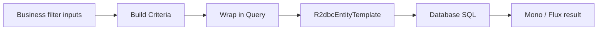

# Kết hợp điều kiện AND, OR và nhóm điều kiện

Spring Data Relational R2DBC cung cấp `Criteria` và `Query` để xây dựng truy vấn động theo cách có cấu trúc. `Criteria` mô tả điều kiện lọc; `Query` đóng gói điều kiện cùng các tùy chọn truy vấn; `R2dbcEntityTemplate` hoặc `R2dbcEntityOperations` thực thi truy vấn và trả kết quả dưới dạng `Mono` hoặc `Flux`.

Khi truy vấn có nhiều điều kiện, cần xác định rõ điều kiện nào kết hợp bằng `AND`, điều kiện nào kết hợp bằng `OR` và điều kiện nào phải nằm trong cùng một nhóm. Một truy vấn có thể trả kết quả sai dù từng điều kiện riêng lẻ đều đúng nếu nhóm logic bị đặt sai. Vì vậy, hãy thiết kế biểu thức theo đúng quy tắc nghiệp vụ rồi biểu diễn nhóm bằng `Criteria` lồng nhau.

## 1. Vai trò của `Criteria` và `Query`

`Criteria` biểu diễn một điều kiện hoặc tổ hợp điều kiện. Mỗi điều kiện thường gồm thuộc tính/cột, phép so sánh và giá trị cần so sánh. `Query` sử dụng `Criteria` để mô tả phần lọc, đồng thời có thể chứa thông tin sắp xếp, giới hạn và phân trang tùy API.

Luồng sử dụng cơ bản:



Ví dụ truy vấn đơn giản:

```java
import static org.springframework.data.relational.core.query.Criteria.where;
import static org.springframework.data.relational.core.query.Query.query;

import org.springframework.data.relational.core.query.Criteria;
import org.springframework.data.relational.core.query.Query;
import reactor.core.publisher.Flux;

public Flux<Order> findOpenOrders() {
    Query query = query(where("status").is(OrderStatus.OPEN));

    return template.select(Order.class)
            .matching(query)
            .all();
}
```

`where("status")` bắt đầu điều kiện trên thuộc tính `status`; `.is(...)` tạo phép so sánh bằng. `Query.query(...)` đóng gói điều kiện. `select(Order.class)` yêu cầu đọc entity `Order`; `.all()` trả về `Flux<Order>`.

Trong các ví dụ, `template` là một bean `R2dbcEntityTemplate` được inject vào service. Có thể dùng interface `R2dbcEntityOperations` nếu muốn tầng nghiệp vụ phụ thuộc vào abstraction. Tên thuộc tính trong query cần khớp metadata mapping của entity và phiên bản Spring Data Relational đang dùng; Spring Data dùng mapping context để chuyển sang tên cột tương ứng.

## 2. Kết hợp điều kiện bằng AND

`AND` yêu cầu tất cả điều kiện trong nhóm phải đúng. Ví dụ chỉ lấy đơn hàng đang mở có tổng tiền lớn hơn 100:

```java
public Flux<Order> findOpenOrdersAbove(BigDecimal minimumTotal) {
    Criteria criteria = where("status").is(OrderStatus.OPEN)
            .and("total").greaterThan(minimumTotal);

    return template.select(Order.class)
            .matching(Query.query(criteria))
            .all();
}
```

Điều kiện tương đương về mặt logic:

```sql
WHERE status = 'OPEN'
  AND total > 100
```

Chỉ những hàng thỏa cả trạng thái và tổng tiền mới được trả về. Nếu một điều kiện sai, hàng đó không thuộc kết quả.

Có thể thêm nhiều điều kiện `AND`:

```java
Criteria criteria = where("tenantId").is(tenantId)
        .and("status").is(OrderStatus.OPEN)
        .and("createdAt").greaterThanOrEquals(from)
        .and("total").lessThanOrEquals(maximumTotal);
```

Điều này tương ứng với:

```sql
WHERE tenant_id = :tenantId
  AND status = :status
  AND created_at >= :from
  AND total <= :maximumTotal
```

Kết hợp `AND` thường phù hợp khi các điều kiện đều là giới hạn bắt buộc, ví dụ tenant hiện tại, trạng thái được phép, khoảng thời gian và mức giá.

## 3. Kết hợp điều kiện bằng OR

`OR` chỉ yêu cầu ít nhất một điều kiện trong nhóm đúng. Ví dụ tìm đơn hàng ở trạng thái `OPEN` hoặc `PENDING`:

```java
public Flux<Order> findOpenOrPendingOrders() {
    Criteria criteria = where("status").is(OrderStatus.OPEN)
            .or("status").is(OrderStatus.PENDING);

    return template.select(Order.class)
            .matching(Query.query(criteria))
            .all();
}
```

Điều kiện tương đương:

```sql
WHERE status = 'OPEN'
   OR status = 'PENDING'
```

Một hàng chỉ cần thỏa một trong hai trạng thái là đủ. Có thể dùng `in(...)` khi mục tiêu chỉ là kiểm tra một cột có thuộc tập giá trị:

```java
Criteria criteria = where("status")
        .in(OrderStatus.OPEN, OrderStatus.PENDING);
```

Về ý nghĩa, điều kiện `IN` tương đương với một chuỗi so sánh bằng nối bằng `OR` trong trường hợp đơn giản. `IN` thường gọn hơn khi danh sách giá trị dài. Nếu mỗi nhánh có các điều kiện khác nhau, hãy dùng `OR` và nhóm `Criteria`.

## 4. Vì sao cần nhóm điều kiện?

Khi trộn `AND` và `OR`, thứ tự đánh giá ảnh hưởng trực tiếp tới kết quả. Ví dụ nghiệp vụ yêu cầu:

> Lấy đơn hàng thuộc tenant hiện tại và có trạng thái OPEN hoặc PENDING.

Biểu thức mong muốn là:

```sql
WHERE tenant_id = :tenantId
  AND (status = 'OPEN' OR status = 'PENDING')
```

Nếu bỏ ngoặc và viết:

```sql
WHERE tenant_id = :tenantId AND status = 'OPEN'
   OR status = 'PENDING'
```

SQL thường ưu tiên `AND` trước `OR`, nên biểu thức được hiểu là:

```sql
WHERE (tenant_id = :tenantId AND status = 'OPEN')
   OR status = 'PENDING'
```

Kết quả có thể bao gồm đơn hàng `PENDING` thuộc tenant khác. Đây là lỗi nghiêm trọng nếu `tenantId` là ranh giới dữ liệu hoặc quyền truy cập.

Quy tắc thực hành: khi một nhóm có nhiều điều kiện, hãy tạo `Criteria` con rồi kết hợp với `and(Criteria)` hoặc `or(Criteria)` để thể hiện ngoặc một cách tường minh. Đừng dựa vào trí nhớ về precedence của SQL để suy luận một chuỗi builder dài.

## 5. Nhóm OR bên trong một điều kiện AND

Với ví dụ tenant ở trên, hãy tạo nhóm trạng thái riêng:

```java
Criteria allowedStatuses = where("status").is(OrderStatus.OPEN)
        .or("status").is(OrderStatus.PENDING);

Criteria criteria = where("tenantId").is(tenantId)
        .and(allowedStatuses);

return template.select(Order.class)
        .matching(Query.query(criteria))
        .all();
```

Nhóm `allowedStatuses` được kết hợp với điều kiện tenant bằng `AND`. Ý nghĩa logic là:

\[
tenantId = T \;\land\; (status = OPEN \;\lor\; status = PENDING)
\]

Việc đặt điều kiện tenant ở ngoài nhóm OR rất quan trọng: mọi nhánh trạng thái đều phải thuộc tenant đang truy vấn.

Có thể viết trực tiếp mà không cần biến trung gian:

```java
Criteria criteria = where("tenantId").is(tenantId)
        .and(where("status").is(OrderStatus.OPEN)
                .or("status").is(OrderStatus.PENDING));
```

Tạo biến cho nhóm con thường dễ đọc hơn khi điều kiện phức tạp hoặc được tái sử dụng.

## 6. Nhóm AND bên trong một điều kiện OR

Một trường hợp khác là tìm đơn hàng có trạng thái OPEN và tổng tiền cao, hoặc đơn hàng PENDING có mức ưu tiên cao:

```sql
WHERE (status = 'OPEN' AND total > 500)
   OR (status = 'PENDING' AND priority = 'HIGH')
```

Có thể xây dựng hai nhóm riêng rồi nối bằng OR:

```java
Criteria expensiveOpenOrder = where("status").is(OrderStatus.OPEN)
        .and("total").greaterThan(new BigDecimal("500"));

Criteria urgentPendingOrder = where("status").is(OrderStatus.PENDING)
        .and("priority").is(Priority.HIGH);

Criteria criteria = expensiveOpenOrder.or(urgentPendingOrder);

return template.select(Order.class)
        .matching(Query.query(criteria))
        .all();
```

Mỗi nhánh là một nhóm `AND`; hai nhóm được kết hợp bằng `OR`. Khi đọc code, cấu trúc biến tương ứng với cấu trúc logic nên dễ kiểm tra hơn một chuỗi dài.

## 7. Nhóm lồng nhau nhiều cấp

Một truy vấn có thể cần nhiều lớp ngoặc. Ví dụ:

```sql
WHERE tenant_id = :tenantId
  AND deleted_at IS NULL
  AND (
       (status = 'OPEN' AND total >= :minimum)
       OR
       (status = 'PENDING' AND priority = 'HIGH')
  )
```

Có thể diễn đạt bằng các nhóm con:

```java
Criteria openAndExpensive = where("status").is(OrderStatus.OPEN)
        .and("total").greaterThanOrEquals(minimumTotal);

Criteria pendingAndUrgent = where("status").is(OrderStatus.PENDING)
        .and("priority").is(Priority.HIGH);

Criteria statusAndBusinessRule = openAndExpensive.or(pendingAndUrgent);

Criteria criteria = where("tenantId").is(tenantId)
        .and("deletedAt").isNull()
        .and(statusAndBusinessRule);
```

Đoạn mã minh họa cấu trúc nhóm. Tên thuộc tính và kiểu enum cần tương ứng entity thực tế. Các toán tử null có thể được biểu diễn bằng API `isNull()`/`isNotNull()` trong phiên bản Spring Data Relational hỗ trợ; nếu API của dự án khác, hãy dùng cách diễn đạt Criteria tương ứng theo Javadoc của phiên bản đó.

Không nên tạo một nhóm lồng nhau quá sâu chỉ để mô phỏng mọi chi tiết của câu SQL. Hãy đặt tên biến theo ý nghĩa nghiệp vụ, ví dụ `openAndExpensive`, `pendingAndUrgent`, `visibleOrders`, để người đọc hiểu vì sao các điều kiện được gom lại.

## 8. Kết hợp điều kiện động từ tham số tìm kiếm

Trong thực tế, request tìm kiếm thường có các trường tùy chọn. Ví dụ người dùng có thể nhập trạng thái, ngày bắt đầu, ngày kết thúc và mức tiền tối đa. Không nên tạo một truy vấn riêng cho mọi tổ hợp tham số; hãy ghép các điều kiện hiện diện vào `Criteria`.

```java
public Flux<Order> searchOrders(
        Long tenantId,
        OrderStatus status,
        LocalDateTime createdAfter,
        BigDecimal maximumTotal) {

    Criteria criteria = where("tenantId").is(tenantId);

    if (status != null) {
        criteria = criteria.and("status").is(status);
    }

    if (createdAfter != null) {
        criteria = criteria.and("createdAt").greaterThanOrEquals(createdAfter);
    }

    if (maximumTotal != null) {
        criteria = criteria.and("total").lessThanOrEquals(maximumTotal);
    }

    return template.select(Order.class)
            .matching(Query.query(criteria))
            .all();
}
```

`tenantId` luôn là điều kiện bắt buộc. Những tham số tùy chọn chỉ được thêm khi có giá trị. Cách này tránh tạo điều kiện `column = null` ngoài ý muốn và giữ truy vấn phù hợp với dữ liệu đầu vào.

Nếu một trường bắt buộc có thể mang giá trị null theo nghiệp vụ, cần phân biệt “không truyền filter” với “tìm các hàng có cột NULL”. Đây là hai yêu cầu khác nhau. Không dùng một giá trị null duy nhất để đại diện cho cả hai ý nghĩa.

## 9. Điều kiện OR động theo tập giá trị

Nếu người dùng chọn nhiều trạng thái, danh sách trạng thái có thể được truyền thành một tập giá trị:

```java
public Flux<Order> findByStatuses(Long tenantId, Collection<OrderStatus> statuses) {
    Criteria criteria = where("tenantId").is(tenantId);

    if (statuses != null && !statuses.isEmpty()) {
        criteria = criteria.and(where("status").in(statuses));
    }

    return template.select(Order.class)
            .matching(Query.query(criteria))
            .all();
}
```

`IN` thường là cách ngắn gọn để biểu diễn `status = A OR status = B OR ...`. Cần quyết định rõ hành vi khi danh sách rỗng: bỏ qua điều kiện trạng thái, trả về không có kết quả hay từ chối request. Ví dụ trên bỏ qua filter nếu danh sách rỗng; điều đó có thể không phù hợp với mọi API.

Nếu danh sách rỗng phải trả về rỗng, có thể xử lý rõ trước khi truy vấn:

```java
if (statuses != null && statuses.isEmpty()) {
    return Flux.empty();
}
```

Đừng dựa vào việc tạo `IN ()`; SQL với danh sách rỗng có thể không hợp lệ hoặc có semantics khác tùy cách builder/driver xử lý.

## 10. Kết hợp điều kiện khoảng và nhiều phép so sánh

Một bộ lọc ngày thường gồm cận dưới và cận trên:

```java
Criteria criteria = where("createdAt").greaterThanOrEquals(from)
        .and("createdAt").lessThan(to);
```

Ý nghĩa là `from <= createdAt < to`. Dùng khoảng nửa mở thường thuận tiện cho bộ lọc theo ngày: cận dưới bao gồm, cận trên không bao gồm. Ví dụ để tìm các bản ghi trong một ngày, tính `startOfDay` và `startOfNextDay` theo múi giờ nghiệp vụ rồi truy vấn `>= start` và `< end`.

Có thể kết hợp khoảng với nhóm OR:

```java
Criteria customerMatch = where("customerId").is(customerId)
        .or("createdBy").is(userId);

Criteria criteria = where("tenantId").is(tenantId)
        .and("createdAt").greaterThanOrEquals(from)
        .and("createdAt").lessThan(to)
        .and(customerMatch);
```

Ở đây mọi kết quả phải thuộc tenant và khoảng thời gian, đồng thời phải thỏa ít nhất một trong hai điều kiện người liên quan. Nhóm OR được giới hạn trong một điều kiện AND tổng thể.

## 11. Kết hợp Criteria với sắp xếp và giới hạn kết quả

`Criteria` chỉ mô tả bộ lọc. `Query` có thể kết hợp thêm sắp xếp và giới hạn để phục vụ màn hình tìm kiếm:

```java
import org.springframework.data.domain.Sort;
import org.springframework.data.relational.core.query.Query;

Query query = Query.query(criteria)
        .sort(Sort.by(Sort.Order.desc("createdAt")))
        .limit(50);

return template.select(Order.class)
        .matching(query)
        .all();
```

Ví dụ lấy tối đa 50 đơn hàng mới nhất thỏa điều kiện. Các phương thức và overload của `Query` cần đối chiếu phiên bản Spring Data Relational đang dùng. Nếu cần phân trang nhiều trang, hãy chọn API phân trang phù hợp và thêm thứ tự sắp xếp ổn định, thường có khóa phụ như ID để tránh kết quả thay đổi vị trí tùy ý giữa các trang.

Không nên lấy toàn bộ kết quả rồi lọc/sắp xếp trong Java nếu database có thể thực hiện điều kiện. Lọc tại database giúp giảm dữ liệu truyền qua mạng và lượng object cần tạo trong ứng dụng.

## 12. Tìm kiếm chuỗi và điều kiện kết hợp

Criteria hỗ trợ các phép so sánh chuỗi tùy API và dialect, ví dụ `like`, `notLike`, `in` hoặc so sánh bằng. Khi dùng `LIKE`, ký tự `%` và `_` có ý nghĩa wildcard; nếu người dùng nhập chuỗi tìm kiếm literal, cần escape wildcard theo quy tắc của database và API đang dùng.

Ví dụ ý tưởng tìm theo tên hoặc email trong cùng tenant:

```java
Criteria textMatch = where("name").like("%" + keyword + "%")
        .or("email").like("%" + keyword + "%");

Criteria criteria = where("tenantId").is(tenantId)
        .and(textMatch);
```

Kết quả phải thuộc tenant hiện tại và có tên hoặc email khớp từ khóa. Việc nối wildcard vào giá trị tìm kiếm không đồng nghĩa nối dữ liệu vào câu SQL; Criteria vẫn bind giá trị như tham số. Tuy vậy, cần escape `%` và `_` nếu chúng phải được xem là ký tự thường, và giới hạn độ dài từ khóa để tránh truy vấn quá tốn kém.

Nếu cần tìm kiếm không phân biệt hoa thường, semantics phụ thuộc collation, database và phép toán được hỗ trợ. Không giả định `like` luôn không phân biệt hoa thường. Có thể chuẩn hóa dữ liệu, dùng collation phù hợp hoặc API riêng của hệ quản trị theo yêu cầu.

## 13. Không nối trực tiếp dữ liệu người dùng vào SQL

`Criteria` được thiết kế để biểu diễn điều kiện và giá trị một cách có cấu trúc. Hãy truyền giá trị qua các phép so sánh của Criteria thay vì ghép chuỗi SQL:

```java
// Dùng Criteria và giá trị bind
Criteria criteria = where("email").is(request.email());
```

Tránh tạo câu SQL bằng cách nối trực tiếp input:

```java
// Không nên: dữ liệu người dùng bị ghép vào câu SQL
String sql = "SELECT * FROM customer WHERE email = '" + request.email() + "'";
```

Khi cần `DatabaseClient` và SQL viết tay, dùng bind parameters. Với tên cột hoặc hướng sắp xếp do client gửi, bind parameter không thể thay thế identifier; hãy ánh xạ input qua whitelist các thuộc tính được phép. Không cho phép người dùng truyền tùy ý tên bảng, cột hoặc đoạn SQL.

## 14. Null, điều kiện vắng mặt và logic ba giá trị của SQL

SQL có ba trạng thái logic: `TRUE`, `FALSE` và `UNKNOWN`. So sánh thông thường với `NULL`, ví dụ `column = NULL`, không cho kết quả `TRUE`; phải dùng `IS NULL` hoặc `IS NOT NULL`. Vì vậy, một điều kiện filter không có giá trị và một điều kiện tìm cột null không thể được xem là một.

Ví dụ về mặt SQL:

```sql
-- Không tương đương với IS NULL
WHERE deleted_at = NULL

-- Kiểm tra đúng cột không có giá trị
WHERE deleted_at IS NULL
```

Trong Criteria, dùng toán tử null tương ứng của phiên bản Spring Data đang dùng, chẳng hạn `isNull()` và `isNotNull()` nếu có trong API. Nếu một tham số request là null vì client không gửi filter, thường nên bỏ qua điều kiện đó. Nếu client yêu cầu tìm những hàng có cột null, hãy biểu diễn rõ bằng toán tử `IS NULL`.

Các điều kiện chứa null cũng ảnh hưởng đến `NOT`, `NOT IN` và phép so sánh. Ví dụ `NOT IN` với tập giá trị chứa `NULL` có thể cho kết quả `UNKNOWN` đối với các hàng không khớp. Hãy làm sạch tập filter và xác định semantics trước khi đưa vào query.

## 15. Tách việc xây dựng Criteria khỏi việc thực thi

Với truy vấn phức tạp, nên tách phương thức tạo điều kiện để service dễ đọc và dễ kiểm thử:

```java
private Criteria buildOrderCriteria(OrderSearchRequest request) {
    Criteria criteria = where("tenantId").is(request.tenantId());

    if (request.from() != null) {
        criteria = criteria.and("createdAt").greaterThanOrEquals(request.from());
    }

    if (request.to() != null) {
        criteria = criteria.and("createdAt").lessThan(request.to());
    }

    if (request.statuses() != null && !request.statuses().isEmpty()) {
        criteria = criteria.and(where("status").in(request.statuses()));
    }

    if (request.minimumTotal() != null) {
        criteria = criteria.and("total").greaterThanOrEquals(request.minimumTotal());
    }

    return criteria;
}

public Flux<Order> search(OrderSearchRequest request) {
    Query query = Query.query(buildOrderCriteria(request));

    return template.select(Order.class)
            .matching(query)
            .all();
}
```

Việc tách builder có một số lợi ích:

- Có thể kiểm thử quy tắc ghép điều kiện độc lập với việc kết nối database.
- Tên phương thức và biến thể hiện mục đích của filter.
- Dễ thêm điều kiện tùy chọn mà không làm service thành một chuỗi builder quá dài.
- Có thể tái sử dụng nhóm điều kiện chung như tenant, trạng thái hoạt động hoặc phạm vi thời gian.

Không nên đưa authorization chỉ vào filter do client điều khiển. Điều kiện tenant hoặc phạm vi quyền phải lấy từ ngữ cảnh đã xác thực phía server và luôn được áp dụng bất kể request có gửi filter hay không.

## 16. Kiểm thử logic AND, OR và nhóm điều kiện

Unit test cho builder nên tập trung vào quy tắc nghiệp vụ của các tổ hợp. Có thể kiểm tra các trường hợp:

1. Khi chỉ có tenant, truy vấn vẫn giới hạn đúng tenant.
2. Khi trạng thái là OPEN hoặc PENDING, cả hai trạng thái được chấp nhận.
3. Khi kết hợp tenant AND nhóm trạng thái OR, dữ liệu tenant khác không được lọt vào kết quả.
4. Khi có hai nhánh AND nối bằng OR, mỗi nhánh phải thỏa đầy đủ điều kiện của chính nó.
5. Khi filter tùy chọn vắng mặt, điều kiện tương ứng được bỏ qua theo hợp đồng API.
6. Khi danh sách filter rỗng, hành vi được xác định rõ và không tạo `IN ()`.
7. Khi filter yêu cầu SQL NULL, dùng phép kiểm tra null thay vì so sánh bằng null.

Với integration test, nên tạo dữ liệu có chủ ý để phân biệt lỗi ngoặc. Ví dụ tạo một hàng PENDING thuộc tenant khác. Nếu truy vấn vô tình trở thành `(tenant = A AND status = OPEN) OR status = PENDING`, hàng sai tenant sẽ xuất hiện và test phát hiện được lỗi.

Ví dụ test ở mức service với `StepVerifier`:

```java
StepVerifier.create(orderService.searchOrders(tenantA))
        .expectNextMatches(order ->
                order.getTenantId().equals(tenantA)
                        && (order.getStatus() == OrderStatus.OPEN
                        || order.getStatus() == OrderStatus.PENDING))
        .verifyComplete();
```

Đây chỉ là ví dụ kiểm tra phần tử trả về. Một integration test đầy đủ nên seed cả hàng hợp lệ lẫn hàng không hợp lệ để bảo đảm query loại đúng các trường hợp sai, không chỉ xác nhận một hàng hợp lệ xuất hiện.

## 17. Hiệu năng và khả năng sử dụng index

Kết hợp nhiều điều kiện có thể ảnh hưởng đến query plan. Database có thể sử dụng index đơn, index ghép, bitmap hoặc chiến lược khác tùy hệ quản trị và thống kê dữ liệu. Không có quy tắc rằng mỗi điều kiện AND/OR sẽ luôn sử dụng một index riêng.

Một số lưu ý:

- Điều kiện tenant thường có độ chọn lọc cao và xuất hiện trong nhiều truy vấn; index ghép có thể cần bắt đầu bằng `tenant_id` tùy mẫu truy vấn.
- `OR` giữa các cột khác nhau có thể làm query plan phức tạp hơn; hãy xem `EXPLAIN` trên dữ liệu gần thực tế.
- `LIKE '%keyword%'` thường khó tận dụng B-tree index thông thường; có thể cần full-text search, trigram hoặc giải pháp riêng của database.
- Các phép chuyển đổi trên cột trong điều kiện có thể làm giảm khả năng dùng index nếu không có functional index phù hợp.
- Filter quá rộng hoặc không giới hạn kết quả có thể trả về lượng dữ liệu lớn; kết hợp limit/phân trang và thứ tự ổn định.

Không tối ưu bằng cách thay đổi logic AND/OR. Trước tiên bảo đảm biểu thức đúng nghiệp vụ, sau đó dùng query plan và metric để tối ưu index hoặc cách truy vấn.

## 18. Những lỗi thường gặp

| Lỗi | Hậu quả | Cách khắc phục |
| --- | --- | --- |
| Quên nhóm OR trong điều kiện AND | Dữ liệu ngoài tenant/phạm vi có thể lọt vào kết quả | Tạo `Criteria` con và kết hợp bằng `and(group)` |
| Dùng OR thay cho AND | Kết quả rộng hơn quy tắc nghiệp vụ | Viết biểu thức logic trước, sau đó chuyển thành Criteria |
| Ghép chuỗi builder quá dài | Khó hiểu precedence và khó sửa | Tách nhóm bằng biến có tên ý nghĩa |
| Tham số null bị thêm thành phép so sánh | Truy vấn không có semantics mong muốn | Chỉ thêm filter khi request thực sự yêu cầu; xử lý null rõ ràng |
| Danh sách `IN` rỗng | SQL không hợp lệ hoặc hành vi không như mong đợi | Quy định rõ trả rỗng, bỏ filter hay báo lỗi |
| Cho client truyền tùy ý tên cột | Rủi ro truy vấn ngoài phạm vi hoặc injection qua identifier | Dùng whitelist thuộc tính được phép |
| Dùng `LIKE` mà không xử lý wildcard | Kết quả rộng hơn từ khóa literal | Escape `%` và `_` theo quy tắc phù hợp |
| Chỉ test một hàng hợp lệ | Không phát hiện điều kiện OR làm lọt dữ liệu sai | Seed dữ liệu phản ví dụ cho từng nhánh logic |
| Filter không giới hạn | Tải database và bộ nhớ tăng | Thêm phân trang/limit và theo dõi query plan |

## 19. Nguyên tắc thực hành

- Dùng `Criteria` để biểu diễn từng điều kiện và `Query` để đóng gói truy vấn.
- Dùng `and(...)` khi mọi điều kiện đều bắt buộc; dùng `or(...)` khi chỉ cần một nhánh đúng.
- Tạo `Criteria` lồng nhau cho các nhóm cần dấu ngoặc, nhất là khi trộn AND với OR.
- Đặt điều kiện tenant, quyền truy cập và phạm vi dữ liệu ở nhóm bắt buộc bên ngoài các nhánh OR.
- Đặt tên biến nhóm theo ý nghĩa nghiệp vụ để code dễ đọc.
- Chỉ thêm điều kiện tùy chọn khi tham số thực sự được cung cấp; phân biệt bỏ filter với tìm SQL NULL.
- Dùng `IN` cho một cột cần khớp một trong nhiều giá trị; xác định hành vi danh sách rỗng.
- Dùng bind parameter thông qua Criteria hoặc DatabaseClient, không nối dữ liệu người dùng vào SQL.
- Whitelist tên thuộc tính, cột sắp xếp và identifier do client lựa chọn.
- Kiểm thử cả dữ liệu hợp lệ và phản ví dụ có thể lọt qua khi nhóm điều kiện sai.
- Xem query plan và index sau khi logic đã đúng; không giả định OR hoặc AND luôn dùng index theo một cách cố định.
- Kiểm tra API Criteria/Query theo phiên bản Spring Data Relational của dự án.

## 20. Kết luận

`Criteria` và `Query` giúp xây dựng truy vấn động trong Spring Data Relational R2DBC. `AND` kết hợp các điều kiện bắt buộc; `OR` cho phép một trong các nhánh đúng. Khi trộn hai phép toán, nhóm điều kiện bằng `Criteria` lồng nhau để thể hiện chính xác dấu ngoặc và tránh làm rộng phạm vi truy vấn ngoài ý muốn.

Hãy bắt đầu từ biểu thức nghiệp vụ, tách các nhóm có ý nghĩa, thêm filter tùy chọn theo trạng thái tham số và giữ các điều kiện bảo mật như tenant ở nhóm bắt buộc. Kết hợp kiểm thử với dữ liệu phản ví dụ, bind tham số và xem query plan sẽ giúp truy vấn vừa đúng logic vừa dễ bảo trì khi yêu cầu tìm kiếm phát triển.
