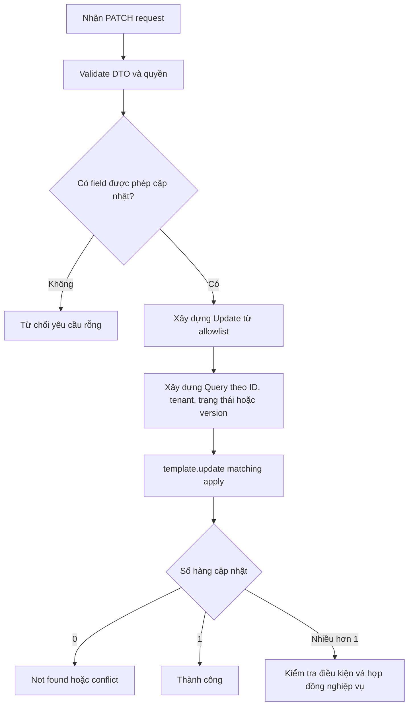

# Cập nhật chọn lọc một số cột

Trong Spring Data R2DBC, không phải lúc nào ứng dụng cũng cần tải toàn bộ entity, thay đổi một thuộc tính rồi lưu lại. Với các nghiệp vụ chỉ cập nhật một vài cột, `R2dbcEntityTemplate` cung cấp API `update(Query, Update)` để chỉ định rõ hàng nào cần thay đổi và những thuộc tính nào được ghi.

Cách làm này thường được gọi là *partial update* hoặc cập nhật một phần. Nó giúp giảm dữ liệu phải đọc, tránh ghi đè các thuộc tính không liên quan và thể hiện rõ điều kiện cập nhật ở phía database.

Khi xây dựng partial update, cần chú ý ba vấn đề: chỉ cho phép cập nhật những field được nghiệp vụ chấp nhận, phân biệt field không được gửi với field được gửi giá trị `null`, và kiểm tra số hàng thực sự bị tác động.

## 1. Partial update là gì?

Giả sử bảng `customers` có các cột:

```sql
CREATE TABLE customers (
    id BIGINT GENERATED BY DEFAULT AS IDENTITY PRIMARY KEY,
    tenant_id BIGINT NOT NULL,
    name VARCHAR(120) NOT NULL,
    email VARCHAR(180),
    phone VARCHAR(30),
    status VARCHAR(20) NOT NULL,
    modified_at TIMESTAMP NOT NULL
);
```

Một yêu cầu cập nhật tên khách hàng không nhất thiết phải đọc toàn bộ bản ghi. Ứng dụng có thể thực hiện câu lệnh tương đương:

```sql
UPDATE customers
SET name = ?, modified_at = ?
WHERE id = ?;
```

Các cột `email`, `phone` và `status` không nằm trong `SET`, vì vậy thao tác này không yêu cầu ghi lại giá trị của chúng.

Partial update hữu ích khi:

- API nhận một yêu cầu PATCH chỉ chứa một vài thuộc tính.
- Một tác vụ nền chỉ thay đổi trạng thái hoặc thời điểm xử lý.
- Cần cập nhật theo điều kiện mà không cần tải entity trước.
- Entity có nhiều cột và ứng dụng muốn tránh ghi lại các giá trị không liên quan.
- Nhiều tiến trình có thể cập nhật các nhóm thuộc tính khác nhau của cùng một bản ghi.

Partial update không thay thế mọi thao tác lưu entity. Khi nghiệp vụ cần kiểm tra và thay đổi toàn bộ aggregate, repository `save()` vẫn là lựa chọn phù hợp.

## 2. Dùng `R2dbcEntityTemplate.update()`

`R2dbcEntityTemplate` cung cấp fluent API để tạo câu lệnh update từ entity type, điều kiện `Query` và các thuộc tính trong `Update`.

```java
import static org.springframework.data.relational.core.query.Criteria.where;
import static org.springframework.data.relational.core.query.Query.query;

import org.springframework.data.relational.core.query.Update;
import org.springframework.data.r2dbc.core.R2dbcEntityTemplate;
import reactor.core.publisher.Mono;

public Mono<Long> renameCustomer(
        R2dbcEntityTemplate template,
        Long customerId,
        String newName) {

    return template.update(Customer.class)
            .matching(query(where("id").is(customerId)))
            .apply(Update.update("name", newName));
}
```

Các thành phần có ý nghĩa như sau:

- `Customer.class` cho template biết metadata mapping cần sử dụng.
- `matching(Query)` xác định những hàng được phép cập nhật.
- `Update.update("name", newName)` khai báo thuộc tính cần thay đổi.
- `apply(Update)` thực thi thao tác và trả về `Mono<Long>` chứa số hàng được cập nhật theo báo cáo của driver.

Tên trong `Update` và `Criteria` thường là tên property của entity. Spring Data dùng metadata để ánh xạ property đó sang cột vật lý trong database.

### 2.1. Cập nhật nhiều cột

Có thể thêm nhiều thuộc tính vào cùng một `Update`:

```java
Update changes = Update.update("name", "Lan Nguyen")
        .set("email", "lan.nguyen@example.com")
        .set("phone", "0900000000");

return template.update(Customer.class)
        .matching(query(where("id").is(customerId)))
        .apply(changes);
```

Template tạo một thao tác update với các thuộc tính đã khai báo. Không cần gọi `save()` cho từng field.

### 2.2. Dùng điều kiện có nhiều tiêu chí

Điều kiện update có thể kết hợp nhiều tiêu chí. Ví dụ, hệ thống multi-tenant nên giới hạn cả ID và tenant sở hữu bản ghi:

```java
Query condition = query(
        where("id").is(customerId)
                .and("tenantId").is(tenantId)
);

return template.update(Customer.class)
        .matching(condition)
        .apply(Update.update("name", newName));
```

Điều kiện tenant được đưa vào SQL để database chỉ cập nhật bản ghi thuộc tenant hiện tại. Việc kiểm tra quyền ở tầng service vẫn cần thiết; predicate trong database là một lớp bảo vệ quan trọng để tránh cập nhật nhầm dữ liệu.

Có thể bổ sung điều kiện trạng thái:

```java
Query condition = query(
        where("id").is(customerId)
                .and("tenantId").is(tenantId)
                .and("status").is("ACTIVE")
);
```

Nhờ vậy, chỉ khách hàng đang hoạt động thuộc tenant tương ứng mới được cập nhật.

## 3. Cập nhật động theo những field được gửi lên

Một API PATCH thường nhận các field tùy chọn. Client có thể gửi một field, nhiều field hoặc không gửi field nào. Ứng dụng cần tạo `Update` từ đúng các field có mặt trong yêu cầu.

Ví dụ DTO:

```java
public record CustomerPatchRequest(
        String name,
        String email,
        String phone
) {
}
```

Nếu quy ước của API là `null` nghĩa là field không được gửi, có thể xây dựng `Update` động như sau:

```java
private Update toUpdate(CustomerPatchRequest patch) {
    Update changes = null;

    if (patch.name() != null) {
        changes = Update.update("name", patch.name());
    }

    if (patch.email() != null) {
        changes = changes == null
                ? Update.update("email", patch.email())
                : changes.set("email", patch.email());
    }

    if (patch.phone() != null) {
        changes = changes == null
                ? Update.update("phone", patch.phone())
                : changes.set("phone", patch.phone());
    }

    return changes;
}
```

Sau đó kiểm tra trường hợp không có field nào được cập nhật:

```java
public Mono<Long> patchCustomer(
        Long customerId,
        Long tenantId,
        CustomerPatchRequest patch) {

    Update changes = toUpdate(patch);

    if (changes == null) {
        return Mono.error(new IllegalArgumentException(
                "At least one field must be provided"));
    }

    Query condition = query(
            where("id").is(customerId)
                    .and("tenantId").is(tenantId)
    );

    return template.update(Customer.class)
            .matching(condition)
            .apply(changes);
}
```

Đoạn code trên minh họa quy ước đơn giản: field có giá trị khác null được cập nhật; field null được xem là không gửi. Quy ước này không cho phép client chủ động xóa giá trị một cột bằng SQL `NULL`.

### 3.1. Phân biệt field không gửi và field được gửi `null`

Trong API PATCH, hai ý định sau khác nhau:

```json
{}
```

Không yêu cầu thay đổi field nào.

```json
{"phone": null}
```

Client có thể đang yêu cầu xóa số điện thoại hiện tại bằng cách đặt cột `phone` thành SQL `NULL`.

Nếu DTO Java chỉ dùng `String phone`, nhiều bộ JSON binding sẽ ánh xạ cả trường hợp thiếu field và trường hợp gửi `null` thành cùng giá trị Java `null`. Khi đó ứng dụng không thể phân biệt hai ý định.

Nếu nghiệp vụ cần hỗ trợ xóa giá trị, hãy dùng một kiểu dữ liệu thể hiện rõ ba trạng thái: không được gửi, được gửi với giá trị cụ thể, và được gửi với giá trị null. Ví dụ:

```java
public record FieldPatch<T>(boolean supplied, T value) {
}

public record CustomerPatch(
        FieldPatch<String> name,
        FieldPatch<String> email,
        FieldPatch<String> phone
) {
}
```

Khi `supplied` là `false`, không thêm property vào `Update`. Khi `supplied` là `true`, thêm property với giá trị tương ứng; nếu `value` là `null`, mục tiêu là đặt cột thành SQL `NULL` (nếu schema cho phép).

Ví dụ xây dựng `Update`:

```java
private Update toUpdate(CustomerPatch patch) {
    Update changes = null;

    if (patch.name() != null && patch.name().supplied()) {
        changes = Update.update("name", patch.name().value());
    }

    if (patch.email() != null && patch.email().supplied()) {
        changes = changes == null
                ? Update.update("email", patch.email().value())
                : changes.set("email", patch.email().value());
    }

    if (patch.phone() != null && patch.phone().supplied()) {
        changes = changes == null
                ? Update.update("phone", patch.phone().value())
                : changes.set("phone", patch.phone().value());
    }

    return changes;
}
```

Kiểu `FieldPatch` ở đây là ví dụ mô hình dữ liệu. Khi triển khai API thật, cần cấu hình deserialization để phân biệt trường bị thiếu với trường có giá trị null. Không phải mọi thư viện JSON đều tự ánh xạ được kiểu ba trạng thái này mà không có custom deserializer.

### 3.2. Không cho phép client cập nhật mọi property tùy ý

Không nên nhận một map tùy ý từ request rồi chuyển trực tiếp mọi key thành tên property để cập nhật. Client có thể gửi những field nhạy cảm như `id`, `tenantId`, `status`, `role`, `createdAt` hoặc `version`.

Hãy lập danh sách field được phép cập nhật theo từng nghiệp vụ. Với DTO có kiểu cụ thể, danh sách này được thể hiện qua các thuộc tính DTO. Nếu dùng map động, phải kiểm tra key với allowlist:

```java
private static final Set<String> ALLOWED_FIELDS = Set.of(
        "name", "email", "phone"
);
```

Ngoài allowlist, cần kiểm tra quyền của người gọi, kiểu dữ liệu, độ dài, định dạng, trạng thái nghiệp vụ và giới hạn nullability. Không đưa tên cột từ input vào câu SQL tự ghép chuỗi.

## 4. Cập nhật một số cột theo điều kiện nghiệp vụ

Partial update thường cần thêm điều kiện để tránh cập nhật một bản ghi đã thay đổi hoặc không còn ở trạng thái hợp lệ.

### 4.1. Chỉ cập nhật khi trạng thái hiện tại phù hợp

Ví dụ chỉ cho phép chuyển khách hàng đang `ACTIVE` sang `INACTIVE`:

```java
public Mono<Long> deactivate(Long customerId, Long tenantId) {
    Query condition = query(
            where("id").is(customerId)
                    .and("tenantId").is(tenantId)
                    .and("status").is("ACTIVE")
    );

    Update changes = Update.update("status", "INACTIVE");

    return template.update(Customer.class)
            .matching(condition)
            .apply(changes);
}
```

Nếu số hàng được cập nhật là `0`, có thể bản ghi không tồn tại, không thuộc tenant hiện tại hoặc trạng thái không còn là `ACTIVE`. Việc gộp các điều kiện vào một câu update giúp thao tác kiểm tra và thay đổi được thực hiện nguyên tử ở database.

### 4.2. Cập nhật theo version để tránh lost update

Nếu nhiều request có thể cập nhật cùng một bản ghi, có thể dùng optimistic locking. Với repository `save()`, Spring Data hỗ trợ `@Version`. Khi dùng partial update trực tiếp qua template, ứng dụng cần đưa version hiện tại vào điều kiện và tăng version trong `Update`.

```java
public Mono<Void> renameIfVersionMatches(
        Long customerId,
        Long expectedVersion,
        String newName) {

    Query condition = query(
            where("id").is(customerId)
                    .and("version").is(expectedVersion)
    );

    Update changes = Update.update("name", newName)
            .set("version", expectedVersion + 1);

    return template.update(Customer.class)
            .matching(condition)
            .apply(changes)
            .flatMap(rows -> {
                if (rows == 0) {
                    return Mono.error(new OptimisticLockingFailureException(
                            "Customer was changed or no longer exists"));
                }
                if (rows != 1) {
                    return Mono.error(new IllegalStateException(
                            "Expected exactly one updated customer"));
                }
                return Mono.empty();
            });
}
```

Đây là optimistic locking được triển khai tường minh. Với `Long` version, ví dụ dùng phép tăng `expectedVersion + 1`; nếu schema hoặc kiểu version khác, cần điều chỉnh tương ứng. Nếu số hàng là `0`, bản ghi có thể không tồn tại hoặc version không khớp; có thể truy vấn thêm khi cần phân biệt hai trường hợp.

### 4.3. Cập nhật theo tenant và quyền sở hữu

Với ứng dụng multi-tenant, mọi thao tác cập nhật nên mang theo tenant context đã xác thực. Không nên chỉ dựa vào ID do client gửi.

```java
Query condition = query(
        where("id").is(customerId)
                .and("tenantId").is(currentTenantId)
);
```

`currentTenantId` phải được lấy từ ngữ cảnh xác thực đáng tin cậy của server. Không lấy tenant ID từ body rồi coi đó là bằng chứng quyền sở hữu.

## 5. Cập nhật thời gian audit và các giá trị quản lý

Khi cập nhật một vài cột, các thuộc tính không được đưa vào `Update` sẽ không tự động thay đổi. Nếu hệ thống cần cập nhật `modifiedAt`, hãy thêm trường đó một cách rõ ràng:

```java
Update changes = Update.update("name", newName)
        .set("modifiedAt", LocalDateTime.now());
```

Trong hệ thống phân tán, thời gian có thể nên được tạo từ clock dùng chung hoặc từ database tùy yêu cầu nhất quán. Hãy thống nhất timezone và kiểu thời gian với schema.

Không nên mặc định callback/auditing dành cho thao tác lưu entity sẽ tự chạy giống hệt với `template.update(Query, Update)`. Partial update không đưa một entity đầy đủ qua cùng đường đi save. Nếu cần audit field, hãy thêm vào `Update` hoặc thiết kế cơ chế audit riêng cho thao tác này.

Các cột như `createdAt`, `tenantId`, `id` hoặc trạng thái đặc biệt thường không nên cho phép thay đổi qua DTO PATCH thông thường. Hãy tách endpoint hoặc use case có quyền rõ ràng khi cần cập nhật chúng.

## 6. Partial update và Repository `save()` khác nhau thế nào?

| Tiêu chí | Repository `save()` | Template `update(Query, Update)` |
| --- | --- | --- |
| Đầu vào | Entity | Điều kiện `Query` và tập field `Update` |
| Mục đích | Lưu trạng thái entity | Cập nhật chọn lọc một số thuộc tính |
| Đọc entity trước | Thường cần khi muốn áp dụng domain logic lên trạng thái hiện tại | Không bắt buộc nếu điều kiện và dữ liệu cập nhật đã đủ |
| Field được ghi | Theo mapping của entity | Những field được khai báo trong `Update` |
| Điều kiện | Theo nhận diện entity và khóa | Có thể chỉ định nhiều tiêu chí trong `Query` |
| Kết quả | `Mono<S>` chứa entity đã lưu | `Mono<Long>` chứa số hàng được cập nhật |
| Generated ID | Có thể được cập nhật trong entity trả về | Không phải mục tiêu chính của update |
| Optimistic locking | Hỗ trợ qua `@Version` | Cần đưa version vào điều kiện và tăng version rõ ràng nếu cần |
| Phù hợp | Lưu aggregate sau khi áp dụng nghiệp vụ | PATCH, cập nhật trạng thái, cập nhật một vài cột |

Nếu phải kiểm tra nhiều quy tắc domain dựa trên toàn bộ entity, hãy đọc entity và dùng repository save trong transaction phù hợp. Nếu chỉ thay đổi một vài cột theo điều kiện đã xác định, template update có thể đơn giản và hiệu quả hơn.

## 7. Ví dụ service hoàn chỉnh

Giả sử entity:

```java
@Table("customers")
public class Customer {

    @Id
    private Long id;
    private Long tenantId;
    private String name;
    private String email;
    private String phone;
    private String status;
    private LocalDateTime modifiedAt;

    // Constructor, getter và setter được lược bớt.
}
```

DTO chỉ cho phép thay đổi tên, email và phone:

```java
public record CustomerPatchRequest(
        String name,
        String email,
        String phone
) {
}
```

Service:

```java
@Service
public class CustomerPatchService {

    private final R2dbcEntityTemplate template;
    private final Clock clock;

    public CustomerPatchService(
            R2dbcEntityTemplate template,
            Clock clock) {
        this.template = template;
        this.clock = clock;
    }

    public Mono<Void> patch(
            Long customerId,
            Long tenantId,
            CustomerPatchRequest patch) {

        Update changes = toUpdate(patch);
        if (changes == null) {
            return Mono.error(new IllegalArgumentException(
                    "No supported field was provided"));
        }

        changes = changes.set(
                "modifiedAt",
                LocalDateTime.now(clock)
        );

        Query condition = query(
                where("id").is(customerId)
                        .and("tenantId").is(tenantId)
        );

        return template.update(Customer.class)
                .matching(condition)
                .apply(changes)
                .flatMap(rows -> {
                    if (rows == 0) {
                        return Mono.error(new CustomerNotFoundException(customerId));
                    }
                    if (rows != 1) {
                        return Mono.error(new IllegalStateException(
                                "Expected one customer to be updated"));
                    }
                    return Mono.empty();
                });
    }

    private Update toUpdate(CustomerPatchRequest patch) {
        Update changes = null;

        if (patch.name() != null) {
            changes = Update.update("name", patch.name());
        }
        if (patch.email() != null) {
            changes = changes == null
                    ? Update.update("email", patch.email())
                    : changes.set("email", patch.email());
        }
        if (patch.phone() != null) {
            changes = changes == null
                    ? Update.update("phone", patch.phone())
                    : changes.set("phone", patch.phone());
        }

        return changes;
    }
}
```

Ví dụ này giả định `null` trong DTO có nghĩa field không được gửi, và server đã xác thực `tenantId`. `Clock` được inject để có thể kiểm soát thời gian trong kiểm thử. Trong code thật, cần bổ sung validation cho tên, email, phone và quy tắc quyền truy cập.

## 8. Những điểm cần lưu ý về kiểu dữ liệu và mapping

### 8.1. Dùng tên property thay cho tên cột vật lý

Giả sử entity có:

```java
@Column("first_name")
private String firstName;
```

Khi tạo `Update`, dùng tên property:

```java
Update.update("firstName", newName);
```

Mapping metadata của Spring Data chuyển property sang cột `first_name`. Điều này giúp code không phụ thuộc trực tiếp vào cách đặt tên cột trong database.

### 8.2. Giá trị null

Một giá trị null được đưa vào `Update` có ý nghĩa đặt cột thành SQL `NULL`, nếu kiểu cột cho phép và converter hỗ trợ. Nó khác với việc không đưa property vào `Update`.

```java
Update changes = Update.update("phone", null);
```

Nếu cột `phone` có constraint `NOT NULL`, database sẽ từ chối thao tác. Hãy kiểm tra schema và quy tắc nghiệp vụ trước khi cho phép xóa giá trị.

### 8.3. Giá trị enum và value object

Nếu entity sử dụng enum, value object hoặc kiểu tùy chỉnh, Spring Data dùng conversion infrastructure để chuyển giá trị của `Update` sang kiểu database. Cần đăng ký custom converter nếu kiểu dữ liệu không được hỗ trợ mặc định.

Không nên truyền chuỗi tùy ý từ request vào field enum mà không validate. Chuyển đổi thất bại sẽ làm publisher phát lỗi khi thao tác được thực thi.

## 9. Transaction và nhiều partial update

Nếu một nghiệp vụ cần cập nhật nhiều bảng hoặc nhiều nhóm field mà tất cả phải thành công cùng nhau, hãy đặt các thao tác trong reactive transaction phù hợp.

```java
@Transactional
public Mono<Void> updateCustomerAndProfile(
        Long customerId,
        String newName,
        String newDisplayName) {

    Mono<Long> customerUpdate = template.update(Customer.class)
            .matching(query(where("id").is(customerId)))
            .apply(Update.update("name", newName));

    return customerUpdate.flatMap(rows -> {
        if (rows != 1) {
            return Mono.error(new CustomerNotFoundException(customerId));
        }

        return template.update(Profile.class)
                .matching(query(where("customerId").is(customerId)))
                .apply(Update.update("displayName", newDisplayName))
                .then();
    }).then();
}
```

Các thao tác phải dùng cùng `ConnectionFactory` và reactive transaction manager để tham gia cùng transaction. Giữ chúng trong một publisher chain và để lỗi truyền ra ngoài để transaction có thể rollback. Không gọi `.subscribe()` độc lập hoặc `.block()` bên trong phương thức transaction reactive.

Nếu thao tác update thứ hai không khớp bản ghi profile, hãy quyết định rõ đó là tình huống hợp lệ hay lỗi cần rollback. `then()` chỉ bỏ qua giá trị số hàng; nó không tự coi `0` là lỗi.

## 10. Kiểm tra số hàng được cập nhật

`apply()` trả về `Mono<Long>`. Số hàng này là bằng chứng hữu ích để xác nhận điều kiện update có khớp hay không.

```java
return template.update(Customer.class)
        .matching(query(where("id").is(customerId)))
        .apply(Update.update("status", "INACTIVE"))
        .flatMap(rows -> {
            if (rows == 0) {
                return Mono.error(new CustomerNotFoundException(customerId));
            }
            return Mono.just(rows);
        });
```

Ý nghĩa chính:

- `0`: không có hàng nào được báo là cập nhật.
- `1`: một hàng được cập nhật.
- Lớn hơn `1`: nhiều hàng bị tác động; hãy xác định điều đó có đúng với nghiệp vụ không.

Driver/database có thể có khác biệt về cách báo số hàng khi giá trị mới giống giá trị cũ. Nếu logic phụ thuộc chính xác vào số hàng *matched* hay *changed*, hãy xác nhận semantics của driver/database đang dùng và thiết kế kiểm tra tương ứng.

## 11. Những lỗi thường gặp khi cập nhật chọn lọc

| Triệu chứng | Nguyên nhân có thể | Cách xử lý |
| --- | --- | --- |
| Field không thay đổi | Field không được thêm vào `Update` hoặc publisher chưa được subscribe | Kiểm tra builder và pipeline reactive |
| Field ngoài ý muốn bị ghi đè | Dùng `save()` với entity không đầy đủ hoặc map input trực tiếp | Dùng partial update và allowlist field |
| Không thể xóa giá trị thành null | DTO không phân biệt field thiếu và field gửi null | Dùng mô hình patch ba trạng thái |
| Update tác động nhầm tenant | Predicate chỉ chứa ID | Thêm tenant context lấy từ xác thực vào `Query` |
| Update quá nhiều hàng | Điều kiện matching thiếu tiêu chí | Bổ sung điều kiện và kiểm tra số hàng |
| Update trả về 0 | Bản ghi không tồn tại hoặc không thỏa điều kiện trạng thái/version | Xử lý not found hoặc conflict theo nghiệp vụ |
| Mất cập nhật khi có nhiều request | Không kiểm tra version hoặc trạng thái hiện tại | Dùng optimistic locking hoặc predicate điều kiện |
| `modifiedAt` không đổi | Partial update không tự điền audit field theo mong đợi | Thêm field audit vào `Update` |
| Sai tên cột/property | Dùng tên SQL vật lý trong khi API cần property name hoặc mapping chưa đúng | Kiểm tra `@Column` và metadata entity |
| Lỗi constraint khi đặt null | Cột database không cho phép null | Kiểm tra schema và validate request |

## 12. Kiểm thử partial update

Nên kiểm thử với database R2DBC thật hoặc Testcontainers để xác nhận SQL được sinh, điều kiện matching, mapping và transaction. Mock `R2dbcEntityTemplate` chỉ kiểm tra cách gọi API, không xác nhận dữ liệu thực sự thay đổi như mong muốn.

Ví dụ kiểm thử:

```java
@DataR2dbcTest
class CustomerPartialUpdateTest {

    @Autowired
    R2dbcEntityTemplate template;

    @Test
    void shouldUpdateOnlyNameAndPreserveEmail() {
        Customer customer = new Customer(
                null,
                10L,
                "Lan",
                "lan@example.com",
                "0900000000",
                "ACTIVE",
                LocalDateTime.now()
        );

        Mono<Customer> result = template.insert(Customer.class)
                .using(customer)
                .flatMap(inserted -> template.update(Customer.class)
                        .matching(query(where("id").is(inserted.getId())))
                        .apply(Update.update("name", "Lan Nguyen"))
                        .then(template.selectOne(
                                query(where("id").is(inserted.getId())),
                                Customer.class)));

        StepVerifier.create(result)
                .assertNext(updated -> {
                    assertThat(updated.getName()).isEqualTo("Lan Nguyen");
                    assertThat(updated.getEmail()).isEqualTo("lan@example.com");
                })
                .verifyComplete();
    }
}
```

Test minh họa việc insert dữ liệu, cập nhật riêng tên rồi đọc lại để xác nhận email được giữ nguyên. Constructor và schema trong test cần khớp entity thực tế của dự án; có thể dùng fixture builder để tránh lặp nhiều tham số.

### 12.1. Các tình huống nên kiểm tra

- Chỉ gửi một field và xác nhận các cột khác không đổi.
- Gửi nhiều field và xác nhận tất cả được cập nhật.
- Không gửi field nào và xác nhận API từ chối hoặc xử lý theo hợp đồng.
- Gửi null để xóa giá trị nếu API hỗ trợ tri-state patch.
- Cập nhật một ID không tồn tại.
- Cập nhật ID thuộc tenant khác.
- Điều kiện trạng thái không còn hợp lệ.
- Version cũ và version mới trong optimistic locking.
- Cập nhật nhiều bảng trong một transaction và kiểm tra rollback.
- Audit field được cập nhật đúng theo chính sách.

## 13. Quy trình xây dựng một API PATCH an toàn

Có thể triển khai theo trình tự:

1. Xác định rõ các field mà use case cho phép thay đổi.
2. Thiết kế DTO để phân biệt field không gửi và field gửi null nếu cần.
3. Validate kiểu dữ liệu, độ dài, format và quy tắc nghiệp vụ.
4. Xác định tenant, người dùng và quyền sở hữu từ security context.
5. Chỉ tạo `Update` từ các field nằm trong allowlist.
6. Tạo `Query` với ID và các điều kiện trạng thái/quyền/version cần thiết.
7. Thực thi `apply()` trong reactive pipeline.
8. Kiểm tra số hàng cập nhật và chuyển thành not found/conflict khi phù hợp.
9. Cập nhật audit field tường minh.
10. Kiểm thử các trường hợp field thiếu, null, conflict và rollback.

## 14. Luồng xử lý partial update



## 15. Kết luận

`R2dbcEntityTemplate.update(Query, Update)` là lựa chọn phù hợp khi ứng dụng cần cập nhật chọn lọc một số cột. `Update` mô tả các property cần ghi; `Query` giới hạn hàng được phép thay đổi; `apply()` trả về số hàng cập nhật để service xử lý kết quả.

Hãy xây dựng `Update` từ allowlist field, phân biệt field bị thiếu với field được gửi null, đưa tenant/trạng thái/version vào điều kiện khi nghiệp vụ yêu cầu và cập nhật audit field rõ ràng. Với thao tác cần lưu toàn bộ aggregate sau khi áp dụng domain logic, repository `save()` vẫn phù hợp hơn. Kiểm thử trên database thực tế sẽ giúp xác nhận partial update chỉ thay đổi đúng các cột và hàng mà nghiệp vụ cho phép.
