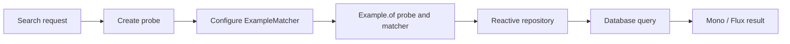

# Query by Example và cấu hình ExampleMatcher

Spring Data Relational R2DBC hỗ trợ Query by Example (QBE), một cách tạo truy vấn từ một đối tượng mẫu thay vì viết tên phương thức truy vấn hoặc tự ghép câu SQL. Đối tượng mẫu được gọi là *probe*: các thuộc tính có giá trị của probe trở thành điều kiện tìm kiếm. `ExampleMatcher` quy định cách so khớp những thuộc tính đó, chẳng hạn so sánh chính xác, bắt đầu bằng, kết thúc bằng, chứa chuỗi, bỏ qua một số thuộc tính hoặc không phân biệt chữ hoa chữ thường.

QBE phù hợp với các màn hình tìm kiếm có nhiều bộ lọc tùy chọn và các điều kiện chủ yếu là so sánh bằng hoặc so khớp chuỗi. Nó giúp tạo truy vấn linh hoạt mà không cần viết một phương thức repository cho mọi tổ hợp filter. Tuy nhiên, QBE có giới hạn: nó không phải ngôn ngữ biểu thức đầy đủ cho mọi phép so sánh, nhóm logic phức tạp hoặc truy vấn liên bảng. Khi cần điều kiện lớn hơn/nhỏ hơn, khoảng giá trị hoặc nhóm `AND`/`OR` có ngoặc, hãy cân nhắc query method, `@Query` hoặc `Criteria` với `R2dbcEntityTemplate`.

## 1. Các thành phần của Query by Example

QBE có ba thành phần chính:

| Thành phần | Vai trò |
| --- | --- |
| Probe | Đối tượng domain chứa những giá trị muốn dùng làm điều kiện tìm kiếm |
| `ExampleMatcher` | Quy định cách so khớp thuộc tính, cách xử lý null, thuộc tính cần bỏ qua và quy tắc chuỗi |
| `Example<T>` | Kết hợp probe với matcher thành đối tượng truy vấn có kiểu |

Luồng sử dụng:



Ví dụ, nếu probe có `name = "Frodo"` và các thuộc tính khác là null, QBE mặc định tạo điều kiện tìm theo tên. Những thuộc tính null được bỏ qua theo mặc định, nên không cần tạo một câu truy vấn riêng cho từng tổ hợp trường được nhập.

## 2. Khai báo repository hỗ trợ QBE

Repository cần có hợp đồng `ReactiveQueryByExampleExecutor` để cung cấp các phương thức QBE reactive. Có thể khai báo rõ ràng cùng `ReactiveCrudRepository`:

```java
import org.springframework.data.repository.query.ReactiveQueryByExampleExecutor;
import org.springframework.data.repository.reactive.ReactiveCrudRepository;

public interface CustomerRepository
        extends ReactiveCrudRepository<Customer, Long>,
                ReactiveQueryByExampleExecutor<Customer> {
}
```

`ReactiveQueryByExampleExecutor<Customer>` cung cấp các phương thức như:

- `findAll(Example<S>)` trả `Flux<S>` chứa các bản ghi khớp.
- `findOne(Example<S>)` trả `Mono<S>`; publisher hoàn tất rỗng nếu không có kết quả và phát lỗi nếu có nhiều hơn một kết quả.
- `count(Example<S>)` trả `Mono<Long>`.
- `exists(Example<S>)` trả `Mono<Boolean>`.
- `findAll(Example<S>, Sort)` tìm kết quả theo thứ tự chỉ định.

Một số interface repository chuyên biệt hoặc phiên bản Spring Data có thể đã kế thừa hợp đồng QBE. Nếu repository hiện tại đã cung cấp các phương thức trên, không cần khai báo lặp lại. Hãy kiểm tra interface và phiên bản dependency của dự án.

## 3. Tạo probe và Example đơn giản

Giả sử entity `Customer` có các thuộc tính `name`, `city` và `status`:

```java
import org.springframework.data.annotation.Id;
import org.springframework.data.relational.core.mapping.Table;

@Table("customer")
public class Customer {

    @Id
    private Long id;

    private String name;

    private String city;

    private String email;

    private CustomerStatus status;

    // Constructor, getters và setters.
}
```

Tạo probe chỉ chứa tên cần tìm:

```java
import org.springframework.data.domain.Example;
import reactor.core.publisher.Flux;

public Flux<Customer> findByName(String name) {
    Customer probe = new Customer();
    probe.setName(name);

    Example<Customer> example = Example.of(probe);
    return customerRepository.findAll(example);
}
```

Nếu `name` là `"Frodo"`, các thuộc tính `city` và `status` đang null sẽ không được dùng làm điều kiện theo matcher mặc định. Truy vấn tương đương về ý nghĩa với `WHERE name = 'Frodo'`.

`Example.of(probe)` dùng matcher mặc định. Có thể truyền matcher riêng bằng `Example.of(probe, matcher)` khi cần điều chỉnh cách so khớp.

## 4. `matchingAll()` và `matchingAny()`

Mặc định, `ExampleMatcher.matching()` tương đương `matchingAll()`: mọi thuộc tính được đưa vào truy vấn phải khớp. Đây là phép kết hợp `AND`.

```java
import org.springframework.data.domain.Example;
import org.springframework.data.domain.ExampleMatcher;

Customer probe = new Customer();
probe.setCity("Hobbiton");
probe.setStatus(CustomerStatus.ACTIVE);

ExampleMatcher matcher = ExampleMatcher.matchingAll();
Example<Customer> example = Example.of(probe, matcher);
```

Ý nghĩa logic:

```sql
WHERE city = 'Hobbiton'
  AND status = 'ACTIVE'
```

`matchingAny()` kết hợp các thuộc tính được đưa vào bằng `OR`: chỉ cần một thuộc tính khớp là bản ghi được chọn.

```java
ExampleMatcher matcher = ExampleMatcher.matchingAny();
Example<Customer> example = Example.of(probe, matcher);
```

Ý nghĩa logic:

```sql
WHERE city = 'Hobbiton'
   OR status = 'ACTIVE'
```

`matchingAny()` áp dụng OR trên các thuộc tính được matcher đưa vào. Nó không cung cấp cách định nghĩa các nhóm OR lồng nhau, ví dụ `(city = A AND status = ACTIVE) OR (city = B AND status = PENDING)`. Với biểu thức có nhóm logic như vậy, dùng `Criteria` hoặc SQL tùy chỉnh.

## 5. Bỏ qua thuộc tính bằng `withIgnorePaths`

Probe thường được tạo từ entity có nhiều thuộc tính hơn số trường mà màn hình tìm kiếm sử dụng. Có thể chỉ định các thuộc tính cần bỏ qua:

```java
Customer probe = new Customer();
probe.setName("Frodo");
probe.setCity("Hobbiton");
probe.setStatus(CustomerStatus.ACTIVE);

ExampleMatcher matcher = ExampleMatcher.matchingAll()
        .withIgnorePaths("status");

Example<Customer> example = Example.of(probe, matcher);
```

Mặc dù `probe.status` có giá trị, thuộc tính này không tham gia điều kiện. Truy vấn chỉ dựa trên `name` và `city`.

Điều này hữu ích khi probe được bind từ request hoặc được tạo từ một đối tượng có nhiều trường, nhưng một số trường chỉ phục vụ hiển thị hoặc không được phép dùng để lọc. Tuy nhiên, đừng dựa vào ignore paths để thực hiện authorization; điều kiện phạm vi truy cập phải được bảo vệ riêng ở tầng server và query phù hợp.

## 6. Bỏ qua null và đưa null vào điều kiện

Theo mặc định, QBE bỏ qua thuộc tính null trong probe. Đây là hành vi hữu ích cho filter tùy chọn:

```java
Customer probe = new Customer();
probe.setCity("Hobbiton");
// name và status là null nên được bỏ qua.

Example<Customer> example = Example.of(probe);
```

Nếu muốn tìm các hàng có một cột SQL `NULL`, có thể cấu hình `withIncludeNullValues()`:

```java
Customer probe = new Customer();
probe.setCity("Hobbiton");

ExampleMatcher matcher = ExampleMatcher.matchingAll()
        .withIncludeNullValues();

Example<Customer> example = Example.of(probe, matcher);
```

Khi đó các thuộc tính null được đưa vào điều kiện so khớp, thường tương ứng với `IS NULL` ở SQL. Trong ví dụ, nếu `name` và `status` không được gán, chúng cũng có thể trở thành điều kiện null; kết quả có thể hẹp hơn nhiều so với mong đợi.

Nếu chỉ muốn kiểm tra null cho một thuộc tính, hãy cấu hình matcher theo phạm vi thuộc tính nếu API phiên bản đang dùng hỗ trợ, hoặc chọn `Criteria` để biểu diễn `IS NULL` tường minh. Cần phân biệt:

- Không truyền trường tìm kiếm: thường có nghĩa là bỏ qua điều kiện đó.
- Truyền yêu cầu tìm giá trị chưa có: có nghĩa là thêm điều kiện `IS NULL`.

Không nên dùng cùng một `null` trong DTO để đại diện cho cả hai ý nghĩa mà không có quy ước rõ ràng.

## 7. Lưu ý với kiểu nguyên thủy trong probe

QBE bỏ qua null, nhưng kiểu nguyên thủy Java không thể mang null. Ví dụ `int age` trong probe luôn có giá trị, mặc định là `0`; `boolean active` mặc định là `false`. Các giá trị mặc định đó có thể trở thành điều kiện tìm kiếm ngoài ý muốn.

Với đối tượng dùng làm probe, nên ưu tiên kiểu wrapper cho trường tùy chọn:

```java
public class CustomerSearchProbe {
    private Integer age;
    private Boolean active;
}
```

Nếu probe phải dùng chính entity có kiểu nguyên thủy, có thể bỏ qua những thuộc tính không muốn lọc bằng `withIgnorePaths("age", "active")`. Một lựa chọn tốt hơn trong API tìm kiếm phức tạp là dùng DTO filter riêng rồi tạo probe phù hợp từ DTO đó.

## 8. Cấu hình so khớp chuỗi

Mặc định, thuộc tính chuỗi thường được so khớp chính xác (exact match). `ExampleMatcher` cho phép chọn quy tắc chuỗi như:

| String matcher | Ý nghĩa | Ví dụ probe `"Fro"` |
| --- | --- | --- |
| `EXACT` | Giá trị phải khớp toàn bộ | `Fro` |
| `STARTING` | Giá trị bắt đầu bằng probe | `Frodo`, `Frobin` |
| `ENDING` | Giá trị kết thúc bằng probe | `SamFro` |
| `CONTAINING` | Giá trị có chứa probe | `TheFrodoName` |

Có thể cấu hình matcher chung cho các thuộc tính chuỗi:

```java
ExampleMatcher matcher = ExampleMatcher.matchingAll()
        .withStringMatcher(ExampleMatcher.StringMatcher.CONTAINING)
        .withIgnoreCase();
```

`withStringMatcher(CONTAINING)` áp dụng so khớp chứa chuỗi cho các thuộc tính chuỗi không có cấu hình riêng. `withIgnoreCase()` yêu cầu so khớp không phân biệt hoa thường cho các thuộc tính chuỗi phù hợp.

Nếu chỉ muốn áp dụng quy tắc cho một thuộc tính, dùng `withMatcher`:

```java
ExampleMatcher matcher = ExampleMatcher.matchingAll()
        .withMatcher("name",
                ExampleMatcher.GenericPropertyMatchers.startsWith().ignoreCase())
        .withMatcher("city",
                ExampleMatcher.GenericPropertyMatchers.exact());
```

Trong ví dụ, `name` tìm theo tiền tố và không phân biệt hoa thường; `city` so khớp chính xác. Cấu hình theo thuộc tính có độ ưu tiên cao hơn quy tắc chuỗi mặc định của matcher.

## 9. Bỏ qua chữ hoa chữ thường

Có thể áp dụng không phân biệt hoa thường cho mọi thuộc tính chuỗi:

```java
ExampleMatcher matcher = ExampleMatcher.matchingAll()
        .withIgnoreCase();
```

Hoặc chỉ một số thuộc tính:

```java
ExampleMatcher matcher = ExampleMatcher.matchingAll()
        .withIgnoreCase("name", "email");
```

QBE tạo truy vấn theo khả năng của store và database. Việc so sánh không phân biệt hoa thường có thể phụ thuộc collation, cách database xử lý chữ hoa/chữ thường và dialect. Với Unicode hoặc quy tắc ngôn ngữ đặc biệt, không nên giả định `ignoreCase` tương đương mọi quy tắc locale. Nếu cần chuẩn hóa email/username, có thể lưu cột chuẩn hóa và áp dụng unique constraint tương ứng.

## 10. Cấu hình matcher theo từng thuộc tính

`withMatcher` cho phép cấu hình riêng từng thuộc tính mà không ảnh hưởng các thuộc tính khác. Ví dụ tìm khách hàng theo tên bắt đầu bằng, email chứa từ khóa và thành phố so khớp chính xác:

```java
Customer probe = new Customer();
probe.setName("An");
probe.setEmail("example");
probe.setCity("Ho Chi Minh City");

ExampleMatcher matcher = ExampleMatcher.matchingAll()
        .withMatcher("name",
                ExampleMatcher.GenericPropertyMatchers.startsWith().ignoreCase())
        .withMatcher("email",
                ExampleMatcher.GenericPropertyMatchers.contains().ignoreCase())
        .withMatcher("city",
                ExampleMatcher.GenericPropertyMatchers.exact());

Example<Customer> example = Example.of(probe, matcher);
```

Kết quả phải thỏa cả ba điều kiện vì matcher dùng `matchingAll()`. Tên thuộc tính truyền vào matcher phải tương ứng với property của entity, không nhất thiết là tên cột vật lý nếu entity dùng `@Column` để đổi tên.

## 11. Tạo filter tìm kiếm từ DTO

Không nhất thiết bind trực tiếp request HTTP vào entity. Một DTO riêng giúp phân biệt dữ liệu đầu vào với dữ liệu persistence, tránh để client điều khiển ID, tenant hoặc trường nội bộ.

```java
public record CustomerSearchRequest(
        String name,
        String city,
        CustomerStatus status
) {
}
```

Service chuyển DTO thành probe:

```java
public Flux<Customer> search(CustomerSearchRequest request) {
    Customer probe = new Customer();
    probe.setName(request.name());
    probe.setCity(request.city());
    probe.setStatus(request.status());

    ExampleMatcher matcher = ExampleMatcher.matchingAll()
            .withMatcher("name",
                    ExampleMatcher.GenericPropertyMatchers.contains().ignoreCase())
            .withMatcher("city",
                    ExampleMatcher.GenericPropertyMatchers.startsWith().ignoreCase());

    Example<Customer> example = Example.of(probe, matcher);
    return customerRepository.findAll(example);
}
```

Trong ví dụ, `status` dùng so khớp mặc định, còn `name` và `city` có quy tắc chuỗi riêng. Các trường null trong request được bỏ qua theo mặc định. Nếu cần tenant scope, hãy lấy tenant từ ngữ cảnh xác thực ở server và áp dụng bằng truy vấn có bảo đảm điều kiện đó; không lấy tenant ID từ probe do client kiểm soát như một cơ chế phân quyền duy nhất.

## 12. Sắp xếp kết quả QBE

`ReactiveQueryByExampleExecutor` có overload nhận `Sort`:

```java
import org.springframework.data.domain.Sort;

public Flux<Customer> searchByCity(String city) {
    Customer probe = new Customer();
    probe.setCity(city);

    Example<Customer> example = Example.of(probe);
    Sort sort = Sort.by(Sort.Order.asc("name"));

    return customerRepository.findAll(example, sort);
}
```

Tên thuộc tính trong `Sort` là property của entity. Khi sắp xếp theo dữ liệu do client chọn, nên ánh xạ qua danh sách thuộc tính được cho phép thay vì chuyển nguyên chuỗi đầu vào thành tên thuộc tính.

Nếu cần giới hạn kết quả hoặc phân trang, hãy kiểm tra API fluent query và các khả năng repository của phiên bản Spring Data đang dùng. `ReactiveQueryByExampleExecutor` cung cấp các overload cơ bản; hỗ trợ fluent projection, limit hoặc các hình thức phân trang phụ thuộc phiên bản và store. Với endpoint tìm kiếm có dữ liệu lớn, không nên phát toàn bộ kết quả không giới hạn.

## 13. Đếm và kiểm tra tồn tại bằng Example

Không cần tải toàn bộ entity nếu mục tiêu chỉ là đếm hoặc kiểm tra có kết quả:

```java
public Mono<Long> countCustomers(CustomerSearchRequest request) {
    Customer probe = new Customer();
    probe.setCity(request.city());
    probe.setStatus(request.status());

    Example<Customer> example = Example.of(probe);
    return customerRepository.count(example);
}

public Mono<Boolean> hasCustomer(String email) {
    Customer probe = new Customer();
    probe.setEmail(email);

    return customerRepository.exists(Example.of(probe));
}
```

`count` trả `Mono<Long>` và `exists` trả `Mono<Boolean>`. Cách này tránh materialize danh sách entity chỉ để lấy số lượng hoặc kiểm tra sự tồn tại.

Nếu muốn lấy một kết quả, dùng `findOne`. Hãy bảo đảm probe đủ cụ thể để tối đa một hàng khớp; nếu nhiều hàng khớp, publisher phát lỗi `IncorrectResultSizeDataAccessException` thay vì tùy tiện chọn một hàng.

## 14. `ExampleMatcher` là immutable

Các phương thức cấu hình `ExampleMatcher` trả về một matcher mới. Hãy giữ kết quả sau mỗi lần cấu hình:

```java
ExampleMatcher matcher = ExampleMatcher.matchingAll();
matcher = matcher.withIgnoreCase();
matcher = matcher.withIgnorePaths("internalNote");
```

Hoặc viết dạng chain:

```java
ExampleMatcher matcher = ExampleMatcher.matchingAll()
        .withIgnoreCase()
        .withIgnorePaths("internalNote");
```

Không gọi một phương thức `with...` rồi bỏ qua giá trị trả về nếu mong muốn thay đổi matcher. Matcher có thể được tái sử dụng cho nhiều probe nếu quy tắc tìm kiếm giống nhau; probe nên được tạo riêng cho từng request để tránh chia sẻ trạng thái mutable.

## 15. Những giới hạn của Query by Example

QBE được thiết kế cho truy vấn dựa trên hình dạng của một probe. Nó không phải công cụ phù hợp cho mọi biểu thức SQL:

- Không biểu diễn trực tiếp các phép so sánh lớn hơn, nhỏ hơn hoặc khoảng như `age > 18`, `created_at BETWEEN ...`.
- Không cung cấp cấu trúc nhóm logic tùy ý như `(A AND B) OR (C AND D)`.
- Không phù hợp cho truy vấn cần join phức tạp hoặc điều kiện trên collection/map.
- Không thay thế projection và query chuyên biệt khi cần đọc cấu trúc kết quả khác entity.
- Hành vi so khớp chuỗi, collation và một số kiểu dữ liệu phụ thuộc database/driver.

Nếu chỉ cần một vài điều kiện bằng nhau và so khớp chuỗi, QBE thường gọn. Nếu cần điều kiện động có range, nhóm logic, join hoặc SQL đặc thù, có thể chọn:

| Nhu cầu | Cách tiếp cận phù hợp |
| --- | --- |
| Truy vấn ổn định, tên điều kiện rõ ràng | Derived query method hoặc `@Query` |
| Nhiều filter tùy chọn với `AND`, `OR`, range và nhóm điều kiện | `Criteria` + `Query` + `R2dbcEntityTemplate` |
| SQL đặc thù, join hoặc projection tùy chỉnh | `@Query` hoặc `DatabaseClient` |
| Bộ lọc chủ yếu equality và string matching từ probe | Query by Example |

## 16. So sánh QBE với Criteria

Hai cách tiếp cận đều có thể tạo truy vấn động, nhưng có mô hình sử dụng khác nhau:

| Tiêu chí | Query by Example | Criteria / Query |
| --- | --- | --- |
| Cách mô tả | Probe chứa giá trị và matcher quy định cách so khớp | Code mô tả trực tiếp từng điều kiện |
| Equality | Tự suy ra từ thuộc tính có giá trị | Dùng `.is(value)` |
| Chuỗi | Có matcher exact, starts, ends, contains và ignore case | Dùng phép toán Criteria tương ứng, tùy API/dialect |
| AND/OR | `matchingAll()` hoặc `matchingAny()` trên các thuộc tính | Có thể nhóm `and(...)`, `or(...)` lồng nhau |
| Range | Không phải thế mạnh của QBE | Hỗ trợ phép so sánh như greater/less và các điều kiện phù hợp |
| Null | Matcher mặc định bỏ qua null; có thể yêu cầu include null | Có thể chỉ định `isNull()`/`isNotNull()` |
| Repository | Dùng `ReactiveQueryByExampleExecutor` | Thường dùng template/operations |
| Trường hợp phù hợp | Form tìm kiếm đơn giản, filter tùy chọn | Truy vấn động có logic nghiệp vụ phức tạp |

Không cần chọn một cách duy nhất cho toàn ứng dụng. Có thể dùng QBE cho màn hình tra cứu đơn giản và Criteria cho một báo cáo hoặc tìm kiếm nâng cao.

## 17. Kiểm thử QBE

Nên kiểm thử cả cách probe được tạo lẫn kết quả truy vấn. Với unit test, có thể xác minh service ánh xạ DTO sang probe và cấu hình matcher đúng. Với integration test, seed các bản ghi để xác nhận database thực thi đúng semantics của QBE.

Các trường hợp hữu ích:

1. Probe có một thuộc tính: chỉ các hàng khớp thuộc tính đó được trả về.
2. `matchingAll()` yêu cầu tất cả thuộc tính không null cùng khớp.
3. `matchingAny()` trả hàng khớp ít nhất một thuộc tính được chọn.
4. `withIgnorePaths` loại thuộc tính khỏi điều kiện dù probe có giá trị.
5. Null mặc định bị bỏ qua; `withIncludeNullValues()` tìm cột SQL null theo cấu hình matcher.
6. `STARTING`, `ENDING`, `CONTAINING` và `ignoreCase` có hành vi phù hợp với database/collation.
7. Probe rỗng được xử lý có chủ đích, không vô tình trả toàn bộ bảng.
8. Thuộc tính primitive có giá trị mặc định không tạo filter ngoài ý muốn.
9. `findOne` phát lỗi nếu nhiều hàng khớp; `exists` và `count` trả kiểu kết quả mong đợi.

Ví dụ kiểm tra reactive result:

```java
StepVerifier.create(customerRepository.findAll(example))
        .expectNextMatches(customer ->
                customer.getName().startsWith("Fro"))
        .verifyComplete();
```

Test đầy đủ cần seed cả hàng khớp và không khớp. Chỉ kiểm tra một hàng hợp lệ xuất hiện chưa đủ để phát hiện điều kiện bị mở rộng ngoài ý muốn.

## 18. Các lỗi thường gặp

| Lỗi | Hậu quả | Cách xử lý |
| --- | --- | --- |
| Repository thiếu `ReactiveQueryByExampleExecutor` | Không có các phương thức QBE reactive | Kế thừa interface QBE hoặc dùng repository đã hỗ trợ |
| Dùng `matchingAny()` trong khi muốn tất cả filter cùng đúng | Kết quả quá rộng | Dùng `matchingAll()` hoặc Criteria với nhóm rõ ràng |
| Quên rằng null mặc định bị bỏ qua | Không tìm được hàng có cột null như mong muốn | Dùng include null hoặc Criteria `IS NULL` |
| Dùng primitive trong probe | Giá trị `0`/`false` mặc định trở thành điều kiện | Dùng wrapper hoặc ignore paths |
| Probe rỗng | Có thể tạo truy vấn không giới hạn theo semantics matcher/store | Kiểm tra request rỗng và đặt chính sách từ chối hoặc trả rỗng |
| Mong QBE xử lý range hoặc nhóm OR phức tạp | Không biểu diễn được điều kiện cần thiết | Chuyển sang Criteria, `@Query` hoặc DatabaseClient |
| Matcher không được gán lại | Cấu hình mới không được áp dụng | Lưu matcher được trả về từ `with...` |
| Giả định ignore case giống nhau ở mọi database | Kết quả khác do collation/Unicode | Kiểm thử với database thật và chuẩn hóa khi cần |

## 19. Nguyên tắc thực hành

- Tạo probe từ DTO tìm kiếm thay vì bind trực tiếp toàn bộ request vào entity persistence.
- Dùng `Example.of(probe)` cho quy tắc mặc định hoặc `Example.of(probe, matcher)` khi cần cấu hình chi tiết.
- Dùng `matchingAll()` khi mọi filter hiện diện phải cùng đúng; dùng `matchingAny()` khi chỉ cần một thuộc tính khớp.
- Bỏ qua thuộc tính không tham gia tìm kiếm bằng `withIgnorePaths`.
- Hiểu rằng null mặc định bị bỏ qua; chỉ include null khi thật sự muốn truy vấn `IS NULL`.
- Dùng wrapper cho thuộc tính tùy chọn trong probe để tránh giá trị mặc định của primitive.
- Chọn string matcher và ignore case theo yêu cầu nghiệp vụ, rồi kiểm thử với database thực tế.
- Gán lại matcher sau mỗi lời gọi `with...` vì matcher là immutable.
- Kiểm tra probe rỗng và định nghĩa hành vi rõ ràng trước khi truy vấn.
- Dùng Criteria hoặc SQL tùy chỉnh khi cần range, nhóm AND/OR, join hoặc biểu thức phức tạp.
- Giới hạn/sắp xếp kết quả và không tải toàn bộ bảng cho một màn hình tìm kiếm lớn.
- Bảo đảm tenant và authorization được áp dụng từ ngữ cảnh server, không phụ thuộc filter client tự gửi.

## 20. Kết luận

Query by Example cho phép Spring Data R2DBC xây dựng truy vấn reactive từ một probe và `ExampleMatcher`. Probe chứa các giá trị cần tìm; matcher quyết định cách kết hợp `AND`/`OR`, bỏ qua thuộc tính, xử lý null và so khớp chuỗi. Repository cung cấp `findAll`, `findOne`, `count`, `exists` và các overload liên quan để thực thi `Example` dưới dạng `Flux` hoặc `Mono`.

QBE đặc biệt hữu ích cho form tìm kiếm có nhiều trường tùy chọn và quy tắc so khớp đơn giản. Cần chú ý null mặc định bị bỏ qua, primitive có giá trị mặc định, `matchingAny()` áp dụng OR trên các thuộc tính và matcher là immutable. Khi truy vấn cần range, nhóm logic lồng nhau, join hoặc SQL đặc thù, hãy chuyển sang Criteria, query method hoặc `@Query` để biểu diễn chính xác yêu cầu.
