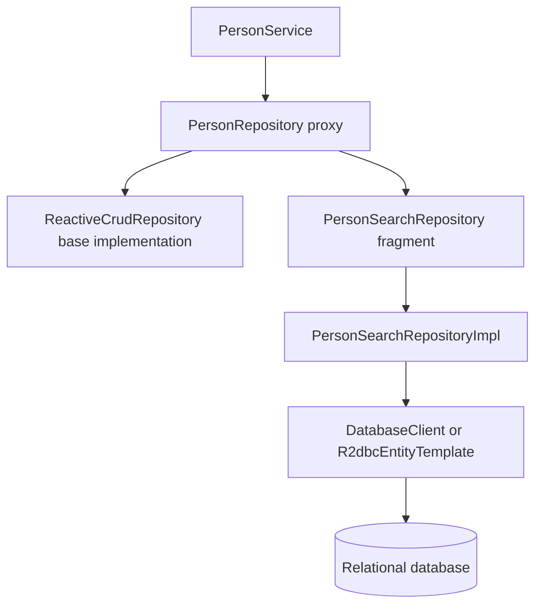

# Mở rộng Repository bằng fragment và triển khai tùy chỉnh

Spring Data R2DBC tự tạo implementation cho các interface Repository, vì vậy ứng dụng có thể dùng các method như `findById`, `save`, `deleteById` hoặc query method mà không phải tự viết lớp triển khai. Tuy nhiên, khi nghiệp vụ cần truy vấn SQL đặc thù, projection riêng, thao tác nhiều bảng hoặc một quy tắc truy cập dữ liệu dùng chung, các method CRUD và derived query có thể chưa đủ.

Spring Data giải quyết nhu cầu đó bằng **repository fragment**. Một fragment là một phần chức năng được mô tả bằng interface và được triển khai trong một class riêng. Repository chính kết hợp interface CRUD với một hoặc nhiều fragment; Spring Data ghép các implementation này thành đối tượng Repository mà ứng dụng inject và sử dụng.

Với fragment, phần truy cập dữ liệu tùy chỉnh có thể dùng `DatabaseClient`, `R2dbcEntityTemplate` hoặc các abstraction khác của Spring R2DBC. Cách tổ chức này giữ interface Repository làm hợp đồng của tầng dữ liệu, đồng thời cho phép đóng gói những thao tác không thể diễn đạt gọn bằng query method.

## 1. Khi nào cần mở rộng Repository?

Các interface như `ReactiveCrudRepository<T, ID>` cung cấp sẵn CRUD reactive. Spring Data cũng có thể tạo truy vấn từ tên method hoặc từ `@Query`. Những cơ chế này phù hợp với phần lớn thao tác thông thường.

Tuy nhiên, một ứng dụng có thể cần:

- Tìm kiếm với nhiều điều kiện tùy chọn và cách kết hợp filter phức tạp.
- Join nhiều bảng rồi ánh xạ thành DTO không tương ứng với một entity.
- Dùng CTE, window function, JSON operator, full-text search hoặc cú pháp riêng của database.
- Thực hiện một thao tác đọc/ghi gồm nhiều câu SQL theo một quy tắc riêng.
- Tái sử dụng một nhóm thao tác truy cập dữ liệu trong nhiều Repository.
- Tùy chỉnh cách thực hiện một hành vi Repository mà API mặc định không đáp ứng.

Không cần tạo fragment cho mọi query method. Nếu một truy vấn có thể diễn đạt rõ bằng tên method hoặc `@Query` đơn giản, hãy giữ cách đó để interface dễ đọc. Fragment hữu ích khi phần triển khai cần logic Java, nhiều bước, SQL tùy chỉnh hoặc một abstraction riêng.

## 2. Repository fragment là gì?

Repository fragment gồm hai phần:

1. **Fragment interface:** khai báo các method mà phần mở rộng cung cấp.
2. **Fragment implementation:** class triển khai interface đó.

Repository chính kế thừa fragment interface cùng với Repository cơ sở của Spring Data. Khi khởi tạo repository, Spring Data kết hợp implementation mặc định với các fragment đã tìm thấy.

Ví dụ cấu trúc package:

```text
com.example.people
├── Person.java
├── PersonRepository.java
├── PersonSearchRepository.java
└── PersonSearchRepositoryImpl.java
```

Trong đó:

- `PersonRepository` là Repository mà Service sử dụng.
- `PersonSearchRepository` mô tả phần tìm kiếm tùy chỉnh.
- `PersonSearchRepositoryImpl` hiện thực phần tìm kiếm đó.

Sơ đồ quan hệ:



Repository proxy là điểm vào duy nhất mà tầng Service cần phụ thuộc. Các lời gọi CRUD được xử lý bởi implementation cơ sở; các method thuộc fragment được chuyển tới class triển khai fragment tương ứng.

## 3. Tạo fragment interface

Giả sử bảng `person` có các cột `id`, `firstname`, `lastname`, `email`, `status` và `created_at`. Ứng dụng cần tìm người theo trạng thái và trả về projection gồm một số trường.

Trước hết, định nghĩa DTO kết quả:

```java
public record PersonSummary(
    Long id,
    String firstname,
    String lastname,
    String email
) {}
```

Định nghĩa điều kiện tìm kiếm:

```java
public record PersonSearchCriteria(
    String status,
    String namePrefix,
    int limit
) {}
```

Sau đó khai báo fragment interface:

```java
public interface PersonSearchRepository {

    Flux<PersonSummary> search(PersonSearchCriteria criteria);

    Mono<Long> deleteInactiveBefore(Instant cutoff);
}
```

Interface chỉ mô tả hợp đồng. Nó không cần kế thừa `ReactiveCrudRepository` và cũng không cần biết truy vấn được thực hiện bằng `DatabaseClient` hay `R2dbcEntityTemplate`.

Việc tách fragment interface thành một kiểu riêng giúp:

- Đặt tên rõ cho nhóm chức năng mở rộng.
- Có thể tái sử dụng fragment trong nhiều Repository nếu cùng hợp đồng.
- Viết unit test cho implementation mà không cần tạo toàn bộ Repository proxy.
- Thay đổi cách triển khai mà không làm thay đổi Service đang gọi interface.

## 4. Triển khai fragment bằng DatabaseClient

Spring Framework cung cấp `DatabaseClient` để thực thi SQL reactive. Fragment implementation có thể inject client qua constructor và trả về `Flux` hoặc `Mono`.

```java
public class PersonSearchRepositoryImpl implements PersonSearchRepository {

    private final DatabaseClient databaseClient;

    public PersonSearchRepositoryImpl(DatabaseClient databaseClient) {
        this.databaseClient = databaseClient;
    }

    @Override
    public Flux<PersonSummary> search(PersonSearchCriteria criteria) {
        int limit = Math.max(1, Math.min(criteria.limit(), 100));

        return databaseClient.sql("""
                SELECT id, firstname, lastname, email
                FROM person
                WHERE status = :status
                  AND firstname LIKE :namePrefix
                ORDER BY firstname ASC, id ASC
                LIMIT :limit
                """)
            .bind("status", criteria.status())
            .bind("namePrefix", criteria.namePrefix() + "%")
            .bind("limit", limit)
            .map((row, metadata) -> new PersonSummary(
                row.get("id", Long.class),
                row.get("firstname", String.class),
                row.get("lastname", String.class),
                row.get("email", String.class)
            ))
            .all();
    }

    @Override
    public Mono<Long> deleteInactiveBefore(Instant cutoff) {
        return databaseClient.sql("""
                DELETE FROM person
                WHERE status = :status
                  AND created_at < :cutoff
                """)
            .bind("status", "INACTIVE")
            .bind("cutoff", cutoff)
            .fetch()
            .rowsUpdated();
    }
}
```

Trong ví dụ:

- `DatabaseClient` được inject qua constructor, thuận tiện cho dependency injection và kiểm thử.
- `bind(...)` truyền giá trị vào câu SQL, tránh ghép dữ liệu đầu vào trực tiếp vào chuỗi truy vấn.
- `map(...)` chuyển từng `Row` thành `PersonSummary`.
- `all()` trả về `Flux<PersonSummary>`.
- `rowsUpdated()` trả số hàng bị tác động dưới dạng `Mono<Long>`.
- `limit` được giới hạn ở phía ứng dụng để tránh một request yêu cầu quá nhiều hàng.

Ví dụ dùng cú pháp `LIKE` phổ biến, nhưng cách xử lý ký tự đại diện và collation có thể khác theo database. Nếu cần tìm kiếm không phân biệt hoa thường hoặc full-text search, hãy sử dụng cú pháp phù hợp với hệ quản trị và kiểm thử trên driver thực tế.

## 5. Kết hợp fragment với Repository chính

Sau khi có fragment interface và implementation, Repository chính kế thừa fragment đó:

```java
public interface PersonRepository
        extends ReactiveCrudRepository<Person, Long>, PersonSearchRepository {
}
```

Tầng Service có thể gọi cả method CRUD lẫn method fragment thông qua cùng một bean:

```java
@Service
public class PersonService {

    private final PersonRepository repository;

    public PersonService(PersonRepository repository) {
        this.repository = repository;
    }

    public Mono<Person> findById(Long id) {
        return repository.findById(id);
    }

    public Flux<PersonSummary> search(PersonSearchCriteria criteria) {
        return repository.search(criteria);
    }

    public Mono<Long> cleanup(Instant cutoff) {
        return repository.deleteInactiveBefore(cutoff);
    }
}
```

Spring Data tạo Repository proxy và kết hợp các thành phần theo interface đã khai báo. Service không cần inject riêng `PersonSearchRepositoryImpl`; nó chỉ phụ thuộc vào hợp đồng `PersonRepository`.

## 6. Quy tắc đặt tên và phát hiện implementation

Theo quy ước mặc định, Spring Data tìm class triển khai có tên fragment interface cộng với hậu tố `Impl`.

| Fragment interface | Implementation mặc định |
|---|---|
| `PersonSearchRepository` | `PersonSearchRepositoryImpl` |
| `PersonAuditRepository` | `PersonAuditRepositoryImpl` |
| `OrderReportingRepository` | `OrderReportingRepositoryImpl` |

Để Spring Data phát hiện implementation thuận lợi:

- Đặt fragment interface, Repository và implementation trong package được quét.
- Giữ tên class theo đúng quy ước hậu tố.
- Đảm bảo class triển khai đúng fragment interface.
- Dùng constructor injection cho dependency như `DatabaseClient` hoặc `R2dbcEntityTemplate`.
- Tránh tạo một bean khác có cùng chức năng và cùng tên bean khiến việc phát hiện trở nên mơ hồ.

Nếu cần thay hậu tố mặc định, có thể cấu hình `repositoryImplementationPostfix` trong `@EnableR2dbcRepositories`:

```java
@Configuration
@EnableR2dbcRepositories(
    basePackages = "com.example.people",
    repositoryImplementationPostfix = "Custom"
)
public class R2dbcRepositoryConfiguration {
}
```

Khi đó implementation fragment có thể dùng hậu tố `Custom`, ví dụ `PersonSearchRepositoryCustom`. Tên interface và class phải tuân theo quy ước đã cấu hình. Nếu dự án dùng Spring Boot auto-configuration, chỉ cần khai báo `@EnableR2dbcRepositories` khi thật sự cần tùy chỉnh cấu hình quét Repository; không nên bật lại một cấu hình quét trùng lặp mà Boot đã cung cấp.

## 7. Một Repository có thể ghép nhiều fragment

Repository không bị giới hạn ở một fragment. Có thể tách các nhóm chức năng theo trách nhiệm:

```java
public interface PersonSearchRepository {
    Flux<PersonSummary> search(PersonSearchCriteria criteria);
}

public interface PersonExportRepository {
    Flux<PersonExportRow> exportByStatus(String status);
}

public interface PersonMaintenanceRepository {
    Mono<Long> deleteInactiveBefore(Instant cutoff);
}
```

Repository chính kết hợp các interface:

```java
public interface PersonRepository extends
        ReactiveCrudRepository<Person, Long>,
        PersonSearchRepository,
        PersonExportRepository,
        PersonMaintenanceRepository {
}
```

Các implementation tương ứng:

```text
PersonSearchRepositoryImpl
PersonExportRepositoryImpl
PersonMaintenanceRepositoryImpl
```

Cách chia này giúp mỗi fragment có một mục đích cụ thể. `PersonSearchRepositoryImpl` có thể dùng `DatabaseClient` cho filter động; `PersonExportRepositoryImpl` có thể streaming dữ liệu theo projection; `PersonMaintenanceRepositoryImpl` có thể thực hiện cleanup theo batch hoặc câu SQL chuyên biệt.

Không nên chia fragment quá nhỏ đến mức mỗi method có một interface và class riêng mà không có lợi ích tái sử dụng hay ranh giới trách nhiệm. Một fragment nên đại diện cho một nhóm chức năng có ý nghĩa.

## 8. Tái sử dụng một fragment trong nhiều Repository

Một fragment có thể được dùng trong nhiều Repository nếu các entity hoặc bảng cần cùng một khả năng. Ví dụ, nhiều bảng có trường `tenant_id` và cần thao tác tìm kiếm theo tenant.

Có thể tạo interface tổng quát:

```java
public interface TenantScopedSearch<T> {
    Flux<T> findAllByTenant(Long tenantId, int limit);
}
```

Tuy nhiên, implementation tổng quát phải biết entity tương ứng với bảng nào và cột tenant được ánh xạ ra sao. Có thể inject `R2dbcEntityTemplate` rồi sử dụng metadata entity để xây dựng query, hoặc thiết kế mỗi fragment cụ thể để tránh suy đoán tên bảng/cột.

Ví dụ fragment riêng cho một entity:

```java
public interface InvoiceSearchRepository {
    Flux<InvoiceSummary> findOpenInvoices(Long tenantId, int limit);
}
```

```java
public class InvoiceSearchRepositoryImpl implements InvoiceSearchRepository {

    private final DatabaseClient databaseClient;

    public InvoiceSearchRepositoryImpl(DatabaseClient databaseClient) {
        this.databaseClient = databaseClient;
    }

    @Override
    public Flux<InvoiceSummary> findOpenInvoices(Long tenantId, int limit) {
        int safeLimit = Math.max(1, Math.min(limit, 100));

        return databaseClient.sql("""
                SELECT id, invoice_no, due_date, total_amount
                FROM invoice
                WHERE tenant_id = :tenantId
                  AND status = :status
                ORDER BY due_date ASC, id ASC
                LIMIT :limit
                """)
            .bind("tenantId", tenantId)
            .bind("status", "OPEN")
            .bind("limit", safeLimit)
            .map((row, metadata) -> new InvoiceSummary(
                row.get("id", Long.class),
                row.get("invoice_no", String.class),
                row.get("due_date", LocalDate.class),
                row.get("total_amount", BigDecimal.class)
            ))
            .all();
    }
}
```

Tái sử dụng nên giảm lặp code mà vẫn giữ SQL và quy tắc nghiệp vụ dễ hiểu. Nếu các bảng có cấu trúc khác nhau đáng kể, implementation riêng thường rõ ràng hơn một abstraction tổng quát quá phức tạp.

## 9. Dùng R2dbcEntityTemplate trong fragment

Không phải fragment nào cũng cần SQL thuần. Nếu thao tác dựa trên entity và cần điều kiện động, `R2dbcEntityTemplate` có thể phù hợp hơn `DatabaseClient`.

```java
public interface PersonMaintenanceRepository {
    Mono<Long> deleteInactiveBefore(Instant cutoff);
}
```

```java
public class PersonMaintenanceRepositoryImpl
        implements PersonMaintenanceRepository {

    private final R2dbcEntityTemplate template;

    public PersonMaintenanceRepositoryImpl(R2dbcEntityTemplate template) {
        this.template = template;
    }

    @Override
    public Mono<Long> deleteInactiveBefore(Instant cutoff) {
        Criteria criteria = Criteria.where("status").is("INACTIVE")
            .and("createdAt").lessThan(cutoff);

        return template.delete(Person.class)
            .matching(Query.query(criteria))
            .all();
    }
}
```

Template sử dụng mapping metadata để chuyển thuộc tính entity thành tên cột và tạo SQL phù hợp với dialect. Cách này hữu ích khi muốn giữ code truy vấn gần với mô hình entity, đồng thời tránh tự ghép tên bảng/cột.

Khi cần join phức tạp, CTE, database-specific function hoặc projection tùy chỉnh, `DatabaseClient` thường cho phép kiểm soát SQL tốt hơn. Có thể dùng cả hai API trong cùng ứng dụng hoặc trong các fragment khác nhau.

## 10. Khi nào cần custom base repository class?

Repository fragment và custom base class giải quyết hai nhu cầu khác nhau.

**Fragment** bổ sung một nhóm method cụ thể vào một hoặc một số Repository. Đây là lựa chọn mặc định khi chỉ cần thêm khả năng tìm kiếm, báo cáo, export hoặc cleanup.

**Custom base repository class** thay đổi implementation nền tảng dùng chung cho nhiều Repository, ví dụ muốn tùy chỉnh cách một method CRUD được thực hiện hoặc thêm một method chung cho tất cả Repository trong phạm vi cấu hình.

Với Spring Data R2DBC, base implementation mặc định là `SimpleR2dbcRepository`. Có thể tạo class tổng quát kế thừa class này rồi đăng ký bằng `repositoryBaseClass`:

```java
@NoRepositoryBean
public interface BaseR2dbcRepository<T, ID>
        extends ReactiveCrudRepository<T, ID> {

    // Khai báo các hợp đồng dùng chung nếu cần.
}
```

```java
public class CustomR2dbcRepository<T, ID>
        extends SimpleR2dbcRepository<T, ID> {

    public CustomR2dbcRepository(
            RelationalEntityInformation<T, ID> entity,
            R2dbcEntityOperations operations) {
        super(entity, operations);
    }

    // Override hoặc bổ sung hành vi dùng chung tại đây.
}
```

Đăng ký base class:

```java
@Configuration
@EnableR2dbcRepositories(
    basePackages = "com.example.data",
    repositoryBaseClass = CustomR2dbcRepository.class
)
public class RepositoryConfiguration {
}
```

Đây là khung minh họa cho mô hình custom base class. Constructor và các kiểu hỗ trợ của `SimpleR2dbcRepository` có thể thay đổi giữa các phiên bản Spring Data; cần đối chiếu API của release train đang dùng trước khi triển khai. Khi không cần thay đổi hành vi chung của CRUD, fragment đơn giản và ít phụ thuộc nội bộ framework hơn.

`@NoRepositoryBean` thường được dùng trên interface repository tổng quát để Spring Data không cố tạo repository instance trực tiếp từ kiểu chưa có entity cụ thể. Repository thực tế kế thừa interface cơ sở này với kiểu entity và ID xác định.

## 11. Phân biệt fragment với cách triển khai tùy chỉnh kiểu cũ

Các phiên bản Spring Data trước đây thường dùng một class có tên theo Repository, ví dụ `PersonRepositoryImpl`, để chứa toàn bộ method tùy chỉnh. Cách tổ chức đó gắn implementation với một Repository cụ thể và khó chia nhỏ khi chức năng phát triển.

Repository composition hiện đại khuyến khích tách từng fragment thành interface và implementation riêng:

| Cách tổ chức | Ví dụ | Đặc điểm |
|---|---|---|
| Repository-specific implementation kiểu cũ | `PersonRepositoryImpl` | Gắn implementation trực tiếp với một Repository; phù hợp code legacy cần duy trì |
| Repository fragment | `PersonSearchRepository` + `PersonSearchRepositoryImpl` | Tách hợp đồng và implementation theo chức năng; có thể ghép nhiều fragment |
| Custom base class | `CustomR2dbcRepository` | Thay đổi hoặc mở rộng hành vi nền tảng cho nhiều Repository |

Với code mới, ưu tiên fragment khi cần mở rộng chức năng Repository. Nếu đang nâng cấp một dự án cũ, hãy kiểm tra quy tắc phát hiện implementation của phiên bản hiện tại và migration guide trước khi đổi tên hoặc di chuyển class. Tránh để cả implementation kiểu cũ và fragment cùng khai báo method trùng nhau nếu chưa hiểu thứ tự composition và cách framework giải quyết lời gọi.

## 12. Transaction trong custom fragment

Fragment implementation có thể thực hiện một hoặc nhiều câu SQL. Nếu nhiều thao tác cần thành công hoặc thất bại cùng nhau, hãy dùng reactive transaction phù hợp.

Ví dụ:

```java
public interface AccountTransferRepository {
    Mono<Void> transfer(Long fromId, Long toId, BigDecimal amount);
}
```

```java
public class AccountTransferRepositoryImpl
        implements AccountTransferRepository {

    private final DatabaseClient databaseClient;

    public AccountTransferRepositoryImpl(DatabaseClient databaseClient) {
        this.databaseClient = databaseClient;
    }

    @Override
    @Transactional
    public Mono<Void> transfer(
            Long fromId,
            Long toId,
            BigDecimal amount) {

        Mono<Long> debit = databaseClient.sql("""
                UPDATE account
                SET balance = balance - :amount
                WHERE id = :id
                  AND balance >= :amount
                """)
            .bind("amount", amount)
            .bind("id", fromId)
            .fetch()
            .rowsUpdated();

        return debit.flatMap(updated -> {
            if (updated != 1) {
                return Mono.error(new IllegalStateException(
                    "Source account is missing or has insufficient balance"));
            }

            return databaseClient.sql("""
                    UPDATE account
                    SET balance = balance + :amount
                    WHERE id = :id
                    """)
                .bind("amount", amount)
                .bind("id", toId)
                .fetch()
                .rowsUpdated()
                .flatMap(credited -> credited == 1
                    ? Mono.empty()
                    : Mono.error(new IllegalStateException("Target account not found")));
        });
    }
}
```

Ví dụ minh họa việc ghép các publisher trong một transaction. Trong ứng dụng thực tế, cần kiểm tra số dư, số tiền dương, tài khoản nguồn/đích và xử lý các quy tắc nghiệp vụ khác. `@Transactional` chỉ có hiệu lực khi lời gọi đi qua proxy Spring và reactive transaction manager được cấu hình với cùng `ConnectionFactory` mà `DatabaseClient` sử dụng.

Không gọi `subscribe()` hoặc `block()` bên trong fragment. Hãy trả `Mono`/`Flux` để tầng gọi đăng ký publisher và Spring quản lý transaction theo Reactor Context. Nếu fragment được gọi bên trong một transaction đã tồn tại, các thao tác có thể tham gia transaction đó theo cấu hình propagation.

## 13. Quy tắc thiết kế implementation

Fragment implementation thường được quản lý như bean singleton. Vì vậy:

- Dùng constructor injection cho `DatabaseClient`, `R2dbcEntityTemplate`, converter hoặc dependency khác.
- Không lưu trạng thái của từng request trong field mutable của implementation.
- Đưa dữ liệu đầu vào qua tham số method và bind parameter vào SQL.
- Không tự tạo connection hoặc tự quản lý vòng đời connection khi đã dùng `DatabaseClient`/template.
- Giữ các method reactive: trả `Mono` hoặc `Flux`, không tự subscribe.
- Đặt quy tắc nghiệp vụ ở Service khi chúng điều phối nhiều aggregate; fragment tập trung vào thao tác dữ liệu.
- Dùng tên method mô tả rõ access pattern và kiểu kết quả.
- Giới hạn kết quả, phân trang và chọn projection để tránh tải dữ liệu không cần thiết.
- Với identifier SQL động như tên cột hoặc hướng sort, dùng allow-list; bind parameter chỉ bảo vệ giá trị.

Không nên đưa toàn bộ logic nghiệp vụ vào fragment chỉ vì nó có thể truy cập database. Một fragment chứa quá nhiều điều kiện nghiệp vụ, gọi dịch vụ bên ngoài hoặc điều phối nhiều bounded context sẽ khó kiểm thử và làm mờ trách nhiệm của Repository.

## 14. Xử lý lỗi và kết quả trong fragment

Các method fragment nên có hợp đồng kết quả rõ ràng:

| Kiểu trả về | Ý nghĩa thường gặp |
|---|---|
| `Mono<Entity>` | Có thể có một entity; publisher rỗng nếu không tìm thấy |
| `Flux<DTO>` | Không, một hoặc nhiều dòng kết quả |
| `Mono<Long>` | Số hàng bị tác động hoặc một giá trị đếm |
| `Mono<Void>` | Chỉ quan tâm thao tác hoàn tất hay phát lỗi |

Nếu thao tác cập nhật hoặc xóa cần phân biệt không có hàng phù hợp, trả số hàng bị tác động giúp Service đưa ra quyết định. Nếu method chỉ trả `Mono<Void>`, caller không thể dựa vào giá trị phát ra để biết có hàng nào bị xóa.

Lỗi từ driver/database có thể được chuyển thành exception của Spring R2DBC hoặc giữ nguyên nguyên nhân gốc. Fragment có thể để lỗi truyền lên Service, nơi ánh xạ sang lỗi nghiệp vụ hoặc HTTP response. Chỉ chuyển đổi lỗi tại fragment khi việc chuyển đổi có ý nghĩa riêng cho hợp đồng truy cập dữ liệu.

Không nên nuốt lỗi bằng `onErrorResume(error -> Mono.empty())` một cách chung chung. Cách đó có thể khiến một truy vấn thất bại trông giống như không có dữ liệu hoặc thao tác thành công. Hãy phân biệt rõ lỗi không tìm thấy, lỗi constraint, timeout, lỗi kết nối và lỗi lập trình.

## 15. Kiểm thử fragment

Fragment có thể kiểm thử độc lập vì implementation là một class Java nhận dependency qua constructor. Tuy nhiên, unit test mock `DatabaseClient` không thể xác nhận SQL thực sự chạy đúng trên database.

Nên kết hợp:

**Unit test cho logic Java:** kiểm tra chuẩn hóa input, giới hạn page size, allow-list sort, cách xây dựng điều kiện và xử lý kết quả.

**Integration test cho database:** chạy fragment với R2DBC driver và database thực tế hoặc Testcontainers để xác nhận cú pháp SQL, bind parameter, mapping kiểu dữ liệu, transaction và constraint.

**Repository composition test:** khởi tạo ApplicationContext hoặc cấu hình Repository test để xác nhận Spring phát hiện đúng fragment implementation và method được gọi qua Repository proxy.

Ví dụ một integration test dùng `StepVerifier`:

```java
@DataR2dbcTest
class PersonRepositoryTest {

    @Autowired
    PersonRepository repository;

    @Test
    void searchReturnsOnlyMatchingPeople() {
        PersonSearchCriteria criteria = new PersonSearchCriteria(
            "ACTIVE",
            "An",
            10
        );

        StepVerifier.create(repository.search(criteria))
            .expectNextMatches(person ->
                person.firstname().startsWith("An"))
            .verifyComplete();
    }
}
```

Ví dụ này giả định test database đã được khởi tạo dữ liệu phù hợp và cấu hình quét Repository nhận diện fragment. Nếu dùng Testcontainers, cần cấu hình `ConnectionFactory` cho container và bảo đảm fragment được tạo trong test context.

Nên kiểm tra thêm:

- Không tìm thấy dữ liệu thì `Flux` hoàn tất rỗng.
- Giá trị đầu vào được bind đúng và không thể làm thay đổi cấu trúc SQL.
- Kết quả projection ánh xạ đúng alias và kiểu dữ liệu.
- `limit` không vượt mức tối đa.
- Lỗi constraint hoặc database được truyền lên đúng cách.
- Nhiều câu lệnh trong fragment rollback cùng nhau khi transaction thất bại.
- Method fragment được gọi qua Repository proxy và đúng implementation được chọn.

## 16. Các lỗi thường gặp khi triển khai fragment

| Biểu hiện | Nguyên nhân có thể | Cách xử lý |
|---|---|---|
| Repository proxy báo thiếu method hoặc không tìm thấy implementation | Sai tên class, sai hậu tố hoặc implementation nằm ngoài phạm vi quét | Kiểm tra tên fragment interface + postfix và package được quét |
| Lỗi tạo bean do dependency không được inject | Constructor yêu cầu bean chưa có hoặc cấu hình R2DBC chưa hoàn chỉnh | Kiểm tra `DatabaseClient`, `R2dbcEntityTemplate` và `ConnectionFactory` |
| Method CRUD hoạt động nhưng method fragment không được ghép | Repository chưa kế thừa fragment interface | Thêm fragment interface vào khai báo Repository |
| SQL chạy nhưng mapping lỗi | Alias cột hoặc kiểu Java không khớp kiểu driver trả về | Kiểm tra `Row`, `RowMetadata`, kiểu dữ liệu và converter |
| Transaction không bao trùm các câu SQL | Publisher bị subscribe độc lập hoặc dùng connection factory/transaction manager khác nhau | Trả chuỗi reactive và dùng cùng hạ tầng transaction |
| Implementation dùng chung nhưng dữ liệu request bị lẫn | Lưu trạng thái request trong field mutable của singleton | Chuyển dữ liệu thành tham số method, giữ implementation stateless |
| SQL động không an toàn | Ghép tên cột hoặc giá trị từ request trực tiếp vào SQL | Bind giá trị và dùng allow-list cho identifier |

## 17. Quy trình mở rộng Repository

Khi một Repository cần thêm hành vi tùy chỉnh, có thể triển khai theo trình tự:

**Bước 1 — Xác định khoảng trống của API hiện tại.** Kiểm tra xem method CRUD, derived query hoặc `@Query` có diễn đạt đủ nhu cầu hay không.

**Bước 2 — Chia nhóm chức năng.** Xác định thao tác nào tạo thành một trách nhiệm có ý nghĩa, ví dụ tìm kiếm, báo cáo, export hoặc cleanup.

**Bước 3 — Tạo fragment interface.** Khai báo method và kiểu reactive trả về, giữ hợp đồng độc lập với cách triển khai.

**Bước 4 — Viết implementation.** Đặt class theo tên fragment interface cộng hậu tố cấu hình, inject `DatabaseClient` hoặc `R2dbcEntityTemplate` qua constructor.

**Bước 5 — Ghép fragment vào Repository.** Cho Repository chính kế thừa fragment interface cùng với `ReactiveCrudRepository` hoặc Repository cơ sở phù hợp.

**Bước 6 — Giữ reactive chain và transaction.** Không block hoặc tự subscribe; cấu hình transaction manager đúng `ConnectionFactory` khi nhiều câu lệnh cần nguyên tử.

**Bước 7 — Kiểm thử composition và SQL.** Xác nhận Spring phát hiện implementation, câu SQL chạy đúng, mapping và xử lý lỗi phù hợp.

**Bước 8 — Chỉ dùng custom base class khi cần thay đổi hành vi chung.** Fragment nên là lựa chọn đầu tiên cho chức năng mở rộng riêng lẻ; base class dành cho thay đổi có tính nền tảng trên nhiều Repository.

## 18. Kết luận

Repository fragment giúp mở rộng Spring Data R2DBC theo hướng composition: fragment interface mô tả một nhóm thao tác, class có hậu tố phù hợp triển khai chúng, và Repository chính kết hợp fragment với các method CRUD mặc định. Cách này cho phép dùng `DatabaseClient` hoặc `R2dbcEntityTemplate` cho truy vấn đặc thù mà Service vẫn chỉ phụ thuộc vào một Repository interface.

Hãy dùng fragment cho các chức năng tùy chỉnh có ranh giới rõ, giữ implementation stateless và reactive, bind dữ liệu an toàn, đồng thời kiểm thử cả việc Spring ghép implementation lẫn SQL trên database thật. Chỉ xây dựng custom base repository class khi cần thay đổi hành vi nền tảng dùng chung cho nhiều Repository; với phần lớn nhu cầu mở rộng riêng, fragment dễ tổ chức và bảo trì hơn.
