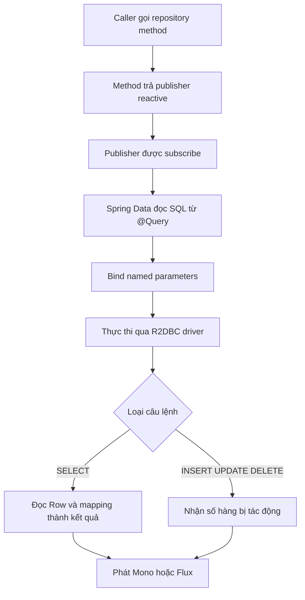

# Khai báo SQL bằng `@Query`

Spring Data R2DBC cho phép khai báo câu SQL trực tiếp trên repository method bằng annotation `@Query`. Cách này hữu ích khi query method theo quy ước tên không diễn đạt được câu truy vấn, khi cần join hoặc aggregate cụ thể, hoặc khi muốn kiểm soát rõ SQL được gửi tới database.

Với `@Query`, câu SQL được viết ngay tại repository interface. Spring Data thực thi câu lệnh bằng hạ tầng R2DBC, bind các tham số, sau đó ánh xạ kết quả vào kiểu trả về reactive. Với câu lệnh thay đổi dữ liệu như `UPDATE` hoặc `DELETE`, cần đánh dấu `@Modifying` để Spring Data xử lý method như một modifying query.

## 1. `@Query` là gì?

`@Query` là annotation của Spring Data R2DBC dùng để cung cấp câu SQL cho một repository method. Annotation nằm trong package:

```java
import org.springframework.data.r2dbc.repository.Query;
```

Ví dụ:

```java
public interface CustomerRepository
        extends ReactiveCrudRepository<Customer, Long> {

    @Query("SELECT * FROM customers WHERE status = :status")
    Flux<Customer> findCustomersByStatus(String status);
}
```

Khi method được gọi và publisher được subscribe, Spring Data thực thi câu SQL đã khai báo, bind giá trị `status`, rồi ánh xạ từng hàng thành `Customer`.

Tên method trong ví dụ có thể không tuân theo quy ước query derivation. Khi có `@Query`, câu SQL trong annotation là định nghĩa truy vấn mà Spring Data sử dụng cho method đó.

### 1.1. Khi nào nên dùng `@Query`?

`@Query` phù hợp khi:

- Query cần join nhiều bảng hoặc dùng biểu thức SQL cụ thể.
- Cần `GROUP BY`, aggregate, subquery hoặc CTE mà query derivation không thuận tiện.
- Muốn kiểm soát cột được chọn, điều kiện, thứ tự hoặc giới hạn kết quả.
- Cần khai báo một câu `UPDATE` hoặc `DELETE` cụ thể trên repository.
- Muốn giữ SQL gần với repository method để dễ đọc và quản lý.

Nếu query đơn giản có thể diễn đạt rõ bằng query method như `findByStatus`, query derivation thường gọn hơn. Nếu cấu trúc query thay đổi mạnh theo runtime, cân nhắc `R2dbcEntityTemplate` hoặc `DatabaseClient` thay vì tạo nhiều annotation với SQL gần giống nhau.

## 2. Khai báo repository và entity

Ví dụ entity:

```java
import org.springframework.data.annotation.Id;
import org.springframework.data.relational.core.mapping.Column;
import org.springframework.data.relational.core.mapping.Table;

@Table("customers")
public class Customer {

    @Id
    private Long id;

    private String name;

    @Column("email_address")
    private String email;

    private String status;

    public Customer(Long id, String name, String email, String status) {
        this.id = id;
        this.name = name;
        this.email = email;
        this.status = status;
    }

    public Long getId() { return id; }
    public String getName() { return name; }
    public String getEmail() { return email; }
    public String getStatus() { return status; }
}
```

Repository:

```java
import org.springframework.data.repository.reactive.ReactiveCrudRepository;
import org.springframework.data.r2dbc.repository.Query;
import reactor.core.publisher.Flux;
import reactor.core.publisher.Mono;

public interface CustomerRepository
        extends ReactiveCrudRepository<Customer, Long> {

    @Query("SELECT * FROM customers WHERE status = :status")
    Flux<Customer> findByStatusUsingSql(String status);

    @Query("SELECT * FROM customers WHERE id = :id")
    Mono<Customer> findOneUsingSql(Long id);
}
```

Spring Data tạo implementation cho repository. Không cần tự viết class thực thi các method có `@Query`.

## 3. Bind tham số trong câu SQL

Không nên ghép trực tiếp dữ liệu đầu vào vào chuỗi SQL. Hãy dùng bind parameter để database nhận câu lệnh và giá trị riêng biệt.

### 3.1. Named parameters

Spring Data R2DBC hỗ trợ named parameter trong câu SQL, thường viết với cú pháp `:parameterName`:

```java
@Query("SELECT * FROM customers WHERE status = :status")
Flux<Customer> findByStatus(String status);
```

Giá trị tham số được bind khi publisher được thực thi. Driver nhận bind marker phù hợp với dialect của database thông qua hạ tầng Spring R2DBC.

Nếu muốn liên kết tên tham số một cách tường minh, dùng `@Param`:

```java
import org.springframework.data.repository.query.Param;

@Query("SELECT * FROM customers WHERE status = :customerStatus")
Flux<Customer> findByStatus(
        @Param("customerStatus") String status);
```

`@Param` đặc biệt hữu ích khi tên tham số trong Java khác tên placeholder SQL hoặc khi muốn tránh phụ thuộc vào metadata tên tham số do compiler giữ lại. Nếu dựa vào tên tham số Java, hãy cấu hình biên dịch giữ lại parameter names theo yêu cầu của phiên bản Spring Data đang dùng.

### 3.2. Một query có nhiều tham số

```java
@Query("""
       SELECT *
       FROM customers
       WHERE status = :status
         AND email_address LIKE :emailPattern
       """)
Flux<Customer> search(
        @Param("status") String status,
        @Param("emailPattern") String emailPattern);
```

Ví dụ gọi:

```java
repository.search("ACTIVE", "%@example.com");
```

Giá trị `%@example.com` là giá trị của `LIKE`, không phải một phần câu SQL được nối chuỗi. Hãy xác định rõ quy tắc escape ký tự wildcard nếu dữ liệu tìm kiếm đến trực tiếp từ người dùng.

### 3.3. Bind parameter an toàn và giới hạn của nó

Bind parameter dùng cho giá trị như ID, trạng thái, email hoặc thời gian. Nó không dùng để thay thế tên bảng, tên cột, từ khóa SQL hoặc hướng sắp xếp.

Ví dụ sau không phải cách an toàn để truyền tên cột:

```sql
SELECT * FROM customers ORDER BY :columnName
```

Bind parameter không biến giá trị thành identifier SQL. Nếu cần sắp xếp theo lựa chọn của người dùng, hãy ánh xạ lựa chọn đó qua allowlist ở ứng dụng và chọn một câu SQL/template tương ứng. Không nối trực tiếp input vào chuỗi SQL.

## 4. Ánh xạ kết quả của `@Query`

Kiểu trả về của repository method quyết định cách kết quả được phát ra:

- `Mono<Customer>` phù hợp khi query dự kiến trả về tối đa một entity.
- `Flux<Customer>` phù hợp khi query trả về nhiều hàng.
- `Mono<Long>` có thể dùng cho một giá trị aggregate như `COUNT(*)`.
- `Mono<Integer>` hoặc kiểu số tương ứng thường dùng cho số hàng bị tác động của modifying query.

### 4.1. Trả về một entity

```java
@Query("SELECT * FROM customers WHERE id = :id")
Mono<Customer> findCustomer(@Param("id") Long id);
```

Nếu không có hàng phù hợp, `Mono` hoàn tất mà không phát ra entity. Nếu query có thể trả nhiều hàng nhưng method khai báo `Mono<Customer>`, cần bảo đảm điều kiện truy vấn thực sự giới hạn kết quả tối đa một hàng, ví dụ bằng khóa chính hoặc cú pháp giới hạn phù hợp với database.

### 4.2. Trả về nhiều entity

```java
@Query("""
       SELECT *
       FROM customers
       WHERE status = :status
       ORDER BY name
       """)
Flux<Customer> findAllByStatus(@Param("status") String status);
```

Mỗi hàng kết quả được ánh xạ thành một `Customer` và phát ra tuần tự qua `Flux`. Nếu cần phân trang, có thể khai báo `LIMIT` và `OFFSET` rõ trong SQL hoặc sử dụng API query phù hợp. Cú pháp giới hạn hàng có thể khác nhau theo database.

### 4.3. Trả về scalar hoặc aggregate

```java
@Query("SELECT COUNT(*) FROM customers WHERE status = :status")
Mono<Long> countByStatus(@Param("status") String status);
```

Query chỉ trả về một cột số nên method có thể nhận kiểu scalar thay vì entity. Kiểu Java phải tương thích với kiểu giá trị mà driver trả về và conversion infrastructure hỗ trợ.

### 4.4. Chọn cột cụ thể và alias

Không nhất thiết phải dùng `SELECT *`. Chọn cột cần thiết giúp query rõ ràng và hạn chế đọc dữ liệu thừa:

```java
@Query("""
       SELECT id, name, email_address
       FROM customers
       WHERE status = :status
       """)
Flux<Customer> findCustomerFields(@Param("status") String status);
```

Các cột được chọn phải đủ để ánh xạ entity một cách hợp lệ. Nếu entity có constructor yêu cầu các thuộc tính khác, hoặc property không nullable cần được khởi tạo, query thiếu cột có thể gây lỗi mapping hay tạo object không đúng ý định.

Khi tên cột SQL khác property Java, dùng `@Column` trên entity hoặc alias kết quả theo tên mà mapping target mong đợi. Ví dụ entity khai báo `@Column("email_address")` cho property `email`, nên kết quả có cột `email_address` có thể được ánh xạ vào property đó.

### 4.5. Projection cho kết quả chỉ đọc một phần

Nếu query chỉ cần một phần dữ liệu, có thể định nghĩa projection thay vì ánh xạ thành entity đầy đủ.

Ví dụ interface projection:

```java
public interface CustomerSummary {
    Long getId();
    String getName();
}
```

Repository method:

```java
@Query("SELECT id, name FROM customers WHERE status = :status")
Flux<CustomerSummary> findSummariesByStatus(
        @Param("status") String status);
```

Tên cột kết quả cần tương ứng với property/accessor của projection theo quy tắc mapping. Nếu dùng DTO class hoặc record, constructor và tên tham số cũng cần tương thích với cột được chọn.

## 5. Dùng `@Query` cho câu lệnh thay đổi dữ liệu

`@Query` không chỉ dùng cho `SELECT`. Có thể khai báo `UPDATE` hoặc `DELETE`. Với modifying query, cần thêm `@Modifying` để chỉ rõ câu lệnh thay đổi dữ liệu.

```java
import org.springframework.data.r2dbc.repository.Modifying;
import org.springframework.data.r2dbc.repository.Query;
import org.springframework.data.repository.query.Param;
import reactor.core.publisher.Mono;

public interface CustomerRepository
        extends ReactiveCrudRepository<Customer, Long> {

    @Modifying
    @Query("UPDATE customers SET status = :status WHERE id = :id")
    Mono<Integer> updateStatus(
            @Param("id") Long id,
            @Param("status") String status);
}
```

`@Modifying` thuộc package `org.springframework.data.r2dbc.repository`. Kết quả số thường biểu diễn số hàng được database báo là đã tác động.

### 5.1. Cập nhật nhiều cột

```java
@Modifying
@Query("""
       UPDATE customers
       SET name = :name,
           status = :status,
           modified_at = :modifiedAt
       WHERE id = :id
       """)
Mono<Integer> updateCustomer(
        @Param("id") Long id,
        @Param("name") String name,
        @Param("status") String status,
        @Param("modifiedAt") LocalDateTime modifiedAt);
```

Đây là câu SQL cố định với các giá trị bind riêng. Chỉ những cột xuất hiện trong `SET` được cập nhật.

### 5.2. Xóa dữ liệu

```java
@Modifying
@Query("DELETE FROM customers WHERE status = :status")
Mono<Integer> deleteByStatus(@Param("status") String status);
```

Method trả về số hàng được xóa. Với thao tác nguy hiểm như xóa hàng loạt, điều kiện cần được thiết kế cẩn thận và có thể cần giới hạn quyền gọi ở tầng service.

### 5.3. Kiểm tra số hàng bị tác động

```java
public Mono<Void> deactivateCustomer(Long id) {
    return repository.updateStatus(id, "INACTIVE")
            .flatMap(rows -> {
                if (rows == 0) {
                    return Mono.error(new CustomerNotFoundException(id));
                }
                if (rows != 1) {
                    return Mono.error(new IllegalStateException(
                            "Expected exactly one customer to be updated"));
                }
                return Mono.empty();
            });
}
```

Nếu query dùng ID duy nhất, số hàng kỳ vọng thường là `0` hoặc `1`. Với query update theo trạng thái hoặc nhóm dữ liệu, có thể có nhiều hàng. Driver/database có thể khác nhau về cách đếm hàng matched và hàng thực sự changed khi giá trị mới giống giá trị cũ; hãy xác nhận semantics nếu nghiệp vụ phụ thuộc chính xác vào con số này.

### 5.4. `@Modifying` không tự trả về entity đã cập nhật

Modifying query thông thường trả về số hàng bị tác động hoặc kiểu kết quả phù hợp khác theo hỗ trợ của phiên bản, chứ không tự ánh xạ toàn bộ entity vừa thay đổi.

Nếu cần entity sau update, có thể thực hiện query tiếp theo trong cùng pipeline:

```java
public Mono<Customer> renameAndRead(Long id, String newName) {
    return repository.rename(id, newName)
            .flatMap(rows -> rows == 0
                    ? Mono.empty()
                    : repository.findById(id));
}
```

Nếu cần kiểm soát update và đọc lại trong một transaction nhất quán, hãy đặt cả hai thao tác trong reactive transaction phù hợp.

## 6. SQL cố định và truy vấn động

`@Query` phù hợp nhất với câu SQL có cấu trúc tương đối cố định. Bind parameter giúp thay đổi giá trị điều kiện, nhưng không làm thay đổi cấu trúc SQL.

Ví dụ có thể thay đổi status theo tham số:

```java
@Query("SELECT * FROM customers WHERE status = :status")
Flux<Customer> findByStatus(@Param("status") String status);
```

Nhưng không thể dùng bind parameter để chọn tên cột hoặc thêm tùy ý một đoạn `ORDER BY`.

### 6.1. Sắp xếp động

Nếu chỉ có một số lựa chọn sort được phép, có thể tạo các repository method riêng hoặc dùng Template để xây dựng query từ một allowlist:

```java
String sortColumn = switch (sortBy) {
    case "name" -> "name";
    case "email" -> "email_address";
    default -> "id";
};
```

Không nối `sortBy` trực tiếp từ request vào SQL. Giá trị đầu vào phải được ánh xạ sang identifier cố định do ứng dụng kiểm soát.

### 6.2. Điều kiện tùy chọn

Với một số query có điều kiện tùy chọn đơn giản, có thể khai báo SQL cố định:

```java
@Query("""
       SELECT * FROM customers
       WHERE (:status IS NULL OR status = :status)
       """)
Flux<Customer> findOptionalStatus(@Param("status") String status);
```

Cách này phụ thuộc khả năng bind null và cách database xử lý biểu thức. Nó cũng có thể làm execution plan kém tối ưu với dữ liệu lớn. Với nhiều điều kiện tùy chọn, `R2dbcEntityTemplate` thường dễ bảo trì hơn vì có thể chỉ thêm predicate khi điều kiện được cung cấp.

### 6.3. Không nối chuỗi input để tạo SQL

Tránh cách làm:

```java
String sql = "SELECT * FROM customers WHERE name = '" + name + "'";
```

Ghép chuỗi có thể tạo lỗ hổng SQL injection và lỗi escaping. Hãy bind giá trị:

```java
@Query("SELECT * FROM customers WHERE name = :name")
Flux<Customer> findByName(@Param("name") String name);
```

Nếu thật sự cần dynamic identifier hoặc cấu trúc SQL, hãy dùng allowlist và API query builder phù hợp, không lấy raw SQL fragment từ client.

## 7. Phân trang và giới hạn kết quả

Với SQL khai báo, có thể đưa `LIMIT` và `OFFSET` vào câu lệnh nếu database hỗ trợ cú pháp đó:

```java
@Query("""
       SELECT * FROM customers
       WHERE status = :status
       ORDER BY id
       LIMIT :limit OFFSET :offset
       """)
Flux<Customer> findPage(
        @Param("status") String status,
        @Param("limit") int limit,
        @Param("offset") long offset);
```

Hãy kiểm tra cú pháp của database và validate `limit`/`offset` để tránh truy vấn quá lớn hoặc giá trị âm không hợp lệ. `ORDER BY` nên ổn định, thường thêm khóa duy nhất làm tiêu chí cuối để tránh bản ghi di chuyển giữa các trang khi dữ liệu thay đổi.

Với dataset lớn, keyset pagination thường ổn định hơn offset pagination:

```java
@Query("""
       SELECT * FROM customers
       WHERE status = :status
         AND id > :afterId
       ORDER BY id
       LIMIT :limit
       """)
Flux<Customer> findNextBatch(
        @Param("status") String status,
        @Param("afterId") Long afterId,
        @Param("limit") int limit);
```

Query này giả định ID tăng theo thứ tự và là khóa duy nhất. Với thứ tự phức tạp hơn, cursor cần bao gồm đủ các cột sắp xếp để xác định vị trí tiếp theo.

## 8. Transaction khi dùng `@Query`

Một query method được gọi trong reactive transaction có thể tham gia transaction nếu repository sử dụng cùng `ConnectionFactory` và reactive transaction manager. Khi nhiều câu SQL cần thành công hoặc rollback cùng nhau, hãy đặt ranh giới transaction ở service.

```java
@Service
public class CustomerService {

    private final CustomerRepository repository;
    private final AuditRepository auditRepository;

    public CustomerService(
            CustomerRepository repository,
            AuditRepository auditRepository) {
        this.repository = repository;
        this.auditRepository = auditRepository;
    }

    @Transactional
    public Mono<Void> deactivate(Long customerId) {
        return repository.updateStatus(customerId, "INACTIVE")
                .flatMap(rows -> rows == 1
                        ? auditRepository.recordStatusChange(customerId)
                        : Mono.error(new CustomerNotFoundException(customerId)))
                .then();
    }
}
```

Trong ví dụ, thao tác cập nhật và ghi audit nằm trong cùng publisher chain. Để rollback hoạt động, cả hai repository phải dùng cùng transaction manager/connection factory và lỗi phải được truyền ra ngoài. Không gọi `.subscribe()` độc lập hoặc `.block()` bên trong pipeline transaction.

Không nên giả định mọi method `@Query` tự động có transaction bao quanh chỉ vì nó nằm trong repository. Hãy khai báo transaction ở ranh giới nghiệp vụ khi cần tính nguyên tử.

## 9. Những điểm cần chú ý về mapping và callback

### 9.1. Tên cột và property

Với entity có:

```java
@Column("email_address")
private String email;
```

`SELECT *` trả cột `email_address` sẽ được mapping theo metadata. Nếu query dùng alias, hãy đặt alias phù hợp với tên cột/property mà mapping target mong đợi.

### 9.2. Query phải trả đủ dữ liệu cho kiểu đích

Nếu method trả `Customer`, hãy chọn đủ cột cần thiết cho entity. Nếu chỉ chọn `id` và `name`, nên dùng projection hoặc DTO phù hợp thay vì cố ánh xạ một entity có thêm các field bắt buộc khác.

### 9.3. Modifying query và lifecycle callbacks

`@Modifying @Query` thực thi SQL được khai báo trực tiếp. Vì không nhất thiết có một entity đầy đủ được chuyển qua quy trình save, không nên mặc định các callback entity, auditing hoặc version handling giống repository `save()` sẽ tự động chạy.

Nếu query cần cập nhật `modified_at`, version hoặc audit data, hãy đưa logic đó vào SQL một cách tường minh hoặc dùng API lưu entity phù hợp. Nếu dùng optimistic locking, hãy đưa version vào predicate và cập nhật version trong cùng câu lệnh.

## 10. So sánh `@Query`, query derivation và Template

| Tiêu chí | Query derivation | Repository `@Query` | `R2dbcEntityTemplate` |
| --- | --- | --- | --- |
| Định nghĩa | Từ tên method | SQL khai báo trong annotation | Query/Update được xây dựng bằng API |
| SQL phức tạp | Hạn chế theo khả năng derivation | Rất linh hoạt với SQL cố định | Linh hoạt với điều kiện động |
| Bind tham số | Tự động theo method | Named parameters trong SQL | Bind qua query API |
| Dynamic predicates | Hạn chế | Phải thiết kế trong SQL cố định hoặc nhiều method | Phù hợp |
| Kiểm soát câu SQL | Gián tiếp | Trực tiếp | Framework sinh SQL từ metadata |
| Phù hợp | CRUD và query method đơn giản | Join, aggregate, SQL đặc thù hoặc modifying query | Query/update thay đổi theo runtime |

Chọn cách đơn giản nhất thể hiện đúng ý định. Không cần dùng `@Query` cho một `findByStatus` đơn giản nếu query derivation đã đủ rõ. Ngược lại, không nên ép một truy vấn join hoặc aggregate phức tạp vào tên method dài khó hiểu.

## 11. Những lỗi thường gặp khi dùng `@Query`

| Triệu chứng | Nguyên nhân có thể | Cách xử lý |
| --- | --- | --- |
| Không bind được tham số | Placeholder không khớp tên `@Param` hoặc tên tham số không có metadata | Kiểm tra `:name` và `@Param("name")` |
| Lỗi cú pháp SQL | Câu SQL hoặc cú pháp dialect không phù hợp database | Chạy query trực tiếp trên database và kiểm tra dialect |
| Không ánh xạ được entity | Cột kết quả thiếu hoặc tên cột không khớp mapping | Chọn đủ cột, kiểm tra `@Column` và alias |
| UPDATE/DELETE không chạy như mong đợi | Thiếu `@Modifying` hoặc kiểu trả về không phù hợp | Đánh dấu modifying query và dùng kiểu số/void được hỗ trợ |
| `Mono` phát lỗi nhiều kết quả | Query trả nhiều hàng nhưng method khai báo một kết quả | Giới hạn query hoặc đổi sang `Flux` |
| SQL injection | Nối input trực tiếp vào SQL | Dùng bind parameter và allowlist cho identifier |
| Không sort được theo tham số | Bind parameter không thay thế tên cột hoặc `ASC/DESC` | Dùng allowlist hoặc Template |
| Không thấy ID/version sau modifying query | Modifying query trả số hàng, không trả entity đã lưu | Query lại hoặc dùng repository/template insert/save phù hợp |
| Transaction không rollback | Các thao tác không cùng transaction context hoặc bị subscribe tách rời | Dùng cùng connection factory và reactive transaction manager |

## 12. Kiểm thử repository có `@Query`

Nên kiểm thử với database R2DBC thực tế hoặc Testcontainers. Unit test chỉ mock repository không xác nhận SQL có hợp lệ với dialect, parameter có bind đúng hoặc mapping có chính xác hay không.

Ví dụ:

```java
@DataR2dbcTest
class CustomerQueryRepositoryTest {

    @Autowired
    CustomerRepository repository;

    @Test
    void shouldFindActiveCustomers() {
        StepVerifier.create(repository.findByStatusUsingSql("ACTIVE"))
                .expectNextMatches(customer ->
                        "ACTIVE".equals(customer.getStatus()))
                .thenCancel()
                .verify();
    }

    @Test
    void shouldUpdateStatusAndReturnAffectedRows() {
        StepVerifier.create(repository.updateStatus(1L, "INACTIVE"))
                .expectNext(1)
                .verifyComplete();
    }
}
```

Test cần schema và dữ liệu fixture tương ứng. Với test update, nên chuẩn bị bản ghi có ID xác định rồi kiểm tra cả số hàng trả về lẫn trạng thái sau khi đọc lại. Không nên phụ thuộc vào ID cố định nếu database sinh ID tự động.

### 12.1. Những trường hợp nên kiểm tra

- Query trả về một hàng, nhiều hàng và không có hàng.
- Named parameter với các giá trị đặc biệt như dấu nháy hoặc ký tự wildcard.
- Mapping cột có alias và `@Column`.
- Projection hoặc DTO có ít cột hơn entity đầy đủ.
- Modifying query trả về số hàng phù hợp.
- Query có điều kiện tenant, quyền sở hữu hoặc version.
- Cú pháp `LIMIT`/`OFFSET` theo database mục tiêu.
- Transaction rollback khi câu SQL thứ hai phát sinh lỗi.
- Hành vi null parameter nếu query hỗ trợ điều kiện nullable.

## 13. Quy trình viết một method `@Query`

1. Xác định kiểu kết quả: entity, projection, scalar hay số hàng tác động.
2. Viết câu SQL theo dialect của database dự án.
3. Dùng named parameter cho mọi giá trị đến từ input.
4. Dùng `@Param` để liên kết tên tham số rõ ràng.
5. Chọn đủ cột và alias để mapping đúng kiểu trả về.
6. Nếu câu lệnh thay đổi dữ liệu, thêm `@Modifying` và chọn kiểu trả về phù hợp.
7. Kiểm tra predicate, tenant, trạng thái và version để giới hạn hàng bị ảnh hưởng.
8. Đặt transaction ở service nếu nhiều thao tác cần tính nguyên tử.
9. Viết integration test trên database tương ứng.

## 14. Luồng thực thi `@Query`



## 15. Kết luận

`@Query` giúp khai báo SQL trực tiếp trên repository method của Spring Data R2DBC. Nó phù hợp với truy vấn có cấu trúc cố định cần join, aggregate, projection hoặc SQL đặc thù. Named parameter và `@Param` giúp bind giá trị an toàn; kiểu trả về `Mono`/`Flux` xác định cách kết quả được phát ra và ánh xạ.

Với `UPDATE` hoặc `DELETE`, hãy dùng `@Modifying`, kiểm tra số hàng bị tác động và đưa điều kiện bảo vệ dữ liệu vào SQL. Không nối input vào câu SQL, không dùng bind parameter để thay identifier, và không mặc định modifying query tự cập nhật entity, callback hoặc version như repository `save()`. Khi query cần thay đổi điều kiện theo runtime, cân nhắc `R2dbcEntityTemplate`; khi query đơn giản, query derivation thường đủ rõ ràng.
