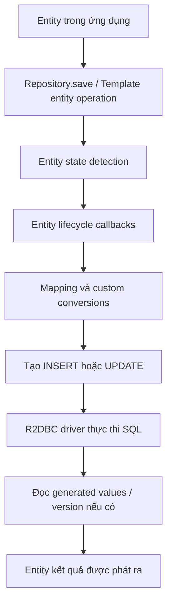

# Phân biệt truy vấn cập nhật trực tiếp với lưu thực thể qua vòng đời ánh xạ

Trong Spring Data Relational R2DBC, một thay đổi dữ liệu có thể được thực hiện theo hai hướng chính. Ứng dụng có thể yêu cầu Spring Data lưu một entity thông qua repository hoặc entity-oriented API của `R2dbcEntityTemplate`; hoặc ứng dụng có thể phát hành một câu lệnh cập nhật trực tiếp bằng `@Modifying @Query`, `DatabaseClient` hay fluent update API.

Hai hướng đều có thể thay đổi cùng một hàng trong database, nhưng chúng đi qua các đường xử lý khác nhau. Lưu entity sử dụng metadata ánh xạ và vòng đời persistence của Spring Data. Cập nhật trực tiếp thực thi câu lệnh được mô tả rõ ràng, thường chỉ trả về số hàng bị tác động. Nó không tự tải entity, phát hiện thay đổi trong object hoặc chạy các entity lifecycle callback như thao tác lưu entity.

Chọn đúng cách giúp kiểm soát được auditing, generated values, optimistic locking, phạm vi cột được cập nhật và hiệu năng. Đây cũng là điểm cần nhớ khi chuyển từ JPA/Hibernate sang R2DBC: Spring Data Relational không có persistence context để tự dirty-check entity, dù ứng dụng đang dùng repository, template hay transaction.

## 1. Hai cách diễn đạt một thay đổi

Giả sử bảng `customer` có các cột `id`, `name`, `status`, `last_modified` và `version`. Ứng dụng cần đổi trạng thái của một customer.

**Lưu entity:** đọc entity, thay đổi property trong Java rồi gọi `save`:

```java
public Mono<Customer> changeStatus(Long id, String newStatus) {
    return customerRepository.findById(id)
            .switchIfEmpty(Mono.error(
                    new IllegalArgumentException("Customer không tồn tại: " + id)
            ))
            .flatMap(customer -> {
                customer.setStatus(newStatus);
                return customerRepository.save(customer);
            });
}
```

**Cập nhật trực tiếp:** mô tả chính xác câu lệnh SQL cần thực hiện:

```java
public Mono<Long> changeStatus(Long id, String newStatus) {
    return databaseClient.sql(
                "UPDATE customer SET status = :status WHERE id = :id"
            )
            .bind("status", newStatus)
            .bind("id", id)
            .fetch()
            .rowsUpdated();
}
```

Cách thứ nhất làm việc với entity và để Spring Data tạo câu lệnh dựa trên metadata. Cách thứ hai nói rõ cột nào được cập nhật và điều kiện nào xác định hàng. Publisher của cả hai cách đều cần được subscribe để I/O database thực sự diễn ra.

## 2. Lưu entity qua vòng đời ánh xạ

Khi gọi `repository.save(entity)`, Spring Data xử lý entity như một đối tượng persistence. Framework sử dụng metadata để xác định table, column, identifier, version và các property persistent. Giá trị property được chuyển đổi thành kiểu mà R2DBC driver có thể bind, sau đó framework thực hiện thao tác insert hoặc update.

Quy trình khái quát:



Các bước cụ thể phụ thuộc thao tác, mapping và phiên bản Spring Data, nhưng những đặc điểm quan trọng là:

- Spring Data biết entity type và mapping metadata.
- Trạng thái mới/cũ được xác định theo `Persistable`, `@Version` hoặc `@Id`.
- Các entity callback phù hợp với thao tác persistence có thể được gọi.
- Custom conversions được dùng để chuyển kiểu domain sang kiểu store và ngược lại.
- Framework tạo câu lệnh dựa trên metadata và dialect.
- Kết quả lưu có thể chứa ID hoặc version mới, đặc biệt với entity dùng generated ID hoặc optimistic locking.

### Ví dụ entity và repository

```java
@Table("customer")
public class Customer {

    @Id
    private Long id;

    private String name;

    private String status;

    @Version
    private Long version;

    // Constructor, getter và setter
}
```

Repository:

```java
public interface CustomerRepository
        extends ReactiveCrudRepository<Customer, Long> {
}
```

Khi service gọi `save`, Spring Data dùng `@Id` để nhận diện định danh và `@Version` nếu entity có optimistic locking. Ứng dụng không cần tự viết tên table, tên cột hoặc điều kiện version cho thao tác entity-oriented thông thường.

### Newness detection và INSERT/UPDATE

`save` không có nghĩa luôn là `UPDATE`. Spring Data cần phân loại entity mới hay đã tồn tại:

- Entity triển khai `Persistable`: `isNew()` quyết định.
- Nếu không triển khai `Persistable` nhưng có `@Version`: version được ưu tiên để nhận diện entity mới.
- Nếu không có hai trường hợp trên: identifier `@Id` được dùng.

Kết quả phân loại quyết định insert hay update. Framework không mặc định chạy `SELECT` để xác minh ID có tồn tại trước khi chọn thao tác.

### Entity callbacks và auditing

Entity-oriented persistence có thể đi qua các callback như `BeforeConvertCallback`, `BeforeSaveCallback` và `AfterSaveCallback` (ở reactive API là các callback reactive tương ứng). Chúng cho phép ứng dụng chuẩn hóa dữ liệu, bổ sung giá trị hoặc thực hiện logic liên quan tới vòng đời persistence.

Spring Data R2DBC auditing cũng sử dụng callback để cập nhật các property như:

- `@CreatedDate`: thời điểm tạo.
- `@LastModifiedDate`: thời điểm sửa gần nhất.
- `@CreatedBy`: người tạo.
- `@LastModifiedBy`: người sửa gần nhất.

Ví dụ:

```java
@Table("customer")
public class Customer {

    @Id
    private Long id;

    private String status;

    @LastModifiedDate
    private Instant lastModified;
}
```

Khi auditing được cấu hình đúng và entity đi qua thao tác lưu được Spring Data quản lý, callback auditing có thể cập nhật `lastModified` trước khi ghi. Nếu ứng dụng dùng truy vấn `UPDATE` trực tiếp, callback entity này không tự chạy; SQL phải tự cập nhật cột `last_modified` nếu nghiệp vụ yêu cầu.

### Kết quả lưu

`save` trả về publisher chứa entity sau quá trình lưu. Entity kết quả có thể phản ánh generated ID, version mới hoặc các thay đổi do callback áp dụng. Với entity bất biến, Spring Data có thể tạo instance mới thay vì sửa object đầu vào.

Vì vậy, nên dùng giá trị được phát ra từ `save`:

```java
return customerRepository.save(customer)
        .map(saved -> new CustomerView(
                saved.getId(),
                saved.getStatus(),
                saved.getVersion()
        ));
```

Không nên giả định object đầu vào luôn được thay đổi tại chỗ hoặc database đã ghi chỉ vì publisher `save` đã được tạo.

## 3. Cập nhật trực tiếp bằng `@Modifying @Query`

Với một thay đổi đơn giản và xác định rõ cột, repository có thể khai báo câu SQL bằng `@Query`. Khi query là lệnh thay đổi dữ liệu, dùng `@Modifying` để Spring Data nhận biết đây là modifying query.

```java
public interface CustomerRepository
        extends ReactiveCrudRepository<Customer, Long> {

    @Modifying
    @Query("UPDATE customer SET status = :status WHERE id = :id")
    Mono<Integer> updateStatus(
            @Param("id") Long id,
            @Param("status") String status
    );
}
```

Method này phát publisher chứa số hàng bị tác động. Nó không trả về một `Customer` đã được Spring Data tải, sửa và lưu qua entity lifecycle. Câu lệnh SQL là nguồn mô tả chính: bảng `customer`, cột `status` và điều kiện `id` đều được viết tường minh.

### Đặc điểm của modifying query

- Không cần đọc entity trước khi cập nhật.
- Có thể cập nhật một hoặc nhiều hàng bằng một câu SQL.
- Phạm vi cột được cập nhật thể hiện trực tiếp trong `SET`.
- Kết quả thường là số hàng bị tác động, không phải entity.
- Không tự chạy entity lifecycle callback cho từng hàng bị cập nhật.
- Không tự áp dụng auditing hoặc optimistic locking theo metadata entity.
- Tên bảng, tên cột, biểu thức và cú pháp SQL cần phù hợp database.

Các kiểu trả về reactive cụ thể và khả năng hỗ trợ phụ thuộc phiên bản Spring Data R2DBC. Với ví dụ trên, `Mono<Integer>` biểu diễn update count. Hãy tham khảo API phiên bản dự án nếu cần `Mono<Long>` hoặc kiểu trả về khác.

## 4. Cập nhật trực tiếp bằng `DatabaseClient`

`DatabaseClient` phù hợp khi cần SQL tường minh, bind tham số, mapping kết quả hoặc dùng cú pháp riêng của database.

```java
public Mono<Long> updateCustomerStatus(Long id, String status) {
    return databaseClient.sql("""
                UPDATE customer
                SET status = :status,
                    last_modified = :modifiedAt
                WHERE id = :id
                """)
            .bind("status", status)
            .bind("modifiedAt", Instant.now())
            .bind("id", id)
            .fetch()
            .rowsUpdated();
}
```

Trong ví dụ này, SQL chủ động cập nhật cả `status` và `last_modified`. Không có entity callback auditing tự động bổ sung timestamp; service truyền timestamp và câu lệnh ghi rõ cột đó.

Luôn bind giá trị thay vì nối dữ liệu đầu vào trực tiếp vào SQL:

```java
// Không nên nối dữ liệu người dùng vào chuỗi SQL.
String sql = "UPDATE customer SET status = '" + status + "' WHERE id = " + id;
```

Bind parameter giúp driver truyền giá trị như tham số, tránh lỗi quoting và giảm nguy cơ SQL injection. Tên bảng, tên cột và từ khóa SQL thường không thể bind như một giá trị; nếu cần chọn chúng theo đầu vào, hãy kiểm tra với danh sách cho phép.

### Giá trị null và kiểu đặc thù

Nếu cập nhật một cột thành SQL `NULL`, API bind cần chỉ định kiểu Java phù hợp khi không thể suy ra kiểu từ ngữ cảnh:

```java
databaseClient.sql("UPDATE customer SET nickname = :nickname WHERE id = :id")
        .bindNull("nickname", String.class)
        .bind("id", id)
        .fetch()
        .rowsUpdated();
```

Với JSON, SQL array hoặc kiểu đặc thù khác, hãy bind kiểu mà driver hỗ trợ hoặc dùng converter phù hợp. Direct SQL không loại bỏ trách nhiệm mã hóa tham số của driver.

## 5. Entity-oriented `R2dbcEntityTemplate` và fluent update

`R2dbcEntityTemplate` cung cấp cả API làm việc với entity và API cập nhật theo điều kiện. Cần phân biệt hai nhóm này.

### Thao tác với entity

Các thao tác như:

```java
template.insert(customer);
template.update(customer);
```

nhận một entity làm đầu vào và thực hiện persistence theo metadata ánh xạ của entity. Chúng thuộc đường xử lý entity-oriented, có thể áp dụng entity callbacks, conversion, generated values và versioning theo hỗ trợ của thao tác.

### Fluent update theo điều kiện

API dạng:

```java
template.update(Customer.class)
        .matching(query(where("id").is(id)))
        .apply(update("status", newStatus));
```

mô tả một lệnh update theo entity type, điều kiện và tập property cần cập nhật. Dù API dùng `Customer.class` và property name, đây vẫn là thao tác update theo điều kiện chứ không phải lưu một instance entity qua vòng đời save. Nó không có sẵn một entity instance để chạy callback cho từng hàng được cập nhật.

Fluent update hữu ích khi muốn dùng metadata property/dialect nhưng vẫn cập nhật trực tiếp một số cột. Kết quả thường là số hàng bị tác động. Nếu cần lifecycle callback, auditing hoặc optimistic locking của một entity cụ thể, hãy chọn entity-oriented persistence hoặc thể hiện các quy tắc đó rõ trong câu lệnh.

## 6. So sánh đường xử lý

| Khía cạnh | Lưu entity (`save`, `insert(entity)`, `update(entity)`) | Cập nhật trực tiếp (`@Modifying @Query`, `DatabaseClient`, fluent update) |
| --- | --- | --- |
| Đầu vào chính | Entity instance | SQL/điều kiện và các tham số |
| Mapping table/column | Dựa trên entity metadata | SQL viết tường minh; fluent update có thể dùng metadata property |
| Chọn INSERT/UPDATE | Có newness detection với `save` | Lệnh đã được chỉ định rõ |
| Entity callbacks | Có thể chạy theo lifecycle của thao tác | Không tự chạy callback cho entity bị ảnh hưởng |
| Auditing | Có thể tự cập nhật qua callback nếu cấu hình | Phải tự cập nhật cột auditing |
| `@Version` | Có thể áp dụng optimistic locking | Không tự áp dụng; phải viết điều kiện và tăng version |
| Generated ID | Entity result có thể nhận ID do database sinh | Không tự cập nhật entity; cần đọc kết quả/`RETURNING` nếu hỗ trợ |
| Phạm vi cột | Theo mapping và thao tác entity | Chính xác theo `SET` hoặc update definition |
| Kết quả thường gặp | Entity được lưu | Số hàng bị tác động hoặc dữ liệu do query tường minh trả về |
| Cập nhật nhiều hàng | Thường phải thao tác entity hoặc dùng bulk API riêng | Một câu lệnh có thể cập nhật nhiều hàng |
| Đọc trước khi ghi | Thường cần khi sửa entity hiện có theo dữ liệu đang đọc | Có thể không cần nếu điều kiện SQL đã đủ |

Không có cách nào luôn tốt hơn cách còn lại. Câu hỏi cần trả lời là nghiệp vụ cần một thay đổi trên entity với lifecycle mapping, hay cần một lệnh database cập nhật một tập cột/hàng đã xác định.

## 7. Auditing: direct update không tự chạy callback

Giả sử entity có:

```java
@CreatedDate
private Instant createdAt;

@LastModifiedDate
private Instant lastModifiedAt;
```

Khi Spring Data lưu entity qua đường persistence entity-oriented và auditing được bật, callback auditing có thể đặt `createdAt` cho lần insert và cập nhật `lastModifiedAt` cho lần sửa.

Nhưng câu lệnh:

```sql
UPDATE customer SET status = 'INACTIVE' WHERE last_login < :cutoff
```

không tự kích hoạt auditing callback cho từng customer. Nếu muốn ghi nhận thời gian sửa, câu SQL phải đưa cột đó vào `SET`:

```sql
UPDATE customer
SET status = :status,
    last_modified_at = :modifiedAt
WHERE last_login < :cutoff
```

Với bulk update, dùng một timestamp chung cho cả batch có thể phù hợp. Nếu nghiệp vụ cần actor, truyền actor hoặc mã người thực hiện một cách tường minh. Không nên giả định `@LastModifiedBy` hoặc `@LastModifiedDate` tự được áp dụng khi update trực tiếp.

## 8. Optimistic locking và `@Version`

Khi entity có `@Version`, entity-oriented update có thể dùng identifier và version hiện tại trong điều kiện SQL. Nếu một transaction khác đã thay đổi hàng, update dựa trên version cũ không khớp và Spring Data báo optimistic locking failure.

Direct update không tự đọc metadata `@Version` để tạo điều kiện version hoặc tăng version. Nếu muốn giữ optimistic locking, câu SQL phải thể hiện quy tắc đó.

Ví dụ:

```java
@Modifying
@Query("""
       UPDATE customer
       SET name = :name,
           version = version + 1
       WHERE id = :id
         AND version = :expectedVersion
       """)
Mono<Integer> updateNameIfVersionMatches(
        @Param("id") Long id,
        @Param("name") String name,
        @Param("expectedVersion") Long expectedVersion
);
```

Nếu publisher phát `1`, một hàng đã được cập nhật. Nếu phát `0`, không có hàng nào khớp cả ID lẫn version. Nguyên nhân có thể là hàng không tồn tại hoặc entity đang stale; nếu cần phân biệt, có thể đọc lại theo ID trong một bước phù hợp.

Với SQL `DatabaseClient`, nguyên tắc tương tự:

```java
Mono<Long> update = databaseClient.sql("""
            UPDATE customer
            SET name = :name,
                version = version + 1
            WHERE id = :id AND version = :version
            """)
        .bind("name", newName)
        .bind("id", id)
        .bind("version", expectedVersion)
        .fetch()
        .rowsUpdated();
```

Khi dùng direct update, ứng dụng chịu trách nhiệm đồng bộ version property của entity đang giữ hoặc đọc lại entity sau cập nhật. Nếu không tăng version, các luồng dùng optimistic locking có thể không phát hiện được thay đổi vừa xảy ra.

## 9. Direct update có thể an toàn và hiệu quả hơn cho phép biến đổi nguyên tử

Không phải mọi thay đổi đều cần đọc entity về Java rồi ghi lại. Với bộ đếm, số dư hoặc cập nhật theo điều kiện, một câu SQL có thể thực hiện phép biến đổi ngay tại database và tránh mô hình read-modify-write có race condition.

Ví dụ giảm số lượng tồn kho nếu còn đủ:

```java
Mono<Long> decreaseStock(Long productId, int amount) {
    return databaseClient.sql("""
                UPDATE inventory
                SET quantity = quantity - :amount
                WHERE product_id = :productId
                  AND quantity >= :amount
                """)
            .bind("amount", amount)
            .bind("productId", productId)
            .fetch()
            .rowsUpdated();
}
```

Một câu lệnh như vậy kiểm tra điều kiện và cập nhật trong cùng thao tác database. Kết quả `1` có thể biểu thị giảm thành công; `0` biểu thị không có hàng thỏa điều kiện, chẳng hạn sản phẩm không tồn tại hoặc không đủ tồn kho.

Nếu làm bằng cách đọc quantity, trừ trong Java rồi `save`, hai request đồng thời có thể cùng đọc một giá trị cũ và ghi đè kết quả của nhau nếu không có locking/version phù hợp. Direct update nguyên tử là lựa chọn tốt cho những phép biến đổi có thể diễn đạt an toàn bằng SQL.

Điều đó không có nghĩa mọi nghiệp vụ nên chuyển thành SQL. Khi cần kiểm tra nhiều quy tắc domain, gọi service khác, chạy callbacks hoặc trả về entity đã ánh xạ, đường entity-oriented có thể rõ ràng hơn.

## 10. Cập nhật nhiều hàng (bulk update)

Direct update đặc biệt hữu ích khi cần thay đổi nhiều hàng theo một điều kiện:

```java
Mono<Long> deactivateDormantCustomers(Instant cutoff) {
    return databaseClient.sql("""
                UPDATE customer
                SET status = :status,
                    last_modified_at = :now
                WHERE last_login < :cutoff
                  AND status = :activeStatus
                """)
            .bind("status", "INACTIVE")
            .bind("now", Instant.now())
            .bind("cutoff", cutoff)
            .bind("activeStatus", "ACTIVE")
            .fetch()
            .rowsUpdated();
}
```

Một câu lệnh có thể cập nhật hàng loạt mà không cần tải từng entity lên ứng dụng. Điều này giảm round-trip và bộ nhớ khi số lượng hàng lớn.

Đổi lại, mỗi hàng không đi qua entity lifecycle riêng. Callback auditing, logic được đặt trong service khi lưu entity, generated values và optimistic locking không tự chạy theo từng hàng. Nếu những quy tắc đó quan trọng, hãy đưa chúng vào SQL, thiết kế thao tác theo batch entity hoặc chia công việc thành các bước có kiểm soát.

Bulk update cũng có thể khiến entity đã được đọc trước đó trở nên stale. Spring Data R2DBC không có persistence context để tự đồng bộ các object đang giữ. Nếu ứng dụng tiếp tục dùng chúng, hãy đọc lại hoặc chủ động cập nhật trạng thái bộ nhớ.

## 11. Transaction và subscription áp dụng cho cả hai cách

Entity save và direct update đều là thao tác reactive. Tạo publisher không đồng nghĩa SQL đã chạy; publisher cần được subscribe bởi framework hoặc tầng gọi.

Có thể phối hợp nhiều thao tác trong một reactive transaction:

```java
@Transactional
public Mono<Void> updateCustomerAndAudit(Long id, String status) {
    return customerRepository.findById(id)
            .switchIfEmpty(Mono.error(
                    new IllegalArgumentException("Customer không tồn tại")
            ))
            .flatMap(customer -> customerRepository.save(
                    customer.withStatus(status)
            ))
            .flatMap(saved -> databaseClient.sql("""
                        INSERT INTO audit_log (customer_id, action)
                        VALUES (:id, :action)
                        """)
                    .bind("id", saved.getId())
                    .bind("action", "STATUS_CHANGED")
                    .fetch()
                    .rowsUpdated()
                    .then());
}
```

Nếu cần transaction bao trùm repository và `DatabaseClient`, cả hai phải sử dụng cùng cấu hình `ConnectionFactory` và reactive transaction manager phù hợp. Các thao tác phải nằm trong cùng pipeline do Spring quản lý.

Không gọi `subscribe()` thủ công bên trong service có `@Transactional`. Subscription tách rời có thể nằm ngoài transaction context và làm caller không chờ được kết quả thực thi. Hãy trả publisher hoàn chỉnh.

Rollback chỉ hoàn tác các thay đổi database thuộc transaction. Nó không khôi phục object Java đã bị thay đổi trong bộ nhớ. Sau lỗi transaction, nếu cần trạng thái chính xác, hãy đọc lại entity hoặc tạo lại object từ dữ liệu đáng tin cậy.

## 12. Direct update và entity đang nằm trong bộ nhớ

Giả sử ứng dụng đã đọc:

```java
Customer customer = ...; // status = "ACTIVE"
```

Sau đó thực hiện direct update:

```java
databaseClient.sql("UPDATE customer SET status = 'INACTIVE' WHERE id = :id")
        .bind("id", customer.getId())
        .fetch()
        .rowsUpdated();
```

Khi SQL chạy thành công, hàng trong database có `status = 'INACTIVE'`, nhưng object Java vẫn giữ `status = 'ACTIVE'`. Không có persistence context để Spring Data tự cập nhật object đó.

Nếu tiếp tục dùng object cũ, ứng dụng có thể hiển thị hoặc xử lý dữ liệu stale. Nếu sau đó gọi `save(customer)`, giá trị cũ trong object thậm chí có thể ghi đè thay đổi direct update, tùy các property được lưu và version strategy.

Các cách xử lý:

- Đọc lại entity sau direct update nếu cần dữ liệu mới nhất.
- Tạo DTO/kết quả mới từ dữ liệu đầu vào và update count nếu không cần toàn bộ entity.
- Dùng câu lệnh có `RETURNING` nếu database hỗ trợ và ứng dụng cần nhận dữ liệu được cập nhật; mapping kết quả phải được khai báo tường minh.
- Không giữ mutable entity lâu hơn phạm vi cần thiết khi nhiều thao tác database có thể thay đổi cùng hàng.

## 13. Khi nào nên dùng mỗi cách?

### Chọn lưu entity qua repository/template khi

- Nghiệp vụ đang thao tác với một entity cụ thể đã được đọc hoặc tạo trong ứng dụng.
- Muốn Spring Data sử dụng metadata mapping, custom conversions và generated values.
- Cần entity callbacks, auditing hoặc entity lifecycle behavior đã cấu hình.
- Muốn dùng optimistic locking dựa trên `@Version` mà không tự viết điều kiện version.
- Cần nhận entity sau khi lưu để tiếp tục xử lý domain hoặc trả response.
- Thao tác là insert/update một entity và việc ánh xạ đầy đủ entity phù hợp với yêu cầu.

### Chọn direct update khi

- Chỉ cần thay đổi một vài cột và muốn chỉ rõ chính xác các cột đó.
- Có thể cập nhật nhiều hàng bằng một điều kiện SQL.
- Cần một phép biến đổi nguyên tử như tăng/giảm bộ đếm hoặc kiểm tra điều kiện ngay trong `WHERE`.
- Truy vấn dùng biểu thức, toán tử hoặc cú pháp riêng database.
- Không cần tạo entity Java cho từng hàng bị tác động.
- Muốn giảm số lần đọc/ghi và lượng dữ liệu truyền về ứng dụng.

### Dùng `R2dbcEntityTemplate` khi cần trung gian

`R2dbcEntityTemplate` có thể phù hợp khi muốn dùng mapping metadata và dialect nhưng vẫn cần query/update theo điều kiện. Cần phân biệt API nhận entity (`insert(entity)`, `update(entity)`) với fluent update (`update(Entity.class).matching(...).apply(...)`), vì hai nhóm có mục tiêu và lifecycle khác nhau.

## 14. Bảng quyết định nhanh

| Tình huống | Lựa chọn thường phù hợp | Điều cần tự quản lý |
| --- | --- | --- |
| Tạo một entity mới với ID do database sinh | `repository.save` hoặc `template.insert(entity)` | Dùng entity kết quả có generated ID |
| Đổi trạng thái một entity và cần auditing | Entity save | Cấu hình auditing và dùng kết quả save |
| Chỉ cập nhật cột `status` theo ID | `@Modifying @Query` hoặc `DatabaseClient` | Cập nhật audit/version nếu cần |
| Tăng bộ đếm nguyên tử | Direct update | Kiểm tra update count và điều kiện |
| Cập nhật hàng chục nghìn hàng theo điều kiện | Bulk direct update | Auditing, version, callbacks và object stale |
| Cập nhật entity có `@Version` | Entity save | Xử lý optimistic locking failure |
| Direct update entity có `@Version` | Direct SQL với điều kiện version | Tự kiểm tra version, tăng version và xử lý 0 rows |
| Cần SQL riêng database | `DatabaseClient` hoặc `@Query` | SQL, bind, mapping kết quả |
| Cần cập nhật vài property theo criteria mapping | Fluent update của template | Không giả định có entity callbacks cho từng hàng |

## 15. Kiểm thử hai đường cập nhật

Kiểm thử nên xác nhận cả kết quả database lẫn các hiệu ứng lifecycle có liên quan.

### Kiểm thử entity save

```java
StepVerifier.create(
        customerRepository.findById(10L)
                .flatMap(customer -> {
                    customer.setStatus("INACTIVE");
                    return customerRepository.save(customer);
                })
)
        .assertNext(saved -> {
            assertThat(saved.getStatus()).isEqualTo("INACTIVE");
            assertThat(saved.getLastModified()).isNotNull();
        })
        .verifyComplete();
```

Test này giả định auditing được cấu hình và entity có property `lastModified`. Có thể đọc lại entity sau đó để xác nhận giá trị đã được ghi vào database.

### Kiểm thử direct update

```java
StepVerifier.create(customerRepository.updateStatus(10L, "INACTIVE"))
        .expectNext(1)
        .verifyComplete();

StepVerifier.create(customerRepository.findById(10L))
        .assertNext(customer ->
                assertThat(customer.getStatus()).isEqualTo("INACTIVE")
        )
        .verifyComplete();
```

Nếu query direct update không tự cập nhật `last_modified`, test nên xác nhận rằng auditing callback không tự chạy và cột chỉ đổi khi SQL được viết để cập nhật nó.

### Các tình huống nên kiểm thử thêm

- Entity save gọi callback đúng theo cấu hình; direct update không gọi callback entity tương ứng.
- Auditing timestamp/actor được cập nhật tự động trên entity path và được cập nhật tường minh trên direct SQL nếu cần.
- `@Version` phát hiện stale entity trên entity path.
- Direct update có điều kiện version trả 0 hàng khi version không khớp và tăng version khi thành công.
- Bulk update tác động đúng số hàng và không để service tiếp tục dùng entity stale.
- Transaction rollback hoàn tác dữ liệu database ở cả hai đường cập nhật.
- Publisher không được subscribe thì không thực hiện thao tác ghi.
- Giá trị null và kiểu đặc thù được bind đúng bằng driver thật.

Các repository test cần subscribe publisher, ví dụ bằng `StepVerifier`. Tạo `Mono` rồi bỏ không không chứng minh SQL đã thực thi.

## 16. Các lỗi thường gặp

| Biểu hiện | Nguyên nhân có thể | Cách xử lý |
| --- | --- | --- |
| Direct update không đổi `lastModified` | Không có entity auditing callback trên direct query | Đưa cột timestamp vào `SET` hoặc dùng entity save |
| Direct update không tăng version | Query không tự áp dụng `@Version` | Tăng version và thêm version vào `WHERE` |
| `save` ghi đè một cột vừa direct update | Object đang giữ là stale và save ghi các property persistent của entity | Đọc lại entity, dùng version hoặc update một cột tường minh |
| `@Modifying` query không chạy như mong đợi | Thiếu annotation hoặc kiểu trả về không được phiên bản hỗ trợ | Kiểm tra query method và API Spring Data R2DBC hiện tại |
| Update count bằng 0 | Không có hàng khớp điều kiện, ID sai hoặc version stale | Kiểm tra điều kiện; đọc lại nếu cần phân biệt nguyên nhân |
| Caller nhận kết quả trước khi SQL hoàn tất | Service tự `subscribe()` rồi trả publisher khác | Trả publisher ghi và nối bằng `flatMap`/`then` |
| Callback không chạy với SQL tùy chỉnh | Direct query không đi qua entity lifecycle | Đưa logic vào SQL hoặc dùng entity-oriented operation |
| Object Java không phản ánh direct update | Không có persistence context để đồng bộ object đang giữ | Đọc lại hoặc tạo kết quả mới |
| Rollback database nhưng object vẫn có giá trị mới | Transaction không rollback heap object | Đọc lại hoặc dựng lại object sau rollback |

Khi điều tra, hãy xác định đường code đang dùng: entity-oriented persistence hay direct update. Sau đó kiểm tra callback, auditing, version, SQL condition, update count và subscription. Không nên tìm một cơ chế dirty checking để giải thích hành vi của R2DBC.

## 17. Ghi nhớ

- `repository.save(entity)` và entity-oriented `R2dbcEntityTemplate` dùng metadata ánh xạ và vòng đời persistence của Spring Data.
- `@Modifying @Query` và `DatabaseClient` thực thi câu lệnh cập nhật được mô tả tường minh; fluent update cũng là cập nhật theo điều kiện chứ không phải lưu một entity instance.
- Direct update thường trả số hàng bị tác động, không tự trả entity đã được ánh xạ.
- Entity callbacks và auditing không tự chạy cho các hàng bị thay đổi bằng direct SQL.
- `@Version` được áp dụng tự động trên đường entity persistence được hỗ trợ; direct update phải tự thêm điều kiện version và tăng version nếu cần optimistic locking.
- Direct update chỉ thay đổi các cột được chỉ định, phù hợp với bulk update và phép biến đổi nguyên tử.
- Entity đang giữ trong bộ nhớ không tự đồng bộ sau direct update; đọc lại trước khi tiếp tục dùng hoặc lưu entity cũ.
- Transaction có thể bao trùm cả hai cách nếu thao tác nằm trong cùng reactive pipeline và dùng cùng transaction context.
- Publisher phải được subscribe; không tự subscribe tách rời trong service.
- Chọn entity save khi cần lifecycle/mapping của entity; chọn direct update khi cần kiểm soát SQL, cột và tập hàng được thay đổi.

Khi thiết kế một thao tác ghi R2DBC, hãy xác định liệu ứng dụng cần lưu một entity qua mapping lifecycle hay cần thực hiện một lệnh SQL trực tiếp. Lựa chọn đó quyết định ai chịu trách nhiệm cho auditing, version, conversion, callback, kết quả trả về và việc đồng bộ trạng thái object trong bộ nhớ.
