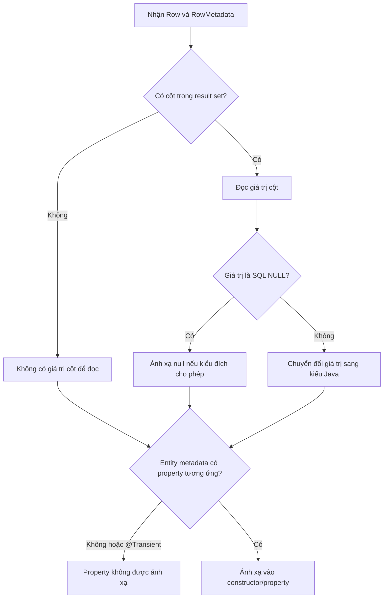

# Phân biệt cột bị bỏ qua, giá trị null và thuộc tính không được ánh xạ

Khi Spring Data R2DBC chuyển kết quả SQL thành entity hoặc DTO, có ba tình huống rất dễ bị nhầm lẫn:

1. **Cột không có trong kết quả truy vấn**: câu `SELECT` không trả về cột đó, nên `Row` không có metadata của cột.
2. **Cột có trong kết quả nhưng giá trị SQL là `NULL`**: cột tồn tại trong result set, nhưng giá trị của hàng hiện tại là null.
3. **Thuộc tính Java không được ánh xạ**: entity metadata không liên kết thuộc tính đó với cột kết quả, ví dụ thuộc tính được đánh dấu `@Transient` hoặc tên cột không khớp mapping.

Ba trường hợp này có ý nghĩa khác nhau. Một cột bị bỏ khỏi `SELECT` không tự động trở thành SQL `NULL`; một cột SQL `NULL` vẫn là cột có mặt trong result set; và một thuộc tính không được ánh xạ không thể nhận giá trị chỉ vì câu SQL có một cột tương tự.

Hiểu rõ khác biệt giúp tránh entity thiếu dữ liệu, ghi đè nhầm giá trị, lỗi constructor mapping và những lỗi khó tìm khi dùng projection, join hoặc câu SQL tùy chỉnh.

## 1. Nhìn từ ba lớp: result set, giá trị SQL và metadata entity

Hãy bắt đầu từ một bảng:

```sql
CREATE TABLE customers (
    id BIGINT PRIMARY KEY,
    name VARCHAR(120) NOT NULL,
    email VARCHAR(180),
    phone VARCHAR(30),
    note VARCHAR(500)
);
```

Giả sử có một hàng:

| id | name | email | phone | note |
| ---: | --- | --- | --- | --- |
| 10 | Lan | `lan@example.com` | `NULL` | Khách hàng thân thiết |

Các câu truy vấn sau tạo ra những result set khác nhau:

```sql
-- A: phone không được chọn
SELECT id, name, email FROM customers WHERE id = 10;

-- B: phone được chọn và có giá trị SQL NULL
SELECT id, name, email, phone FROM customers WHERE id = 10;

-- C: phone được chọn nhưng đổi tên cột kết quả
SELECT id, name, email, phone AS contact_number
FROM customers WHERE id = 10;
```

| Trường hợp | Cột `phone` có trong metadata kết quả? | Giá trị của cột |
| --- | --- | --- |
| Query A | Không | Không có giá trị để đọc |
| Query B | Có | SQL `NULL` |
| Query C | Không còn tên `phone`; kết quả có `contact_number` | SQL `NULL` trong cột alias |

Trong Query A, database không gửi cột `phone` về ứng dụng. Trong Query B, database gửi cột `phone` và giá trị của nó là null. Trong Query C, cột có mặt dưới một tên khác; mapping có thể không liên kết `contact_number` với property `phone` nếu không có cấu hình hoặc alias phù hợp.

## 2. Cột bị bỏ qua trong câu `SELECT`

Cột bị bỏ qua là cột không xuất hiện trong danh sách chọn của query. Ví dụ:

```sql
SELECT id, name, email
FROM customers
WHERE id = :id;
```

Kết quả chỉ chứa ba cột `id`, `name` và `email`. `Row` không có metadata cho `phone` hoặc `note`.

### 2.1. Điều gì xảy ra khi ánh xạ vào entity đầy đủ?

Giả sử entity:

```java
@Table("customers")
public class Customer {

    @Id
    private Long id;
    private String name;
    private String email;
    private String phone;
    private String note;

    // Constructor, getter và setter được lược bớt.
}
```

Nếu query chỉ chọn `id`, `name` và `email`, Spring Data không có dữ liệu cột để điền `phone` và `note`. Với property được gán sau constructor, chúng có thể giữ giá trị mặc định của object. Với persistence constructor cần các tham số tương ứng, giá trị không có trong kết quả có thể được cung cấp như null tùy đường mapping và metadata.

Điểm quan trọng là không nên dựa vào giá trị mặc định đó như một phần hợp đồng dữ liệu. Một entity được thiết kế để biểu diễn đầy đủ bản ghi có thể không còn đầy đủ sau khi query chỉ chọn một phần cột.

Ví dụ nguy hiểm:

```java
@Query("SELECT id, name, email FROM customers WHERE id = :id")
Mono<Customer> findSummaryAsCustomer(@Param("id") Long id);
```

Method khai báo trả về `Customer`, nhưng SQL chỉ trả một phần dữ liệu. Caller có thể nhận một object với `phone` và `note` chưa được khởi tạo. Nếu sau đó object này được dùng như entity đầy đủ hoặc lưu lại, dữ liệu thiếu có thể gây lỗi hoặc ghi đè ngoài ý muốn tùy cách ghi.

### 2.2. Nên dùng projection hoặc DTO cho kết quả một phần

Nếu query chỉ cần ID và tên, hãy tạo kiểu kết quả chỉ biểu diễn hai thuộc tính đó:

```java
public record CustomerSummary(Long id, String name) {
}
```

Repository:

```java
@Query("SELECT id, name FROM customers WHERE id = :id")
Mono<CustomerSummary> findSummary(@Param("id") Long id);
```

Kiểu trả về phản ánh đúng dữ liệu mà query cung cấp. Caller không thể nhầm `CustomerSummary` với entity đầy đủ có email, phone và note.

Với interface projection:

```java
public interface CustomerNameView {
    Long getId();
    String getName();
}
```

```java
@Query("SELECT id, name FROM customers WHERE id = :id")
Mono<CustomerNameView> findNameView(@Param("id") Long id);
```

Tên cột trong result set cần tương ứng với thuộc tính/accessor mà projection yêu cầu theo quy tắc mapping của Spring Data. Với DTO hoặc record, constructor cũng cần tương thích với các cột được chọn.

### 2.3. Cột bị bỏ khỏi SELECT không nhận default của database

Default của database áp dụng trong các thao tác ghi khi cột bị bỏ khỏi `INSERT` hoặc khi câu lệnh dùng từ khóa `DEFAULT` theo cú pháp database. Nó không có nghĩa là khi `SELECT` bỏ một cột thì database tự thay cột đó bằng default.

Ví dụ:

```sql
INSERT INTO customers (id, name, email)
VALUES (11, 'Minh', 'minh@example.com');
```

Nếu `phone` có default được khai báo ở schema, database có thể áp dụng default khi insert. Nhưng:

```sql
SELECT id, name FROM customers WHERE id = 11;
```

vẫn chỉ trả `id` và `name`. Không có `phone` trong result set, dù hàng trong database có thể đang lưu một giá trị phone mặc định.

## 3. Cột có mặt nhưng giá trị SQL là `NULL`

SQL `NULL` biểu thị giá trị chưa biết, không tồn tại hoặc được cố ý để trống theo ngữ nghĩa của schema. Cột vẫn có mặt trong metadata result set.

Ví dụ:

```sql
SELECT id, name, phone
FROM customers
WHERE id = 10;
```

Nếu `phone` của hàng đó là SQL `NULL`, result set có cột `phone` với giá trị null.

### 3.1. Ánh xạ SQL NULL vào kiểu Java

Với property có thể null, dùng kiểu reference:

```java
private String phone;
private Long secondaryNumber;
private LocalDateTime verifiedAt;
```

Các kiểu reference có thể biểu diễn null. Ngược lại, primitive như `long`, `int`, `boolean` không thể chứa null.

```java
private long score;
private boolean verified;
```

Nếu cột `score` hoặc `verified` trong database có thể null, mapping sang primitive sẽ làm mất khả năng biểu diễn trạng thái null và có thể gây lỗi chuyển đổi/gán giá trị tùy cơ chế mapping. Hãy dùng `Long` hoặc `Boolean` nếu null là trạng thái hợp lệ, hoặc bảo đảm schema và query luôn cung cấp giá trị không null.

### 3.2. SQL NULL khác chuỗi rỗng và số 0

Các giá trị sau không tương đương:

| Giá trị | Ý nghĩa |
| --- | --- |
| SQL `NULL` | Không có giá trị cụ thể theo ngữ nghĩa SQL |
| `''` | Chuỗi rỗng |
| `' '` | Chuỗi chứa dấu cách |
| `0` | Số không |
| `false` | Giá trị boolean false |

Không nên tự chuyển null thành chuỗi rỗng hoặc số 0 nếu nghiệp vụ cần phân biệt chúng. Khi cần giá trị thay thế, hãy thể hiện rõ trong SQL hoặc tầng domain.

### 3.3. Dùng `COALESCE` khi muốn thay thế null

SQL `COALESCE` trả về biểu thức đầu tiên khác null:

```sql
SELECT id,
       name,
       COALESCE(phone, 'Chưa cung cấp') AS phone
FROM customers
WHERE id = :id;
```

Ở đây query chủ động thay SQL `NULL` bằng chuỗi `Chưa cung cấp`. Kết quả ánh xạ vào `String phone` sẽ là chuỗi đó thay vì null.

Chỉ dùng cách này khi giá trị thay thế có ý nghĩa đúng với nghiệp vụ. Nếu null mang ý nghĩa “chưa xác minh”, “không áp dụng” hoặc “người dùng đã xóa”, thay thế bằng chuỗi mặc định có thể làm mất thông tin.

### 3.4. Điều kiện lọc với NULL

Trong SQL, không kiểm tra null bằng phép so sánh thông thường:

```sql
-- Không đúng để tìm các hàng có phone NULL
SELECT * FROM customers WHERE phone = NULL;

-- Cách đúng
SELECT * FROM customers WHERE phone IS NULL;
```

Tương tự, dùng `IS NOT NULL` để tìm các hàng có giá trị. Quy tắc ba giá trị của SQL khiến biểu thức `phone = NULL` cho kết quả UNKNOWN thay vì TRUE.

## 4. Thuộc tính Java không được ánh xạ

Một thuộc tính không được ánh xạ là thuộc tính mà mapping metadata của Spring Data không liên kết với cột lưu trữ. Có nhiều nguyên nhân:

- Thuộc tính được đánh dấu `@Transient`.
- Tên cột kết quả không khớp tên cột mà entity mong đợi.
- Query trả về alias không phù hợp.
- Thuộc tính không thuộc persistent model của entity.
- Cột kết quả là cột phụ được tạo bởi biểu thức, join hoặc aggregate nhưng entity không có property tương ứng.

### 4.1. Dùng `@Transient` cho property không lưu trong database

Spring Data cung cấp annotation `@Transient` để loại property khỏi persistent mapping:

```java
import org.springframework.data.annotation.Transient;

@Table("customers")
public class Customer {

    @Id
    private Long id;
    private String name;

    @Transient
    private String displayLabel;

    // Constructor, getter và setter được lược bớt.
}
```

`displayLabel` không được xem là cột cần đọc/ghi trong mapping entity thông thường. Có thể tính giá trị này trong domain/service sau khi entity được tải:

```java
customer.setDisplayLabel(customer.getName() + " (#" + customer.getId() + ")");
```

Đừng kỳ vọng query có cột tên `display_label` sẽ tự động ghi vào property `displayLabel` đã đánh dấu `@Transient`. Nếu muốn nhận dữ liệu tổng hợp từ query, hãy dùng projection/DTO hoặc ánh xạ thủ công.

### 4.2. Tên cột không khớp property

Giả sử entity khai báo:

```java
@Column("email_address")
private String email;
```

Mapping metadata liên kết property `email` với cột `email_address`. Nếu query trả về:

```sql
SELECT id, name, email_address AS contact
FROM customers;
```

thì result set có cột `contact`, không phải `email_address`. Nếu không có mapping phù hợp, property `email` có thể không được điền.

Sửa query để trả đúng tên cột:

```sql
SELECT id, name, email_address
FROM customers;
```

Hoặc nếu target là DTO có property `contact`, hãy khai báo DTO phù hợp và dùng alias `contact` một cách có chủ đích.

### 4.3. Naming strategy và `@Column`

Spring Data Relational dùng naming strategy để ánh xạ tên property Java sang tên cột mặc định. Ví dụ property `firstName` thường được ánh xạ sang `first_name` theo naming strategy mặc định.

Nếu schema dùng tên cột khác, khai báo rõ:

```java
@Column("customer_full_name")
private String name;
```

Với query SQL tự viết, phải nhớ tên cột mà mapping metadata mong đợi. `@Column` mô tả mapping property với cột database; nó không tự biến một alias tùy ý thành tên cột đã khai báo.

### 4.4. Cột dư trong result set

Một query có thể trả về nhiều cột hơn entity cần:

```sql
SELECT id, name, email_address, CURRENT_TIMESTAMP AS queried_at
FROM customers;
```

Nếu entity `Customer` không có property persistent tương ứng với `queried_at`, cột phụ đó không tự trở thành một property mới của entity. Nó thường không được sử dụng trong entity mapping.

Nếu ứng dụng cần `queriedAt`, hãy tạo projection/DTO có thuộc tính tương ứng hoặc đọc cột bằng `DatabaseClient` và mapping thủ công.

## 5. So sánh ba tình huống trong cùng một ví dụ

Giả sử entity:

```java
@Table("customers")
public class Customer {

    @Id
    private Long id;
    private String name;
    private String phone;

    @Transient
    private String displayLabel;

    // Constructor và accessor được lược bớt.
}
```

| Tình huống | SQL/result set | Mapping tới `phone` | Mapping tới `displayLabel` |
| --- | --- | --- | --- |
| Cột bị bỏ qua | `SELECT id, name` | Không có giá trị cột; property có thể chưa được gán | Không được map vì `@Transient` |
| Cột SQL NULL | `SELECT id, name, phone`, giá trị phone là NULL | Nhận null nếu kiểu Java/converter cho phép | Không được map vì `@Transient` |
| Property không được ánh xạ | Query trả `display_label`, entity đánh dấu property `@Transient` | Phụ thuộc cột phone có được chọn hay không | Vẫn không được map theo entity metadata |
| Alias sai | `phone AS contact` | Không khớp cột `phone`, có thể không được gán | Không liên quan |

Hãy xác định nguyên nhân ở đúng lớp. Nếu result set không có cột, sửa `SELECT`; nếu cột có SQL NULL, xử lý nullability; nếu mapping metadata loại property hoặc tên cột sai, sửa entity mapping hoặc dùng kiểu kết quả khác.

## 6. Constructor mapping và property population

Spring Data R2DBC có thể tạo entity bằng persistence constructor hoặc factory method, sau đó điền các property còn lại theo mapping metadata.

### 6.1. Property là tham số constructor

Ví dụ:

```java
@Table("customers")
public class Customer {

    @Id
    private final Long id;
    private final String name;
    private final String phone;

    @PersistenceCreator
    public Customer(Long id, String name, String phone) {
        this.id = id;
        this.name = name;
        this.phone = phone;
    }
}
```

Nếu câu query chỉ trả `id` và `name`, constructor vẫn yêu cầu tham số `phone`. Framework không có giá trị phone từ result set; giá trị truyền vào có thể là null tùy mapping path. Vì vậy, constructor của entity đầy đủ nên được dùng với query trả đủ cột mà entity cần.

Nếu chỉ cần một phần dữ liệu, hãy tạo DTO/record với constructor chỉ nhận các cột được query:

```java
public record CustomerContact(Long id, String name) {
}
```

### 6.2. Property được gán sau constructor

Với entity mutable có constructor không tham số, property bị bỏ khỏi result set thường không được gán qua property population và có thể giữ giá trị mặc định của Java, ví dụ null cho reference hoặc `0` cho primitive.

Đây là một lý do khiến entity đầy đủ không phải lựa chọn tốt cho query chỉ lấy một phần cột. Một object trông có vẻ hợp lệ nhưng chứa field chưa được khởi tạo có thể gây lỗi ở tầng nghiệp vụ.

### 6.3. Constructor parameter và SQL NULL

Nếu cột có trong result set nhưng giá trị là SQL `NULL`, constructor parameter tương ứng nhận giá trị null nếu kiểu và converter cho phép. Với primitive, không thể biểu diễn null; cần wrapper hoặc quy tắc dữ liệu đảm bảo không null.

Vì vậy, “không có cột” và “có cột nhưng null” khác nhau về metadata, dù cả hai đôi khi có thể dẫn đến một giá trị Java null trong object cuối cùng. Nếu nghiệp vụ phải phân biệt hai trường hợp, cần kiểm tra metadata result set hoặc thiết kế projection/query riêng.

## 7. Làm việc với join và alias

Join thường tạo result set có nhiều cột từ nhiều bảng. Nếu các bảng có cùng tên cột như `id`, `name` hoặc `created_at`, result set có thể chứa tên trùng hoặc tên không đủ rõ để ánh xạ.

Ví dụ:

```sql
SELECT c.id,
       c.name,
       p.id,
       p.display_name
FROM customers c
JOIN profiles p ON p.customer_id = c.id
WHERE c.id = :id;
```

Cả hai bảng đều có cột `id`. Nếu ánh xạ thẳng vào một entity, tên cột trùng có thể gây nhập nhằng hoặc ghi đè giá trị tùy cách driver và mapping xử lý metadata.

Hãy alias rõ ràng:

```sql
SELECT c.id AS customer_id,
       c.name AS customer_name,
       p.id AS profile_id,
       p.display_name AS profile_display_name
FROM customers c
JOIN profiles p ON p.customer_id = c.id
WHERE c.id = :id;
```

Sau đó ánh xạ vào DTO chuyên biệt:

```java
public record CustomerProfileRow(
        Long customerId,
        String customerName,
        Long profileId,
        String profileDisplayName
) {
}
```

Với join phức tạp, DTO/projection thường rõ ràng hơn việc cố gắng đưa tất cả cột của nhiều bảng vào một entity aggregate.

## 8. Kiểm tra sự hiện diện của cột bằng R2DBC `RowMetadata`

Khi dùng repository và mapping tự động, Spring Data xử lý `Row`/metadata theo entity mapping. Nếu cần phân biệt rõ cột không có trong result set với cột có giá trị null, có thể dùng `DatabaseClient` để đọc metadata trực tiếp.

Ví dụ:

```java
return databaseClient.sql("SELECT id, name, phone FROM customers WHERE id = :id")
        .bind("id", customerId)
        .map((row, metadata) -> {
            boolean phoneColumnPresent = metadata.getColumnMetadatas().stream()
                    .anyMatch(column -> column.getName().equalsIgnoreCase("phone"));

            String phone = phoneColumnPresent
                    ? row.get("phone", String.class)
                    : null;

            return new CustomerPhoneResult(
                    row.get("id", Long.class),
                    row.get("name", String.class),
                    phoneColumnPresent,
                    phone
            );
        })
        .one();
```

DTO biểu diễn cả việc cột có mặt và giá trị:

```java
public record CustomerPhoneResult(
        Long id,
        String name,
        boolean phoneColumnPresent,
        String phone
) {
}
```

Kết quả có thể phân biệt:

- `phoneColumnPresent == false`: query không trả cột phone.
- `phoneColumnPresent == true` và `phone == null`: cột phone có mặt nhưng giá trị SQL là NULL.
- `phoneColumnPresent == true` và `phone != null`: cột có mặt và có giá trị.

Tên cột trong metadata có thể phụ thuộc driver, dialect và alias. Nếu query dùng alias, hãy kiểm tra đúng tên alias. Với kết quả có tên cột trùng, nên alias duy nhất trước khi đọc.

## 9. Khi nào nên dùng `COALESCE`, alias hoặc DTO?

| Nhu cầu | Cách phù hợp |
| --- | --- |
| Muốn SQL NULL trở thành giá trị mặc định | `COALESCE` trong SQL, nếu thay đổi ngữ nghĩa là chủ ý |
| Query chỉ chọn một vài cột | DTO hoặc projection chỉ chứa các cột đó |
| Cột vật lý khác tên property | `@Column` hoặc alias phù hợp |
| Query join nhiều bảng có cột trùng tên | Alias duy nhất và DTO chuyên biệt |
| Cần phân biệt cột bị bỏ khỏi query với cột SQL NULL | Đọc `RowMetadata` và giá trị `Row` |
| Property chỉ dùng trong ứng dụng, không lưu database | `@Transient` và tự tính/gán trong ứng dụng |
| Muốn cập nhật field null thành SQL NULL | Dùng update rõ ràng với giá trị null và kiểm tra schema |

Không nên dùng `COALESCE` chỉ để che lỗi mapping do query thiếu cột. Hãy sửa result set hoặc kiểu trả về để phản ánh đúng dữ liệu cần dùng.

## 10. Ảnh hưởng đến cập nhật dữ liệu

Một lỗi thường gặp là query chỉ chọn một phần cột, ánh xạ thành entity đầy đủ, sau đó thay đổi một property và gọi `save()`.

Ví dụ:

```java
@Query("SELECT id, name FROM customers WHERE id = :id")
Mono<Customer> findPartial(@Param("id") Long id);
```

```java
return repository.findPartial(id)
        .map(customer -> {
            customer.setName("Lan Nguyen");
            return customer;
        })
        .flatMap(repository::save);
```

Entity có thể không chứa `email`, `phone` hoặc các property khác. Khi `save()` lưu entity theo mapping, các giá trị chưa được tải có thể trở thành null hoặc giá trị mặc định và ghi đè dữ liệu hiện tại tùy câu SQL được tạo. Đây là lỗi mất dữ liệu nghiêm trọng.

Nếu mục tiêu là thay đổi một cột, dùng partial update rõ ràng:

```java
return template.update(Customer.class)
        .matching(query(where("id").is(id)))
        .apply(Update.update("name", "Lan Nguyen"));
```

Hoặc tải đầy đủ entity trước khi sửa và gọi `save()` nếu nghiệp vụ cần kiểm tra toàn bộ aggregate.

## 11. Kiểm thử ba trường hợp riêng biệt

Hãy tạo dữ liệu kiểm thử có ít nhất một cột nullable để có thể kiểm tra cả trường hợp SQL NULL và trường hợp query bỏ cột.

Ví dụ schema và fixture:

```sql
CREATE TABLE customers (
    id BIGINT PRIMARY KEY,
    name VARCHAR(120) NOT NULL,
    phone VARCHAR(30),
    note VARCHAR(500)
);

INSERT INTO customers (id, name, phone, note)
VALUES (10, 'Lan', NULL, 'VIP');
```

### 11.1. Test cột bị bỏ khỏi result set

```java
@Query("SELECT id, name FROM customers WHERE id = :id")
Mono<CustomerSummary> findSummary(@Param("id") Long id);
```

Test xác nhận projection chỉ cung cấp các field được chọn:

```java
StepVerifier.create(repository.findSummary(10L))
        .assertNext(summary -> {
            assertThat(summary.id()).isEqualTo(10L);
            assertThat(summary.name()).isEqualTo("Lan");
        })
        .verifyComplete();
```

### 11.2. Test cột có SQL NULL

```java
@Query("SELECT id, name, phone FROM customers WHERE id = :id")
Mono<CustomerPhoneView> findPhone(@Param("id") Long id);
```

Test xác nhận cột có mặt nhưng giá trị null:

```java
StepVerifier.create(repository.findPhone(10L))
        .assertNext(view -> {
            assertThat(view.getId()).isEqualTo(10L);
            assertThat(view.getPhone()).isNull();
        })
        .verifyComplete();
```

### 11.3. Test property `@Transient`

```java
@Transient
private String displayLabel;
```

Property này không được Spring Data ánh xạ như một cột persistent. Test nên xác nhận nó được tính/gán ở tầng ứng dụng theo ý định, thay vì kỳ vọng query tự điền property này.

### 11.4. Các tình huống bổ sung

- Query chọn đủ cột cho persistence constructor.
- Query thiếu một constructor parameter.
- SQL NULL ánh xạ vào wrapper và primitive.
- Alias đúng và alias sai so với `@Column`.
- Query join có tên cột trùng.
- Cột phụ trong result set không có property tương ứng.
- Projection trả về ít field hơn entity.
- Không lưu lại một entity được materialize từ partial SELECT.
- `COALESCE` thay null bằng giá trị mặc định theo đúng nghiệp vụ.

## 12. Những lỗi thường gặp và cách xử lý

| Triệu chứng | Nguyên nhân có thể | Cách xử lý |
| --- | --- | --- |
| Property null dù database có dữ liệu | Cột không được chọn hoặc alias không khớp mapping | Kiểm tra SELECT, metadata và `@Column` |
| Property null dù query có cột | Giá trị cột thực sự là SQL NULL | Kiểm tra dữ liệu, nullability và quy tắc nghiệp vụ |
| Entity thiếu nhiều field sau query | Query chỉ chọn một phần cột nhưng trả entity đầy đủ | Dùng DTO/projection hoặc chọn đủ cột |
| Property tính toán không được điền | Property được đánh dấu `@Transient` | Tính ở ứng dụng hoặc ánh xạ thủ công sang DTO |
| Lỗi khi mapping vào primitive | Cột có thể null nhưng Java primitive không thể chứa null | Dùng wrapper hoặc bảo đảm dữ liệu không null |
| Dữ liệu bị mất sau khi gọi save | Entity được tải thiếu cột rồi lưu lại | Không save partial entity; dùng partial update hoặc tải đầy đủ |
| Join trả nhầm ID/tên | Cột trùng tên giữa các bảng | Alias duy nhất và dùng DTO chuyên biệt |
| Giá trị mặc định không xuất hiện | Nhầm lẫn default của INSERT với cột bị bỏ trong SELECT | Kiểm tra schema và chọn cột rõ ràng |

## 13. Quy trình thiết kế mapping rõ ràng

Khi viết query và kiểu kết quả, hãy thực hiện theo trình tự:

1. Liệt kê các cột mà câu SQL thực sự trả về.
2. Xác định cột nào có thể chứa SQL NULL.
3. Xác định tên cột/alias mà result set cung cấp.
4. Đối chiếu với `@Column`, naming strategy và constructor parameter của kiểu đích.
5. Nếu query chỉ trả một phần dữ liệu, tạo projection/DTO tương ứng.
6. Nếu property không lưu trong database, đánh dấu `@Transient` và tự quản lý giá trị đó.
7. Dùng wrapper cho các property có thể null.
8. Tránh lưu lại entity được tạo từ partial result set.
9. Viết integration test cho cột thiếu, SQL NULL, alias và property không map.

## 14. Luồng phân biệt cột thiếu, SQL NULL và property không map



## 15. Kết luận

Cột bị bỏ khỏi `SELECT`, cột có giá trị SQL `NULL` và property không được mapping là ba trạng thái khác nhau. Cột bị bỏ không xuất hiện trong result set; SQL NULL vẫn là một cột có mặt nhưng giá trị null; property không được mapping bị loại khỏi hoặc không khớp với metadata entity.

Hãy chọn kiểu kết quả đúng với dữ liệu query trả về. Dùng DTO/projection cho tập cột một phần, `@Column` hoặc alias để khớp tên, `@Transient` cho property không lưu, và wrapper cho giá trị có thể null. Khi cần phân biệt cột không có với cột có giá trị null, đọc `RowMetadata` cùng giá trị `Row`. Đặc biệt, tránh gọi `save()` trên entity được tạo từ partial SELECT vì các field chưa được tải có thể làm mất dữ liệu hiện có.
