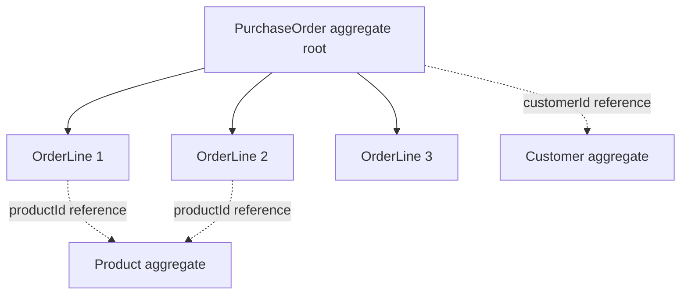

# Không giả định lazy loading, cascade hoặc dirty checking như JPA

Spring Data R2DBC làm việc với cơ sở dữ liệu quan hệ theo mô hình reactive, nhưng cách quản lý object và quan hệ khác với JPA/Hibernate. Một entity được đọc từ database không được giữ trong persistence context để framework tự theo dõi mọi thay đổi. Một thuộc tính tham chiếu tới entity khác cũng không tự tải dữ liệu khi được truy cập. Các thao tác lưu và xóa phải được thể hiện rõ trong code hoặc được xử lý theo ranh giới aggregate mà Spring Data Relational hỗ trợ.

Ba hành vi của JPA thường bị hiểu nhầm khi chuyển sang R2DBC là **lazy loading**, **cascade operation** và **dirty checking**. Spring Data Relational có cơ chế ánh xạ aggregate và quản lý các thành phần thuộc aggregate, nhưng không cung cấp đầy đủ mô hình persistence context của JPA. Hiểu đúng khác biệt này giúp tránh truy vấn ngầm, dữ liệu ghi thiếu, xóa nhầm hoặc giả định sai về transaction.

## 1. Vì sao không nên mang nguyên cách nghĩ JPA sang R2DBC?

Trong ứng dụng JPA, `EntityManager` quản lý persistence context. Khi một entity được tải, provider có thể giữ trạng thái của entity, theo dõi thay đổi thuộc tính và thực hiện SQL khi flush. Các quan hệ có thể được cấu hình lazy/eager; cascade xác định thao tác nào được truyền từ entity cha sang entity liên quan.

Spring Data R2DBC không dùng persistence context kiểu đó. Repository, `R2dbcEntityTemplate` và `DatabaseClient` thực hiện các thao tác reactive với database. Khi một truy vấn hoàn tất, ứng dụng nhận các object được ánh xạ từ kết quả. Framework không tiếp tục giữ một graph entity trong bộ nhớ để tự phát hiện mọi thay đổi về sau.

| Khả năng | JPA/Hibernate | Spring Data R2DBC / Relational |
|---|---|---|
| Persistence context | Có; quản lý entity trong một phạm vi persistence context | Không có persistence context kiểu JPA |
| Lazy loading | Có thể cấu hình cho quan hệ được hỗ trợ | Không có proxy lazy loading tự động |
| Dirty checking | Theo dõi thay đổi trên entity đang được quản lý | Không tự phát hiện thay đổi; cần gọi thao tác ghi rõ ràng |
| Cascade annotation | Có các annotation và `CascadeType` của JPA | Không dùng mô hình cascade annotation của JPA |
| Quan hệ dữ liệu | Object relationship như `@ManyToOne`, `@OneToMany` | Mapping theo aggregate và quan hệ bảng; cần truy vấn rõ ràng giữa các aggregate |
| Thời điểm ghi | Có thể flush khi transaction commit hoặc theo flush mode | Publisher ghi được thực thi khi được subscribe; ứng dụng gọi `save`, `insert`, `update` hoặc SQL cụ thể |

Spring Data Relational vẫn hỗ trợ ánh xạ dữ liệu thuộc aggregate, ví dụ một đơn hàng cùng các dòng hàng của nó. Điều đó không biến nó thành ORM có lazy loading và dirty checking như JPA.

## 2. Hiểu ranh giới aggregate trong Spring Data Relational

Spring Data Relational tổ chức dữ liệu theo **aggregate**. Aggregate root là điểm vào để đọc và thay đổi một nhóm đối tượng cần được quản lý như một đơn vị nghiệp vụ. Các đối tượng thuộc cùng aggregate có thể được ánh xạ tới nhiều bảng, nhưng chúng thuộc cùng một ranh giới nhất quán.

Ví dụ, một `PurchaseOrder` có các `OrderLine`. Các dòng hàng chỉ có ý nghĩa trong đơn hàng và thường được tạo, thay đổi hoặc xóa cùng với đơn hàng. Đây là trường hợp phù hợp để mô hình hóa các dòng hàng như thành phần của aggregate `PurchaseOrder`.

Ngược lại, `Customer` và `Product` thường là aggregate độc lập. Đơn hàng nên lưu định danh khách hàng và sản phẩm thay vì kéo toàn bộ object graph của khách hàng và sản phẩm vào cùng aggregate. Khi cần tên khách hàng hoặc thông tin sản phẩm để hiển thị, ứng dụng truy vấn rõ ràng theo use case đọc.



Sơ đồ thể hiện hai loại quan hệ khác nhau:

- `OrderLine` là thành phần được quản lý trong aggregate của `PurchaseOrder`.
- `Customer` và `Product` là aggregate riêng, được tham chiếu qua ID.

Ranh giới aggregate là quyết định thiết kế nghiệp vụ. Foreign key trong database bảo vệ tính toàn vẹn tham chiếu, nhưng không tự quyết định hai object có thuộc cùng aggregate hay không.

## 3. Ánh xạ thành phần thuộc aggregate bằng @MappedCollection

Spring Data Relational cung cấp `@MappedCollection` để ánh xạ các đối tượng con được lưu trong bảng riêng và thuộc về aggregate root.

Ví dụ:

```java
@Table("purchase_order")
public class PurchaseOrder {

    @Id
    private Long id;

    private String orderNo;
    private String status;

    @MappedCollection(idColumn = "order_id")
    private Set<OrderLine> lines = new LinkedHashSet<>();

    // Constructor, getter và các phương thức nghiệp vụ.
}
```

```java
@Table("order_line")
public class OrderLine {

    @Id
    private Long id;

    private Long productId;
    private Integer quantity;
    private BigDecimal unitPrice;

    // Constructor, getter và các phương thức nghiệp vụ.
}
```

Trong schema, bảng con có cột foreign key trỏ về aggregate root:

```sql
CREATE TABLE purchase_order (
    id BIGINT GENERATED BY DEFAULT AS IDENTITY PRIMARY KEY,
    order_no VARCHAR(40) NOT NULL UNIQUE,
    status VARCHAR(30) NOT NULL
);

CREATE TABLE order_line (
    id BIGINT GENERATED BY DEFAULT AS IDENTITY PRIMARY KEY,
    order_id BIGINT NOT NULL REFERENCES purchase_order(id),
    product_id BIGINT NOT NULL,
    quantity INTEGER NOT NULL CHECK (quantity > 0),
    unit_price NUMERIC(19, 2) NOT NULL CHECK (unit_price >= 0)
);
```

`idColumn = "order_id"` cho Spring Data biết cột trong bảng con dùng để liên kết tới ID của aggregate root. Khi tải aggregate root, mapping có thể tải các thành phần được khai báo thuộc aggregate. Không có nghĩa các quan hệ tới aggregate khác sẽ tự được tải theo.

Nếu collection dùng `List` hoặc `Map`, có thể cần cấu hình thêm `keyColumn` để lưu vị trí hoặc khóa của phần tử theo mapping được hỗ trợ. Hãy xem tài liệu Spring Data Relational đúng phiên bản để chọn cấu hình collection phù hợp.

## 4. Tham chiếu aggregate khác bằng ID

Với quan hệ tới một aggregate độc lập, thường lưu ID thay vì nhúng entity vào object graph:

```java
@Table("purchase_order")
public record PurchaseOrder(
    @Id Long id,
    String orderNo,
    Long customerId,
    String status
) {}
```

`customerId` chỉ là giá trị tham chiếu. Khi đọc `PurchaseOrder`, Spring Data không tự gọi `CustomerRepository.findById(customerId)` khi code truy cập thuộc tính đó. Nếu cần thông tin khách hàng, ứng dụng phải truy vấn rõ ràng.

Ví dụ với một đơn hàng:

```java
public Mono<OrderDetail> findOrderDetail(Long orderId) {
    return orderRepository.findById(orderId)
        .flatMap(order -> customerRepository.findById(order.customerId())
            .map(customer -> new OrderDetail(
                order.id(),
                order.orderNo(),
                order.status(),
                customer.displayName()
            )));
}
```

Đây là cách đọc rõ ràng cho một chi tiết đơn hàng. Nhưng nếu dùng cùng cách này cho danh sách 100 đơn hàng, ứng dụng có thể phát sinh N+1 query: một truy vấn lấy đơn hàng rồi thêm một truy vấn khách hàng cho mỗi đơn.

Với danh sách, nên cân nhắc một truy vấn join projection bằng `DatabaseClient`, hoặc tải tập ID khách hàng rồi truy vấn theo tập ID. Hãy chọn theo cardinality, kích thước dữ liệu và yêu cầu nhất quán.

## 5. Không có lazy loading tự động

Lazy loading trong JPA cho phép một quan hệ chưa được tải được truy xuất khi code đọc thuộc tính quan hệ. Provider có thể dùng proxy để phát sinh SQL vào thời điểm đó, miễn là entity còn nằm trong phạm vi persistence context phù hợp.

Spring Data R2DBC không tạo proxy lazy như vậy. Việc truy cập một trường ID hoặc một object đã được ánh xạ không tự kích hoạt truy vấn mới. Không có `FetchType.LAZY` để trì hoãn tải quan hệ theo cách JPA.

Ví dụ cách nghĩ không áp dụng trực tiếp:

```java
// Mô hình JPA minh họa, không phải cách mapping quan hệ R2DBC.
@ManyToOne(fetch = FetchType.LAZY)
private Customer customer;
```

Trong Spring Data Relational, hãy biểu diễn tham chiếu ngoài aggregate bằng ID và truy vấn rõ ràng khi cần. Nếu muốn một kết quả kết hợp, tạo DTO từ câu join.

### Chiến lược 1: tải rõ ràng theo từng bước

Phù hợp khi đọc một đối tượng hoặc số lượng quan hệ nhỏ:

```java
public Mono<OrderDetail> getDetail(Long orderId) {
    return orderRepository.findById(orderId)
        .flatMap(order -> customerRepository.findById(order.customerId())
            .map(customer -> new OrderDetail(
                order.id(),
                order.orderNo(),
                customer.displayName(),
                order.status()
            )));
}
```

### Chiến lược 2: join và projection

Phù hợp với màn hình danh sách cần dữ liệu từ nhiều bảng:

```java
public record OrderListItem(
    Long orderId,
    String orderNo,
    String status,
    String customerName
) {}
```

```java
public Flux<OrderListItem> findOrderList(String status) {
    return databaseClient.sql("""
            SELECT o.id AS order_id,
                   o.order_no,
                   o.status,
                   c.display_name AS customer_name
            FROM purchase_order o
            JOIN customer c ON c.id = o.customer_id
            WHERE o.status = :status
            ORDER BY o.id DESC
            """)
        .bind("status", status)
        .map((row, metadata) -> new OrderListItem(
            row.get("order_id", Long.class),
            row.get("order_no", String.class),
            row.get("status", String.class),
            row.get("customer_name", String.class)
        ))
        .all();
}
```

### Chiến lược 3: tải theo tập ID

Nếu không muốn join nhưng cần tránh N+1, có thể lấy các đơn hàng trước, gom `customerId` duy nhất rồi tải khách hàng theo một truy vấn `IN`. Cách này cần chú ý giới hạn kích thước tập ID, bind collection theo API/driver hỗ trợ và cách ghép kết quả trong bộ nhớ. Với tập dữ liệu lớn, hãy phân trang danh sách cha trước khi tải dữ liệu liên quan.

## 6. Không có dirty checking tự động

Trong JPA, entity được tải trong persistence context có thể được thay đổi trực tiếp:

```java
// Cách dùng quen thuộc trong JPA; không nên kỳ vọng R2DBC tự lưu thay đổi.
Person person = entityManager.find(Person.class, id);
person.setStatus("ACTIVE");
// Dirty checking có thể phát hiện thay đổi và ghi khi flush/commit.
```

Trong Spring Data R2DBC, việc thay đổi object Java chỉ thay đổi object trong bộ nhớ. Framework không theo dõi object đó để tự phát hiện và ghi xuống database khi transaction kết thúc.

Ứng dụng phải gọi thao tác ghi một cách tường minh, chẳng hạn:

```java
public Mono<Person> activate(Long id) {
    return personRepository.findById(id)
        .switchIfEmpty(Mono.error(new PersonNotFoundException(id)))
        .map(person -> person.withStatus("ACTIVE"))
        .flatMap(personRepository::save);
}
```

Ví dụ giả định `Person` là record có phương thức `withStatus` tạo một instance mới. Nếu dùng class mutable, Service có thể gọi setter rồi truyền entity đã thay đổi vào `save`. Điểm cốt lõi là phải gọi `save` hoặc một thao tác update rõ ràng.

### Lưu ý khi dùng save

`save(entity)` là thao tác lưu aggregate/entity theo quy tắc Spring Data, không phải lệnh “chỉ ghi những field đã thay đổi” như dirty checking của JPA. Không nên mặc định framework biết thuộc tính nào đã được sửa trong bộ nhớ.

Khi lưu một aggregate, Spring Data Relational quản lý dữ liệu root và các thành phần thuộc aggregate theo mapping của nó. Cách thực hiện SQL cụ thể phụ thuộc loại entity, trạng thái mới/cũ, mapping và phiên bản. Vì vậy, hãy tránh dùng một entity đọc thiếu trường làm đầu vào `save` nếu không muốn các giá trị thiếu ảnh hưởng đến dữ liệu đang có.

Nếu chỉ cần thay đổi một vài cột, một câu update tường minh thường phù hợp hơn việc tải toàn bộ entity rồi lưu lại. Điều này đặc biệt hữu ích khi bảng có nhiều trường hoặc nhiều request cập nhật các trường khác nhau.

## 7. Cập nhật một phần bằng R2dbcEntityTemplate

`R2dbcEntityTemplate` cho phép update theo điều kiện và chỉ thay đổi các cột cần thiết:

```java
import static org.springframework.data.relational.core.query.Criteria.where;
import static org.springframework.data.relational.core.query.Query.query;
import static org.springframework.data.relational.core.query.Update.update;

public Mono<Long> changePersonStatus(Long id, String status) {
    return template.update(Person.class)
        .matching(query(where("id").is(id)))
        .apply(update("status", status));
}
```

Kết quả là số hàng bị tác động. Cách này không cần tải entity trước và thể hiện rõ cột nào được cập nhật.

Nếu cần kiểm soát cạnh tranh, có thể đưa version vào điều kiện và tăng version theo quy tắc ứng dụng hoặc dùng cơ chế optimistic locking phù hợp. Không nên bỏ qua điều kiện tenant, trạng thái hoặc quyền sở hữu khi xây dựng update một phần.

## 8. Cập nhật một phần bằng DatabaseClient

Với SQL tùy chỉnh, có thể dùng `DatabaseClient`:

```java
public Mono<Long> updateStatus(Long id, String status) {
    return databaseClient.sql("""
            UPDATE person
            SET status = :status,
                updated_at = CURRENT_TIMESTAMP
            WHERE id = :id
            """)
        .bind("status", status)
        .bind("id", id)
        .fetch()
        .rowsUpdated();
}
```

Bind parameter cho tất cả giá trị đầu vào. `rowsUpdated()` giúp biết có bao nhiêu hàng bị tác động; Service có thể chuyển kết quả 0 thành not found hoặc no-op tùy hợp đồng nghiệp vụ.

Nếu cần optimistic concurrency, có thể thêm điều kiện version:

```sql
UPDATE person
SET status = :status,
    version = version + 1
WHERE id = :id
  AND version = :expectedVersion;
```

Nếu số hàng cập nhật bằng 0, có thể do ID không tồn tại hoặc version đã thay đổi. Ứng dụng cần quyết định có truy vấn bổ sung để phân biệt hay trả về xung đột chung. Cần kiểm thử cách tăng version và mapping phù hợp với cấu hình Spring Data của dự án.

## 9. Cascade trong JPA và aggregate semantics trong Spring Data Relational

JPA cung cấp `CascadeType.PERSIST`, `MERGE`, `REMOVE`, `REFRESH`, `DETACH` và `ALL` để truyền một số thao tác từ entity cha sang entity liên quan. Spring Data R2DBC không sử dụng các annotation cascade này.

Điều đó không có nghĩa Spring Data Relational bỏ qua mọi đối tượng con. Các đối tượng được ánh xạ như thành phần của cùng aggregate được quản lý theo aggregate root. Khi lưu hoặc xóa aggregate root, Spring Data Relational xử lý các thành phần thuộc aggregate theo mapping và semantics của nó.

Phải phân biệt:

- **Thành phần thuộc aggregate:** ví dụ `OrderLine` trong `PurchaseOrder`, được khai báo bằng `@MappedCollection`.
- **Aggregate độc lập được tham chiếu:** ví dụ `Customer` hoặc `Product`, được giữ bằng ID và có vòng đời riêng.
- **Cascade ở database:** hành vi do foreign key như `ON DELETE CASCADE`, được database thực hiện.
- **Cascade annotation của JPA:** không phải cơ chế mapping của Spring Data R2DBC.

Không nên coi một tham chiếu ID tới aggregate khác là quan hệ cascade. Xóa `PurchaseOrder` không có nghĩa ứng dụng muốn xóa luôn `Customer` hoặc `Product` được tham chiếu.

## 10. Xóa aggregate root và các thành phần con

Với aggregate được ánh xạ bằng `@MappedCollection`, Spring Data Relational hiểu các hàng con là một phần của aggregate root. Khi xóa aggregate root qua Repository hoặc template, framework quản lý việc xóa các thành phần thuộc aggregate theo mapping.

Ví dụ:

```java
public interface PurchaseOrderRepository
        extends ReactiveCrudRepository<PurchaseOrder, Long> {
}
```

```java
public Mono<Void> cancelAndDeleteOrder(Long id) {
    return orderRepository.findById(id)
        .switchIfEmpty(Mono.error(new OrderNotFoundException(id)))
        .flatMap(order -> {
            if (!"CANCELLED".equals(order.getStatus())) {
                return Mono.error(new IllegalStateException(
                    "Only cancelled orders can be deleted"));
            }
            return orderRepository.delete(order);
        });
}
```

Ví dụ minh họa quy tắc nghiệp vụ trước khi xóa. Các hàng con được ánh xạ trong aggregate được xử lý theo semantics của Spring Data Relational. Không cần và không nên dựa vào `CascadeType.REMOVE` của JPA.

Các hàng thuộc aggregate khác được tham chiếu bằng ID không tự động trở thành thành phần để xóa. Nếu database có foreign key ngăn xóa root, cần thiết kế quan hệ và thứ tự thao tác phù hợp.

## 11. Phân biệt aggregate delete với ON DELETE CASCADE

`ON DELETE CASCADE` là tính năng của database:

```sql
CREATE TABLE order_line (
    id BIGINT GENERATED BY DEFAULT AS IDENTITY PRIMARY KEY,
    order_id BIGINT NOT NULL,
    product_id BIGINT NOT NULL,
    quantity INTEGER NOT NULL,
    CONSTRAINT fk_order_line_order
        FOREIGN KEY (order_id)
        REFERENCES purchase_order(id)
        ON DELETE CASCADE
);
```

Khi một câu SQL xóa hàng `purchase_order`, database tự xóa các hàng `order_line` liên quan theo foreign key. Cơ chế này hoạt động bất kể câu lệnh được gửi từ Spring Data, `DatabaseClient`, một công cụ SQL hay một ứng dụng khác.

Trong khi đó, aggregate semantics là cách Spring Data Relational quản lý các đối tượng con được khai báo trong mapping. Hai cơ chế có thể cùng tồn tại, nhưng cần hiểu database và framework đang thực hiện phần việc nào để tránh xóa lặp, constraint conflict hoặc hiểu nhầm về thứ tự SQL.

Không nên cấu hình cascade xóa cho mọi foreign key. Dữ liệu giao dịch, lịch sử thanh toán hoặc bản ghi audit có thể cần được giữ lại ngay cả khi entity cha không còn hoạt động. Có thể dùng `RESTRICT`, soft delete hoặc trạng thái nghiệp vụ thay vì xóa vật lý.

## 12. Không nhầm quan hệ database với object graph tự động

Một foreign key cho biết một hàng tham chiếu tới hàng khác. Nó không buộc ứng dụng phải biểu diễn quan hệ đó bằng một object property có thể tự tải.

Ví dụ schema:

```sql
CREATE TABLE purchase_order (
    id BIGINT PRIMARY KEY,
    customer_id BIGINT NOT NULL REFERENCES customer(id)
);
```

Entity có thể chỉ giữ ID:

```java
@Table("purchase_order")
public record PurchaseOrder(
    @Id Long id,
    Long customerId
) {}
```

Khi cần thông tin khách hàng, hãy lựa chọn rõ cách đọc:

- Truy vấn `CustomerRepository` theo `customerId` khi chỉ cần một khách hàng.
- Dùng `DatabaseClient` join đơn hàng và khách hàng cho một danh sách.
- Tải tập khách hàng theo ID rồi ghép kết quả trong bộ nhớ nếu số lượng được giới hạn.

Thiết kế này giúp ứng dụng kiểm soát số query và tránh việc một getter vô tình kích hoạt I/O. Nó cũng làm rõ dữ liệu nào thuộc aggregate hiện tại và dữ liệu nào thuộc aggregate khác.

## 13. Tránh N+1 khi không có lazy loading

Không có lazy loading không có nghĩa ứng dụng nên gọi repository một lần cho mỗi quan hệ. N+1 vẫn có thể xuất hiện nếu Service tự lặp qua danh sách rồi truy vấn từng bản ghi liên quan.

Ví dụ không hiệu quả:

```java
public Flux<OrderListItem> listOrders() {
    return orderRepository.findAll()
        .flatMap(order -> customerRepository.findById(order.customerId())
            .map(customer -> new OrderListItem(
                order.id(),
                order.orderNo(),
                customer.displayName()
            )));
}
```

Nếu có N đơn hàng, luồng này có thể tạo một truy vấn lấy đơn hàng và N truy vấn lấy khách hàng. Với tập dữ liệu lớn, điều này làm tăng round trip và tải database.

Một lựa chọn là join thành projection:

```java
public Flux<OrderListItem> listOrders() {
    return databaseClient.sql("""
            SELECT o.id AS order_id,
                   o.order_no,
                   c.display_name AS customer_name
            FROM purchase_order o
            JOIN customer c ON c.id = o.customer_id
            ORDER BY o.id DESC
            """)
        .map((row, metadata) -> new OrderListItem(
            row.get("order_id", Long.class),
            row.get("order_no", String.class),
            row.get("customer_name", String.class)
        ))
        .all();
}
```

Với quan hệ one-to-many, hãy phân trang tập cha trước khi join collection hoặc tải con theo tập ID. Không đặt `LIMIT` trực tiếp trên kết quả join nếu mục tiêu là giới hạn số aggregate root, vì một root có thể tạo nhiều hàng kết quả.

## 14. Quản lý thay đổi collection trong aggregate

Với aggregate có collection con, ứng dụng thay đổi collection bằng code nghiệp vụ rồi gọi thao tác lưu aggregate. Không có dirty checking để tự phát hiện phần tử nào được thêm, sửa hoặc xóa.

Ví dụ:

```java
public Mono<PurchaseOrder> addLine(Long orderId, AddOrderLine command) {
    return orderRepository.findById(orderId)
        .switchIfEmpty(Mono.error(new OrderNotFoundException(orderId)))
        .map(order -> {
            order.addLine(new OrderLine(
                null,
                command.productId(),
                command.quantity(),
                command.unitPrice()
            ));
            return order;
        })
        .flatMap(orderRepository::save);
}
```

Ví dụ giả định `PurchaseOrder.addLine` là phương thức nghiệp vụ cập nhật collection. Việc gọi `save` là bắt buộc để ghi thay đổi xuống database.

Với aggregate lớn hoặc collection có nhiều hàng, cần xem xét chi phí lưu toàn bộ aggregate. Nếu một thao tác chỉ cập nhật một dòng con, có thể dùng một command/query repository riêng để update đúng hàng theo ID và điều kiện nghiệp vụ, nhưng phải giữ được các invariant của aggregate. Đây là lựa chọn thiết kế; không nên bỏ qua aggregate root chỉ để tối ưu một truy vấn mà chưa hiểu quy tắc nhất quán.

Khi Spring Data lưu aggregate có collection, framework quản lý các hàng con theo mapping của aggregate. Không nên giả định nó chỉ phát một câu `UPDATE` cho đúng phần tử đã đổi như một ORM dirty-tracking. Hãy đọc tài liệu phiên bản đang dùng và đo SQL thực tế nếu chi phí cập nhật collection quan trọng.

## 15. Optimistic locking thay cho giả định entity luôn mới nhất

Không có persistence context và dirty checking đồng nghĩa một object đã tải có thể trở nên cũ khi request khác cập nhật cùng hàng. Spring Data Relational hỗ trợ optimistic locking bằng `@Version` để phát hiện một số xung đột ghi.

```java
@Table("purchase_order")
public record PurchaseOrder(
    @Id Long id,
    String orderNo,
    String status,
    @Version Long version
) {}
```

Khi đọc entity, ứng dụng nhận version hiện tại. Khi cập nhật hoặc xóa theo entity, framework có thể sử dụng version trong điều kiện để phát hiện dữ liệu đã thay đổi. Nếu không hàng nào phù hợp với ID và version mong đợi, thao tác có thể phát sinh lỗi optimistic locking.

Optimistic locking không thay thế transaction và cũng không tự giải quyết mọi xung đột nghiệp vụ. Service cần quyết định cách xử lý: trả lỗi conflict, tải lại dữ liệu, thử lại theo quy tắc an toàn hoặc yêu cầu người dùng xác nhận.

Với SQL update tùy chỉnh, nếu cần optimistic concurrency, phải đưa version vào điều kiện và cập nhật version một cách nhất quán. Không nên bỏ `@Version` khỏi entity rồi cho rằng một câu update không có version vẫn bảo vệ được dữ liệu trước cập nhật đồng thời.

## 16. Reactive transaction không phải persistence context

`@Transactional` trong Spring Data R2DBC quản lý transaction reactive thông qua Reactor Context và reactive transaction manager. Nó không tạo một persistence context để theo dõi entity như JPA.

Ví dụ transaction reactive:

```java
@Service
public class OrderService {

    private final PurchaseOrderRepository orders;
    private final OrderLineRepository lines;

    public OrderService(
            PurchaseOrderRepository orders,
            OrderLineRepository lines) {
        this.orders = orders;
        this.lines = lines;
    }

    @Transactional
    public Mono<Void> deleteOrder(Long orderId) {
        return lines.deleteByOrderId(orderId)
            .then(orders.deleteById(orderId));
    }
}
```

Ví dụ minh họa các thao tác explicit trong một chuỗi reactive. Nếu các dòng hàng là thành phần aggregate được Spring Data quản lý cùng root, hãy cân nhắc thao tác delete aggregate root thay vì tự xóa con; đoạn code chỉ phù hợp khi repository và quy tắc schema được thiết kế cho cách xóa thủ công này.

Transaction cần dùng `R2dbcTransactionManager` gắn với cùng `ConnectionFactory` mà Repository/`DatabaseClient` sử dụng. Không gọi `subscribe()` hoặc `block()` bên trong Service/Repository; các thao tác phải nằm trong publisher được trả về để transaction manager quản lý đúng subscription.

Transaction giúp nhiều câu lệnh commit/rollback cùng nhau. Nó không tự tải quan hệ, không tự theo dõi thay đổi object và không tự cascade mọi thao tác tới aggregate khác.

## 17. Những annotation JPA không nên mang sang R2DBC

Khi chuyển code từ JPA, cần xem lại các annotation và giả định sau:

| JPA/Hibernate | Trong Spring Data Relational/R2DBC |
|---|---|
| `@Entity` | Dùng mapping annotation của Spring Data như `@Table` và `@Column` |
| `@ManyToOne` / `@OneToOne` | Thiết kế tham chiếu ID giữa aggregate hoặc query join tường minh |
| `@OneToMany` | Dùng mapping aggregate phù hợp như `@MappedCollection` cho thành phần thuộc root |
| `FetchType.LAZY` | Không có lazy proxy tự tải; truy vấn dữ liệu liên quan rõ ràng |
| `FetchType.EAGER` | Không giả định framework tự ghép object graph; thiết kế truy vấn cụ thể |
| `CascadeType.PERSIST` / `REMOVE` | Dùng aggregate semantics, thao tác explicit hoặc constraint/cascade ở database theo thiết kế |
| Dirty checking | Gọi `save`, template update hoặc SQL rõ ràng |
| `EntityManager.flush()` | Không có persistence context JPA để flush; publisher thao tác database được thực thi khi subscribe |
| `EntityGraph` | Viết query/projection rõ ràng bằng Repository, template hoặc `DatabaseClient` |

Không nên thêm các annotation JPA chỉ để code trông giống mô hình cũ. Hãy chọn annotation đúng package và đúng framework. Một số annotation chung của Spring Data như `@Id` và `@Version` được dùng trong mapping relational, nhưng điều đó không có nghĩa toàn bộ annotation JPA được hỗ trợ.

## 18. Khi nào nên dùng Repository, Template hoặc DatabaseClient?

| Nhu cầu | API phù hợp | Lý do |
|---|---|---|
| CRUD aggregate root và thành phần thuộc aggregate | `ReactiveCrudRepository` | API CRUD reactive, mapping theo aggregate |
| Đọc/ghi entity theo điều kiện động | `R2dbcEntityTemplate` | Dùng mapping metadata và Criteria/Query |
| Update một số cột, join hoặc projection riêng | `DatabaseClient` | Kiểm soát SQL và số hàng bị tác động |
| Đọc dữ liệu từ aggregate khác | Repository riêng, query join hoặc truy vấn theo tập ID | Thể hiện rõ việc tải dữ liệu liên quan |
| Cập nhật một phần mà không cần tải entity | Template update hoặc `DatabaseClient` | Tránh đọc và ghi lại toàn bộ entity |
| Xử lý nghiệp vụ qua nhiều aggregate | Service kết hợp nhiều Repository trong transaction hoặc workflow | Giữ ranh giới nghiệp vụ rõ ràng |

Đừng dùng `DatabaseClient` cho mọi CRUD đơn giản nếu Repository đã đủ. Ngược lại, đừng ép một truy vấn join hoặc aggregate thành entity chỉ để dùng `findBy...`.

## 19. Những lỗi thường gặp khi chuyển từ JPA sang R2DBC

| Biểu hiện | Giả định sai thường gặp | Cách xử lý |
|---|---|---|
| Đọc `order.customer` nhưng không có thông tin khách hàng | Mong quan hệ tự lazy load | Lưu `customerId` và truy vấn rõ ràng hoặc join projection |
| Thay đổi entity nhưng database không đổi | Mong dirty checking tự ghi | Gọi `save`, template update hoặc SQL tường minh |
| Xóa root nhưng dữ liệu liên quan không như mong đợi | Mong `CascadeType.REMOVE` của JPA hoạt động | Xác định thành phần aggregate, foreign key và hành vi delete cụ thể |
| Gọi `save` với object thiếu trường làm mất dữ liệu | Nghĩ framework chỉ update field đã đổi | Dùng entity đầy đủ hoặc câu update một phần |
| Danh sách tạo rất nhiều query | Tự truy vấn quan hệ từng phần tử | Dùng join projection hoặc truy vấn theo tập ID |
| Cập nhật ghi đè dữ liệu mới của request khác | Nghĩ object vừa đọc luôn mới nhất | Dùng `@Version`, điều kiện update hoặc transaction phù hợp |
| Transaction không bao trùm thao tác | Tạo subscription riêng bằng `subscribe()` | Trả một chuỗi reactive và dùng reactive transaction manager đúng |

## 20. Kiểm thử các hành vi một cách tường minh

Vì không có lazy loading và dirty checking tự động, test cần kiểm tra những thao tác ứng dụng thực sự gọi.

Với aggregate mapping:

- Đọc aggregate root và xác nhận các thành phần được khai báo trong mapping có dữ liệu đúng.
- Thêm, sửa, xóa phần tử con rồi gọi `save`; xác nhận database phản ánh trạng thái mong muốn.
- Xóa aggregate root và xác nhận các hàng thuộc aggregate được xử lý theo semantics của phiên bản.
- Xác nhận aggregate khác được tham chiếu bằng ID không bị xóa ngoài ý muốn.

Với tham chiếu ngoài aggregate:

- Đọc root không tự phát sinh query tới aggregate khác.
- Service hoặc query repository tải dữ liệu liên quan theo đúng use case.
- Danh sách lớn không phát sinh N+1 query.

Với cập nhật và concurrency:

- Thay đổi object nhưng không gọi save thì database không thay đổi.
- Gọi save hoặc update thì dữ liệu được ghi như mong đợi.
- Entity có version cũ bị phát hiện khi có cập nhật cạnh tranh.
- Update một phần chỉ thay đổi các cột được chỉ định.
- Transaction rollback khi một thao tác trong chuỗi reactive thất bại.

Nên dùng Testcontainers hoặc database tương ứng với production để kiểm tra foreign key, cascade, kiểu dữ liệu và SQL. H2 có thể khác PostgreSQL, SQL Server hoặc Oracle về cú pháp và hành vi constraint.

## 21. Quy trình thiết kế quan hệ dữ liệu cho R2DBC

Khi thiết kế một mô hình quan hệ, hãy làm rõ các quyết định sau:

**Bước 1 — Xác định aggregate root.** Nhóm các object cần được thay đổi cùng nhau theo invariant nghiệp vụ. Tránh gom mọi quan hệ foreign key vào một aggregate lớn.

**Bước 2 — Xác định thành phần và tham chiếu.** Dùng mapping như `@MappedCollection` cho thành phần thuộc aggregate; lưu ID cho aggregate độc lập.

**Bước 3 — Thiết kế cách đọc.** Xác định use case cần dữ liệu liên quan; chọn truy vấn riêng, join projection hoặc tải theo tập ID. Không trông chờ lazy loading.

**Bước 4 — Thiết kế cách ghi.** Gọi `save` cho thao tác lưu aggregate; dùng template/SQL update một phần khi chỉ cần thay đổi vài cột.

**Bước 5 — Xác định hành vi xóa.** Phân biệt thành phần aggregate, aggregate được tham chiếu và cascade ở database. Không dựa vào annotation cascade JPA.

**Bước 6 — Xử lý cập nhật cạnh tranh.** Dùng `@Version` hoặc điều kiện update theo version khi nghiệp vụ cần phát hiện dữ liệu cũ.

**Bước 7 — Giữ reactive chain.** Kết hợp các thao tác bằng `flatMap`, `then`, `zip` hoặc toán tử phù hợp; không `block()`/`subscribe()` trong tầng truy cập dữ liệu.

**Bước 8 — Kiểm thử trên database thật.** Kiểm tra mapping aggregate, SQL thực tế, transaction, foreign key và concurrency.

## 22. Kết luận

Spring Data R2DBC không hoạt động như JPA/Hibernate: không có persistence context để lazy load quan hệ hoặc dirty check object, và không dùng `CascadeType` của JPA. Thay vào đó, Spring Data Relational ánh xạ theo aggregate. Các thành phần thuộc aggregate được quản lý qua aggregate root; tham chiếu tới aggregate độc lập thường được lưu bằng ID và được tải bằng truy vấn rõ ràng.

Khi thay đổi dữ liệu, hãy gọi `save`, `R2dbcEntityTemplate` hoặc `DatabaseClient` một cách tường minh. Khi cần đọc quan hệ, chọn truy vấn riêng, join projection hoặc tải theo tập ID để kiểm soát số query. Khi xóa, phân biệt aggregate semantics với `ON DELETE CASCADE` của database. Kết hợp `@Version`, reactive transaction và integration test giúp ứng dụng giữ được tính nhất quán mà không dựa vào các hành vi ORM không tồn tại trong R2DBC.
