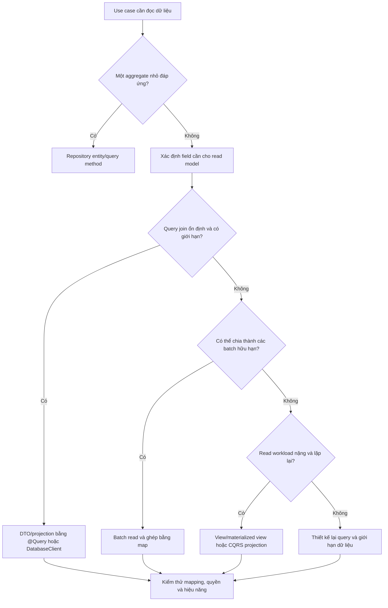

# Chọn mô hình đọc riêng khi đồ thị dữ liệu quá phức tạp

Trong Spring Data R2DBC, mô hình ghi dữ liệu thường được tổ chức quanh aggregate root để bảo vệ ranh giới nhất quán của nghiệp vụ. Tuy nhiên, một màn hình hoặc API đọc có thể cần thông tin từ nhiều aggregate, nhiều bảng và nhiều phép tổng hợp cùng lúc. Nếu cố dùng nguyên entity graph của mô hình ghi cho mọi truy vấn, ứng dụng dễ gặp query phức tạp, đọc thừa dữ liệu, nhiều round trip hoặc cấu trúc object khó bảo trì.

Khi đồ thị dữ liệu phục vụ việc đọc trở nên phức tạp, hãy cân nhắc tạo **read model riêng**: một DTO, projection hoặc cấu trúc dữ liệu được thiết kế theo nhu cầu của từng màn hình/use case. Read model có thể được tạo bằng một câu SQL join, một số truy vấn theo lô, `R2dbcEntityTemplate`, `DatabaseClient`, database view hoặc một projection được cập nhật riêng.

Điều quan trọng là phân biệt mô hình ghi và mô hình đọc. Aggregate vẫn giữ trách nhiệm bảo vệ quy tắc nghiệp vụ khi thay đổi dữ liệu; read model có thể kết hợp thông tin từ nhiều aggregate để trả lời một câu hỏi cụ thể mà không buộc ứng dụng phải tải và ghép toàn bộ object graph domain.

## 1. Vì sao một đồ thị dữ liệu lớn gây khó khăn?

Giả sử hệ thống bán hàng có các nhóm dữ liệu:

```text
Customer
  └── Orders
        └── OrderItems
              └── Product

Order
  ├── Payment
  ├── Shipment
  └── StatusHistory
```

Một trang chi tiết đơn hàng có thể cần:

- Mã đơn hàng, ngày tạo và trạng thái.
- Tên, email và địa chỉ của khách hàng.
- Danh sách sản phẩm, số lượng, đơn giá và thành tiền.
- Tình trạng thanh toán và giao hàng.
- Tổng tiền, số tiền đã thanh toán và thời điểm cập nhật gần nhất.

Những dữ liệu này có thể nằm trong nhiều bảng hoặc aggregate khác nhau. Một entity `Order` không nhất thiết phải chứa mọi thông tin để biểu diễn toàn bộ trang chi tiết.

Nếu xây dựng một object graph lớn rồi tải nó cho mọi API, có thể gặp các vấn đề:

1. **Over-fetching**: query tải nhiều cột hoặc quan hệ mà use case hiện tại không cần.
2. **Nhiều round trip**: service gọi repository lần lượt cho từng quan hệ.
3. **N+1 query**: tải danh sách cha rồi truy vấn con riêng cho từng phần tử.
4. **Mapping khó**: kết quả join có cột trùng tên, quan hệ một-nhiều làm nhân bản hàng.
5. **Coupling**: DTO của API phụ thuộc sâu vào cấu trúc aggregate hoặc entity.
6. **Nhất quán khó hiểu**: nhiều truy vấn chạy ở các thời điểm khác nhau có thể nhìn thấy trạng thái dữ liệu khác nhau.

Read model riêng giúp định nghĩa chính xác dữ liệu cần cho một câu hỏi đọc, thay vì cố biến entity graph thành cấu trúc dùng chung cho mọi tình huống.

## 2. Aggregate trong Spring Data Relational và giới hạn của việc tải quan hệ tự động

Spring Data Relational (bao gồm Spring Data JDBC và Spring Data R2DBC) khuyến khích thiết kế dữ liệu theo aggregate. Aggregate root là điểm vào để thao tác với một nhóm object thuộc cùng ranh giới nhất quán nghiệp vụ.

Ví dụ, `Order` có thể là aggregate root và chứa các `OrderItem` thuộc về đơn hàng. `Customer`, `Product`, `Payment` hoặc `Shipment` có thể là các aggregate độc lập với vòng đời và quy tắc riêng.

Trong mô hình này:

- Aggregate root quản lý các thành phần thuộc aggregate của nó.
- Tham chiếu sang aggregate khác thường được biểu diễn bằng ID hoặc khóa tham chiếu.
- Ranh giới aggregate giúp xác định thao tác nào cần được bảo vệ trong một transaction nghiệp vụ.
- Query đọc có thể kết hợp nhiều aggregate mà không làm thay đổi ranh giới ghi.

### 2.1. Không xem Spring Data R2DBC như JPA/Hibernate

Spring Data R2DBC không cung cấp persistence context kiểu JPA/Hibernate với lazy loading tự động cho các association. Không nên kỳ vọng khai báo một quan hệ trong entity sẽ khiến framework tự tải toàn bộ object graph khi gọi getter.

Ví dụ, nếu `Order` lưu `customerId`, việc đọc một `Order` không tự động tải `Customer`. Ứng dụng cần chủ động truy vấn customer khi use case cần dữ liệu đó.

Tương tự, không nên thiết kế service với giả định rằng đọc một danh sách đơn hàng rồi truy cập `order.getItems()` sẽ tự động phát sinh truy vấn lấy items. Trong Spring Data Relational, hãy xác định rõ dữ liệu nào được đọc và bằng truy vấn nào.

### 2.2. Đọc nhiều aggregate không có nghĩa gộp chúng thành một aggregate

Một trang chi tiết có thể cần dữ liệu từ `Order`, `Customer`, `Payment` và `Shipment`. Đây là nhu cầu đọc. Không vì vậy mà phải đưa tất cả các object vào một aggregate lớn hoặc để một entity sở hữu vòng đời của các entity khác.

Hãy giữ mô hình ghi theo ranh giới nghiệp vụ và tạo read model riêng cho màn hình. Read model có thể kết hợp các dữ liệu liên quan mà không thay đổi cách ghi và bảo vệ tính nhất quán của từng aggregate.

## 3. Read model là gì?

Read model là cấu trúc dữ liệu được thiết kế để trả lời một use case đọc cụ thể. Nó thường là DTO hoặc projection, không nhất thiết là entity được lưu trực tiếp trong database.

Ví dụ API danh sách đơn hàng chỉ cần:

```java
public record OrderListItem(
        Long orderId,
        String orderNumber,
        String customerName,
        String status,
        BigDecimal totalAmount,
        LocalDateTime placedAt
) {
}
```

Read model này có thể được tạo từ `orders`, `customers` và `order_items`. Nó không cần chứa toàn bộ `Customer`, `OrderItem`, `Payment` hay `Shipment` entity.

### 3.1. Read model thường có phạm vi theo use case

Một hệ thống có thể có nhiều read model:

| Use case | Read model có thể dùng |
| --- | --- |
| Danh sách đơn hàng | `OrderListItem` |
| Chi tiết đơn hàng | `OrderDetailView` |
| Dashboard doanh thu | `RevenueSummary` |
| Tìm kiếm khách hàng | `CustomerSearchResult` |
| Theo dõi vận chuyển | `ShipmentTrackingView` |

Không cần tạo một DTO tổng quát chứa mọi field của toàn hệ thống. Mỗi read model nên có tên thể hiện mục đích và chỉ chứa dữ liệu cần cho use case.

### 3.2. Read model không nhất thiết là bảng riêng

Có nhiều cách tạo read model:

- SQL join và projection trực tiếp từ các bảng hiện tại.
- Một số query theo lô rồi ghép kết quả trong service.
- Database view hoặc materialized view.
- Bảng projection được cập nhật bởi event hoặc quy trình đồng bộ.
- Cache có cấu trúc theo use case.

Hãy bắt đầu bằng cách đơn giản nhất đáp ứng yêu cầu latency, tính nhất quán và khả năng vận hành. Không phải mọi read model đều cần CQRS hoặc một database riêng.

## 4. Tạo read model bằng repository `@Query`

Với query có cấu trúc ổn định, repository `@Query` có thể join nhiều bảng và trả trực tiếp DTO/projection.

Giả sử schema:

```sql
CREATE TABLE customers (
    id BIGINT PRIMARY KEY,
    full_name VARCHAR(160) NOT NULL
);

CREATE TABLE orders (
    id BIGINT PRIMARY KEY,
    order_number VARCHAR(40) NOT NULL,
    customer_id BIGINT NOT NULL,
    status VARCHAR(30) NOT NULL,
    placed_at TIMESTAMP NOT NULL
);

CREATE TABLE order_items (
    id BIGINT PRIMARY KEY,
    order_id BIGINT NOT NULL,
    product_name VARCHAR(160) NOT NULL,
    quantity INTEGER NOT NULL,
    unit_price DECIMAL(18, 2) NOT NULL
);
```

Read model danh sách:

```java
public record OrderListItem(
        Long orderId,
        String orderNumber,
        String customerName,
        String status,
        BigDecimal totalAmount,
        LocalDateTime placedAt
) {
}
```

Query:

```java
public interface OrderReadRepository
        extends Repository<Order, Long> {

    @Query("""
           SELECT o.id AS order_id,
                  o.order_number AS order_number,
                  c.full_name AS customer_name,
                  o.status AS status,
                  COALESCE(SUM(i.quantity * i.unit_price), 0) AS total_amount,
                  o.placed_at AS placed_at
           FROM orders o
           JOIN customers c ON c.id = o.customer_id
           LEFT JOIN order_items i ON i.order_id = o.id
           WHERE o.status = :status
           GROUP BY o.id, o.order_number, c.full_name, o.status, o.placed_at
           ORDER BY o.placed_at DESC, o.id DESC
           """)
    Flux<OrderListItem> findOrderList(@Param("status") String status);
}
```

Ví dụ minh họa cách tạo một read model phẳng bằng join và aggregate. Cú pháp alias, cách ánh xạ DTO/record và hỗ trợ projection phụ thuộc phiên bản Spring Data R2DBC. Hãy xác nhận mapping thực tế bằng integration test với phiên bản dự án.

### 4.1. Vì sao dùng `LEFT JOIN` cho items?

`LEFT JOIN` giữ lại đơn hàng ngay cả khi chưa có dòng item. `COALESCE(SUM(...), 0)` chuyển kết quả aggregate null thành số 0 cho trường hợp không có item.

Nếu dùng `INNER JOIN`, đơn hàng không có item sẽ bị loại khỏi kết quả. Chọn loại join theo ý nghĩa nghiệp vụ.

### 4.2. Vì sao phải `GROUP BY`?

Một đơn hàng có thể có nhiều dòng item. Join trực tiếp sẽ tạo một hàng cho mỗi item. Khi muốn một dòng read model cho mỗi đơn hàng, cần aggregate như `SUM` và `GROUP BY` các cột không aggregate.

Với database có quy tắc `GROUP BY` nghiêm ngặt, hãy liệt kê đầy đủ các cột không aggregate. Cú pháp và hỗ trợ alias trong `GROUP BY` có thể khác theo database.

### 4.3. Không trả entity đầy đủ cho một màn hình tổng hợp

`OrderListItem` chỉ mang thông tin màn hình cần. Nó không yêu cầu Spring Data tạo một `Order` có `Customer`, `OrderItem` và `Payment` lồng nhau. Điều này giảm coupling và giúp API phản ánh rõ dữ liệu query.

## 5. Dùng `DatabaseClient` khi cần kiểm soát mapping rõ hơn

Với query phức tạp hoặc khi muốn kiểm soát việc đọc từng cột, `DatabaseClient` cho phép ánh xạ `Row` thành DTO thủ công.

```java
public Flux<OrderListItem> findOrderList(String status) {
    return databaseClient.sql("""
            SELECT o.id AS order_id,
                   o.order_number AS order_number,
                   c.full_name AS customer_name,
                   o.status AS status,
                   COALESCE(SUM(i.quantity * i.unit_price), 0) AS total_amount,
                   o.placed_at AS placed_at
            FROM orders o
            JOIN customers c ON c.id = o.customer_id
            LEFT JOIN order_items i ON i.order_id = o.id
            WHERE o.status = :status
            GROUP BY o.id, o.order_number, c.full_name, o.status, o.placed_at
            ORDER BY o.placed_at DESC, o.id DESC
            """)
            .bind("status", status)
            .map((row, metadata) -> new OrderListItem(
                    row.get("order_id", Long.class),
                    row.get("order_number", String.class),
                    row.get("customer_name", String.class),
                    row.get("status", String.class),
                    row.get("total_amount", BigDecimal.class),
                    row.get("placed_at", LocalDateTime.class)
            ))
            .all();
}
```

Ưu điểm của mapping thủ công:

- Thấy rõ mỗi cột được chuyển sang property nào.
- Dễ xử lý alias, kiểu dữ liệu và cột tính toán.
- Không cần ép kết quả join vào một entity aggregate.
- Có thể kiểm soát cách xử lý null hoặc dữ liệu đặc thù.

Đổi lại, code mapping phải được duy trì khi SQL hoặc DTO thay đổi. Hãy giữ SQL và mapper gần nhau, dùng tên alias rõ ràng và có integration test.

## 6. Đọc theo lô thay vì truy vấn N+1

Không phải mọi read model đều phù hợp với một câu join lớn. Một lựa chọn khác là lấy danh sách ID trước, sau đó tải các dữ liệu liên quan theo lô.

Ví dụ không tốt:

```java
return orderRepository.findRecentOrders()
        .flatMap(order -> customerRepository.findById(order.getCustomerId())
                .map(customer -> toListItem(order, customer)));
```

Nếu có 100 đơn hàng, cách này có thể tạo một query lấy danh sách và thêm khoảng 100 query tìm customer. Đây là vấn đề N+1.

### 6.1. Quy trình batch read

Một cách tiếp cận tốt hơn:

1. Lấy một trang đơn hàng và danh sách `customerId` duy nhất.
2. Tải tất cả customer cần thiết bằng một query theo tập ID.
3. Tạo map `customerId -> CustomerSummary` trong bộ nhớ.
4. Ghép mỗi order với customer summary để tạo read model.

Ví dụ phác thảo:

```java
public Mono<List<OrderListItem>> findRecentPage() {
    return orderRepository.findRecentPage()
            .collectList()
            .flatMap(orders -> {
                if (orders.isEmpty()) {
                    return Mono.just(List.of());
                }

                Set<Long> customerIds = orders.stream()
                        .map(Order::getCustomerId)
                        .collect(Collectors.toSet());

                return customerReadRepository.findByIds(customerIds)
                        .collectMap(CustomerSummary::id)
                        .map(customersById -> orders.stream()
                                .map(order -> toListItem(
                                        order,
                                        customersById.get(order.getCustomerId())))
                                .toList());
            });
}
```

`findByIds` là method minh họa; có thể triển khai bằng `R2dbcEntityTemplate` với tiêu chí `IN`, `DatabaseClient` hoặc query phù hợp với driver/database. Cần xử lý trường hợp customer bị xóa hoặc không còn truy cập được giữa hai bước.

### 6.2. Lợi ích và giới hạn của batch read

Batch read giảm số round trip từ một query cho mỗi order xuống một query cho mỗi nhóm dữ liệu. Nó cũng cho phép giữ query cho từng bảng tương đối đơn giản.

Tuy nhiên, cần giới hạn kích thước trang và số ID trong một batch. Database có giới hạn số bind parameter hoặc kích thước câu lệnh. Với tập ID rất lớn, chia thành nhiều batch nhỏ.

### 6.3. Ghép dữ liệu trong bộ nhớ

Khi ghép kết quả, nên tạo map theo khóa để tránh tìm kiếm tuyến tính cho từng order. Cần xử lý rõ trường hợp thiếu dữ liệu liên quan, quyền truy cập và giá trị null.

Không nên dùng `collectList()` cho một tập kết quả không giới hạn. Batch read phù hợp với trang có kích thước hữu hạn hoặc một nhóm ID được giới hạn rõ ràng.

## 7. Xử lý quan hệ một-nhiều trong read model

Một trang chi tiết đơn hàng thường cần danh sách item. Join order với order_items tạo nhiều hàng cho cùng một order. Có hai cách phổ biến:

- Trả một DTO phẳng cho từng dòng kết quả nếu API cũng cần dữ liệu dạng dòng.
- Gom các dòng theo order ID thành một DTO lồng nhau nếu API cần một đơn hàng với danh sách item.

### 7.1. DTO cho từng dòng join

```java
public record OrderItemRow(
        Long orderId,
        String orderNumber,
        String customerName,
        Long itemId,
        String productName,
        Integer quantity,
        BigDecimal unitPrice
) {
}
```

SQL:

```sql
SELECT o.id AS order_id,
       o.order_number AS order_number,
       c.full_name AS customer_name,
       i.id AS item_id,
       i.product_name AS product_name,
       i.quantity AS quantity,
       i.unit_price AS unit_price
FROM orders o
JOIN customers c ON c.id = o.customer_id
LEFT JOIN order_items i ON i.order_id = o.id
WHERE o.id = :orderId
ORDER BY i.id;
```

### 7.2. Gom các dòng thành DTO lồng nhau

DTO đích:

```java
public record OrderItemView(
        Long itemId,
        String productName,
        Integer quantity,
        BigDecimal unitPrice
) {
}

public record OrderDetailView(
        Long orderId,
        String orderNumber,
        String customerName,
        List<OrderItemView> items
) {
}
```

Nếu query sắp xếp theo `order_id`, có thể gom các hàng liên tiếp theo order bằng `bufferUntilChanged`:

```java
return orderItemRowFlux
        .bufferUntilChanged(OrderItemRow::orderId)
        .map(rows -> {
            OrderItemRow first = rows.get(0);

            List<OrderItemView> items = rows.stream()
                    .filter(row -> row.itemId() != null)
                    .map(row -> new OrderItemView(
                            row.itemId(),
                            row.productName(),
                            row.quantity(),
                            row.unitPrice()))
                    .toList();

            return new OrderDetailView(
                    first.orderId(),
                    first.orderNumber(),
                    first.customerName(),
                    items);
        });
```

Query phải có `ORDER BY o.id` để các hàng của cùng order nằm liên tiếp. Với một order không có item, `LEFT JOIN` tạo hàng có `item_id` null; đoạn code loại hàng đó khỏi danh sách items.

`bufferUntilChanged` chỉ giữ nhóm hiện tại, nhưng nhóm lớn vẫn chiếm bộ nhớ. Nếu query trả dữ liệu của rất nhiều order hoặc mỗi order có hàng triệu item, cần phân trang hoặc đọc theo từng order/batch thay vì gom toàn bộ.

## 8. Chọn một query join hay nhiều query theo lô?

Không có một cách luôn tốt hơn. Quyết định phụ thuộc kích thước dữ liệu, độ phức tạp join, số round trip, tính nhất quán và khả năng tối ưu của database.

| Tiêu chí | Một query join | Nhiều query theo lô |
| --- | --- | --- |
| Round trip | Thường ít hơn | Nhiều hơn nhưng được giới hạn theo nhóm |
| Mapping | Có thể phức tạp khi quan hệ một-nhiều | Mỗi kết quả thường dễ ánh xạ hơn |
| Dữ liệu lặp | Có thể lặp cột của entity cha trên mỗi hàng con | Có thể tránh lặp dữ liệu cha |
| Tối ưu SQL | Database xử lý join và aggregate | Service ghép kết quả sau khi đọc |
| Kích thước kết quả | Có thể tăng mạnh do row multiplication | Có thể kiểm soát theo từng batch |
| Tính nhất quán | Một statement thường có snapshot theo semantics database | Nhiều statement có thể nhìn thấy dữ liệu ở các thời điểm khác nhau |
| Phù hợp | Join/aggregate rõ ràng, tập dữ liệu có giới hạn | Quan hệ phức tạp, cần query riêng cho từng loại dữ liệu |

Hãy đo bằng dữ liệu gần với production. Một query join có thể hiệu quả hơn nhiều query; ngược lại, join quá lớn với nhiều nhánh một-nhiều có thể tạo hàng trung gian rất lớn và tốn tài nguyên.

## 9. Phân trang read model

Read model danh sách nên có giới hạn. Tránh trả toàn bộ dữ liệu của một bảng lớn qua một `Flux` chỉ vì API reactive có thể phát nhiều phần tử.

Ví dụ phân trang theo offset:

```sql
SELECT o.id, o.order_number, c.full_name AS customer_name, o.status
FROM orders o
JOIN customers c ON c.id = o.customer_id
WHERE o.status = :status
ORDER BY o.placed_at DESC, o.id DESC
LIMIT :limit OFFSET :offset;
```

`ORDER BY` cần có thứ tự ổn định. Thêm khóa duy nhất như `o.id` làm tiêu chí cuối để tránh thứ tự không xác định giữa các hàng có cùng `placed_at`.

### 9.1. Offset pagination

Offset pagination đơn giản cho giao diện có số trang, nhưng database có thể phải bỏ qua nhiều hàng khi offset lớn. Dữ liệu thay đổi giữa các lần đọc cũng có thể làm bản ghi lặp hoặc bị bỏ qua giữa các trang.

### 9.2. Keyset pagination

Với danh sách lớn, keyset pagination dùng giá trị cuối trang trước làm cursor:

```sql
SELECT o.id, o.order_number, c.full_name AS customer_name, o.status,
       o.placed_at
FROM orders o
JOIN customers c ON c.id = o.customer_id
WHERE o.status = :status
  AND (o.placed_at, o.id) < (:lastPlacedAt, :lastId)
ORDER BY o.placed_at DESC, o.id DESC
LIMIT :limit;
```

Cú pháp so sánh tuple ở trên được hỗ trợ bởi một số database nhưng không phải tất cả. Nếu database không hỗ trợ, diễn đạt điều kiện cursor bằng các nhánh tương đương:

```sql
AND (
    o.placed_at < :lastPlacedAt
    OR (o.placed_at = :lastPlacedAt AND o.id < :lastId)
)
```

Cursor cần chứa đủ các giá trị sắp xếp để xác định vị trí tiếp theo. Hãy validate cursor và giới hạn `limit` ở server.

## 10. Read model từ database view hoặc materialized view

Khi một query join/aggregate được dùng thường xuyên và có chi phí cao, có thể cân nhắc database view hoặc materialized view.

### 10.1. Database view

View lưu định nghĩa query ở database. Ứng dụng có thể truy vấn view như một nguồn dữ liệu đọc:

```sql
CREATE VIEW order_list_view AS
SELECT o.id AS order_id,
       o.order_number,
       c.full_name AS customer_name,
       o.status,
       COALESCE(SUM(i.quantity * i.unit_price), 0) AS total_amount,
       o.placed_at
FROM orders o
JOIN customers c ON c.id = o.customer_id
LEFT JOIN order_items i ON i.order_id = o.id
GROUP BY o.id, o.order_number, c.full_name, o.status, o.placed_at;
```

Repository có thể đọc view qua query hoặc một mapping type chuyên biệt. View thông thường tính kết quả khi truy vấn; nó không nhất thiết lưu sẵn kết quả.

### 10.2. Materialized view

Materialized view lưu kết quả đã tính trước theo cơ chế database hỗ trợ. Việc đọc có thể nhanh hơn, nhưng dữ liệu cần được refresh theo lịch hoặc cơ chế tương ứng. Vì vậy, có thể có độ trễ giữa dữ liệu nguồn và read model.

Hãy cân nhắc:

- Tần suất cập nhật dữ liệu nguồn.
- Độ trễ dữ liệu mà nghiệp vụ chấp nhận.
- Chi phí refresh và khóa/ảnh hưởng lên database.
- Cách xử lý khi refresh thất bại.
- Khả năng index và phân trang trên view.

Không phải database nào cũng hỗ trợ materialized view với cùng semantics. Chọn cơ chế theo database thực tế.

## 11. CQRS và read model được cập nhật riêng

Khi nhu cầu đọc và ghi khác nhau đáng kể, có thể áp dụng CQRS (Command Query Responsibility Segregation):

- **Write model** tiếp nhận command và bảo vệ quy tắc nghiệp vụ trong aggregate.
- **Read model** phục vụ query bằng cấu trúc phù hợp cho màn hình, báo cáo hoặc tìm kiếm.

Read model có thể được cập nhật từ domain event, outbox event hoặc luồng đồng bộ. Ví dụ khi đơn hàng được tạo, hệ thống phát sự kiện `OrderCreated`; một projection handler cập nhật bảng `order_list_projection` với thông tin đơn hàng và khách hàng cần cho trang danh sách.

```text
Command API
    |
    v
Write model / Aggregate
    |
    v
Database transaction + Outbox
    |
    v
Event publisher
    |
    v
Projection handler
    |
    v
Read model table
    |
    v
Query API
```

### 11.1. Khi nào cần CQRS?

CQRS đáng cân nhắc khi:

- Query có nhiều join/aggregate và được gọi với tần suất cao.
- Cấu trúc dữ liệu phục vụ đọc khác rõ rệt với mô hình ghi.
- Có thể chấp nhận eventual consistency ở một số màn hình.
- Cần tối ưu read workload độc lập với write workload.
- Có nhiều loại projection phục vụ nhiều nhóm truy vấn khác nhau.

Không nên áp dụng CQRS chỉ để tạo thêm lớp code. Với một query join đơn giản hoặc một DTO, repository `@Query` hay `DatabaseClient` thường đủ.

### 11.2. Eventual consistency

Nếu read model được cập nhật bất đồng bộ từ event, dữ liệu có thể chậm hơn write model trong một khoảng thời gian. Sau khi command thành công, query ngay lập tức có thể chưa thấy projection mới.

Ứng dụng cần xác định rõ:

- Màn hình nào chấp nhận dữ liệu trễ.
- Màn hình nào cần đọc dữ liệu vừa ghi ngay lập tức.
- Có cần trả version/event ID để client theo dõi projection đã cập nhật đến đâu không.
- Cách retry và xử lý event trùng lặp.
- Cách rebuild projection khi schema hoặc logic đọc thay đổi.

Với thao tác cần xác nhận ngay dữ liệu vừa ghi, có thể trả kết quả command trực tiếp, đọc từ write model hoặc thiết kế read-your-writes phù hợp. Không giả định projection bất đồng bộ luôn cập nhật ngay lập tức.

### 11.3. Idempotency và thứ tự sự kiện

Projection handler nên xử lý event lặp lại an toàn. Có thể lưu event ID đã xử lý, dùng upsert theo khóa projection hoặc thiết kế phép cập nhật idempotent.

Nếu event có thứ tự quan trọng, hãy kiểm soát version/sequence của aggregate. Một event cũ đến sau không nên ghi đè trạng thái mới hơn trong read model.

## 12. Nhất quán khi ghép nhiều truy vấn

Khi read model được ghép từ nhiều query, dữ liệu có thể thay đổi giữa các query. Ví dụ:

1. Query đầu đọc order với `status = 'PAID'`.
2. Một transaction khác cập nhật order sang `CANCELLED`.
3. Query tiếp theo đọc payment hoặc shipment sau thay đổi.

Kết quả ghép có thể phản ánh các thời điểm khác nhau.

Nếu yêu cầu cần một snapshot nhất quán, hãy xem xét chạy các query trong cùng reactive transaction với isolation level phù hợp. Khả năng snapshot và mức cô lập thực tế phụ thuộc database. Một transaction `READ COMMITTED` có thể cho phép các statement liên tiếp nhìn thấy commit mới giữa các lần đọc; `REPEATABLE READ` hoặc snapshot isolation có semantics khác nhau tùy hệ quản trị.

Nếu dữ liệu đọc có thể chấp nhận độ trễ, có thể dùng projection bất đồng bộ và thể hiện rõ tính eventual consistency trong hợp đồng API.

## 13. Chọn mô hình đọc theo mức độ phức tạp

| Mức độ nhu cầu | Cách tiếp cận nên cân nhắc |
| --- | --- |
| Đọc một entity hoặc một aggregate nhỏ | Repository `findById`, query method |
| Đọc vài cột cho một màn hình | DTO/projection |
| Join ổn định giữa một số bảng | Repository `@Query` hoặc `DatabaseClient` |
| Điều kiện và tập cột thay đổi theo runtime | `R2dbcEntityTemplate` hoặc `DatabaseClient` |
| Quan hệ một-nhiều cần gom thành DTO lồng nhau | Join phẳng rồi group, hoặc batch read |
| Nhiều query liên quan nhưng có giới hạn ID | Batch read và ghép bằng map |
| Query aggregate nặng được dùng lặp lại | View/materialized view sau khi đo hiệu năng |
| Nhiều read workload khác write model và chấp nhận trễ | CQRS/read projection riêng |

Đừng chọn mô hình phức tạp hơn nhu cầu. Một DTO cho một endpoint không đồng nghĩa phải có một bảng projection hoặc một service đồng bộ event.

## 14. Những lỗi thường gặp khi thiết kế read model

| Triệu chứng | Nguyên nhân có thể | Cách xử lý |
| --- | --- | --- |
| Một API phát sinh rất nhiều query | Truy vấn từng quan hệ cho mỗi entity, tạo N+1 | Join hoặc batch read theo tập ID |
| DTO có quá nhiều field không dùng | Dùng entity graph chung cho mọi màn hình | Tạo read model theo use case |
| Join trả nhiều bản sao của entity cha | Quan hệ một-nhiều làm nhân số hàng | Aggregate/group theo khóa cha hoặc query theo lô |
| Mapping nhầm cột | Join có tên cột trùng hoặc alias không rõ | Alias duy nhất và DTO phẳng |
| Query quá nặng | Join nhiều nhánh một-nhiều hoặc aggregate trên tập lớn | Đo execution plan, chia query, index hoặc projection |
| Trang đọc thiếu dữ liệu mới ghi | Read model bất đồng bộ chưa cập nhật | Xác định eventual consistency và read-your-writes |
| Kết quả ghép không nhất quán | Nhiều query chạy ở snapshot khác nhau | Transaction/isolation phù hợp hoặc projection có version |
| Bộ nhớ tăng mạnh | `collectList()` hoặc group toàn bộ kết quả không giới hạn | Phân trang, batch nhỏ và giới hạn kích thước nhóm |
| Projection cũ sau thay đổi schema | Không version hóa/rebuild read model | Migration và quy trình rebuild projection |

## 15. Đo lường trước khi tách read model

Trước khi tạo một cấu trúc đọc riêng, hãy đo vấn đề hiện tại:

- Số query được thực hiện cho một request.
- Tổng round trip và thời gian chờ database.
- Số hàng và số cột được đọc.
- Kích thước dữ liệu trung gian sau join.
- Latency p50, p95 và p99.
- CPU, memory, connection pool và tải database.
- Tỷ lệ cache hit nếu có cache.
- Mức độ trễ dữ liệu cho phép của use case.

Sau khi có read model mới, chạy cùng workload và so sánh. Đừng chỉ đo thời gian query riêng lẻ; cần đo cả thời gian mapping, ghép dữ liệu, serialize response và tổng latency API.

## 16. Ví dụ thiết kế API danh sách và chi tiết đơn hàng

Một cách tổ chức hợp lý có thể là:

```text
order/
  domain/
    Order.java
    OrderItem.java
  write/
    OrderRepository.java
    OrderCommandService.java
  read/
    OrderListItem.java
    OrderDetailView.java
    OrderReadRepository.java
    OrderQueryService.java
```

Write side:

```java
public interface OrderRepository
        extends ReactiveCrudRepository<Order, Long> {
}
```

Read side:

```java
public interface OrderReadRepository {

    Flux<OrderListItem> findRecentOrders(
            Long tenantId,
            int limit);

    Mono<OrderDetailView> findDetail(
            Long tenantId,
            Long orderId);
}
```

Query service:

```java
@Service
public class OrderQueryService {

    private final OrderReadRepository readRepository;

    public OrderQueryService(OrderReadRepository readRepository) {
        this.readRepository = readRepository;
    }

    public Flux<OrderListItem> recentOrders(Long tenantId, int limit) {
        int safeLimit = Math.max(1, Math.min(limit, 100));
        return readRepository.findRecentOrders(tenantId, safeLimit);
    }

    public Mono<OrderDetailView> detail(Long tenantId, Long orderId) {
        return readRepository.findDetail(tenantId, orderId);
    }
}
```

Các interface query ở trên minh họa cách tách trách nhiệm. Implementation có thể dùng `@Query`, `DatabaseClient`, `R2dbcEntityTemplate` hoặc view. Giới hạn page size ở service giúp bảo vệ database và bộ nhớ khi client gửi limit quá lớn.

## 17. Kiểm thử read model

Read model cần integration test với database vì join, aggregate, alias, kiểu dữ liệu và semantics của SQL phụ thuộc database thật.

Các trường hợp nên kiểm tra:

1. Đơn hàng có một item và nhiều item.
2. Đơn hàng không có item khi query dùng `LEFT JOIN`.
3. Khách hàng không tồn tại hoặc quan hệ bị thiếu theo dữ liệu legacy.
4. Nhiều đơn hàng có cùng timestamp và phân trang ổn định.
5. Tenant khác không thể đọc dữ liệu ngoài phạm vi.
6. Aggregate total đúng với quantity và unit price.
7. Query không trả cột dư hoặc alias trùng gây mapping nhầm.
8. Batch read xử lý ID trùng và ID không còn tồn tại.
9. Transaction/isolation đáp ứng yêu cầu snapshot khi ghép nhiều query.
10. Projection được rebuild hoặc cập nhật đúng khi event lặp và event đến sai thứ tự.

Ví dụ test reactive với `StepVerifier`:

```java
@DataR2dbcTest
class OrderReadRepositoryTest {

    @Autowired
    OrderReadRepository repository;

    @Test
    void shouldReturnOrderListWithCustomerAndTotal() {
        StepVerifier.create(repository.findRecentOrders(10L, 20))
                .assertNext(item -> {
                    assertThat(item.orderNumber()).isEqualTo("ORD-001");
                    assertThat(item.customerName()).isEqualTo("Lan Nguyen");
                    assertThat(item.totalAmount())
                            .isEqualByComparingTo("250.00");
                })
                .verifyComplete();
    }
}
```

Test cần chuẩn bị fixture với dữ liệu và số lượng item xác định. Nếu read model dùng projection hoặc custom repository implementation, cấu hình test phải nạp đúng bean và database tương ứng.

## 18. Quy trình chọn read model riêng

1. Xác định câu hỏi đọc mà endpoint hoặc màn hình cần trả lời.
2. Liệt kê dữ liệu và aggregate nguồn, không bắt đầu bằng việc tải toàn bộ entity graph.
3. Xác định kích thước dữ liệu, cardinality của quan hệ và yêu cầu phân trang.
4. Chọn DTO/projection có đúng các field cần trả.
5. Chọn một query join, batch read, view hoặc projection riêng dựa trên số liệu và yêu cầu nhất quán.
6. Alias rõ ràng cho cột join và ánh xạ kết quả vào read model.
7. Đưa tenant, quyền truy cập và trạng thái vào predicate của query.
8. Giới hạn kích thước kết quả và tránh N+1.
9. Xác định độ nhất quán cần có khi ghép nhiều query hoặc dùng projection bất đồng bộ.
10. Viết integration test và đo latency, số query, bộ nhớ trên workload gần production.

## 19. Luồng quyết định tổng quát



## 20. Kết luận

Khi đồ thị dữ liệu phục vụ đọc trở nên phức tạp, hãy thiết kế read model theo use case thay vì buộc entity graph của mô hình ghi phải phục vụ mọi màn hình. Spring Data R2DBC không tự lazy-load các quan hệ như JPA/Hibernate; ứng dụng cần chủ động chọn dữ liệu bằng repository query, `@Query`, `DatabaseClient`, `R2dbcEntityTemplate` hoặc một projection riêng.

Với query join ổn định, DTO/projection thường là lựa chọn rõ ràng. Với nhiều quan hệ cần đọc, batch read giúp tránh N+1. Với workload đọc nặng và lặp lại, view, materialized view hoặc CQRS projection có thể phù hợp nếu chấp nhận và quản lý được độ trễ dữ liệu. Hãy giữ aggregate ghi theo ranh giới nghiệp vụ, giới hạn kích thước kết quả, kiểm tra nhất quán khi ghép nhiều query và đo hiệu năng trên workload thực tế trước khi tăng độ phức tạp kiến trúc.
