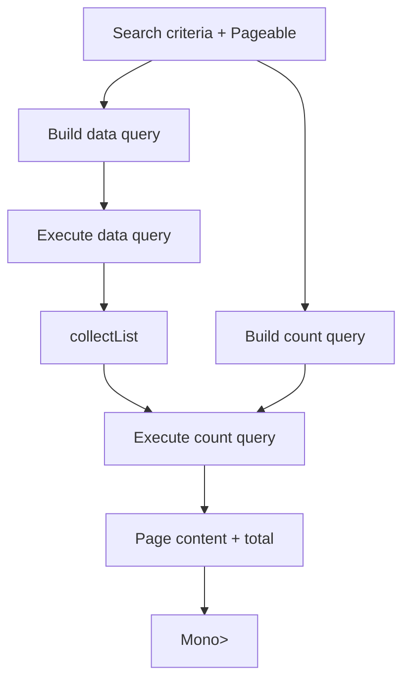

# Tách truy vấn lấy dữ liệu với truy vấn đếm tổng

Trong phân trang, ứng dụng thường cần hai kết quả khác nhau: danh sách bản ghi của trang hiện tại và tổng số bản ghi thỏa điều kiện tìm kiếm. Hai kết quả này có liên quan nhưng phục vụ mục đích khác nhau. Truy vấn lấy dữ liệu trả về các hàng cần hiển thị; truy vấn đếm tổng trả về một con số để tính tổng số trang, kiểm tra trang cuối và hiển thị số lượng kết quả.

Trong Spring Data Relational R2DBC, hai truy vấn thường được thực hiện riêng vì ứng dụng làm việc theo mô hình reactive. Việc lấy dữ liệu có thể trả về `Flux<T>`, còn truy vấn đếm trả về `Mono<Long>`. Khi giao diện cần tổng số chính xác, ứng dụng kết hợp hai publisher để tạo một `Mono<Page<T>>` hoặc một đối tượng kết quả tương đương.

Tách hai truy vấn giúp tối ưu từng phần: câu lấy dữ liệu tập trung vào thứ tự, projection và giới hạn trang; câu đếm chỉ tính số hàng phù hợp với bộ lọc. Tuy nhiên, hai câu lệnh phải diễn đạt cùng một tập dữ liệu logic. Nếu điều kiện lọc giữa chúng khác nhau, metadata phân trang sẽ không chính xác.

## 1. Vì sao cần cả truy vấn dữ liệu và truy vấn đếm?

Giả sử màn hình quản lý đơn hàng hiển thị 20 đơn mỗi trang. Người dùng lọc theo khách hàng và trạng thái. Để hiển thị “Trang 2 trên 8 — 153 đơn hàng”, ứng dụng cần:

- Các hàng thuộc trang hiện tại, đã sắp xếp và giới hạn theo kích thước trang.
- Tổng số hàng thỏa bộ lọc, không bị giới hạn bởi trang hiện tại.

Truy vấn lấy dữ liệu có thể là:

```sql
SELECT id, customer_id, status, created_at, total
FROM orders
WHERE customer_id = :customerId
  AND status = :status
ORDER BY created_at DESC, id DESC
LIMIT :limit OFFSET :offset;
```

Truy vấn đếm tương ứng:

```sql
SELECT COUNT(*) AS total_count
FROM orders
WHERE customer_id = :customerId
  AND status = :status;
```

Điểm khác biệt chính:

| Thành phần | Truy vấn lấy dữ liệu | Truy vấn đếm |
| --- | --- | --- |
| Mục đích | Trả về các hàng của trang hiện tại. | Đếm toàn bộ hàng thỏa bộ lọc. |
| Projection | Các cột cần hiển thị hoặc ánh xạ entity. | Một giá trị số. |
| ORDER BY | Thường cần để thứ tự trang ổn định. | Thường không cần. |
| LIMIT/OFFSET | Có để giới hạn trang. | Không có, vì phải đếm toàn bộ tập phù hợp. |
| JOIN | Chỉ giữ join cần cho dữ liệu hoặc bộ lọc. | Có thể bỏ join không cần thiết, nhưng phải giữ đúng semantics. |
| Kiểu kết quả reactive | Thường là `Flux<T>`. | Thường là `Mono<Long>`. |

Không được thêm `LIMIT` hoặc `OFFSET` vào truy vấn đếm nếu mục tiêu là tổng số kết quả. Câu `COUNT(*)` phải đếm tập bản ghi logic trước khi phân trang.

## 2. Phân biệt tổng số bản ghi và số bản ghi trong trang

Có ba con số thường xuất hiện khi phân trang:

- **Total elements:** tổng số hàng thỏa bộ lọc.
- **Page size:** số hàng tối đa ứng dụng muốn lấy cho mỗi trang.
- **Number of elements:** số hàng thực tế có trong trang hiện tại.

Ví dụ tổng cộng 153 đơn hàng, page size là 20, trang cuối có 13 hàng:

| Thuộc tính | Giá trị |
| --- | ---: |
| Total elements | 153 |
| Page size | 20 |
| Tổng số trang | 8 |
| Số hàng trang cuối | 13 |

Tổng số trang thường được tính như sau:

```java
long totalPages = (totalElements + pageSize - 1) / pageSize;
```

Hoặc dùng `Math.ceil` sau khi chuyển sang số thực, nhưng phép tính số nguyên ở trên tránh sai số dấu phẩy động. Cần xử lý `pageSize` phải lớn hơn 0.

Số hàng của trang hiện tại không thể thay thế tổng số hàng. Nếu trang đầu trả về 20 bản ghi, điều đó không có nghĩa tập kết quả chỉ có 20 bản ghi. Truy vấn đếm riêng cung cấp tổng số cần thiết.

## 3. Ngữ nghĩa của truy vấn đếm phải khớp truy vấn lấy dữ liệu

Nguyên tắc quan trọng nhất là hai truy vấn phải dùng cùng điều kiện lọc theo nghiệp vụ.

Ví dụ truy vấn dữ liệu lọc đơn hàng theo khách hàng, trạng thái và khoảng thời gian:

```sql
SELECT id, customer_id, status, created_at, total
FROM orders
WHERE customer_id = :customerId
  AND status IN (:statuses)
  AND created_at >= :from
  AND created_at < :to
ORDER BY created_at DESC, id DESC
LIMIT :limit OFFSET :offset;
```

Truy vấn đếm phải áp dụng cùng bộ lọc:

```sql
SELECT COUNT(*) AS total_count
FROM orders
WHERE customer_id = :customerId
  AND status IN (:statuses)
  AND created_at >= :from
  AND created_at < :to;
```

Hai câu lệnh có thể khác projection, ORDER BY và giới hạn trang. Nhưng chúng không được khác điều kiện xác định tập kết quả.

Nếu truy vấn dữ liệu có thêm điều kiện `deleted_at IS NULL` mà truy vấn đếm quên điều kiện này, tổng số trang sẽ bao gồm cả bản ghi đã xóa mềm. Người dùng có thể thấy trang cuối trống hoặc tổng số trang lớn hơn số trang thực tế.

Một cách tốt là mô tả bộ lọc một lần ở tầng ứng dụng rồi dùng cùng một đối tượng criteria để bind cho cả hai câu SQL. Nếu phải viết lại phần WHERE trong hai chuỗi SQL, cần có kiểm thử để phát hiện trường hợp một bên bị thiếu điều kiện.

## 4. Tách ORDER BY, LIMIT và OFFSET khỏi truy vấn đếm

Truy vấn đếm thường không cần thứ tự sắp xếp vì thứ tự không ảnh hưởng đến số lượng hàng.

```sql
-- Data query
SELECT id, status, created_at
FROM orders
WHERE customer_id = :customerId
ORDER BY created_at DESC, id DESC
LIMIT :limit OFFSET :offset;

-- Count query
SELECT COUNT(*) AS total_count
FROM orders
WHERE customer_id = :customerId;
```

Giữ `ORDER BY` trong count query thường không đem lại lợi ích và có thể làm truy vấn tốn thêm công việc. Tương tự, không đưa `LIMIT` và `OFFSET` vào count query.

Trong một số truy vấn, `ORDER BY` nằm bên trong subquery vì nó ảnh hưởng đến phép chọn dữ liệu, chẳng hạn truy vấn dùng window function hoặc `FETCH FIRST` để lấy một hàng cho mỗi nhóm. Khi đó, không thể xóa máy móc mọi ORDER BY khỏi count query. Hãy đếm đúng kết quả logic của truy vấn dữ liệu.

## 5. Đếm đúng khi truy vấn có JOIN

Khi truy vấn lấy dữ liệu dùng JOIN, một bản ghi gốc có thể xuất hiện nhiều lần trong tập kết quả trung gian. Điều này thường xảy ra với quan hệ một-nhiều hoặc nhiều-nhiều.

Ví dụ, một sản phẩm có nhiều tag. Truy vấn join sản phẩm với bảng liên kết tag có thể tạo nhiều hàng cho cùng một sản phẩm:

```sql
SELECT p.id, p.name
FROM products p
JOIN product_tags pt ON pt.product_id = p.id
WHERE pt.tag_id IN (:tagIds);
```

Nếu một sản phẩm khớp với hai tag trong danh sách, nó có thể xuất hiện hai lần. Nếu giao diện hiển thị mỗi sản phẩm một lần, data query cần dùng DISTINCT hoặc cấu trúc truy vấn khác để loại trùng:

```sql
SELECT DISTINCT p.id, p.name
FROM products p
JOIN product_tags pt ON pt.product_id = p.id
WHERE pt.tag_id IN (:tagIds)
ORDER BY p.name, p.id
LIMIT :limit OFFSET :offset;
```

Count query phải đếm cùng đơn vị kết quả:

```sql
SELECT COUNT(DISTINCT p.id) AS total_count
FROM products p
JOIN product_tags pt ON pt.product_id = p.id
WHERE pt.tag_id IN (:tagIds);
```

Dùng COUNT(*) trong trường hợp này sẽ đếm số hàng sau JOIN, không phải số sản phẩm duy nhất. Tổng số trang có thể lớn hơn số sản phẩm thực tế.

### Dùng EXISTS để tránh nhân bản hàng

Nếu JOIN chỉ được dùng để kiểm tra một quan hệ có tồn tại, EXISTS có thể biểu diễn ý định trực tiếp hơn:

```sql
SELECT p.id, p.name
FROM products p
WHERE EXISTS (
    SELECT 1
    FROM product_tags pt
    WHERE pt.product_id = p.id
      AND pt.tag_id IN (:tagIds)
)
ORDER BY p.name, p.id
LIMIT :limit OFFSET :offset;
```

Count query tương ứng:

```sql
SELECT COUNT(*) AS total_count
FROM products p
WHERE EXISTS (
    SELECT 1
    FROM product_tags pt
    WHERE pt.product_id = p.id
      AND pt.tag_id IN (:tagIds)
);
```

Vì truy vấn ngoài vẫn có một hàng cho mỗi sản phẩm, COUNT(*) đếm đúng sản phẩm. EXISTS không phải lúc nào cũng nhanh hơn JOIN; hãy xem query plan và index thực tế.

### Giữ nguyên điều kiện lọc đặt trong ON và WHERE

Với LEFT JOIN, vị trí đặt điều kiện có thể thay đổi kết quả. Điều kiện ở ON có thể giữ lại hàng bên trái không có hàng khớp; điều kiện ở WHERE có thể loại chúng sau khi JOIN.

Ví dụ:

```sql
SELECT p.id, r.rating
FROM products p
LEFT JOIN reviews r
  ON r.product_id = p.id
 AND r.approved = TRUE;
```

Sản phẩm chưa có review đã duyệt vẫn xuất hiện. Nếu chuyển r.approved = TRUE xuống WHERE, các hàng không có review có thể bị loại. Count query phải giữ cùng semantics của JOIN và điều kiện, nếu không tổng số sẽ không tương ứng với danh sách.

## 6. Đếm kết quả GROUP BY và HAVING

Khi data query trả về các nhóm tổng hợp, đơn vị cần đếm là số nhóm được trả về, không phải số hàng nguồn.

Ví dụ báo cáo số đơn và tổng tiền theo từng khách hàng:

```sql
SELECT
    customer_id,
    COUNT(*) AS order_count,
    SUM(total) AS total_amount
FROM orders
WHERE created_at >= :from
  AND created_at < :to
GROUP BY customer_id
HAVING SUM(total) >= :minimumTotal
ORDER BY total_amount DESC
LIMIT :limit OFFSET :offset;
```

Truy vấn đếm cần đếm số nhóm thỏa HAVING. Không thể chỉ đếm hàng trong bảng orders:

```sql
SELECT COUNT(*) AS total_count
FROM (
    SELECT customer_id
    FROM orders
    WHERE created_at >= :from
      AND created_at < :to
    GROUP BY customer_id
    HAVING SUM(total) >= :minimumTotal
) grouped_customers;
```

Subquery tạo ra đúng tập nhóm mà data query sẽ trả về; câu bên ngoài đếm số hàng trong tập đó. Tên và cấu trúc subquery có thể được điều chỉnh, nhưng phải giữ điều kiện lọc, GROUP BY và HAVING tương ứng.

Nếu truy vấn có DISTINCT, window function hoặc phép chọn top-N theo nhóm, hãy xác định chính xác đơn vị kết quả trước khi viết count query. Đôi khi count cần bọc toàn bộ phần tạo kết quả logic trong một subquery. Không thể luôn thay SELECT projection bằng COUNT(*) rồi bỏ các phần còn lại.

## 7. COUNT(*), COUNT(column) và COUNT(DISTINCT ...)

Các biểu thức đếm không có cùng semantics:

| Biểu thức | Đếm gì |
| --- | --- |
| COUNT(*) | Mọi hàng trong tập kết quả, kể cả hàng có cột NULL. |
| COUNT(column) | Hàng mà biểu thức column không NULL. |
| COUNT(DISTINCT column) | Số giá trị khác nhau và không NULL của column. |
| COUNT(DISTINCT a, b) | Cú pháp đếm tổ hợp cột khác nhau phụ thuộc database; không nên giả định portable. |

Đối với count query phân trang thông thường, COUNT(*) là lựa chọn tự nhiên nếu mỗi hàng của tập kết quả tương ứng đúng một mục hiển thị.

Dùng COUNT(column) khi nghiệp vụ thực sự muốn đếm số giá trị hiện diện trong cột đó. Nếu cột có thể NULL, kết quả có thể thấp hơn số hàng.

Dùng COUNT(DISTINCT id) khi JOIN tạo nhiều hàng cho một entity nhưng màn hình hiển thị mỗi entity một lần. Với nhiều cột tạo thành khóa nhóm, cân nhắc bọc truy vấn nhóm trong subquery thay vì dựa vào cú pháp multi-column distinct riêng của vendor.

## 8. Kết hợp hai truy vấn trong reactive flow

Một cách triển khai phổ biến là thực thi data query và count query thành hai publisher, sau đó kết hợp kết quả.

- Data query trả Flux<T>; dùng collectList() để gom các hàng của một trang thành Mono<List<T>>.
- Count query trả Mono<Long>.
- Có thể kết hợp hai publisher bằng Mono.zip hoặc flatMap tuần tự, rồi tạo metadata trang.

Mono.zip subscribe cả hai publisher và có thể khiến hai câu SQL chạy đồng thời. Cách này phù hợp khi mỗi truy vấn có thể dùng kết nối độc lập và không bị ràng buộc vào cùng một connection trong transaction. Nếu hai câu lệnh dùng chung một connection theo reactive transaction context, nên thực thi tuần tự bằng flatMap trừ khi driver/database xác nhận hỗ trợ nhiều statement đồng thời trên connection đó.

Sơ đồ luồng:



Page<T> chứa nội dung trang, thông tin Pageable và tổng số phần tử. Bản thân PageImpl là một đối tượng metadata đồng bộ; đặt nó trong Mono giúp việc tạo page chỉ diễn ra sau khi cả truy vấn dữ liệu và truy vấn đếm hoàn tất.

Trong reactive repository, không nên mặc định rằng mọi phương thức có thể trả Page<T> giống repository blocking. Cách hỗ trợ return type và pagination phụ thuộc API/phiên bản Spring Data. Khi cần tổng số chính xác, một custom repository method trả Mono<Page<T>> và tự kết hợp hai truy vấn là cách triển khai minh bạch.

### Ví dụ với DatabaseClient

Giả sử màn hình tìm sản phẩm theo trạng thái và khoảng giá. Data query dùng cú pháp LIMIT/OFFSET phổ biến ở PostgreSQL và MySQL:

```java
private static final String DATA_SQL = """
    SELECT p.id, p.name, p.status, p.price
    FROM products p
    WHERE p.status = :status
      AND p.price >= :minimum
      AND p.price <= :maximum
    ORDER BY p.created_at DESC, p.id DESC
    LIMIT :limit OFFSET :offset
    """;

private static final String COUNT_SQL = """
    SELECT COUNT(*) AS total_count
    FROM products p
    WHERE p.status = :status
      AND p.price >= :minimum
      AND p.price <= :maximum
    """;
```

Hai câu lệnh dùng cùng điều kiện trạng thái và khoảng giá. Data query có thứ tự và giới hạn trang; count query chỉ tính tổng.

Một custom repository fragment có thể triển khai như sau:

```java
import java.math.BigDecimal;
import java.util.Objects;
import java.util.UUID;

import org.springframework.data.domain.Page;
import org.springframework.data.domain.PageImpl;
import org.springframework.data.domain.Pageable;
import org.springframework.r2dbc.core.DatabaseClient;

import reactor.core.publisher.Mono;

public class ProductSearchRepositoryImpl {

    private final DatabaseClient databaseClient;

    public ProductSearchRepositoryImpl(DatabaseClient databaseClient) {
        this.databaseClient = databaseClient;
    }

    public Mono<Page<ProductSummary>> search(
            ProductSearchCriteria criteria,
            Pageable pageable) {

        if (!pageable.isPaged()) {
            return Mono.error(
                new IllegalArgumentException("A paged request is required")
            );
        }

        var dataQuery = databaseClient.sql(DATA_SQL)
            .bind("status", criteria.status().name())
            .bind("minimum", criteria.minimum())
            .bind("maximum", criteria.maximum())
            .bind("limit", pageable.getPageSize())
            .bind("offset", pageable.getOffset())
            .map((row, metadata) -> new ProductSummary(
                row.get("id", UUID.class),
                row.get("name", String.class),
                row.get("status", String.class),
                row.get("price", BigDecimal.class)
            ))
            .all()
            .collectList();

        var countQuery = databaseClient.sql(COUNT_SQL)
            .bind("status", criteria.status().name())
            .bind("minimum", criteria.minimum())
            .bind("maximum", criteria.maximum())
            .map((row, metadata) ->
                Objects.requireNonNull(
                    row.get("total_count", Long.class)
                )
            )
            .one();

        return dataQuery.flatMap(content ->
            countQuery.map(total -> new PageImpl<>(
                content,
                pageable,
                total
            ))
        );
    }
}
```

Ví dụ minh họa giả định các thành phần DATA_SQL, COUNT_SQL, ProductSearchCriteria và ProductSummary đã được khai báo trong phạm vi phù hợp. ProductSearchCriteria.status là enum được lưu bằng tên trong cột VARCHAR; vì vậy code bind status.name(). Các giá trị status và khoảng giá là bắt buộc; nếu chúng có thể NULL, cần xác định semantics và dùng bindNull với kiểu dữ liệu phù hợp.

pageable.getOffset() trả về offset dạng long; getPageSize() trả về số hàng tối đa của trang. SQL dùng named parameter qua DatabaseClient, để Spring chuyển chúng sang bind marker phù hợp với driver. Cú pháp LIMIT/OFFSET vẫn phụ thuộc database; với SQL Server hoặc hệ khác, phần giới hạn hàng cần implementation thích hợp. Ví dụ dùng flatMap để chạy tuần tự hai truy vấn, phù hợp cả khi chúng chia sẻ connection trong transaction. Nếu không cần transaction và muốn chạy song song, có thể cân nhắc Mono.zip khi ConnectionFactory cấp kết nối độc lập cho từng query.

## 9. Khi không cần tổng số: dùng Slice hoặc hasNext

Không phải màn hình nào cũng cần biết tổng số bản ghi. Nếu giao diện chỉ cần nút “Tiếp theo” hoặc cuộn vô hạn, chạy count query ở mọi request có thể tạo chi phí không cần thiết.

Trong trường hợp đó, có thể dùng mô hình Slice. Slice chỉ cần biết trang hiện tại còn trang tiếp theo hay không. Một cách triển khai đơn giản là lấy nhiều hơn page size đúng một hàng:

```sql
SELECT id, status, created_at
FROM orders
WHERE customer_id = :customerId
ORDER BY created_at DESC, id DESC
LIMIT :limitPlusOne OFFSET :offset;
```

Nếu page size là 20, truy vấn lấy tối đa 21 hàng:

- Có tối đa 20 hàng: không có trang tiếp theo.
- Có 21 hàng: có trang tiếp theo; bỏ hàng thứ 21 khỏi nội dung trả về.
- Không cần chạy count query.

Ví dụ xử lý danh sách đã lấy:

```java
List<OrderSummary> rows = fetchedRows;

boolean hasNext = rows.size() > pageable.getPageSize();

List<OrderSummary> content = hasNext
    ? rows.subList(0, pageable.getPageSize())
    : rows;

Slice<OrderSummary> slice =
    new SliceImpl<>(content, pageable, hasNext);
```

Trong một repository reactive, có thể trả `Mono<Slice<OrderSummary>>` sau khi gom `Flux` của tối đa page size cộng một hàng. Cách này tiết kiệm một truy vấn đếm, nhưng không cung cấp tổng số trang hay tổng số phần tử.

| Nhu cầu giao diện | Cách phù hợp |
| --- | --- |
| Hiển thị tổng số kết quả và tổng số trang | Page với count query chính xác. |
| Chỉ cần biết còn dữ liệu tiếp theo | Slice với page size cộng một hàng. |
| Cuộn liên tục trên dữ liệu lớn | Keyset/cursor pagination, thường không cần total count. |
| Tổng số chỉ mang tính tham khảo | Có thể dùng số liệu cache/ước lượng nếu nghiệp vụ cho phép và ghi rõ semantics. |

Không nên chạy count query chỉ vì component giao diện mặc định có chỗ hiển thị tổng số. Hãy xác định liệu người dùng và nghiệp vụ có thực sự cần con số chính xác hay không.

## 10. Chi phí và tối ưu truy vấn đếm

Truy vấn đếm có thể đắt hơn truy vấn lấy một trang, đặc biệt khi bộ lọc chọn lọc thấp hoặc cần JOIN, DISTINCT, GROUP BY và HAVING.

Một số hướng tối ưu:

- Bỏ ORDER BY không cần thiết khỏi count query.
- Bỏ JOIN chỉ dùng để lấy cột hiển thị nếu nó không ảnh hưởng điều kiện hoặc số lượng hàng.
- Dùng EXISTS thay JOIN khi chỉ cần kiểm tra quan hệ tồn tại và semantics tương đương.
- Dùng COUNT(DISTINCT id) khi kết quả hiển thị là entity duy nhất sau JOIN.
- Tạo index phù hợp với điều kiện lọc và khóa liên kết.
- Giữ count query đơn giản nhất nhưng vẫn đếm đúng tập kết quả.
- Đo execution plan với dữ liệu có phân bố gần thực tế.

Ví dụ, data query cần JOIN bảng khách hàng để lấy tên hiển thị:

```sql
SELECT o.id, o.status, o.created_at, c.display_name
FROM orders o
JOIN customers c ON c.id = o.customer_id
WHERE o.status = :status
ORDER BY o.created_at DESC, o.id DESC
LIMIT :limit OFFSET :offset;
```

Nếu count chỉ lọc theo trạng thái và khóa ngoại customer_id luôn hợp lệ nhờ foreign key, JOIN khách hàng có thể không cần thiết:

```sql
SELECT COUNT(*) AS total_count
FROM orders o
WHERE o.status = :status;
```

Chỉ bỏ JOIN khi nó không ảnh hưởng điều kiện hoặc multiplicity của tập kết quả. Nếu data query dùng INNER JOIN để loại đơn hàng không có khách hàng hợp lệ, hoặc lọc theo thuộc tính khách hàng, count query phải giữ điều kiện tương ứng.

### Index cho count query

Một count query vẫn phải tìm các hàng phù hợp. Index trên cột lọc có thể giúp database đọc ít dữ liệu hơn, nhưng không có quy tắc rằng cứ thêm index là count sẽ nhanh.

Ví dụ bộ lọc phổ biến:

```sql
WHERE customer_id = :customerId
  AND status = :status
```

Có thể cân nhắc index ghép trên (customer_id, status) nếu phù hợp với các truy vấn thường xuyên. Thứ tự cột, độ chọn lọc, số lượng giá trị khác nhau và các query khác đều ảnh hưởng quyết định index. Kiểm tra query plan thay vì chỉ dựa vào cấu trúc WHERE.

Với count distinct hoặc grouped count, database có thể cần sort hoặc hash để loại trùng/nhóm dữ liệu. Những truy vấn này cần được đo riêng; count đơn giản trên một bảng không đại diện cho chi phí của mọi count query.

## 11. Tính nhất quán khi hai truy vấn chạy riêng

Data query và count query là hai câu lệnh riêng. Nếu dữ liệu thay đổi giữa thời điểm chúng đọc database, nội dung trang và tổng số có thể không khớp tuyệt đối.

Ví dụ:

1. Data query lấy 20 đơn hàng.
2. Một transaction khác thêm 5 đơn hàng thỏa bộ lọc.
3. Count query chạy sau đó và trả tổng số mới.

Trang hiện tại phản ánh một thời điểm, còn tổng số phản ánh thời điểm sau. Chiều ngược lại cũng có thể xảy ra nếu bản ghi bị xóa giữa hai câu lệnh.

Đây là hệ quả của isolation level và cách database cung cấp snapshot. Nếu giao diện chấp nhận số liệu thay đổi theo thời gian, hành vi này thường có thể chấp nhận được. Nếu nghiệp vụ yêu cầu nội dung trang và total count nhất quán theo cùng một snapshot, hãy chạy hai truy vấn trong cùng transaction với mức isolation phù hợp.

Trong Spring reactive, transaction có thể được quản lý qua `TransactionalOperator` hoặc cấu hình reactive transaction phù hợp với `ConnectionFactory`:

```java
return transactionalOperator.transactional(
    searchRepository.search(criteria, pageable)
);
```

Ví dụ trên giả định phương thức `search` thực hiện cả hai truy vấn trong transaction context được truyền qua Reactor context. Chỉ mở transaction mặc định không tự bảo đảm snapshot nhất quán ở mọi database; cần chọn isolation level phù hợp và kiểm tra semantics của hệ quản trị. Ví dụ, `READ COMMITTED` có thể cấp snapshot mới cho mỗi statement ở một số database, trong khi `REPEATABLE READ` thường cung cấp semantics ổn định hơn nhưng có chi phí và giới hạn riêng.

Không nên nâng isolation level cho mọi truy vấn phân trang mà không cân nhắc tải, lock và khả năng tranh chấp. Chỉ dùng mức cao hơn khi yêu cầu nghiệp vụ cần tính nhất quán đó.

## 12. Xử lý trang rỗng và các giá trị biên

Count query còn giúp xử lý đúng các trường hợp không có kết quả hoặc page request vượt quá phạm vi.

| Tình huống | Data query | Count query | Kết quả mong đợi |
| --- | --- | --- | --- |
| Không có hàng thỏa bộ lọc | Không có hàng | Trả 0 | Page rỗng, total là 0. |
| Trang đầu có dữ liệu | Trả tối đa page size | Trả tổng phù hợp | Page có nội dung và metadata. |
| Trang cuối ít hơn page size | Trả số hàng còn lại | Trả tổng phù hợp | Page cuối có ít hàng hơn page size. |
| Offset nằm sau hàng cuối | Không có hàng | Vẫn trả tổng | Page rỗng nhưng total vẫn chính xác. |
| Bộ lọc sai hoặc không hợp lệ | Có thể không chạy query | Có thể không chạy query | Trả lỗi validation theo hợp đồng API. |

Một số quy tắc cần áp dụng trước khi truy vấn:

- Page number không được âm.
- Page size phải lớn hơn 0.
- Page size nên có giới hạn tối đa để tránh client yêu cầu quá nhiều hàng.
- Tính offset bằng kiểu đủ rộng; `Pageable.getOffset()` trả về `long`.
- Sắp xếp phải ổn định và nên có khóa duy nhất làm tie-breaker.
- Kiểm tra cận dưới/cận trên và danh sách lọc trước khi bind.

Nếu trang yêu cầu vượt quá tổng số, không cần coi đó là lỗi database. Trả page rỗng cùng total count là một kết quả hợp lệ; API có thể quyết định hiển thị thông báo phù hợp.

## 13. Tái sử dụng điều kiện lọc mà không tạo hai nguồn sự thật

Một lỗi bảo trì phổ biến là data SQL và count SQL chứa hai bản sao phần WHERE được chỉnh sửa riêng theo thời gian. Khi thêm một bộ lọc, lập trình viên cập nhật data query nhưng quên count query.

Có thể giảm rủi ro bằng cách dùng cùng một criteria object và cùng một hàm bind tham số:

```java
public record OrderSearchCriteria(
    Long customerId,
    OrderStatus status,
    LocalDateTime from,
    LocalDateTime to
) {}
```

Hàm bind dùng chung:

```java
private DatabaseClient.GenericExecuteSpec bindCriteria(
        DatabaseClient.GenericExecuteSpec spec,
        OrderSearchCriteria criteria) {

    return spec
        .bind("customerId", criteria.customerId())
        .bind("status", criteria.status().name())
        .bind("from", criteria.from())
        .bind("to", criteria.to());
}
```

Data query và count query cùng gọi hàm này, rồi mỗi query bind thêm limit/offset nếu cần. Ví dụ trên giả định tất cả trường criteria đều bắt buộc và không null. Nếu có bộ lọc tùy chọn, hãy bind theo nhánh rõ ràng hoặc tạo các câu SQL phù hợp; không gọi `.bind` với null.

Với SQL động, có thể tạo một đối tượng mô tả bộ lọc gồm phần WHERE đã được dựng từ các lựa chọn được cho phép và map tham số. Không nối dữ liệu đầu vào trực tiếp vào SQL. Nếu dùng chung một fragment WHERE, hãy bảo đảm phần SQL ghép vào chỉ chứa cấu trúc do ứng dụng kiểm soát và tất cả giá trị vẫn được bind.

Không nhất thiết phải chia sẻ nguyên một chuỗi SQL giữa data và count. Hai câu lệnh có projection và cấu trúc khác nhau. Điều cần dùng chung là định nghĩa tập kết quả: bộ lọc, quyền truy cập, điều kiện xóa mềm và logic quan hệ.

## 14. Kiểm thử data query và count query

Không nên chỉ kiểm tra câu lấy dữ liệu hoặc chỉ kiểm tra giá trị total. Integration test cần chứng minh hai truy vấn mô tả cùng một tập kết quả và tạo metadata trang đúng.

Các trường hợp nên kiểm tra:

| Trường hợp | Điều cần xác nhận |
| --- | --- |
| Có nhiều hàng hơn page size | Data query chỉ trả số hàng tối đa của trang; total count lớn hơn số hàng trang. |
| Trang cuối | Data query trả phần còn lại; count vẫn là tổng toàn bộ. |
| Không có kết quả | Data query rỗng; count trả 0; Page vẫn được tạo. |
| Offset vượt tổng số | Content rỗng nhưng total count vẫn đúng. |
| JOIN một-nhiều | Count không nhân số hàng theo quan hệ con nếu mỗi entity chỉ hiển thị một lần. |
| DISTINCT | Count đếm đúng các hàng distinct mà data query trả về. |
| GROUP BY/HAVING | Count đếm số nhóm sau HAVING. |
| Bộ lọc tùy chọn | Data và count cùng áp dụng mọi bộ lọc đã chọn. |
| Soft delete hoặc tenant filter | Count tuân thủ cùng điều kiện phân quyền và xóa mềm. |
| Thay đổi dữ liệu đồng thời | Hành vi nhất quán phù hợp isolation level và yêu cầu nghiệp vụ. |

Ví dụ kiểm thử page có tổng số:

```java
@Test
void returnsPageWithMatchingContentAndTotal() {
    Pageable pageable = PageRequest.of(0, 2);

    StepVerifier.create(
            searchRepository.search(criteria, pageable)
        )
        .assertNext(page -> {
            assertEquals(2, page.getContent().size());
            assertEquals(5, page.getTotalElements());
            assertEquals(3, page.getTotalPages());
        })
        .verifyComplete();
}
```

Ví dụ giả định dữ liệu test đã tạo đúng năm bản ghi thỏa bộ lọc và truy vấn sắp xếp ổn định. Cần kiểm tra nội dung cụ thể của trang, không chỉ kích thước và tổng số.

Với JOIN có nhiều hàng con, hãy chuẩn bị dữ liệu mà một entity khớp nhiều hàng liên kết. Test sẽ phát hiện nếu count dùng COUNT(*) trong khi data query dùng DISTINCT.

Với GROUP BY, tạo nhiều hàng nguồn nhưng số nhóm ít hơn số hàng. Xác nhận count trả số nhóm sau HAVING. Đây là cách phát hiện lỗi phổ biến khi chỉ thay projection bằng COUNT(*).

### Kiểm thử count độc lập

Nếu count query có thể được tái sử dụng, nên kiểm tra nó độc lập với nhiều bộ lọc:

- Một khách hàng có nhiều đơn.
- Một khách hàng không có đơn.
- Nhiều trạng thái khác nhau.
- Khoảng thời gian không chứa dữ liệu.
- Bộ lọc kết hợp cho kết quả rỗng.
- Hàng bị soft delete hoặc không thuộc tenant hiện tại.

Khi cần kiểm tra SQL được gửi xuống database, có thể bật logging ở môi trường test hoặc dùng công cụ theo dõi query. Tránh phụ thuộc vào chuỗi SQL được sinh ra nếu điều cần xác nhận là semantics và kết quả; SQL có thể thay đổi giữa các phiên bản framework mà không làm thay đổi hành vi.

## 15. Các lỗi thường gặp khi tách truy vấn đếm

| Lỗi | Hậu quả | Cách xử lý |
| --- | --- | --- |
| Count query giữ LIMIT/OFFSET | Total chỉ phản ánh một phần dữ liệu. | Bỏ giới hạn trang khỏi count query. |
| Count query thiếu một điều kiện WHERE | Tổng số trang không khớp nội dung. | Dùng cùng criteria và test từng bộ lọc. |
| Dùng COUNT(*) sau JOIN một-nhiều | Đếm hàng liên kết thay vì entity duy nhất. | Dùng COUNT(DISTINCT id) hoặc EXISTS. |
| Đếm hàng nguồn khi data query trả nhóm | Total lớn hơn số nhóm hiển thị. | Đếm subquery chứa GROUP BY/HAVING. |
| Count query giữ ORDER BY không cần thiết | Có thể phát sinh sort hoặc công việc thừa. | Bỏ ORDER BY không ảnh hưởng semantics. |
| Count query bỏ JOIN có tác dụng lọc | Đếm cả hàng mà data query loại bỏ. | Giữ điều kiện tương đương, có thể chuyển sang EXISTS. |
| Data và count dùng bộ tham số khác nhau | Page metadata sai hoặc bind lỗi. | Dùng criteria object và binder dùng chung. |
| Luôn chạy count dù giao diện không cần total | Tăng tải database và độ trễ. | Dùng Slice hoặc keyset pagination. |
| Giả định hai truy vấn luôn đọc cùng snapshot | Total và content có thể lệch khi dữ liệu thay đổi. | Chọn transaction/isolation theo yêu cầu consistency. |
| Chỉ test bằng mock | Không phát hiện sai SQL, join multiplicity hoặc mapping. | Chạy integration test trên database thực tế. |

## 16. Chọn cơ chế count theo hợp đồng repository

Không phải mọi truy vấn đều cần một cách count giống nhau.

- Truy vấn đơn giản trên một bảng: dùng COUNT(*) với cùng bộ lọc.
- Truy vấn JOIN nhưng trả entity duy nhất: dùng COUNT(DISTINCT primary_key) hoặc EXISTS nếu phù hợp.
- Truy vấn nhóm: đếm các hàng của subquery chứa GROUP BY và HAVING.
- Truy vấn có phép chọn top-N hoặc window function: đếm kết quả logic sau phép chọn.
- Màn hình chỉ cần biết còn trang tiếp: bỏ count và dùng Slice.
- Truy vấn dữ liệu lớn với cursor: cân nhắc keyset pagination thay cho offset và total count.

Spring Data R2DBC và các phiên bản của nó có thể cung cấp các mức hỗ trợ khác nhau cho query method, pagination và annotation khai báo. Không nên giả định mọi tính năng countQuery của Spring Data JPA đều có mặt và hoạt động giống hệt trong R2DBC. Hãy kiểm tra API của đúng phiên bản dependency. Khi cần kiểm soát riêng hai câu SQL hoặc count semantics phức tạp, custom repository fragment với DatabaseClient là cách minh bạch.

## 17. Quy trình triển khai phân trang với hai truy vấn

Khi triển khai một endpoint cần tổng số chính xác, có thể đi theo trình tự:

1. **Xác định đơn vị kết quả:** entity, projection hay nhóm tổng hợp.
2. **Xác định bộ lọc:** gồm quyền truy cập, tenant, soft delete, trạng thái và khoảng thời gian.
3. **Viết data query:** chọn cột cần trả về, thứ tự ổn định, limit và offset.
4. **Viết count query:** đếm cùng tập logic, bỏ phần sắp xếp và giới hạn trang không cần thiết.
5. **Xử lý JOIN:** xác định có nhân bản hàng hay không; chọn COUNT DISTINCT hoặc EXISTS khi cần.
6. **Xử lý GROUP BY:** đếm số nhóm sau HAVING bằng subquery.
7. **Bind cùng criteria:** tái sử dụng bộ tham số cho cả hai truy vấn.
8. **Kết hợp reactive:** gom dữ liệu trang và count bằng flatMap tuần tự hoặc Mono.zip khi hai truy vấn dùng kết nối độc lập, sau đó tạo Page.
9. **Cân nhắc Slice:** bỏ count nếu giao diện chỉ cần hasNext.
10. **Kiểm thử và đo:** xác minh biên trang, total, query plan và hành vi khi dữ liệu thay đổi đồng thời.

Tách truy vấn lấy dữ liệu với truy vấn đếm tổng làm cho phân trang reactive rõ ràng và có thể tối ưu độc lập. Data query chịu trách nhiệm lấy đúng hàng của trang; count query chịu trách nhiệm đếm đúng tập kết quả logic trước phân trang. Khi hai câu lệnh dùng cùng bộ lọc, xử lý đúng multiplicity của JOIN và nhóm tổng hợp, đồng thời được kiểm thử trên database thật, metadata trang sẽ phản ánh chính xác hơn dữ liệu mà người dùng đang xem.
