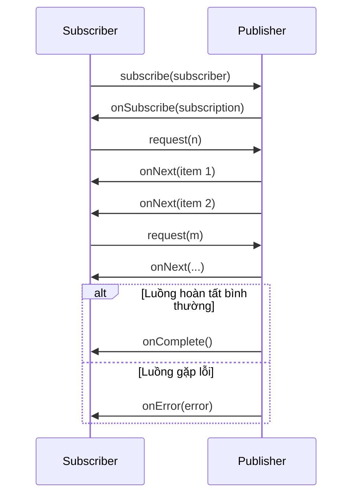

# Reactive Streams và vai trò Publisher, Subscriber, Subscription

## 1. Reactive Streams giải quyết vấn đề gì?

Khi một ứng dụng đọc dữ liệu từ cơ sở dữ liệu, kết quả có thể đến thành một dòng gồm nhiều phần tử. Nếu ứng dụng nhận dữ liệu nhanh hơn khả năng xử lý, dữ liệu có thể tích tụ trong bộ nhớ. Nếu ứng dụng phải chờ từng thao tác I/O hoàn tất theo kiểu đồng bộ, luồng thực thi có thể bị giữ lại trong lúc chờ mạng hoặc cơ sở dữ liệu.

Reactive Streams là một đặc tả cho việc trao đổi một dòng dữ liệu bất đồng bộ giữa bên phát và bên nhận. Đặc tả này định nghĩa một giao thức chung để hai bên phối hợp về thời điểm phát dữ liệu, lỗi, kết thúc và nhu cầu nhận dữ liệu. Cơ chế quan trọng nhất trong giao thức là **backpressure**: bên nhận có thể thông báo trước rằng nó sẵn sàng nhận bao nhiêu phần tử.

Trong Spring Data Relational R2DBC, các API truy cập dữ liệu phản ứng thường trả về `Mono<T>` hoặc `Flux<T>` của Project Reactor. Hai kiểu này triển khai giao diện `Publisher<T>` của Reactive Streams. Vì vậy, một lời gọi repository có thể trả về một publisher đại diện cho kết quả truy vấn; publisher phối hợp với subscriber khi có người đăng ký và yêu cầu dữ liệu.

Reactive Streams là đặc tả giao tiếp, không phải một thư viện cơ sở dữ liệu hay một cách viết SQL mới. R2DBC cung cấp SPI truy cập cơ sở dữ liệu theo hướng reactive; driver R2DBC thực hiện giao tiếp với hệ quản trị cơ sở dữ liệu; Spring Data R2DBC cung cấp các abstraction như repository và template; Reactor cung cấp `Mono`, `Flux` cùng các toán tử để kết hợp luồng dữ liệu.

## 2. Bốn khái niệm trong mô hình Reactive Streams

Đặc tả Reactive Streams có bốn giao diện cốt lõi trong package `org.reactivestreams`:

| Giao diện | Vai trò | Câu hỏi mà nó trả lời |
| --- | --- | --- |
| `Publisher<T>` | Bên có khả năng phát các phần tử kiểu `T` | Ai cung cấp dữ liệu? |
| `Subscriber<T>` | Bên đăng ký và nhận các tín hiệu từ publisher | Ai tiêu thụ dữ liệu? |
| `Subscription` | Đại diện cho một mối quan hệ đăng ký cụ thể; cho phép yêu cầu hoặc hủy dữ liệu | Subscriber muốn nhận bao nhiêu và có muốn dừng không? |
| `Processor<T, R>` | Vừa là subscriber của `T`, vừa là publisher của `R` | Ai nhận dữ liệu, biến đổi dữ liệu rồi phát tiếp? |

Trong bài này, trọng tâm là `Publisher`, `Subscriber` và `Subscription`, vì ba thành phần đó tạo nên giao thức cơ bản của một luồng dữ liệu.

### 2.1. Publisher — bên phát dữ liệu

`Publisher<T>` mô tả một nguồn có thể phát không, một hoặc nhiều phần tử kiểu `T` cho subscriber. Giao diện cốt lõi có phương thức:

```java
public interface Publisher<T> {
    void subscribe(Subscriber<? super T> subscriber);
}
```

Publisher không cần biết chi tiết subscriber sẽ lưu dữ liệu vào đâu hay hiển thị dữ liệu như thế nào. Nó chỉ cần tuân thủ giao thức Reactive Streams: thông báo đăng ký, phát các phần tử trong giới hạn nhu cầu đã được yêu cầu, rồi kết thúc bình thường hoặc bằng lỗi.

Trong Spring Data R2DBC, publisher thường được tạo ra từ một thao tác đọc hoặc ghi dữ liệu. Ví dụ với một repository kế thừa `ReactiveCrudRepository`:

```java
public interface PersonRepository
        extends ReactiveCrudRepository<Person, Long> {
}
```

Các phương thức sau trả về publisher:

```java
Flux<Person> allPeople = personRepository.findAll();
Mono<Person> onePerson = personRepository.findById(42L);
Mono<Person> savedPerson = personRepository.save(person);
```

`Flux<T>` là publisher có thể phát từ 0 đến nhiều phần tử. `Mono<T>` là publisher có thể phát tối đa một phần tử. Một `Mono` cũng có thể hoàn tất mà không phát phần tử nào, chẳng hạn khi `findById` không tìm thấy bản ghi.

Publisher không đồng nghĩa với một luồng chạy riêng. Reactive Streams quy định cách truyền tín hiệu và điều tiết nhu cầu; nó không bắt buộc mọi publisher phải tạo thread mới hoặc luôn phát dữ liệu trên một thread cụ thể. Việc thực thi đồng bộ hay bất đồng bộ, cũng như thread nào xử lý tín hiệu, phụ thuộc vào publisher, driver và các toán tử được sử dụng.

### 2.2. Subscriber — bên nhận dữ liệu

`Subscriber<T>` nhận các tín hiệu từ publisher. Giao diện có bốn callback:

```java
public interface Subscriber<T> {
    void onSubscribe(Subscription subscription);
    void onNext(T item);
    void onError(Throwable throwable);
    void onComplete();
}
```

Ý nghĩa của từng callback:

- `onSubscribe(subscription)`: publisher thông báo rằng subscriber đã được đăng ký và cung cấp đối tượng điều khiển mối quan hệ đăng ký đó.
- `onNext(item)`: publisher phát một phần tử. Một subscription có thể nhận nhiều lần gọi `onNext`.
- `onError(throwable)`: publisher thông báo luồng kết thúc do lỗi. Đây là tín hiệu kết thúc.
- `onComplete()`: publisher thông báo luồng đã hoàn tất bình thường. Đây cũng là tín hiệu kết thúc.

Subscriber thường quyết định xử lý mỗi phần tử như thế nào. Ví dụ, một subscriber có thể ghi phần tử vào log, chuyển đổi nó, lưu vào một cấu trúc dữ liệu hoặc gửi kết quả tới một thành phần khác. Subscriber cũng chịu trách nhiệm yêu cầu dữ liệu thông qua `Subscription` được nhận trong `onSubscribe`.

Một subscriber chỉ có thể nhận một trong hai tín hiệu kết thúc: `onComplete` hoặc `onError`. Sau tín hiệu kết thúc, publisher không được phát thêm `onNext` hay một tín hiệu kết thúc khác cho subscription đó.

### 2.3. Subscription — quyền điều khiển luồng dữ liệu

`Subscription` được publisher truyền cho subscriber trong `onSubscribe`. Giao diện này có hai phương thức:

```java
public interface Subscription {
    void request(long n);
    void cancel();
}
```

`request(n)` thông báo nhu cầu nhận thêm tối đa `n` phần tử. `cancel()` yêu cầu publisher dừng việc phát dữ liệu cho subscription hiện tại.

Subscription gắn với một lần đăng ký cụ thể. Nếu cùng một publisher được hai subscriber đăng ký, mỗi lần đăng ký có subscription riêng. Mỗi subscriber có thể yêu cầu số lượng phần tử khác nhau hoặc hủy vào thời điểm khác nhau.

Nhu cầu được cộng dồn qua các lần gọi `request`. Ví dụ, `request(2)` rồi `request(3)` tạo ra tổng nhu cầu là 5 phần tử, nếu chưa có phần tử nào được phát trong khoảng đó. Giá trị `Long.MAX_VALUE` thường được dùng để biểu thị nhu cầu không giới hạn thực tế. Gọi `request` với số không hoặc số âm là vi phạm giao thức; publisher phải kết thúc luồng bằng `onError` với `IllegalArgumentException`.

`cancel()` là yêu cầu hủy. Subscriber có thể gọi nó khi không còn cần dữ liệu, chẳng hạn người dùng đóng kết nối HTTP hoặc một toán tử chỉ cần một số lượng phần tử nhất định. Việc dừng tài nguyên bên dưới có thể cần thời gian để hoàn tất; ứng dụng không nên giả định rằng mọi thao tác đang chạy sẽ biến mất tức thì tại đúng thời điểm gọi `cancel()`.

### 2.4. Processor — thành phần trung gian

`Processor<T, R>` kết hợp vai trò subscriber và publisher: nó nhận các phần tử kiểu `T`, xử lý chúng rồi có thể phát ra các phần tử kiểu `R`. Khái niệm này hữu ích khi xây dựng một thành phần trung gian trong pipeline. Trong ứng dụng Spring Data R2DBC thông thường, lập trình viên thường dùng các toán tử Reactor như `map`, `filter` và `flatMap` thay vì tự triển khai `Processor`.

## 3. Trình tự hoạt động của một subscription

Một publisher và subscriber trao đổi theo trình tự khái quát sau:



Trình tự cần hiểu như sau:

1. Subscriber gọi `publisher.subscribe(this)` để đăng ký nhận dữ liệu.
2. Publisher gọi `onSubscribe` và truyền vào một subscription. Đây phải là tín hiệu đầu tiên mà subscriber nhận từ publisher.
3. Subscriber gọi `subscription.request(n)` để khai báo nhu cầu. Nếu subscriber chưa yêu cầu phần tử nào, publisher chưa được phép phát `onNext`.
4. Publisher phát không quá số phần tử đã được yêu cầu. Mỗi phần tử được chuyển qua `onNext`.
5. Subscriber có thể yêu cầu thêm dữ liệu trong hoặc sau khi xử lý phần tử. Nhu cầu mới được cộng vào nhu cầu còn lại.
6. Khi không còn dữ liệu, publisher gọi `onComplete`. Nếu có lỗi, publisher gọi `onError`. Cả hai đều kết thúc subscription.

Publisher có thể phát tín hiệu ngay trong quá trình gọi `subscribe`, hoặc phát sau đó tùy cách triển khai. Vì thế, mã ứng dụng không nên dựa vào giả định rằng `subscribe` luôn trả về trước khi callback đầu tiên được gọi.

Các tín hiệu của một subscription phải được tuần tự hóa: subscriber không được nhận nhiều callback tín hiệu chồng lấn theo cách phá vỡ thứ tự giao thức. Tuy vậy, không nên suy ra rằng toàn bộ ứng dụng chỉ dùng một thread; những subscription khác nhau và các phần khác nhau của pipeline có thể hoạt động trên những thread khác nhau.

## 4. Backpressure: subscriber điều tiết tốc độ phát

Backpressure là khả năng subscriber điều khiển lượng dữ liệu publisher được phép phát. Điều này giúp hệ thống phản hồi khi bên tiêu thụ xử lý chậm hơn bên sản xuất.

Giả sử publisher có 1.000 bản ghi. Nếu subscriber chỉ yêu cầu 10 phần tử, publisher chỉ được phát tối đa 10 phần tử qua `onNext` cho đến khi nhận thêm yêu cầu. Khi subscriber xử lý xong một phần tử và gọi `request(1)`, nhu cầu tăng thêm một phần tử.

Ví dụ, subscriber yêu cầu theo từng phần tử:

```java
import org.reactivestreams.Subscriber;
import org.reactivestreams.Subscription;

public final class OneAtATimeSubscriber<T> implements Subscriber<T> {

    private Subscription subscription;

    @Override
    public void onSubscribe(Subscription subscription) {
        this.subscription = subscription;
        subscription.request(1);
    }

    @Override
    public void onNext(T item) {
        System.out.println("Received: " + item);
        subscription.request(1);
    }

    @Override
    public void onError(Throwable error) {
        System.err.println("Stream failed: " + error.getMessage());
    }

    @Override
    public void onComplete() {
        System.out.println("Stream completed");
    }
}
```

Khi subscriber này đăng ký với publisher, nó yêu cầu một phần tử trong `onSubscribe`. Sau khi nhận và xử lý phần tử đó, nó yêu cầu thêm một phần tử trong `onNext`. Cách làm này minh họa rõ việc subscriber điều khiển nhu cầu. Trong ứng dụng thực tế, subscriber cần xử lý lỗi và hủy subscription phù hợp với vòng đời của tác vụ.

Backpressure không có nghĩa là cơ sở dữ liệu chắc chắn chỉ đọc đúng một hàng mỗi lần `request(1)`. Driver có thể đọc trước một nhóm hàng, dùng bộ đệm hoặc cơ chế fetch riêng tùy giao thức và cách triển khai. Các toán tử trong pipeline cũng có thể có mức prefetch riêng. Reactive Streams kiểm soát số phần tử được phát theo giao thức; chi tiết đọc dữ liệu từ máy chủ được quyết định bởi driver và các tầng bên dưới.

Backpressure cũng không thay thế giới hạn truy vấn SQL. Nếu yêu cầu nghiệp vụ là chỉ lấy 20 bản ghi, hãy thể hiện giới hạn đó trong truy vấn hoặc bằng API phù hợp. `take(20)` có thể dừng luồng sau 20 phần tử bằng cách hủy upstream, nhưng bản thân nó không nhất thiết biến truy vấn SQL thành `LIMIT 20`.

## 5. Reactive Streams trong Spring Data R2DBC

Spring Data R2DBC đưa giao thức Reactive Streams vào API truy cập dữ liệu thông qua Reactor. Những kiểu trả về thường gặp gồm:

| Kiểu trả về | Số phần tử tối đa | Ví dụ thao tác |
| --- | ---: | --- |
| `Mono<Person>` | 1 | Tìm một người theo ID, lưu một entity |
| `Flux<Person>` | Không giới hạn cố định | Đọc danh sách người, chạy truy vấn trả nhiều hàng |
| `Mono<Void>` | 0 | Hoàn tất một thao tác không trả entity, ví dụ xóa |

Ví dụ repository:

```java
public interface PersonRepository
        extends ReactiveCrudRepository<Person, Long> {
}
```

Khi gọi `findAll`, phương thức trả về một `Flux<Person>`. Khi gọi `findById`, phương thức trả về một `Mono<Person>`:

```java
Flux<Person> people = personRepository.findAll();
Mono<Person> person = personRepository.findById(42L);
```

Các biến trên giữ publisher. Với các nguồn reactive của Spring Data R2DBC, thao tác truy cập dữ liệu thường được thực hiện khi publisher được subscribe. Vì vậy, chỉ gọi `findAll()` rồi bỏ publisher đi thường không làm truy vấn được thực thi. Một framework như Spring WebFlux có thể subscribe publisher được trả về từ controller khi xử lý request HTTP.

Ví dụ controller trả publisher cho WebFlux:

```java
@RestController
@RequestMapping("/people")
public class PersonController {

    private final PersonRepository repository;

    public PersonController(PersonRepository repository) {
        this.repository = repository;
    }

    @GetMapping
    public Flux<Person> findAll() {
        return repository.findAll();
    }

    @GetMapping("/{id}")
    public Mono<Person> findById(@PathVariable Long id) {
        return repository.findById(id);
    }
}
```

Controller không cần tự gọi `subscribe()`. WebFlux nhận publisher trả về, quản lý subscription theo vòng đời HTTP và ghi các phần tử ra response. Khi client ngắt kết nối, framework có thể hủy subscription để báo cho upstream rằng không cần tiếp tục phát dữ liệu.

### 5.1. Kết hợp nhiều thao tác mà không chặn thread

Các publisher có thể được kết hợp thành một pipeline. Ví dụ, tìm một entity rồi cập nhật và lưu lại:

```java
public Mono<Person> renamePerson(Long id, String newName) {
    return personRepository.findById(id)
            .flatMap(person -> {
                person.setName(newName);
                return personRepository.save(person);
            });
}
```

`flatMap` nhận entity từ `findById`, gọi thao tác lưu và nối publisher kết quả của thao tác lưu vào pipeline. Toàn bộ chuỗi vẫn được biểu diễn bằng `Mono<Person>`. Không cần lấy kết quả bằng `block()` rồi mới gọi `save`.

Một số toán tử thường gặp:

- `map`: biến đổi mỗi phần tử thành một giá trị khác, không tạo publisher lồng nhau.
- `flatMap`: biến đổi phần tử thành publisher rồi kết hợp kết quả của publisher đó vào luồng.
- `concatMap`: thực hiện các publisher con theo thứ tự, hữu ích khi cần giữ thứ tự xử lý tuần tự.
- `filter`: chỉ cho các phần tử thỏa điều kiện đi tiếp.
- `switchIfEmpty`: cung cấp một publisher thay thế nếu nguồn hoàn tất mà không phát phần tử.
- `onErrorResume`: chuyển sang publisher khác khi có lỗi phù hợp.
- `retryWhen`: đăng ký lại nguồn theo chính sách retry; cần cân nhắc vì thao tác ghi có thể được thực hiện lại.
- `take(n)`: chỉ chuyển tiếp tối đa `n` phần tử rồi hủy nguồn upstream.

Các toán tử này vẫn tạo thành publisher. Khi có subscriber ở cuối pipeline, nhu cầu và tín hiệu sẽ được truyền qua các toán tử về phía nguồn theo cách mà từng toán tử triển khai.

### 5.2. Lỗi là một tín hiệu của luồng

Trong Reactive Streams, lỗi được truyền qua `onError` và kết thúc subscription hiện tại. Với Reactor, có thể xử lý lỗi bằng các toán tử như `onErrorReturn`, `onErrorResume` hoặc `retryWhen`:

```java
public Mono<Person> findPersonOrDefault(Long id) {
    return personRepository.findById(id)
            .switchIfEmpty(Mono.error(
                    new IllegalArgumentException("Person not found: " + id)
            ))
            .onErrorResume(DatabaseException.class, error -> {
                // Chọn cách xử lý phù hợp với nghiệp vụ.
                return Mono.empty();
            });
}
```

Trong ví dụ, `switchIfEmpty` xử lý trường hợp không có bản ghi; `onErrorResume` xử lý một loại lỗi cụ thể. Cần phân biệt trường hợp publisher hoàn tất bình thường nhưng không phát phần tử với trường hợp publisher kết thúc do lỗi.

Retry thường tạo ra một lần subscribe mới vào nguồn. Với truy vấn đọc, việc chạy lại có thể phù hợp tùy tình huống. Với thao tác ghi, cần xem xét tính idempotent và khả năng lần thực hiện trước đã được cơ sở dữ liệu commit hay chưa trước khi tự động retry.

### 5.3. Hủy subscription và vòng đời request

Subscriber gọi `cancel()` khi không cần dữ liệu nữa. Trong ứng dụng WebFlux, việc client đóng kết nối có thể dẫn đến hủy publisher đang tạo response. Tín hiệu hủy có thể truyền ngược qua các toán tử đến driver R2DBC để driver dừng hoặc giải phóng tài nguyên truy vấn theo khả năng của nó.

Điều này đặc biệt hữu ích với truy vấn trả nhiều hàng. Nếu client không còn nhận response, ứng dụng nên cho phép luồng bị hủy thay vì tiếp tục tiêu thụ và giữ dữ liệu không cần thiết. Các tác vụ phụ như ghi log hoặc gửi sự kiện cũng cần được gắn với vòng đời phù hợp; một subscription tách rời có thể tiếp tục chạy sau khi request ban đầu đã kết thúc.

## 6. Subscription thủ công và subscribe của Reactor

Ở tầng Reactive Streams thuần, subscriber tự nhận `Subscription` và gọi `request(n)`. Khi sử dụng Reactor, lập trình viên thường dùng các phương thức `subscribe` tiện ích:

```java
personRepository.findAll()
        .subscribe(person -> System.out.println(person));
```

Các overload `subscribe` thông dụng của Reactor tự quản lý yêu cầu dữ liệu và thường yêu cầu không giới hạn. Vì vậy, ví dụ trên khác với subscriber thủ công ở phần trước: mã ứng dụng không trực tiếp gọi `request(1)` cho từng phần tử.

Trong một controller hoặc service reactive, thường nên trả publisher hoặc kết hợp nó với publisher khác thay vì gọi `subscribe()` bên trong phương thức. Khi tự subscribe, ứng dụng tự tạo một luồng thực thi tách khỏi publisher được trả về; lỗi, hủy và thời điểm hoàn tất có thể không còn gắn với vòng đời request của caller. Chỉ dùng subscribe trực tiếp khi thật sự cần khởi chạy một tác vụ độc lập và đã xác định rõ cách quản lý lỗi, tài nguyên cũng như vòng đời của tác vụ đó.

Tương tự, `block()` chờ kết quả bằng cách chặn thread. Gọi `block()` trong một pipeline WebFlux/R2DBC có thể làm mất lợi ích non-blocking và gây nghẽn các thread xử lý request. Hãy ưu tiên `map`, `flatMap` và các toán tử kết hợp publisher. `block()` có thể hữu ích trong một số ranh giới imperative hoặc mã kiểm thử, nhưng không nên trở thành cách nối các thao tác trong luồng reactive của ứng dụng.

## 7. Những điểm dễ hiểu nhầm

### Gọi phương thức repository có nghĩa là truy vấn đã chạy

Thông thường, lời gọi repository reactive tạo và trả về publisher. Truy vấn được thực thi khi có subscription. Nếu publisher không được subscribe bởi ứng dụng hoặc framework, pipeline có thể không chạy.

### `Mono` luôn có một giá trị

`Mono<T>` có thể phát một giá trị rồi hoàn tất, hoàn tất rỗng mà không phát giá trị, hoặc kết thúc bằng lỗi. Vì thế, cần xử lý trường hợp rỗng khi nghiệp vụ yêu cầu.

### Reactive Streams tự tạo thread cho mọi thao tác

Đặc tả không đảm bảo mỗi publisher chạy trên một thread riêng. Reactive mô tả cách trao đổi tín hiệu và điều tiết nhu cầu. Cần xem xét driver, scheduler và các toán tử khi muốn kiểm soát nơi thực thi.

### Backpressure đồng nghĩa với truy vấn SQL có LIMIT

Backpressure điều tiết số phần tử publisher được phép phát theo nhu cầu. Nó không tự thay đổi câu SQL thành truy vấn có `LIMIT`, cũng không đảm bảo driver không đọc trước dữ liệu.

### Hủy subscription luôn dừng tức thì mọi công việc

`cancel()` yêu cầu dừng luồng. Driver và tài nguyên bên dưới cần thực hiện việc hủy hoặc dọn dẹp theo cơ chế riêng; có thể vẫn có một số hoạt động đang diễn ra tại thời điểm tín hiệu hủy được gửi.

### Có thể dùng `subscribe()` ở bất cứ đâu

Subscribe trực tiếp tạo một subscription mới và thường tách pipeline khỏi caller. Trong kiến trúc reactive, nên trả publisher và để tầng gọi quản lý subscription, trừ khi có chủ đích rõ ràng tạo tác vụ độc lập.

## 8. Cách đọc một pipeline R2DBC

Khi gặp một phương thức Spring Data R2DBC trả về `Mono` hoặc `Flux`, có thể lần lượt xác định:

1. **Publisher ở đâu?** Tìm nguồn như `findById`, `findAll`, `save` hoặc thao tác từ `R2dbcEntityTemplate`.
2. **Subscriber ở đâu?** Xác định thành phần cuối cùng subscribe, thường là WebFlux, một adapter reactive hoặc một subscriber do ứng dụng tạo.
3. **Nhu cầu được quản lý thế nào?** Kiểm tra các toán tử và subscriber cuối pipeline; lưu ý những toán tử có thể prefetch hoặc giới hạn tốc độ.
4. **Luồng kết thúc ra sao?** Kiểm tra đường hoàn tất rỗng, lỗi, retry và hủy khi caller không còn cần kết quả.
5. **Có thao tác chặn không?** Tìm `block()`, `blockFirst()`, `blockLast()`, `toIterable()` hoặc lời gọi I/O đồng bộ nằm trong pipeline.

Ví dụ:

```java
public Flux<Person> findActivePeople() {
    return personRepository.findAll()
            .filter(Person::isActive)
            .take(100);
}
```

Trong pipeline này, `findAll()` là nguồn publisher; `filter` lọc từng entity; `take(100)` giới hạn số phần tử được chuyển tiếp và hủy upstream sau khi đạt giới hạn. Thành phần gọi phương thức sẽ subscribe publisher cuối cùng. Nếu yêu cầu là giới hạn số hàng mà cơ sở dữ liệu trả về, cần xem xét thêm truy vấn hoặc phương thức repository có giới hạn phù hợp.

Hiểu đúng ba vai trò `Publisher`, `Subscriber` và `Subscription` giúp đọc được vòng đời của dữ liệu reactive: nguồn cung cấp dữ liệu, bên nhận đăng ký để tiêu thụ, còn subscription là kênh để điều tiết nhu cầu và yêu cầu dừng. Trong Spring Data R2DBC, Reactor hiện thực giao thức này qua `Mono` và `Flux`, cho phép kết hợp thao tác cơ sở dữ liệu thành pipeline mà không phải chặn thread để chờ từng kết quả.
