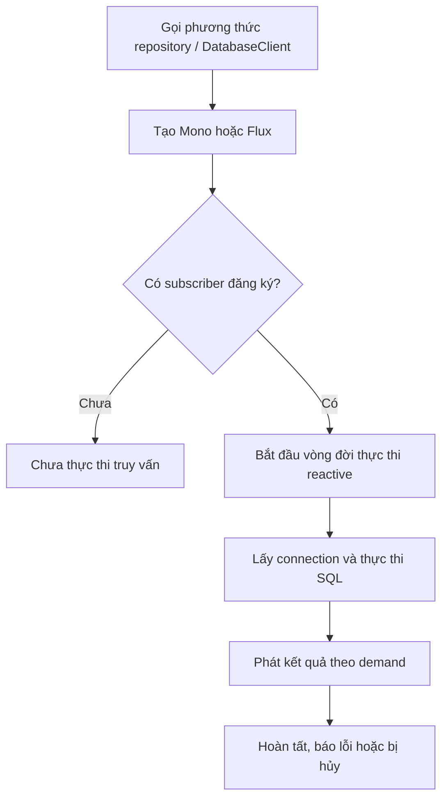

# Luồng lạnh, đăng ký thực thi và tính trì hoãn của truy vấn

Trong Spring Data Relational R2DBC, các thao tác đọc và ghi cơ sở dữ liệu thường trả về một publisher của Reactor, chẳng hạn `Mono<T>` hoặc `Flux<T>`. Khi gọi phương thức repository hoặc tạo một thao tác bằng `DatabaseClient`, ứng dụng chủ yếu đang **xây dựng mô tả của một luồng xử lý**. Truy vấn được thực thi trong vòng đời đăng ký (subscription), khi có subscriber tham gia vào publisher.

Đặc điểm này là nền tảng của lập trình reactive: việc tạo pipeline và việc thực sự lấy dữ liệu được tách thành hai thời điểm. Hiểu đúng ranh giới đó giúp tránh trường hợp truy vấn không chạy vì chưa có subscription, truy vấn chạy nhiều lần ngoài dự kiến, hoặc một thao tác bị tách khỏi transaction do tự gọi `subscribe()`.

## 1. Publisher là gì trong truy vấn R2DBC?

R2DBC cung cấp API truy cập cơ sở dữ liệu theo mô hình reactive. Spring Data R2DBC dùng Reactor để biểu diễn kết quả và các bước xử lý bất đồng bộ. Hai kiểu dữ liệu thường gặp là:

| Kiểu trả về | Số phần tử | Ví dụ thường gặp |
| --- | --- | --- |
| `Mono<T>` | Không có hoặc có một phần tử | `findById`, `save`, `count` (với kiểu số), một truy vấn dự kiến trả về một bản ghi |
| `Flux<T>` | Không có, một hoặc nhiều phần tử | `findAll`, truy vấn tìm nhiều bản ghi, luồng kết quả của `DatabaseClient` |

Ví dụ một repository reactive:

```java
public interface CustomerRepository
        extends ReactiveCrudRepository<Customer, Long> {

    Flux<Customer> findByStatus(String status);
}
```

Lời gọi sau trả về một `Flux<Customer>`:

```java
Flux<Customer> activeCustomers =
        customerRepository.findByStatus("ACTIVE");
```

Biến `activeCustomers` giữ publisher đại diện cho thao tác truy vấn. Việc gán publisher vào biến, truyền publisher qua các phương thức, hoặc thêm các toán tử như `map` và `filter` không tự tạo ra một subscriber. Vì vậy, ở thời điểm này truy vấn cơ sở dữ liệu chưa được yêu cầu thực thi.

Publisher là hợp đồng mô tả cách phát dữ liệu cho subscriber. Subscriber đăng ký với publisher và nhận các tín hiệu reactive như `onNext`, `onError` hoặc `onComplete`. Với `Mono`, tối đa một tín hiệu `onNext` được phát; với `Flux`, có thể có nhiều tín hiệu `onNext`.

## 2. Luồng lạnh (cold publisher)

Một publisher lạnh tạo hoặc lấy dữ liệu riêng cho mỗi lần đăng ký. Các publisher truy vấn do Spring Data R2DBC và `DatabaseClient` cung cấp thường có tính chất lạnh và trì hoãn việc giao tiếp với cơ sở dữ liệu cho đến khi có subscription.

Có thể hình dung quy trình qua sơ đồ sau:



Ví dụ:

```java
Flux<Customer> customers = customerRepository.findByStatus("ACTIVE");

// Chỉ tạo pipeline; chưa có subscriber.
// Truy vấn chưa được yêu cầu thực thi tại đây.
```

Nếu không có thành phần nào đăng ký với `customers`, publisher không có người tiêu thụ kết quả và thao tác truy vấn không bắt đầu. Điều này thường xảy ra khi một phương thức service tạo rồi trả về publisher nhưng phía gọi không bao giờ subscribe hoặc không chuyển publisher cho một framework quản lý subscription.

Trong một ứng dụng Spring WebFlux, controller thường chỉ cần trả publisher cho framework:

```java
@GetMapping("/customers/active")
public Flux<Customer> activeCustomers() {
    return customerRepository.findByStatus("ACTIVE");
}
```

WebFlux đăng ký và tiêu thụ publisher trong quá trình xử lý HTTP response. Vì vậy controller không cần tự gọi `subscribe()`.

### Vì sao gọi là “lạnh”?

Với publisher lạnh, mỗi subscription độc lập thường khởi động một lần thực thi mới. Cùng một biến publisher có thể được subscribe nhiều lần:

```java
Flux<Customer> customers = customerRepository.findByStatus("ACTIVE");

customers.subscribe(customer -> log.info("Subscriber A: {}", customer));
customers.subscribe(customer -> log.info("Subscriber B: {}", customer));
```

Hai subscriber trên thường khiến truy vấn được thực thi hai lần. Mỗi subscriber nhận luồng kết quả của lần thực thi tương ứng. Việc tái sử dụng cùng một đối tượng `Flux` không đồng nghĩa với việc kết quả truy vấn tự động được chia sẻ hoặc cache.

Điều này cũng áp dụng khi một publisher được subscribe lại do các toán tử như `retry` hoặc `repeat`:

- `retry` đăng ký lại upstream sau lỗi để thử thực thi lại. Với truy vấn đọc, điều đó thường có nghĩa là gửi lại truy vấn. Với thao tác ghi, cần cân nhắc khả năng thao tác trước đã được cơ sở dữ liệu xử lý một phần hoặc hoàn tất trước khi lỗi được quan sát; thử lại có thể gây tác dụng phụ lặp.
- `repeat` đăng ký lại sau khi upstream hoàn tất, nên truy vấn có thể chạy lại sau mỗi lần hoàn tất.

Không nên khái quát rằng mọi `Publisher` trong Reactive Streams đều lạnh. Publisher từ nguồn sự kiện, `Sinks` hoặc một số nguồn thời gian có thể là nóng (hot), nghĩa là dữ liệu có thể được phát độc lập với thời điểm subscriber đăng ký. Tính lạnh ở đây mô tả hành vi thường gặp của publisher thao tác cơ sở dữ liệu trong Spring Data R2DBC.

## 3. Subscription là ranh giới bắt đầu thực thi

Trong Reactive Streams, subscriber gọi `subscribe` để đăng ký với publisher. Subscription thiết lập quan hệ tiêu thụ dữ liệu; sau đó subscriber có thể yêu cầu số phần tử thông qua cơ chế demand. Với publisher truy vấn R2DBC, việc đăng ký khởi động vòng đời thực thi truy vấn: framework/driver lấy connection phù hợp, chuẩn bị và thực thi câu SQL, rồi phát kết quả theo luồng reactive.

Một subscription thường đi qua các giai đoạn sau:

1. **Đăng ký:** subscriber kết nối với publisher. Publisher cung cấp `Subscription` qua tín hiệu `onSubscribe`.
2. **Khởi động thao tác cơ sở dữ liệu:** publisher truy vấn bắt đầu quy trình lấy connection và thực thi câu lệnh. Connection có thể được lấy từ connection pool; nếu đang ở trong reactive transaction, connection gắn với transaction có thể được sử dụng.
3. **Nhận kết quả:** dữ liệu được ánh xạ thành đối tượng Java và phát qua `onNext`. `Mono` phát tối đa một phần tử, còn `Flux` có thể phát nhiều phần tử.
4. **Kết thúc vòng đời:** publisher phát `onComplete`, phát `onError`, hoặc nhận tín hiệu hủy (`cancel`). Framework và driver quản lý việc giải phóng tài nguyên theo vòng đời thao tác.

Đây là mô tả khái niệm. Chi tiết thời điểm gửi SQL, đọc từng hàng và đệm dữ liệu phụ thuộc vào Spring Data, Reactor và R2DBC driver. Việc đăng ký bắt đầu vòng đời xử lý, còn lượng dữ liệu được tiêu thụ chịu ảnh hưởng của demand và cơ chế prefetch/buffering của các thành phần bên dưới.

### Đăng ký thủ công bằng `subscribe()`

Có thể gọi `subscribe()` trực tiếp để bắt đầu xử lý:

```java
customerRepository.findByStatus("ACTIVE")
        .subscribe(
                customer -> log.info("Customer: {}", customer),
                error -> log.error("Không thể tải customer", error),
                () -> log.info("Đã tải xong danh sách customer")
        );
```

Ngay khi `subscribe()` được gọi, subscription được tạo và thao tác reactive bắt đầu. Cách này hữu ích ở một số ranh giới ứng dụng cần chủ động khởi chạy một tác vụ, nhưng cần quản lý lỗi và vòng đời của subscription. `subscribe()` thường trả về `Disposable`, cho phép hủy subscription khi cần.

Trong service reactive thông thường, nên trả publisher cho tầng gọi để tầng đó quản lý subscription:

```java
public Flux<Customer> findActiveCustomers() {
    return customerRepository.findByStatus("ACTIVE")
            .filter(Customer::isEnabled)
            .sort(Comparator.comparing(Customer::getName));
}
```

Các toán tử được nối vào pipeline và sẽ chạy khi publisher được subscribe. Không cần tự subscribe bên trong service.

### Những thao tác thường tạo subscription

Ngoài `subscribe()`, một số thao tác có thể đăng ký publisher ở bên trong:

| Thao tác | Hành vi |
| --- | --- |
| `block()` | Subscribe rồi chờ kết quả đồng bộ; với `Mono`, trả về giá trị hoặc `null` nếu rỗng |
| `toFuture()` | Tạo `CompletableFuture` và đăng ký publisher để hoàn thành future |
| `StepVerifier.verify()` | Đăng ký publisher trong lúc chạy kịch bản kiểm thử |
| Spring WebFlux xử lý response | Framework đăng ký publisher để ghi dữ liệu vào response |

Ví dụ, mỗi lần gọi `block()` là một lần subscribe:

```java
Mono<Customer> customer = customerRepository.findById(10L);

Customer first = customer.block();  // Subscription thứ nhất
Customer second = customer.block(); // Subscription thứ hai
```

Với publisher truy vấn lạnh, hai dòng này có thể thực thi truy vấn hai lần. `block()` cũng làm luồng gọi trở thành chặn đồng bộ, nên không phù hợp để sử dụng bên trong chuỗi xử lý reactive hoặc trên các thread không cho phép blocking của WebFlux.

## 4. Tính trì hoãn khi xây dựng và kết hợp truy vấn

Tính trì hoãn cho phép ứng dụng lắp ghép các bước xử lý trước, rồi để subscriber quyết định thời điểm bắt đầu. Ví dụ:

```java
public Mono<CustomerView> findCustomerView(Long id) {
    return customerRepository.findById(id)
            .map(customer -> new CustomerView(
                    customer.getId(),
                    customer.getName()
            ));
}
```

Khi gọi `findCustomerView(id)`, phương thức tạo và trả về một `Mono<CustomerView>`. `map` mô tả cách chuyển `Customer` thành `CustomerView`. Truy vấn và phép ánh xạ thuộc pipeline sẽ được xử lý khi có subscription và dữ liệu đi qua pipeline.

Các toán tử kết hợp thường gặp:

```java
return customerRepository.findById(id)
        .filter(Customer::isEnabled)
        .flatMap(customer -> addressRepository.findByCustomerId(customer.getId())
                .map(address -> new CustomerView(customer, address)))
        .switchIfEmpty(Mono.error(new CustomerNotFoundException(id)));
```

- `filter` chỉ cho phần tử đi tiếp nếu điều kiện đúng.
- `flatMap` nối một publisher khác sau khi upstream phát phần tử. Truy vấn địa chỉ chỉ được đăng ký khi nhánh `flatMap` nhận được customer.
- `switchIfEmpty` chuyển sang publisher dự phòng nếu upstream hoàn tất mà không phát phần tử.
- `Mono.error` tạo publisher kết thúc bằng lỗi; lỗi được phát khi publisher đó được subscribe trong pipeline.

Điểm cần phân biệt là **tạo publisher** và **thực thi thao tác bên trong publisher**. Một số biểu thức Java vẫn chạy ngay khi phương thức được gọi. Chẳng hạn, việc tính đối số, tạo object hoặc gọi một factory để lấy publisher có thể diễn ra ở thời điểm assembly. Tính trì hoãn của R2DBC chủ yếu bảo đảm thao tác giao tiếp cơ sở dữ liệu được gắn với subscription; không có nghĩa mọi dòng Java trong phương thức đều tự động bị trì hoãn.

### Dùng `defer` khi cần trì hoãn cả việc tạo publisher

`Mono.defer` và `Flux.defer` nhận một supplier tạo publisher mới cho mỗi subscription. Chúng hữu ích khi bản thân việc tạo publisher hoặc tính giá trị đầu vào cũng cần diễn ra tại thời điểm subscribe:

```java
Mono<Customer> customer = Mono.defer(() ->
        customerRepository.findById(resolveCustomerId())
);
```

`resolveCustomerId()` được gọi khi có subscription. Nếu publisher được subscribe nhiều lần, supplier được gọi lại cho mỗi lần. Publisher truy vấn do repository trả về vốn đã trì hoãn việc thực thi SQL; `defer` bổ sung một lớp trì hoãn cho việc gọi repository và tính đối số.

Một ví dụ khác là tạo dữ liệu mới cho mỗi lần thực thi:

```java
Mono<AuditRecord> saveAudit = Mono.defer(() -> {
    AuditRecord record = new AuditRecord(UUID.randomUUID(), "CUSTOMER_READ");
    return auditRepository.save(record);
});
```

Mỗi subscription tạo một `AuditRecord` mới rồi đăng ký thao tác lưu tương ứng. Nếu tạo `AuditRecord` bên ngoài `defer`, UUID sẽ được sinh ngay lúc xây dựng pipeline và object đó có thể được dùng lại qua nhiều subscription.

Có thể dùng `defer` với nhánh dự phòng khi muốn chỉ tạo publisher dự phòng lúc nhánh đó thực sự được chọn:

```java
return customerRepository.findById(id)
        .switchIfEmpty(Mono.defer(() ->
                customerRepository.findById(DEFAULT_CUSTOMER_ID)
        ));
```

Trong ví dụ này, publisher tìm customer mặc định chỉ được tạo khi truy vấn đầu tiên hoàn tất rỗng. Vì thao tác repository cũng lạnh, SQL của nhánh dự phòng chỉ chạy khi nhánh đó được đăng ký.

## 5. Nhiều subscriber, cache và chia sẻ kết quả

Với publisher truy vấn lạnh, mỗi subscriber thường có một lần thực thi độc lập. Nếu nhiều thành phần cần cùng một kết quả và việc truy vấn lặp lại là không mong muốn, cần chủ động chọn chiến lược chia sẻ hoặc cache.

Ví dụ với `Mono.cache()`:

```java
Mono<Customer> cachedCustomer = customerRepository.findById(10L).cache();
```

Subscription đầu tiên kích hoạt truy vấn và lưu tín hiệu kết thúc của `Mono`. Các subscription sau nhận lại tín hiệu đã cache thay vì thực thi lại truy vấn trong thời gian cache còn hiệu lực. Có thể cấu hình thời hạn cache bằng các overload có TTL.

Một số điểm cần cân nhắc:

- Cache của Reactor lưu tín hiệu trong bộ nhớ ứng dụng; đây không phải cache tự động của cơ sở dữ liệu hay cache cấp Hibernate.
- Với `Mono`, tín hiệu được cache có thể là giá trị, hoàn tất rỗng hoặc lỗi. Vì vậy, một kết quả rỗng hay lỗi cũng có thể được phát lại.
- `Flux.cache()` có thể giữ lại các phần tử đã phát để phát lại cho subscriber sau. Với luồng lớn hoặc không giới hạn, việc giữ toàn bộ dữ liệu có thể tiêu tốn nhiều bộ nhớ.
- Dữ liệu cache có thể cũ sau khi bản ghi thay đổi. Cần xác định TTL và cách vô hiệu hóa phù hợp với yêu cầu nhất quán.

Reactor còn có các toán tử chia sẻ như `share` hoặc `publish().refCount()`. Chúng có ngữ nghĩa vòng đời và thời điểm đăng ký riêng; hãy chọn theo nhu cầu thực tế và đọc kỹ hành vi khi subscriber đến muộn hoặc rời đi. Không nên thêm cache/chia sẻ chỉ để tránh gọi repository nhiều lần mà chưa xác định rõ yêu cầu dữ liệu.

## 6. Demand, backpressure và hủy subscription

Reactive Streams có cơ chế backpressure: subscriber có thể yêu cầu số phần tử mà nó sẵn sàng nhận. Với `Flux`, demand ảnh hưởng đến việc phát dữ liệu và phối hợp giữa các bước trong pipeline. R2DBC driver và các thành phần Spring có thể dùng prefetch hoặc buffering, do đó không nên hiểu rằng một `request(1)` luôn tương ứng chính xác với một lần đọc một hàng từ database.

Ví dụ:

```java
return customerRepository.findAll()
        .take(100)
        .map(this::toView);
```

`take(100)` giới hạn số phần tử được chuyển tiếp xuống phần còn lại của pipeline. Khi đủ 100 phần tử, toán tử có thể hủy subscription upstream. Đây là giới hạn ở luồng reactive; nếu muốn giới hạn số hàng mà database phải tìm hoặc trả về, hãy dùng truy vấn có `LIMIT`, phân trang hoặc cơ chế truy vấn phù hợp. Việc hủy ở phía client không bảo đảm mọi driver/database đều dừng công việc tức thời.

Khi subscriber hủy subscription, publisher nhận tín hiệu `cancel`. Với truy vấn R2DBC, framework và driver thực hiện quy trình hủy và giải phóng tài nguyên theo khả năng hỗ trợ. Điều này quan trọng khi HTTP client ngắt kết nối hoặc khi pipeline chỉ cần một phần kết quả.

## 7. Subscription và reactive transaction

Reactive transaction có vòng đời gắn với subscription. Khi dùng `@Transactional` cho phương thức trả về `Mono` hoặc `Flux`, cần cấu hình reactive transaction manager phù hợp, thường là `R2dbcTransactionManager`. Transaction được quản lý trong ngữ cảnh reactive của subscription; các thao tác repository nằm trong cùng pipeline có thể dùng connection gắn với transaction đó.

Ví dụ:

```java
@Transactional
public Mono<Void> renameCustomer(Long id, String newName) {
    return customerRepository.findById(id)
            .switchIfEmpty(Mono.error(new CustomerNotFoundException(id)))
            .flatMap(customer -> {
                customer.setName(newName);
                return customerRepository.save(customer);
            })
            .then();
}
```

Phương thức trả về một pipeline. Khi pipeline được subscribe, cơ chế transaction reactive bao quanh quá trình thực thi và kết thúc transaction theo tín hiệu hoàn tất hoặc lỗi. Các thao tác tìm và lưu được nối trong cùng chuỗi reactive.

Tránh tự subscribe bên trong một phương thức cần transaction:

```java
// Không nên làm như sau trong một service reactive có transaction.
public Mono<Void> renameCustomer(Long id, String newName) {
    customerRepository.findById(id)
            .flatMap(customer -> {
                customer.setName(newName);
                return customerRepository.save(customer);
            })
            .subscribe();

    return Mono.empty();
}
```

`subscribe()` tạo một subscription độc lập ngay tại chỗ. Publisher được trả về là `Mono.empty()` và không đại diện cho công việc tìm/lưu customer. Subscription tự tạo cũng có thể nằm ngoài transaction context của pipeline do framework quản lý, khiến transaction, xử lý lỗi và thời điểm hoàn tất không còn được phối hợp như dự kiến.

Hãy trả publisher từ service để framework hoặc tầng gọi subscribe đúng một lần ở ranh giới phù hợp. Nếu cần điều phối transaction tường minh, có thể dùng `TransactionalOperator` để bọc publisher; nguyên tắc vẫn là giữ các thao tác liên quan trong cùng pipeline reactive.

## 8. Kiểm thử cũng là một subscriber

Các công cụ kiểm thử Reactor như `StepVerifier` đăng ký publisher khi chạy verification. Vì vậy, một truy vấn trong kiểm thử chỉ được kích hoạt khi verifier thực hiện subscription:

```java
StepVerifier.create(customerRepository.findByStatus("ACTIVE"))
        .expectNextCount(2)
        .verifyComplete();
```

`verifyComplete()` khởi động việc tiêu thụ publisher, kiểm tra có hai phần tử và xác nhận luồng hoàn tất bình thường. Nếu tạo publisher rồi không gọi phương thức verification hoặc subscribe tương ứng, truy vấn sẽ chưa được thực thi.

Khi kiểm thử hành vi nhiều subscription, hãy tạo từng subscriber một cách có chủ đích và nhớ rằng publisher truy vấn lạnh thường thực thi lại cho mỗi lần. Nếu dùng `cache`, kết quả kiểm thử sẽ phản ánh ngữ nghĩa cache thay vì hành vi cold mặc định.

## 9. Các lỗi thường gặp và cách xử lý

| Biểu hiện | Nguyên nhân thường gặp | Cách xử lý |
| --- | --- | --- |
| Không thấy truy vấn chạy | Publisher được tạo nhưng không có subscriber | Trả publisher cho WebFlux hoặc subscribe tại ranh giới ứng dụng phù hợp |
| Truy vấn chạy hai lần | Cùng publisher bị subscribe hai lần, hoặc có `block()`/`toFuture()` ngoài dự kiến | Theo dõi nơi tạo subscription; chỉ có một luồng tiêu thụ nếu đó là yêu cầu nghiệp vụ |
| Service trả về rỗng dù truy vấn có dữ liệu | Service tự subscribe rồi trả một publisher khác, thường là `Mono.empty()` | Nối thao tác bằng `map`/`flatMap` và trả publisher hoàn chỉnh |
| Truy vấn dự phòng chạy dù không cần | Tạo publisher dự phòng hoặc tính đối số quá sớm | Dùng `Mono.defer`/`Flux.defer` khi cần trì hoãn việc tạo nhánh dự phòng |
| Transaction không bao trùm thao tác | Subscription được tạo tách khỏi pipeline transaction | Trả publisher xuyên suốt và để reactive transaction manager quản lý subscription |
| Ứng dụng bị chặn hoặc báo lỗi khi gọi `block()` | Blocking trong luồng xử lý reactive | Dùng toán tử reactive và để tầng framework subscribe |
| Truy vấn bị thực thi lại sau lỗi | `retry` tạo subscription mới | Xác định thao tác có an toàn khi chạy lại không; giới hạn số lần retry và xử lý idempotency cho thao tác ghi |

Khi điều tra, có thể lần theo các điểm sau:

1. Phương thức repository hoặc `DatabaseClient` trả về publisher nào?
2. Publisher được subscribe ở đâu? Có framework nào đang quản lý subscription không?
3. Có nhiều nơi gọi `subscribe`, `block`, `toFuture`, `retry` hoặc `repeat` không?
4. Publisher có bị cache hoặc chia sẻ khiến số lần thực thi khác với cold mặc định không?
5. Nếu có transaction, các thao tác có còn nằm trong cùng pipeline và cùng reactive context không?

## 10. Ghi nhớ khi làm việc với Spring Data R2DBC

- Gọi repository method thường tạo `Mono` hoặc `Flux`; bản thân lời gọi đó chưa đồng nghĩa với việc SQL đã được thực thi.
- Publisher truy vấn R2DBC thường là cold và lazy: subscription khởi động một lần thực thi; mỗi subscription mới thường thực thi lại.
- Các toán tử như `map`, `filter`, `flatMap` và `switchIfEmpty` mô tả cách xử lý dữ liệu trong pipeline. Chúng không tự tạo subscription.
- `defer` trì hoãn cả việc gọi factory tạo publisher và tính toán bên trong supplier cho đến mỗi subscription.
- `subscribe`, `block`, `toFuture`, `StepVerifier` và framework như WebFlux có thể tạo subscription. Hãy biết rõ thành phần nào đang sở hữu việc tiêu thụ publisher.
- Không tự subscribe trong service reactive cần trả kết quả hoặc tham gia transaction; hãy trả publisher đã kết hợp đầy đủ.
- Mỗi subscription có thể thực thi lại truy vấn. Dùng cache hoặc chia sẻ khi có yêu cầu rõ ràng về việc dùng chung kết quả và chấp nhận ngữ nghĩa dữ liệu tương ứng.
- Backpressure và cancellation điều phối việc tiêu thụ luồng; chúng không thay thế giới hạn truy vấn ở database như `LIMIT` hoặc phân trang.

Nắm vững mối quan hệ giữa publisher, subscription và thời điểm thực thi là điều kiện cần để viết repository, service và transaction reactive đúng cách với Spring Data R2DBC. Khi đọc một đoạn code reactive, hãy lần theo nơi publisher được tạo, các toán tử được nối vào nó và nơi subscription thực sự bắt đầu; từ đó có thể xác định chính xác khi nào truy vấn chạy và vì sao nó có thể chạy một hoặc nhiều lần.
