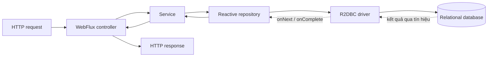

# Luồng xử lý không chặn và tác hại của thao tác chặn

Trong Spring Data Relational R2DBC, truy cập cơ sở dữ liệu được thiết kế theo mô hình phản ứng (reactive) và I/O không chặn (non-blocking). Mô hình này giúp ứng dụng xử lý nhiều yêu cầu đồng thời mà không cần giữ một luồng (thread) đứng chờ trong suốt thời gian cơ sở dữ liệu phản hồi. Tuy nhiên, lợi ích đó chỉ còn nguyên vẹn khi toàn bộ chuỗi xử lý tôn trọng cách làm việc không chặn. Một lời gọi đồng bộ như `block()`, `Thread.sleep()` hoặc JDBC có thể chiếm dụng luồng đang phục vụ nhiều yêu cầu và làm giảm đáng kể khả năng đáp ứng của ứng dụng.

## 1. Vì sao R2DBC gắn với xử lý không chặn?

JDBC truyền thống cung cấp API đồng bộ. Khi ứng dụng gọi một truy vấn JDBC, luồng gọi thường phải đợi cho đến khi cơ sở dữ liệu trả kết quả hoặc phát sinh lỗi. Trong thời gian chờ, luồng đó không thể tiếp tục xử lý công việc khác.

R2DBC (Reactive Relational Database Connectivity) cung cấp API truy cập cơ sở dữ liệu quan hệ theo hướng phản ứng. Spring Data R2DBC xây dựng các repository và thao tác truy cập dữ liệu trên API này. Các phương thức thường trả về kiểu phản ứng như `Mono<T>` hoặc `Flux<T>` thay vì trả trực tiếp một đối tượng đã được tải xong.

Điểm khác biệt cốt lõi nằm ở cách luồng ứng dụng chờ I/O:

| Cách truy cập | Hành vi khi chờ cơ sở dữ liệu | Hệ quả đối với luồng gọi |
| --- | --- | --- |
| JDBC đồng bộ | Lời gọi thường chờ kết quả truy vấn | Luồng bị giữ cho đến khi lời gọi hoàn tất |
| R2DBC phản ứng | Driver thực hiện I/O theo cơ chế không chặn và phát tín hiệu khi có kết quả | Luồng có thể tiếp tục nhận công việc khác trong lúc chờ I/O |

Không chặn không có nghĩa là truy vấn SQL chạy tức thì, cơ sở dữ liệu không cần tài nguyên, hay ứng dụng có thể xử lý số lượng yêu cầu vô hạn. Cơ sở dữ liệu vẫn phải thực thi truy vấn, lấy khóa, đọc dữ liệu và gửi kết quả qua mạng. Lợi ích của non-blocking là ứng dụng không phải dành riêng một luồng để ngồi chờ các thao tác I/O đó.

## 2. Các kiểu dữ liệu phản ứng trong Spring Data R2DBC

Hai kiểu thường gặp nhất trong một luồng xử lý R2DBC là:

- `Mono<T>` biểu diễn một kết quả có thể có hoặc không có. Ví dụ: tìm một bản ghi theo khóa chính, lưu một thực thể hoặc lấy một giá trị tổng hợp.
- `Flux<T>` biểu diễn từ không đến nhiều kết quả. Ví dụ: truy vấn danh sách đơn hàng hoặc đọc một luồng bản ghi.

Các kiểu này triển khai mô hình Reactive Streams. Thay vì trả kết quả ngay tại thời điểm gọi phương thức, một repository thường trả về một `Publisher`. Pipeline được mô tả trước; việc thực thi bắt đầu khi có subscriber đăng ký. Sau đó, publisher truyền các tín hiệu như `onNext`, `onError` và `onComplete` theo quy tắc của Reactive Streams.

Ví dụ repository:

```java
import org.springframework.data.repository.reactive.ReactiveCrudRepository;
import reactor.core.publisher.Flux;

public interface OrderRepository
        extends ReactiveCrudRepository<Order, Long> {

    Flux<Order> findByStatus(OrderStatus status);
}
```

`findByStatus` trả về `Flux<Order>`. Khi phương thức được gọi, ứng dụng nhận được một mô tả pipeline. Truy vấn được thực thi khi pipeline được subscribe, chẳng hạn khi Spring WebFlux xử lý giá trị trả về từ controller.

## 3. Một yêu cầu đi qua hệ thống như thế nào?

Với ứng dụng dùng Spring WebFlux, Spring Data R2DBC và driver R2DBC, luồng điển hình có thể hình dung như sau:



Quá trình thường gồm các bước sau:

1. **Nhận yêu cầu:** máy chủ nhận HTTP request. Với cấu hình WebFlux dựa trên Reactor Netty, các luồng sự kiện (event-loop threads) tiếp nhận và điều phối nhiều kết nối.
2. **Tạo pipeline:** controller gọi service; service gọi repository và ghép các toán tử như `map`, `flatMap`, `filter` hoặc `switchIfEmpty`. Phần lớn thao tác này chỉ mô tả cách xử lý kết quả.
3. **Đăng ký thực thi:** framework subscribe vào publisher được trả về để bắt đầu luồng dữ liệu.
4. **Gửi truy vấn:** repository chuyển yêu cầu xuống Spring Data R2DBC và driver R2DBC. Driver gửi câu lệnh đến cơ sở dữ liệu bằng cơ chế I/O không chặn.
5. **Chờ I/O mà không giữ luồng:** khi dữ liệu chưa về, luồng sự kiện không phải đứng đợi câu trả lời. Nó có thể xử lý sự kiện của kết nối hoặc yêu cầu khác.
6. **Nhận tín hiệu:** khi driver nhận được dữ liệu, nó phát tín hiệu vào pipeline. Các toán tử tiếp theo biến đổi kết quả hoặc xử lý lỗi.
7. **Trả phản hồi:** WebFlux ghi kết quả thành HTTP response khi publisher hoàn tất.

Sơ đồ mô tả trách nhiệm ở mức khái niệm. Luồng thực tế thực thi từng toán tử phụ thuộc vào máy chủ, driver, scheduler và các ranh giới chuyển luồng mà ứng dụng cấu hình. Không nên giả định mọi bước luôn chạy trên cùng một thread hoặc mọi driver đều có cách triển khai nội bộ giống nhau.

### Ví dụ giữ nguyên kiểu phản ứng từ controller đến repository

```java
@Service
public class OrderService {

    private final OrderRepository repository;

    public OrderService(OrderRepository repository) {
        this.repository = repository;
    }

    public Mono<OrderDto> findById(Long id) {
        return repository.findById(id)
                .map(OrderDto::from);
    }
}
```

```java
@RestController
@RequestMapping("/orders")
public class OrderController {

    private final OrderService service;

    public OrderController(OrderService service) {
        this.service = service;
    }

    @GetMapping("/{id}")
    public Mono<ResponseEntity<OrderDto>> findById(@PathVariable Long id) {
        return service.findById(id)
                .map(ResponseEntity::ok)
                .defaultIfEmpty(ResponseEntity.notFound().build());
    }
}
```

Service trả `Mono<OrderDto>` và controller tiếp tục trả `Mono<ResponseEntity<OrderDto>>`. Spring WebFlux quản lý việc subscribe và chuyển kết quả thành HTTP response. Không cần tự chờ kết quả trong controller.

## 4. Thế nào là một thao tác chặn?

Một thao tác chặn khiến luồng hiện tại không thể tiếp tục công việc cho đến khi thao tác đó kết thúc. Những ví dụ phổ biến gồm:

- Gọi `Mono.block()`, `Flux.blockFirst()` hoặc `Flux.blockLast()` để chờ kết quả phản ứng một cách đồng bộ.
- Gọi `Future.get()` hoặc `CompletableFuture.join()` để đợi một tác vụ khác hoàn tất.
- Gọi `Thread.sleep()` hoặc dùng các cơ chế `wait()`/khóa đồng bộ trong đường xử lý yêu cầu.
- Gọi API I/O đồng bộ như JDBC, `RestTemplate`, đọc tệp đồng bộ hoặc một thư viện mạng chỉ hỗ trợ blocking.
- Chờ một tài nguyên bằng thao tác đồng bộ, ví dụ khóa bị giữ bởi luồng khác.

Ví dụ dưới đây chuyển một pipeline phản ứng thành lời gọi đồng bộ:

```java
public OrderDto findOrder(Long id) {
    Order order = orderRepository.findById(id).block();
    return OrderDto.from(order);
}
```

`block()` subscribe vào publisher rồi giữ luồng gọi cho đến khi có kết quả, publisher hoàn tất rỗng hoặc phát sinh lỗi. Nếu `Mono` hoàn tất mà không có phần tử, `block()` có thể trả về `null`, vì vậy đoạn mã còn có nguy cơ gây lỗi khi truyền giá trị đó vào `OrderDto.from`. Dùng `block(Duration)` chỉ thêm giới hạn thời gian chờ; thao tác vẫn là blocking.

Một điểm cần phân biệt: không phải mọi phép tính đồng bộ đều là thao tác chặn theo nghĩa I/O. Một phép biến đổi nhỏ trong `map` thường chạy nhanh và không phải vấn đề. Tuy vậy, một phép tính CPU kéo dài cũng chiếm luồng trong suốt thời gian tính toán. Nó cần được phân bổ tài nguyên phù hợp, dù nguyên nhân là tiêu thụ CPU thay vì chờ I/O.

## 5. Tác hại khi chặn luồng trong ứng dụng reactive

### 5.1. Làm nghẽn event loop

Trong WebFlux chạy trên Reactor Netty, một nhóm event-loop threads tương đối nhỏ điều phối nhiều kết nối. Mỗi luồng có thể xử lý sự kiện từ nhiều request. Nếu một request gọi `block()`, thực hiện truy vấn JDBC hoặc ngủ bằng `Thread.sleep()` ngay trên event loop, luồng đó không thể xử lý các sự kiện khác trong thời gian bị giữ.

Ví dụ, một request mất hai giây để chờ một lời gọi đồng bộ. Trong hai giây đó, event loop đang thực hiện lời gọi có thể chậm xử lý dữ liệu đến, dữ liệu đi và callback của các kết nối khác được giao cho nó. Vì vậy, một thao tác chặn trong một request có thể ảnh hưởng đến nhiều request không liên quan.

### 5.2. Giảm thông lượng và tăng độ trễ

Thông lượng là số lượng yêu cầu hệ thống xử lý được trong một khoảng thời gian. Khi các event loop thường xuyên bị chặn, số sự kiện được xử lý mỗi giây giảm xuống. Những request phải chờ trong hàng đợi lâu hơn, làm tăng độ trễ trung bình và đặc biệt là độ trễ ở các phân vị cao như p95 hoặc p99.

Ứng dụng có thể vẫn hoạt động đúng trong thử nghiệm ít tải, nhưng biểu hiện xấu rõ rệt khi có nhiều request đồng thời. Đây là lý do một đoạn mã dùng `block()` đôi khi không gây lỗi chức năng ngay lập tức nhưng vẫn là vấn đề hiệu năng và khả năng mở rộng.

### 5.3. Cạn kiệt luồng và tài nguyên

Khi một số lượng lớn tác vụ chặn cùng lúc, ứng dụng có thể phải tạo thêm luồng hoặc xếp tác vụ vào hàng đợi. Nếu luồng bị giữ quá lâu, số luồng sẵn sàng xử lý công việc mới giảm đi. Khi pool đã đạt giới hạn, tác vụ mới phải chờ hoặc thất bại.

Với các thao tác cơ sở dữ liệu, việc chờ đồng bộ còn có thể giữ kết nối lâu hơn cần thiết. Pool kết nối bị sử dụng hết khiến request khác không lấy được kết nối. Khi hàng đợi, thời gian chờ và số lần retry tăng cùng lúc, hệ thống có thể rơi vào tình trạng suy giảm dây chuyền.

### 5.4. Làm mất lợi ích của backpressure

Backpressure cho phép subscriber thể hiện nhu cầu dữ liệu và giúp điều tiết tốc độ truyền phần tử trong một pipeline Reactive Streams. Tuy nhiên, backpressure không thể giải phóng một thread đang mắc kẹt bên trong lời gọi blocking.

Nếu một toán tử `map` gọi API đồng bộ mất vài giây, subscriber vẫn phải chờ lời gọi đó kết thúc mới xử lý được tín hiệu tiếp theo. Điều tiết số phần tử có thể giúp kiểm soát lượng dữ liệu, nhưng không biến thao tác chặn thành I/O không chặn.

### 5.5. Gây timeout và lỗi dây chuyền

Khi event loop bị giữ, phản hồi HTTP có thể đến muộn và vượt quá timeout của client, gateway hoặc load balancer. Client có thể gửi lại request trong khi request cũ vẫn đang chạy. Retry không được kiểm soát làm tăng tải lên cơ sở dữ liệu và các dịch vụ phụ thuộc, khiến tình trạng nghẽn nghiêm trọng hơn.

### 5.6. Làm sai lệch vòng đời của pipeline

Việc tự gọi `subscribe()` trong service thường tách tác vụ khỏi pipeline mà controller trả về:

```java
public Mono<String> createOrder(Order order) {
    orderRepository.save(order).subscribe();
    return Mono.just("Đã nhận yêu cầu");
}
```

Phương thức trên có thể trả thông báo trước khi thao tác lưu hoàn tất. Lỗi từ thao tác lưu không còn được truyền tự nhiên đến subscriber của HTTP request; việc hủy request cũng không nhất thiết hủy được công việc đã tách ra. Ranh giới transaction và xử lý lỗi trở nên khó kiểm soát.

Thông thường, hãy trả publisher để framework hoặc tầng gọi phía trên quản lý việc subscribe:

```java
public Mono<Order> createOrder(Order order) {
    return orderRepository.save(order);
}
```

## 6. Những cách tránh blocking

### 6.1. Giữ kiểu reactive xuyên suốt các tầng

Khi dùng Spring Data R2DBC, hãy để repository, service và controller trao đổi bằng `Mono` hoặc `Flux`. Dùng các toán tử reactive để nối tiếp công việc:

```java
public Mono<OrderDto> findOrder(Long id) {
    return orderRepository.findById(id)
            .switchIfEmpty(Mono.error(new OrderNotFoundException(id)))
            .map(OrderDto::from);
}
```

`switchIfEmpty` xử lý trường hợp không có bản ghi; `map` chuyển đổi phần tử khi nó đến. Cả hai đều giữ kết quả trong cùng pipeline. Không cần gọi `block()` để lấy đối tượng trung gian.

### 6.2. Ưu tiên API không chặn cho các dịch vụ phụ thuộc

Nếu service cần gọi HTTP, cache hoặc hệ thống nhắn tin, hãy ưu tiên client có API reactive hoặc non-blocking. Ví dụ, trong ứng dụng WebFlux, `WebClient` cung cấp API phản ứng để ghép lời gọi HTTP vào pipeline.

Nếu một thành phần chỉ có API blocking và chưa thể thay thế, cần cô lập lời gọi đó trên scheduler dành cho tác vụ blocking. Việc cô lập giúp event loop không phải trực tiếp chờ lời gọi đồng bộ.

### 6.3. Cô lập thư viện blocking bằng `boundedElastic`

Reactor cung cấp `Schedulers.boundedElastic()` cho các tác vụ blocking có giới hạn. Có thể bọc lời gọi đồng bộ bằng `Mono.fromCallable` và chỉ định scheduler thực thi:

```java
public Mono<Quote> getQuote(String productCode) {
    return Mono.fromCallable(() -> legacyPricingClient.fetch(productCode))
            .subscribeOn(Schedulers.boundedElastic());
}
```

`fromCallable` trì hoãn lời gọi đến khi publisher được subscribe. `subscribeOn` yêu cầu nguồn thực thi trên `boundedElastic`, nhờ đó lời gọi blocking không chiếm event loop của WebFlux.

Khi cần kết hợp kết quả R2DBC với một thư viện đồng bộ, có thể bọc riêng phần blocking:

```java
public Mono<OrderView> getOrderView(Long id) {
    return orderRepository.findById(id)
            .flatMap(order ->
                    Mono.fromCallable(() ->
                                    legacyPricingClient.fetch(order.getProductCode()))
                            .subscribeOn(Schedulers.boundedElastic())
                            .map(quote -> OrderView.from(order, quote))
            );
}
```

Truy vấn R2DBC vẫn chạy theo cơ chế reactive. Chỉ lời gọi `legacyPricingClient.fetch` được đưa sang scheduler dành cho blocking. Nếu không có bản ghi, `flatMap` không gọi client phụ thuộc và publisher hoàn tất rỗng.

`boundedElastic` là vùng cách ly cho công việc blocking, không biến thư viện đồng bộ thành thư viện non-blocking. Scheduler này có giới hạn tài nguyên; nếu đưa quá nhiều tác vụ chậm vào đó, hàng đợi vẫn có thể tăng và tác vụ vẫn có thể phải chờ. Không nên dùng nó như một cách mặc định cho mọi toán tử hoặc mọi truy vấn R2DBC.

### 6.4. Chọn scheduler theo loại công việc

Reactor có các scheduler phục vụ mục đích khác nhau. Việc chọn scheduler cần dựa trên công việc thực tế:

| Loại công việc | Hướng xử lý phù hợp | Lưu ý |
| --- | --- | --- |
| Truy vấn qua driver R2DBC | Giữ pipeline reactive, dùng scheduler mặc định do driver và runtime quản lý | Không cần bọc truy vấn R2DBC trong `boundedElastic` chỉ vì đó là truy vấn cơ sở dữ liệu |
| I/O đồng bộ từ thư viện cũ | Cô lập bằng `Mono.fromCallable` hoặc `Flux.fromIterable` phù hợp, kết hợp `subscribeOn(Schedulers.boundedElastic())` | Theo dõi thời gian chờ và giới hạn số tác vụ blocking |
| Tính toán CPU nặng | Chuyển phần xử lý sang `Schedulers.parallel()` khi phù hợp | Tránh gọi I/O blocking trên scheduler này |
| Biến đổi dữ liệu nhỏ, nhanh | Dùng trực tiếp `map`, `filter` hoặc toán tử tương ứng | Không cần chuyển scheduler nếu không có lý do |

Ví dụ chuyển một bước tính toán CPU sang `parallel`:

```java
public Mono<Report> createReport(Long id) {
    return reportRepository.findById(id)
            .publishOn(Schedulers.parallel())
            .map(this::calculateExpensiveReport);
}
```

`publishOn` tạo ranh giới chuyển scheduler cho các toán tử phía sau nó trong pipeline. Vì vậy, `calculateExpensiveReport` chạy trên scheduler đã chọn. Đoạn này dành cho tính toán CPU; không dùng `parallel` để chờ JDBC, tệp hoặc HTTP đồng bộ.

### 6.5. Hiểu đúng `subscribeOn` và `publishOn`

Hai toán tử này đều ảnh hưởng đến nơi thực thi, nhưng có phạm vi khác nhau:

- `subscribeOn(scheduler)` tác động đến quá trình subscribe ở nguồn và thường được dùng để đưa một nguồn blocking như `fromCallable` sang scheduler thích hợp.
- `publishOn(scheduler)` tạo điểm chuyển luồng cho các toán tử nằm phía sau nó. Nó thường được dùng khi một bước xử lý phía sau cần chạy trên scheduler khác.

Thứ tự rất quan trọng. Ví dụ sau không sửa được lời gọi blocking nằm trước `publishOn`:

```java
return orderRepository.findById(id)
        .map(order -> legacyClient.fetch(order.getProductCode()))
        .publishOn(Schedulers.boundedElastic());
```

`map` nằm trước ranh giới `publishOn`, nên lời gọi `legacyClient.fetch` đã chạy trên luồng phát tín hiệu đến `map`. Chuyển scheduler sau đó không thể đưa thao tác vừa thực hiện ngược về scheduler khác.

Hãy đặt ranh giới trước phần blocking hoặc bọc lời gọi bằng publisher riêng:

```java
return orderRepository.findById(id)
        .flatMap(order -> Mono.fromCallable(
                        () -> legacyClient.fetch(order.getProductCode()))
                .subscribeOn(Schedulers.boundedElastic()));
```

## 7. Backpressure và xử lý luồng dữ liệu lớn

Với `Flux`, subscriber có thể yêu cầu số phần tử theo nhu cầu. Điều này hữu ích khi xử lý tập kết quả lớn vì producer và consumer có thể phối hợp tốc độ thay vì buộc ứng dụng tải toàn bộ dữ liệu vào bộ nhớ.

Ví dụ, có thể biến đổi từng bản ghi trong pipeline:

```java
public Flux<OrderDto> findRecentOrders() {
    return orderRepository.findByStatus(OrderStatus.OPEN)
            .filter(Order::isRecent)
            .map(OrderDto::from);
}
```

Tránh thu toàn bộ kết quả thành một danh sách lớn nếu không cần thiết:

```java
// Chỉ dùng khi tập kết quả có kích thước phù hợp với bộ nhớ.
Mono<List<Order>> allOrders = orderRepository.findAll().collectList();
```

Backpressure có thể điều tiết số phần tử đi qua pipeline, nhưng không thay thế việc phân trang, giới hạn truy vấn hoặc xử lý blocking đúng cách. Với tập dữ liệu lớn, hãy cân nhắc truy vấn có điều kiện, phân trang phù hợp với API đang dùng, xử lý theo lô và tránh giữ toàn bộ kết quả trong bộ nhớ.

## 8. Blocking và transaction reactive

Spring Data R2DBC hỗ trợ transaction reactive. Với transaction reactive, ngữ cảnh transaction được gắn với quá trình thực thi của publisher thông qua Reactor Context. Vì vậy, các thao tác trong transaction cần được nối vào cùng pipeline và để Spring quản lý vòng đời thực thi.

Ví dụ dùng `TransactionalOperator`:

```java
public Mono<Order> createOrder(Order order) {
    return transactionalOperator.transactional(
            orderRepository.save(order)
                    .flatMap(saved -> auditRepository.save(AuditEntry.forOrder(saved))
                            .thenReturn(saved))
    );
}
```

Trong ví dụ này, thao tác lưu đơn hàng và lưu bản ghi audit được ghép trong cùng publisher được bọc bởi `TransactionalOperator`. Khi publisher hoàn tất thành công, transaction có thể commit; khi phát sinh lỗi, transaction manager xử lý rollback theo quy tắc transaction.

Không gọi `block()` hoặc tự `subscribe()` giữa transaction. Việc đó có thể tách công việc khỏi ngữ cảnh và vòng đời transaction mà Spring đang quản lý, đồng thời làm mất khả năng truyền lỗi và tín hiệu hủy một cách nhất quán. Nếu dùng annotation `@Transactional` cho phương thức reactive, hãy trả về `Mono` hoặc `Flux` để transaction manager quản lý publisher đó.

## 9. Cách nhận biết thao tác blocking

Khi điều tra một ứng dụng R2DBC bị chậm, có thể bắt đầu từ các dấu hiệu sau:

1. **Tìm các lời gọi đồng bộ trong đường xử lý request:** tìm `block()`, `blockFirst()`, `blockLast()`, `Thread.sleep()`, `Future.get()`, `join()` và các API JDBC hoặc HTTP đồng bộ.
2. **Kiểm tra thread dump:** nếu các luồng có tên như `reactor-http-nio-*` thường xuyên nằm trong trạng thái chờ tại JDBC, socket blocking hoặc `Thread.sleep`, đó là dấu hiệu event loop đang bị chặn. Tên thread cụ thể phụ thuộc runtime và cấu hình.
3. **Theo dõi độ trễ và pool:** so sánh latency p95/p99, số kết nối đang sử dụng, hàng đợi tác vụ và số luồng hoạt động khi tải tăng.
4. **Dùng công cụ phát hiện blocking trong môi trường kiểm thử:** BlockHound có thể giúp phát hiện một số lời gọi blocking trên các thread được đánh dấu là non-blocking. Công cụ này hỗ trợ phát hiện sớm, nhưng không thay thế việc đọc luồng thực thi và đo đạc ứng dụng.
5. **Kiểm tra ranh giới scheduler:** xác nhận lời gọi blocking thực sự nằm sau `publishOn` phù hợp hoặc được bọc bằng `fromCallable`/`subscribeOn`; chỉ nhìn thấy `boundedElastic` ở cuối pipeline chưa đủ để kết luận đã cô lập đúng.

Một ứng dụng có thể chạy đúng với vài request nhưng suy giảm nhanh khi tải đồng thời tăng. Vì vậy, nên kiểm tra cả hành vi dưới tải và phân bố độ trễ, thay vì chỉ dựa vào việc endpoint trả về kết quả đúng trong thử nghiệm đơn lẻ.

## 10. Các nguyên tắc thực hành

- Giữ `Mono` và `Flux` xuyên suốt repository, service và controller khi đang dùng WebFlux cùng Spring Data R2DBC.
- Không gọi `block()` trong đường xử lý request reactive. Chỉ cân nhắc chuyển sang blocking ở ranh giới tích hợp được kiểm soát, chẳng hạn một ứng dụng hoặc tác vụ vốn được thiết kế đồng bộ.
- Ưu tiên driver và client non-blocking cho cơ sở dữ liệu, HTTP và các dịch vụ phụ thuộc.
- Nếu bắt buộc gọi thư viện blocking, cô lập đúng lời gọi bằng `boundedElastic`; không đặt toàn bộ pipeline R2DBC lên scheduler này một cách tùy tiện.
- Dùng scheduler dành cho CPU khi có tính toán nặng; không dùng event loop hoặc scheduler CPU để chờ I/O đồng bộ.
- Trả publisher từ service và controller; tránh tự `subscribe()` bên trong tầng nghiệp vụ.
- Giữ các thao tác cần cùng transaction trong một pipeline reactive liên tục.
- Kiểm soát lượng dữ liệu bằng điều kiện truy vấn, phân trang và backpressure; đừng mặc định rằng `Flux` tự động làm cho mọi tập dữ liệu đều an toàn về bộ nhớ.
- Đo latency, mức sử dụng kết nối và hành vi thread dưới tải để phát hiện điểm nghẽn thực tế.

## 11. Kết luận

R2DBC cho phép ứng dụng truy cập cơ sở dữ liệu quan hệ theo mô hình reactive và I/O không chặn. Khi request đang chờ dữ liệu từ cơ sở dữ liệu, luồng xử lý có thể được dùng cho công việc khác; kết quả sẽ tiếp tục đi qua pipeline bằng các tín hiệu reactive. Lợi ích này phụ thuộc vào cách toàn bộ ứng dụng được viết: chỉ một thao tác blocking đặt trên event loop cũng có thể làm chậm nhiều request, tăng độ trễ và gây cạn kiệt tài nguyên.

Hãy giữ pipeline reactive xuyên suốt, ưu tiên API non-blocking và chỉ cô lập thư viện blocking khi thật sự cần thiết. Việc chọn đúng scheduler, giữ nguyên vòng đời transaction và kiểm soát luồng dữ liệu giúp Spring Data R2DBC phát huy lợi ích về khả năng mở rộng và khả năng đáp ứng khi tải tăng.
