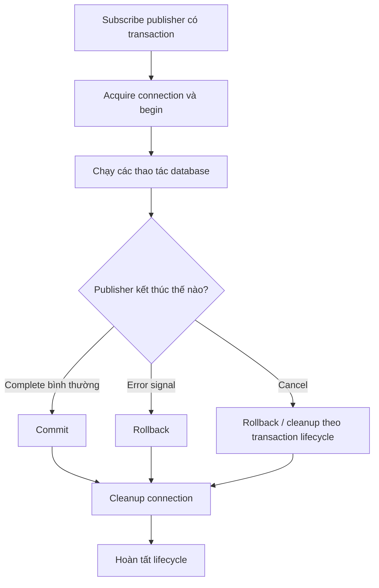

# ReactiveTransactionManager và vai trò của R2dbcTransactionManager

## 1. Giao dịch trong ứng dụng reactive

Một thao tác nghiệp vụ có thể cần nhiều câu lệnh database nhưng vẫn phải được xem là một đơn vị công việc. Ví dụ, khi tạo đơn hàng, ứng dụng có thể cần lưu đơn hàng, lưu các dòng hàng và ghi một bản ghi audit. Nếu lưu đơn hàng thành công nhưng lưu dòng hàng thất bại, hệ thống có thể rơi vào trạng thái không nhất quán nếu các câu lệnh không cùng một transaction.

Transaction cung cấp bốn thuộc tính ACID:

- **Atomicity:** các thay đổi trong transaction được commit cùng nhau hoặc rollback cùng nhau.
- **Consistency:** transaction đưa dữ liệu từ một trạng thái hợp lệ sang trạng thái hợp lệ khác theo các constraint và quy tắc được áp dụng.
- **Isolation:** các transaction đồng thời được cô lập theo isolation level của database.
- **Durability:** thay đổi đã commit được database bảo đảm lưu bền vững theo cấu hình của hệ quản trị.

Với Spring Data R2DBC, các thao tác database trả về `Mono` hoặc `Flux`. Vì vậy, transaction cũng cần được quản lý theo vòng đời của publisher, thay vì giữ một thread trong suốt quá trình thực thi. Spring cung cấp abstraction `ReactiveTransactionManager` cho mục đích này; `R2dbcTransactionManager` là implementation dành cho R2DBC.

## 2. ReactiveTransactionManager là gì?

`ReactiveTransactionManager` là abstraction của Spring Framework để quản lý transaction theo kiểu reactive. Nó định nghĩa một hợp đồng chung cho các thao tác bắt đầu hoặc tham gia transaction, commit và rollback mà không yêu cầu chặn thread để chờ kết quả.

Interface nằm trong package:

```java
org.springframework.transaction.ReactiveTransactionManager
```

Hợp đồng cốt lõi có ba thao tác:

```java
public interface ReactiveTransactionManager extends TransactionManager {

    Mono<ReactiveTransaction> getReactiveTransaction(
            TransactionDefinition definition);

    Mono<Void> commit(ReactiveTransaction transaction);

    Mono<Void> rollback(ReactiveTransaction transaction);
}
```

Ý nghĩa:

- `getReactiveTransaction(...)` lấy transaction phù hợp với định nghĩa được yêu cầu. Tùy propagation behavior, Spring có thể tạo transaction mới hoặc tham gia transaction hiện tại.
- `commit(...)` yêu cầu commit transaction và trả về publisher hoàn tất khi thao tác kết thúc.
- `rollback(...)` yêu cầu rollback transaction và trả về publisher hoàn tất khi thao tác kết thúc.

Các phương thức trả publisher vì lấy connection, bắt đầu transaction, commit và rollback đều có thể là thao tác bất đồng bộ. Spring có thể kết hợp chúng vào pipeline và quản lý lỗi mà không cần gọi `block()`.

`ReactiveTransactionManager` chỉ là abstraction. Nó không tự biết cách mở connection PostgreSQL, MySQL hay H2. Implementation cụ thể sẽ kết nối abstraction này với API transaction của tài nguyên bên dưới.

## 3. R2dbcTransactionManager là gì?

`R2dbcTransactionManager` là implementation của `ReactiveTransactionManager` dành cho một `io.r2dbc.spi.ConnectionFactory`. Lớp này thuộc Spring Framework R2DBC, trong package:

```java
org.springframework.r2dbc.connection.R2dbcTransactionManager
```

Vai trò chính của nó là quản lý một R2DBC `Connection` cho transaction hiện tại:

1. Nhận yêu cầu bắt đầu hoặc tham gia transaction.
2. Lấy connection từ `ConnectionFactory`, hoặc sử dụng connection đã gắn với transaction hiện tại.
3. Bắt đầu transaction trên connection khi cần.
4. Gắn connection với reactive transaction context để các thao tác database tiếp theo có thể sử dụng lại.
5. Commit hoặc rollback khi publisher kết thúc theo kết quả tương ứng.
6. Dọn dẹp tài nguyên và đóng/trả connection về factory hoặc pool.

`R2dbcTransactionManager` làm việc với một `ConnectionFactory` duy nhất. Đây là transaction manager cục bộ cho một tài nguyên R2DBC, không phải bộ điều phối transaction phân tán giữa nhiều database hoặc nhiều hệ thống từ xa.

## 4. Phân biệt abstraction và implementation

| Thành phần | Vai trò | Ví dụ |
| --- | --- | --- |
| `ReactiveTransactionManager` | Hợp đồng quản lý transaction reactive | API chung của Spring |
| `R2dbcTransactionManager` | Quản lý transaction trên R2DBC `ConnectionFactory` | Bắt đầu/commit/rollback trên R2DBC connection |
| `PlatformTransactionManager` | Hợp đồng quản lý transaction imperative | `DataSourceTransactionManager` cho JDBC |
| `DataSourceTransactionManager` | Transaction manager cho JDBC `DataSource` | Quản lý JDBC connection |
| `TransactionalOperator` | API programmatic bao quanh một publisher bằng transaction | `operator.transactional(publisher)` |
| `@Transactional` | Khai báo ranh giới transaction ở method/class | Spring transaction interceptor |

`ReactiveTransactionManager` cho phép Spring cung cấp cơ chế nhất quán cho nhiều loại tài nguyên reactive. `R2dbcTransactionManager` thực hiện hợp đồng đó cho R2DBC. Khi sử dụng Spring Data R2DBC, đây thường là transaction manager phù hợp với `ConnectionFactory` của repository và `DatabaseClient`.

Không nhầm `R2dbcTransactionManager` với `DataSourceTransactionManager`. Một transaction manager JDBC quản lý connection JDBC; transaction manager R2DBC quản lý connection R2DBC. Hai manager này không tự phối hợp thành một transaction nguyên tử chỉ vì chúng cùng kết nối tới một database.

## 5. Kiến trúc và đường đi của reactive transaction

Một luồng transaction điển hình có thể hình dung như sau:

```mermaid
flowchart TD
    A[Controller / Caller] --> B[Application Service]
    B --> C[@Transactional hoặc TransactionalOperator]
    C --> D[ReactiveTransactionManager]
    D --> E[R2dbcTransactionManager]
    E --> F[ConnectionFactory]
    F --> G[R2DBC Connection]
    G --> H[Database Transaction]
    B --> I[Repository / DatabaseClient]
    I --> J[ConnectionFactoryUtils]
    J --> G
    H --> K[Commit hoặc Rollback]
```

Trong sơ đồ:

- Application service mô tả use case và kết hợp các publisher.
- `@Transactional` hoặc `TransactionalOperator` xác định phạm vi transaction.
- `ReactiveTransactionManager` điều phối vòng đời transaction.
- `R2dbcTransactionManager` làm việc với connection R2DBC.
- Repository và `DatabaseClient` lấy connection thông qua cơ chế Spring để có thể tham gia transaction hiện tại.
- Database thực hiện commit hoặc rollback ở phía server.

Các tầng này tách biệt trách nhiệm. Repository không tự quản lý transaction xuyên suốt use case; transaction manager đảm nhận việc liên kết nhiều thao tác persistence vào cùng một transaction.

## 6. Vì sao reactive transaction dùng Reactor Context?

Trong lập trình imperative, nhiều transaction manager gắn connection hoặc transaction resource với thread hiện tại bằng `ThreadLocal`. Cách đó phù hợp khi một thao tác thường chạy trên cùng một thread trong suốt transaction.

Reactive pipeline có thể chuyển qua nhiều thread khi dùng scheduler, `publishOn`, `subscribeOn` hoặc các toán tử bất đồng bộ. Một transaction không thể phụ thuộc đơn thuần vào thread đang thực thi callback tại một thời điểm.

Spring quản lý tài nguyên transaction reactive trong **Reactor Context** gắn với subscription. Connection của transaction được liên kết với reactive context để các thao tác database trong cùng pipeline có thể tìm lại đúng connection, kể cả khi pipeline chuyển thread.

Điều này có nghĩa:

- Transaction gắn với subscription/reactive context, không gắn đơn thuần với thread.
- Reactor operators thông thường duy trì context theo cơ chế của Reactor.
- Các thao tác repository và `DatabaseClient` trong cùng pipeline có thể dùng chung connection đã được transaction manager bind.
- Một subscription độc lập tạo bằng `subscribe()` bên trong use case có thể không kế thừa transaction context của publisher bên ngoài.

### 6.1. Chuyển thread không tự làm mất transaction

Ví dụ pipeline có thể dùng scheduler:

```java
return customerRepository.findById(customerId)
        .publishOn(Schedulers.parallel())
        .flatMap(customer -> {
            customer.setStatus("ACTIVE");
            return customerRepository.save(customer);
        });
```

Việc dùng `publishOn` không tự động làm transaction reactive mất đi vì Reactor Context được truyền theo subscription. Tuy nhiên, các thư viện tự viết hoặc cơ chế async không tích hợp Reactor có thể làm mất context nếu tự tạo subscription hoặc không truyền context đúng cách.

Không nên dùng `ThreadLocal` để tự giữ R2DBC connection trong reactive code. Hãy để Spring transaction manager và các API tích hợp Spring quản lý tài nguyên.

### 6.2. Vì sao không gọi subscribe() bên trong transaction?

Ví dụ không nên dùng:

```java
@Transactional
public Mono<Void> createOrder(Order order) {
    orderRepository.save(order).subscribe();
    return auditRepository.save(new AuditEntry("ORDER_CREATED"));
}
```

Lệnh `subscribe()` tạo subscription mới cho thao tác lưu đơn hàng. Subscription đó có vòng đời riêng và có thể chạy ngoài transaction context của publisher được trả về. Spring transaction interceptor chỉ quản lý publisher mà method trả về; nó không chờ subscription độc lập bên trong hoàn tất.

Hãy kết hợp publisher:

```java
@Transactional
public Mono<Void> createOrder(Order order) {
    return orderRepository.save(order)
            .flatMap(saved -> auditRepository.save(
                    new AuditEntry("ORDER_CREATED", saved.getId())))
            .then();
}
```

Khi đó hai thao tác được nối trong cùng pipeline và có thể tham gia cùng reactive transaction.

## 7. Cấu hình R2dbcTransactionManager

Trong một ứng dụng Spring không dùng auto-configuration, có thể khai báo bean transaction manager:

```java
import io.r2dbc.spi.ConnectionFactory;
import org.springframework.context.annotation.Bean;
import org.springframework.context.annotation.Configuration;
import org.springframework.r2dbc.connection.R2dbcTransactionManager;
import org.springframework.transaction.ReactiveTransactionManager;

@Configuration
public class R2dbcTransactionConfiguration {

    @Bean
    ReactiveTransactionManager transactionManager(
            ConnectionFactory connectionFactory) {
        return new R2dbcTransactionManager(connectionFactory);
    }
}
```

Bean nhận cùng `ConnectionFactory` mà repository và `DatabaseClient` sử dụng. Nếu transaction manager được tạo từ một factory khác, thao tác repository có thể không tham gia transaction đó.

### 7.1. Spring Boot auto-configuration

Với Spring Boot và dependency Spring Data R2DBC phù hợp, Boot thường có thể tự cấu hình `ConnectionFactory` và reactive transaction manager khi điều kiện auto-configuration được đáp ứng. Khi ứng dụng chỉ có một `ConnectionFactory` và không cần tùy chỉnh đặc biệt, thường không cần tự khai báo bean manager.

Nếu ứng dụng tự khai báo `R2dbcTransactionManager`, Spring Boot thường lùi lại theo điều kiện bean hiện có. Hãy kiểm tra cấu hình thực tế và log auto-configuration khi không chắc bean nào đang được sử dụng.

### 7.2. Nhiều ConnectionFactory

Nếu ứng dụng có nhiều database R2DBC, có thể cần nhiều `ConnectionFactory` và nhiều transaction manager. Khi đó, cần chỉ định rõ manager cho từng use case:

```java
@Transactional(transactionManager = "ordersTransactionManager")
public Mono<Void> processOrder(...) {
    // Các repository của database orders tham gia manager tương ứng.
}
```

Tên bean trong annotation phải khớp với tên bean đã khai báo. Mỗi `R2dbcTransactionManager` chỉ quản lý tài nguyên của `ConnectionFactory` mà nó nhận.

## 8. Dùng @Transactional cho reactive method

Spring hỗ trợ `@Transactional` cho method trả về reactive type như `Mono` hoặc `Flux`, khi có `ReactiveTransactionManager` phù hợp.

Ví dụ:

```java
@Service
public class OrderService {

    private final OrderRepository orderRepository;
    private final OrderLineRepository orderLineRepository;

    public OrderService(
            OrderRepository orderRepository,
            OrderLineRepository orderLineRepository) {
        this.orderRepository = orderRepository;
        this.orderLineRepository = orderLineRepository;
    }

    @Transactional
    public Mono<Order> createOrder(Order order) {
        return orderRepository.save(order)
                .flatMap(saved -> orderLineRepository
                        .saveAll(saved.getLines())
                        .then(Mono.just(saved)));
    }
}
```

Ví dụ minh họa một use case có nhiều thao tác repository. Với aggregate được Spring Data Relational quản lý, root và collection có thể đã được lưu cùng nhau qua một lần `save`; khi đó không cần repository riêng cho dòng con. Ví dụ này chỉ nhằm minh họa transaction bao quanh nhiều publisher.

Khi method được gọi qua Spring proxy, transaction interceptor bắt đầu hoặc tham gia transaction, thực thi publisher và quyết định commit/rollback khi publisher kết thúc.

### 8.1. Ranh giới method và proxy

Trong cấu hình proxy-based transaction management, lời gọi phải đi qua Spring proxy để `@Transactional` được áp dụng. Gọi một method transactional khác trong cùng object bằng `this.someMethod()` thường là self-invocation và không đi qua proxy, nên annotation trên method được gọi có thể không được kích hoạt.

Nên đặt ranh giới transaction ở một bean service được gọi từ bean khác, hoặc dùng `TransactionalOperator` nếu cần xác định phạm vi transaction ngay trong pipeline.

### 8.2. Method cần trả Publisher

Reactive transaction được quản lý theo lifecycle của publisher. Một method reactive nên trả `Mono` hoặc `Flux` để Spring có thể theo dõi quá trình thực thi.

Không viết một method trả `void` nhưng bên trong tự subscribe R2DBC publisher rồi kỳ vọng `@Transactional` quản lý các thao tác đó. Khi method trả `void`, Spring xem đó là kiểu xử lý imperative và cần transaction manager imperative phù hợp; subscription tự tạo không nằm trong lifecycle reactive của interceptor.

## 9. Dùng TransactionalOperator theo cách programmatic

`TransactionalOperator` là abstraction giúp bao một publisher bằng transaction reactive mà không cần annotation trên method.

Nó nằm trong package:

```java
org.springframework.transaction.reactive.TransactionalOperator
```

Có thể tạo operator từ transaction manager:

```java
@Configuration
public class TransactionOperatorConfiguration {

    @Bean
    TransactionalOperator transactionalOperator(
            ReactiveTransactionManager transactionManager) {
        return TransactionalOperator.create(transactionManager);
    }
}
```

Sau đó:

```java
@Service
public class TransferService {

    private final AccountRepository accountRepository;
    private final TransactionalOperator transactionalOperator;

    public TransferService(
            AccountRepository accountRepository,
            TransactionalOperator transactionalOperator) {
        this.accountRepository = accountRepository;
        this.transactionalOperator = transactionalOperator;
    }

    public Mono<Void> transfer(
            Long fromId,
            Long toId,
            BigDecimal amount) {

        Mono<Void> work = accountRepository.debit(fromId, amount)
                .then(accountRepository.credit(toId, amount));

        return transactionalOperator.transactional(work);
    }
}
```

`transactional(work)` trả publisher được bao trong transaction. Nếu một thao tác phát lỗi, transaction có thể rollback; nếu toàn bộ publisher hoàn tất bình thường, transaction commit.

### 9.1. Dùng execute khi cần callback

`execute` cho phép viết callback nhận `ReactiveTransaction`:

```java
Flux<Result> results = transactionalOperator.execute(status ->
        repository.findAll()
                .flatMap(this::processOne)
);
```

Callback trả một `Publisher`, còn `execute` trả `Flux` để biểu diễn kết quả. Dạng này hữu ích khi cần thao tác với trạng thái transaction hoặc xây dựng publisher trong phạm vi transaction.

Với một publisher đã có sẵn, `transactional(publisher)` thường dễ đọc hơn. Chọn API theo cách tổ chức pipeline, không cần dùng programmatic transaction chỉ vì ứng dụng đang dùng Reactor.

## 10. Chọn @Transactional hay TransactionalOperator?

| Tiêu chí | `@Transactional` | `TransactionalOperator` |
| --- | --- | --- |
| Cách khai báo | Annotation trên class/method | Bao publisher trong code |
| Phù hợp | Use case có ranh giới method rõ ràng | Ranh giới transaction cần nằm trong một phần pipeline |
| Khả năng đọc | Thể hiện transaction ở mức service method | Thể hiện transaction ngay tại biểu thức reactive |
| Cấu hình propagation/isolation | Thuộc tính annotation | Dùng `TransactionDefinition` khi tạo operator |
| Phụ thuộc proxy | Có trong cấu hình annotation proxy-based | Không cần transaction proxy cho thao tác bao publisher |
| Dễ dùng trong functional pipeline | Ít trực tiếp hơn | Tự nhiên hơn |

Ví dụ annotation:

```java
@Transactional
public Mono<Order> placeOrder(PlaceOrderCommand command) {
    return validate(command)
            .flatMap(this::saveOrderAndLines);
}
```

Ví dụ operator:

```java
public Mono<Order> placeOrder(PlaceOrderCommand command) {
    return validate(command)
            .flatMap(this::saveOrderAndLines)
            .as(transactionalOperator::transactional);
}
```

Cả hai cách có thể quản lý transaction reactive. Tránh vô tình bao cùng một publisher bằng nhiều transaction boundary không cần thiết, vì propagation behavior có thể tạo transaction lồng nhau hoặc tham gia transaction hiện tại tùy cấu hình.

## 11. TransactionDefinition và các thuộc tính transaction

`ReactiveTransactionManager` nhận `TransactionDefinition`, trong đó có các thuộc tính xác định cách transaction được tạo hoặc tham gia:

- Propagation behavior.
- Isolation level.
- Timeout.
- Read-only hint.
- Tên transaction.

Với `@Transactional`, các thuộc tính có thể khai báo trực tiếp:

```java
@Transactional(
        propagation = Propagation.REQUIRED,
        isolation = Isolation.READ_COMMITTED,
        timeout = 10,
        readOnly = false
)
public Mono<Void> updateOrder(...) {
    // Reactive database operations
}
```

Các giá trị ở ví dụ chỉ minh họa cấu hình. Khả năng áp dụng thực tế phụ thuộc database, R2DBC driver và Spring Framework version.

### 11.1. Propagation

Propagation xác định cách một method tham gia vào transaction hiện có hoặc tạo transaction mới.

| Propagation | Ý nghĩa khái quát |
| --- | --- |
| `REQUIRED` | Tham gia transaction hiện tại nếu có; nếu không thì tạo mới |
| `REQUIRES_NEW` | Tạo transaction mới độc lập với transaction hiện tại theo khả năng manager |
| `SUPPORTS` | Tham gia transaction nếu có; nếu không thì chạy không có transaction mới |
| `MANDATORY` | Yêu cầu phải có transaction hiện tại |
| `NOT_SUPPORTED` | Chạy không có transaction, có thể tạm ngưng transaction hiện tại |
| `NEVER` | Yêu cầu không có transaction hiện tại |
| `NESTED` | Dùng nested transaction/savepoint nếu manager và driver hỗ trợ |

`REQUIRED` là lựa chọn phổ biến cho use case cần tham gia transaction của tầng gọi hoặc tự tạo transaction khi gọi độc lập.

`REQUIRES_NEW` có thể cần thêm connection trong khi transaction ngoài đang bị suspend. Với pool nhỏ hoặc transaction ngoài giữ connection lâu, điều này có thể làm tăng nhu cầu connection. Hãy kiểm tra hành vi cụ thể của manager và driver.

`NESTED` thường phụ thuộc khả năng savepoint của connection/driver và implementation. Không nên giả định mọi R2DBC driver đều hỗ trợ nested transaction như nhau.

### 11.2. Isolation level

Isolation level điều khiển mức độ một transaction nhìn thấy thay đổi của transaction khác. Các mức thường được biết đến:

| Isolation | Ý nghĩa khái quát |
| --- | --- |
| `READ_UNCOMMITTED` | Có thể đọc thay đổi chưa commit nếu database hỗ trợ đúng mức này |
| `READ_COMMITTED` | Chỉ đọc dữ liệu đã commit; hai lần đọc có thể thấy kết quả khác nhau |
| `REPEATABLE_READ` | Bảo đảm mạnh hơn cho dữ liệu đã đọc trong transaction; chi tiết phụ thuộc database |
| `SERIALIZABLE` | Mức cô lập cao, cố gắng tạo kết quả tương đương thực thi tuần tự; có thể phát sinh serialization failure |

Database có thể không hỗ trợ mọi mức isolation hoặc có thể ánh xạ chúng theo cách riêng. Ví dụ, một số hệ quản trị dùng MVCC với semantics khác nhau. Hãy kiểm tra tài liệu database và driver thay vì chỉ dựa vào tên enum.

### 11.3. Read-only

`readOnly = true` thể hiện transaction chỉ đọc. Đây thường là một hint cho transaction manager/database, không nên mặc định rằng nó luôn ngăn tuyệt đối mọi câu ghi. Mức độ enforcement phụ thuộc manager, driver và database; một số cấu hình có thể yêu cầu database đặt transaction ở chế độ read-only rõ ràng.

Ví dụ:

```java
@Transactional(readOnly = true)
public Flux<OrderSummary> findRecentOrders() {
    return orderRepository.findRecentSummaries();
}
```

Đây là tín hiệu về ý định của use case và có thể giúp database tối ưu hoặc từ chối thao tác ghi nếu được cấu hình hỗ trợ. Không dùng `readOnly` như biện pháp authorization hoặc thay thế kiểm tra quyền.

### 11.4. Timeout

`timeout` trong transaction definition giới hạn thời gian theo cơ chế transaction manager hỗ trợ. Nó không nhất thiết giống statement timeout của database và không bảo đảm mọi câu SQL đang chạy sẽ bị server dừng tức thì khi hết hạn.

Hãy phối hợp timeout của transaction, statement, connection acquire và HTTP request. Nếu timeout ở tầng ngoài ngắn hơn các tầng trong, caller có thể hủy publisher trước khi thao tác hoàn tất; cancellation sẽ ảnh hưởng vòng đời transaction.

## 12. Commit và rollback theo tín hiệu reactive

Với reactive transaction, kết quả của publisher quyết định cách transaction kết thúc:



### 12.1. Hoàn tất bình thường dẫn đến commit

Nếu publisher bên trong transaction hoàn tất bình thường, transaction manager thực hiện commit. Chỉ khi commit hoàn tất thì thay đổi mới được xác nhận thành công ở phía database.

### 12.2. Error signal dẫn đến rollback

Nếu publisher phát lỗi và lỗi đi qua transaction boundary, transaction manager rollback transaction theo chính sách rollback. Mặc định của Spring là rollback với `RuntimeException` và `Error`; checked exception không tự động làm rollback trong mọi cấu hình annotation nếu không khai báo `rollbackFor` phù hợp.

Ví dụ:

```java
@Transactional(rollbackFor = Exception.class)
public Mono<Void> processOrder(Order order) throws Exception {
    return orderRepository.save(order)
            .then(Mono.error(new Exception("A later step failed")));
}
```

Với reactive code, điều quan trọng là exception phải được phát thành error signal trong publisher để transaction interceptor nhìn thấy.

### 12.3. Xử lý lỗi bên trong pipeline có thể khiến transaction commit

Xem ví dụ:

```java
@Transactional
public Mono<Void> updateOrder(Order order) {
    return orderRepository.save(order)
            .then(auditRepository.save(createAudit(order)))
            .onErrorResume(error -> Mono.empty());
}
```

`onErrorResume` biến lỗi thành hoàn tất bình thường trước khi publisher tới transaction boundary. Transaction manager có thể thấy publisher hoàn tất thành công và commit, mặc dù một bước đã thất bại.

Nếu muốn rollback, hãy để lỗi truyền qua transaction boundary hoặc đánh dấu rollback-only theo API phù hợp. Nếu cần chuyển lỗi thành kết quả nghiệp vụ sau khi rollback, hãy đặt việc xử lý lỗi bên ngoài transaction boundary:

```java
public Mono<String> updateOrder(Order order) {
    return transactionalOperator.transactional(
                    orderRepository.save(order)
                            .then(auditRepository.save(createAudit(order)))
                            .thenReturn("updated"))
            .onErrorResume(error -> Mono.just("update failed"));
}
```

Ở ví dụ này, lỗi được xử lý sau publisher đã được bao bởi operator. Transaction boundary có cơ hội quan sát lỗi và rollback trước khi tầng ngoài chuyển lỗi thành kết quả thay thế.

### 12.4. Cancellation

Reactive Streams cho phép subscriber hủy subscription. Ví dụ client HTTP ngắt kết nối, timeout ở tầng gọi hoặc toán tử chỉ lấy một phần dữ liệu có thể hủy publisher upstream.

Với reactive transaction, cancellation là tín hiệu quan trọng vì transaction không nên được commit như thể toàn bộ công việc đã hoàn tất bình thường. Spring transaction infrastructure thực hiện rollback/cleanup theo lifecycle khi publisher bị cancel. Vì vậy, không nên bỏ dở publisher transaction hoặc tự tạo subscription tách rời.

Với `Flux`, nếu consumer chỉ lấy một phần kết quả rồi hủy, transaction có thể bị rollback. Nếu cần transaction chỉ đọc để tiêu thụ toàn bộ kết quả, hãy bảo đảm subscriber đọc tới completion.

## 13. R2dbcTransactionManager và ConnectionFactoryUtils

`R2dbcTransactionManager` bind một connection vào reactive transaction context. Để các thao tác khác sử dụng đúng connection đó, chúng phải truy cập connection qua cơ chế Spring-aware.

Spring cung cấp `ConnectionFactoryUtils` để lấy connection gắn với transaction hiện tại. Các abstraction như `DatabaseClient` và Spring Data R2DBC sử dụng cơ chế này để tham gia transaction.

Với code persistence tùy chỉnh, không nên luôn gọi trực tiếp:

```java
connectionFactory.create();
```

vì thao tác đó có thể lấy một connection mới không gắn với transaction hiện tại. Thay vào đó, dùng `ConnectionFactoryUtils.getConnection(connectionFactory)` hoặc API Spring tích hợp sẵn phù hợp với phiên bản đang dùng.

Ví dụ ý tưởng:

```java
Mono<Connection> connection = ConnectionFactoryUtils.getConnection(connectionFactory);
```

`ConnectionFactoryUtils` quản lý việc tìm connection đã bind trong context hoặc lấy connection mới khi không có transaction. Việc giải phóng cũng cần theo đúng API Spring để tránh đóng nhầm connection do transaction manager sở hữu.

### 13.1. Connection pool vẫn hoạt động cùng transaction manager

Nếu dùng R2DBC Pool, `ConnectionFactory` mà ứng dụng nhận có thể là pooled factory. `R2dbcTransactionManager` mượn một connection từ pool khi bắt đầu transaction và giữ connection đó trong phạm vi transaction. Khi commit/rollback và cleanup hoàn tất, connection được trả về pool.

Một transaction thường giữ một connection trong suốt thời gian hoạt động. Do đó, transaction kéo dài có thể làm connection bị chiếm lâu và khiến pool thiếu connection cho request khác.

### 13.2. Không giữ transaction trong lúc chờ công việc ngoài database

Tránh mẫu:

```java
@Transactional
public Mono<Void> checkout(CheckoutCommand command) {
    return orderRepository.save(command.toOrder())
            .flatMap(order -> paymentClient.charge(command.payment()))
            .then();
}
```

Trong ví dụ, transaction database có thể giữ connection trong khi chờ HTTP tới payment service. Transaction R2DBC không thể rollback khoản thanh toán ở hệ thống từ xa chỉ bằng rollback database.

Hãy tách bước database và remote call theo một quy trình phù hợp, ví dụ ghi trạng thái pending rồi phát command, xử lý kết quả ở bước tiếp theo và dùng outbox/saga khi cần độ tin cậy. Điều này giảm thời gian giữ connection và làm rõ cách xử lý lỗi giữa các hệ thống.

## 14. Ranh giới một ConnectionFactory và giới hạn transaction phân tán

`R2dbcTransactionManager` quản lý một `ConnectionFactory`. Nếu một use case ghi vào hai database độc lập, một manager R2DBC không tự tạo transaction nguyên tử cho cả hai.

Ví dụ:

- `ordersConnectionFactory` quản lý database đơn hàng.
- `billingConnectionFactory` quản lý database thanh toán.

Hai connection factory có thể có hai `R2dbcTransactionManager` riêng. Một method có hai thao tác ghi không đồng nghĩa cả hai thao tác commit/rollback cùng nhau.

Nếu database A commit thành công nhưng database B lỗi, dữ liệu có thể ở trạng thái một phần. Với hệ thống phân tán, thường cần:

- Saga/process manager để điều phối các bước và hành động bù.
- Transactional outbox để lưu event cùng thay đổi local trong một transaction.
- Idempotency để xử lý message hoặc request lặp.
- Retry có giới hạn và phân loại lỗi.
- Trạng thái nghiệp vụ trung gian để có thể tiếp tục hoặc khôi phục.

Không nên gọi đây là transaction ACID phân tán nếu hạ tầng không có cơ chế transaction phân tán thực sự. R2DBC SPI và `R2dbcTransactionManager` không tự cung cấp XA cho nhiều tài nguyên.

## 15. Propagation trong use case nhiều tầng

Giả sử `OrderService.placeOrder()` gọi `InventoryService.reserve()` và cả hai đều được đánh dấu `@Transactional`.

```java
@Transactional
public Mono<Order> placeOrder(PlaceOrderCommand command) {
    return orderRepository.save(command.toOrder())
            .flatMap(order -> inventoryService.reserve(command.items())
                    .thenReturn(order));
}
```

Nếu method bên trong dùng `Propagation.REQUIRED` và cùng reactive transaction manager, nó thường tham gia transaction hiện tại. Nếu method bên trong dùng `REQUIRES_NEW`, nó yêu cầu transaction mới theo khả năng manager và có thể tạm ngưng transaction ngoài.

Hãy cân nhắc ranh giới nghiệp vụ thay vì đặt `@Transactional` ở mọi method. Thông thường, application service định nghĩa transaction cho một use case; các method repository tham gia transaction đó.

## 16. Kiểm thử reactive transaction

Transaction cần được kiểm thử qua database và transaction manager thực tế. Unit test mock repository chỉ kiểm tra logic điều phối, không xác nhận commit/rollback ở database.

Ví dụ kiểm tra rollback bằng `TransactionalOperator`:

```java
Mono<Void> work = transactionalOperator.transactional(
        customerRepository.save(customer)
                .then(Mono.error(new IllegalStateException("force rollback")))
                .then()
);

StepVerifier.create(work)
        .expectError(IllegalStateException.class)
        .verify();
```

Sau khi publisher phát lỗi, test có thể truy vấn lại để xác nhận customer không tồn tại:

```java
StepVerifier.create(customerRepository.existsById(customer.getId()))
        .expectNext(false)
        .verifyComplete();
```

Ví dụ cần điều chỉnh theo cách ID được sinh và cách fixture tạo dữ liệu. Nếu ID được sinh trong transaction bị rollback, có thể cần lưu ID đã biết trước hoặc truy vấn theo khóa nghiệp vụ.

Các tình huống nên kiểm thử:

- Nhiều thao tác repository trong cùng transaction cùng commit.
- Lỗi ở thao tác sau khiến thao tác trước rollback.
- Lỗi được chuyển thành empty bên trong transaction có dẫn đến commit ngoài ý muốn không.
- Cancellation có kích hoạt cleanup/rollback phù hợp không.
- Propagation `REQUIRED` tham gia transaction hiện tại.
- `REQUIRES_NEW` và nested/savepoint chỉ được dùng nếu manager/driver hỗ trợ đúng.
- Isolation level thực tế có đáp ứng yêu cầu đọc/ghi đồng thời không.
- Connection được trả về pool sau commit, rollback và lỗi.

## 17. Những lỗi thường gặp

| Triệu chứng | Nguyên nhân có thể có | Cách xử lý |
| --- | --- | --- |
| Hai thao tác repository không rollback cùng nhau | Chúng dùng connection factory/transaction manager khác nhau hoặc bị subscribe tách rời | Dùng cùng `ConnectionFactory`, nối publisher và kiểm tra manager |
| `@Transactional` không có tác dụng | Self-invocation, method không đi qua proxy hoặc method không trả reactive publisher | Đặt boundary ở bean được proxy và trả `Mono`/`Flux` |
| Transaction mất khi chuyển thread | Dùng cơ chế async tự tạo subscription hoặc không truyền Reactor Context | Giữ pipeline Reactor và tránh subscribe lồng nhau |
| Gọi `subscribe()` rồi transaction kết thúc sớm | Subscription độc lập không thuộc publisher method trả về | Nối bằng `flatMap`, `then` và trả publisher |
| Lỗi bị nuốt nhưng dữ liệu vẫn commit | `onErrorResume` biến lỗi thành completion trước transaction boundary | Để lỗi đi qua boundary hoặc xử lý sau transaction operator |
| Pool cạn connection | Transaction kéo dài, chờ HTTP hoặc publisher không hoàn tất | Rút ngắn transaction, bỏ remote call khỏi transaction và bảo đảm cleanup |
| `readOnly = true` vẫn ghi được | Read-only chỉ là hint hoặc database/driver không enforce | Kiểm tra hỗ trợ của driver/database và dùng quyền DB/constraint khi cần |
| Isolation level không như mong đợi | Database/driver không hỗ trợ hoặc ánh xạ khác | Kiểm thử trên hệ quản trị thực tế |
| Nested transaction không hoạt động | Driver hoặc manager không hỗ trợ savepoint theo cách yêu cầu | Kiểm tra R2DBC SPI/driver và phiên bản Spring |
| Hai database không rollback cùng nhau | Một R2dbcTransactionManager chỉ quản lý một ConnectionFactory | Dùng saga/outbox hoặc giải pháp distributed transaction phù hợp |

## 18. Cách lựa chọn ReactiveTransactionManager trong ứng dụng

Khi xây dựng ứng dụng Spring Data R2DBC, có thể đi theo trình tự:

1. Xác định thao tác persistence dùng R2DBC `ConnectionFactory` nào.
2. Chọn `R2dbcTransactionManager` cho factory đó, hoặc dùng bean auto-configured của Spring Boot nếu phù hợp.
3. Bảo đảm repository, `R2dbcEntityTemplate` và `DatabaseClient` cùng sử dụng factory tương ứng.
4. Đặt transaction boundary ở application service bằng `@Transactional` hoặc dùng `TransactionalOperator` cho phạm vi publisher cụ thể.
5. Giữ các thao tác database trong cùng reactive pipeline; tránh `block()` và `subscribe()` độc lập.
6. Chọn propagation, isolation, read-only và timeout theo nghiệp vụ cùng khả năng của database/driver.
7. Xác định cách xử lý error signal, cancellation, commit và rollback.
8. Không giả định một manager R2DBC có thể quản lý nhiều database hoặc HTTP service trong cùng transaction.
9. Kiểm thử commit, rollback, cancellation, propagation và pool cleanup trên database thật.

`ReactiveTransactionManager` là hợp đồng quản lý transaction bất đồng bộ của Spring. `R2dbcTransactionManager` hiện thực hợp đồng đó bằng cách quản lý connection R2DBC và gắn connection với reactive transaction context. Khi dùng cùng `ConnectionFactory`, repository và `DatabaseClient` có thể tham gia một transaction mà không cần chặn thread. Hiểu rõ context, publisher lifecycle, propagation và giới hạn một tài nguyên giúp đặt transaction boundary đúng chỗ, tránh mất transaction do subscription độc lập và bảo đảm các thao tác dữ liệu được commit hoặc rollback theo ý định nghiệp vụ.
