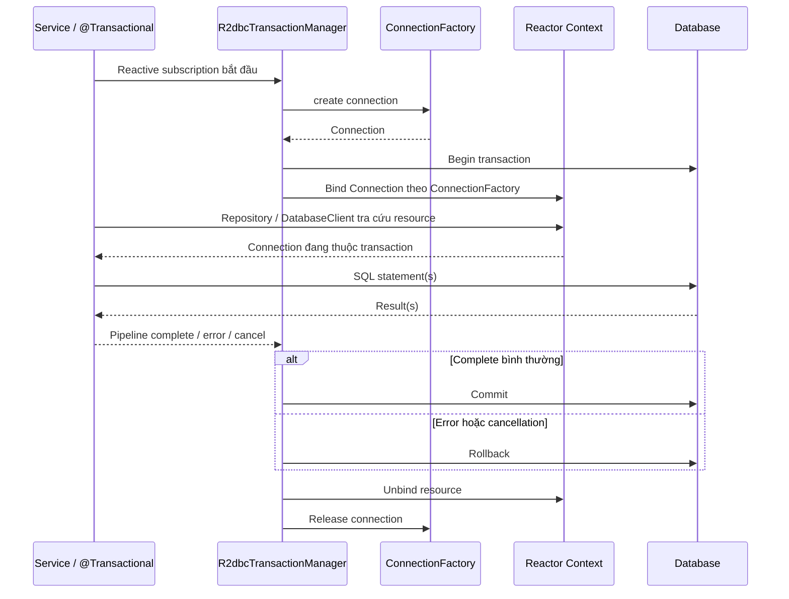

# Liên kết kết nối giao dịch qua Reactor Context

Trong Spring Data Relational R2DBC, một reactive transaction cần bảo đảm các thao tác database thuộc cùng transaction sử dụng cùng một kết nối R2DBC. Spring thực hiện việc này bằng cách liên kết `Connection` với transaction context của Reactor. `R2dbcTransactionManager` mở transaction, đặt connection vào context của subscriber; các thành phần truy cập dữ liệu của Spring như `DatabaseClient`, repository và `R2dbcEntityTemplate` tra cứu connection đó khi thực thi SQL. Khi transaction kết thúc, Spring commit hoặc rollback, gỡ connection khỏi context và giải phóng tài nguyên.

Reactor Context là cơ chế truyền trạng thái theo reactive subscription. Nó không phụ thuộc vào một thread cố định như `ThreadLocal`. Vì vậy, một pipeline có thể chuyển qua nhiều thread bằng `publishOn` hoặc `subscribeOn` mà vẫn giữ transaction context, miễn là các thao tác tiếp tục nằm trong cùng reactive chain. Ngược lại, tự gọi `subscribe()`, `block()` hoặc tạo một subscription độc lập có thể tách thao tác database ra khỏi context của transaction ban đầu.

Hiểu cách liên kết này giúp giải thích vì sao hai lệnh repository có thể dùng cùng connection trong một transaction, vì sao gọi trực tiếp `ConnectionFactory.create()` có thể thoát khỏi transaction của Spring, và vì sao reactive transaction phải được tổ chức thành một pipeline liên tục.

## 1. Vì sao transaction cần gắn với connection?

Một transaction database là phạm vi trong đó nhiều thao tác SQL được phối hợp theo các thuộc tính transaction như atomicity, consistency, isolation và durability. Với R2DBC, các thao tác SQL được thực thi qua một `Connection`.

Ví dụ chuyển tiền cần hai thao tác:

```sql
UPDATE account SET balance = balance - 100 WHERE id = 1;
UPDATE account SET balance = balance + 100 WHERE id = 2;
```

Hai câu lệnh phải thuộc cùng transaction. Nếu câu lệnh thứ hai lỗi, database cần rollback thay đổi của câu lệnh thứ nhất. Điều này chỉ có ý nghĩa khi cả hai lệnh được thực thi trên cùng connection và trong cùng transaction đã được bắt đầu trên connection đó.

Nếu mỗi lệnh tự lấy một connection độc lập, lệnh debit có thể nằm trong transaction A còn lệnh credit nằm ngoài hoặc trong transaction B. Khi đó transaction manager không thể bảo đảm hai thao tác commit/rollback như một đơn vị.

Với Spring Data R2DBC, `R2dbcTransactionManager` quản lý connection theo `ConnectionFactory` và liên kết nó với reactive transaction context. Các thao tác truy cập dữ liệu tham gia transaction phải lấy connection qua cơ chế nhận biết transaction của Spring.

## 2. Reactor Context là gì?

Reactor Context là một vùng lưu trữ key/value bất biến, gắn với subscriber của một reactive pipeline. Nó được dùng để truyền trạng thái theo luồng reactive mà không cần dựa vào thread hiện tại.

Trong lập trình đồng bộ, một framework có thể dùng `ThreadLocal` để gắn transaction vào thread. Cách đó phù hợp khi một thao tác bắt đầu và kết thúc trên cùng thread. Reactive pipeline có thể chuyển thread trong lúc chạy, nên trạng thái transaction không thể chỉ dựa vào thread hiện tại.

Reactor Context giải quyết vấn đề bằng cách gắn transaction resources và synchronization state vào subscriber context. Các operator Reactor chuyển tiếp context theo quy tắc của chúng, vì vậy transaction có thể tiếp tục được nhận diện khi pipeline chạy trên thread khác.

### Context đi theo subscription, không đi theo thread

Ví dụ:

```java
Mono<String> pipeline = Mono.just("start")
        .publishOn(Schedulers.boundedElastic())
        .map(value -> value + " -> worker thread");
```

`publishOn` có thể chuyển việc xử lý downstream sang thread khác. Reactor Context vẫn thuộc subscription của pipeline; nó không bị mất chỉ vì thread thay đổi.

Ngược lại, đoạn code sau tạo một subscription mới:

```java
someRepository.save(entity).subscribe();
```

Subscription mới không tự kế thừa transaction context của pipeline đang gọi nó. Vì vậy, thao tác lưu có thể lấy connection khác và chạy ngoài transaction mà caller mong muốn.

### Context là bất biến

Reactor Context được sửa bằng cách tạo context mới qua operator như `contextWrite`; các giá trị trong đó được truyền theo subscription. Spring tự quản lý key chứa transaction resource. Ứng dụng thông thường không cần tự ghi, xóa hoặc thay đổi transaction resource trong context.

Không nên cố tự đặt connection hoặc transaction manager state vào Reactor Context bằng một key tùy ý để thay thế `R2dbcTransactionManager`. Việc liên kết resource phải tuân theo cơ chế Spring để acquire, synchronize, commit, rollback và release connection đúng cách.

## 3. `R2dbcTransactionManager` liên kết connection như thế nào?

`R2dbcTransactionManager` là reactive transaction manager cho một `ConnectionFactory`. Khi một reactive transaction bắt đầu, quá trình khái quát như sau:

1. Spring nhận subscription đi qua ranh giới transaction, ví dụ một method `@Transactional` trả về `Mono` hoặc `Flux`.
2. Transaction manager lấy một `Connection` từ `ConnectionFactory` được cấu hình.
3. Connection được đưa vào trạng thái transaction phù hợp và transaction được bắt đầu theo API R2DBC.
4. Spring tạo transaction resource holder và liên kết nó với reactive transaction context của subscriber, theo khóa là `ConnectionFactory`.
5. Các thao tác truy cập dữ liệu của Spring tra cứu resource đã liên kết thay vì tự tạo connection mới.
6. Khi pipeline hoàn tất bình thường, transaction manager commit; nếu pipeline lỗi hoặc bị hủy theo ngữ nghĩa reactive transaction, transaction manager rollback.
7. Spring gỡ resource khỏi context, thực hiện cleanup cần thiết và trả connection về pool hoặc giải phóng connection.

Sơ đồ khái quát:



Đây là mô hình khái niệm. Chi tiết begin/commit/rollback, reset connection và release phụ thuộc driver, pool và phiên bản Spring Framework. Ý chính là connection được gắn với reactive transaction context để các thao tác cùng transaction tìm lại được đúng resource.

## 4. Cấu hình transaction manager

Trong ứng dụng Spring dùng một `ConnectionFactory`, có thể khai báo `R2dbcTransactionManager`:

```java
@Configuration
public class R2dbcTransactionConfiguration {

    @Bean
    public ReactiveTransactionManager transactionManager(
            ConnectionFactory connectionFactory
    ) {
        return new R2dbcTransactionManager(connectionFactory);
    }
}
```

`R2dbcTransactionManager` cần cùng `ConnectionFactory` mà các thao tác R2DBC tham gia transaction sử dụng. Spring Boot có thể tự cấu hình transaction manager khi điều kiện auto-configuration phù hợp; nếu ứng dụng tự khai báo nhiều factory hoặc nhiều transaction manager, cần chỉ định rõ manager được dùng.

Với một `ConnectionFactory`, cấu hình thường có dạng:

```text
ConnectionFactory
       |
       +--> R2dbcTransactionManager
       |
       +--> DatabaseClient
       |
       +--> R2dbcEntityTemplate
       |
       +--> Spring Data R2DBC repositories
```

Các thành phần cần tham gia cùng transaction phải dùng factory tương ứng. Nếu repository được cấu hình bằng factory A nhưng transaction manager quản lý factory B, repository đó không tự động dùng connection đã bind cho B.

## 5. `@Transactional` với reactive return type

Spring hỗ trợ reactive transaction cho method trả về reactive type như `Mono` hoặc `Flux`, khi có reactive transaction manager phù hợp.

Ví dụ:

```java
@Service
public class TransferService {

    private final AccountRepository accountRepository;

    public TransferService(AccountRepository accountRepository) {
        this.accountRepository = accountRepository;
    }

    @Transactional
    public Mono<Void> transfer(Long fromId, Long toId, BigDecimal amount) {
        return accountRepository.debit(fromId, amount)
                .then(accountRepository.credit(toId, amount))
                .then();
    }
}
```

Khi method được gọi, Spring trả về publisher đã được bọc bởi transaction interceptor. Transaction thực sự bắt đầu khi publisher được subscribe. Các thao tác repository trong pipeline sử dụng cùng reactive transaction context nếu chúng dùng cùng `ConnectionFactory` và Spring-aware data access.

### Reactive transaction bắt đầu khi subscribe

Với reactive method, đừng suy luận rằng transaction đã mở ngay tại dòng gọi method:

```java
Mono<Void> transfer = transferService.transfer(1L, 2L, amount);
```

Dòng trên tạo/nhận publisher. Transaction và I/O database được kích hoạt khi publisher được tiêu thụ. Nếu không subscribe, thao tác không chạy.

Một publisher cold có thể được subscribe nhiều lần. Mỗi subscription có thể thực hiện lại pipeline và tạo một transaction mới. Tránh chia sẻ publisher ghi rồi vô tình subscribe nhiều lần nếu thao tác không idempotent.

### Phải dùng reactive transaction manager

Method trả `Mono`/`Flux` cần được quản lý bởi reactive transaction manager như `R2dbcTransactionManager`. Nếu ứng dụng có cả transaction manager imperative và reactive, hãy kiểm tra manager được chọn bởi cấu hình/annotation. Một transaction manager JDBC/JPA không quản lý R2DBC connection.

## 6. `DatabaseClient`, repository và template tham gia transaction

Các thành phần truy cập dữ liệu của Spring được thiết kế để nhận biết connection đã bind:

- `DatabaseClient` sử dụng cơ chế connection lookup của Spring.
- Spring Data R2DBC repository thực hiện thao tác qua infrastructure R2DBC của Spring.
- `R2dbcEntityTemplate` sử dụng `DatabaseClient`/mapping infrastructure tương ứng.
- Các thao tác này có thể tham gia cùng reactive transaction nếu dùng cùng `ConnectionFactory` và được gọi trong cùng pipeline.

Ví dụ kết hợp repository và `DatabaseClient`:

```java
@Transactional
public Mono<Void> renameAndAudit(Long customerId, String newName) {
    return customerRepository.findById(customerId)
            .switchIfEmpty(Mono.error(
                    new IllegalArgumentException("Customer không tồn tại")
            ))
            .flatMap(customer -> {
                customer.setName(newName);
                return customerRepository.save(customer);
            })
            .flatMap(saved -> databaseClient.sql("""
                        INSERT INTO audit_log (customer_id, action)
                        VALUES (:customerId, :action)
                        """)
                    .bind("customerId", saved.getId())
                    .bind("action", "CUSTOMER_RENAMED")
                    .fetch()
                    .rowsUpdated()
                    .then());
}
```

Nếu cả repository và `DatabaseClient` dùng cùng factory do transaction manager quản lý, cả thao tác cập nhật customer và insert audit có thể chạy trên cùng transaction connection. Nếu thao tác audit lỗi và lỗi được truyền ra khỏi transaction boundary, Spring rollback cả hai thay đổi.

Điều kiện quan trọng là các publisher phải được nối với nhau. Chỉ gọi `databaseClient.sql(...)` mà bỏ publisher trả về không thực thi SQL và không tham gia transaction.

## 7. `ConnectionFactoryUtils` và lấy connection nhận biết transaction

Khi cần dùng R2DBC SPI trực tiếp trong một ứng dụng Spring, nên lấy connection qua `ConnectionFactoryUtils` thay vì gọi thẳng `ConnectionFactory.create()`:

```java
import org.springframework.r2dbc.connection.ConnectionFactoryUtils;

Mono<Connection> connectionMono =
        ConnectionFactoryUtils.getConnection(connectionFactory);
```

`ConnectionFactoryUtils.getConnection(...)` tra cứu connection đã bind với transaction hiện tại. Nếu có connection trong reactive context, nó trả về connection đó; nếu không có transaction-bound resource, nó có thể lấy connection mới từ factory.

Khi hoàn tất thao tác thủ công, dùng `ConnectionFactoryUtils.releaseConnection(...)`:

```java
Mono<Void> release = ConnectionFactoryUtils.releaseConnection(
        connection,
        connectionFactory
);
```

Nếu connection thuộc transaction đang hoạt động, Spring không giải phóng connection đó sớm; transaction manager vẫn sở hữu và sẽ release ở cuối transaction. Nếu connection không được transaction quản lý, helper sẽ thực hiện release phù hợp.

Ví dụ quản lý connection bất đồng bộ:

```java
public Mono<Long> updateStatus(Long id, String status) {
    return Mono.usingWhen(
            ConnectionFactoryUtils.getConnection(connectionFactory),
            connection -> Mono.from(connection.createStatement(
                            "UPDATE customer SET status = $1 WHERE id = $2"
                    ).bind(0, status)
                     .bind(1, id)
                     .execute())
                    .flatMap(result -> Mono.from(result.getRowsUpdated())),
            connection -> ConnectionFactoryUtils.releaseConnection(
                    connection, connectionFactory
            ),
            (connection, error) -> ConnectionFactoryUtils.releaseConnection(
                    connection, connectionFactory
            ),
            connection -> ConnectionFactoryUtils.releaseConnection(
                    connection, connectionFactory
            )
    );
}
```

Ví dụ dùng marker `$1`, `$2` theo cú pháp PostgreSQL; driver khác có thể dùng marker khác. Khi chạy trong transaction của Spring và cùng factory, connection lấy từ `ConnectionFactoryUtils` có thể là connection đã bind. Khi chạy ngoài transaction, helper sẽ lấy và release connection như một thao tác độc lập.

Trong code thông thường, `DatabaseClient` thường đơn giản và ít rủi ro quản lý tài nguyên hơn. Dùng SPI trực tiếp khi thật sự cần quyền kiểm soát statement/connection ở mức thấp.

## 8. Vì sao gọi trực tiếp `ConnectionFactory.create()` có thể thoát transaction?

`ConnectionFactory.create()` yêu cầu factory tạo một connection mới. Lời gọi này không tra cứu connection đã bind vào reactive transaction context của Spring.

Ví dụ dễ gây lỗi:

```java
@Transactional
public Mono<Void> updateTwoTables(Long id) {
    return customerRepository.updateStatus(id, "ACTIVE")
            .then(Mono.from(connectionFactory.create())
                    .flatMap(connection ->
                            Mono.from(connection.createStatement(
                                    "INSERT INTO audit_log(customer_id) VALUES ($1)"
                            ).bind(0, id).execute())
                                    .then(Mono.from(connection.close()))
                    ))
            .then();
}
```

Repository update có thể dùng connection transaction-bound, trong khi `connectionFactory.create()` lấy connection khác. Lệnh insert audit vì vậy không nằm trong cùng transaction. Nếu lệnh thứ hai lỗi, update customer có thể vẫn commit.

Khi cần thao tác SPI trực tiếp trong transaction Spring, hãy dùng `ConnectionFactoryUtils.getConnection(...)` và release qua helper tương ứng, hoặc đưa SQL vào `DatabaseClient`.

### Khi nào gọi trực tiếp `create()` là hợp lý?

Lời gọi trực tiếp không sai trong mọi trường hợp. Nó phù hợp khi ứng dụng chủ động quản lý connection và transaction ở tầng SPI, hoặc khi muốn tạo một connection độc lập ngoài transaction Spring. Nhưng không nên dùng nó bên trong một reactive transaction và kỳ vọng nó tự tham gia resource binding.

## 9. ConnectionFactory phải nhất quán

`R2dbcTransactionManager` bind connection theo `ConnectionFactory` mà nó quản lý. Các thao tác database cần tham gia transaction phải dùng factory tương ứng.

Các tình huống dễ cấu hình sai:

- Repository dùng factory A, transaction manager dùng factory B.
- `DatabaseClient` được tạo từ một factory khác với factory của transaction manager.
- Ứng dụng tự tạo một `ConnectionFactory` mới trong service thay vì inject bean đã cấu hình.
- Một số thao tác dùng proxy/wrapper hoặc pool khác khiến resource lookup không khớp với resource key mà transaction manager sử dụng.
- Có nhiều database nhưng chỉ một transaction manager được chỉ định mà không chọn đúng manager cho từng repository.

Hãy khai báo và inject cùng bean `ConnectionFactory` vào transaction manager, `DatabaseClient`, template và repository configuration. Với nhiều factory, cấu hình rõ ràng từng nhóm repository và transaction manager.

Một `R2dbcTransactionManager` quản lý transaction cục bộ cho một `ConnectionFactory`. Nó không tự tạo transaction phân tán nguyên tử qua nhiều database/factory độc lập. Nếu nghiệp vụ ghi nhiều database, cần thiết kế cơ chế phối hợp riêng như outbox/saga hoặc giải pháp distributed transaction phù hợp; không giả định một `@Transactional` duy nhất bao trùm mọi resource.

## 10. Reactor Context và chuyển thread

Transaction context gắn với subscriber nên không cần thread cố định. Các operator Reactor tiêu chuẩn chuyển tiếp context theo cơ chế của Reactor.

Ví dụ:

```java
@Transactional
public Mono<Void> updateCustomer(Long id) {
    return customerRepository.findById(id)
            .publishOn(Schedulers.parallel())
            .flatMap(customer -> {
                customer.setStatus("ACTIVE");
                return customerRepository.save(customer);
            })
            .then();
}
```

`publishOn` chuyển việc xử lý downstream sang scheduler khác. Việc chuyển thread tự nó không làm mất transaction context. Tuy nhiên, code vẫn cần tránh truy cập mutable state đồng thời và không nên chạy nhiều thao tác trên cùng connection theo cách driver không hỗ trợ.

### Không dùng ThreadLocal để tìm transaction reactive

Không nên viết logic kiểu:

```java
// Không phải cách tìm transaction R2DBC.
Connection connection = myThreadLocal.get();
```

Thread hiện tại có thể thay đổi giữa các operator. Transaction resource được Spring lưu trong Reactor Context và được truy xuất qua reactive transaction infrastructure.

### Không tự tạo subscription mới

Các thao tác sau có nguy cơ tách khỏi transaction context:

```java
repository.save(entity).subscribe();
repository.findById(id).block();
```

`subscribe()` tạo một subscription mới. `block()` cũng tiêu thụ publisher bằng một subscription riêng và chặn thread gọi. Cả hai đều không phải cách nối một thao tác vào pipeline hiện tại.

Hãy dùng các operator như `flatMap`, `concatMap`, `then`, `zip` hoặc `when` để nối publisher và trả publisher cuối cùng cho framework/tầng gọi.

## 11. Reactive Context không tự truyền qua mọi ranh giới bên ngoài Reactor

Các operator Reactor thông thường giữ subscriber context. Tuy nhiên, khi ứng dụng tự chuyển công việc sang callback API bên ngoài Reactor, tạo một subscription khác hoặc gửi công việc qua một hệ thống không có tích hợp context propagation, transaction context không tự được mang theo.

Ví dụ không nên:

```java
return customerRepository.findById(id)
        .doOnNext(customer -> externalExecutor.execute(() -> {
            // Callback này không thuộc reactive pipeline gốc.
            // Không nên thực hiện R2DBC transaction work ở đây.
            customerRepository.save(customer).subscribe();
        }))
        .then();
```

Callback được gửi vào executor không còn nằm trong cùng subscription. Publisher save được subscribe riêng và có thể dùng connection mới.

Nếu cần chuyển sang scheduler, dùng operator Reactor như `publishOn` hoặc `subscribeOn`. Nếu phải tích hợp API callback bên ngoài, hãy chuyển dữ liệu qua ranh giới đó rồi quay lại reactive chain một cách rõ ràng; không giả định transaction resource được tự động chuyển theo callback.

## 12. `TransactionalOperator` cho transaction lập trình

Ngoài `@Transactional`, Spring cung cấp `TransactionalOperator` để bọc một publisher trong transaction:

```java
@Configuration
public class TransactionConfiguration {

    @Bean
    public TransactionalOperator transactionalOperator(
            ReactiveTransactionManager transactionManager
    ) {
        return TransactionalOperator.create(transactionManager);
    }
}
```

Sử dụng:

```java
public Mono<Void> updateCustomerAndAudit(Long id, String status) {
    Mono<Void> work = customerRepository.updateStatus(id, status)
            .then(auditRepository.insertStatusChange(id, status))
            .then();

    return transactionalOperator.transactional(work);
}
```

`transactional(...)` bọc publisher để các thao tác bên trong được thực thi trong reactive transaction context. Transaction bắt đầu khi publisher được subscribe và kết thúc theo tín hiệu terminal của publisher.

Có thể dùng callback `execute` khi cần thao tác với transaction status:

```java
return transactionalOperator.execute(status ->
        customerRepository.updateStatus(id, statusValue)
                .then(auditRepository.insertStatusChange(id, statusValue))
                .then()
).then();
```

Trong callback, các thao tác vẫn cần được trả về/nối vào publisher. Không gọi `subscribe()` bên trong callback.

### Khi nào dùng annotation, khi nào dùng operator?

| Cách | Phù hợp |
| --- | --- |
| `@Transactional` | Transaction là ranh giới của một service method và cấu hình declarative dễ đọc |
| `TransactionalOperator` | Cần bọc một đoạn pipeline cụ thể, transaction boundary linh hoạt hoặc điều khiển rollback-only trong code |

Hai cách đều dựa trên reactive transaction manager và Reactor Context. Không nên bọc lồng nhiều transaction operator không cần thiết nếu chưa xác định propagation và semantics mong muốn.

## 13. Error, cancellation và rollback

Transaction manager quyết định commit/rollback dựa trên tín hiệu của reactive pipeline và rollback rules.

### Pipeline hoàn tất bình thường

Nếu pipeline hoàn tất bình thường, transaction thường được commit:

```java
return customerRepository.updateStatus(id, "ACTIVE")
        .then(auditRepository.insertStatusChange(id, "ACTIVE"));
```

### Lỗi truyền ra khỏi transaction boundary

Nếu một publisher phát lỗi và lỗi truyền ra ngoài transaction boundary, transaction manager rollback theo rollback rules:

```java
@Transactional
public Mono<Void> updateThenFail(Long id) {
    return customerRepository.updateStatus(id, "ACTIVE")
            .then(Mono.error(new IllegalStateException("Không thể tiếp tục")));
}
```

### Nuốt lỗi có thể khiến transaction commit

Nếu ứng dụng xử lý lỗi thành một completion bình thường bên trong transaction, transaction manager có thể thấy pipeline hoàn tất thành công và commit:

```java
@Transactional
public Mono<Void> updateAndIgnoreError(Long id) {
    return customerRepository.updateStatus(id, "ACTIVE")
            .then(auditRepository.insertStatusChange(id, "ACTIVE"))
            .onErrorResume(error -> Mono.empty());
}
```

Nếu yêu cầu rollback, đừng nuốt lỗi trước khi transaction manager nhận được tín hiệu lỗi. Với `TransactionalOperator`, có thể đánh dấu `status.setRollbackOnly()` khi cần xử lý lỗi và vẫn trả kết quả fallback. Với declarative transaction, có thể để lỗi truyền ra hoặc cấu hình rollback rule phù hợp.

### Cancellation

Trong reactive transaction, cancellation là tín hiệu kết thúc có ý nghĩa. Nếu subscriber hủy pipeline, transaction manager có thể rollback transaction. Các operator như `take(n)`, `next()`, `timeout` hoặc client disconnect có thể tạo cancellation. Vì vậy, hãy thận trọng khi dùng chúng quanh một publisher ghi hoặc một transaction `Flux` dài.

Không nên coi việc subscriber nhận được một phần dữ liệu từ `Flux` là bằng chứng transaction đã commit. Với transaction, cần hiểu khi nào toàn bộ publisher hoàn tất và transaction manager thực hiện commit.

## 14. Propagation và nhiều transaction context

Các thuộc tính propagation của Spring vẫn có ý nghĩa với reactive transaction, nhưng hành vi diễn ra theo reactive context thay vì thread-bound state.

Một số propagation thường gặp:

| Propagation | Ý nghĩa khái quát |
| --- | --- |
| `REQUIRED` | Tham gia transaction hiện có; nếu chưa có thì tạo transaction mới |
| `REQUIRES_NEW` | Tạm đình chỉ transaction hiện tại và tạo transaction mới nếu transaction manager hỗ trợ cách phối hợp đó |
| `SUPPORTS` | Tham gia nếu có transaction; nếu không thì chạy không có transaction |
| `MANDATORY` | Yêu cầu phải có transaction hiện tại |
| `NOT_SUPPORTED` | Chạy không có transaction, đình chỉ transaction hiện tại nếu có |
| `NEVER` | Báo lỗi nếu đang có transaction |

Ví dụ:

```java
@Transactional(propagation = Propagation.REQUIRED)
public Mono<Void> updateAccount(...) {
    // Tham gia transaction hiện có hoặc mở transaction mới.
}
```

Khi cần `REQUIRES_NEW`, transaction manager phải có khả năng đình chỉ resource hiện tại và tạo resource mới; cần kiểm thử với phiên bản Spring và driver đang dùng. Mỗi transaction mới có thể giữ một connection riêng, nên lồng transaction nhiều tầng có thể làm tăng nhu cầu connection pool.

`R2dbcTransactionManager` quản lý một connection cho một `ConnectionFactory`. Các transaction trên những factory khác nhau không tự động trở thành một transaction phân tán duy nhất.

## 15. Một connection trong transaction và concurrency

Thông thường, một reactive transaction gắn với một connection. Các thao tác trong pipeline cùng tham gia transaction sẽ sử dụng connection đó. Điều này giúp chúng chia sẻ transaction state, nhưng không có nghĩa mọi driver cho phép thực thi tùy ý nhiều statement đồng thời trên cùng connection.

Ví dụ:

```java
return Mono.when(
        repository.updateA(),
        repository.updateB()
);
```

`Mono.when` đăng ký các publisher cùng lúc. Nếu cả hai cùng dùng một connection transaction-bound, driver có thể phải tuần tự hóa, không hỗ trợ hoặc xử lý concurrency theo quy tắc riêng. Với các thao tác phụ thuộc thứ tự hoặc driver không hỗ trợ concurrent statements trên một connection, hãy dùng:

```java
return repository.updateA()
        .then(repository.updateB());
```

hoặc:

```java
return repository.findAllInputs()
        .concatMap(repository::save);
```

Không tăng concurrency bằng `flatMap` bên trong một transaction chỉ vì muốn nhanh hơn. Kiểm tra khả năng driver và đo thực tế. Nếu cần xử lý song song thật sự, có thể phải chia công việc thành các transaction độc lập, mỗi transaction dùng connection riêng; khi đó chúng không còn atomic như một transaction duy nhất.

## 16. Connection pool và thời gian giữ transaction

Khi dùng pool, connection được transaction manager lấy từ pool và giữ trong suốt transaction. Sau commit/rollback và cleanup, connection được trả về pool.

Điều đó có nghĩa transaction dài sẽ giữ connection lâu hơn và làm giảm số connection sẵn sàng cho request khác. Nếu pool có `maxSize` nhỏ và nhiều transaction kéo dài, request mới có thể chờ acquire connection hoặc timeout.

Nên giữ transaction ngắn:

- Đưa các thao tác database cần atomic vào cùng transaction.
- Tránh gọi HTTP, gửi email hoặc chờ dịch vụ bên ngoài trong khi đang giữ transaction.
- Tránh xử lý CPU nặng trong transaction nếu không cần giữ connection.
- Không giữ transaction mở trong lúc người dùng tương tác hoặc duyệt nhiều trang.
- Theo dõi transaction duration, pool acquired/idle/pending và acquire latency.

Nếu cần gửi message sau khi commit, cân nhắc outbox pattern hoặc transaction synchronization phù hợp thay vì giữ connection trong lúc gọi broker bên ngoài.

## 17. Nhiều `ConnectionFactory` và nhiều database

Một reactive transaction manager R2DBC quản lý một `ConnectionFactory`. Nếu ứng dụng có database customer và database analytics với hai factory khác nhau, một transaction manager không tự bind cả hai connection vào một transaction ACID chung.

Có thể khai báo nhiều transaction manager:

```java
@Bean
ReactiveTransactionManager customerTransactionManager(
        @Qualifier("customerConnectionFactory") ConnectionFactory factory
) {
    return new R2dbcTransactionManager(factory);
}

@Bean
ReactiveTransactionManager analyticsTransactionManager(
        @Qualifier("analyticsConnectionFactory") ConnectionFactory factory
) {
    return new R2dbcTransactionManager(factory);
}
```

Service cần chọn transaction manager phù hợp với repository/factory được sử dụng, ví dụ qua qualifier/transaction manager name trong `@Transactional` theo cấu hình Spring. Các thao tác trên hai database sẽ thuộc hai transaction cục bộ riêng nếu được mở riêng; một transaction có thể commit trong khi transaction kia thất bại.

Nếu nghiệp vụ cần phối hợp nhiều resource, hãy thiết kế theo eventual consistency, outbox/saga hoặc giải pháp phân tán phù hợp. Không giả định Reactor Context tự biến nhiều connection thành một transaction chung.

## 18. Kiểm tra transaction context trong quá trình debug

Khi hai thao tác không cùng transaction như mong đợi, kiểm tra theo thứ tự:

1. Method có trả `Mono`/`Flux` hay reactive publisher phù hợp không?
2. Có reactive transaction manager như `R2dbcTransactionManager` không?
3. Transaction manager có dùng đúng `ConnectionFactory` với repository/`DatabaseClient` không?
4. Các thao tác database có nằm trong cùng publisher chain không?
5. Có chỗ nào gọi `subscribe()`, `block()` hoặc tạo subscription mới không?
6. Có gọi trực tiếp `ConnectionFactory.create()` thay vì `ConnectionFactoryUtils.getConnection()` trong code SPI không?
7. Có self-invocation làm method `@Transactional` không đi qua proxy không?
8. Có `onErrorResume` nuốt lỗi trước transaction boundary không?
9. Có cancellation do `take`, `next`, `timeout` hoặc client disconnect không?
10. Có nhiều factory hoặc transaction manager bị chọn nhầm không?

### Self-invocation và proxy

Trong cấu hình transaction dựa trên proxy, gọi một method `@Transactional` từ method khác trong cùng instance (`this.someTransactionalMethod()`) thường không đi qua proxy. Vì vậy, interceptor có thể không mở transaction mới cho method được gọi nội bộ. Nếu transaction đã được mở ở caller bên ngoài thì thao tác vẫn có thể tham gia transaction đó; nhưng không nên dựa vào annotation trên self-invoked method để tạo boundary mới.

Giải pháp là đặt ranh giới transaction ở method được gọi qua Spring proxy, tách service bean hoặc dùng `TransactionalOperator` khi cần bọc pipeline trực tiếp.

### Log connection và transaction

Có thể bật log phù hợp cho Spring transaction, R2DBC driver và pool để quan sát acquire, begin, commit, rollback và release. Tránh log mật khẩu, token hoặc payload nhạy cảm. Connection object identity trong log có thể hỗ trợ so sánh nhưng không nên là cơ chế logic để xác nhận transaction; hãy dựa vào transaction manager, factory và hành vi database.

## 19. Kiểm thử việc liên kết connection qua Reactor Context

Một integration test nên chứng minh các thao tác repository và `DatabaseClient` cùng tham gia transaction, đồng thời rollback xảy ra khi pipeline lỗi.

Ví dụ service:

```java
@Transactional
public Mono<Void> updateAndFail(Long id) {
    return customerRepository.updateStatus(id, "CHANGED")
            .then(databaseClient.sql("""
                        INSERT INTO audit_log (customer_id, action)
                        VALUES (:id, :action)
                        """)
                    .bind("id", id)
                    .bind("action", "TEST")
                    .fetch()
                    .rowsUpdated())
            .then(Mono.error(new IllegalStateException("force rollback")));
}
```

Kiểm thử:

```java
StepVerifier.create(service.updateAndFail(10L))
        .expectError(IllegalStateException.class)
        .verify();

StepVerifier.create(customerRepository.findById(10L))
        .assertNext(customer ->
                assertThat(customer.getStatus()).isEqualTo("ACTIVE")
        )
        .verifyComplete();

StepVerifier.create(auditRepository.countByCustomerId(10L))
        .expectNext(0L)
        .verifyComplete();
```

Test này giả định dữ liệu ban đầu có status `ACTIVE`, transaction manager và các data access components dùng cùng factory. Nếu cả update customer và insert audit được rollback, đó là bằng chứng hai thao tác đã tham gia transaction boundary chung.

### Kiểm thử lỗi do lấy connection trực tiếp

Có thể tạo một integration test đối chứng trong đó một thao tác dùng `ConnectionFactory.create()` độc lập. Thao tác đó không tự tham gia connection đã bind. Kết quả có thể cho thấy thay đổi trên connection transaction-bound rollback, trong khi thao tác trên connection độc lập đã commit riêng. Chỉ nên làm test đối chứng trong database kiểm thử và với transaction boundary được kiểm soát.

### Kiểm thử cancellation

Với publisher `Flux` được bọc trong reactive transaction, kiểm tra cancellation từ các operator như `take(1)` hoặc timeout để xác nhận transaction rollback theo semantics của Spring. Tránh viết test chỉ xác nhận subscriber nhận được phần tử đầu rồi kết luận transaction đã commit.

## 20. Các lỗi thường gặp

| Biểu hiện | Nguyên nhân có thể | Cách xử lý |
| --- | --- | --- |
| Một phần thay đổi commit dù thao tác sau lỗi | Có thao tác dùng connection mới ngoài transaction context | Dùng cùng factory và `ConnectionFactoryUtils`/`DatabaseClient` |
| Repository và SQL tùy chỉnh không rollback cùng nhau | Hai bên dùng `ConnectionFactory` khác nhau | Cấu hình cùng factory và reactive transaction manager |
| `@Transactional` không mở transaction | Method không trả reactive type phù hợp hoặc không đi qua proxy | Dùng reactive return type và kiểm tra proxy/configuration |
| Transaction không chạy khi method được gọi | Publisher không được subscribe | Trả publisher cho tầng gọi và để nó được tiêu thụ |
| Thao tác ghi chạy ngoài transaction | Tự gọi `subscribe()` hoặc `block()` | Nối publisher bằng Reactor operators |
| Code lỗi sau `publishOn` | Nhầm transaction context phụ thuộc thread | Dùng Reactor pipeline; không dùng ThreadLocal cho reactive resource |
| Direct SPI dùng connection khác | Gọi `ConnectionFactory.create()` | Dùng `ConnectionFactoryUtils.getConnection()` |
| Lỗi bị nuốt nhưng dữ liệu vẫn commit | `onErrorResume` biến lỗi thành completion bình thường | Để lỗi truyền ra hoặc đánh dấu rollback-only |
| Transaction rollback khi client hủy | Cancellation được xem là tín hiệu rollback | Thiết kế publisher/cancellation và transaction scope rõ ràng |
| Pool hết connection | Transaction dài hoặc nhiều transaction lồng nhau | Rút ngắn transaction, giới hạn concurrency và theo dõi pool |
| Hai thao tác cùng connection chạy lỗi khi song song | Driver không hỗ trợ concurrent statement trên một connection | Tuần tự hóa bằng `then`/`concatMap` hoặc kiểm tra hỗ trợ driver |
| Ghi hai database không atomic | Một transaction manager chỉ quản lý một factory | Thiết kế eventual consistency/outbox/saga hoặc giải pháp phù hợp |

## 21. Quy trình thiết kế reactive transaction

Khi một service cần nhiều thao tác R2DBC cùng transaction, có thể làm theo trình tự:

1. Xác định các thao tác database nào phải commit/rollback cùng nhau.
2. Chọn một `ConnectionFactory` và reactive transaction manager cho resource đó.
3. Bảo đảm repository, `DatabaseClient` và template liên quan dùng cùng factory.
4. Đặt boundary bằng `@Transactional` trên reactive method hoặc `TransactionalOperator`.
5. Nối mọi thao tác bằng Reactor operators và trả publisher cuối cùng.
6. Nếu dùng SPI trực tiếp, lấy/release connection qua `ConnectionFactoryUtils` để nhận biết resource đã bind.
7. Không tự subscribe/block hoặc chuyển công việc R2DBC sang callback nằm ngoài pipeline.
8. Xác định rollback rules, xử lý lỗi, cancellation và retry.
9. Giữ transaction ngắn để không chiếm connection pool quá lâu.
10. Kiểm thử rollback giữa repository và `DatabaseClient`, cancellation và các trường hợp nhiều factory.

## 22. Ghi nhớ

- Reactive transaction của Spring R2DBC gắn connection với subscriber context của Reactor, không dựa vào một thread cố định.
- `R2dbcTransactionManager` lấy connection từ `ConnectionFactory`, bắt đầu transaction và bind resource vào Reactor Context theo factory.
- `DatabaseClient`, repository và `R2dbcEntityTemplate` của Spring có thể tra cứu connection đã bind nếu chúng dùng cùng factory.
- `ConnectionFactory.create()` trực tiếp tạo connection mới và không tự tra cứu connection transaction-bound.
- Khi dùng R2DBC SPI trong Spring transaction, dùng `ConnectionFactoryUtils.getConnection()` và `releaseConnection()`.
- Reactive transaction bắt đầu khi publisher được subscribe; tạo `Mono`/`Flux` không tự mở transaction hay thực thi SQL.
- Reactor Context theo subscription, vì vậy chuyển thread bằng operator Reactor không tự làm mất transaction context.
- `subscribe()`, `block()` hoặc callback tạo subscription riêng có thể tách thao tác khỏi transaction hiện tại.
- Lỗi truyền ra transaction boundary thường dẫn tới rollback theo rollback rules; nuốt lỗi thành completion có thể khiến transaction commit.
- Cancellation có thể dẫn tới rollback; chú ý `take`, `next`, `timeout` và client disconnect quanh transaction `Flux`.
- Một transaction R2DBC thường giữ một connection; không giả định driver cho phép các statement chạy đồng thời trên connection đó.
- Connection được giữ tới khi transaction kết thúc; transaction dài làm giảm connection pool capacity.
- Một `R2dbcTransactionManager` quản lý một `ConnectionFactory`; nhiều factory không tự trở thành một distributed transaction.

Khi cần bảo đảm nhiều thao tác R2DBC cùng transaction, hãy giữ chúng trong cùng reactive pipeline và bảo đảm tất cả data access đi qua cơ chế connection lookup của Spring với đúng `ConnectionFactory`. Reactor Context giữ liên kết giữa subscriber và connection; transaction manager dùng liên kết đó để commit hoặc rollback đúng resource khi pipeline kết thúc.
