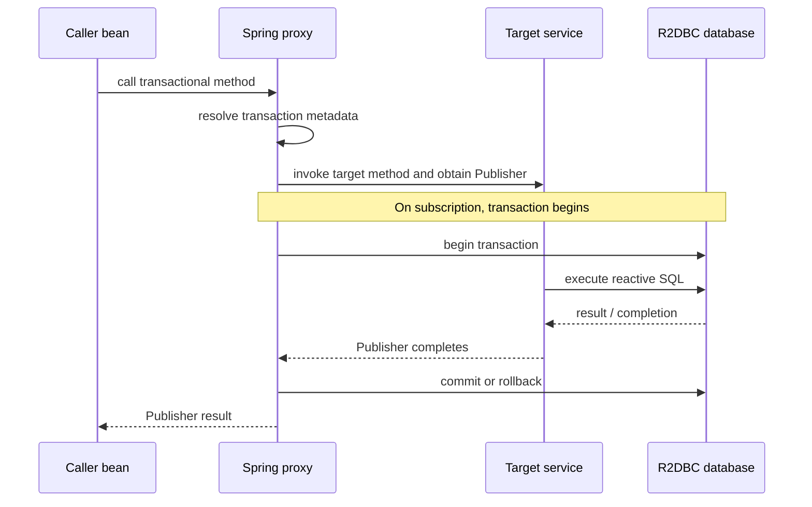
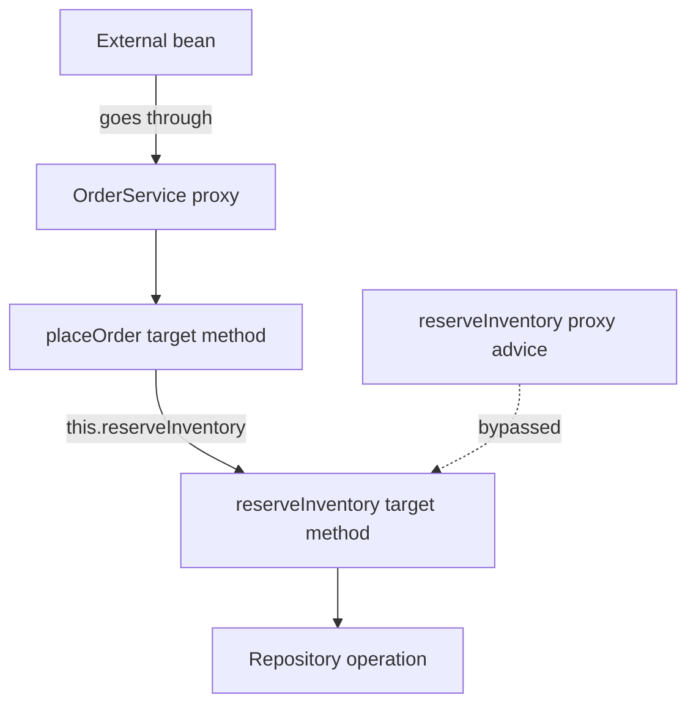

# Ranh giới giao dịch qua proxy và vấn đề tự gọi phương thức

Spring quản lý giao dịch bằng cách chặn lời gọi phương thức thông qua một cơ chế trung gian. Với cấu hình transaction mặc định dựa trên proxy, lời gọi từ một bean khác đi qua proxy sẽ được áp dụng các thuộc tính `@Transactional`. Một lời gọi từ phương thức này sang phương thức khác trên cùng một đối tượng lại đi thẳng qua `this`, bỏ qua proxy. Đây là nguyên nhân phổ biến khiến annotation giao dịch ở phương thức được tự gọi không có tác dụng như mong đợi.

Trong Spring Data Relational R2DBC, vấn đề này cần được hiểu cùng với mô hình reactive. Giao dịch được gắn với quá trình subscribe và Reactor Context, không dựa vào việc một thread duy nhất giữ trạng thái giao dịch. Ranh giới giao dịch phải bao phủ toàn bộ publisher gồm các thao tác database cần commit hoặc rollback cùng nhau.

Bài học này giải thích cách proxy áp dụng transaction advice, vì sao self-invocation bỏ qua advice, cách tổ chức service để ranh giới giao dịch hoạt động đúng với R2DBC, và cách kiểm thử hành vi commit/rollback.

## 1. @Transactional hoạt động qua proxy như thế nào?

Trong chế độ proxy-based mặc định, Spring tạo một proxy bao quanh bean có phương thức được quản lý giao dịch. Khi một bean khác gọi phương thức qua reference do Spring cung cấp, proxy có thể:

1. Đọc metadata của @Transactional.
2. Chọn transaction manager phù hợp.
3. Bắt đầu giao dịch hoặc tham gia giao dịch đang có theo propagation.
4. Gọi phương thức trên đối tượng đích.
5. Theo dõi kết quả để commit hoặc rollback.
6. Trả kết quả cho caller.

Mô hình khái quát:



Proxy là điểm Spring có thể áp dụng transaction advice. Đối tượng đích không tự động kiểm tra annotation mỗi khi một phương thức Java được gọi.

### Gọi qua proxy

Ví dụ có hai bean:

```java
@Service
public class CheckoutControllerService {

    private final OrderService orderService;

    public CheckoutControllerService(OrderService orderService) {
        this.orderService = orderService;
    }

    public Mono<Order> checkout(CheckoutCommand command) {
        return orderService.placeOrder(command);
    }
}
```

```java
@Service
public class OrderService {

    private final OrderRepository orders;

    public OrderService(OrderRepository orders) {
        this.orders = orders;
    }

    @Transactional
    public Mono<Order> placeOrder(CheckoutCommand command) {
        Order order = Order.from(command);
        return orders.save(order);
    }
}
```

CheckoutControllerService nhận bean OrderService từ Spring. Reference đó thường là proxy. Khi checkout gọi orderService.placeOrder, lời gọi đi qua proxy nên transaction metadata được áp dụng nếu transaction manager đã cấu hình đúng.

## 2. Vì sao self-invocation bỏ qua proxy?

Self-invocation xảy ra khi một phương thức gọi một phương thức khác trên cùng instance bằng lời gọi nội bộ, ví dụ `this.reserveInventory(...)` hoặc gọi trực tiếp `reserveInventory(...)`.

Xét service:

```java
@Service
public class OrderService {

    @Transactional
    public Mono<Order> placeOrder(CheckoutCommand command) {
        return reserveInventory(command)
            .then(saveOrder(command));
    }

    @Transactional(propagation = Propagation.REQUIRES_NEW)
    public Mono<Void> reserveInventory(CheckoutCommand command) {
        return inventoryRepository.reserve(command);
    }
}
```

Caller bên ngoài có thể gọi placeOrder qua proxy, nên transaction của placeOrder được áp dụng. Nhưng khi code trong placeOrder gọi reserveInventory, lời gọi đó đi thẳng đến phương thức trên cùng đối tượng đích. Nó không quay lại proxy.

Hệ quả:

- Annotation trên reserveInventory không được đọc ở lần gọi nội bộ đó.
- Propagation.REQUIRES_NEW không được áp dụng.
- Các thuộc tính riêng của phương thức như isolation, timeout, readOnly hoặc rollback rule cũng không tạo một ranh giới mới qua lời gọi nội bộ.
- Nếu placeOrder đã có transaction, thao tác repository trong reserveInventory thường vẫn chạy trong transaction bên ngoài thông qua Reactor Context; điều bị bỏ qua là metadata riêng của phương thức reserveInventory.

Self-invocation không có nghĩa mọi transaction đều biến mất. Nếu caller đã vào một phương thức transactional qua proxy, transaction bên ngoài vẫn bao phủ publisher được trả về. Vấn đề là annotation trên phương thức tự gọi không được kích hoạt như một lần proxy interception mới.

### Minh họa đường gọi



Khi placeOrder tự gọi reserveInventory, nhánh proxy advice của reserveInventory không được đi qua. Đây là quy tắc của proxy-based AOP, không phải hành vi riêng của R2DBC.

## 3. Phân biệt transaction bên ngoài với annotation của phương thức được tự gọi

Cần phân biệt hai câu hỏi:

- Có transaction nào đang bao quanh lời gọi hiện tại không?
- Annotation trên phương thức vừa được gọi có được proxy áp dụng không?

Ví dụ, caller gọi placeOrder qua proxy và placeOrder có @Transactional. Transaction bắt đầu cho publisher mà placeOrder trả về. Khi publisher gọi repository và các bước reactive tiếp theo, chúng có thể tham gia transaction đó.

Nếu placeOrder tự gọi reserveInventory có REQUIRES_NEW, phần REQUIRES_NEW không được áp dụng. reserveInventory chạy trong ngữ cảnh giao dịch hiện có của placeOrder nếu có, hoặc không có transaction nếu bên ngoài cũng không tạo transaction.

| Cách gọi | Transaction metadata có được áp dụng? |
| --- | --- |
| Bean A gọi bean B qua reference Spring proxy | Có, nếu phương thức được proxy hỗ trợ và cấu hình transaction hợp lệ. |
| Phương thức trong bean gọi this.otherMethod() | Không áp dụng metadata riêng của otherMethod qua proxy. |
| Phương thức trong bean gọi otherMethod() không có this | Vẫn là self-invocation; không qua proxy. |
| Một bean khác gọi phương thức trên cùng bean B | Có thể qua proxy như bình thường. |
| Gọi phương thức từ constructor hoặc @PostConstruct trên chính instance | Không đi qua proxy như lời gọi từ bean khác. |

Điều quan trọng là thiết kế ranh giới giao dịch theo luồng nghiệp vụ, thay vì chỉ đặt annotation ở mọi phương thức rồi giả định chúng luôn tạo giao dịch độc lập.

## 4. Cách khắc phục ưu tiên: tách phần việc sang bean khác

Cách dễ hiểu và dễ kiểm thử nhất là chuyển phần cần transaction boundary riêng sang một collaborator khác. Lời gọi giữa hai bean sẽ đi qua proxy của bean đích.

Ví dụ, yêu cầu nghiệp vụ là tạo đơn hàng trong transaction chính, còn thao tác giữ hàng tồn kho phải chạy trong transaction mới:

```java
@Service
public class InventoryReservationService {

    private final InventoryRepository inventory;

    public InventoryReservationService(InventoryRepository inventory) {
        this.inventory = inventory;
    }

    @Transactional(propagation = Propagation.REQUIRES_NEW)
    public Mono<Void> reserve(CheckoutCommand command) {
        return inventory.reserve(
            command.productId(),
            command.quantity()
        );
    }
}
```

Service điều phối:

```java
@Service
public class OrderService {

    private final InventoryReservationService reservations;
    private final OrderRepository orders;

    public OrderService(
            InventoryReservationService reservations,
            OrderRepository orders) {
        this.reservations = reservations;
        this.orders = orders;
    }

    @Transactional
    public Mono<Order> placeOrder(CheckoutCommand command) {
        return reservations.reserve(command)
            .then(Mono.defer(() -> orders.save(Order.from(command))));
    }
}
```

OrderService gọi bean InventoryReservationService qua reference do Spring inject. Nếu REQUIRES_NEW được hỗ trợ bởi transaction manager và lời gọi thực sự đi qua proxy, Spring có thể tạm ngưng transaction hiện tại, mở transaction mới cho thao tác giữ hàng rồi quay lại transaction ngoài.

Transaction mới thường cần một connection riêng trong khi connection của transaction ngoài đang được giữ lại. Vì vậy, connection pool phải có đủ dung lượng cho các transaction lồng theo cách này. Nếu pool chỉ có một connection, lời gọi REQUIRES_NEW có thể phải chờ connection mà chính transaction ngoài đang giữ và cuối cùng timeout. Hãy tính cả số transaction đồng thời và mức lồng khi cấu hình pool.

Cần xác định semantics nghiệp vụ trước khi chọn REQUIRES_NEW. Nếu transaction giữ hàng commit thành công nhưng transaction tạo đơn hàng thất bại, phần giữ hàng có thể vẫn tồn tại. Điều này có thể cần bước giải phóng hàng, retry hoặc quy trình bù trừ. Nếu hai thao tác phải cùng thành công hoặc cùng rollback, chúng thường nên tham gia cùng một transaction thay vì tách bằng REQUIRES_NEW.

### Tách bean theo trách nhiệm

Không cần tạo một bean chỉ để đánh lừa proxy. Hãy tách khi phần việc thực sự có trách nhiệm hoặc transaction boundary riêng, ví dụ:

- Giữ hoặc giải phóng tồn kho.
- Ghi một bản ghi audit độc lập.
- Lưu một aggregate riêng.
- Thực hiện thao tác cần propagation hoặc timeout khác.
- Điều phối một bước có chính sách rollback riêng.

Cấu trúc này làm rõ phụ thuộc và giúp kiểm thử từng service độc lập.

## 5. Cách khác: dùng TransactionalOperator để đặt ranh giới tường minh

Với R2DBC reactive, TransactionalOperator là lựa chọn tốt khi cần kiểm soát chính xác publisher nào nằm trong transaction. Thay vì dựa hoàn toàn vào annotation qua proxy, code bọc chuỗi reactive bằng operator.

Cấu hình transaction manager:

```java
@Configuration
public class R2dbcTransactionConfiguration {

    @Bean
    ReactiveTransactionManager transactionManager(
            ConnectionFactory connectionFactory) {
        return new R2dbcTransactionManager(connectionFactory);
    }

    @Bean
    TransactionalOperator transactionalOperator(
            ReactiveTransactionManager transactionManager) {
        return TransactionalOperator.create(transactionManager);
    }
}
```

Service dùng operator:

```java
@Service
public class OrderService {

    private final OrderRepository orders;
    private final OrderLineRepository orderLines;
    private final TransactionalOperator tx;

    public OrderService(
            OrderRepository orders,
            OrderLineRepository orderLines,
            TransactionalOperator tx) {
        this.orders = orders;
        this.orderLines = orderLines;
        this.tx = tx;
    }

    public Mono<Order> placeOrder(CheckoutCommand command) {
        Mono<Order> work = orders.save(Order.from(command))
            .flatMap(saved ->
                orderLines.saveAll(
                    OrderLine.from(saved.id(), command.items())
                )
                .then(Mono.just(saved))
            );

        return tx.transactional(work);
    }
}
```

tx.transactional(work) bao quanh publisher kết hợp của thao tác lưu đơn hàng và lưu dòng hàng. Nếu publisher hoàn tất bình thường, transaction commit. Nếu publisher phát lỗi, transaction rollback theo chính sách transaction manager.

Cách này hữu ích khi:

- Chỉ một phần của phương thức cần transaction.
- Có nhiều chuỗi reactive với ranh giới khác nhau.
- Muốn tránh phụ thuộc vào việc một phương thức có được gọi qua proxy hay không.
- Muốn biểu diễn transaction boundary ngay cạnh chuỗi publisher được bao bọc.

Không nên bọc riêng từng lệnh repository nếu các lệnh phải nguyên tử với nhau. Hãy bọc toàn bộ publisher đại diện cho một đơn vị công việc.

## 6. Reactive transaction gắn với subscription và Reactor Context

Với R2DBC, transaction không được duy trì bằng cách giữ một thread cố định. Spring quản lý tài nguyên giao dịch trong Reactor Context để các thao tác reactive phía sau có thể sử dụng cùng kết nối đã gắn với transaction.

Một phương thức reactive có thể tạo publisher trước, nhưng SQL chỉ thực thi khi publisher được subscribe. Transaction interceptor hoặc TransactionalOperator phối hợp vòng đời transaction với subscription:

1. Subscriber đăng ký publisher.
2. Transaction manager lấy connection và bắt đầu transaction.
3. Publisher thực hiện các thao tác database trong transaction context.
4. Publisher hoàn tất thì commit.
5. Publisher phát lỗi thì rollback theo rollback rule.

Do đó, một method có @Transactional nên trả về Mono, Flux hoặc kiểu reactive Publisher mà transaction manager hỗ trợ. Nếu method tự gọi subscribe() bên trong, chuỗi công việc có thể tách khỏi publisher mà proxy đang quản lý.

### Không tự subscribe trong service

Không nên viết:

```java
@Transactional
public Mono<Order> placeOrder(CheckoutCommand command) {
    orders.save(Order.from(command)).subscribe();

    return Mono.just(Order.pending(command));
}
```

subscribe() tạo một subscription độc lập. Transaction advice theo dõi publisher được trả về, nhưng thao tác lưu đã bị tách khỏi publisher đó. Nó có thể chạy ngoài transaction, lỗi không được truyền về caller và method có thể hoàn tất trước khi insert xong.

Hãy nối các thao tác bằng operator:

```java
@Transactional
public Mono<Order> placeOrder(CheckoutCommand command) {
    return orders.save(Order.from(command))
        .flatMap(saved ->
            orderLines.saveAll(
                OrderLine.from(saved.id(), command.items())
            )
            .thenReturn(saved)
        );
}
```

Mọi thao tác cần cùng transaction phải nằm trong cùng publisher composition và sử dụng cùng cấu hình transaction manager/ConnectionFactory.

### Tránh block() trong reactive flow

Gọi block() trong service reactive làm ngắt chuỗi non-blocking, có thể gây deadlock hoặc sử dụng sai transaction context. Hãy kết hợp publisher bằng flatMap, then, zip hoặc operator phù hợp. Chỉ chuyển sang blocking ở ranh giới ứng dụng được thiết kế rõ ràng, không làm bên trong luồng reactive đang quản lý transaction.

## 7. Cấu hình đúng transaction manager cho R2DBC

Để @Transactional hoặc TransactionalOperator điều khiển giao dịch R2DBC, ứng dụng cần ReactiveTransactionManager, thường là R2dbcTransactionManager gắn với ConnectionFactory đang dùng.

```java
@Bean
ReactiveTransactionManager transactionManager(
        ConnectionFactory connectionFactory) {
    return new R2dbcTransactionManager(connectionFactory);
}
```

Một số điểm cần lưu ý:

- Repository, DatabaseClient và R2dbcEntityTemplate phải sử dụng ConnectionFactory tương ứng với transaction manager.
- Nếu có nhiều database, cần chỉ rõ transaction manager cho từng service hoặc annotation.
- Không giả định PlatformTransactionManager của JDBC quản lý được kết nối R2DBC.
- Nếu method trả reactive publisher, hãy dùng reactive transaction manager.
- Khi cấu hình nhiều transaction manager, có thể chỉ định tên bean trong @Transactional(transactionManager = "...").

Ví dụ chỉ định manager:

```java
@Transactional(transactionManager = "ordersTransactionManager")
public Mono<Order> placeOrder(CheckoutCommand command) {
    return orders.save(Order.from(command));
}
```

Transaction không tự bao trùm một thao tác sử dụng ConnectionFactory khác. Nếu service gọi hai database độc lập, một R2dbcTransactionManager thông thường không biến chúng thành distributed transaction.

## 8. Phạm vi hiệu lực của @Transactional

@Transactional có thể đặt trên class hoặc method. Annotation ở method thường ghi đè metadata tương ứng từ class cho method đó.

```java
@Service
@Transactional(readOnly = true)
public class OrderQueryService {

    public Flux<Order> findRecent() {
        return orders.findRecent();
    }

    @Transactional
    public Mono<Order> create(Order order) {
        return orders.save(order);
    }
}
```

Ví dụ minh họa class mặc định read-only và method create khai báo transaction ghi. Hành vi cụ thể của readOnly phụ thuộc transaction manager và database; không nên coi nó là cơ chế bảo vệ tuyệt đối để ngăn ghi.

Một số lưu ý proxy:

- Phương thức cần được gọi qua proxy.
- Với JDK proxy, caller thường gọi qua interface được proxy triển khai.
- Với class-based proxy, method final không thể được override để chặn theo cách subclass proxy thông thường.
- Private method không phải điểm vào proxy transaction thông thường.
- Ưu tiên đặt ranh giới giao dịch ở phương thức public của service được gọi từ bean khác.
- Không dựa vào annotation trên private helper hoặc phương thức chỉ được tự gọi.

Các giới hạn chính xác về visibility phụ thuộc loại proxy và phiên bản Spring. Cách thiết kế ổn định là đặt transaction boundary trên API service public và gọi API đó từ bean khác hoặc bọc publisher bằng TransactionalOperator.

## 9. Propagation và self-invocation

Propagation xác định hành vi khi một lời gọi transactional xuất hiện trong lúc đã có transaction. Một số chế độ thường gặp:

| Propagation | Ý nghĩa |
| --- | --- |
| REQUIRED | Tham gia transaction hiện tại; nếu chưa có thì tạo mới. |
| REQUIRES_NEW | Tạm ngưng transaction hiện tại và tạo transaction mới. |
| SUPPORTS | Tham gia transaction nếu có; nếu không thì chạy không có transaction. |
| MANDATORY | Yêu cầu phải có transaction hiện tại. |
| NOT_SUPPORTED | Tạm ngưng transaction hiện tại và chạy không có transaction. |
| NEVER | Báo lỗi nếu đang có transaction. |

Với proxy-based AOP, propagation chỉ được xử lý khi lời gọi đi qua proxy. Nếu phương thức placeOrder tự gọi reserveInventory được gắn REQUIRES_NEW, annotation đó không tạo transaction mới. reserveInventory tiếp tục chạy trong transaction đang có nếu publisher được thực thi trong transaction đó.

Điều này cũng đúng với REQUIRED: nếu method tự gọi có REQUIRED, proxy không cần tham gia để tạo transaction riêng; publisher vẫn có thể tham gia transaction ngoài. Nhưng metadata của lần gọi nội bộ không được áp dụng. Ví dụ timeout, isolation hoặc rollback rule được khai báo riêng trên method tự gọi sẽ không có hiệu lực ở lần gọi đó.

### Khi thực sự cần REQUIRES_NEW

Nếu một thao tác phải commit độc lập với transaction ngoài, hãy đặt nó trong bean khác và gọi qua proxy, hoặc thiết kế chuỗi TransactionalOperator riêng với transaction manager phù hợp.

Cần cân nhắc hậu quả nghiệp vụ: transaction mới có thể commit ngay cả khi transaction ngoài rollback. Dùng nó cho audit hoặc reservation có thể tạo dữ liệu cần quy trình bù trừ. Không dùng REQUIRES_NEW chỉ để bảo đảm có transaction mà chưa xác định quan hệ commit giữa hai phần.

## 10. Rollback và cách xử lý lỗi reactive

Với @Transactional, Spring quyết định commit hay rollback dựa trên kết quả publisher và rollback rules. Mặc định, các unchecked exception và Error làm rollback; checked exception không mặc định rollback nếu không khai báo rule tương ứng.

Có thể khai báo rõ:

```java
@Transactional(rollbackFor = BusinessRuleException.class)
public Mono<Order> placeOrder(CheckoutCommand command) {
    return orders.save(Order.from(command))
        .flatMap(saved ->
            validateAndReserve(saved, command)
                .thenReturn(saved)
        );
}
```

Trong reactive flow, lỗi được truyền bằng error signal. Nếu code chuyển lỗi thành kết quả bình thường trước khi transaction boundary nhìn thấy nó, transaction có thể commit.

Ví dụ:

```java
@Transactional
public Mono<Order> placeOrder(CheckoutCommand command) {
    return orders.save(Order.from(command))
        .onErrorResume(error -> Mono.just(Order.fallback(command)));
}
```

onErrorResume biến error signal thành completion bình thường nếu fallback phát giá trị. Transaction manager có thể coi publisher đã thành công và commit. Nếu muốn rollback, hãy để lỗi truyền ra ngoài transaction boundary hoặc đánh dấu rollback-only bằng API phù hợp.

Với TransactionalOperator, có thể đặt rollback-only trong callback execute:

```java
return transactionalOperator.execute(status ->
    orders.save(order)
        .onErrorResume(error -> {
            status.setRollbackOnly();
            return Mono.error(error);
        })
).single();
```

Ví dụ minh họa cách đánh dấu rollback-only rồi tiếp tục phát lỗi. Với TransactionalOperator.transactional(publisher), thường chỉ cần để lỗi thoát khỏi publisher được bọc. Tránh nuốt lỗi bên trong chuỗi nếu mục tiêu là rollback.

## 11. Self-invocation qua ví dụ có hai chính sách transaction

Giả sử một service có hai thao tác:

- createOrder: tạo đơn và ghi các dòng hàng trong một transaction.
- writeAudit: ghi audit độc lập, muốn chạy với REQUIRES_NEW.

Thiết kế dễ gặp lỗi:

```java
@Service
public class OrderService {

    @Transactional
    public Mono<Order> createOrder(CheckoutCommand command) {
        return orders.save(Order.from(command))
            .flatMap(order ->
                writeAudit(order)
                    .thenReturn(order)
            );
    }

    @Transactional(propagation = Propagation.REQUIRES_NEW)
    public Mono<Void> writeAudit(Order order) {
        return auditRepository.save(AuditEntry.created(order))
            .then();
    }
}
```

writeAudit được gọi nội bộ. REQUIRES_NEW không được áp dụng, nên audit có thể nằm trong transaction tạo đơn. Nếu transaction tạo đơn rollback, audit cũng rollback.

Nếu audit thực sự phải commit độc lập, tách thành bean:

```java
@Service
public class AuditService {

    private final AuditRepository auditRepository;

    public AuditService(AuditRepository auditRepository) {
        this.auditRepository = auditRepository;
    }

    @Transactional(propagation = Propagation.REQUIRES_NEW)
    public Mono<Void> recordOrderCreated(Order order) {
        return auditRepository.save(AuditEntry.created(order))
            .then();
    }
}
```

```java
@Service
public class OrderService {

    private final OrderRepository orders;
    private final AuditService auditService;

    public OrderService(
            OrderRepository orders,
            AuditService auditService) {
        this.orders = orders;
        this.auditService = auditService;
    }

    @Transactional
    public Mono<Order> createOrder(CheckoutCommand command) {
        return orders.save(Order.from(command))
            .flatMap(order ->
                auditService.recordOrderCreated(order)
                    .thenReturn(order)
            );
    }
}
```

Lời gọi từ OrderService sang AuditService đi qua proxy. Nhưng hãy nhớ: nếu transaction audit commit trước rồi transaction order rollback, audit ghi “đã tạo đơn” dù đơn không tồn tại. Đó có thể là sai nghiệp vụ.

Nếu audit phải phản ánh chính xác các sự kiện đã commit, cân nhắc ghi bản ghi outbox cùng transaction đơn hàng, rồi phát sự kiện sau commit. Không dùng REQUIRES_NEW một cách máy móc cho mọi audit.

## 12. Gọi qua proxy có thể làm thay đổi thời điểm thực thi reactive

Khi một method trả Mono hoặc Flux, proxy thường trả một publisher đã được bọc transaction. Transaction thực tế bắt đầu khi publisher đó được subscribe, không nhất thiết ngay tại thời điểm gọi method để lấy publisher.

Ví dụ:

```java
Mono<Order> result = orderService.placeOrder(command);
// Tại đây publisher đã được tạo; thao tác reactive chưa nhất thiết chạy.

return result;
```

Khi framework web hoặc subscriber khác subscribe result, transaction lifecycle mới diễn ra. Nếu cùng một publisher được subscribe nhiều lần, mỗi subscription có thể tạo một lần thực thi và transaction riêng. Tránh chia sẻ publisher có side effect giữa nhiều subscriber nếu không có chủ ý rõ ràng.

Các operator như defer có ích khi cần tạo đối tượng hoặc đọc trạng thái tại thời điểm subscription:

```java
@Transactional
public Mono<Order> placeOrder(CheckoutCommand command) {
    return Mono.defer(() -> {
        Order order = Order.from(command);
        return orders.save(order);
    });
}
```

defer không tự tạo transaction; transaction vẫn đến từ proxy hoặc TransactionalOperator. Nó chỉ trì hoãn việc tạo publisher con đến khi có subscription.

## 13. Những cách xử lý khác và khi nào nên tránh

Ngoài tách bean và TransactionalOperator, có một số lựa chọn khác:

### Self-injection

Một bean có thể inject proxy của chính nó rồi gọi phương thức qua reference đó. Cách này có thể làm lời gọi đi qua proxy, nhưng dễ tạo phụ thuộc vòng, gây khó hiểu khi đọc code và làm mờ ranh giới trách nhiệm. Không nên chọn làm giải pháp mặc định.

### Lấy proxy hiện tại

Spring có thể cho phép lấy proxy hiện tại nếu bật expose proxy và dùng AopContext. Cách này làm code phụ thuộc hạ tầng AOP, giảm tính độc lập và dễ gây khó khăn khi test. Chỉ cân nhắc khi có lý do rõ và không thể tái cấu trúc hợp lý.

### AspectJ weaving

Chế độ AspectJ weaving có thể áp dụng advice tại bytecode và xử lý self-invocation theo cách proxy không làm được. Tuy nhiên, nó cần cấu hình weaving/build/runtime riêng và tăng độ phức tạp vận hành. Chỉ dùng khi dự án chủ động chọn mô hình này; cấu hình transaction mặc định của Spring thường là proxy-based.

### Gọi phương thức qua interface hoặc bean khác

Đây thường là cách rõ ràng nhất nếu cần một transaction boundary độc lập. Tách thành collaborator thể hiện được hợp đồng, phụ thuộc và đơn vị nghiệp vụ.

## 14. Ranh giới transaction trong reactive chain

Transaction phải bao trọn publisher đại diện cho đơn vị công việc. Nếu chỉ bọc một phần, những thao tác sau đó có thể chạy ngoài transaction.

Ví dụ cần cùng commit:

```java
public Mono<Order> placeOrder(CheckoutCommand command) {
    Mono<Order> work = orders.save(Order.from(command))
        .flatMap(order ->
            orderLines.saveAll(
                OrderLine.from(order.id(), command.items())
            )
            .thenReturn(order)
        )
        .flatMap(order ->
            paymentIntentRepository.save(
                PaymentIntent.pending(order.id())
            ).thenReturn(order)
        );

    return transactionalOperator.transactional(work);
}
```

Cả đơn hàng, dòng hàng và payment intent nằm trong publisher được bọc. Nếu một thao tác phát lỗi, transaction manager có thể rollback tất cả thao tác trong cùng transaction.

Một cách bọc không đầy đủ:

```java
public Mono<Order> placeOrder(CheckoutCommand command) {
    return transactionalOperator.transactional(
        orders.save(Order.from(command))
    )
    .flatMap(order ->
        orderLines.saveAll(
            OrderLine.from(order.id(), command.items())
        ).thenReturn(order)
    );
}
```

Trong ví dụ này, transaction đầu tiên kết thúc sau khi lưu order. Việc lưu order lines xảy ra sau transaction boundary đó, nên không nguyên tử với thao tác đầu.

Nếu hai bước phải cùng thành công hoặc cùng rollback, hãy đặt cả hai trong cùng publisher được bọc.

## 15. Kiểm thử proxy và self-invocation

Kiểm thử transaction cần xác minh kết quả ở database, không chỉ xác minh annotation tồn tại hoặc method được gọi.

### Kiểm thử rollback qua proxy

Ví dụ service lưu một đơn hàng rồi phát lỗi:

```java
@Transactional
public Mono<Order> createThenFail(Order order) {
    return orders.save(order)
        .flatMap(saved ->
            Mono.error(new IllegalStateException("force rollback"))
        );
}
```

Integration test gọi method qua bean Spring và sau khi publisher kết thúc với lỗi, kiểm tra bản ghi không tồn tại:

```java
@Test
void rollsBackWhenReactivePublisherFails() {
    Order order = sampleOrder();

    StepVerifier.create(orderService.createThenFail(order))
        .expectError(IllegalStateException.class)
        .verify();

    StepVerifier.create(orderRepository.findById(order.id()))
        .verifyComplete();
}
```

Test cần dùng database và reactive transaction manager thật. Nếu test framework tự bọc test method trong transaction, hãy chú ý transaction của test có thể ảnh hưởng kết quả quan sát. Nên thiết kế setup/cleanup rõ ràng hoặc kiểm tra sau khi transaction của service đã hoàn tất.

### Kiểm thử self-invocation

Để chứng minh REQUIRES_NEW không được áp dụng qua self-invocation, tạo tình huống:

1. Phương thức ngoài mở transaction qua proxy.
2. Phương thức ngoài gọi nội bộ phương thức có REQUIRES_NEW.
3. Phương thức ngoài phát lỗi sau lời gọi nội bộ.
4. Kiểm tra dữ liệu được ghi bởi phương thức nội bộ có rollback cùng transaction ngoài hay không.

Nếu lời gọi nội bộ bỏ qua proxy, thao tác nội bộ thường tham gia transaction ngoài và bị rollback cùng. Sau khi tách sang bean khác và gọi qua proxy, transaction mới có thể commit độc lập. Test phải phản ánh chính xác semantics mà nghiệp vụ mong muốn.

### Kiểm tra transaction context

Nếu một chuỗi reactive có nhiều repository, kiểm tra rằng các thao tác thực sự tham gia cùng transaction. Có thể kiểm tra bằng cách buộc thao tác cuối phát lỗi và xác nhận tất cả thay đổi trước đó đều rollback. Đây là bằng chứng hữu ích hơn việc chỉ mock TransactionalOperator.

## 16. Các lỗi thường gặp

| Lỗi | Nguyên nhân | Hướng xử lý |
| --- | --- | --- |
| @Transactional trên method tự gọi không có tác dụng | Lời gọi không đi qua proxy. | Tách bean hoặc dùng TransactionalOperator. |
| REQUIRES_NEW không tạo transaction mới | Metadata của method tự gọi bị bỏ qua. | Gọi collaborator qua proxy hoặc đặt transaction boundary tường minh. |
| Một số thao tác repository nằm ngoài transaction | Publisher bị tách hoặc subscribe độc lập. | Nối publisher trong cùng chain và bọc toàn bộ công việc. |
| Method trả về sớm trước khi SQL hoàn tất | Gọi subscribe() thủ công. | Trả publisher và để caller subscribe. |
| Lỗi không làm rollback | Lỗi bị onErrorResume chuyển thành completion bình thường. | Để lỗi thoát hoặc đánh dấu rollback-only. |
| @Transactional không mở R2DBC transaction | Cấu hình sai transaction manager hoặc dùng manager JDBC. | Cấu hình ReactiveTransactionManager gắn đúng ConnectionFactory. |
| Transaction không bao trùm nhiều database | Các thao tác dùng ConnectionFactory/manager khác nhau. | Thiết kế consistency riêng, outbox hoặc distributed transaction nếu thực sự cần. |
| Audit commit nhưng dữ liệu chính rollback | Dùng REQUIRES_NEW với semantics không phù hợp. | Xem xét outbox hoặc quy trình bù trừ. |
| Test pass nhưng production không rollback | Test chỉ mock hoặc test transaction bao ngoài che kết quả. | Dùng integration test với database thật và quan sát sau commit/rollback. |

## 17. Quy trình chọn và đặt ranh giới giao dịch

Khi thiết kế một service reactive, có thể đi theo trình tự:

1. **Xác định đơn vị nghiệp vụ nguyên tử:** những thay đổi nào phải cùng commit hoặc cùng rollback?
2. **Chọn ranh giới service:** đặt annotation trên phương thức public được bean khác gọi hoặc bọc publisher bằng TransactionalOperator.
3. **Xác nhận đường gọi:** kiểm tra lời gọi có đi qua proxy hay là self-invocation.
4. **Chọn propagation:** chỉ dùng REQUIRES_NEW khi commit độc lập thực sự là yêu cầu nghiệp vụ.
5. **Cấu hình reactive manager:** gắn R2dbcTransactionManager với đúng ConnectionFactory.
6. **Giữ publisher liên tục:** không tự subscribe hoặc block trong service.
7. **Đặt rollback rule:** quyết định lỗi nào phải rollback và tránh nuốt error signal ngoài ý muốn.
8. **Xem xét Reactor Context:** giữ các thao tác database trong cùng reactive chain và transaction context.
9. **Kiểm thử bằng database thật:** xác minh commit, rollback, self-invocation và propagation.
10. **Đánh giá tính nhất quán liên hệ thống:** nếu có nhiều database hoặc dịch vụ, cân nhắc outbox, saga hoặc cơ chế bù trừ thay vì giả định một local transaction bao trùm tất cả.

Trong Spring Data Relational R2DBC, @Transactional chỉ được áp dụng khi lời gọi đi qua cơ chế interception phù hợp. Proxy-based transaction không chặn lời gọi nội bộ trên cùng instance. Khi cần ranh giới riêng, tách trách nhiệm sang bean khác hoặc dùng TransactionalOperator để bọc publisher. Kết hợp điều đó với reactive transaction manager, Reactor Context và kiểm thử commit/rollback trên database thật sẽ giúp giao dịch có phạm vi rõ ràng và hành vi dự đoán được.
