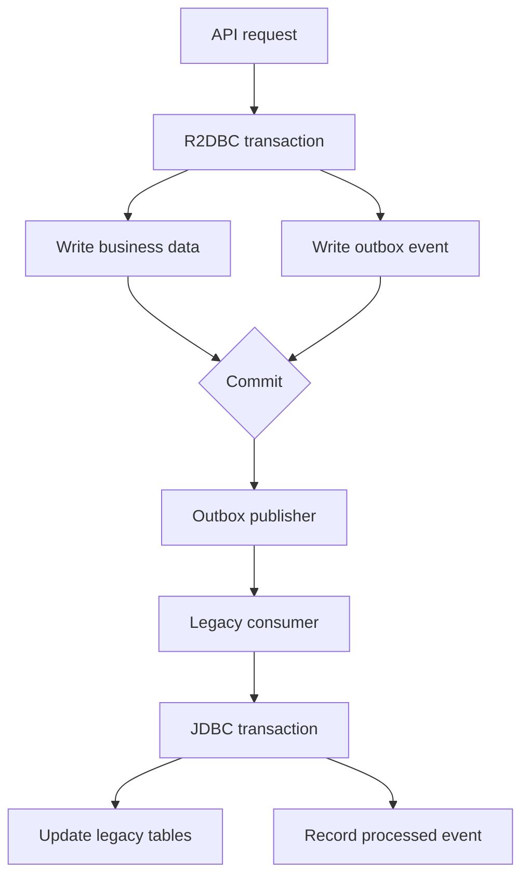

# Phân biệt giao dịch R2DBC với giao dịch JDBC trong cùng ứng dụng

Một ứng dụng Spring có thể sử dụng đồng thời Spring Data R2DBC và JDBC, ví dụ một module mới dùng reactive repository trong khi module báo cáo hoặc thư viện cũ vẫn dùng `JdbcTemplate`. Hai công nghệ đều truy cập cơ sở dữ liệu quan hệ và đều có hỗ trợ transaction trong Spring, nhưng chúng quản lý connection và ngữ cảnh giao dịch theo hai mô hình khác nhau.

JDBC thường dùng transaction manager kiểu imperative, gắn connection với luồng thực thi thông qua cơ chế thread-bound. R2DBC dùng reactive transaction manager, gắn connection với Reactor Context để transaction đi theo chuỗi publisher. Vì vậy, một ứng dụng có cả hai công nghệ thường cần hai transaction manager riêng. Việc cả hai cùng kết nối tới một database không làm cho hai transaction tự động trở thành một transaction nguyên tử.

Muốn thiết kế đúng, cần xác định mỗi thao tác ghi thuộc transaction manager nào, transaction bắt đầu và kết thúc ở đâu, và điều gì xảy ra nếu một phần của quy trình thành công còn phần khác thất bại. Với yêu cầu atomicity xuyên qua cả JDBC và R2DBC, cần một chiến lược phối hợp riêng; không thể chỉ đặt một annotation `@Transactional` lên phương thức chứa cả hai lời gọi rồi mặc định database sẽ rollback tất cả.

## 1. Hai mô hình truy cập database trong cùng ứng dụng

JDBC là API truy cập cơ sở dữ liệu theo kiểu đồng bộ. Một lời gọi như `jdbcTemplate.query(...)` thực hiện công việc trên thread gọi và trả kết quả khi thao tác hoàn tất. Connection thường được lấy từ `DataSource` và có thể được transaction manager gắn với thread hiện tại.

R2DBC là API truy cập cơ sở dữ liệu theo kiểu reactive. Các thao tác được biểu diễn bằng `Mono` hoặc `Flux`; SQL chỉ thực thi khi publisher được subscribe. Connection được cung cấp từ `ConnectionFactory`, còn reactive transaction manager gắn resource vào Reactor Context để các thao tác trong cùng chuỗi reactive có thể tham gia transaction.

| Tiêu chí | JDBC | R2DBC |
|---|---|---|
| API kết nối | `DataSource` và `Connection` | `ConnectionFactory` và `Connection` của R2DBC SPI |
| Cách thực thi | Đồng bộ, blocking | Reactive, non-blocking khi driver hỗ trợ |
| Template phổ biến | `JdbcTemplate`, `NamedParameterJdbcTemplate` | `DatabaseClient`, `R2dbcEntityTemplate` |
| Repository | Spring Data JDBC hoặc repository tự triển khai | Spring Data R2DBC reactive repository |
| Transaction manager | `PlatformTransactionManager`, thường là `JdbcTransactionManager` hoặc `DataSourceTransactionManager` | `ReactiveTransactionManager`, thường là `R2dbcTransactionManager` |
| Ngữ cảnh giữ transaction | Thường gắn với thread hiện tại | Gắn với Reactor Context |
| Kiểu kết quả | Giá trị trực tiếp, `List`, object hoặc exception | `Mono`, `Flux` và tín hiệu reactive |
| Kết thúc thao tác | Khi lời gọi đồng bộ trả về hoặc transaction commit | Khi publisher được subscribe và hoàn tất, lỗi hoặc bị hủy theo transaction lifecycle |

Hai stack có thể cùng tồn tại trong một process và thậm chí kết nối tới cùng một database server. Chúng vẫn dùng connection, transaction manager và cơ chế propagation riêng.

## 2. Transaction JDBC: connection gắn với thread

Trong ứng dụng Spring dùng JDBC, transaction manager lấy connection từ `DataSource`, chuyển connection sang chế độ transaction phù hợp và gắn nó với thread đang chạy transaction. Các thao tác qua `JdbcTemplate` sử dụng cơ chế hỗ trợ của Spring để tìm connection đang được transaction quản lý.

Ví dụ cấu hình transaction manager:

```java
@Configuration
public class JdbcTransactionConfiguration {

    @Bean("jdbcTransactionManager")
    public PlatformTransactionManager jdbcTransactionManager(
            DataSource dataSource) {
        return new JdbcTransactionManager(dataSource);
    }
}
```

`JdbcTransactionManager` là transaction manager chuyên cho JDBC trong Spring Framework hiện đại. Có thể dùng `DataSourceTransactionManager` nếu dự án hoặc phiên bản đang sử dụng yêu cầu lớp đó; cả hai đều là `PlatformTransactionManager`.

Một service JDBC có thể dùng `@Transactional`:

```java
@Service
public class JdbcAccountService {

    private final JdbcTemplate jdbcTemplate;

    public JdbcAccountService(JdbcTemplate jdbcTemplate) {
        this.jdbcTemplate = jdbcTemplate;
    }

    @Transactional(transactionManager = "jdbcTransactionManager")
    public void transfer(Long fromId, Long toId, BigDecimal amount) {
        int debited = jdbcTemplate.update("""
                UPDATE account
                SET balance = balance - ?
                WHERE id = ? AND balance >= ?
                """,
            amount, fromId, amount);

        if (debited != 1) {
            throw new IllegalStateException("Insufficient balance or source missing");
        }

        int credited = jdbcTemplate.update("""
                UPDATE account
                SET balance = balance + ?
                WHERE id = ?
                """,
            amount, toId);

        if (credited != 1) {
            throw new IllegalStateException("Target account not found");
        }
    }
}
```

Hai câu update dùng connection JDBC đang được transaction manager quản lý. Nếu phương thức ném runtime exception và transaction chưa bị cấu hình khác, Spring rollback transaction JDBC đó.

Điểm quan trọng là `JdbcTemplate` tham gia transaction nhờ tích hợp với Spring và `DataSource` tương ứng. Nếu code tự gọi `dataSource.getConnection()` rồi tự quản lý connection, nó có thể không tham gia transaction đang mở. Với code JDBC dùng Spring, hãy ưu tiên `JdbcTemplate`, `DataSourceUtils` hoặc cơ chế connection-aware được framework hỗ trợ.

## 3. Transaction R2DBC: connection gắn với Reactor Context

Trong Spring Data R2DBC, `R2dbcTransactionManager` quản lý một connection từ `ConnectionFactory`. Transaction context được truyền qua Reactor Context thay vì dựa vào thread hiện tại.

Ví dụ cấu hình:

```java
@Configuration
public class R2dbcTransactionConfiguration {

    @Bean("r2dbcTransactionManager")
    public ReactiveTransactionManager r2dbcTransactionManager(
            ConnectionFactory connectionFactory) {
        return new R2dbcTransactionManager(connectionFactory);
    }
}
```

Service reactive dùng transaction manager đó:

```java
@Service
public class ReactiveOrderService {

    private final PurchaseOrderRepository orderRepository;
    private final OrderLineRepository lineRepository;

    public ReactiveOrderService(
            PurchaseOrderRepository orderRepository,
            OrderLineRepository lineRepository) {
        this.orderRepository = orderRepository;
        this.lineRepository = lineRepository;
    }

    @Transactional(transactionManager = "r2dbcTransactionManager")
    public Mono<PurchaseOrder> createOrder(CreateOrder command) {
        PurchaseOrder order = new PurchaseOrder(
            null,
            command.orderNo(),
            command.customerId(),
            "PENDING"
        );

        return orderRepository.save(order)
            .flatMap(saved -> Flux.fromIterable(command.lines())
                .map(line -> new OrderLine(
                    null,
                    saved.id(),
                    line.productId(),
                    line.quantity(),
                    line.unitPrice()
                ))
                .concatMap(lineRepository::save)
                .then(Mono.just(saved)));
    }
}
```

Transaction được áp dụng khi publisher được subscribe. Các thao tác Repository trong cùng reactive chain tham gia transaction thông qua Reactor Context, miễn là chúng dùng cùng hạ tầng `ConnectionFactory` được transaction manager quản lý.

Không gọi `subscribe()` hoặc `block()` bên trong phương thức reactive có transaction. Nếu tự subscribe một publisher khác, publisher đó có thể chạy ngoài transaction context của luồng hiện tại. Hãy trả về và kết hợp publisher bằng `flatMap`, `then`, `zip` hoặc toán tử Reactor phù hợp.

## 4. Vì sao một ứng dụng cần hai transaction manager?

Transaction manager quản lý một loại resource cụ thể. `JdbcTransactionManager` quản lý connection từ một `DataSource`; `R2dbcTransactionManager` quản lý connection từ một `ConnectionFactory`.

Khi ứng dụng có cả hai stack, có thể cấu hình hai bean riêng:

```java
@Configuration
public class TransactionManagersConfiguration {

    @Bean("jdbcTransactionManager")
    public PlatformTransactionManager jdbcTransactionManager(
            DataSource dataSource) {
        return new JdbcTransactionManager(dataSource);
    }

    @Bean("r2dbcTransactionManager")
    public ReactiveTransactionManager r2dbcTransactionManager(
            ConnectionFactory connectionFactory) {
        return new R2dbcTransactionManager(connectionFactory);
    }
}
```

Khi dự án có nhiều transaction manager, nên chỉ rõ bean cần dùng trong `@Transactional`:

```java
@Transactional(transactionManager = "jdbcTransactionManager")
public void updateLegacyData() {
    // JDBC operations
}

@Transactional(transactionManager = "r2dbcTransactionManager")
public Mono<Void> updateReactiveData() {
    // R2DBC operations
}
```

Nếu không chỉ định, Spring cần chọn transaction manager mặc định theo cấu hình và quy tắc resolution. Khi có nhiều manager, việc để mơ hồ dễ dẫn tới chọn sai manager hoặc lỗi không tìm thấy manager phù hợp. Dùng qualifier rõ ràng giúp người đọc biết transaction nào đang được quản lý.

Spring Boot có thể tự cấu hình một số transaction manager dựa trên dependency và bean hiện có. Nếu khai báo bean thủ công, hãy kiểm tra điều kiện auto-configuration để tránh tạo hai manager không chủ ý cho cùng một resource. Tên bean trong ví dụ là tên do ứng dụng lựa chọn; cấu hình thực tế cần nhất quán với annotation.

## 5. Cùng một database không có nghĩa là cùng một transaction

Đây là điểm quan trọng nhất khi kết hợp JDBC và R2DBC.

Giả sử cả `DataSource` và `ConnectionFactory` đều trỏ tới `jdbc:postgresql://.../app_db` và `r2dbc:postgresql://.../app_db`. Một transaction JDBC mở connection JDBC. Một transaction R2DBC mở connection R2DBC. Hai connection này là hai session độc lập ở database server.

Nếu JDBC transaction commit nhưng R2DBC transaction rollback, database chỉ rollback những thay đổi thuộc transaction R2DBC. Thay đổi JDBC đã commit vẫn còn. Việc hai thao tác ghi cùng database, cùng schema hoặc cùng bảng không làm database tự gộp chúng thành một transaction.

| Tình huống | Kết quả |
|---|---|
| JDBC transaction rollback | Các thao tác JDBC thuộc connection JDBC được rollback |
| R2DBC transaction rollback | Các thao tác R2DBC thuộc connection R2DBC được rollback |
| JDBC commit, R2DBC rollback | Thay đổi JDBC vẫn tồn tại; thay đổi R2DBC bị rollback |
| R2DBC commit, JDBC rollback | Thay đổi R2DBC vẫn tồn tại; thay đổi JDBC bị rollback |
| Cả hai commit | Cả hai tập thay đổi tồn tại, nhưng không có một commit nguyên tử chung |

`@Transactional` quản lý transaction của manager được chọn. Nó không tự tìm mọi connection tới cùng database rồi gom chúng vào một transaction phân tán.

## 6. Không dùng một @Transactional mặc định cho cả hai stack

Một phương thức có thể gọi cả `JdbcTemplate` và `DatabaseClient`, nhưng annotation chỉ chọn một transaction manager tại một thời điểm. Ví dụ:

```java
@Transactional(transactionManager = "r2dbcTransactionManager")
public Mono<Void> process() {
    return r2dbcRepository.save(...)
        .then(Mono.fromRunnable(() -> jdbcTemplate.update(...)));
}
```

Đoạn code này không làm câu lệnh JDBC tham gia transaction R2DBC. JDBC dùng `DataSource` và cơ chế thread-bound riêng. Hơn nữa, callback trong reactive chain có thể chạy trên thread khác với thread tạo publisher; transaction R2DBC được truyền qua Reactor Context, không phải bằng ThreadLocal mà `JdbcTemplate` sử dụng.

Tương tự, chọn JDBC transaction manager cho một phương thức trả `Mono` không làm cho các thao tác R2DBC tự tham gia transaction JDBC. Một transaction imperative thường được mở khi phương thức được gọi và hoàn tất khi phương thức trả về. Nếu phương thức chỉ tạo một publisher deferred rồi trả về, câu SQL R2DBC có thể chỉ chạy sau khi transaction JDBC đã kết thúc.

Ví dụ không nên dùng:

```java
@Transactional(transactionManager = "jdbcTransactionManager")
public Mono<Person> createLater(String name) {
    return Mono.fromCallable(() -> jdbcTemplate.queryForObject(
        "SELECT ...", personRowMapper
    ));
}
```

Ở đây, `Mono.fromCallable` trì hoãn lời gọi JDBC tới lúc subscribe. Transaction JDBC do annotation quản lý có thể đã kết thúc ngay sau khi method trả publisher. Cần đặt transaction boundary đúng nơi thao tác đồng bộ thực sự chạy hoặc tách riêng phương thức JDBC imperative.

## 7. Tách service theo công nghệ và transaction boundary

Một cách tổ chức dễ hiểu là tách thao tác JDBC và R2DBC thành các service có transaction manager rõ ràng:

```java
@Service
public class LegacyCustomerService {

    private final JdbcTemplate jdbcTemplate;

    public LegacyCustomerService(JdbcTemplate jdbcTemplate) {
        this.jdbcTemplate = jdbcTemplate;
    }

    @Transactional(transactionManager = "jdbcTransactionManager")
    public void recordLegacyAudit(Long customerId, String action) {
        jdbcTemplate.update("""
                INSERT INTO legacy_audit(customer_id, action)
                VALUES (?, ?)
                """,
            customerId, action);
    }
}
```

```java
@Service
public class ReactiveCustomerService {

    private final CustomerRepository repository;

    public ReactiveCustomerService(CustomerRepository repository) {
        this.repository = repository;
    }

    @Transactional(transactionManager = "r2dbcTransactionManager")
    public Mono<Customer> updateName(Long id, String name) {
        return repository.findById(id)
            .switchIfEmpty(Mono.error(new CustomerNotFoundException(id)))
            .map(customer -> customer.withName(name))
            .flatMap(repository::save);
    }
}
```

Mỗi service chịu trách nhiệm transaction của stack tương ứng. Nếu một use case cần gọi cả hai, một lớp orchestration có thể điều phối hai service, nhưng phải xem chúng là hai transaction độc lập trừ khi có một cơ chế phối hợp transaction được hỗ trợ rõ ràng.

Tách service cũng giúp tránh lỗi self-invocation của Spring proxy. Gọi một method `@Transactional` khác trong cùng instance bằng `this.someMethod()` thường không đi qua proxy, nên annotation trên method được gọi có thể không được áp dụng như mong đợi. Đưa transaction boundary sang bean khác hoặc dùng `TransactionalOperator` giúp luồng thực thi rõ ràng hơn.

## 8. Gọi JDBC từ một luồng reactive

JDBC là blocking. Nếu phải gọi JDBC trong ứng dụng WebFlux hoặc reactive pipeline, không nên chạy trực tiếp trên event-loop thread. Có thể chuyển phần blocking sang `Schedulers.boundedElastic()`:

```java
public Mono<LegacyReport> loadLegacyReport(Long customerId) {
    return Mono.fromCallable(() -> legacyReportService.load(customerId))
        .subscribeOn(Schedulers.boundedElastic());
}
```

`legacyReportService.load(...)` là phương thức imperative được proxy Spring quản lý và có thể dùng `@Transactional(transactionManager = "jdbcTransactionManager")`. Lời gọi JDBC thực sự chạy trên bounded elastic worker; JDBC transaction bắt đầu và kết thúc trong lời gọi đó trên cùng thread.

Điều này bảo đảm phần JDBC được thực thi trong transaction JDBC của chính nó. Nó không khiến JDBC transaction tham gia transaction R2DBC đang bao quanh reactive pipeline.

Ví dụ orchestration:

```java
public Mono<CombinedResult> updateAndRead(Long customerId, String name) {
    return reactiveCustomerService.updateName(customerId, name)
        .flatMap(updated ->
            Mono.fromCallable(() -> legacyReportService.load(customerId))
                .subscribeOn(Schedulers.boundedElastic())
                .map(report -> new CombinedResult(updated, report))
        );
}
```

Nếu R2DBC update commit thành công rồi JDBC report thất bại, update R2DBC không tự rollback. Nếu JDBC report thành công nhưng một thao tác R2DBC tiếp theo thất bại và rollback, phần JDBC đã commit vẫn tồn tại. Đây là hai transaction với hai kết quả độc lập.

Nếu JDBC chỉ dùng để đọc, vấn đề atomicity ghi có thể không xuất hiện, nhưng snapshot của JDBC read vẫn có thể khác snapshot của R2DBC transaction. Nếu cần một góc nhìn nhất quán, hãy chọn một access path hoặc isolation strategy phù hợp thay vì giả định hai connection cùng thấy một trạng thái.

## 9. Không block R2DBC để gọi JDBC và cũng không biến JDBC thành reactive thật

Một số ứng dụng gọi `block()` trên publisher R2DBC rồi tiếp tục JDBC. Cách này phá vỡ lợi ích reactive, có thể gây deadlock hoặc chiếm event-loop thread, và không kết hợp hai transaction thành một.

```java
// Không nên: block trong reactive pipeline.
Customer customer = customerRepository.findById(id).block();
jdbcTemplate.update("UPDATE ...", ...);
```

Tương tự, bọc `JdbcTemplate` trong `Mono.fromCallable` chỉ giúp đưa blocking work vào reactive composition và chuyển nó sang scheduler phù hợp; JDBC vẫn là blocking và vẫn dùng transaction manager JDBC.

Nếu phần lớn use case là reactive, ưu tiên dùng R2DBC cho các thao tác database trong transaction đó. Nếu một thư viện legacy bắt buộc JDBC, cô lập lời gọi và xác định rõ transaction riêng. Không nên trộn hai API trong cùng một transaction với kỳ vọng chúng tự chia sẻ connection.

## 10. Dùng TransactionalOperator cho R2DBC

Ngoài annotation, reactive transaction có thể được quản lý tường minh bằng `TransactionalOperator`:

```java
@Configuration
public class ReactiveTransactionOperatorConfiguration {

    @Bean
    public TransactionalOperator r2dbcTransactionalOperator(
            @Qualifier("r2dbcTransactionManager")
            ReactiveTransactionManager transactionManager) {
        return TransactionalOperator.create(transactionManager);
    }
}
```

Sử dụng:

```java
public Mono<Void> createOrder(CreateOrder command) {
    Mono<Void> work = orderRepository.save(toOrder(command))
        .flatMap(order -> saveLines(order, command.lines()))
        .then();

    return r2dbcTransactionalOperator.transactional(work);
}
```

`TransactionalOperator` hữu ích khi muốn đặt transaction boundary quanh một publisher cụ thể hoặc khi orchestration reactive phức tạp. Nó vẫn quản lý transaction R2DBC, không tự quản lý transaction JDBC.

Nếu cần JDBC transaction tường minh, có thể dùng `TransactionTemplate` với `PlatformTransactionManager` trong một lời gọi imperative. Đừng gọi `TransactionTemplate.execute(...)` trên event-loop thread nếu bên trong có JDBC blocking; hãy chuyển toàn bộ lời gọi sang scheduler phù hợp.

## 11. Propagation và isolation không tự nối hai transaction manager

Các thuộc tính như `REQUIRED`, `REQUIRES_NEW`, `NESTED`, isolation level và timeout được áp dụng trong phạm vi transaction manager đang xử lý lời gọi.

Ví dụ:

```java
@Transactional(
    transactionManager = "r2dbcTransactionManager",
    propagation = Propagation.REQUIRES_NEW
)
public Mono<Void> writeReactiveRecord() {
    // Transaction R2DBC mới hoặc độc lập theo propagation của manager này.
}
```

`REQUIRES_NEW` ở đây yêu cầu R2DBC transaction manager tạo transaction R2DBC độc lập theo khả năng hỗ trợ của nó. Nó không có nghĩa mở một transaction chung với JDBC manager. Nếu một method khác dùng `jdbcTransactionManager`, propagation của JDBC được xử lý riêng.

Hỗ trợ nested transaction/savepoint phụ thuộc transaction manager, R2DBC driver và database. Không giả định `NESTED` hoặc savepoint hoạt động giống nhau ở JDBC và R2DBC. Cần kiểm tra tài liệu phiên bản, driver và integration test.

Isolation level cũng được thiết lập trên từng connection. Một transaction JDBC và một transaction R2DBC có thể có isolation khác nhau, dù chúng truy cập cùng database. Nếu nghiệp vụ cần đảm bảo một invariant xuyên qua hai luồng, hai isolation setting riêng không tạo ra một atomic snapshot chung.

## 12. Có thể dùng JTA/XA để phối hợp không?

Trong hệ thống enterprise, JTA/XA có thể phối hợp nhiều resource manager có hỗ trợ XA để commit hoặc rollback phân tán theo giao thức two-phase commit. Tuy nhiên, không nên giả định mọi JDBC driver, R2DBC driver hoặc transaction manager đều hỗ trợ XA giống nhau.

JDBC có hệ sinh thái XA lâu đời thông qua `XADataSource`. R2DBC SPI thông thường không cung cấp một abstraction XA phổ quát tương đương để mọi R2DBC driver có thể tham gia JTA transaction. Khả năng phối hợp R2DBC với một transaction coordinator phụ thuộc implementation cụ thể và cần được xác nhận từ nhà cung cấp.

Nếu yêu cầu bắt buộc atomic commit xuyên qua JDBC và R2DBC, hãy kiểm tra cụ thể:

- Cả hai resource có hỗ trợ XA hay không.
- Transaction coordinator có adapter cho đúng resource và driver hay không.
- Database và driver có hỗ trợ prepare/commit/rollback phù hợp không.
- Cách xử lý recovery khi process hoặc coordinator dừng giữa hai phase.
- Chi phí latency, lock và vận hành của distributed transaction.

Nếu không có hỗ trợ XA đã được xác minh, không nên tự tạo một “transaction manager kết hợp” bằng cách gọi hai manager tuần tự rồi rollback thủ công. Cách đó không bảo đảm atomicity khi process chết, kết nối mất hoặc một commit đã thành công.

## 13. Mẫu phối hợp thường dùng: Transactional Outbox

Khi một use case ghi dữ liệu bằng R2DBC rồi cần một thành phần JDBC hoặc hệ thống khác xử lý tiếp, transactional outbox thường là lựa chọn đáng tin cậy.

Trong cùng R2DBC transaction, ứng dụng ghi dữ liệu nghiệp vụ và một bản ghi outbox:

```java
@Transactional(transactionManager = "r2dbcTransactionManager")
public Mono<Order> createOrder(CreateOrder command) {
    return orderRepository.save(toOrder(command))
        .flatMap(order -> outboxRepository.save(
            OutboxEvent.orderCreated(order.id(), command.requestKey())
        ).thenReturn(order));
}
```

Vì order và outbox record dùng cùng R2DBC transaction manager/connection factory, cả hai cùng commit hoặc rollback. Một worker đọc outbox sau đó chuyển sự kiện tới consumer. Consumer có thể dùng JDBC transaction riêng để cập nhật hệ thống legacy và đánh dấu event đã xử lý.

Luồng tổng quát:



Outbox không tạo một transaction phân tán. Nó bảo đảm sự kiện được lưu cùng dữ liệu nguồn; việc giao nhận có thể lặp lại. Vì vậy consumer cần idempotent, thường dùng `event_id` duy nhất hoặc bảng inbox/processed-event để chống xử lý trùng.

## 14. Saga và thao tác bù khi cần phối hợp nhiều bước

Nếu một quy trình gồm nhiều transaction độc lập, có thể mô hình hóa thành Saga. Mỗi bước commit trong transaction riêng. Nếu bước sau thất bại, hệ thống thực hiện hành động bù (compensation) để đưa nghiệp vụ về trạng thái chấp nhận được.

Ví dụ quy trình tạo đơn:

1. R2DBC tạo đơn ở trạng thái `PENDING`.
2. JDBC cập nhật hệ thống legacy hoặc tạo bản ghi tích hợp.
3. Dịch vụ thanh toán xử lý giao dịch.
4. R2DBC chuyển đơn sang `CONFIRMED`.

Nếu bước thanh toán thất bại, ứng dụng có thể hủy đơn hoặc hoàn tác giữ chỗ theo quy tắc nghiệp vụ. Compensation không phải rollback vật lý của transaction đã commit; đó là một thao tác nghiệp vụ mới.

Saga phù hợp với quy trình dài, qua nhiều service hoặc resource không hỗ trợ distributed transaction. Cần lưu trạng thái tiến trình, idempotency key, retry policy, timeout và hành động bù. Không nên dùng Saga cho một thao tác nhỏ có thể thực hiện nguyên tử trong một transaction database duy nhất.

## 15. Khi nào nên chọn một công nghệ cho toàn bộ transaction?

Nếu nhiều thao tác phải cùng commit hoặc rollback, giải pháp đơn giản nhất thường là dùng cùng một stack trong transaction boundary:

- Dùng `DatabaseClient`, `R2dbcEntityTemplate` và Repository R2DBC cho toàn bộ thao tác thuộc một reactive transaction.
- Hoặc dùng `JdbcTemplate`/JDBC Repository cho toàn bộ thao tác thuộc một JDBC transaction.

Việc chọn stack phụ thuộc workload, driver, thư viện hiện có và yêu cầu non-blocking. Không nên chọn R2DBC chỉ vì một endpoint trả `Mono` nếu phần lớn công việc bên trong vẫn blocking JDBC. Ngược lại, không cần chuyển một module JDBC ổn định sang R2DBC chỉ để có thể chạy chung trong ứng dụng.

Nếu cần gọi hệ thống legacy, hãy tách transaction và dùng outbox/Saga khi cần phối hợp trạng thái. Nếu hai thao tác chỉ đọc và không cần snapshot chung, có thể gọi cả hai nhưng phải hiểu rằng dữ liệu có thể được đọc ở những thời điểm khác nhau.

## 16. Cấu hình DataSource và ConnectionFactory riêng

JDBC và R2DBC thường cần hai cấu hình kết nối riêng, dù cùng database:

```yaml
spring:
  datasource:
    url: jdbc:postgresql://localhost:5432/app_db
    username: app_user
    password: change_me
    hikari:
      maximum-pool-size: 10

  r2dbc:
    url: r2dbc:postgresql://localhost:5432/app_db
    username: app_user
    password: change_me
    pool:
      enabled: true
      max-size: 20
```

Ví dụ minh họa hai connection pool độc lập. Các thuộc tính pool có thể thay đổi theo Spring Boot version và dependency được cài. Tổng connection mà database nhìn thấy có thể gần bằng tổng pool JDBC và R2DBC nhân với số instance ứng dụng, cộng các công cụ hoặc dịch vụ khác.

Không nên dùng cùng một URL JDBC cho `ConnectionFactory` hoặc cùng một URL R2DBC cho `DataSource`. Mỗi stack cần driver và cấu hình tương ứng. Migration tool có thể vẫn dùng JDBC trong khi runtime ứng dụng dùng R2DBC; điều đó không tự làm hai transaction manager chia sẻ connection.

## 17. Kiểm soát transaction manager khi có nhiều bean

Khi ứng dụng có nhiều manager, cần đặt tên bean ổn định và chỉ định rõ manager ở những nơi quan trọng:

```java
@Transactional(transactionManager = "jdbcTransactionManager")
public void updateLegacyRecord() {
    // Imperative JDBC transaction.
}

@Transactional(transactionManager = "r2dbcTransactionManager")
public Mono<Void> updateReactiveRecord() {
    // Reactive R2DBC transaction.
}
```

Có thể dùng `@Qualifier` khi inject manager vào `TransactionalOperator` hoặc `TransactionTemplate`:

```java
@Bean
public TransactionTemplate jdbcTransactionTemplate(
        @Qualifier("jdbcTransactionManager")
        PlatformTransactionManager transactionManager) {
    return new TransactionTemplate(transactionManager);
}

@Bean
public TransactionalOperator r2dbcTransactionalOperator(
        @Qualifier("r2dbcTransactionManager")
        ReactiveTransactionManager transactionManager) {
    return TransactionalOperator.create(transactionManager);
}
```

`TransactionTemplate` là API imperative; `TransactionalOperator` là API reactive. Không dùng `TransactionTemplate` để bao một publisher R2DBC deferred rồi mong transaction vẫn tồn tại sau khi callback trả về. Tương tự, không dùng `TransactionalOperator` để bao một lời gọi JDBC blocking và cho rằng connection JDBC đã tham gia reactive transaction.

## 18. Những lưu ý về @Transactional và proxy

`@Transactional` thường được áp dụng qua Spring AOP proxy. Vì vậy:

- Bean cần được Spring quản lý.
- Lời gọi cần đi qua proxy để transaction interceptor được kích hoạt.
- Self-invocation trong cùng class thường không đi qua proxy.
- Chọn đúng transaction manager bằng qualifier khi có nhiều manager.
- Với reactive method, trả `Mono`/`Flux` để transaction manager điều khiển vòng đời publisher.
- Không tạo subscription phụ bằng `subscribe()` bên trong method.

Ví dụ self-invocation dễ gây nhầm:

```java
public Mono<Void> outer() {
    return inner(); // Gọi trực tiếp trong cùng object; có thể bỏ qua proxy.
}

@Transactional(transactionManager = "r2dbcTransactionManager")
public Mono<Void> inner() {
    return repository.save(...).then();
}
```

Nếu transaction cần bắt đầu tại `inner`, hãy chuyển method đó sang một bean riêng hoặc dùng `TransactionalOperator` trực tiếp trong publisher.

## 19. Error handling và rollback trong reactive transaction

Reactive transaction manager theo dõi tín hiệu của publisher. Khi publisher phát lỗi, transaction có thể rollback theo rollback rules. Nếu publisher hoàn tất bình thường, transaction có thể commit. Cancellation cũng là một phần của vòng đời reactive và transaction manager cần giải phóng/rollback resource theo semantics tương ứng.

Không nên nuốt lỗi bên trong transaction nếu muốn rollback:

```java
// Có thể khiến transaction thấy publisher hoàn tất bình thường.
return repository.save(entity)
    .onErrorResume(error -> Mono.empty());
```

Nếu muốn transaction rollback rồi mới chuyển lỗi thành kết quả nghiệp vụ, hãy đặt xử lý lỗi bên ngoài ranh giới transaction:

```java
Mono<Entity> transactionalWork = transactionalOperator.transactional(
    repository.save(entity)
);

return transactionalWork
    .map(saved -> SaveOutcome.success(saved.id()))
    .onErrorResume(error -> Mono.just(
        SaveOutcome.failure(classify(error))
    ));
```

Với JDBC imperative, transaction interceptor quan sát exception thoát khỏi method để quyết định commit/rollback. Nếu code bắt exception rồi không ném lại, transaction manager có thể xem method kết thúc bình thường và commit, trừ khi transaction đã được đánh dấu rollback-only. Hãy đặt error handling phù hợp với transaction boundary của từng stack.

Mặc định Spring thường rollback với unchecked exception và `Error`; checked exception không nhất thiết rollback nếu không cấu hình `rollbackFor`. Cần khai báo rollback rules theo yêu cầu nghiệp vụ và phiên bản Spring đang dùng.

## 20. Isolation, timeout và connection pool

Transaction JDBC và R2DBC có thể có cấu hình isolation và timeout riêng. Một transaction manager đặt isolation `READ_COMMITTED` không tự đặt isolation cho transaction của manager còn lại.

Khi cùng một request mở cả JDBC transaction và R2DBC transaction, mỗi transaction có thể giữ một connection. Nếu một phần blocking hoặc chờ publisher lâu, pool có thể bị cạn connection. Cần tránh giữ transaction mở trong khi:

- Gọi HTTP hoặc dịch vụ bên ngoài.
- Chờ người dùng hoặc message.
- Thực hiện công việc CPU dài không liên quan tới database.
- Chờ một transaction manager khác hoàn tất mà không có nhu cầu atomicity rõ ràng.

Theo dõi riêng pool JDBC và R2DBC: active/idle connection, acquire latency, timeout, transaction duration và query latency. Tổng connection của hai pool phải nằm trong giới hạn database, kể cả khi ứng dụng chạy nhiều replica.

## 21. Kiểm thử ứng dụng có cả JDBC và R2DBC

Kiểm thử riêng từng stack là chưa đủ nếu use case orchestration gọi cả hai. Nên có các nhóm test sau:

**JDBC transaction test:** xác nhận nhiều câu JDBC commit cùng nhau và runtime exception làm rollback.

**R2DBC transaction test:** dùng `StepVerifier` xác nhận nhiều publisher R2DBC cùng transaction và lỗi làm rollback.

**Manager selection test:** xác nhận method JDBC dùng đúng `jdbcTransactionManager` và method reactive dùng đúng `r2dbcTransactionManager`.

**Mixed workflow test:** cố ý làm JDBC thành công rồi R2DBC thất bại (và ngược lại) để xác nhận hai transaction độc lập, không giả định atomicity chung.

**Thread/context test:** xác nhận JDBC blocking work chạy trên scheduler phù hợp và transaction JDBC bắt đầu/kết thúc trong lời gọi imperative; xác nhận R2DBC chain vẫn giữ reactive transaction context qua các operator.

**Outbox/idempotency test:** nếu dùng outbox, xác nhận business row và outbox row cùng commit/rollback; consumer xử lý event lặp mà không tạo tác dụng phụ trùng.

**Integration test trên database thật:** dùng Testcontainers hoặc database test tương ứng với production để kiểm tra driver, isolation, lock, generated values và lỗi thực tế.

Không nên chỉ dùng mock transaction manager để kết luận database thực sự rollback đúng. Mock hữu ích cho unit test orchestration, còn atomicity phải được xác nhận bằng integration test.

## 22. Những lỗi thường gặp khi kết hợp JDBC và R2DBC

| Biểu hiện | Nguyên nhân | Cách xử lý |
|---|---|---|
| JDBC update không rollback khi R2DBC lỗi | Hai transaction manager và connection độc lập | Chấp nhận hai transaction riêng hoặc dùng outbox/Saga/XA nếu được hỗ trợ |
| R2DBC query chạy sau khi JDBC transaction đã commit | Publisher deferred được trả về từ method dùng imperative manager | Dùng reactive manager cho reactive chain; tách JDBC call thành method imperative riêng |
| `@Transactional` báo không tìm thấy manager hoặc chọn sai manager | Có nhiều bean manager nhưng không chỉ định qualifier | Dùng `transactionManager` rõ ràng trên annotation |
| JDBC blocking làm chậm event loop | Gọi JDBC trực tiếp trong reactive pipeline | Đưa blocking call sang `Schedulers.boundedElastic()` |
| R2DBC operation không tham gia transaction | Dùng connection factory khác hoặc tự subscribe publisher | Dùng đúng `ConnectionFactory`, trả publisher liên tục và tránh subscription độc lập |
| Transaction annotation không có tác dụng | Self-invocation hoặc object không qua Spring proxy | Tách bean hoặc dùng `TransactionalOperator` |
| Pool cạn connection | Hai stack mở hai pool và giữ transaction quá lâu | Tính tổng pool size, giảm transaction duration và giới hạn concurrency |
| Test pass nhưng production lỗi | H2/mock khác driver/database thực tế | Chạy integration test với database và driver tương ứng |

## 23. Quy trình thiết kế transaction cho ứng dụng hỗn hợp

Khi một ứng dụng có cả JDBC và R2DBC, hãy làm theo trình tự:

**Bước 1 — Liệt kê resource.** Xác định `DataSource`, `ConnectionFactory`, database server, driver và pool tương ứng.

**Bước 2 — Xác định transaction manager.** Cấu hình `PlatformTransactionManager` cho JDBC và `ReactiveTransactionManager` cho R2DBC; đặt tên bean rõ ràng.

**Bước 3 — Gắn transaction boundary.** Chỉ rõ manager trong `@Transactional` hoặc dùng `TransactionTemplate`/`TransactionalOperator` tương ứng.

**Bước 4 — Giữ một stack trong một transaction.** Nếu nhiều thao tác phải atomic, ưu tiên dùng cùng JDBC hoặc cùng R2DBC connection trong transaction đó.

**Bước 5 — Cô lập blocking work.** Nếu gọi JDBC từ reactive pipeline, chuyển lời gọi sang bounded elastic và để JDBC transaction chạy trọn trong method imperative.

**Bước 6 — Xử lý phối hợp nhiều resource.** Nếu chấp nhận eventual consistency, dùng outbox hoặc Saga. Chỉ dùng XA/JTA khi cả resource và coordinator hỗ trợ rõ ràng.

**Bước 7 — Kiểm tra lỗi và rollback.** Đặt error handling đúng phía ngoài transaction boundary khi cần rollback; không nuốt lỗi sớm.

**Bước 8 — Đo vận hành.** Theo dõi từng pool, transaction duration, timeout, deadlock và kết quả partial failure.

**Bước 9 — Integration test.** Kiểm thử từng manager và các tình huống một transaction commit trong khi transaction kia rollback.

## 24. Kết luận

JDBC và R2DBC đều hỗ trợ transaction trong Spring nhưng sử dụng resource và ngữ cảnh khác nhau. JDBC transaction thường gắn connection với thread qua `PlatformTransactionManager`; R2DBC transaction gắn connection với Reactor Context qua `ReactiveTransactionManager`. Một ứng dụng có cả hai nên cấu hình manager riêng và chỉ rõ manager cho từng service hoặc transaction boundary.

Hai transaction manager local không tự phối hợp thành một transaction nguyên tử, kể cả khi cùng kết nối một database. Nếu một thao tác phải commit hoặc rollback cùng nhau, hãy giữ các câu lệnh trong cùng một stack/connection. Nếu cần phối hợp nhiều transaction độc lập, cân nhắc transactional outbox hoặc Saga; chỉ dùng XA/JTA khi hỗ trợ cụ thể đã được xác minh. Phân biệt rõ các boundary này giúp tránh lỗi dữ liệu một phần và làm cho hành vi rollback của ứng dụng dễ dự đoán.
