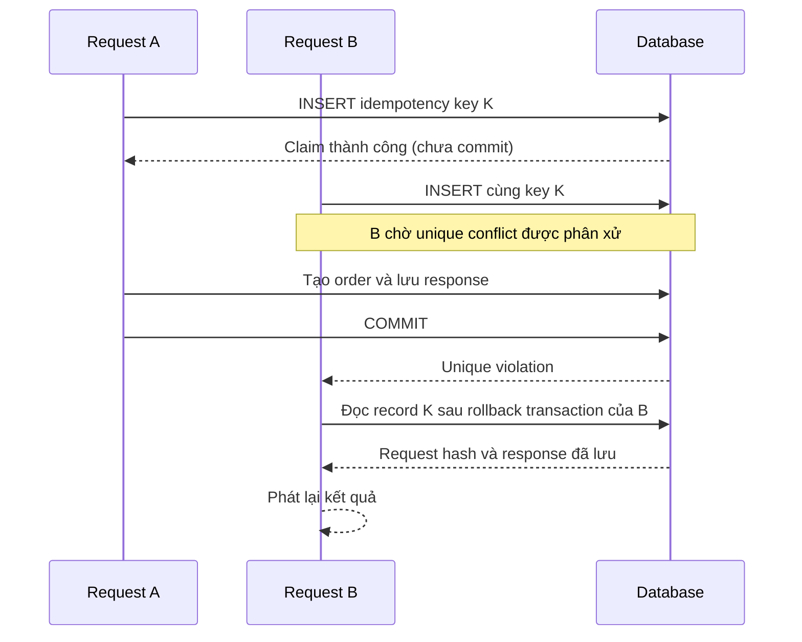

# Thiết kế thao tác lũy đẳng để chịu được yêu cầu lặp lại

Trong ứng dụng Spring Data Relational R2DBC, một thao tác ghi thường được thực hiện bất đồng bộ qua `Mono` hoặc `Flux`. Client có thể gửi lại cùng một yêu cầu khi timeout, mất kết nối hoặc không nhận được phản hồi; gateway cũng có thể retry, và message broker có thể giao lại một message. Vì vậy, cùng một ý định nghiệp vụ có thể đến ứng dụng nhiều lần, kể cả khi lần xử lý trước đã ghi dữ liệu thành công.

Thiết kế lũy đẳng (idempotency) bảo đảm việc thực hiện lại cùng một thao tác không tạo thêm hiệu ứng nghiệp vụ ngoài dự kiến. Với thao tác tạo đơn hàng, thanh toán hoặc đặt chỗ, điều này thường có nghĩa một yêu cầu được nhận diện bằng khóa idempotency, chỉ tạo một kết quả nghiệp vụ và có thể trả lại kết quả đã lưu khi client gửi lại yêu cầu.

Trong R2DBC, nền tảng của thiết kế này là constraint ở database, transaction reactive, thao tác cập nhật có điều kiện và cách xử lý lỗi khi nhiều request cạnh tranh. Chỉ kiểm tra trong bộ nhớ hoặc gọi `exists` trước khi insert không đủ để chống yêu cầu lặp đồng thời.

## 1. Idempotency là gì?

Một thao tác được xem là lũy đẳng nếu thực hiện một lần hay nhiều lần với cùng ý định đều dẫn tới cùng trạng thái nghiệp vụ cuối cùng. Có thể hình dung:

\[
f(f(x)) = f(x)
\]

Ví dụ, đặt trạng thái tài khoản thành `SUSPENDED` là thao tác có thể lũy đẳng: gọi một lần hay lặp lại vẫn cho trạng thái `SUSPENDED`. Ngược lại, tăng số dư thêm 100 mỗi lần gọi là thao tác không lũy đẳng: retry có thể cộng tiền hai lần.

| Thao tác | Có lũy đẳng tự nhiên không? | Lý do |
| --- | --- | --- |
| `PUT /customers/42` đặt tên thành một giá trị xác định | Thường có | Gửi lại cùng giá trị vẫn cho cùng trạng thái |
| `DELETE /sessions/abc` | Thường có nếu xóa lặp được coi là thành công | Sau lần đầu, các lần sau không làm thay đổi thêm trạng thái |
| `POST /orders` tạo một đơn hàng mới | Không tự nhiên | Mỗi lần gọi có thể tạo một đơn hàng khác |
| `UPDATE wallet SET balance = balance + 100` | Không | Mỗi lần thực thi lại cộng thêm 100 |
| `UPDATE customer SET status = 'ACTIVE' WHERE id = :id` | Thường có | Đặt cùng một trạng thái nhiều lần không tạo thêm hiệu ứng |
| Gửi email hoặc gọi dịch vụ thanh toán | Không tự nhiên | Gửi lại có thể tạo thêm email hoặc giao dịch |

Idempotency không có nghĩa mọi request lặp đều phải trả cùng một mã HTTP hoặc cùng thời gian phản hồi. Điều cần giữ là hiệu ứng nghiệp vụ không bị nhân đôi và hợp đồng API xác định rõ cách trả kết quả khi request được gửi lại.

## 2. Vì sao request có thể bị gửi lại?

Retry thường xuất hiện do lỗi ở ranh giới mạng, nơi client không thể biết chắc server đã xử lý tới đâu:

1. Client gửi yêu cầu tạo đơn hàng.
2. Server ghi đơn hàng thành công trong database.
3. Kết nối bị đứt trước khi response tới client.
4. Client thấy timeout và gửi lại yêu cầu.
5. Nếu server không nhận diện yêu cầu cũ, nó có thể tạo thêm đơn hàng thứ hai.

Một timeout không chứng minh thao tác database đã thất bại. Có thể request chưa tới server, có thể transaction đã rollback, hoặc transaction đã commit nhưng response bị mất. Vì thế, client cần có cách gửi lại cùng một ý định và server cần tra cứu kết quả trước đó.

Các nguồn retry phổ biến gồm:

- Người dùng nhấn nút nhiều lần vì giao diện chưa phản hồi.
- Mobile client gửi lại sau khi chuyển mạng hoặc ứng dụng được mở lại.
- HTTP client, API gateway hoặc load balancer retry lỗi tạm thời.
- Message broker giao lại message khi consumer không xác nhận đúng thời hạn.
- Job nền được chạy lại sau khi tiến trình bị dừng.
- Một service không biết request trước đã commit hay chưa do mất kết nối trong lúc chờ kết quả.

Thiết kế lũy đẳng phải tính tới retry đồng thời, không chỉ hai request cách nhau vài giây. Hai bản sao có thể tới hai instance ứng dụng ở cùng một thời điểm.

## 3. Idempotency key trong API

Với thao tác tạo mới hoặc thao tác có hiệu ứng không thể lặp tùy ý, client có thể gửi một khóa idempotency trong header, ví dụ:

```http
POST /orders
Idempotency-Key: 2a97f6c0-1c7d-4fd4-a4df-7f0cbb6a62ab
Content-Type: application/json

{
  "customerId": 42,
  "items": [
    { "productId": 7, "quantity": 2 }
  ]
}
```

Server dùng khóa này để nhận diện các lần gửi lại cùng một thao tác. Nếu request đầu tiên đã hoàn tất, request tiếp theo có cùng khóa và cùng nội dung sẽ nhận lại kết quả đã lưu, thay vì tạo đơn hàng mới.

Một idempotency key nên:

- Được tạo một lần cho một ý định nghiệp vụ, rồi giữ nguyên trong mọi lần retry của ý định đó.
- Có độ ngẫu nhiên đủ lớn, thường dùng UUID hoặc token ngẫu nhiên do client tạo.
- Được giới hạn độ dài và kiểm tra định dạng ở biên API.
- Được scope theo tenant/người dùng và loại thao tác để tránh va chạm giữa các ngữ cảnh.
- Không chứa thông tin bí mật hoặc dữ liệu cá nhân có thể đoán được.
- Được giữ trong thời gian đủ dài theo hợp đồng retry của sản phẩm.

Không tạo một khóa mới cho mỗi lần HTTP retry. Nếu client đổi khóa ở mỗi lần gửi, server sẽ xem đó là những thao tác mới và không thể deduplicate.

## 4. Phạm vi duy nhất của khóa

Không nên chỉ đặt `UNIQUE(idempotency_key)` một cách máy móc nếu hệ thống có nhiều tenant hoặc nhiều loại thao tác. Phạm vi duy nhất thường gồm tenant/người dùng, operation và key:

```text
(tenant_id, operation, idempotency_key)
```

Ví dụ, cùng chuỗi key có thể được dùng cho một thao tác tạo đơn hàng của tenant A và một thao tác tạo phiếu hỗ trợ của tenant B mà không xung đột nếu hai thao tác thuộc phạm vi khác nhau.

Phạm vi cần được xác định từ hợp đồng API. Một số hệ thống dùng `(account_id, idempotency_key)`; hệ thống khác dùng `(tenant_id, endpoint, idempotency_key)`. Dù chọn cách nào, tenant hoặc account phải lấy từ danh tính đã xác thực phía server, không tin một giá trị scope do client tự khai báo.

## 5. Lưu idempotency key bằng unique constraint

Một bảng idempotency có thể lưu trạng thái xử lý và kết quả đã tạo. Ví dụ DDL PostgreSQL:

```sql
CREATE TABLE idempotency_record (
    id BIGINT GENERATED BY DEFAULT AS IDENTITY PRIMARY KEY,
    tenant_id BIGINT NOT NULL,
    operation VARCHAR(100) NOT NULL,
    idempotency_key VARCHAR(200) NOT NULL,
    request_hash CHAR(64) NOT NULL,
    state VARCHAR(20) NOT NULL,
    resource_id BIGINT,
    response_status INTEGER,
    response_body TEXT,
    created_at TIMESTAMPTZ NOT NULL DEFAULT CURRENT_TIMESTAMP,
    completed_at TIMESTAMPTZ,
    expires_at TIMESTAMPTZ,
    CONSTRAINT uq_idempotency_scope
        UNIQUE (tenant_id, operation, idempotency_key),
    CONSTRAINT ck_idempotency_state
        CHECK (state IN ('PROCESSING', 'COMPLETED'))
);
```

Các trường chính:

| Trường | Mục đích |
| --- | --- |
| `tenant_id` | Scope theo tenant đã xác thực |
| `operation` | Phân biệt loại thao tác/API |
| `idempotency_key` | Khóa client giữ nguyên qua các lần retry |
| `request_hash` | Phát hiện cùng key nhưng payload khác |
| `state` | Trạng thái xử lý, ví dụ đang xử lý hoặc hoàn tất |
| `resource_id` | ID tài nguyên nghiệp vụ đã tạo |
| `response_status`, `response_body` | Thông tin response có thể phát lại |
| `created_at`, `completed_at`, `expires_at` | Theo dõi vòng đời và chính sách lưu giữ |

Unique constraint là hàng rào cuối cùng để hai request cạnh tranh không thể cùng claim một key trong cùng scope. Kiểm tra trong Java trước khi insert không thể thay thế constraint này.

DDL trên dùng kiểu `TIMESTAMPTZ` và identity theo PostgreSQL. Với database khác, điều chỉnh kiểu thời gian, kiểu ID và cú pháp identity theo hệ quản trị đang dùng.

## 6. Vì sao phải lưu request hash?

Một client có thể vô tình gửi cùng idempotency key với payload khác. Ví dụ lần đầu key K tạo đơn hàng cho customer 42, lần sau cùng key K lại gửi customer 99. Nếu server chỉ nhìn thấy key, nó có thể trả kết quả đơn hàng đầu tiên cho một yêu cầu có ý nghĩa khác, gây nhầm lẫn nghiêm trọng.

Server nên tính hash từ biểu diễn chuẩn hóa của yêu cầu nghiệp vụ, đồng thời scope theo operation và phiên bản API nếu cần. Khi key đã tồn tại:

- Cùng key và cùng request hash: xem là retry của thao tác cũ, trả kết quả đã lưu hoặc trạng thái đang xử lý theo hợp đồng API.
- Cùng key nhưng request hash khác: từ chối, thường bằng HTTP `409 Conflict` hoặc lỗi tương đương.

Không hash chuỗi JSON thô nếu thứ tự field, khoảng trắng hoặc cách biểu diễn số có thể thay đổi mà ý nghĩa request không đổi. Hãy parse và canonicalize dữ liệu cần thiết trước khi hash. Cũng cần xác định những trường nào thuộc ý nghĩa nghiệp vụ; không đưa dữ liệu ngẫu nhiên như request timestamp hoặc trace ID vào hash.

Hash không thay thế validation. Server vẫn phải kiểm tra quyền, định dạng, giới hạn và quy tắc nghiệp vụ trước khi xử lý.

## 7. Hai mô hình lưu trạng thái idempotency

Có hai cách thiết kế thường gặp, phù hợp với thời lượng và đặc điểm thao tác khác nhau.

### Mô hình A: claim, thực hiện nghiệp vụ và hoàn tất trong cùng transaction

Trong một transaction reactive:

1. Insert idempotency record ở trạng thái `PROCESSING`.
2. Thực hiện thay đổi nghiệp vụ, ví dụ tạo order.
3. Lưu ID tài nguyên và response vào idempotency record, chuyển trạng thái thành `COMPLETED`.
4. Commit transaction.

Record `PROCESSING` chưa commit nên request khác không nhìn thấy một trạng thái đang xử lý đã được lưu riêng. Khi request thứ hai insert cùng unique key, database sẽ phân xử xung đột với transaction đầu. Nếu transaction đầu commit, request thứ hai nhận lỗi unique; nếu transaction đầu rollback, request thứ hai có thể claim key và thực hiện nghiệp vụ.

Ưu điểm là claim, thay đổi nghiệp vụ và kết quả idempotency cùng commit hoặc cùng rollback. Không có record hoàn tất mà thiếu order, hoặc order đã commit nhưng thiếu kết quả để retry tra cứu.

Mô hình này phù hợp với thao tác database ngắn và có thể hoàn thành trong một transaction. Không nên giữ transaction mở trong lúc chờ một dịch vụ HTTP hoặc người dùng phản hồi.

### Mô hình B: lưu trạng thái PROCESSING riêng cho công việc dài

Với công việc dài hoặc xử lý bất đồng bộ, hệ thống có thể commit record `PROCESSING` trước, sau đó worker thực hiện và cập nhật `COMPLETED`. Khi đó cần thêm cơ chế:

- Lease hoặc thời điểm hết hạn để phát hiện worker bị dừng.
- Token/owner để chỉ worker đang giữ quyền mới được cập nhật trạng thái.
- Chuyển trạng thái có điều kiện, ví dụ chỉ cập nhật từ `PROCESSING` sang `COMPLETED` khi lease còn hiệu lực.
- Chính sách retry/recovery khi worker chết giữa chừng.
- Outbox hoặc hàng đợi bền vững để không mất công việc sau khi đã commit trạng thái.

Mô hình này có thể trả `202 Accepted` hoặc trạng thái “đang xử lý” cho request trùng. Nó phức tạp hơn vì trạng thái `PROCESSING` có thể tồn tại sau khi tiến trình chết. Cần có worker phục hồi và quy tắc xử lý lease rõ ràng.

Không trộn hai mô hình một cách tùy tiện. Với thao tác ngắn trong database, transaction đơn thường dễ bảo đảm tính nguyên tử hơn. Với workflow dài, state machine và recovery phải được thiết kế đầy đủ.

## 8. Luồng xử lý atomic trong Spring Data R2DBC

Ví dụ dưới đây minh họa mô hình A. Tên repository và DTO là kiểu của ứng dụng; phần claim/complete có thể triển khai bằng `DatabaseClient`, repository tùy chỉnh hoặc template.

```java
public Mono<OrderResponse> createOrder(
        AuthenticatedTenant tenant,
        String idempotencyKey,
        CreateOrderRequest request) {

    String requestHash = requestHasher.hashCanonical(request);

    return transactionalOperator.transactional(
            idempotencyStore.claim(
                            tenant.id(),
                            "CREATE_ORDER",
                            idempotencyKey,
                            requestHash)
                    .onErrorMap(
                            this::isIdempotencyKeyConflict,
                            error -> new DuplicateIdempotencyKeyException(error))
                    .then(orderRepository.save(Order.from(tenant.id(), request)))
                    .flatMap(savedOrder -> {
                        OrderResponse response = OrderResponse.from(savedOrder);

                        return idempotencyStore.complete(
                                        tenant.id(),
                                        "CREATE_ORDER",
                                        idempotencyKey,
                                        requestHash,
                                        savedOrder.getId(),
                                        response)
                                .thenReturn(response);
                    })
    ).onErrorResume(
            DuplicateIdempotencyKeyException.class,
            error -> replayExisting(
                    tenant.id(),
                    "CREATE_ORDER",
                    idempotencyKey,
                    requestHash));
}
```

Điểm quan trọng trong ví dụ:

- `claim`, `save(order)` và `complete` nằm trong cùng `TransactionalOperator`.
- Lỗi unique của thao tác claim được chuyển thành exception riêng để phân biệt với lỗi constraint khi lưu order.
- `onErrorResume` nằm bên ngoài publisher transaction. Transaction đầu được rollback trước khi đọc kết quả đã tồn tại.
- `replayExisting` đọc record bằng một thao tác mới sau khi transaction claim thất bại.
- Mọi nhánh đều trả `Mono`; không gọi `block()` hoặc tự `subscribe()` trong service.

`isIdempotencyKeyConflict` cần nhận diện đúng unique constraint `uq_idempotency_scope` theo exception/SQLSTATE mà driver sử dụng. Không chuyển mọi `DuplicateKeyException` của toàn bộ luồng thành duplicate idempotency key, vì order cũng có thể vi phạm một constraint khác.

## 9. Claim và complete bằng `DatabaseClient`

Một store tùy chỉnh có thể insert claim bằng bind parameters:

```java
public Mono<Void> claim(
        Long tenantId,
        String operation,
        String key,
        String requestHash) {

    return databaseClient.sql("""
            INSERT INTO idempotency_record
                (tenant_id, operation, idempotency_key,
                 request_hash, state, created_at)
            VALUES
                (:tenantId, :operation, :key,
                 :requestHash, 'PROCESSING', CURRENT_TIMESTAMP)
            """)
            .bind("tenantId", tenantId)
            .bind("operation", operation)
            .bind("key", key)
            .bind("requestHash", requestHash)
            .fetch()
            .rowsUpdated()
            .then();
}
```

Để hoàn tất, cập nhật record trong cùng transaction:

```java
public Mono<Void> complete(
        Long tenantId,
        String operation,
        String key,
        String requestHash,
        Long resourceId,
        OrderResponse response) {

    return databaseClient.sql("""
            UPDATE idempotency_record
            SET state = 'COMPLETED',
                resource_id = :resourceId,
                response_status = :responseStatus,
                response_body = :responseBody,
                completed_at = CURRENT_TIMESTAMP
            WHERE tenant_id = :tenantId
              AND operation = :operation
              AND idempotency_key = :key
              AND request_hash = :requestHash
              AND state = 'PROCESSING'
            """)
            .bind("tenantId", tenantId)
            .bind("operation", operation)
            .bind("key", key)
            .bind("requestHash", requestHash)
            .bind("resourceId", resourceId)
            .bind("responseStatus", 201)
            .bind("responseBody", responseSerializer.serialize(response))
            .fetch()
            .rowsUpdated()
            .flatMap(updated -> updated == 1
                    ? Mono.empty()
                    : Mono.error(new IllegalStateException(
                            "Idempotency record was not completed")));
}
```

Ví dụ dùng `response_body TEXT` để giữ chuỗi JSON đã serialize; ứng dụng có thể chọn kiểu JSON/JSONB riêng của database và driver. Nếu response có header quan trọng, hãy lưu những header cần phát lại theo whitelist. Không lưu header hop-by-hop, cookie nhạy cảm hoặc token xác thực một cách tùy tiện.

Việc kiểm tra `rowsUpdated == 1` bảo đảm bước complete đã cập nhật đúng record đang ở trạng thái `PROCESSING`. Nếu không cập nhật được, transaction nên thất bại để thay đổi nghiệp vụ trước đó rollback cùng.

## 10. Phát lại kết quả đã hoàn tất

Khi claim thất bại do unique key đã tồn tại, service đọc record hiện tại:

```java
public Mono<OrderResponse> replayExisting(
        Long tenantId,
        String operation,
        String key,
        String requestHash) {

    return idempotencyStore.find(tenantId, operation, key)
            .switchIfEmpty(Mono.error(
                    new IllegalStateException("Conflicting key was not found")))
            .flatMap(existing -> {
                if (!existing.requestHash().equals(requestHash)) {
                    return Mono.error(new IdempotencyKeyReuseException());
                }

                if (!existing.isCompleted()) {
                    return Mono.error(new RequestStillProcessingException());
                }

                return Mono.just(responseSerializer.deserialize(
                        existing.responseBody()));
            });
}
```

Với mô hình A, request trùng thường chỉ đọc được record sau khi transaction đầu commit, khi đó record đã là `COMPLETED`. `PROCESSING` có thể xuất hiện nếu hệ thống dùng mô hình B hoặc có một luồng xử lý khác; API cần quy định trả `202`, `409`, `Retry-After` hay trạng thái phù hợp.

Nếu cùng key nhưng request hash khác, không phát lại response cũ như thể payload mới đã được xử lý. Hãy trả lỗi xung đột rõ ràng để client biết không được tái sử dụng key cho ý định khác.

## 11. Điều gì xảy ra khi hai request cùng key tới đồng thời?

Unique constraint xử lý cuộc đua tại database, nơi mọi instance cùng nhìn thấy một trạng thái dữ liệu chung.



Nếu A commit, B không thể claim cùng key và sẽ đọc kết quả của A. Nếu A rollback, insert của B có thể thành công và B trở thành request thực hiện nghiệp vụ. Chi tiết chờ và báo lỗi phụ thuộc isolation/database, nhưng unique constraint vẫn là cơ chế phân xử cuối cùng.

Với PostgreSQL, sau một lỗi constraint trong transaction, transaction thường ở trạng thái lỗi và không thể tiếp tục truy vấn bình thường trước khi rollback. Vì vậy, đặt nhánh đọc lại sau khi `TransactionalOperator` kết thúc và rollback, như ví dụ ở trên. Không bắt lỗi duplicate rồi truy vấn record tiếp ngay bên trong cùng transaction đã bị abort.

## 12. Vì sao `exists` rồi `save` không đủ?

Một cách triển khai dễ viết nhưng không an toàn:

```java
return idempotencyRepository.existsByTenantIdAndKey(tenantId, key)
        .flatMap(exists -> {
            if (exists) {
                return Mono.error(new DuplicateRequestException());
            }

            return orderRepository.save(order);
        });
```

Hai request đồng thời có thể cùng nhận `exists = false`, rồi cả hai cùng tạo order. Đây là race condition giữa bước kiểm tra và bước ghi.

Ngay cả khi thêm transaction, mức isolation mặc định không nhất thiết biến hai câu lệnh thành một thao tác duy nhất. Giải pháp cần constraint unique trên key và phải xử lý trường hợp insert cạnh tranh. Có thể dùng `exists` để tối ưu phản hồi trong một số trường hợp, nhưng kết quả insert có constraint mới là quyết định cuối cùng.

## 13. Lũy đẳng bằng cập nhật có điều kiện

Không phải mọi thao tác đều cần bảng idempotency. Một số nghiệp vụ có thể được thiết kế lũy đẳng bằng câu lệnh cập nhật đặt trạng thái xác định:

```sql
UPDATE shipment
SET status = 'CANCELLED'
WHERE id = :shipmentId
  AND status <> 'CANCELLED';
```

Lệnh này không tạo thêm hiệu ứng khi chạy lại sau khi trạng thái đã là `CANCELLED`. Tuy nhiên, nếu cần phân biệt không tồn tại, đã hủy và không được phép hủy, service cần diễn giải số hàng bị ảnh hưởng hoặc đọc trạng thái theo quy tắc nghiệp vụ.

Với thao tác chuyển trạng thái, nên dùng điều kiện trạng thái hiện tại:

```sql
UPDATE payment
SET status = 'CAPTURED', captured_at = CURRENT_TIMESTAMP
WHERE id = :paymentId
  AND status = 'AUTHORIZED';
```

Chỉ một request có thể chuyển từ `AUTHORIZED` sang `CAPTURED`. Request lặp sau đó không cập nhật thêm hàng. Cần xác định response khi số hàng cập nhật bằng 0: trạng thái đã được chuyển trước đó có thể được xem là thành công idempotent, còn trạng thái khác có thể là xung đột nghiệp vụ.

## 14. Vì sao phép cộng/trừ thường không lũy đẳng?

Các thao tác tương đối như tăng, giảm, cộng điểm hoặc trừ tồn kho thường không lũy đẳng:

```sql
UPDATE inventory
SET reserved_quantity = reserved_quantity + :quantity
WHERE product_id = :productId;
```

Nếu cùng yêu cầu được chạy hai lần, số lượng đặt trước tăng gấp đôi. Chỉ dùng điều kiện `reserved_quantity + quantity <= available_quantity` vẫn chưa giải quyết việc một request hợp lệ bị gửi lại nhiều lần; nó chỉ bảo vệ giới hạn tồn kho.

Để lũy đẳng, cần gắn hiệu ứng với một operation ID duy nhất:

```sql
CREATE TABLE inventory_reservation_operation (
    operation_id VARCHAR(100) PRIMARY KEY,
    product_id BIGINT NOT NULL,
    quantity INTEGER NOT NULL,
    created_at TIMESTAMP NOT NULL DEFAULT CURRENT_TIMESTAMP
);
```

Trong một transaction, claim `operation_id` bằng insert có unique constraint rồi mới cập nhật tồn kho. Nếu operation ID đã tồn tại, không áp dụng phép cộng lần nữa. Claim và update tồn kho phải cùng transaction để không có record operation mà chưa cập nhật inventory hoặc ngược lại.

Với thao tác tài chính, nên lưu ledger/transaction nghiệp vụ với khóa tham chiếu duy nhất thay vì chỉ cập nhật số dư. Ledger giúp kiểm toán, đối soát và phát hiện một lệnh đã được áp dụng.

## 15. Idempotency key và optimistic locking khác nhau

Optimistic locking thường dùng trường version (`@Version`) để phát hiện hai transaction cùng cập nhật một entity. Nó giúp ngăn ghi đè thay đổi của nhau, nhưng không tự deduplicate một lệnh nghiệp vụ được gửi lại.

Ví dụ, request đầu tăng điểm thành công và version tăng từ 3 lên 4. Client không nhận được response rồi gửi lại một command mới. Nếu lần gửi lại đọc version 4 và thực hiện phép tăng lần nữa, optimistic locking không biết đây là cùng một ý định cũ; nó có thể tăng điểm thêm lần nữa.

| Cơ chế | Bảo vệ điều gì? |
| --- | --- |
| Unique idempotency key | Cùng một ý định không được claim và thực hiện hai lần trong cùng scope |
| Optimistic locking/version | Phát hiện cập nhật dựa trên phiên bản cũ và tránh lost update |
| Transaction | Gom các thay đổi database thành một đơn vị commit/rollback |
| Unique business constraint | Bảo vệ một bất biến dữ liệu như mã giao dịch không trùng |

Các cơ chế có thể được dùng cùng nhau. Ví dụ request idempotency key chống lặp; version kiểm soát cập nhật cạnh tranh trên aggregate; unique constraint bảo vệ mã giao dịch.

## 16. Ranh giới transaction reactive

Spring Data R2DBC hỗ trợ transaction reactive thông qua `R2dbcTransactionManager` và `TransactionalOperator` hoặc `@Transactional` trên phương thức trả publisher. Ngữ cảnh transaction được truyền qua Reactor Context, vì vậy các thao tác database cần được nối trong cùng reactive chain.

Ví dụ:

```java
public Mono<OrderResponse> createOrder(CreateOrderRequest request) {
    return transactionalOperator.transactional(
            orderRepository.save(Order.from(request))
                    .flatMap(saved ->
                            idempotencyRepository.save(
                                    IdempotencyRecord.completedFor(saved))
                                    .thenReturn(OrderResponse.from(saved)))
    );
}
```

Đoạn minh họa chỉ đúng khi thao tác lưu idempotency record và order thực sự dùng cùng transaction manager/connection factory. Thiết kế đầy đủ phải claim key trước khi tạo order và xử lý xung đột unique như các phần trên.

Không gọi `block()` hoặc tự `subscribe()` bên trong transaction. Việc đó có thể tách thao tác khỏi Reactor Context, khiến transaction không bao phủ toàn bộ công việc và làm mất khả năng truyền lỗi/hủy nhất quán.

Transaction cũng không tự bao phủ một dịch vụ HTTP, hệ thống email hoặc broker bên ngoài. Gọi dịch vụ ngoài trong lúc giữ transaction database có thể kéo dài thời gian giữ connection và vẫn không tạo được atomicity giữa hai hệ thống.

## 17. Xử lý side effect bên ngoài bằng Transactional Outbox

Giả sử tạo đơn hàng cần gửi sự kiện `OrderCreated` tới broker. Nếu commit order rồi gửi message thất bại, hệ thống có order nhưng không có event. Nếu gửi event trước rồi transaction database rollback, consumer có thể nhận event của order không tồn tại.

Transactional Outbox giải quyết khoảng trống này bằng cách ghi dữ liệu nghiệp vụ và một hàng outbox trong cùng transaction:

```sql
CREATE TABLE outbox_event (
    id BIGINT GENERATED BY DEFAULT AS IDENTITY PRIMARY KEY,
    event_key VARCHAR(200) NOT NULL UNIQUE,
    aggregate_id BIGINT NOT NULL,
    event_type VARCHAR(100) NOT NULL,
    payload TEXT NOT NULL,
    created_at TIMESTAMP NOT NULL DEFAULT CURRENT_TIMESTAMP,
    published_at TIMESTAMP
);
```

Trong transaction tạo order:

```java
return transactionalOperator.transactional(
        orderRepository.save(order)
                .flatMap(saved -> outboxRepository.save(
                                OutboxEvent.orderCreated(saved))
                        .thenReturn(saved))
);
```

Worker đọc outbox chưa gửi và publish event. Nếu worker publish thành công nhưng chết trước khi đánh dấu `published_at`, event có thể được gửi lại. Vì vậy consumer cũng cần idempotent, thường bằng bảng `processed_event` có unique constraint trên `event_id` hoặc một khóa nghiệp vụ tương đương.

Outbox bảo đảm event cần phát không bị mất khi transaction nghiệp vụ commit; nó thường cung cấp delivery at-least-once, không phải exactly-once end-to-end. Consumer phải chấp nhận message lặp.

## 18. Gọi dịch vụ thanh toán hoặc dịch vụ ngoài

Một transaction R2DBC không thể tự rollback một khoản thanh toán đã được cổng thanh toán xử lý. Với side effect bên ngoài:

- Dùng cùng một idempotency key khi gọi provider nếu provider hỗ trợ.
- Lưu trạng thái yêu cầu và mã tham chiếu provider.
- Dùng outbox để phát lệnh thanh toán bền vững nếu workflow bất đồng bộ.
- Xử lý callback/webhook lặp bằng unique event ID hoặc transaction reference.
- Đối soát trạng thái khi timeout không rõ provider đã xử lý hay chưa.
- Không gọi lại provider với key mới chỉ vì lần gọi trước timeout.

Nếu provider không hỗ trợ idempotency, cần thiết kế một cơ chế đối soát hoặc truy vấn trạng thái theo mã tham chiếu trước khi thử lại. Không có transaction cục bộ nào bảo đảm một dịch vụ bên ngoài chỉ thực hiện một lần.

## 19. Retry trong reactive pipeline

Reactor có thể retry publisher khi gặp lỗi phù hợp, nhưng retry có nghĩa là subscribe lại. Nếu publisher chứa thao tác ghi không lũy đẳng, retry có thể tạo hiệu ứng lặp.

Ví dụ không nên retry mù quáng:

```java
return walletRepository.addFunds(accountId, amount)
        .retryWhen(Retry.max(3));
```

Nếu lần đầu đã commit nhưng client/driver nhận lỗi ở ranh giới phản hồi, lần retry có thể cộng tiền lần nữa. Cần gắn operation ID/idempotency key và bảo vệ bằng unique constraint trong transaction.

Khi retry:

- Chỉ retry lỗi tạm thời có khả năng hồi phục, không retry lỗi validation hoặc vi phạm nghiệp vụ.
- Giữ nguyên idempotency key và request hash qua mọi lần thử.
- Dùng backoff và jitter để tránh nhiều request retry cùng lúc.
- Giới hạn số lần retry và tổng deadline.
- Bảo đảm mỗi lần retry tạo một transaction mới nếu transaction trước đã rollback.
- Không retry một lỗi mà kết quả commit chưa rõ nếu thao tác chưa có cơ chế idempotency.

Không dùng `retryWhen` để che mọi lỗi bằng cách thực thi lại vô điều kiện. Cần hiểu lỗi phát sinh trước commit, trong commit hay sau khi server đã commit nhưng kết nối bị mất.

## 20. Thời gian lưu giữ idempotency record

Không nhất thiết lưu idempotency record vĩnh viễn, nhưng thời gian giữ phải dài hơn cửa sổ retry mà client/gateway có thể thực hiện và phù hợp với quy định nghiệp vụ.

Khi thiết kế retention, cần xác định:

- Client có thể retry trong bao lâu sau timeout?
- Gateway, mobile app hoặc job nền có retry trễ không?
- Key có thể được tái sử dụng sau khi record hết hạn không?
- Dữ liệu response có chứa thông tin cá nhân hoặc dữ liệu nhạy cảm không?
- Có yêu cầu kiểm toán hoặc đối soát cần giữ operation ID lâu hơn không?
- Cleanup có thể xóa record đang được xử lý hoặc còn cần cho retry không?

Nếu xóa record quá sớm, một retry muộn có thể tạo thao tác mới. Với thanh toán hoặc nghiệp vụ tài chính, có thể cần giữ operation ledger lâu dài dù response cache chỉ giữ trong thời gian ngắn.

Cleanup nên xóa theo batch và có điều kiện trạng thái/thời gian rõ ràng. Không xóa record `PROCESSING` chỉ vì `created_at` cũ nếu chưa có cơ chế lease/recovery xác định worker đã mất quyền xử lý.

## 21. Bảo mật và quyền truy cập

Idempotency key là định danh thao tác, không phải thông tin xác thực. Người dùng không được phép lấy response của một tenant khác chỉ bằng cách đoán hoặc biết key.

Mỗi lần replay phải:

- Xác thực người gọi như request mới.
- Xác định tenant/account scope từ principal phía server.
- Tìm record theo đúng scope và operation.
- Kiểm tra quyền truy cập tài nguyên hiện tại nếu response chứa dữ liệu có thể đã đổi quyền.
- Không log raw key nếu key có thể được xem là dữ liệu nhạy cảm; có thể log hash/đoạn rút gọn an toàn.
- Không lưu access token, cookie hoặc header bí mật trong response snapshot.

Nếu response cũ chứa dữ liệu nhạy cảm, chính sách replay phải cân nhắc quyền hiện tại. Có thể chỉ lưu resource ID và dựng lại response sau khi kiểm tra quyền, thay vì lưu toàn bộ response body.

## 22. Trả response nào cho request lặp?

API cần định nghĩa nhất quán hành vi khi key đã tồn tại:

| Trạng thái | Hành vi gợi ý |
| --- | --- |
| Key mới, payload hợp lệ | Claim key và thực hiện thao tác |
| Key cũ, cùng payload, đã hoàn tất | Phát lại status/body hoặc tài nguyên đã lưu |
| Key cũ, payload khác | Trả lỗi xung đột, thường là `409 Conflict` |
| Key cũ, đang xử lý theo mô hình B | Trả `202 Accepted`, `409` hoặc trạng thái retry theo hợp đồng API |
| Key hết hạn và đã bị xóa | Có thể được xem là key mới; phải được nêu rõ trong hợp đồng |
| Người gọi không còn quyền xem tài nguyên | Từ chối theo chính sách authorization hiện tại |

Phát lại response không nhất thiết có cùng header thời gian hoặc trace ID. Những trường thuộc nội dung nghiệp vụ như order ID, amount, status và location nên ổn định. Nếu response chứa `Location`, `ETag` hoặc header nghiệp vụ cần thiết, có thể lưu/khôi phục theo whitelist.

## 23. Kiểm thử lũy đẳng và cạnh tranh đồng thời

Unit test có thể xác minh cách service xử lý key và request hash, nhưng không chứng minh unique constraint thực sự giải quyết race condition. Cần integration test trên database tương thích với production.

Các tình huống quan trọng:

1. Gửi một key mới: chỉ một tài nguyên được tạo và record chuyển `COMPLETED`.
2. Gửi lại cùng key và cùng payload sau khi hoàn tất: trả lại cùng resource ID/response, không tạo thêm tài nguyên.
3. Gửi cùng key nhưng payload khác: trả lỗi xung đột, không thay đổi dữ liệu.
4. Gửi hai request cùng key đồng thời: chỉ một thao tác nghiệp vụ được áp dụng.
5. Làm transaction đầu rollback: request khác có thể claim key và thực hiện thành công.
6. Mô phỏng mất response sau commit: retry đọc record đã hoàn tất và replay kết quả.
7. Kiểm tra tenant khác nhau có scope riêng theo thiết kế.
8. Kiểm tra retention và cleanup không xóa record đang cần xử lý.
9. Kiểm tra outbox có đúng một event nghiệp vụ theo event key và consumer chịu được delivery lặp.
10. Kiểm tra retry chỉ áp dụng cho lỗi tạm thời và giữ nguyên idempotency key.

Ví dụ ý tưởng kiểm thử hai request đồng thời:

```java
Mono<OrderResponse> first = service.createOrder(tenant, key, request);
Mono<OrderResponse> second = service.createOrder(tenant, key, request);

StepVerifier.create(Mono.zip(first, second))
        .assertNext(pair -> {
            assertThat(pair.getT1().orderId())
                    .isEqualTo(pair.getT2().orderId());
        })
        .verifyComplete();

StepVerifier.create(orderRepository.countByTenantId(tenant.id()))
        .expectNext(1L)
        .verifyComplete();
```

Đây là phác thảo test; fixture cần bảo đảm bảng trống cho tenant và hai subscription thực sự cạnh tranh. Có thể dùng `Mono.when`/`zip` hoặc barrier để tăng khả năng chạy đồng thời. Kiểm tra cuối cùng phải đọc database để xác nhận chỉ có một hiệu ứng nghiệp vụ.

## 24. Quan sát và vận hành

Idempotency cần được theo dõi như một phần của workflow:

| Chỉ số/log | Điều cần quan sát |
| --- | --- |
| Số claim mới | Lượng thao tác mới được nhận |
| Số replay | Tần suất client/gateway gửi lại yêu cầu đã hoàn tất |
| Số key conflict với payload khác | Lỗi client hoặc hành vi sử dụng key sai |
| Thời gian ở trạng thái processing | Phát hiện workflow bị treo nếu dùng mô hình B |
| Tỷ lệ transaction rollback | Phát hiện lỗi trong chuỗi claim và ghi nghiệp vụ |
| Outbox pending và tuổi event | Phát hiện publisher hoặc broker bị chậm |
| Duplicate event ở consumer | Đánh giá hiệu quả deduplication downstream |

Không đưa raw idempotency key, payload đầy đủ hoặc response nhạy cảm vào log. Có thể dùng correlation ID và một fingerprint an toàn để nối các log liên quan.

Nếu tỷ lệ replay tăng đột biến, cần kiểm tra latency API, timeout ở gateway/client và lỗi kết nối. Retry storm có thể làm tải database tăng; backoff, rate limit và deadline cần được điều chỉnh cùng nhau.

## 25. Các lỗi thiết kế thường gặp

| Lỗi | Hậu quả | Cách khắc phục |
| --- | --- | --- |
| Tạo key mới mỗi lần retry | Mọi lần gửi được xem là thao tác mới | Client tạo một key cho một ý định và giữ nguyên |
| Chỉ kiểm tra `exists` trước insert | Hai request đồng thời có thể cùng vượt qua kiểm tra | Dùng unique constraint và xử lý duplicate claim |
| Không lưu request hash | Cùng key với payload khác bị coi là retry hợp lệ | Hash payload chuẩn hóa và trả conflict khi khác |
| Claim key ngoài transaction với thay đổi nghiệp vụ | Có thể có record claim nhưng không có tài nguyên, hoặc ngược lại | Claim, mutation và complete trong cùng transaction ngắn |
| Bắt lỗi duplicate bên trong transaction đã abort rồi truy vấn tiếp | Truy vấn tiếp có thể thất bại vì transaction đang ở trạng thái lỗi | Để transaction rollback rồi đọc record ở ngoài transaction |
| Bắt mọi duplicate key thành duplicate idempotency | Che giấu vi phạm unique constraint của bảng nghiệp vụ | Nhận diện đúng constraint của bảng idempotency |
| Gọi `block()`/`subscribe()` trong service | Mất reactive flow, có thể tách transaction và lỗi | Nối publisher bằng `flatMap`, `then` và trả về `Mono`/`Flux` |
| Gọi dịch vụ ngoài trong transaction lâu | Giữ connection và không có atomicity xuyên hệ thống | Dùng outbox/saga và idempotency ở provider/consumer |
| Retry phép cộng/trừ không có operation ID | Hiệu ứng bị nhân đôi | Dùng operation ledger/unique key cùng transaction |
| Cho rằng optimistic locking chống duplicate request | Một retry mới vẫn có thể áp dụng nghiệp vụ lần nữa | Kết hợp idempotency key với version khi cần |
| Xóa record quá sớm | Retry muộn tạo tài nguyên trùng | Thiết kế retention theo cửa sổ retry và yêu cầu nghiệp vụ |
| Dùng key làm bằng chứng authorization | Có thể lộ dữ liệu giữa tenant/người dùng | Xác thực và kiểm tra scope/quyền ở mọi request |

## 26. Quy trình thiết kế một thao tác lũy đẳng

Khi thêm idempotency cho một endpoint hoặc consumer, có thể thực hiện theo thứ tự:

1. Xác định hiệu ứng nghiệp vụ nào không được phép lặp, ví dụ tạo order, giữ chỗ, ghi ledger hoặc phát hành thanh toán.
2. Xác định scope của key: tenant/account, operation và phiên bản hợp đồng.
3. Quy định client tạo và giữ key như thế nào qua retry.
4. Chuẩn hóa request và tính hash để phát hiện dùng lại key với payload khác.
5. Tạo bảng idempotency/operation ledger với unique constraint ở database.
6. Chọn mô hình transaction ngắn hay workflow `PROCESSING` dài có lease/recovery.
7. Với transaction ngắn, claim key, ghi nghiệp vụ và lưu response trong cùng transaction reactive.
8. Đưa xử lý duplicate ra ngoài transaction đã rollback rồi đọc và replay kết quả.
9. Dùng outbox và idempotent consumer cho side effect bên ngoài database.
10. Định nghĩa retention, response replay, authorization và mã lỗi.
11. Kiểm thử retry tuần tự, retry đồng thời, rollback, mất response sau commit và payload khác.
12. Theo dõi replay rate, conflict, thời gian xử lý và backlog outbox trong production.

## 27. Nguyên tắc thực hành

- Xem retry là hành vi bình thường của hệ thống phân tán; không giả định mỗi request chỉ tới server một lần.
- Dùng idempotency key ổn định cho thao tác có hiệu ứng không tự lũy đẳng.
- Scope key theo tenant/account và operation bằng dữ liệu đã xác thực ở server.
- Dùng unique constraint làm cơ chế phân xử request cạnh tranh; không dựa riêng vào kiểm tra `exists`.
- Lưu request hash để từ chối cùng key nhưng payload khác.
- Với thao tác database ngắn, claim key, ghi dữ liệu nghiệp vụ và lưu kết quả trong cùng transaction reactive.
- Xử lý lỗi unique claim sau khi transaction rollback rồi mới đọc record đã tồn tại.
- Chỉ replay kết quả khi request hash khớp và người gọi vẫn có quyền phù hợp.
- Dùng cập nhật có điều kiện hoặc operation ledger cho phép cộng/trừ và thao tác tương đối.
- Phân biệt idempotency key với optimistic locking, unique business constraint và transaction.
- Dùng outbox cho sự kiện cần phát sau commit; làm consumer idempotent vì delivery có thể lặp.
- Không gọi `block()` hoặc `subscribe()` rời rạc trong service reactive.
- Không giữ transaction database mở trong lúc chờ dịch vụ bên ngoài.
- Quy định retention, cleanup, retry, backoff và xử lý trạng thái đang chạy.
- Kiểm thử cạnh tranh trên database thật và xác minh số hiệu ứng nghiệp vụ cuối cùng.

## 28. Kết luận

Thiết kế lũy đẳng giúp ứng dụng chịu được request lặp do timeout, retry hoặc message redelivery mà không nhân đôi hiệu ứng nghiệp vụ. Với thao tác tạo mới hoặc cập nhật không tự lũy đẳng, idempotency key cần được scope rõ ràng, gắn với request hash và được bảo vệ bằng unique constraint ở database. Trong Spring Data R2DBC, cách triển khai đáng tin cậy cho thao tác ngắn là claim key, ghi dữ liệu nghiệp vụ và lưu kết quả trong cùng transaction reactive; khi có xung đột, rollback transaction rồi đọc record đã hoàn tất để phát lại response.

Transaction cục bộ không làm cho side effect bên ngoài trở thành exactly-once. Dùng Transactional Outbox, idempotent consumer và key của nhà cung cấp cho workflow liên hệ thống. Kết hợp constraint, transaction, xử lý retry có kiểm soát, authorization và integration test đồng thời sẽ giúp các thao tác ghi an toàn hơn khi hệ thống gặp lỗi mạng hoặc tải cao.
