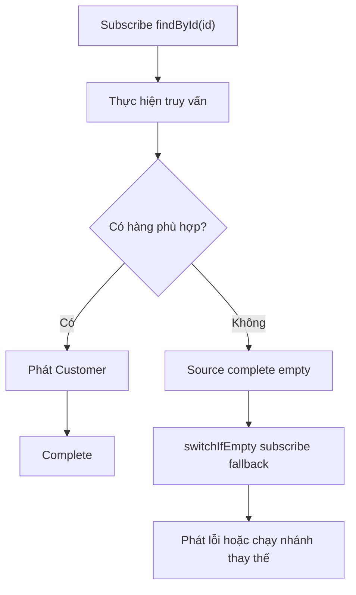

# Dùng `switchIfEmpty` và `defer` cho nhánh dữ liệu không tồn tại

Trong Spring Data Relational R2DBC, nhiều thao tác đọc trả về `Mono<T>` hoặc `Flux<T>`. Khi truy vấn không tìm thấy hàng phù hợp, publisher thường hoàn tất mà không phát ra phần tử. Đây là trạng thái *empty completion* của Reactor. Ứng dụng có thể dùng `switchIfEmpty` để chuyển sang một nhánh khác, chẳng hạn phát lỗi 404, tạo bản ghi mới, đọc dữ liệu mặc định hoặc gọi một nguồn dự phòng.

`defer` bổ sung khả năng trì hoãn việc tạo publisher cho tới khi nhánh đó thực sự được subscribe. Điều này hữu ích khi việc tạo publisher có tính toán, đọc context, sinh giá trị hoặc gọi một hàm có side effect. Kết hợp hai operator giúp diễn đạt rõ luồng: thử đọc trước; chỉ khi không có dữ liệu mới xây dựng và chạy nhánh thay thế.

Điều quan trọng là phân biệt ba thời điểm: tạo pipeline, source hoàn tất rỗng và fallback được subscribe. `switchIfEmpty` chỉ chuyển nhánh khi source hoàn tất mà không phát phần tử. `defer` trì hoãn việc gọi supplier tạo publisher; nó không tự chạy tác vụ trên thread khác và cũng không tự subscribe publisher.

## 1. Empty completion khi truy vấn R2DBC không tìm thấy hàng

Một repository reactive thường khai báo:

```java
public interface CustomerRepository
        extends ReactiveCrudRepository<Customer, Long> {
}
```

Khi gọi:

```java
Mono<Customer> customer = customerRepository.findById(42L);
```

Nếu database có hàng ID `42`, publisher phát ra một `Customer`, sau đó hoàn tất. Nếu không có hàng phù hợp, publisher hoàn tất mà không phát phần tử. Nó không nhất thiết phát `null` và cũng không tự phát một exception chỉ vì không tìm thấy hàng.

Hai kết quả cần phân biệt:

| Trường hợp | Tín hiệu reactive |
| --- | --- |
| Tìm thấy một customer | `onNext(customer)` rồi `onComplete` |
| Không tìm thấy customer | `onComplete` mà không có `onNext` |
| Lỗi kết nối hoặc lỗi SQL | `onError(error)` |

Empty completion là một trạng thái hợp lệ của reactive stream. Nó khác lỗi truy vấn. Nếu cần biến “không tìm thấy” thành lỗi nghiệp vụ, hãy chuyển empty thành error một cách tường minh.

## 2. `switchIfEmpty` chuyển sang publisher thay thế

`switchIfEmpty` nhận một publisher thay thế. Nếu publisher nguồn phát ít nhất một phần tử, nhánh thay thế không được subscribe. Nếu publisher nguồn hoàn tất mà không phát phần tử nào, Reactor subscribe publisher thay thế.

Ví dụ phát lỗi khi không tìm thấy customer:

```java
public Mono<Customer> getCustomer(Long id) {
    return customerRepository.findById(id)
            .switchIfEmpty(Mono.error(
                    new CustomerNotFoundException(id)
            ));
}
```

Luồng hoạt động:

1. Repository thực hiện truy vấn khi publisher được subscribe.
2. Nếu có customer, phần tử đó được phát ra và kết thúc; fallback không chạy.
3. Nếu không có customer, source hoàn tất rỗng.
4. `switchIfEmpty` chuyển sang `Mono.error(...)` và downstream nhận lỗi `CustomerNotFoundException`.

Sơ đồ:



### Fallback có thể là một giá trị mặc định

Nếu muốn trả về một object mặc định thay vì lỗi:

```java
Mono<CustomerView> findCustomerView(Long id) {
    return customerRepository.findById(id)
            .map(CustomerView::from)
            .switchIfEmpty(Mono.just(CustomerView.notFound(id)));
}
```

`Mono.just(...)` phát ra một giá trị rồi hoàn tất. Giá trị mặc định chỉ được phát khi source rỗng.

Nếu chỉ cần thay một publisher rỗng bằng một giá trị đơn giản, `defaultIfEmpty(value)` cũng có thể phù hợp:

```java
Mono<String> name = customerRepository.findById(id)
        .map(Customer::getName)
        .defaultIfEmpty("Unknown customer");
```

`defaultIfEmpty` nhận một giá trị; `switchIfEmpty` nhận publisher, vì vậy có thể dùng nó để chạy truy vấn khác, tạo dữ liệu hoặc phát lỗi.

## 3. `switchIfEmpty` không xử lý lỗi

`switchIfEmpty` chỉ phản ứng với complete rỗng. Nếu source phát `onError`, nhánh thay thế không được gọi:

```java
return customerRepository.findById(id)
        .switchIfEmpty(Mono.defer(() -> createDefaultCustomer(id)));
```

Nếu truy vấn gặp lỗi kết nối, timeout hoặc lỗi SQL, lỗi đó đi thẳng xuống downstream. `switchIfEmpty` không biến lỗi thành “không tìm thấy”.

Phân biệt các operator:

| Operator | Kích hoạt khi | Mục đích |
| --- | --- | --- |
| `switchIfEmpty` | Source hoàn tất không phát phần tử | Chuyển sang publisher thay thế |
| `defaultIfEmpty` | Source hoàn tất không phát phần tử | Phát một giá trị mặc định |
| `onErrorResume` | Source phát lỗi | Chuyển lỗi thành publisher khác |
| `onErrorReturn` | Source phát lỗi | Phát một giá trị thay thế |
| `onErrorMap` | Source phát lỗi | Biến đổi loại lỗi |

Không nên dùng `onErrorResume` để xử lý trường hợp không có hàng nếu repository đã biểu diễn trường hợp đó bằng empty completion. Ngược lại, không dùng `switchIfEmpty` để che lỗi database.

Nếu nghiệp vụ muốn fallback khi một nguồn dự phòng bị lỗi, hãy mô tả riêng quy tắc lỗi bằng `onErrorResume`; đừng gộp lỗi kỹ thuật với dữ liệu không tồn tại.

## 4. Vì sao kết hợp `switchIfEmpty` với `defer`?

Xét ví dụ:

```java
return customerRepository.findById(id)
        .switchIfEmpty(createDefaultCustomer(id));
```

Java đánh giá đối số `createDefaultCustomer(id)` ngay khi xây dựng lời gọi `switchIfEmpty`. Nghĩa là method Java được gọi ngay lúc assembly của pipeline, dù publisher thay thế có thể không bao giờ được subscribe.

Nếu `createDefaultCustomer` chỉ trả về một publisher lạnh và không thực hiện side effect khi được gọi, điều đó có thể không gây vấn đề. Nhưng nếu method thực hiện tính toán, sinh ID, đọc trạng thái mutable, ghi log, gọi một API eager hoặc tạo publisher có hành vi assembly-time, phần việc đó vẫn xảy ra ngay cả khi source sau đó phát ra customer.

Dùng `Mono.defer` để trì hoãn việc gọi method:

```java
return customerRepository.findById(id)
        .switchIfEmpty(Mono.defer(() -> createDefaultCustomer(id)));
```

Supplier bên trong `defer` chỉ được gọi khi fallback được subscribe. Nếu source tìm thấy customer, fallback không được subscribe nên method `createDefaultCustomer` không được gọi.

### Phân biệt tạo publisher và thực thi publisher

Nhiều API reactive của Spring Data trả publisher lạnh: gọi `repository.save(entity)` thường chỉ tạo publisher, còn SQL chạy khi publisher được subscribe. Vì vậy, cần diễn đạt chính xác:

- `switchIfEmpty(fallbackPublisher)` không subscribe fallback nếu source có dữ liệu.
- Nhưng biểu thức Java tạo `fallbackPublisher` được đánh giá trước khi gọi `switchIfEmpty`.
- `Mono.defer(() -> fallbackPublisher)` trì hoãn cả việc gọi supplier để tạo publisher đến lúc fallback được subscribe.

`defer` đặc biệt quan trọng khi việc tạo publisher không thuần túy hoặc cần dữ liệu tại thời điểm subscription. Nếu chỉ tạo một publisher lạnh, không side effect, với các tham số đã cố định, có thể không cần thêm `defer`.

## 5. Tạo bản ghi nếu chưa tồn tại

Một mẫu thường gặp là đọc trước; nếu chưa có thì tạo mới:

```java
public Mono<Customer> findOrCreate(String email, String name) {
    return customerRepository.findByEmail(email)
            .switchIfEmpty(Mono.defer(() ->
                    customerRepository.save(new Customer(email, name))
            ));
}
```

Khi đã có customer, repository phát entity hiện tại và nhánh `save` không chạy. Khi không có, supplier tạo customer mới rồi publisher save được subscribe.

`defer` cũng hữu ích khi muốn sinh giá trị chỉ trong nhánh tạo mới:

```java
public Mono<ApiKey> findOrCreateApiKey(Long customerId) {
    return apiKeyRepository.findByCustomerId(customerId)
            .switchIfEmpty(Mono.defer(() -> {
                String key = secureKeyGenerator.generate();
                ApiKey newKey = new ApiKey(customerId, key);
                return apiKeyRepository.save(newKey);
            }));
}
```

Nếu key được sinh ngoài `defer`, generator có thể chạy ngay cả khi customer đã có key. Đặt việc tạo giá trị bên trong supplier bảo đảm chỉ sinh khi nhánh fallback được chạy.

### `findOrCreate` không tự bảo đảm chỉ tạo một hàng

Mẫu đọc rồi tạo có race condition khi nhiều request chạy đồng thời:

1. Request A truy vấn và không tìm thấy hàng.
2. Request B cũng truy vấn và không tìm thấy hàng.
3. A tạo và lưu hàng.
4. B cũng tạo và lưu hàng.

Nếu không có constraint duy nhất, database có thể chứa hai hàng cùng biểu diễn một thực thể nghiệp vụ. `switchIfEmpty` và `defer` chỉ điều khiển nhánh reactive; chúng không khóa hàng chưa tồn tại và không biến chuỗi read-then-insert thành thao tác nguyên tử.

Hãy đặt unique constraint trên khóa nghiệp vụ, ví dụ:

```sql
ALTER TABLE customer
ADD CONSTRAINT uk_customer_email UNIQUE (email);
```

Sau đó có thể xử lý xung đột duplicate key bằng cách đọc lại hàng đã được request khác tạo:

```java
public Mono<Customer> findOrCreate(String email, String name) {
    return customerRepository.findByEmail(email)
            .switchIfEmpty(Mono.defer(() ->
                    customerRepository.save(new Customer(email, name))
            ))
            .onErrorResume(DuplicateKeyException.class,
                    error -> customerRepository.findByEmail(email));
}
```

Đây là mẫu khái niệm; exception translation và loại lỗi duplicate phụ thuộc driver/database. Chỉ bắt đúng lỗi unique/duplicate mà nghiệp vụ dự kiến. Không dùng `onErrorResume(Exception.class, ...)` để che mọi lỗi kết nối, timeout hoặc lỗi lập trình. Nếu database hỗ trợ `INSERT ... ON CONFLICT` hoặc upsert phù hợp, một câu lệnh nguyên tử có thể là lựa chọn tốt hơn.

## 6. Dùng `switchIfEmpty` để trả lỗi nghiệp vụ

Một service thường cần chuyển empty thành lỗi có ý nghĩa:

```java
public Mono<Customer> requireCustomer(Long id) {
    return customerRepository.findById(id)
            .switchIfEmpty(Mono.error(
                    () -> new CustomerNotFoundException(id)
            ));
}
```

`Mono.error(Supplier)` tạo lỗi khi publisher error được subscribe. Cũng có thể dùng:

```java
.switchIfEmpty(Mono.defer(() ->
        Mono.error(new CustomerNotFoundException(id))
))
```

Hai cách đều trì hoãn việc tạo exception trong nhánh thay thế. Với một exception đã được tạo sẵn và không có side effect đáng kể, `Mono.error(exception)` thường đủ. Dùng supplier khi cần tạo exception mới theo từng subscription hoặc khi constructor có dữ liệu/logic cần đánh giá muộn.

Ở tầng WebFlux, có thể ánh xạ `CustomerNotFoundException` thành HTTP 404 bằng `@ExceptionHandler`, `ResponseStatusException` hoặc cơ chế xử lý lỗi chung. Repository nên biểu diễn dữ liệu không tồn tại bằng empty; service mới quyết định đó là 404, giá trị mặc định hay hành động tạo mới theo nghiệp vụ.

## 7. Dùng fallback để đọc từ nguồn khác

Một trường hợp khác là đọc cache trước, nếu cache không có thì đọc database:

```java
public Mono<ProductView> getProduct(Long id) {
    return cacheRepository.findProduct(id)
            .switchIfEmpty(Mono.defer(() ->
                    productRepository.findById(id)
                            .map(ProductView::from)
            ));
}
```

Khi cache phát dữ liệu, query database không được subscribe. Khi cache empty, fallback mới bắt đầu đọc database.

Nếu muốn ghi cache sau khi database trả dữ liệu, có thể nối thêm bước:

```java
public Mono<ProductView> getProduct(Long id) {
    return cacheRepository.findProduct(id)
            .switchIfEmpty(Mono.defer(() ->
                    productRepository.findById(id)
                            .map(ProductView::from)
                            .flatMap(product ->
                                    cacheRepository.putProduct(product)
                                            .thenReturn(product)
                            )
            ));
}
```

Ví dụ giả định `putProduct` trả publisher hoàn tất khi ghi cache. Nếu thao tác cache lỗi, cần quyết định rõ lỗi đó có làm request thất bại hay nên được xử lý riêng. Không nên nuốt lỗi cache một cách mặc định nếu cache là thành phần bắt buộc của nghiệp vụ.

### Empty cache khác cache lỗi

Nếu cache không có key và phát empty, `switchIfEmpty` đọc database. Nếu cache bị timeout hoặc kết nối lỗi, đó là `onError`, không phải empty. Nếu chính sách yêu cầu fallback sang database khi cache lỗi, cần thêm `onErrorResume` có chủ đích:

```java
return cacheRepository.findProduct(id)
        .onErrorResume(CacheUnavailableException.class,
                error -> Mono.empty())
        .switchIfEmpty(Mono.defer(() -> productRepository.findById(id)
                .map(ProductView::from)));
```

Ở đây lỗi cache thuộc loại được chọn mới được chuyển thành empty để kích hoạt database fallback. Không nên chuyển mọi exception thành empty vì có thể che lỗi lập trình hoặc lỗi dữ liệu.

## 8. `defer` trì hoãn việc tạo publisher

`Mono.defer` nhận một supplier trả về `Mono`. Supplier được gọi khi subscriber subscribe vào publisher được tạo bởi `defer`:

```java
Mono<Customer> deferred = Mono.defer(() -> {
    log.info("Tạo nhánh đọc customer tại thời điểm subscribe");
    return customerRepository.findById(10L);
});
```

Khi chỉ khai báo `deferred`, supplier chưa chạy. Mỗi subscription vào `deferred` gọi supplier để lấy publisher nguồn cho subscription đó.

`Flux.defer` có semantics tương tự nhưng supplier trả `Publisher`/`Flux` phù hợp với luồng nhiều phần tử:

```java
Flux<Customer> deferredCustomers = Flux.defer(() ->
        customerRepository.findByStatus(currentStatus())
);
```

Nếu `currentStatus()` đọc trạng thái có thể thay đổi, `defer` khiến giá trị được đọc tại thời điểm subscription thay vì thời điểm assembly.

### `defer` không phải scheduler

`defer` không chuyển công việc sang thread khác. Supplier chạy trong quá trình subscribe theo luồng thực thi của subscription. Nếu supplier làm việc blocking, `defer` không biến công việc đó thành non-blocking:

```java
Mono.defer(() -> Mono.just(blockingFileRead()));
```

Đoạn code trên vẫn gọi `blockingFileRead()` đồng bộ khi supplier được chạy. Nếu buộc phải dùng API blocking, cần cô lập nó trên scheduler phù hợp, chẳng hạn `subscribeOn(Schedulers.boundedElastic())`, nhưng với R2DBC nên ưu tiên API non-blocking.

### `defer` không cache kết quả

Mỗi subscription gọi lại supplier. Nếu publisher được subscribe hai lần, supplier có thể tạo hai publisher nguồn và thực hiện hai lần truy vấn:

```java
AtomicInteger calls = new AtomicInteger();

Mono<Integer> deferred = Mono.defer(() ->
        Mono.just(calls.incrementAndGet())
);
```

Subscription thứ nhất phát `1`, subscription thứ hai phát `2`. Nếu muốn chia sẻ/cache kết quả giữa subscriber, cần cơ chế cache/share phù hợp; `defer` tự nó không làm việc đó.

## 9. So sánh `defer`, `just`, `fromSupplier` và `fromCallable`

Các operator này đều có thể trì hoãn một phần công việc, nhưng đầu vào và mục đích khác nhau:

| Operator | Đầu vào | Hành vi |
| --- | --- | --- |
| `Mono.just(value)` | Một giá trị đã có | Đánh giá `value` ngay khi gọi `just`; phát giá trị đó khi subscribe |
| `Mono.defer(supplier)` | Supplier trả về một publisher | Gọi supplier khi subscribe để lấy publisher cho subscription đó |
| `Mono.fromSupplier(supplier)` | Supplier trả về một giá trị | Gọi supplier khi subscribe rồi phát giá trị nếu không null |
| `Mono.fromCallable(callable)` | Callable trả về một giá trị hoặc ném exception | Gọi callable khi subscribe; exception được phát thành `onError` |

Ví dụ:

```java
Mono<Customer> just = Mono.just(buildCustomer());

Mono<Customer> fromSupplier = Mono.fromSupplier(
        () -> buildCustomer()
);

Mono<Customer> fromCallable = Mono.fromCallable(
        () -> loadCustomerFromLegacyApi()
);

Mono<Customer> defer = Mono.defer(
        () -> customerRepository.findById(10L)
);
```

`buildCustomer()` trong `Mono.just(buildCustomer())` chạy ngay lúc assembly. Với `fromSupplier`, hàm tạo object chạy khi subscribe. Với `fromCallable`, exception đồng bộ từ callable được chuyển thành tín hiệu lỗi. Với `defer`, supplier phải trả publisher; nó thích hợp khi cần chọn hoặc kết hợp một publisher khác.

Không dùng `fromCallable` để bọc trực tiếp một lời gọi R2DBC trả `Mono`; khi supplier đã trả một publisher, hãy dùng `defer` hoặc operator composition phù hợp. `fromCallable` dành cho giá trị đồng bộ, không phải để tự flatten nested reactive publisher.

## 10. `switchIfEmpty` với `Mono` và `Flux`

Với `Mono<T>`, source có tối đa một phần tử. Nếu không có phần tử, fallback được subscribe:

```java
Mono<Customer> customer = repository.findById(id)
        .switchIfEmpty(Mono.defer(() -> repository.save(new Customer(...))));
```

Với `Flux<T>`, fallback chỉ được subscribe nếu toàn bộ source hoàn tất mà không phát bất kỳ phần tử nào:

```java
Flux<Customer> customers = repository.findByStatus("ACTIVE")
        .switchIfEmpty(Flux.defer(() -> repository.findDefaultCustomers()));
```

Nếu source phát một hoặc nhiều customer rồi hoàn tất, fallback không chạy. `switchIfEmpty` không bổ sung fallback cho từng khoảng trống hoặc cho từng phần tử không khớp. Nó kiểm tra xem publisher nguồn có phát ít nhất một phần tử hay không.

Nếu muốn thay thế từng phần tử có giá trị thiếu trong một luồng, cần dùng `flatMap`, `defaultIfEmpty` bên trong publisher con hoặc logic tương ứng, không đặt `switchIfEmpty` ở ngoài toàn bộ `Flux`.

## 11. Các trường hợp dễ hiểu nhầm

### `collectList()` phát danh sách rỗng, không phải empty Mono

Đây là một khác biệt rất quan trọng:

```java
Mono<List<Customer>> customers = repository.findByStatus("UNKNOWN")
        .collectList();
```

Nếu không có customer, `collectList()` vẫn phát một phần tử là `List.of()` rồi hoàn tất. Vì thế:

```java
repository.findByStatus("UNKNOWN")
        .collectList()
        .switchIfEmpty(Mono.just(List.of(defaultCustomer)));
```

không kích hoạt fallback chỉ vì danh sách rỗng. `Mono<List<Customer>>` đã phát một list, nên source không empty.

Nếu muốn fallback khi danh sách không có phần tử, kiểm tra list:

```java
return repository.findByStatus("UNKNOWN")
        .collectList()
        .flatMap(customers -> customers.isEmpty()
                ? loadDefaultCustomers()
                : Mono.just(customers));
```

Hoặc giữ dữ liệu dưới dạng `Flux` và dùng `switchIfEmpty` trước `collectList`:

```java
return repository.findByStatus("UNKNOWN")
        .switchIfEmpty(Flux.defer(() -> repository.findDefaultCustomers()))
        .collectList();
```

### `Mono<Void>` hoàn tất thành công mà không phát phần tử

`Mono<Void>` biểu diễn một tác vụ chỉ quan tâm tín hiệu hoàn tất, không phát giá trị. Vì vậy, một `Mono<Void>` hoàn tất bình thường cũng là empty đối với `switchIfEmpty`:

```java
repository.deleteById(id)
        .switchIfEmpty(Mono.error(new IllegalStateException("Không xóa được")));
```

Đoạn code này không thể dùng để xác định delete có tìm thấy hàng hay không. Nếu delete thành công, `Mono<Void>` vẫn hoàn tất rỗng nên fallback sẽ chạy. Hãy dùng API trả update count hoặc kiểm tra tồn tại trước nếu nghiệp vụ cần biết có hàng bị xóa.

Tương tự, `.then()` bỏ giá trị của publisher trước và chỉ giữ completion. Sau `.then()`, publisher không phát phần tử, do đó `switchIfEmpty` phía sau sẽ kích hoạt khi thao tác hoàn tất bình thường:

```java
repository.findById(id)
        .then()
        .switchIfEmpty(Mono.defer(this::doFallback));
```

Không dùng cấu trúc này để phát hiện rằng `findById` ban đầu không tìm thấy dữ liệu, vì `.then()` biến cả trường hợp có dữ liệu lẫn empty thành `Mono<Void>` rỗng. Hãy đặt `switchIfEmpty` trước `.then()` nếu muốn phân biệt kết quả đọc.

### `Mono.justOrEmpty(null)` tạo empty

Reactor không phát `null` như một phần tử. `Mono.justOrEmpty(value)` tạo `Mono.empty()` nếu value là null:

```java
Mono<Customer> customer = Mono.justOrEmpty(optionalCustomer);
```

Vì vậy, `switchIfEmpty` có thể được dùng để xử lý giá trị Java nullable đã chuyển thành publisher empty. Tuy nhiên, nên biểu diễn trạng thái thiếu bằng `Optional` hoặc reactive empty một cách rõ ràng thay vì truyền null qua pipeline.

### `Mono<List<T>>` và `Flux<T>` có semantics khác nhau

| Publisher | Không có phần tử nguồn | `switchIfEmpty` kích hoạt? |
| --- | --- | --- |
| `Mono<Customer>` từ `findById` | `Mono.empty()` | Có |
| `Flux<Customer>` từ query không hàng | `Flux.empty()` | Có |
| `Flux<Customer>.collectList()` | `Mono.just(emptyList())` | Không |
| `Mono<Void>` hoàn tất bình thường | Complete không `onNext` | Có |
| `Mono<Long>` phát `0L` | Phát một giá trị | Không |
| `Mono<Boolean>` phát `false` | Phát một giá trị | Không |

`switchIfEmpty` kiểm tra số phần tử được phát, không diễn giải ý nghĩa nghiệp vụ của giá trị như `0`, `false` hoặc list rỗng.

## 12. `defer` với dữ liệu thay đổi theo subscription

`defer` hữu ích khi giá trị đầu vào cần được lấy tại thời điểm subscription:

```java
public Mono<AuditRecord> createAuditRecord() {
    return Mono.defer(() -> {
        Instant now = clock.instant();
        String actor = currentActor();
        return auditRepository.save(new AuditRecord(actor, now));
    });
}
```

Nếu `now` hoặc `actor` được tính ngoài `defer`, chúng được chụp tại thời điểm gọi method. Khi publisher được subscribe muộn hoặc nhiều lần, giá trị có thể không còn đúng thời điểm mong muốn. Đặt chúng trong supplier khiến mỗi subscription lấy giá trị mới.

### Đọc Reactor Context bằng `deferContextual`

Nếu nhánh fallback cần dữ liệu từ Reactor Context, có thể dùng `Mono.deferContextual`:

```java
return customerRepository.findById(id)
        .switchIfEmpty(Mono.deferContextual(context -> {
            String tenantId = context.get("tenantId");
            return customerRepository.findByTenantAndExternalId(
                    tenantId, externalId
            );
        }));
```

Supplier chỉ được chạy khi fallback được subscribe và có thể đọc context của subscriber. Đây là cách làm việc với context trong reactive pipeline; không lấy tenant/transaction state từ `ThreadLocal`.

Không nên tự đặt transaction connection vào context. Spring quản lý resource transaction bằng cơ chế riêng; `deferContextual` chỉ đọc những giá trị context mà ứng dụng có chủ đích truyền vào.

## 13. Kết hợp với transaction reactive

Nhánh fallback được subscribe trong cùng reactive pipeline có thể tham gia transaction context đang hoạt động:

```java
@Transactional
public Mono<Customer> findOrCreate(String email, String name) {
    return customerRepository.findByEmail(email)
            .switchIfEmpty(Mono.defer(() ->
                    customerRepository.save(new Customer(email, name))
            ));
}
```

Khi method được gọi qua Spring transaction proxy và publisher được subscribe, transaction context được gắn với subscriber. Khi source empty, `switchIfEmpty` subscribe publisher từ `defer` trong cùng chain; thao tác save có thể dùng connection đã bind nếu repository dùng đúng `ConnectionFactory`.

Không gọi `subscribe()` bên trong fallback:

```java
// Không nên: tạo subscription độc lập.
.switchIfEmpty(Mono.defer(() -> {
    customerRepository.save(new Customer(email, name)).subscribe();
    return Mono.empty();
}));
```

Publisher save ở đây không còn là một phần của chain mà transaction manager đang quản lý. Hãy trả trực tiếp publisher:

```java
.switchIfEmpty(Mono.defer(() ->
        customerRepository.save(new Customer(email, name))
));
```

## 14. Tính lazy và việc đánh giá đối số

So sánh hai cách:

```java
return repository.findById(id)
        .switchIfEmpty(createFallbackPublisher(id));
```

```java
return repository.findById(id)
        .switchIfEmpty(Mono.defer(() -> createFallbackPublisher(id)));
```

Ở cách đầu, method `createFallbackPublisher` được gọi ngay khi biểu thức Java được đánh giá. Ở cách thứ hai, method chỉ được gọi khi fallback subscription bắt đầu.

Tuy nhiên, nếu `createFallbackPublisher` chỉ trả một publisher lạnh và việc gọi method không có side effect, thì tác vụ database bên trong publisher vẫn chưa chạy trước subscription. Không cần bọc `defer` một cách máy móc quanh mọi publisher.

Nên dùng `defer` khi:

- Muốn chỉ tạo object hoặc publisher trong nhánh thực sự được chọn.
- Cần đọc context hoặc trạng thái tại thời điểm subscription.
- Cần tạo giá trị mới cho mỗi subscription.
- Việc gọi method tạo publisher có side effect hoặc tính toán eager.
- Cần trì hoãn việc chọn một publisher thay thế.

Không nhất thiết dùng `defer` khi:

- Fallback là một publisher hằng, không có side effect khi assembly.
- Giá trị fallback đã được tạo có chủ đích trước đó và cần dùng lại.
- Không cần đọc trạng thái mới theo từng subscription.

## 15. Những mẫu code thường dùng

### Tìm hoặc trả lỗi

```java
Mono<Customer> requireCustomer(Long id) {
    return repository.findById(id)
            .switchIfEmpty(Mono.error(
                    () -> new CustomerNotFoundException(id)
            ));
}
```

### Tìm hoặc tạo

```java
Mono<Customer> findOrCreate(String email) {
    return repository.findByEmail(email)
            .switchIfEmpty(Mono.defer(() ->
                    repository.save(new Customer(email))
            ));
}
```

### Đọc cache, sau đó database

```java
Mono<Product> getProduct(Long id) {
    return cache.find(id)
            .switchIfEmpty(Mono.defer(() -> database.findById(id)));
}
```

### Dùng giá trị mặc định

```java
Mono<String> getDisplayName(Long id) {
    return repository.findById(id)
            .map(Customer::getName)
            .defaultIfEmpty("Guest");
}
```

### Flux query không có hàng thì dùng danh sách dự phòng

```java
Flux<Product> products = repository.findFeatured()
        .switchIfEmpty(Flux.defer(() -> repository.findPopular()));
```

### Chỉ chạy side effect nếu source empty

```java
Mono<Customer> customer = repository.findByEmail(email)
        .switchIfEmpty(Mono.defer(() -> {
            metrics.increment("customer.missing");
            return repository.save(new Customer(email));
        }));
```

Side effect ở đây chỉ xảy ra khi fallback được subscribe. Nếu metric cần ghi nhận mọi lần query miss kể cả khi sau đó fallback lỗi, có thể đặt metric trong supplier như trên. Nếu muốn đo lỗi fallback riêng, dùng thêm `doOnError` ở đúng phạm vi.

## 16. Kiểm thử nhánh empty và defer

Khi kiểm thử, cần xác nhận không chỉ kết quả cuối mà cả việc fallback có được gọi hay không.

### Source có dữ liệu: fallback không được chạy

```java
AtomicBoolean fallbackCalled = new AtomicBoolean(false);

Mono<String> result = Mono.just("found")
        .switchIfEmpty(Mono.defer(() -> {
            fallbackCalled.set(true);
            return Mono.just("fallback");
        }));

StepVerifier.create(result)
        .expectNext("found")
        .verifyComplete();

assertThat(fallbackCalled).isFalse();
```

### Source empty: fallback được gọi khi subscribe

```java
AtomicBoolean fallbackCalled = new AtomicBoolean(false);

Mono<String> result = Mono.<String>empty()
        .switchIfEmpty(Mono.defer(() -> {
            fallbackCalled.set(true);
            return Mono.just("fallback");
        }));

assertThat(fallbackCalled).isFalse();

StepVerifier.create(result)
        .expectNext("fallback")
        .verifyComplete();

assertThat(fallbackCalled).isTrue();
```

### Source lỗi: fallback empty không được chạy

```java
AtomicBoolean fallbackCalled = new AtomicBoolean(false);

Mono<String> result = Mono.<String>error(new IllegalStateException("DB down"))
        .switchIfEmpty(Mono.defer(() -> {
            fallbackCalled.set(true);
            return Mono.just("fallback");
        }));

StepVerifier.create(result)
        .expectError(IllegalStateException.class)
        .verify();

assertThat(fallbackCalled).isFalse();
```

### Supplier của `defer` được gọi mỗi subscription

```java
AtomicInteger calls = new AtomicInteger();

Mono<Integer> result = Mono.defer(() ->
        Mono.just(calls.incrementAndGet())
);

StepVerifier.create(result)
        .expectNext(1)
        .verifyComplete();

StepVerifier.create(result)
        .expectNext(2)
        .verifyComplete();
```

### Kiểm thử `collectList` và `Mono<Void>`

Nên có test xác nhận `collectList()` phát list rỗng nhưng không kích hoạt `switchIfEmpty` ở publisher ngoài; và `Mono<Void>` complete bình thường thì kích hoạt `switchIfEmpty`. Đây là hai tình huống thường gây bug trong service.

Với repository thật, integration test cần dùng database/driver phù hợp và subscribe publisher qua `StepVerifier`. Mock có thể kiểm tra nhánh service, nhưng không chứng minh truy vấn R2DBC thực sự trả empty khi không có hàng.

## 17. Lỗi thường gặp và cách xử lý

| Biểu hiện | Nguyên nhân có thể | Cách xử lý |
| --- | --- | --- |
| Fallback method được gọi dù source có dữ liệu | Method tạo publisher được gọi eager khi assembly | Bọc lời gọi trong `Mono.defer`/`Flux.defer` |
| Fallback chạy sau khi source lỗi | Đang dùng `onErrorResume` hoặc đã chuyển lỗi thành empty | Phân biệt rõ empty và error; chỉ chuyển loại lỗi được phép |
| Không kích hoạt fallback khi query list không có hàng | Đã gọi `collectList()`, kết quả là list rỗng được phát | Dùng `switchIfEmpty` trước `collectList` hoặc kiểm tra `list.isEmpty()` |
| Fallback luôn chạy sau `.then()` | `.then()` trả `Mono<Void>` không phát giá trị | Đặt `switchIfEmpty` trước `.then()` hoặc kiểm tra update count |
| Fallback chạy sau delete thành công | Delete trả `Mono<Void>` nên complete rỗng | Dùng API trả rows updated nếu cần phân biệt |
| Không fallback khi count bằng 0 | `Mono<Long>` phát `0L`, không phải empty | Dùng `filter(count -> count > 0)` hoặc điều kiện nghiệp vụ |
| Tạo trùng bản ghi trong `findOrCreate` | Hai request cùng thấy empty rồi insert | Dùng unique constraint, upsert hoặc xử lý duplicate race |
| Giá trị tạo mới giống nhau giữa nhiều subscription | Giá trị được tính ngoài `defer` | Sinh giá trị bên trong supplier nếu cần per-subscription |
| Publisher fallback không chạy | Fallback publisher được tạo nhưng không được nối/subscribe đúng cách | Trả publisher từ `switchIfEmpty`, không tự `subscribe()` |
| Transaction không bao trùm fallback | Fallback tự subscribe thành pipeline riêng | Trả publisher fallback trực tiếp trong cùng chain |
| `defer` vẫn làm nghẽn thread | Supplier chạy tác vụ blocking | Dùng API non-blocking; nếu bất khả kháng, cô lập blocking work đúng scheduler |

## 18. Quy trình chọn operator

Khi xử lý trường hợp repository không tìm thấy dữ liệu, có thể quyết định theo các bước:

1. Xác định source có biểu diễn “không tìm thấy” bằng empty completion hay phát lỗi.
2. Nếu cần trả lỗi nghiệp vụ, dùng `switchIfEmpty(Mono.error(...))`.
3. Nếu cần một giá trị đơn giản, cân nhắc `defaultIfEmpty(value)`.
4. Nếu cần chạy một publisher khác, dùng `switchIfEmpty(fallbackPublisher)`.
5. Nếu việc tạo fallback phải được trì hoãn, bọc bằng `Mono.defer` hoặc `Flux.defer`.
6. Nếu source là `Flux`, xác định fallback chỉ chạy khi toàn bộ source không phát phần tử nào.
7. Kiểm tra xem có operator trước đó như `collectList()` hoặc `then()` đã biến source thành publisher phát giá trị khác hoặc `Mono<Void>` hay chưa.
8. Giữ lỗi database tách biệt với empty; chỉ dùng `onErrorResume` cho các lỗi có chính sách fallback rõ ràng.
9. Nếu fallback tạo bản ghi, bảo vệ tính duy nhất bằng constraint hoặc upsert để xử lý request đồng thời.
10. Nối toàn bộ publisher trong cùng reactive chain để giữ backpressure, cancellation và transaction context.

## 19. Ghi nhớ

- Query R2DBC không tìm thấy hàng thường hoàn tất empty; đó là trạng thái khác với lỗi database.
- `switchIfEmpty` chỉ chuyển sang publisher thay thế khi source hoàn tất mà không phát phần tử.
- `switchIfEmpty` không xử lý `onError`; dùng `onErrorResume` riêng cho lỗi được phép fallback.
- Java đánh giá đối số `switchIfEmpty(...)` ngay khi assembly; `Mono.defer`/`Flux.defer` trì hoãn việc gọi supplier tạo publisher.
- `defer` không tự subscribe, không cache kết quả và không chuyển công việc sang scheduler khác.
- `Mono.defer` supplier được gọi cho mỗi subscription; giá trị hoặc publisher được tạo trong supplier có thể khác giữa các lần subscribe.
- `Mono<Void>` complete bình thường là empty đối với `switchIfEmpty`; không dùng nó để phát hiện thao tác ghi có tác động hàng hay không.
- `collectList()` luôn phát một list, kể cả list rỗng; đặt `switchIfEmpty` trước `collectList` nếu muốn fallback khi Flux không có hàng.
- `Mono<Long>` phát `0L` và `Mono<Boolean>` phát `false` vẫn là publisher có phần tử; `switchIfEmpty` không kích hoạt.
- `findOrCreate` có race condition; cần unique constraint, upsert hoặc xử lý duplicate key có kiểm soát.
- Nhánh fallback nằm trong cùng reactive chain có thể tham gia transaction context; không gọi `subscribe()` riêng trong supplier.
- Dùng `fromSupplier`/`fromCallable` cho giá trị đồng bộ; dùng `defer` khi cần trả về hoặc chọn một publisher.

Khi xây dựng luồng xử lý dữ liệu không tồn tại trong Spring Data R2DBC, hãy để repository biểu diễn kết quả không tìm thấy bằng empty, dùng `switchIfEmpty` để chọn hành động thay thế và thêm `defer` khi cần trì hoãn việc tạo nhánh đó. Cần đặc biệt chú ý các operator làm thay đổi semantics empty như `collectList()` và `then()`, cùng race condition khi fallback tạo dữ liệu mới.
