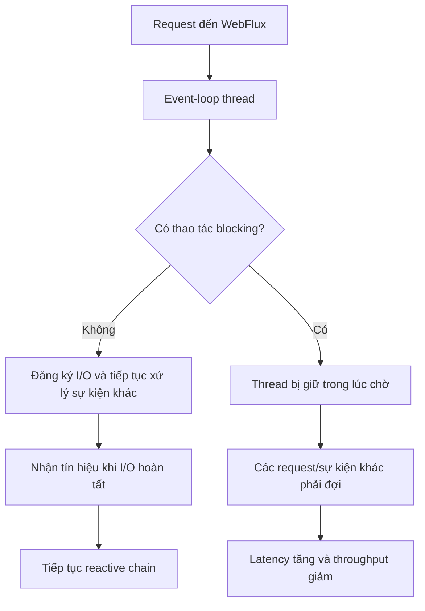

# Tránh block, toFuture().get và các thao tác chặn trên luồng xử lý sự kiện

Spring Data R2DBC được thiết kế để thực hiện truy cập database theo kiểu reactive. Các thao tác trả về `Mono` hoặc `Flux`, cho phép ứng dụng mô tả công việc mà không phải giữ một thread chờ kết quả I/O. Lợi ích này chỉ được giữ khi toàn bộ đường đi của request không chặn các thread có nhiệm vụ xử lý nhiều sự kiện.

Các lời gọi như `block()`, `toFuture().get()`, `CompletableFuture.join()`, `Thread.sleep()`, JDBC đồng bộ hoặc HTTP client blocking có thể giữ một event-loop thread trong lúc chờ. Nếu điều đó xảy ra trên WebFlux/Reactor Netty, thread không thể xử lý các request và tín hiệu khác được giao cho nó. Hậu quả thường là độ trễ tăng, throughput giảm, request timeout và hàng đợi công việc dồn lại dù database vẫn còn khả năng phục vụ.

Nguyên tắc quan trọng là giữ reactive chain liên tục, trả `Mono`/`Flux` về tầng gọi và chỉ cô lập phần blocking bắt buộc vào scheduler dành cho công việc blocking. Nếu một API đã có phiên bản bất đồng bộ như `WebClient` hoặc `CompletableFuture`, hãy chuyển đổi nó sang Reactor thay vì chờ kết quả đồng bộ.

## 1. Event loop và vì sao một thread bị block lại gây ảnh hưởng lớn

Trong ứng dụng Spring WebFlux dùng Reactor Netty, một nhóm nhỏ event-loop thread xử lý hoạt động mạng cho nhiều kết nối. Một event loop có thể nhận dữ liệu socket, giải mã request, kích hoạt handler, ghi response và xử lý các callback I/O. Mô hình này hoạt động hiệu quả vì thread thường không phải ngồi chờ một thao tác mạng hoàn tất.

Khi code gọi một phương thức blocking trên event loop, thread đó dừng xử lý công việc khác cho tới khi lời gọi trả về. Trong khoảng thời gian chờ, các kết nối và request được event loop phụ trách có thể bị trì hoãn.

Ví dụ, nếu một event-loop thread bị chặn 500 ms để chờ JDBC query, mọi sự kiện khác được giao cho thread đó cũng phải chờ. Nếu nhiều request cùng làm việc này, số thread event loop có thể bị chiếm hết. Ứng dụng có thể xuất hiện độ trễ cao trên nhiều endpoint, kể cả endpoint không truy cập database.



Không phải mọi thao tác chờ đều blocking. R2DBC driver và WebClient có thể chờ database hoặc HTTP response bằng I/O bất đồng bộ: thread được trả lại để xử lý công việc khác, rồi publisher phát tín hiệu khi dữ liệu đến. Vấn đề là một lời gọi đồng bộ giữ thread cho tới khi có kết quả.

## 2. Những thao tác blocking thường gặp

Các API dưới đây có thể chặn thread:

| Nhóm | Ví dụ | Vì sao cần tránh trên event loop |
|---|---|---|
| Reactor blocking API | `Mono.block()`, `Flux.blockFirst()`, `Flux.blockLast()`, `blockOptional()` | Subscribe và chờ publisher phát kết quả |
| Future | `Future.get()`, `CompletableFuture.get()`, `join()` | Chờ một tác vụ khác hoàn tất |
| Chờ thread/lock | `Thread.sleep()`, `CountDownLatch.await()`, `Semaphore.acquire()`, `Object.wait()`, `Lock.lock()` khi phải đợi | Giữ thread trong lúc chờ timer, tín hiệu hoặc khóa |
| JDBC | `JdbcTemplate.query(...)`, `PreparedStatement.execute()` | JDBC là API blocking |
| HTTP client đồng bộ | `RestTemplate`, client HTTP đồng bộ của thư viện bên thứ ba | Chờ mạng và response trên thread gọi |
| File I/O đồng bộ | `Files.readAllBytes(...)`, `FileInputStream.read(...)`, API file đồng bộ | Chờ hệ thống file hoặc thiết bị lưu trữ |
| Process/command đồng bộ | Chờ process kết thúc hoặc đọc pipe theo cách blocking | Thread bị giữ trong thời gian process chạy |
| Thư viện bên thứ ba | SDK gọi mạng đồng bộ, thư viện cache hoặc messaging blocking | Bên trong có thể chờ I/O dù chữ ký method không thể hiện điều đó |

Một số thao tác không phải blocking I/O nhưng vẫn có thể làm event loop không phản hồi, ví dụ tính toán CPU kéo dài, vòng lặp không kết thúc, lock contention hoặc xử lý dữ liệu rất lớn trên một thread. Với các công việc này, cần chọn scheduler hoặc chiến lược xử lý phù hợp thay vì chỉ nhìn tên API.

## 3. Vì sao không gọi block() trong reactive chain?

`Mono.block()` subscribe vào publisher rồi chờ cho tới khi publisher phát giá trị, hoàn tất rỗng hoặc lỗi. `Flux.blockFirst()` và `blockLast()` cũng chờ một phần tử hoặc tín hiệu tương ứng. Các method này hữu ích ở một số ranh giới imperative, nhưng không phù hợp bên trong WebFlux handler, service reactive hoặc callback đang chạy trên event loop.

Ví dụ không nên dùng:

```java
@Service
public class PersonService {

    private final PersonRepository repository;

    public PersonService(PersonRepository repository) {
        this.repository = repository;
    }

    public Person findPerson(Long id) {
        // Không nên: chặn thread để đợi R2DBC trả kết quả.
        return repository.findById(id).block();
    }
}
```

Method trên biến thao tác reactive thành lời gọi đồng bộ. Nếu được gọi từ WebFlux event loop, thread có thể bị giữ cho tới khi database trả kết quả. Reactor có thể ném `IllegalStateException` khi phát hiện `block()` được gọi trên thread được đánh dấu là non-blocking, nhưng không nên dựa vào exception này để phát hiện mọi trường hợp: trên một thread không được đánh dấu, lệnh vẫn có thể block và gây hại.

Cách đúng là giữ kiểu trả về reactive:

```java
public Mono<Person> findPerson(Long id) {
    return repository.findById(id);
}
```

Controller cũng trả publisher:

```java
@RestController
@RequestMapping("/people")
public class PersonController {

    private final PersonService service;

    public PersonController(PersonService service) {
        this.service = service;
    }

    @GetMapping("/{id}")
    public Mono<Person> getById(@PathVariable Long id) {
        return service.findPerson(id);
    }
}
```

WebFlux subscribe và ghi response khi publisher phát tín hiệu. Không cần tự gọi `block()` để lấy object trước khi trả response.

### Mỗi lần gọi block() có thể tạo subscription mới

Reactor publisher thường là lazy. Mỗi lần subscribe có thể kích hoạt lại nguồn công việc. Gọi `block()` trên một publisher đã được subscribe ở nơi khác không có nghĩa là đọc lại kết quả đã có; nó có thể tạo một subscription khác và thực thi lại truy vấn.

Ví dụ:

```java
Mono<Person> personMono = repository.findById(id);

Person first = personMono.block();
Person second = personMono.block(); // Có thể phát sinh một lần truy vấn khác.
```

Với publisher lạnh (cold publisher) từ Repository, mỗi lần subscribe thường thực hiện lại thao tác database. Điều này vừa block vừa có thể tạo truy vấn lặp ngoài ý muốn.

## 4. Tránh toFuture().get() và CompletableFuture.join()

Reactor cho phép chuyển publisher thành `CompletableFuture` bằng `toFuture()`. Bản thân `toFuture()` không phải thao tác chờ đồng bộ như `get()` hoặc `join()`, nhưng nó subscribe publisher và trả về future. Khi gọi `get()` hoặc `join()`, thread hiện tại sẽ chờ future hoàn tất.

Ví dụ không nên dùng:

```java
public Person load(Long id) throws Exception {
    return repository.findById(id)
        .toFuture()
        .get();
}
```

Hoặc:

```java
public Person load(Long id) {
    return repository.findById(id)
        .toFuture()
        .join();
}
```

Hai cách này đều biến luồng reactive thành đồng bộ. `get()` còn bọc lỗi trong `ExecutionException` và có thể ném `InterruptedException`; `join()` thường bọc lỗi trong `CompletionException`. Việc chuyển đổi kiểu exception không làm thao tác trở nên non-blocking.

Giữ publisher nếu caller có thể làm việc reactive:

```java
public Mono<Person> load(Long id) {
    return repository.findById(id);
}
```

Nếu API bên ngoài yêu cầu `CompletableFuture`, có thể trả future mà không gọi `get()`:

```java
public CompletableFuture<Person> loadAsync(Long id) {
    return repository.findById(id).toFuture();
}
```

Trong trường hợp cần dùng một API bất đồng bộ đã trả `CompletionStage` hoặc `CompletableFuture`, hãy chuyển đổi ngược vào Reactor:

```java
public Mono<RemoteProfile> loadRemoteProfile(Long id) {
    CompletableFuture<RemoteProfile> future = remoteClient.fetchAsync(id);
    return Mono.fromFuture(future);
}
```

Việc chuyển đổi giữa hai abstraction bất đồng bộ là hợp lý. Điều cần tránh là chờ đồng bộ bằng `.get()` hoặc `.join()` trên thread xử lý sự kiện.

## 5. Không gọi subscribe() bên trong service để chạy công việc rồi trả kết quả

`subscribe()` không giống `block()`: nó không chờ kết quả. Tuy nhiên, tự subscribe bên trong service thường tách công việc khỏi reactive chain mà caller đang quản lý.

Ví dụ không nên dùng:

```java
public Mono<Void> createPerson(Person person) {
    repository.save(person).subscribe();
    return Mono.empty();
}
```

Method có thể trả hoàn tất trước khi insert xong. Lỗi từ insert không được truyền về caller như một lỗi của publisher trả về. Transaction reactive bao quanh method cũng có thể kết thúc trước subscription độc lập đó. Caller không thể kết hợp thứ tự, cancellation hoặc backpressure của thao tác ghi.

Hãy trả publisher:

```java
public Mono<Person> createPerson(Person person) {
    return repository.save(person);
}
```

Nếu cần chạy nhiều thao tác nối tiếp:

```java
public Mono<Person> createWithAudit(Person person) {
    return repository.save(person)
        .flatMap(saved -> auditRepository.save(AuditEntry.created(saved.id()))
            .thenReturn(saved));
}
```

Các publisher nằm trong cùng một chuỗi, nên caller có thể quan sát kết quả/lỗi và reactive transaction manager có thể quản lý toàn bộ công việc nếu được cấu hình đúng.

`subscribe()` phù hợp ở một số điểm bắt đầu tác vụ nền có chủ đích, nhưng khi đó cần thiết kế riêng vòng đời, giám sát lỗi, retry, shutdown và tính bền vững của tác vụ. Không dùng nó để né tránh việc phải trả publisher từ một service reactive thông thường.

## 6. Không dùng Thread.sleep() để chờ tác vụ hoặc mô phỏng độ trễ

`Thread.sleep()` giữ thread hiện tại trong thời gian chỉ định. Không dùng nó để đợi database, đợi message hoặc tạo khoảng trễ trong một reactive pipeline.

Ví dụ không nên dùng:

```java
public Mono<String> getStatus() {
    try {
        Thread.sleep(1000);
    } catch (InterruptedException ex) {
        Thread.currentThread().interrupt();
        return Mono.error(ex);
    }
    return Mono.just("READY");
}
```

Nếu mục đích là tạo độ trễ không chặn, Reactor có `delayElement` hoặc `Mono.delay`:

```java
public Mono<String> getStatus() {
    return Mono.delay(Duration.ofSeconds(1))
        .thenReturn("READY");
}
```

`Mono.delay` lên lịch phát tín hiệu sau khoảng thời gian đã chỉ định; thread không phải ngủ trong suốt khoảng chờ. Trong code nghiệp vụ, không nên thêm delay chỉ để “cho database kịp xử lý”; hãy chờ publisher của thao tác database hoàn tất bằng toán tử reactive.

## 7. JDBC là blocking: cách ly khi chưa thể thay thế

`JdbcTemplate` và JDBC driver là blocking. Nếu một ứng dụng WebFlux vẫn cần gọi module legacy JDBC, không gọi trực tiếp JDBC trên event loop. Có thể bọc lời gọi đồng bộ trong `Mono.fromCallable(...)` rồi chuyển nó sang `Schedulers.boundedElastic()`.

```java
public Mono<LegacyCustomer> findLegacyCustomer(Long id) {
    return Mono.fromCallable(() -> jdbcCustomerService.findById(id))
        .subscribeOn(Schedulers.boundedElastic());
}
```

`Mono.fromCallable` trì hoãn việc gọi `findById` tới lúc subscribe. `subscribeOn` đưa subscription và lời gọi nguồn sang bounded elastic scheduler, nơi phù hợp hơn cho công việc blocking.

Nếu lời gọi JDBC trả về `void`, dùng `Mono.fromRunnable`:

```java
public Mono<Void> writeLegacyAudit(AuditEntry entry) {
    return Mono.fromRunnable(() -> jdbcAuditService.insert(entry))
        .subscribeOn(Schedulers.boundedElastic())
        .then();
}
```

`boundedElastic` cách ly blocking call khỏi event loop; nó không biến JDBC thành non-blocking. Lời gọi vẫn chiếm một worker thread trong thời gian JDBC chờ database. Scheduler có giới hạn số thread và hàng đợi, vì vậy vẫn cần giới hạn concurrency, timeout và theo dõi tải.

Nếu JDBC method có `@Transactional(transactionManager = "jdbcTransactionManager")`, hãy đặt transaction boundary trong một bean imperative riêng để lời gọi thực sự chạy trọn trong method đó trên worker thread. Việc bọc JDBC trong `Mono.fromCallable` không khiến nó tham gia reactive transaction R2DBC đang có.

## 8. Đừng dùng Mono.just() để bọc lời gọi blocking

Một lỗi phổ biến là gọi blocking method trước rồi mới đưa kết quả vào `Mono.just()`:

```java
// Sai: blockingClient.fetch() chạy ngay khi phương thức được gọi.
return Mono.just(blockingClient.fetch(id))
    .subscribeOn(Schedulers.boundedElastic());
```

Đến lúc `Mono.just(...)` được tạo, lời gọi `fetch(id)` đã hoàn tất hoặc đã block thread gọi. `subscribeOn` không thể chuyển ngược một lời gọi đã xảy ra sang scheduler khác.

Hãy dùng `fromCallable`:

```java
return Mono.fromCallable(() -> blockingClient.fetch(id))
    .subscribeOn(Schedulers.boundedElastic());
```

Hoặc `defer` khi cần tạo publisher bên trong scheduler:

```java
return Mono.defer(() -> Mono.just(blockingClient.fetch(id)))
    .subscribeOn(Schedulers.boundedElastic());
```

`fromCallable` thường ngắn gọn hơn cho một lời gọi đồng bộ trả về giá trị. Nếu phương thức có thể trả null, `Mono.fromCallable` hoàn tất rỗng khi Callable trả null; hãy xác định rõ điều đó có phù hợp với hợp đồng hay không.

## 9. Phân biệt subscribeOn và publishOn

Hai toán tử này điều khiển scheduler ở những vị trí khác nhau:

**`subscribeOn(scheduler)`** ảnh hưởng tới nơi subscription và việc thực thi nguồn được bắt đầu. Nó thường được dùng để chuyển một nguồn blocking sang scheduler phù hợp.

**`publishOn(scheduler)`** chuyển các tín hiệu downstream sau vị trí toán tử sang scheduler được chỉ định. Nó không tự chuyển một lời gọi blocking đã xảy ra trước đó.

Ví dụ:

```java
Mono<LegacyData> source = Mono.fromCallable(() -> blockingClient.fetch(id))
    .subscribeOn(Schedulers.boundedElastic());
```

Đây là cách thường dùng cho blocking source.

Ví dụ `publishOn`:

```java
return repository.findById(id)
    .publishOn(Schedulers.boundedElastic())
    .map(person -> legacyFormatter.formatBlocking(person));
```

Ở đây, phần `map` sau `publishOn` chạy trên bounded elastic scheduler, nên lời gọi `formatBlocking` được cách ly. Tuy nhiên, `publishOn` không cần thiết nếu có thể đóng gói riêng blocking operation bằng `fromCallable`.

Ví dụ sai vị trí:

```java
return Mono.just(blockingClient.fetch(id))
    .publishOn(Schedulers.boundedElastic());
```

Lời gọi blocking đã chạy trước `publishOn`, vì vậy event loop vẫn có thể bị chặn.

| Toán tử | Phần bị ảnh hưởng | Tình huống điển hình |
|---|---|---|
| `subscribeOn` | Subscription và nguồn upstream | Bọc JDBC hoặc SDK blocking bằng `fromCallable` |
| `publishOn` | Các operator downstream kể từ vị trí đặt toán tử | Chuyển một đoạn xử lý tiếp theo sang scheduler khác |

Không cần đặt `subscribeOn(boundedElastic())` ở mọi tầng. Hãy đặt nó sát nguồn blocking để ý định và phạm vi cách ly rõ ràng.

## 10. Chọn scheduler theo loại công việc

Reactor có các scheduler dành cho mục đích khác nhau:

| Scheduler | Mục đích | Không nên dùng cho |
|---|---|---|
| `Schedulers.parallel()` | Công việc CPU-bound ngắn, không blocking | JDBC, `Future.get()`, file I/O đồng bộ hoặc chờ lock |
| `Schedulers.boundedElastic()` | Công việc blocking có thời lượng chờ, với số worker và hàng đợi được giới hạn | Thay thế vô hạn cho mọi công việc hoặc xử lý CPU nặng không giới hạn |
| `Schedulers.single()` | Một worker tuần tự cho tác vụ ngắn, không blocking | Blocking I/O làm đình trệ mọi tác vụ trên scheduler đó |
| Scheduler tùy chỉnh | Cô lập workload có đặc tính riêng và giới hạn tài nguyên rõ ràng | Dùng mà không có kế hoạch dispose, capacity và monitoring |

`boundedElastic` là lựa chọn thông dụng để cách ly các thư viện blocking trong ứng dụng reactive. Tuy nhiên, nếu một SDK blocking có thời gian chờ dài hoặc tải cao, có thể tạo scheduler riêng với giới hạn thread/queue phù hợp để nó không chiếm hết tài nguyên dùng chung.

Ví dụ tạo scheduler riêng:

```java
@Configuration
public class BlockingSchedulerConfiguration {

    @Bean(destroyMethod = "dispose")
    public Scheduler legacyIoScheduler() {
        return Schedulers.newBoundedElastic(
            20,
            500,
            "legacy-io"
        );
    }
}
```

Sử dụng:

```java
public Mono<LegacyData> loadLegacyData(Long id) {
    return Mono.fromCallable(() -> legacyClient.load(id))
        .subscribeOn(legacyIoScheduler);
}
```

Các giá trị thread cap và queue cap ở trên chỉ là ví dụ. Hãy chọn theo connection pool JDBC, giới hạn dịch vụ bên ngoài, latency và số request đồng thời. Scheduler cần được dispose khi application context dừng; `destroyMethod` hỗ trợ vòng đời đó.

## 11. Xử lý công việc CPU-bound khác với blocking I/O

Không phải mọi công việc tốn thời gian đều nên đưa vào bounded elastic. Nếu tác vụ chủ yếu tính toán CPU như mã hóa, xử lý ảnh, nén hoặc tính toán số học, nó không chờ I/O nhưng vẫn chiếm CPU. `Schedulers.parallel()` thường phù hợp hơn cho các tác vụ CPU-bound có thời lượng hữu hạn:

```java
public Mono<Report> buildReport(Input input) {
    return Mono.fromCallable(() -> cpuIntensiveCalculation(input))
        .subscribeOn(Schedulers.parallel());
}
```

Nếu công việc CPU kéo dài và có thể chiếm hết worker, cần giới hạn concurrency hoặc dùng scheduler riêng. Không chạy vòng lặp vô hạn hoặc xử lý dữ liệu không giới hạn trên event loop.

Ngược lại, `Schedulers.parallel()` không phải nơi để chạy JDBC hoặc chờ HTTP đồng bộ. Một worker bị block sẽ làm giảm số worker còn lại phục vụ các tác vụ CPU.

## 12. Dùng API bất đồng bộ thay vì bọc API blocking

Nếu thư viện đã cung cấp API reactive hoặc asynchronous, hãy ưu tiên API đó:

| Nhu cầu | API nên ưu tiên trong reactive application |
|---|---|
| Truy cập database | Spring Data R2DBC, `DatabaseClient`, `R2dbcEntityTemplate` |
| Gọi HTTP | `WebClient` hoặc client trả `CompletionStage` |
| Gọi API trả `CompletableFuture` | `Mono.fromFuture(...)` hoặc `Mono.fromCompletionStage(...)` |
| Chờ một khoảng thời gian | `Mono.delay`, `delayElement`, `timeout` |
| Đọc file lớn | API NIO bất đồng bộ hoặc tiện ích reactive phù hợp |
| Gửi message | Reactive messaging client nếu stack hỗ trợ |

Ví dụ dùng `WebClient`:

```java
public Mono<RemoteProfile> fetchProfile(Long id) {
    return webClient.get()
        .uri("/profiles/{id}", id)
        .retrieve()
        .bodyToMono(RemoteProfile.class);
}
```

Không cần bọc `WebClient` trong `fromCallable` hoặc chuyển nó sang bounded elastic chỉ vì đó là lời gọi HTTP. WebClient được thiết kế cho I/O reactive; giữ publisher của nó trong chuỗi.

## 13. Timeout không phải lý do để block

Một số code gọi `block()` vì muốn chờ tối đa một khoảng thời gian. Reactor có toán tử `timeout` để đặt deadline mà không chặn thread:

```java
public Mono<Person> findWithDeadline(Long id) {
    return repository.findById(id)
        .timeout(Duration.ofSeconds(2));
}
```

Nếu publisher không phát tín hiệu trong thời hạn, Reactor phát lỗi timeout và gửi cancellation upstream theo semantics của publisher. Điều này khác với `block(Duration)`, vốn vẫn giữ thread gọi để chờ cho tới khi có kết quả hoặc timeout.

Cancellation không bảo đảm mọi database server lập tức dừng câu SQL. Việc hủy statement phụ thuộc driver và database. Nếu cần giới hạn thời gian thực thi SQL, hãy cấu hình statement/query timeout ở driver hoặc database bên cạnh deadline của ứng dụng.

Không dùng `Thread.sleep()` sau khi gửi SQL để “đợi database”. Hãy kết hợp publisher và xử lý tín hiệu hoàn tất.

## 14. Ảnh hưởng tới reactive transaction

Reactive transaction của Spring dùng Reactor Context để gắn connection với chuỗi publisher. Vì vậy, các operator Reactor chuẩn có thể chuyển thread qua scheduler mà vẫn giữ context khi subscription được nối đúng cách.

Tuy nhiên, gọi `block()` bên trong reactive transaction có thể tạo subscription lồng hoặc subscription độc lập. Nó không phải cách lấy kết quả từ transaction hiện tại. Nếu code tạo một publisher khác rồi tự `subscribe()`, thao tác đó có thể không tham gia transaction context mà caller đang quản lý.

Ví dụ không nên dùng:

```java
@Transactional(transactionManager = "r2dbcTransactionManager")
public Mono<Void> createWithAudit(Person person) {
    Person saved = repository.save(person).block();
    auditRepository.save(AuditEntry.created(saved.id())).subscribe();
    return Mono.empty();
}
```

Đoạn code vừa block vừa tạo subscription độc lập. Transaction manager có thể không bao trùm các thao tác như mong muốn.

Hãy giữ một reactive chain:

```java
@Transactional(transactionManager = "r2dbcTransactionManager")
public Mono<Person> createWithAudit(Person person) {
    return repository.save(person)
        .flatMap(saved -> auditRepository.save(
            AuditEntry.created(saved.id())
        ).thenReturn(saved));
}
```

Nếu cần gọi một thư viện blocking không truy cập database, có thể cô lập nó bằng bounded elastic trong chuỗi reactive. Reactor Context được giữ qua các operator scheduler chuẩn, nhưng `ThreadLocal` của thư viện imperative không tự động trở thành Reactor Context. Nếu thư viện phụ thuộc vào ThreadLocal như security context hoặc transaction JDBC, cần thiết kế propagation riêng và không giả định reactive transaction sẽ quản lý resource đó.

## 15. Gọi JDBC trong WebFlux mà không chặn event loop

Nếu chưa thể chuyển một module JDBC sang R2DBC, hãy để lời gọi JDBC nằm trong một method imperative có transaction JDBC riêng và gọi method đó trên bounded elastic:

```java
@Service
public class LegacyReportService {

    private final JdbcTemplate jdbcTemplate;

    public LegacyReportService(JdbcTemplate jdbcTemplate) {
        this.jdbcTemplate = jdbcTemplate;
    }

    @Transactional(transactionManager = "jdbcTransactionManager")
    public LegacyReport load(Long customerId) {
        return jdbcTemplate.queryForObject("""
                SELECT customer_id, total_orders, total_spend
                FROM legacy_customer_report
                WHERE customer_id = ?
                """,
            legacyReportRowMapper,
            customerId);
    }
}
```

```java
public Mono<LegacyReport> loadReport(Long customerId) {
    return Mono.fromCallable(() -> legacyReportService.load(customerId))
        .subscribeOn(Schedulers.boundedElastic());
}
```

Lời gọi qua bean `LegacyReportService` giúp Spring proxy áp dụng JDBC transaction trong thời gian method imperative chạy. Không tự lấy connection JDBC bên trong một reactive transaction rồi mong nó tham gia transaction R2DBC.

Nếu một use case cần ghi cả JDBC và R2DBC, hãy nhớ hai transaction manager local không tự tạo atomicity chung. Việc chuyển blocking call sang bounded elastic chỉ bảo vệ event loop; nó không phối hợp commit/rollback giữa hai resource. Với yêu cầu nhất quán xuyên qua hai stack, hãy xem xét transactional outbox, Saga hoặc cơ chế phân tán được hỗ trợ cụ thể.

## 16. Không biến một luồng reactive thành blocking chỉ để dùng chung code

Đôi khi một lớp service có method trả entity đồng bộ vì module MVC cũ đang gọi. Khi module WebFlux muốn dùng lại, không nên gọi `block()` để lấy kết quả. Có thể:

- Tách logic nghiệp vụ thuần khỏi lớp truy cập dữ liệu.
- Tạo service reactive trả `Mono`/`Flux` cho R2DBC.
- Giữ service JDBC imperative riêng cho module đồng bộ.
- Chuyển lời gọi JDBC bắt buộc sang bounded elastic nếu được gọi từ WebFlux.

Không nên tạo một abstraction “repository dùng chung” có lúc trả `Person`, lúc trả `Mono<Person>` tùy caller. Hai mô hình có semantics và transaction boundary khác nhau; giữ hợp đồng rõ ràng giúp tránh chặn thread ngầm.

## 17. Backpressure và tránh tải toàn bộ dữ liệu vào bộ nhớ

Tránh `block()` chưa đủ để ứng dụng reactive hoạt động ổn định. Một pipeline có thể non-blocking nhưng vẫn tiêu thụ bộ nhớ lớn nếu tải toàn bộ dữ liệu vào `List`:

```java
// Có thể giữ toàn bộ kết quả trong bộ nhớ.
return repository.findAll()
    .collectList();
```

Với bảng lớn, hãy phân trang, xử lý theo nhóm có giới hạn hoặc stream dữ liệu tới consumer. Backpressure cho phép consumer điều tiết tốc độ nhận tín hiệu, nhưng không thay thế giới hạn truy vấn ở database hoặc giới hạn bộ nhớ của ứng dụng.

Tránh các API chuyển `Flux` thành dạng blocking như `toIterable()` hoặc `toStream()` trong WebFlux handler. Việc lặp qua iterable/stream có thể phải chờ phần tử tiếp theo từ publisher. Nếu cần xuất dữ liệu lớn, dùng streaming response reactive hoặc job export chuyên biệt.

## 18. Phát hiện blocking bằng BlockHound

BlockHound là công cụ phát hiện một số lời gọi blocking được thực hiện trên thread được đánh dấu là non-blocking. Nó có thể giúp tìm ra code vô tình gọi `Thread.sleep`, `Future.get`, file I/O hoặc API blocking trong reactive pipeline.

Thêm dependency test phù hợp với phiên bản Reactor/JDK của dự án, ví dụ:

```gradle
testImplementation("io.projectreactor.tools:blockhound:<version>")
```

Trong test setup:

```java
@BeforeAll
static void installBlockHound() {
    BlockHound.install();
}
```

Ví dụ một test cố ý gọi blocking trên scheduler non-blocking:

```java
StepVerifier.create(
        Mono.delay(Duration.ofMillis(10))
            .publishOn(Schedulers.parallel())
            .map(value -> {
                Thread.sleep(50);
                return value;
            })
    )
    .expectError()
    .verify();
```

Khi BlockHound phát hiện blocking call, test có thể nhận lỗi thay vì âm thầm chặn thread. Đây là ví dụ minh họa; cấu hình và khả năng tương thích cần được xác nhận theo JDK, Reactor và thư viện trong dự án.

BlockHound không phát hiện mọi trường hợp làm hệ thống chậm. Một đoạn tính toán CPU quá dài không phải blocking call theo định nghĩa của công cụ, và một số thư viện/native call có thể cần integration hoặc cấu hình bổ sung. Dùng BlockHound cùng metrics, log và profiling; không xem nó là bằng chứng duy nhất rằng ứng dụng không còn điểm nghẽn.

Không nên thêm allow-list để bỏ qua một blocking call chỉ nhằm làm test xanh. Nếu phải cho phép một lời gọi đặc thù, hãy giải thích vì sao nó an toàn trên thread đó và xác nhận nó không chặn event loop trong workload thực tế.

## 19. Kiểm thử reactive code mà không block

Trong unit test, `StepVerifier` cho phép kiểm tra tín hiệu của `Mono`/`Flux` mà không cần gọi `block()` trong code ứng dụng:

```java
@Test
void returnsPerson() {
    StepVerifier.create(personService.findPerson(10L))
        .expectNextMatches(person -> person.id().equals(10L))
        .verifyComplete();
}
```

Với WebFlux endpoint, `WebTestClient` có thể kiểm tra HTTP response theo cách phù hợp với stack reactive:

```java
webTestClient.get()
    .uri("/people/10")
    .exchange()
    .expectStatus().isOk()
    .expectBody()
    .jsonPath("$.id").isEqualTo(10);
```

Trong test imperative hoặc test harness, `block(Duration)` đôi khi được chấp nhận ở ranh giới kiểm thử để lấy kết quả. Tuy nhiên, nên ưu tiên `StepVerifier` để kiểm tra complete/error/cancel và tránh treo test vô hạn. Không gọi `block()` trên thread event loop trong test WebFlux.

Một số integration test có thể chạy bằng `@SpringBootTest` và `WebTestClient`; kiểm tra endpoint qua HTTP giúp xác nhận cả cách framework subscribe publisher và cách response được ghi.

## 20. Quan sát dấu hiệu event loop bị block

Các dấu hiệu vận hành có thể gồm:

- Độ trễ request tăng trên nhiều endpoint cùng lúc.
- Throughput giảm dù CPU hoặc database chưa đạt giới hạn.
- Thread dump cho thấy `reactor-http-nio-*` nằm trong `Future.get`, `Socket.read`, JDBC driver, `Thread.sleep` hoặc file I/O.
- Event-loop thread bận lâu và không xử lý được nhiều channel.
- Hàng đợi ở bounded elastic tăng, số worker chạm giới hạn hoặc task bị trễ.
- Request timeout tăng nhưng query latency phía database không giải thích được toàn bộ độ trễ.
- Connection pool bị giữ lâu vì một đoạn xử lý đồng bộ sau khi query hoàn tất.

Khi điều tra, hãy lấy thread dump lúc hệ thống đang chậm, xem stack trace của event-loop thread và tìm lời gọi blocking. Đồng thời kiểm tra latency database, connection pool, scheduler queue và thời gian xử lý CPU để phân biệt nguồn nghẽn.

Tên thread có thể giúp nhận diện scheduler nhưng không nên dựa hoàn toàn vào tên. Thread có thể được đổi tên hoặc scheduler tùy chỉnh được sử dụng. Hãy kiểm tra cả stack trace và nơi tạo scheduler.

## 21. Những lỗi thường gặp và cách sửa

| Cách làm có vấn đề | Hậu quả | Cách thay thế |
|---|---|---|
| `repository.findById(id).block()` trong handler | Chặn event loop và tạo subscription đồng bộ | Trả `Mono<Person>` |
| `toFuture().get()` hoặc `.join()` | Chờ future trên thread hiện tại | Trả `Mono`/`CompletableFuture` cho caller hoặc dùng `Mono.fromFuture` |
| `Mono.just(blockingCall())` | Lời gọi đã block trước khi publisher được subscribe | `Mono.fromCallable(...).subscribeOn(boundedElastic())` |
| `Thread.sleep()` | Giữ thread trong lúc chờ | `Mono.delay` hoặc toán tử delay phù hợp |
| JDBC trực tiếp trong WebFlux | Chặn Netty event loop | Cô lập bằng bounded elastic hoặc dùng R2DBC |
| `subscribe()` bên trong service | Công việc tách khỏi luồng lỗi, cancellation và transaction của caller | Kết hợp publisher và trả về |
| `publishOn` đặt sau lời gọi blocking | Lời gọi blocking đã chạy trên thread cũ | Bọc nguồn bằng `fromCallable` và `subscribeOn` |
| Dùng `parallel()` cho JDBC | Worker CPU bị giữ bởi I/O blocking | Dùng `boundedElastic` hoặc scheduler riêng |
| `collectList()` với dữ liệu không giới hạn | Tăng bộ nhớ và giữ nhiều dữ liệu | Phân trang hoặc xử lý streaming có giới hạn |
| Bọc blocking JDBC trong R2DBC transaction rồi mong rollback chung | Hai transaction manager độc lập | Tách transaction; dùng outbox/Saga nếu cần phối hợp |

## 22. Checklist thiết kế một reactive request

Khi viết một endpoint dùng Spring Data R2DBC, hãy tự kiểm tra:

1. Controller và service có trả `Mono`/`Flux` thay vì gọi `block()` không?
2. Có lời gọi `toFuture().get()`, `join()`, `await()` hoặc `Thread.sleep()` nào trên đường xử lý không?
3. Có thư viện đồng bộ nào bị gọi trực tiếp trên event loop không?
4. Nếu phải gọi thư viện blocking, nó đã được bọc bằng `fromCallable`/`fromRunnable` và chuyển sang bounded elastic chưa?
5. Có dùng `Mono.just(blockingCall())` khiến lời gọi chạy trước subscription không?
6. Có `subscribe()` thủ công làm mất liên kết với publisher của caller không?
7. `subscribeOn` và `publishOn` được đặt đúng vị trí không?
8. Công việc CPU-bound và blocking I/O có được đưa vào scheduler phù hợp không?
9. Có giới hạn page size, concurrency và kích thước dữ liệu để tránh giữ tài nguyên quá lâu không?
10. Reactive transaction có được giữ trong cùng chain và dùng đúng `ConnectionFactory` không?
11. Có test với `StepVerifier`, `WebTestClient` và BlockHound khi phù hợp không?
12. Metrics và thread dump có đủ thông tin để tìm event-loop blocking trong production không?

## 23. Quy trình xử lý một thư viện blocking trong ứng dụng R2DBC

Khi phát hiện một API blocking không thể thay thế ngay, hãy thực hiện theo trình tự:

**Bước 1 — Xác định chính xác điểm blocking.** Đọc tài liệu API, thread dump hoặc profile để biết lời gọi nào chờ I/O, lock hay process.

**Bước 2 — Tìm API bất đồng bộ tương ứng.** Ưu tiên WebClient, R2DBC driver, CompletionStage hoặc API NIO nếu thư viện cung cấp.

**Bước 3 — Nếu không có API async, đóng gói lời gọi.** Dùng `Mono.fromCallable` cho method trả giá trị hoặc `Mono.fromRunnable` cho method không trả giá trị.

**Bước 4 — Chuyển sang scheduler blocking.** Dùng `Schedulers.boundedElastic()` hoặc scheduler riêng với giới hạn thread/queue phù hợp.

**Bước 5 — Giữ reactive chain.** Không gọi `block()` hoặc `subscribe()` để lấy kết quả giữa các bước; kết hợp publisher bằng operator phù hợp.

**Bước 6 — Xác định transaction.** Nếu lời gọi là JDBC, dùng JDBC transaction manager riêng bên trong method imperative; không giả định nó tham gia R2DBC transaction.

**Bước 7 — Kiểm thử và quan sát.** Dùng BlockHound, thread dump, scheduler metrics và load test để xác nhận event loop không còn bị chặn.

## 24. Kết luận

Reactive application chỉ giữ được khả năng phục vụ nhiều request hiệu quả khi các thread xử lý sự kiện không bị giữ bởi thao tác chờ đồng bộ. `block()`, `toFuture().get()`, `join()`, `Thread.sleep()`, JDBC và các client blocking đều cần được loại khỏi event-loop path. Không tự subscribe publisher trong service, vì điều đó tách công việc khỏi chuỗi lỗi, cancellation và transaction mà caller quản lý.

Hãy giữ `Mono`/`Flux` xuyên suốt controller và service. Nếu bắt buộc gọi thư viện blocking, đóng gói lời gọi bằng `fromCallable` hoặc `fromRunnable` rồi chuyển sang `boundedElastic` hoặc scheduler riêng; dùng `subscribeOn` ở nguồn blocking và hiểu rằng `publishOn` chỉ ảnh hưởng phần downstream. Ưu tiên API bất đồng bộ, dùng `StepVerifier`/`WebTestClient` để kiểm thử và BlockHound để phát hiện một số lời gọi blocking. Những quy tắc này giúp bảo vệ event loop, giữ transaction reactive đúng phạm vi và làm cho độ trễ của ứng dụng Spring Data R2DBC dễ dự đoán hơn.
