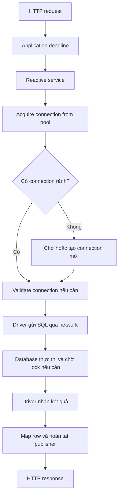

# Kết hợp thời gian chờ ở ứng dụng, pool và cơ sở dữ liệu

Một request dùng Spring Data R2DBC có thể chờ ở nhiều nơi: chờ lấy connection từ pool, chờ mở connection mới, chờ database thực thi SQL, chờ khóa, chờ driver nhận dữ liệu qua mạng và chờ toàn bộ reactive pipeline hoàn tất. Nếu chỉ đặt một timeout ở controller hoặc chỉ cấu hình timeout của database, ứng dụng vẫn có thể giữ tài nguyên quá lâu ở một tầng khác.

Thiết kế timeout cần nhìn toàn bộ đường đi của request. Mỗi tầng có một mục đích riêng và cần một giới hạn phù hợp: timeout ở ứng dụng bảo vệ thời gian phản hồi; timeout của pool giới hạn thời gian chờ connection; timeout kết nối giới hạn thời gian thiết lập session; timeout câu lệnh giới hạn thời gian database chạy SQL; timeout khóa giới hạn thời gian chờ lock. Các giới hạn này bổ sung cho nhau, không thay thế lẫn nhau.

## 1. Các tầng có thể phát sinh thời gian chờ

Một thao tác truy vấn qua R2DBC thường đi qua các bước sau:



Các giới hạn thời gian thường gặp:

| Tầng | Timeout kiểm soát điều gì? | Ví dụ lỗi hoặc biểu hiện |
|---|---|---|
| Request/service | Tổng thời gian ứng dụng chấp nhận chờ một use case | API deadline exceeded |
| Reactive publisher | Thời gian chờ một `Mono`/`Flux` phát tín hiệu | Reactor `TimeoutException` |
| Pool acquire | Thời gian chờ lấy connection rảnh từ pool | Acquire timeout, pending acquire tăng |
| Connection creation | Thời gian mở connection mới tới database | Connect/create timeout |
| Connection validation | Thời gian kiểm tra connection trước khi cấp | Validation timeout |
| Driver/network | Thời gian chờ socket, handshake hoặc phản hồi mạng | Socket timeout, connection reset |
| SQL statement | Thời gian database thực thi một câu lệnh | Statement/query timeout |
| Lock wait | Thời gian chờ lấy row/table lock | Lock timeout hoặc deadlock |
| Transaction | Thời gian một transaction được phép tồn tại | Transaction timeout hoặc transaction bị hủy |

Không phải tất cả các timeout đều có cùng phạm vi. Ví dụ, pool acquire timeout không giới hạn thời gian một câu SQL đã chạy; statement timeout không giới hạn thời gian chờ connection trước khi gửi SQL; publisher timeout giới hạn tín hiệu mà ứng dụng chờ nhưng không bảo đảm mọi database server lập tức dừng công việc.

## 2. Phân biệt timeout và deadline

**Timeout** thường là giới hạn cho một thao tác cụ thể, ví dụ chờ connection tối đa 300 ms hoặc một câu SQL chạy tối đa 1 giây.

**Deadline** là thời điểm cuối cùng mà toàn bộ công việc phải hoàn tất. Deadline của request cần tính cả thời gian chờ pool, truy vấn, mapping, gọi dịch vụ khác và tạo response.

Ví dụ một endpoint có deadline 2,5 giây. Nếu database query đã tiêu thụ 2,3 giây thì ứng dụng chỉ còn 200 ms cho các bước còn lại. Một service có hai truy vấn tuần tự, mỗi truy vấn được phép chạy 2 giây, có thể vượt deadline tổng dù từng truy vấn chưa timeout.

Vì vậy, không nên đặt cùng một con số cho tất cả các tầng. Hãy chia ngân sách thời gian theo use case và bảo đảm timeout của các thao tác bên trong không làm vượt deadline bên ngoài.

## 3. Đặt timeout ở tầng ứng dụng bằng Reactor

Reactor cung cấp `timeout(Duration)` để giới hạn thời gian chờ publisher. Nếu nguồn không phát tín hiệu trong khoảng thời gian chỉ định, publisher downstream phát lỗi timeout và Reactor gửi cancellation upstream theo semantics của publisher.

Ví dụ với Repository:

```java
public Mono<Person> findPerson(Long id) {
    return personRepository.findById(id)
        .timeout(Duration.ofSeconds(2));
}
```

Ví dụ với một use case gồm nhiều bước:

```java
public Mono<OrderDetail> getOrderDetail(Long orderId) {
    return orderRepository.findById(orderId)
        .switchIfEmpty(Mono.error(new OrderNotFoundException(orderId)))
        .flatMap(order -> customerRepository.findById(order.customerId())
            .map(customer -> new OrderDetail(
                order.id(),
                order.orderNo(),
                customer.displayName()
            )))
        .timeout(Duration.ofSeconds(3));
}
```

Timeout ở cuối chuỗi giới hạn tổng thời gian của use case, bao gồm cả các bước nối tiếp. Nếu cần giới hạn từng bước riêng, có thể đặt timeout tại publisher tương ứng, nhưng cần giữ một deadline tổng để không cộng dồn thời gian chờ ngoài dự kiến.

### Chuyển timeout thành lỗi nghiệp vụ hoặc HTTP response

Có thể chuyển lỗi Reactor timeout thành exception của ứng dụng:

```java
public Mono<Person> findPerson(Long id) {
    return personRepository.findById(id)
        .timeout(Duration.ofSeconds(2))
        .onErrorMap(TimeoutException.class,
            error -> new DatabaseOperationTimeoutException(id, error));
}
```

Ở tầng WebFlux, `@RestControllerAdvice` có thể ánh xạ exception này thành HTTP `504 Gateway Timeout` nếu request phụ thuộc vào một dịch vụ phía sau và chính sách API chọn status đó. Nếu timeout là giới hạn xử lý nội bộ hoặc do client hủy request, cách phản hồi có thể khác. Hãy thống nhất hợp đồng API thay vì biến mọi lỗi timeout thành cùng một mã trạng thái.

Không nên trả stack trace, SQL nhạy cảm hoặc thông tin connection trong response. Log nội bộ nên giữ nguyên cause để điều tra.

## 4. Timeout ở tầng request và service

Một request có thể gọi nhiều nguồn: R2DBC, HTTP client, cache và một module đồng bộ. Deadline tổng cần bao trùm toàn bộ use case.

Ví dụ:

```java
public Mono<OrderView> loadOrderView(Long orderId) {
    return orderRepository.findById(orderId)
        .flatMap(order -> webClient.get()
            .uri("/customers/{id}", order.customerId())
            .retrieve()
            .bodyToMono(CustomerView.class)
            .map(customer -> new OrderView(order, customer)))
        .timeout(Duration.ofSeconds(3));
}
```

`timeout` ngoài cùng giới hạn toàn bộ chuỗi. Nếu WebClient có response timeout riêng, timeout đó giới hạn một HTTP exchange; nó không thay thế deadline của use case.

Với nhiều bước tuần tự, có thể đặt timeout riêng ngắn hơn cho từng nguồn và timeout tổng dài hơn một chút. Ví dụ HTTP call được giới hạn 1 giây, truy vấn R2DBC 1,2 giây và use case tổng 2,5 giây. Các con số phải dựa trên latency thực tế và SLA, không sao chép nguyên mẫu cho mọi hệ thống.

Nếu client ngắt kết nối, WebFlux có thể hủy subscription. Cancellation có thể truyền xuống reactive chain, nhưng việc database server dừng câu SQL ngay lập tức phụ thuộc driver và database. Do đó vẫn cần timeout phía database để bảo vệ tài nguyên server.

## 5. Timeout chờ lấy connection từ R2DBC Pool

Pool giới hạn số connection được mở và tái sử dụng. Khi tất cả connection đang được sử dụng, request mới phải chờ connection được trả về hoặc pool tạo connection mới nếu chưa đạt giới hạn.

`maxAcquireTime` của `r2dbc-pool` giới hạn thời gian chờ lấy connection. Nếu hết thời gian mà không có connection được cấp, thao tác acquire thất bại. Đây là tín hiệu quan trọng cho biết pool đang quá tải, connection bị giữ quá lâu hoặc cấu hình pool không phù hợp.

Ví dụ cấu hình Spring Boot:

```yaml
spring:
  r2dbc:
    url: r2dbc:postgresql://localhost:5432/app_db
    username: app_user
    password: change_me
    pool:
      enabled: true
      initial-size: 5
      max-size: 20
      max-acquire-time: 500ms
      max-create-connection-time: 2s
      max-idle-time: 10m
      max-life-time: 30m
      max-validation-time: 1s
```

Đây là cấu hình minh họa cho Spring Boot có hỗ trợ các thuộc tính pool tương ứng và dependency `r2dbc-pool`. Tên thuộc tính, khả năng bind và giá trị mặc định cần được đối chiếu với phiên bản Spring Boot/r2dbc-pool của dự án.

Các thuộc tính có ý nghĩa khác nhau:

- `max-size`: số connection tối đa trong pool.
- `initial-size`: số connection được tạo ban đầu khi pool khởi động hoặc được khởi tạo.
- `max-acquire-time`: thời gian tối đa chờ lấy connection.
- `max-create-connection-time`: thời gian tối đa tạo connection mới.
- `max-validation-time`: thời gian tối đa kiểm tra connection.
- `max-idle-time`: thời gian connection có thể nằm rảnh trước khi bị loại bỏ theo chính sách pool.
- `max-life-time`: tuổi thọ tối đa của connection trước khi pool loại bỏ.

`max-idle-time` và `max-life-time` là chính sách vòng đời connection, không phải timeout của một truy vấn đang chạy. Không dùng chúng để thay cho statement timeout.

### Cấu hình bằng Java

Khi cần cấu hình pool trực tiếp, có thể dùng builder của `r2dbc-pool`:

```java
ConnectionPoolConfiguration poolConfiguration =
    ConnectionPoolConfiguration.builder(connectionFactory)
        .initialSize(5)
        .maxSize(20)
        .maxAcquireTime(Duration.ofMillis(500))
        .maxCreateConnectionTime(Duration.ofSeconds(2))
        .maxValidationTime(Duration.ofSeconds(1))
        .maxIdleTime(Duration.ofMinutes(10))
        .maxLifeTime(Duration.ofMinutes(30))
        .build();

ConnectionPool connectionPool = new ConnectionPool(poolConfiguration);
```

Đây là ví dụ API của `r2dbc-pool`; cần thêm dependency tương ứng và đóng pool khi application context dừng. Nếu Spring Boot đã quản lý pool, không tạo thêm một pool độc lập cho cùng workload nếu chưa có lý do rõ ràng. Hai pool song song có thể làm tổng connection vượt mức database cho phép.

## 6. Timeout tạo connection và timeout kết nối của driver

Pool acquire và connection creation có liên quan nhưng khác nhau:

- Acquire timeout giới hạn thời gian chờ được cấp một connection từ pool.
- Create connection timeout giới hạn thời gian pool/driver tạo một connection mới.
- Driver connect timeout có thể giới hạn thời gian thiết lập TCP, TLS, xác thực hoặc handshake theo khả năng của driver.

Nếu pool còn chỗ trống nhưng database không phản hồi khi mở connection mới, create/connect timeout giúp thao tác thất bại thay vì chờ vô hạn. Tên option và đơn vị cấu hình connect timeout phụ thuộc R2DBC driver. Không có một URL parameter chung áp dụng cho mọi driver; hãy đọc tài liệu của driver PostgreSQL, SQL Server, MySQL hoặc hệ quản trị đang sử dụng.

Timeout kết nối không giới hạn thời gian SQL sau khi connection đã mở. Một kết nối có thể được tạo nhanh nhưng query chạy rất lâu; trường hợp đó cần statement timeout hoặc publisher timeout.

## 7. Timeout kiểm tra connection trong pool

Pool có thể kiểm tra connection trước khi cấp cho caller để tránh sử dụng connection đã chết hoặc không còn hợp lệ. `maxValidationTime` giới hạn thời gian của bước validation nếu pool/driver thực hiện validation.

Validation timeout không phải timeout của câu truy vấn nghiệp vụ. Nếu validation chậm, có thể do database quá tải, mạng không ổn định hoặc cách validation query được cấu hình không phù hợp. Không nên tăng validation timeout vô hạn vì điều đó làm request chờ lâu trước cả khi SQL nghiệp vụ được gửi.

Một số pool/driver dùng validation strategy khác nhau, ví dụ kiểm tra trạng thái connection hoặc thực hiện validation query. Hãy kiểm tra cấu hình và metrics để hiểu pool đang validate như thế nào.

## 8. Timeout ở database: statement timeout

Timeout phía database giới hạn thời gian server thực thi câu SQL. Đây là lớp bảo vệ quan trọng vì ứng dụng có thể hủy request trong khi database vẫn đang xử lý query, tùy khả năng cancellation của driver.

Ví dụ PostgreSQL hỗ trợ `statement_timeout` để hủy câu lệnh vượt thời gian cấu hình. Có thể cấu hình ở cấp role/database/session hoặc đặt tạm thời trong transaction.

```sql
SET LOCAL statement_timeout = '1500ms';
```

`SET LOCAL` chỉ có hiệu lực trong transaction hiện tại và được khôi phục khi transaction kết thúc. Lệnh cần được thực hiện trên đúng connection và trong cùng transaction với câu SQL cần giới hạn. Không gửi `SET LOCAL` trong một publisher độc lập rồi giả định query kế tiếp dùng cùng connection nếu không có transaction context chung.

Với PostgreSQL, cũng có thể đặt mặc định ở cấp database hoặc role, ví dụ:

```sql
ALTER ROLE app_user SET statement_timeout = '2s';
```

Thiết lập ở cấp role ảnh hưởng các session mới của role đó. Cần cân nhắc các workload khác nhau: một role dùng chung cho API đọc nhanh và job báo cáo dài có thể cần chính sách timeout tách biệt.

`statement_timeout` là cấu hình PostgreSQL, không phải thuộc tính portable của Spring Data R2DBC. Với hệ quản trị khác, hãy dùng cơ chế query timeout tương ứng.

## 9. Timeout chờ khóa khác với statement timeout

Một câu SQL có thể chạy lâu vì chờ một transaction khác giữ lock, chứ không phải vì bản thân phép tính hoặc scan dữ liệu quá nặng.

PostgreSQL cung cấp `lock_timeout` để giới hạn thời gian chờ lấy lock:

```sql
SET LOCAL lock_timeout = '300ms';
```

`lock_timeout` chỉ áp dụng thời gian chờ lock. `statement_timeout` giới hạn tổng thời gian thực thi statement. Nếu cả hai được cấu hình, timeout nào đến trước sẽ quyết định lỗi.

Ví dụ, query có thể chờ lock 300 ms rồi bị hủy vì `lock_timeout`, dù `statement_timeout` là 1,5 giây. Lỗi này cần được phân biệt với query plan chậm để tìm nguyên nhân đúng: kiểm tra transaction đang giữ lock, thứ tự cập nhật hàng và thời gian transaction.

PostgreSQL còn có `idle_in_transaction_session_timeout` để chấm dứt session nằm idle trong khi transaction vẫn mở. Cấu hình này giúp phát hiện transaction bị bỏ quên hoặc giữ connection quá lâu, nhưng không thay thế statement timeout.

## 10. Timeout của transaction

Transaction có thể tồn tại lâu vì nhiều statement, xử lý nghiệp vụ giữa các statement hoặc chờ một publisher khác. Một transaction kéo dài giữ connection và có thể giữ lock hoặc snapshot, làm tăng tải database.

Spring cho phép khai báo timeout trong transaction definition, ví dụ:

```java
@Transactional(
    transactionManager = "r2dbcTransactionManager",
    timeout = 3
)
public Mono<Void> updateOrder(Long orderId) {
    return orderRepository.findById(orderId)
        .flatMap(order -> orderRepository.save(order.withStatus("PAID")))
        .then();
}
```

Giá trị `timeout` ở annotation được tính bằng giây trong ví dụ. Khả năng và cách áp dụng timeout phụ thuộc reactive transaction manager, Spring version và driver. Không nên coi transaction timeout là bằng chứng rằng database đã tự hủy mọi statement đang chạy đúng tại thời điểm đó. Hãy kết hợp deadline ở publisher và statement/lock timeout ở database.

Không giữ transaction mở trong khi gọi HTTP, chờ người dùng, thực hiện CPU work dài hoặc đợi một tác vụ không liên quan. Hãy hoàn thành các bước không cần transaction trước hoặc sau transaction nếu nghiệp vụ cho phép.

## 11. Kết hợp timeout theo ngân sách thời gian

Timeout các tầng cần được phối hợp để một request không vượt deadline tổng. Ví dụ minh họa:

| Tầng | Giới hạn ví dụ | Mục đích |
|---|---:|---|
| Request/use case | 2.5 s | Tổng thời gian xử lý tối đa |
| Pool acquire | 300 ms | Không chờ connection quá lâu |
| Connection creation | 700 ms | Giới hạn mở connection mới |
| Database lock wait | 200 ms | Phát hiện tranh chấp lock sớm |
| SQL statement | 1.2 s | Giới hạn thời gian database thực thi |
| Reactive operation | 1.5 s | Bao gồm acquire, query, mapping và overhead ứng dụng |

Các số liệu chỉ minh họa cách phân bổ. Cấu hình thật phải dựa trên latency percentile, SLA, workload và chi phí tạo connection. Một thao tác cần mở connection mới có thể tiêu thụ cả thời gian tạo connection lẫn thời gian query; vì vậy hãy tính cả đường đi chậm nhất.

Quy tắc thiết kế thường hữu ích:

- Pool acquire nên ngắn hơn deadline của thao tác database để ứng dụng phát hiện pool quá tải sớm.
- Connection creation có giới hạn riêng để lỗi mạng không khiến request chờ quá lâu.
- Lock timeout có thể ngắn hơn statement timeout nếu tranh chấp lock cần được phát hiện sớm.
- Statement timeout nên đủ ngắn để database không tiếp tục chạy vượt ngân sách của request.
- Reactive operation timeout cần bao gồm thời gian acquire, SQL, mapping và overhead cần thiết.
- Request deadline phải lớn hơn ngân sách của các bước bên trong cộng phần thời gian xử lý response.

Không đặt mọi timeout bằng đúng 2 giây. Nếu mọi tầng cùng timeout tại một thời điểm, log khó phân biệt nguyên nhân và tầng ngoài có thể hủy request trước khi tầng trong trả lỗi có ý nghĩa.

## 12. Driver socket/read timeout

Timeout socket hoặc read timeout thường giới hạn thời gian chờ dữ liệu qua mạng. Nó hữu ích khi connection bị treo, packet không đến hoặc database/network không phản hồi.

Driver có thể cung cấp các option riêng cho:

- TCP connection timeout.
- TLS handshake timeout.
- Socket read timeout.
- Network timeout hoặc thời gian chờ phản hồi.
- Keepalive và phát hiện connection chết.

Các option này không thống nhất giữa R2DBC driver. Hãy kiểm tra tài liệu và tên option của đúng driver/version; tránh sao chép một URL parameter của driver này sang driver khác.

Socket timeout thường là lớp dự phòng cho sự cố mạng. Nếu nó ngắn hơn statement timeout, ứng dụng có thể mất connection trước khi database trả lỗi statement timeout. Nếu nó quá dài, request có thể hết deadline nhưng connection vẫn đang chờ. Hãy phối hợp với timeout database và request để việc hủy có thể quan sát và xử lý rõ ràng.

## 13. Timeout ở WebClient không phải timeout của R2DBC

Một service có thể vừa truy vấn R2DBC vừa gọi HTTP bằng WebClient. WebClient có response timeout hoặc timeout ở publisher riêng. Những timeout này chỉ kiểm soát HTTP exchange, không kiểm soát pool database hoặc SQL statement.

Ví dụ:

```java
public Mono<OrderView> getOrder(Long id) {
    Mono<Order> order = orderRepository.findById(id)
        .timeout(Duration.ofSeconds(1));

    Mono<CustomerView> customer = order.flatMap(value ->
        webClient.get()
            .uri("/customers/{id}", value.customerId())
            .retrieve()
            .bodyToMono(CustomerView.class)
            .timeout(Duration.ofSeconds(1))
    );

    return Mono.zip(order, customer)
        .map(tuple -> new OrderView(tuple.getT1(), tuple.getT2()))
        .timeout(Duration.ofSeconds(2));
}
```

Đoạn code chỉ minh họa các timeout ở tầng publisher. Vì `order` được dùng trong hai nhánh, nếu publisher là cold, nó có thể được subscribe hai lần và tạo hai truy vấn. Trong code thực tế, hãy dùng `flatMap` để giữ một kết quả hoặc chia sẻ publisher có chủ đích; không sao chép publisher cold chỉ để minh họa timeout.

Một cách rõ hơn:

```java
public Mono<OrderView> getOrder(Long id) {
    return orderRepository.findById(id)
        .timeout(Duration.ofSeconds(1))
        .flatMap(order -> webClient.get()
            .uri("/customers/{id}", order.customerId())
            .retrieve()
            .bodyToMono(CustomerView.class)
            .timeout(Duration.ofSeconds(1))
            .map(customer -> new OrderView(order, customer)))
        .timeout(Duration.ofSeconds(2));
}
```

Ở đây timeout ngoài cùng giới hạn tổng use case; các timeout bên trong giới hạn riêng database publisher và HTTP publisher.

## 14. Timeout và cancellation không đồng nghĩa với database đã dừng

Khi `Mono.timeout(...)` phát lỗi, Reactor gửi cancellation tới upstream. Driver có thể chuyển cancellation thành hủy statement hoặc đóng/giải phóng connection. Tuy nhiên, khả năng và thời điểm dừng câu SQL phụ thuộc driver, giao thức và database server.

Một số tình huống cần phân biệt:

- Ứng dụng ngừng chờ nhưng database vẫn đang thực thi query.
- Driver gửi lệnh cancel nhưng database nhận được chậm.
- Connection bị đóng để giải phóng tài nguyên, khiến server phát hiện mất kết nối sau đó.
- Query đã commit trước khi response bị mất, nên client không biết kết quả cuối cùng.

Với truy vấn đọc, timeout thường dẫn tới việc caller nhận lỗi và có thể thử lại theo chính sách. Với thao tác ghi, kết quả có thể không xác định: database có thể đã commit trước khi kết nối mất. Không được mặc định timeout đồng nghĩa transaction rollback.

Để bảo vệ database, hãy cấu hình statement timeout/lock timeout phía server hoặc driver khi hỗ trợ, đồng thời theo dõi query bị hủy và transaction kéo dài.

## 15. Timeout trong transaction reactive

Khi dùng `@Transactional` hoặc `TransactionalOperator`, publisher chạy trong transaction có thể bị timeout. Nếu lỗi timeout đi ra khỏi transaction boundary, transaction manager có thể rollback transaction. Cần đặt error handling đúng vị trí.

Ví dụ:

```java
Mono<Order> work = orderRepository.save(order)
    .timeout(Duration.ofSeconds(2));

return transactionalOperator.transactional(work)
    .onErrorMap(TimeoutException.class,
        error -> new OrderWriteTimeoutException(error));
```

Ở đây timeout nằm trong publisher được transaction bao bọc; lỗi được truyền qua transaction operator và có thể kích hoạt rollback trước khi được chuyển thành lỗi nghiệp vụ ở phía ngoài.

Không nuốt timeout bên trong transaction:

```java
// Không nên nếu cần rollback khi save timeout.
return transactionalOperator.transactional(
    orderRepository.save(order)
        .onErrorResume(TimeoutException.class, error -> Mono.empty())
);
```

Nếu lỗi bị chuyển thành hoàn tất bình thường trước khi transaction manager xử lý, transaction có thể được commit hoặc kết thúc theo trạng thái khác mong đợi. Hãy để lỗi đi qua transaction boundary rồi mới chuyển thành response.

## 16. Retry sau timeout: chỉ khi thao tác an toàn

Timeout không tự động có nghĩa là thao tác thất bại ở database. Với lệnh insert/update, có thể xảy ra trường hợp server đã thực hiện và commit nhưng client không nhận được response. Retry mù có thể tạo dữ liệu trùng hoặc áp dụng một thao tác hai lần.

Phân loại trước khi retry:

| Trường hợp | Chính sách thường phù hợp |
|---|---|
| Pool acquire timeout do pool đầy | Không retry liên tục; giảm concurrency, kiểm tra connection bị giữ và trả lỗi quá tải |
| Connect timeout do lỗi mạng tạm thời | Có thể retry có giới hạn với backoff sau khi xác định nguyên nhân tạm thời |
| Statement timeout do query chậm | Ưu tiên tối ưu query/index hoặc điều chỉnh workload; retry ngay thường làm tăng tải |
| Lock timeout/deadlock | Có thể retry transaction mới nếu thao tác idempotent và có giới hạn |
| Read timeout khi đọc | Có thể retry nếu query an toàn và ngân sách request còn đủ |
| Timeout khi ghi với kết quả không xác định | Tra cứu bằng idempotency key hoặc correlation key trước khi gửi lại |
| SQL sai, quyền thiếu, constraint violation | Không retry nguyên trạng; sửa lỗi hoặc xử lý conflict |

### Retry toàn bộ transaction, không retry statement bên trong transaction đã lỗi

Khi một statement thất bại, một số database đánh dấu transaction ở trạng thái lỗi. Với PostgreSQL, sau lỗi statement trong transaction, cần rollback trước khi thực hiện statement tiếp theo. Vì vậy, nếu retry, thường phải tạo transaction mới cho mỗi lần thử.

Ví dụ dùng `TransactionalOperator`:

```java
public Mono<Order> createWithRetry(Order order) {
    Mono<Order> oneAttempt = Mono.defer(() ->
        transactionalOperator.transactional(
            orderRepository.save(order)
        )
    );

    return oneAttempt.retryWhen(
        Retry.backoff(2, Duration.ofMillis(100))
            .maxBackoff(Duration.ofSeconds(1))
            .filter(this::isRetryableTransientFailure)
    );
}
```

`Mono.defer` tạo một lần chạy transaction mới mỗi khi retry subscribe lại. `isRetryableTransientFailure` phải phân loại lỗi thực tế từ driver/exception translator, không được trả true cho mọi lỗi.

Không đặt `retryWhen` bên trong transaction wrapper nếu mục đích là tạo transaction mới cho mỗi lần thử:

```java
// Có thể retry nhiều lần bên trong cùng một transaction.
transactionalOperator.transactional(
    orderRepository.save(order)
        .retryWhen(retryPolicy)
);
```

Với phương thức dùng `@Transactional`, nếu retry operator được xây dựng bên trong publisher mà annotation bao bọc, các lần subscribe lại có thể vẫn nằm trong cùng transaction boundary tùy cách composition. Hãy dùng `TransactionalOperator` quanh từng attempt khi cần kiểm soát rõ transaction mới.

## 17. Idempotency cho thao tác ghi có timeout

Với API tạo đơn hàng hoặc thanh toán, hãy dùng một idempotency key duy nhất do client hoặc server tạo cho yêu cầu nghiệp vụ. Lưu key cùng bản ghi hoặc trong bảng request log có unique constraint.

Ví dụ:

```sql
CREATE TABLE payment_request (
    id BIGINT GENERATED BY DEFAULT AS IDENTITY PRIMARY KEY,
    idempotency_key UUID NOT NULL UNIQUE,
    order_id BIGINT NOT NULL,
    status VARCHAR(30) NOT NULL,
    created_at TIMESTAMP WITH TIME ZONE NOT NULL DEFAULT CURRENT_TIMESTAMP
);
```

Khi request timeout và client gửi lại cùng key, service tra cứu bản ghi đã tồn tại hoặc thực hiện upsert theo chính sách. Nhờ đó, ứng dụng có thể trả lại kết quả đã tạo thay vì thực hiện tác dụng phụ lần nữa.

Idempotency key cần gắn với payload hoặc dấu vân tay nội dung để phát hiện trường hợp client dùng lại cùng key cho yêu cầu khác. Nếu payload khác, trả conflict thay vì âm thầm dùng kết quả cũ.

## 18. Pool đầy không phải lúc nào cũng cần tăng max-size

Acquire timeout thường là dấu hiệu pool không có connection rảnh trong thời gian cho phép. Nguyên nhân có thể là:

- Số request đồng thời vượt khả năng pool.
- Query chậm hoặc transaction kéo dài làm connection được giữ lâu.
- Publisher không được subscribe/consume hoặc connection không được giải phóng đúng cách.
- Một luồng blocking giữ connection trong lúc xử lý việc không liên quan.
- Database đã đạt giới hạn connection hoặc xử lý chậm.
- Pool max-size quá thấp so với workload, hoặc quá cao so với năng lực database.

Tăng `max-size` có thể giảm thời gian chờ trong ngắn hạn, nhưng cũng tăng số session và mức cạnh tranh ở database. Nếu database đã bão hòa, tăng pool có thể làm query chậm hơn và khiến nhiều request timeout hơn.

Trước khi tăng pool, hãy kiểm tra thời gian acquire, số connection acquired/idle/pending, thời lượng query, transaction duration và số connection server đang sử dụng. Tìm nguyên nhân connection bị giữ lâu thay vì chỉ nới giới hạn.

## 19. Tính tổng connection khi có nhiều instance

Giới hạn connection của database phải tính trên toàn bộ hệ thống, không chỉ một process.

Ví dụ:

- 4 instance ứng dụng.
- Mỗi instance có R2DBC pool `max-size = 20`.
- Mỗi instance còn có JDBC pool `maximum-pool-size = 10`.

Tổng tối đa lý thuyết từ hai pool ứng dụng là:

\[
4 \times (20 + 10) = 120 \text{ connections}
\]

Con số này chưa tính migration tool, worker, monitoring, admin session hoặc dịch vụ khác. Nếu database chỉ cho phép 100 connection, cấu hình trên có thể vượt giới hạn.

Hãy dành connection budget cho mọi service và môi trường, đồng thời tính pool size theo concurrency thực tế, thời gian giữ connection và năng lực database. Không phải cứ có 1000 request đồng thời là cần 1000 connection; reactive application có thể xử lý nhiều request trong khi chỉ một phần nhỏ đang thực sự dùng database.

## 20. Bulkhead và giới hạn concurrency

Timeout giúp dừng chờ quá lâu, còn bulkhead giới hạn số công việc đồng thời để tránh một workload chiếm hết tài nguyên. Với reactive pipeline, có thể dùng `flatMap` với concurrency giới hạn:

```java
Flux.fromIterable(orderIds)
    .flatMap(orderRepository::findById, 16);
```

Con số 16 là ví dụ. Hãy chọn theo pool size, thời gian query, các workload khác và database capacity. Nếu mọi request đều chạy 100 truy vấn đồng thời, một concurrency limit ở từng request vẫn có thể tạo tải tổng rất lớn; cần giới hạn ở tầng service hoặc gateway khi cần.

Bulkhead có thể tách workload đọc, ghi, báo cáo và cleanup để query báo cáo dài không chiếm toàn bộ connection dành cho API tương tác. Có thể dùng pool riêng nếu có lý do vận hành rõ ràng, nhưng phải tính tổng connection tới database.

Timeout và bulkhead bổ trợ nhau: bulkhead giới hạn số việc được bắt đầu; timeout giới hạn thời gian một việc được phép chờ. Chỉ dùng timeout mà không giới hạn concurrency vẫn có thể tạo một lượng lớn request đồng thời chờ tới lúc timeout.

## 21. Circuit breaker và timeout

Circuit breaker có thể ngừng gửi request tới một dependency đang liên tục thất bại, giúp tránh làm quá tải thêm. Timeout giới hạn thời gian của một lần gọi; circuit breaker theo dõi kết quả nhiều lần gọi và chuyển trạng thái khi vượt ngưỡng cấu hình.

Với R2DBC, circuit breaker có thể bao quanh một service operation. Tuy nhiên, cần chọn exception được tính là failure một cách có chủ đích. Lỗi validation hoặc not found thường không phải dấu hiệu database đang hỏng. Pool acquire timeout, connection error và một số statement timeout có thể được phân loại khác nhau.

Không dùng circuit breaker để che giấu query chậm do thiếu index hoặc transaction thiết kế sai. Hãy kết hợp metrics, query plan và database monitoring để tìm nguyên nhân.

## 22. Đo lường và quan sát timeout

Để phân biệt timeout ở tầng nào, nên thu thập metrics riêng:

| Metric/quan sát | Giúp phát hiện |
|---|---|
| Pool allocated/acquired connections | Số connection đang được sử dụng |
| Pool idle connections | Connection sẵn sàng cấp |
| Pool pending acquire | Số request đang chờ connection |
| Acquire duration và acquire timeout count | Pool contention hoặc thiếu capacity |
| Connection create/validation duration | Mạng, xác thực hoặc validation chậm |
| Query duration theo loại operation | SQL chậm hoặc workload bất thường |
| Statement timeout/lock timeout count | Database hủy query hoặc lock contention |
| Transaction duration | Transaction mở quá lâu |
| Request latency p50/p95/p99 | Trải nghiệm người dùng và tail latency |
| Cancellation count | Request bị hủy hoặc publisher bị timeout |
| Retry count và retry outcome | Lỗi tạm thời, retry storm hoặc policy không phù hợp |

Log timeout nên ghi:

- Correlation ID/request ID.
- Tên operation hoặc repository method.
- Tầng timeout: request, pool acquire, connect, validation, statement, lock hay transaction.
- Thời lượng thực tế và giới hạn cấu hình.
- Database/driver name và trạng thái connection ở mức an toàn.
- SQL state hoặc error code nếu driver cung cấp.
- Retry attempt và idempotency key dạng không nhạy cảm.

Không ghi password, URL có credential, token, dữ liệu cá nhân hoặc toàn bộ bind parameter nhạy cảm. Nếu cần SQL logging, hãy bật có chọn lọc ở môi trường phù hợp và tuân theo chính sách bảo mật.

## 23. Kiểm thử timeout ở các tầng

Không thể xác nhận toàn bộ timeout bằng unit test thuần. Nên kết hợp kiểm thử publisher và integration test với database/driver thật.

### Kiểm thử Reactor timeout

Với logic timeout không phụ thuộc database, có thể dùng virtual time:

```java
StepVerifier.withVirtualTime(() ->
        Mono.never().timeout(Duration.ofSeconds(2))
    )
    .thenAwait(Duration.ofSeconds(2))
    .expectError(TimeoutException.class)
    .verify();
```

Virtual time giúp kiểm thử toán tử Reactor mà không phải chờ thật hai giây. Nó không mô phỏng pool, network hoặc database server.

### Kiểm thử statement timeout trên database

Với PostgreSQL, có thể tạo một truy vấn chậm có kiểm soát trong môi trường test:

```sql
SELECT pg_sleep(3);
```

Sau đó cấu hình `statement_timeout` ngắn hơn và xác nhận driver nhận lỗi từ database. `pg_sleep` là hàm riêng của PostgreSQL; không dùng trong test portable cho hệ quản trị khác.

### Kiểm thử pool acquire timeout

Đặt pool size rất nhỏ trong test, giữ connection trong một publisher chưa hoàn tất, sau đó thực hiện acquire khác và xác nhận lỗi xảy ra trong giới hạn `maxAcquireTime`. Luôn giải phóng publisher/connection sau test để không làm rò rỉ tài nguyên.

### Kiểm thử transaction và cancellation

Kiểm tra timeout trong transaction có rollback dữ liệu đúng mong đợi, connection được trả lại pool và request tiếp theo vẫn có thể sử dụng pool. Cũng cần kiểm tra driver có thực sự cancel statement hay chỉ làm publisher phía ứng dụng kết thúc.

## 24. Những lỗi cấu hình thường gặp

| Triệu chứng | Nguyên nhân có thể | Hướng xử lý |
|---|---|---|
| Request timeout nhưng database query vẫn chạy | Chỉ có publisher timeout, driver/database không hủy statement kịp | Cấu hình statement timeout phía database/driver và kiểm tra cancellation |
| Pool acquire timeout dù query database nhanh | Connection bị giữ ở nơi khác, pool quá nhỏ hoặc concurrency quá cao | Kiểm tra pending acquire, connection lifecycle và transaction duration |
| Tăng pool làm database chậm hơn | Database đã bão hòa connection hoặc lock contention | Giảm concurrency, tối ưu query và phân bổ pool budget |
| Connection creation timeout | Database/network/authentication không phản hồi | Kiểm tra connect option, DNS, TLS, firewall và database capacity |
| Timeout chỉ xuất hiện khi transaction dài | Connection và lock bị giữ trong lúc xử lý ngoài database | Thu hẹp transaction boundary |
| Mọi tầng timeout cùng một thời điểm | Cấu hình timeout trùng nhau, khó phân loại nguyên nhân | Phân bổ ngân sách theo tầng và thêm metrics |
| Retry làm tăng tải và timeout nhiều hơn | Retry mọi lỗi hoặc không có backoff/concurrency limit | Chỉ retry transient failure, giới hạn attempt và dùng jitter |
| Write timeout tạo dữ liệu trùng khi client thử lại | Kết quả commit không xác định, thiếu idempotency | Dùng idempotency key và unique constraint |

## 25. Quy trình thiết kế timeout cho một use case

Khi triển khai endpoint hoặc job dùng Spring Data R2DBC, hãy đi theo các bước:

**Bước 1 — Xác định deadline tổng.** Dựa trên SLA, timeout của client/gateway và thời gian xử lý còn lại cho ứng dụng.

**Bước 2 — Đo latency từng bước.** Tách thời gian chờ pool, mở connection, SQL, lock, mapping và các lời gọi dependency khác.

**Bước 3 — Cấu hình pool.** Đặt `maxAcquireTime`, `maxCreateConnectionTime`, `maxValidationTime`, `maxSize` và vòng đời connection phù hợp.

**Bước 4 — Cấu hình driver/network.** Đặt connect/socket timeout theo option được driver hỗ trợ.

**Bước 5 — Cấu hình database.** Đặt statement timeout, lock timeout và giới hạn transaction/idle transaction theo workload và chính sách server.

**Bước 6 — Đặt reactive timeout.** Dùng `Mono.timeout`/`Flux.timeout` cho operation và deadline tổng của use case.

**Bước 7 — Giữ transaction ngắn.** Không chờ HTTP, người dùng hoặc công việc CPU dài khi đang giữ connection/lock.

**Bước 8 — Quyết định retry.** Phân loại lỗi, retry transaction mới khi an toàn và dùng idempotency key cho thao tác ghi.

**Bước 9 — Giới hạn concurrency.** Dùng bulkhead và pool budget để tránh tạo quá nhiều công việc chờ cùng lúc.

**Bước 10 — Kiểm thử và quan sát.** Test từng timeout riêng, kiểm tra rollback/cancellation và theo dõi metrics trong môi trường gần production.

## 26. Kết luận

Timeout trong Spring Data R2DBC cần được thiết kế theo nhiều tầng. Reactive timeout bảo vệ thời gian ứng dụng chờ; pool acquire và create timeout giới hạn việc lấy hoặc mở connection; driver timeout bảo vệ đường truyền; statement và lock timeout giới hạn công việc phía database; transaction timeout giúp kiểm soát vòng đời transaction theo khả năng của manager.

Hãy phân bổ các giới hạn theo một deadline tổng, giữ timeout bên trong đủ ngắn để request còn thời gian hoàn tất, và không nhầm timeout của publisher với việc database chắc chắn đã dừng SQL hoặc rollback một thao tác ghi. Kết hợp pool metrics, query/lock monitoring, giới hạn concurrency, retry có điều kiện và idempotency giúp ứng dụng phát hiện quá tải sớm, bảo vệ database và xử lý lỗi có thể dự đoán.
