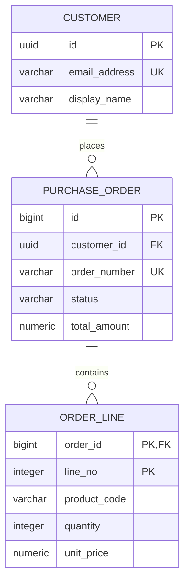

# Tạo schema ban đầu cho môi trường phát triển

## 1. Schema có vai trò gì trong ứng dụng Spring Data R2DBC?

Spring Data R2DBC ánh xạ object Java với các bảng và cột đã tồn tại trong relational database. Repository có thể tạo câu `SELECT`, `INSERT`, `UPDATE` hoặc `DELETE` dựa trên mapping metadata, nhưng annotation như `@Table`, `@Column` và `@Id` không tự tạo toàn bộ schema cho database.

Schema định nghĩa cấu trúc dữ liệu và các quy tắc mà database phải bảo vệ:

- Bảng và cột lưu dữ liệu.
- Kiểu dữ liệu, độ dài, precision và scale.
- Primary key và generated identity.
- Foreign key giữa các bảng.
- `NOT NULL`, `UNIQUE` và `CHECK` constraints.
- Default value và generated column.
- Index hỗ trợ các truy vấn thường dùng.

Khi bắt đầu một ứng dụng mới, cần tạo schema ban đầu để repository có thể kết nối và thực hiện các thao tác CRUD. Với môi trường phát triển, schema còn cần dễ khởi tạo lại, dễ quan sát và đủ gần với cấu trúc mà ứng dụng sẽ sử dụng ở các môi trường khác.

Spring Data R2DBC không yêu cầu một ORM phải tự sinh schema từ entity. Vì vậy, hãy quản lý DDL bằng script SQL hoặc công cụ database migration, sau đó bảo đảm mapping Java khớp với cấu trúc database.

## 2. Phân biệt schema, dữ liệu mẫu và mapping entity

Ba thành phần này có liên quan nhưng đảm nhận trách nhiệm khác nhau:

| Thành phần | Nội dung | Ví dụ |
| --- | --- | --- |
| Schema (DDL) | Cấu trúc và constraint của database | `CREATE TABLE customer (...)` |
| Dữ liệu mẫu (DML) | Bản ghi dùng để phát triển hoặc kiểm thử | `INSERT INTO customer (...) VALUES (...)` |
| Entity mapping | Cách Spring Data chuyển đổi giữa Java và cột SQL | `@Table`, `@Column`, `@Id` |

Ví dụ, entity:

```java
@Table("customer")
public class Customer {

    @Id
    private UUID id;

    @Column("email_address")
    private String email;

    @Column("display_name")
    private String displayName;
}
```

Schema cần có bảng `customer`, cột `id`, `email_address` và `display_name` với kiểu SQL phù hợp. Annotation mô tả mapping; nó không tự bảo đảm các cột đó đã được tạo.

Tương tự, dữ liệu mẫu không phải schema. `data.sql` chỉ có thể insert dữ liệu sau khi các bảng và constraint cần thiết đã tồn tại.

## 3. Quy trình tạo schema ban đầu

Một quy trình phát triển thường gồm:

1. Xác định các entity và ranh giới aggregate cần lưu.
2. Chọn database và kiểu SQL phù hợp với dữ liệu.
3. Thiết kế primary key, foreign key và constraint.
4. Tạo DDL cho các bảng và index.
5. Đặt script vào resource folder hoặc migration folder.
6. Cấu hình Spring Boot kết nối R2DBC tới database phát triển.
7. Khởi tạo schema trước khi ứng dụng chạy các repository query.
8. Nạp dữ liệu mẫu nếu use case phát triển cần dữ liệu ban đầu.
9. Kiểm tra schema và mapping bằng integration test.
10. Ghi lại mọi thay đổi schema tiếp theo bằng migration có phiên bản.

Nên tạo schema từ DDL có thể đọc và review được. Không dựa vào việc chạy ứng dụng rồi chờ lỗi “table does not exist” để bổ sung bảng từng bước.

## 4. Chọn database cho môi trường phát triển

Môi trường phát triển có thể dùng PostgreSQL, MySQL, MariaDB, SQL Server hoặc một database khác có R2DBC driver phù hợp. Hãy chọn cùng loại database với môi trường triển khai nếu có thể, vì SQL dialect, kiểu dữ liệu, constraint và hành vi transaction có thể khác nhau.

Ví dụ này dùng PostgreSQL để minh họa. PostgreSQL có kiểu `UUID`, `NUMERIC`, `TIMESTAMPTZ`, identity column và các constraint phù hợp cho nhiều ứng dụng nghiệp vụ.

Một cấu hình R2DBC URL có dạng:

```text
r2dbc:postgresql://localhost:5432/orders_dev
```

Đây là URL kết nối qua R2DBC driver. Nó khác JDBC URL:

```text
jdbc:postgresql://localhost:5432/orders_dev
```

Ứng dụng dùng Spring Data R2DBC để truy cập database lúc runtime cần R2DBC driver. Nếu dùng Flyway hoặc Liquibase theo cơ chế JDBC, công cụ migration còn cần JDBC driver và kết nối JDBC tương ứng.

## 5. Thiết kế schema trước khi viết DDL

Trước khi tạo bảng, hãy xác định các câu hỏi:

- Entity nào là aggregate root?
- Dữ liệu con có thuộc vòng đời của root không?
- Định danh được sinh ở Java hay database?
- Cột nào bắt buộc và cột nào được phép `NULL`?
- Giá trị nào cần duy nhất?
- Có quy tắc miền giá trị cần `CHECK` constraint không?
- Truy vấn nào thường lọc, join hoặc sắp xếp theo cột nào?
- Dữ liệu nào cần lưu chính xác như tiền tệ hoặc tỷ lệ?
- Có cần soft delete hoặc lưu lịch sử không?

Ví dụ, một ứng dụng đặt hàng ban đầu có ba bảng:



Sơ đồ chỉ thể hiện quan hệ ban đầu. Các bảng thực tế có thể bổ sung timestamp, audit columns, index hoặc các trạng thái nghiệp vụ khác khi yêu cầu rõ hơn.

## 6. DDL mẫu cho schema ban đầu

Một script PostgreSQL có thể tạo ba bảng như sau:

```sql
CREATE TABLE customer (
    id UUID PRIMARY KEY,
    email_address VARCHAR(320) NOT NULL,
    display_name VARCHAR(150) NOT NULL,
    created_at TIMESTAMPTZ NOT NULL DEFAULT CURRENT_TIMESTAMP,
    CONSTRAINT uk_customer_email UNIQUE (email_address)
);

CREATE TABLE purchase_order (
    id BIGINT GENERATED BY DEFAULT AS IDENTITY PRIMARY KEY,
    customer_id UUID NOT NULL,
    order_number VARCHAR(40) NOT NULL,
    status VARCHAR(20) NOT NULL,
    total_amount NUMERIC(19, 2) NOT NULL DEFAULT 0,
    created_at TIMESTAMPTZ NOT NULL DEFAULT CURRENT_TIMESTAMP,
    CONSTRAINT uk_purchase_order_number UNIQUE (order_number),
    CONSTRAINT ck_purchase_order_total_nonnegative
        CHECK (total_amount >= 0),
    CONSTRAINT fk_purchase_order_customer
        FOREIGN KEY (customer_id) REFERENCES customer(id)
);

CREATE TABLE order_line (
    order_id BIGINT NOT NULL,
    line_no INTEGER NOT NULL,
    product_code VARCHAR(60) NOT NULL,
    quantity INTEGER NOT NULL,
    unit_price NUMERIC(19, 2) NOT NULL,
    CONSTRAINT pk_order_line PRIMARY KEY (order_id, line_no),
    CONSTRAINT ck_order_line_number_nonnegative CHECK (line_no >= 0),
    CONSTRAINT ck_order_line_quantity_positive CHECK (quantity > 0),
    CONSTRAINT ck_order_line_price_nonnegative CHECK (unit_price >= 0),
    CONSTRAINT fk_order_line_order
        FOREIGN KEY (order_id)
        REFERENCES purchase_order(id)
        ON DELETE CASCADE
);

CREATE INDEX ix_purchase_order_customer_created
    ON purchase_order(customer_id, created_at DESC);

CREATE INDEX ix_order_line_product_code
    ON order_line(product_code);
```

Trong ví dụ:

- `customer.id` dùng UUID do ứng dụng cung cấp.
- `purchase_order.id` do database cấp bằng identity.
- `order_line` thuộc về `purchase_order` và dùng khóa chính kép `(order_id, line_no)`.
- `NUMERIC(19, 2)` lưu số tiền theo decimal chính xác.
- `NOT NULL`, `UNIQUE` và `CHECK` bảo vệ các quy tắc dữ liệu.
- Foreign key bảo đảm đơn hàng tham chiếu customer có thật.
- `ON DELETE CASCADE` xóa dòng hàng khi đơn hàng bị xóa vật lý; chỉ dùng nếu chính sách dữ liệu cho phép.
- Index hỗ trợ các truy vấn theo customer, thời điểm tạo và product code.

### 6.1. Chọn primary key

Primary key là định danh ổn định của một hàng. Có thể dùng:

- UUID nếu ID được tạo ở ứng dụng hoặc cần chia sẻ giữa nhiều hệ thống.
- Identity/sequence nếu database là nguồn cấp ID số.
- Khóa tự nhiên chỉ khi giá trị thực sự ổn định và có quy tắc duy nhất phù hợp.

Không nên dùng email làm primary key chỉ vì email hiện tại là duy nhất. Email có thể thay đổi theo thời gian. Một surrogate key ổn định thường giúp foreign key và quan hệ dữ liệu dễ quản lý hơn.

### 6.2. NOT NULL và DEFAULT

Hai thuộc tính này có ý nghĩa khác nhau:

- `NOT NULL` cấm lưu SQL NULL.
- `DEFAULT` cung cấp giá trị khi câu INSERT bỏ cột hoặc chỉ định `DEFAULT`.

Ví dụ:

```sql
status VARCHAR(20) NOT NULL DEFAULT 'PENDING'
```

Nếu INSERT bỏ cột `status`, database dùng `PENDING`. Nếu INSERT gửi `NULL`, database từ chối vì `NOT NULL`; default không tự thay thế SQL NULL.

### 6.3. Kiểu dữ liệu cần phù hợp domain

Một số lựa chọn thường gặp trong PostgreSQL:

| Dữ liệu | Kiểu SQL gợi ý | Kiểu Java thường dùng |
| --- | --- | --- |
| UUID | `UUID` | `java.util.UUID` |
| Chuỗi ngắn | `VARCHAR(n)` | `String` |
| Nội dung dài | `TEXT` | `String` |
| Số nguyên | `INTEGER`, `BIGINT` | `Integer`, `Long` |
| Tiền tệ | `NUMERIC(p, s)` | `BigDecimal` |
| Ngày giờ có múi giờ | `TIMESTAMPTZ` | `Instant`, `OffsetDateTime` |
| Boolean | `BOOLEAN` | `Boolean`, `boolean` |

Không dùng `REAL` hoặc `DOUBLE PRECISION` cho số tiền cần độ chính xác thập phân. Chọn precision/scale dựa trên miền giá trị và quy tắc làm tròn.

## 7. Ánh xạ DDL với entity Spring Data Relational

Entity cần khớp tên bảng và cột trong DDL:

```java
@Table("customer")
public class Customer {

    @Id
    private UUID id;

    @Column("email_address")
    private String email;

    @Column("display_name")
    private String displayName;

    @Column("created_at")
    private OffsetDateTime createdAt;
}
```

Đơn hàng:

```java
@Table("purchase_order")
public class PurchaseOrder {

    @Id
    private Long id;

    @Column("customer_id")
    private UUID customerId;

    @Column("order_number")
    private String orderNumber;

    private String status;

    @Column("total_amount")
    private BigDecimal totalAmount;

    @Column("created_at")
    private OffsetDateTime createdAt;
}
```

Mapping metadata cho biết cách chuyển đổi giữa thuộc tính Java và cột SQL. DDL vẫn là nguồn định nghĩa cấu trúc thật của database.

### 7.1. Quan hệ một-nhiều với @MappedCollection

Nếu `OrderLine` thuộc aggregate `PurchaseOrder`, có thể ánh xạ collection:

```java
@Table("purchase_order")
public class PurchaseOrder {

    @Id
    private Long id;

    @MappedCollection(idColumn = "order_id", keyColumn = "line_no")
    private List<OrderLine> lines = new ArrayList<>();
}
```

```java
public class OrderLine {
    @Column("product_code")
    private String productCode;

    private Integer quantity;

    @Column("unit_price")
    private BigDecimal unitPrice;
}
```

`idColumn` phải khớp cột foreign key `order_line.order_id`; `keyColumn` phải khớp cột dùng lưu vị trí/khóa collection `line_no`. Khóa chính kép trong DDL giúp mỗi dòng có vị trí duy nhất trong một đơn hàng.

Không dùng annotation JPA `@OneToMany` cho mapping này. Spring Data Relational sử dụng `@MappedCollection` cho thành phần collection thuộc aggregate.

## 8. Đặt script schema vào project

Với dự án Spring Boot, có thể đặt script SQL trong `src/main/resources`:

```text
src/
  main/
    java/
      ...
    resources/
      application.yml
      application-dev.yml
      db/
        schema.sql
        data.sql
```

`schema.sql` chứa DDL tạo bảng, constraint và index. `data.sql` chứa các câu INSERT dữ liệu mẫu cho môi trường phát triển.

Giữ DDL tách khỏi dữ liệu mẫu giúp dễ xác định lỗi khởi tạo. Nếu bảng chưa được tạo, lỗi thuộc schema initialization; nếu bảng đã tồn tại nhưng insert sai kiểu hoặc vi phạm constraint, lỗi thuộc data initialization.

Với ứng dụng nhỏ hoặc bài thực hành, hai script này có thể đủ để tạo database phát triển ban đầu. Khi schema bắt đầu thay đổi qua nhiều phiên bản, nên chuyển sang công cụ migration có lịch sử.

## 9. Cấu hình Spring Boot khởi tạo schema bằng SQL script

Spring Boot hỗ trợ chạy script SQL khi khởi động ứng dụng. Ví dụ cấu hình R2DBC và SQL initialization trong `application-dev.yml`:

```yaml
spring:
  r2dbc:
    url: r2dbc:postgresql://localhost:5432/orders_dev
    username: ${DB_USERNAME:app}
    password: ${DB_PASSWORD:app}

  sql:
    init:
      mode: always
      schema-locations: classpath:db/schema.sql
      data-locations: classpath:db/data.sql
      continue-on-error: false
```

Các thuộc tính chính:

- `spring.r2dbc.url`: R2DBC URL của database.
- `spring.r2dbc.username` và `password`: thông tin đăng nhập.
- `spring.sql.init.mode`: quyết định khi nào chạy script khởi tạo.
- `schema-locations`: vị trí DDL.
- `data-locations`: vị trí dữ liệu mẫu.
- `continue-on-error`: có tiếp tục khi script gặp lỗi hay không.

Với `mode: always`, Spring Boot chạy script khởi tạo theo cấu hình kể cả khi database không phải embedded database. Điều này hữu ích trong môi trường phát triển nhưng cần quản lý cẩn thận để không vô tình chạy script reset/khởi tạo dữ liệu ngoài ý muốn ở môi trường khác.

### 9.1. Các giá trị của spring.sql.init.mode

| Giá trị | Ý nghĩa |
| --- | --- |
| `embedded` | Chỉ khởi tạo với embedded database; đây là hành vi mặc định phổ biến |
| `always` | Chạy script bất kể database có phải embedded hay không |
| `never` | Không chạy script SQL initialization |

Nếu dùng PostgreSQL trong local development, `embedded` thường không chạy script vì PostgreSQL là external database. Cấu hình `always` trong profile phát triển giúp script được thực thi.

### 9.2. Thứ tự schema và data

Schema phải tồn tại trước khi chạy dữ liệu mẫu. Spring Boot SQL initialization thực hiện schema script trước data script theo cơ chế khởi tạo được cấu hình.

Nếu `data.sql` insert vào bảng chưa tồn tại, startup sẽ thất bại. Giữ DDL trong `schema.sql` và DML trong `data.sql` giúp thứ tự dễ hiểu.

### 9.3. Dừng khi có lỗi

Trong phát triển, nên để `continue-on-error: false` để ứng dụng báo lỗi ngay khi DDL hoặc DML không chạy được. Nếu tiếp tục sau lỗi, ứng dụng có thể khởi động với schema chỉ được tạo một phần và lỗi sẽ xuất hiện muộn hơn ở repository.

Không nên đặt `continue-on-error: true` chỉ để che lỗi trùng bảng, sai cột hoặc constraint. Hãy xác định vì sao script không tương thích với trạng thái database hiện tại.

## 10. Profile riêng cho môi trường phát triển

Không nên bật `spring.sql.init.mode=always` trong cấu hình chung nếu môi trường khác có thể dùng database đã được quản lý bằng migration. Hãy đặt cấu hình này trong profile phát triển:

`application.yml`:

```yaml
spring:
  application:
    name: orders-service
```

`application-dev.yml`:

```yaml
spring:
  r2dbc:
    url: r2dbc:postgresql://localhost:5432/orders_dev
    username: ${DB_USERNAME:app}
    password: ${DB_PASSWORD:app}
  sql:
    init:
      mode: always
      schema-locations: classpath:db/schema.sql
      data-locations: classpath:db/data.sql
      continue-on-error: false
```

Kích hoạt profile khi chạy:

```bash
SPRING_PROFILES_ACTIVE=dev ./mvnw spring-boot:run
```

Hoặc truyền tham số JVM/application phù hợp với cách chạy của project. Trên Windows PowerShell có thể đặt biến môi trường cho phiên hiện tại:

```powershell
$env:SPRING_PROFILES_ACTIVE = "dev"
.\mvnw spring-boot:run
```

Tên profile là `dev`; cách truyền biến môi trường hoặc tham số chạy phụ thuộc shell và công cụ build. Không commit mật khẩu thật vào repository. Dùng biến môi trường hoặc secret management của môi trường chạy.

## 11. Dữ liệu mẫu cho môi trường phát triển

`data.sql` có thể tạo một vài bản ghi phục vụ kiểm tra repository và API:

```sql
INSERT INTO customer (id, email_address, display_name)
VALUES
    ('10000000-0000-0000-0000-000000000001', 'lan@example.com', 'Lan Nguyen'),
    ('10000000-0000-0000-0000-000000000002', 'minh@example.com', 'Minh Tran');

INSERT INTO purchase_order (
    customer_id,
    order_number,
    status,
    total_amount
)
VALUES
    ('10000000-0000-0000-0000-000000000001', 'PO-DEV-001', 'PENDING', 250.00),
    ('10000000-0000-0000-0000-000000000002', 'PO-DEV-002', 'CONFIRMED', 75.50);

INSERT INTO order_line (
    order_id,
    line_no,
    product_code,
    quantity,
    unit_price
)
VALUES
    (1, 0, 'BOOK-001', 2, 125.00),
    (2, 0, 'MUG-001', 1, 75.50);
```

Ví dụ giả định database mới cấp ID `1` và `2` cho hai đơn hàng. Không nên dựa vào giá trị identity cố định như vậy trong một database đã có dữ liệu từ lần chạy trước. Nếu cần dữ liệu mẫu ổn định, có thể dùng ID tường minh khi schema cho phép hoặc dùng script seed riêng có chiến lược kiểm tra/khóa dữ liệu rõ ràng.

### 11.1. Tránh insert trùng khi script chạy lại

`data.sql` có thể được chạy mỗi lần ứng dụng khởi động nếu cấu hình `mode: always`. Nếu script insert cùng một email hoặc order number lần thứ hai, unique constraint sẽ làm startup thất bại.

Có một số cách xử lý:

- Dùng database mới hoặc reset database dev trước khi chạy script.
- Dùng `INSERT ... ON CONFLICT DO NOTHING` trên PostgreSQL khi dữ liệu mẫu chỉ cần tồn tại.
- Dùng `ON CONFLICT ... DO UPDATE` nếu muốn seed luôn cập nhật dữ liệu mẫu theo trạng thái mong muốn.
- Dùng migration/seed tool có cơ chế theo dõi đã chạy thay vì chạy lại DML mỗi startup.

Ví dụ PostgreSQL:

```sql
INSERT INTO customer (id, email_address, display_name)
VALUES (
    '10000000-0000-0000-0000-000000000001',
    'lan@example.com',
    'Lan Nguyen'
)
ON CONFLICT (id) DO NOTHING;
```

`ON CONFLICT` là cú pháp PostgreSQL. Với database khác, dùng cú pháp tương ứng hoặc chọn cách seed phù hợp. Không dùng `DO NOTHING` để che xung đột dữ liệu không mong muốn; xác định rõ khóa nào là khóa idempotent của dữ liệu mẫu.

## 12. Quy ước tên bảng và cột

Nên thống nhất quy ước đặt tên giữa DDL và entity:

- Dùng tên bảng số ít hoặc số nhiều nhất quán.
- Dùng `snake_case` cho tên bảng/cột nếu đó là quy ước của project.
- Đặt tên constraint có ý nghĩa như `pk_...`, `fk_...`, `uk_...`, `ck_...`.
- Tránh tên trùng từ khóa SQL hoặc cần quote ở nhiều nơi.
- Đặt tên index theo bảng và cột được index.

Ví dụ:

```sql
CONSTRAINT fk_purchase_order_customer
    FOREIGN KEY (customer_id) REFERENCES customer(id)
```

Và entity:

```java
@Column("customer_id")
private UUID customerId;
```

Tên thuộc tính Java có thể dùng camelCase trong khi cột SQL dùng snake_case. Dùng `@Column` khi cần thể hiện mapping rõ ràng hoặc khi naming strategy không tự tạo tên mong muốn.

## 13. Index ban đầu nên dựa trên truy vấn

Index không nên được tạo chỉ vì một cột tồn tại. Hãy dựa vào query workload:

| Truy vấn | Index có thể phù hợp |
| --- | --- |
| Tìm customer theo email | Unique index/constraint trên `email_address` |
| Tìm đơn hàng theo customer và sắp xếp mới nhất | Index `(customer_id, created_at DESC)` |
| Tải dòng hàng của đơn hàng theo vị trí | Primary key/index `(order_id, line_no)` |
| Tìm đơn hàng theo order number | Unique index trên `order_number` |
| Tìm dòng hàng theo product code | Index trên `product_code` nếu workload cần |

Primary key và unique constraint thường tạo index tương ứng trong database. Không tạo index trùng lặp nếu constraint đã cung cấp index cần thiết.

Index làm truy vấn đọc có thể nhanh hơn nhưng tăng dung lượng và chi phí INSERT/UPDATE/DELETE. Với môi trường phát triển, hãy bắt đầu từ các truy vấn chính rồi xem execution plan khi dữ liệu đủ lớn.

## 14. Khởi tạo schema bằng Flyway hoặc Liquibase

`schema.sql` và `data.sql` phù hợp cho project nhỏ, ví dụ học tập hoặc môi trường local cần khởi tạo đơn giản. Khi schema thay đổi qua nhiều phiên bản, nên dùng database migration để ghi lại từng thay đổi theo thứ tự.

Ví dụ cấu trúc Flyway:

```text
src/main/resources/
  db/
    migration/
      V1__create_initial_schema.sql
      V2__add_customer_status.sql
      V3__add_order_search_index.sql
```

Mỗi file migration được đánh số phiên bản. Flyway lưu lịch sử migration trong schema history table và chỉ chạy migration chưa được áp dụng theo quy tắc của nó.

Ví dụ nội dung `V1__create_initial_schema.sql`:

```sql
CREATE TABLE customer (
    id UUID PRIMARY KEY,
    email_address VARCHAR(320) NOT NULL UNIQUE,
    display_name VARCHAR(150) NOT NULL,
    created_at TIMESTAMPTZ NOT NULL DEFAULT CURRENT_TIMESTAMP
);
```

Sau đó, thay đổi schema mới được thêm bằng migration tiếp theo, không sửa lại migration đã chạy ở môi trường dùng chung nếu không có quy trình repair được kiểm soát.

### 14.1. Flyway/Liquibase thường dùng JDBC

Ứng dụng có thể dùng R2DBC cho truy cập database ở runtime nhưng vẫn dùng JDBC cho migration. Đây là hai mục đích khác nhau:

- R2DBC driver phục vụ repository và `DatabaseClient` reactive.
- JDBC driver/connection phục vụ công cụ migration như Flyway hoặc Liquibase trong cấu hình phổ biến.

Vì vậy, project chỉ có R2DBC driver có thể cần bổ sung JDBC driver nếu dùng Flyway/Liquibase theo tích hợp JDBC. Cần cấu hình migration kết nối đúng database và chạy trước khi ứng dụng bắt đầu truy vấn repository.

Không giả định `spring.r2dbc.url` tự động là URL mà Flyway/Liquibase sử dụng. Flyway thường cần JDBC URL/driver và có thể được cấu hình qua các thuộc tính `spring.flyway.*`; Liquibase có cấu hình kết nối tương ứng. Cách cấu hình chi tiết phụ thuộc Spring Boot, phiên bản công cụ và database.

### 14.2. Không trộn nhiều cơ chế tạo schema không có chủ đích

Nếu dùng Flyway quản lý schema, không nên đồng thời để `schema.sql` tạo lại các bảng giống hệt khi ứng dụng khởi động. Hai cơ chế có thể tranh chấp thứ tự, gây lỗi bảng đã tồn tại hoặc tạo schema không đúng lịch sử migration.

Chọn một nguồn có thẩm quyền cho schema:

- Script SQL initialization cho project nhỏ hoặc bài thực hành đơn giản.
- Flyway/Liquibase cho schema cần thay đổi có lịch sử và triển khai qua nhiều môi trường.

Nếu cần dùng script seed riêng sau migration, hãy cấu hình rõ thứ tự và phạm vi chạy của dữ liệu mẫu.

## 15. Schema script và migration khác nhau thế nào?

| Tiêu chí | `schema.sql` | Versioned migration |
| --- | --- | --- |
| Mục tiêu | Khởi tạo cấu trúc ban đầu | Quản lý tiến hóa schema qua thời gian |
| Cách chạy | Có thể chạy mỗi lần ứng dụng khởi động theo cấu hình | Chạy migration mới chưa áp dụng |
| Lịch sử | Không tự lưu lịch sử phiên bản | Có bảng lịch sử migration |
| Phù hợp | Local dev, demo, project nhỏ | Team, CI/CD, staging và production |
| Thay đổi schema | Thường sửa script hiện tại hoặc reset DB | Thêm migration mới theo phiên bản |
| Kiểm soát môi trường | Cần cẩn thận profile và mode | Có quy trình áp dụng theo môi trường |

Một nguyên tắc quan trọng: migration đã chạy ở môi trường dùng chung nên được xem là bất biến. Nếu cần thay đổi schema, tạo migration mới để người khác có thể tái tạo đúng lịch sử.

## 16. Dùng Docker Compose cho database phát triển

Docker Compose giúp các thành viên khởi chạy cùng một loại database với cấu hình gần giống nhau. Ví dụ PostgreSQL:

```yaml
services:
  postgres:
    image: postgres:16
    container_name: orders-postgres-dev
    environment:
      POSTGRES_DB: orders_dev
      POSTGRES_USER: app
      POSTGRES_PASSWORD: app
    ports:
      - "5432:5432"
    volumes:
      - orders-postgres-data:/var/lib/postgresql/data
    healthcheck:
      test: ["CMD-SHELL", "pg_isready -U app -d orders_dev"]
      interval: 5s
      timeout: 3s
      retries: 10

volumes:
  orders-postgres-data:
```

Chạy:

```bash
docker compose up -d postgres
```

Khi database sẵn sàng, chạy ứng dụng với profile dev để Spring Boot khởi tạo schema hoặc để migration tool áp dụng migration.

Ví dụ chỉ dành cho môi trường phát triển. Không dùng mật khẩu mẫu trong production. Tag image nên được quản lý nhất quán trong project; nếu cần tái lập môi trường chính xác, có thể pin version hoặc digest theo chính sách team.

### 16.1. Volume giữ dữ liệu giữa các lần chạy

Named volume `orders-postgres-data` giữ dữ liệu database khi container bị dừng hoặc tạo lại. Vì vậy, script `schema.sql` với câu `CREATE TABLE` thông thường có thể lỗi ở lần khởi động tiếp theo do bảng đã tồn tại.

Có thể dùng `CREATE TABLE IF NOT EXISTS` cho một số script phát triển đơn giản, nhưng câu lệnh này không cập nhật cấu trúc bảng nếu bảng cũ có cột hoặc constraint khác. Nó không thay thế migration.

Nếu cần môi trường sạch, hãy dùng database/volume riêng cho dev và reset theo quy trình được kiểm soát. Không chạy lệnh xóa volume hoặc drop schema trên môi trường có dữ liệu cần giữ.

## 17. Tạo schema idempotent trong môi trường phát triển

Một script idempotent có thể chạy lại mà không làm hỏng trạng thái nếu cấu trúc đã tồn tại. Ví dụ PostgreSQL:

```sql
CREATE TABLE IF NOT EXISTS customer (
    id UUID PRIMARY KEY,
    email_address VARCHAR(320) NOT NULL UNIQUE,
    display_name VARCHAR(150) NOT NULL
);

CREATE INDEX IF NOT EXISTS ix_customer_display_name
    ON customer(display_name);
```

`IF NOT EXISTS` chỉ tránh lỗi khi object đã tồn tại. Nó không kiểm tra rằng object cũ có đúng định nghĩa mong muốn. Nếu cột thiếu hoặc kiểu dữ liệu sai, script trên không tự sửa cấu trúc.

Đối với migration có lịch sử, dùng migration versioned để thay đổi schema một cách rõ ràng. Không dựa vào `IF NOT EXISTS` để che mọi sai lệch giữa database và DDL mới.

## 18. Cấu hình R2DBC và SQL initialization trong các môi trường

Một ứng dụng thường có cấu hình khác nhau giữa dev, test và production:

| Môi trường | Kết nối | Cách quản lý schema thường dùng |
| --- | --- | --- |
| Local development | PostgreSQL local/Docker | `schema.sql` đơn giản hoặc migration |
| Automated test | Test database hoặc Testcontainers | Migration hoặc script schema dùng cho test |
| Staging | Database riêng của staging | Migration có phiên bản |
| Production | Database production với quyền hạn chế | Migration có kiểm soát trước/đồng bộ với rollout ứng dụng |

Không nên để production tự chạy một script khởi tạo tùy tiện mỗi lần application instance khởi động. Khi có nhiều instance, các instance có thể cùng khởi tạo schema hoặc tranh chấp DDL. Hãy dùng migration deployment step hoặc quy trình database release được kiểm soát.

### 18.1. Cấu hình profile test

Test có thể dùng một database riêng hoặc Testcontainers. Ví dụ cấu hình test có thể nhận URL từ dynamic property:

```java
@Testcontainers
@SpringBootTest
class CustomerRepositoryIntegrationTest {

    @Container
    static PostgreSQLContainer<?> postgres =
            new PostgreSQLContainer<>("postgres:16")
                    .withDatabaseName("orders_test")
                    .withUsername("test")
                    .withPassword("test");

    @DynamicPropertySource
    static void configure(DynamicPropertyRegistry registry) {
        registry.add("spring.r2dbc.url", () ->
                "r2dbc:postgresql://" + postgres.getHost() + ":" +
                        postgres.getFirstMappedPort() + "/orders_test");
        registry.add("spring.r2dbc.username", postgres::getUsername);
        registry.add("spring.r2dbc.password", postgres::getPassword);
    }
}
```

Đây là ví dụ cấu hình R2DBC cho test. Nếu migration tool dùng JDBC, cần cung cấp JDBC URL/driver tương ứng cho cùng container hoặc khởi tạo schema bằng cách phù hợp với test setup.

## 19. Kiểm tra schema sau khi khởi tạo

Sau khi ứng dụng chạy script hoặc migration, hãy xác nhận các bảng và constraint thực sự tồn tại.

Với PostgreSQL, có thể dùng psql:

```sql
\dt
\d customer
\d purchase_order
\d order_line
```

Hoặc truy vấn catalog:

```sql
SELECT table_name
FROM information_schema.tables
WHERE table_schema = 'public'
ORDER BY table_name;
```

Kiểm tra cột:

```sql
SELECT table_name, column_name, data_type, is_nullable
FROM information_schema.columns
WHERE table_schema = 'public'
ORDER BY table_name, ordinal_position;
```

Kiểm tra constraint:

```sql
SELECT conname, contype, conrelid::regclass AS table_name
FROM pg_constraint
WHERE connamespace = 'public'::regnamespace
ORDER BY table_name, conname;
```

Những câu lệnh catalog trên dành cho PostgreSQL. Database khác có view metadata và cú pháp riêng.

## 20. Kiểm thử repository sau khi tạo schema

Một integration test đơn giản có thể xác nhận bảng đã tồn tại và mapping hoạt động:

```java
@SpringBootTest
class CustomerRepositoryIntegrationTest {

    @Autowired
    CustomerRepository customerRepository;

    @Test
    void shouldSaveAndReadCustomer() {
        Customer customer = new Customer(
                UUID.randomUUID(),
                "dev@example.com",
                "Dev User");

        StepVerifier.create(customerRepository.save(customer)
                .flatMap(saved -> customerRepository.findById(saved.getId())))
                .assertNext(loaded -> {
                    assertEquals("dev@example.com", loaded.getEmail());
                    assertEquals("Dev User", loaded.getDisplayName());
                })
                .verifyComplete();
    }
}
```

Ví dụ giả định constructor và getter phù hợp. Test cần database đã được khởi tạo schema trước khi chạy.

Các tình huống nên kiểm tra:

- Repository có thể insert và đọc lại entity.
- ID được sinh hoặc gán theo thiết kế.
- Tên cột mapping đúng.
- `NOT NULL`, `UNIQUE`, `CHECK` và foreign key hoạt động.
- `NUMERIC` ánh xạ đúng với `BigDecimal`.
- Default database được áp dụng khi câu INSERT bỏ cột.
- `@MappedCollection` đọc/ghi đúng foreign key và key column.
- Index được tạo như DDL dự kiến.

Unit test entity không thể xác nhận schema đã được tạo. Cần integration test với database và driver thực tế để kiểm tra DDL cùng mapping.

## 21. Lỗi thường gặp khi khởi tạo schema

| Triệu chứng | Nguyên nhân có thể có | Cách xử lý |
| --- | --- | --- |
| `relation does not exist` hoặc table not found | Script schema chưa chạy hoặc sai schema/search path | Kiểm tra SQL initialization, migration và tên bảng |
| Script không chạy với PostgreSQL | `spring.sql.init.mode` vẫn là `embedded` | Đặt `always` trong profile dev nếu dùng script initialization |
| Ứng dụng khởi động nhưng repository lỗi | Schema chưa khớp entity mapping | Kiểm tra DDL, `@Table`, `@Column` và kiểu dữ liệu |
| `data.sql` thất bại | Chạy trước schema hoặc dữ liệu vi phạm constraint | Tạo bảng trước, kiểm tra thứ tự và dữ liệu seed |
| Duplicate key khi khởi động lại | `data.sql` chạy lại trên database có dữ liệu | Reset database dev, dùng seed idempotent hoặc migration |
| Bảng tồn tại nhưng thiếu cột mới | `CREATE TABLE IF NOT EXISTS` không cập nhật bảng cũ | Tạo migration ALTER TABLE |
| Flyway không kết nối được | Chỉ có R2DBC driver hoặc thiếu JDBC URL/driver | Cấu hình JDBC migration connection và driver phù hợp |
| Dùng sai kiểu UUID/NUMERIC | DDL không khớp driver hoặc Java type | Đồng bộ kiểu SQL, Java và converter |
| Foreign key insert lỗi | Hàng cha chưa tồn tại hoặc ID tham chiếu sai | Insert theo thứ tự và kiểm tra khóa ngoại |
| Nhiều instance cùng chạy DDL | Schema initialization đặt trong startup của mọi instance | Dùng migration deployment step hoặc khóa/quy trình phù hợp |
| Script lỗi nhưng ứng dụng vẫn chạy | Bật `continue-on-error` | Đặt false trong dev để phát hiện lỗi ngay |

## 22. Bảo vệ môi trường phát triển

Môi trường dev thường chứa dữ liệu thử nghiệm, nhưng vẫn nên tránh một số thói quen nguy hiểm:

- Không dùng thông tin đăng nhập production trong `application-dev.yml`.
- Không commit mật khẩu thật hoặc secret vào Git.
- Không để script phát triển tự động drop database dùng chung.
- Không chạy `schema.sql` có lệnh xóa dữ liệu trên môi trường staging/production.
- Dùng database riêng cho mỗi developer hoặc mỗi test suite khi cần cách ly dữ liệu.
- Giới hạn quyền database của user ứng dụng; không cấp quyền quản trị database nếu runtime không cần.
- Dùng migration có review cho thay đổi schema được chia sẻ trong team.

Một database user dùng cho local development có thể cần quyền tạo bảng. User runtime trong production thường nên có quyền DML cần thiết, còn quyền DDL được cấp cho migration process riêng theo chính sách triển khai.

## 23. Quy trình phát triển schema từ lần đầu

Một quy trình dễ duy trì:

1. Thiết kế bảng và constraint từ mô hình domain/aggregate.
2. Viết `schema.sql` hoặc migration `V1__create_initial_schema.sql`.
3. Ánh xạ entity bằng `@Table`, `@Column`, `@Id` và `@MappedCollection` khi cần.
4. Cấu hình R2DBC URL và credentials cho profile dev.
5. Chọn một cơ chế khởi tạo: SQL initialization hoặc migration tool.
6. Nạp dữ liệu mẫu tách biệt với DDL nếu cần.
7. Khởi động database local bằng Docker hoặc dịch vụ phát triển.
8. Chạy ứng dụng và xác nhận script/migration hoàn tất.
9. Kiểm tra catalog, constraint, index và repository integration test.
10. Khi cần đổi schema, thêm migration mới và cập nhật entity cùng test tương ứng.

## 24. Khi nào nên chuyển từ schema.sql sang migration?

`schema.sql` là cách khởi tạo dễ hiểu cho một database phát triển mới. Tuy nhiên, khi nhiều người cùng làm việc hoặc ứng dụng đã có dữ liệu cần giữ, việc sửa script ban đầu không thể diễn tả chính xác các bước chuyển đổi từ schema cũ sang schema mới.

Nên dùng Flyway hoặc Liquibase khi:

- Nhiều developer hoặc nhiều môi trường cần cùng schema.
- Schema thay đổi thường xuyên qua các phiên bản ứng dụng.
- Cần theo dõi migration nào đã chạy ở database nào.
- Cần triển khai schema trước hoặc đồng bộ với rollout application.
- Có thay đổi dữ liệu cần backfill, rename hoặc chuyển đổi theo từng bước.
- Cần review DDL như một phần của thay đổi source code.

Một migration cần xem xét cả tương thích giữa schema cũ và ứng dụng mới. Với deployment không dừng hệ thống, có thể cần chiến lược expand-and-contract: thêm cấu trúc mới tương thích trước, triển khai ứng dụng chuyển dần, sau đó mới loại bỏ cột cũ trong migration sau.

## 25. Tổng kết cách tạo schema ban đầu

Schema ban đầu là hợp đồng giữa entity mapping và database. Trong Spring Data R2DBC, annotation mô tả cách ánh xạ object nhưng DDL mới tạo bảng, kiểu dữ liệu, constraint và index thật sự.

Với môi trường phát triển đơn giản, có thể đặt `schema.sql` và `data.sql` trong resources, cấu hình `spring.sql.init.mode=always` trong profile dev và dùng R2DBC URL để kết nối database. Khi project cần lịch sử thay đổi và triển khai qua nhiều môi trường, hãy dùng migration có phiên bản như Flyway hoặc Liquibase; trong cấu hình phổ biến, các công cụ này dùng JDBC riêng dù ứng dụng truy cập dữ liệu bằng R2DBC.

Thiết kế schema nên bắt đầu từ primary key, foreign key, nullability, uniqueness, check constraints và kiểu dữ liệu phù hợp. Sau khi khởi tạo, hãy xác nhận cấu trúc bằng metadata của database và integration test repository với đúng driver. Cách làm này giúp môi trường phát triển có thể tái lập, entity mapping khớp với schema và các thay đổi database về sau được quản lý có trật tự.
