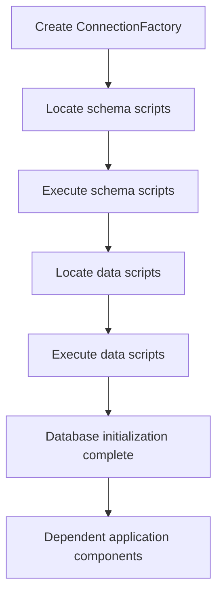

# Spring Boot SQL initialization và thứ tự khởi tạo

Spring Boot có cơ chế SQL initialization để chạy các script tạo cấu trúc và nạp dữ liệu khi ứng dụng khởi động. Với ứng dụng Spring Data Relational R2DBC, cơ chế này có thể dùng `ConnectionFactory` và R2DBC driver để thực thi các file SQL như `schema.sql` và `data.sql`. Cấu hình đúng giúp bảng được tạo trước khi dữ liệu mẫu được chèn và bảo đảm các thành phần ứng dụng chỉ sử dụng database sau khi bước khởi tạo cần thiết đã hoàn tất.

SQL initialization đặc biệt hữu ích cho database nhúng, môi trường phát triển và kiểm thử. Với database dùng chung hoặc production, cần cân nhắc kỹ vì script có thể chạy lại ở mỗi lần khởi động. Khi schema cần tiến hóa qua nhiều phiên bản ứng dụng, công cụ migration như Flyway hoặc Liquibase thường phù hợp hơn.

## 1. SQL initialization trong Spring Boot là gì?

SQL initialization là quá trình Spring Boot đọc các tài nguyên SQL được cấu hình và gửi câu lệnh tới database trong giai đoạn khởi động ứng dụng. Các script phổ biến gồm:

- `schema.sql`: tạo bảng, index, constraint, view hoặc các cấu trúc cần thiết.
- `data.sql`: thêm dữ liệu khởi tạo hoặc dữ liệu tham chiếu.
- `schema-${platform}.sql`: cấu trúc riêng cho một hệ quản trị, ví dụ PostgreSQL.
- `data-${platform}.sql`: dữ liệu riêng cho một hệ quản trị.

Ví dụ cấu trúc thư mục:

```text
src/main/resources/
  schema.sql
  data.sql
  schema-postgresql.sql
  data-postgresql.sql
```

Spring Boot hỗ trợ khởi tạo database cho JDBC và R2DBC. Với ứng dụng R2DBC, cấu hình kết nối được cung cấp qua `spring.r2dbc.*`; script được thực thi thông qua hạ tầng khởi tạo SQL tương ứng với `ConnectionFactory` và driver R2DBC.

SQL initialization chỉ thực thi các câu lệnh SQL. Nó không tự suy ra DDL từ `@Table`, `@Column`, `@Id` hoặc các entity của Spring Data Relational. Annotation mapping mô tả cách ánh xạ Java với schema đã tồn tại; việc tạo và thay đổi schema cần script, migration hoặc một công cụ schema riêng.

## 2. Cấu hình R2DBC connection

Trước khi chạy script, ứng dụng cần có `ConnectionFactory` hoạt động. Với Spring Boot, có thể cấu hình trong `application.yml`:

```yaml
spring:
  r2dbc:
    url: r2dbc:postgresql://localhost:5432/shop
    username: app_user
    password: ${DB_PASSWORD}
```

Ví dụ trên dùng PostgreSQL R2DBC driver. URL và driver phải tương ứng với database thực tế. Không dùng JDBC URL `jdbc:postgresql://...` cho thuộc tính `spring.r2dbc.url`.

Nếu dùng pool, cấu hình pool qua các thuộc tính `spring.r2dbc.pool.*` khi dependency R2DBC pool và phiên bản Spring Boot hỗ trợ. Việc tạo pool không thay đổi nguyên tắc SQL initialization: initializer cần lấy kết nối từ `ConnectionFactory` mà ứng dụng đã cấu hình.

Nếu ứng dụng tự khai báo `ConnectionFactory` bean, hãy kiểm tra auto-configuration và SQL initializer có còn được tạo như mong đợi hay không. Một cấu hình thủ công có thể khiến một số auto-configuration back off; không nên giả định chỉ cần thêm bean là mọi bước khởi tạo tự động vẫn giữ nguyên.

## 3. Các thuộc tính `spring.sql.init.*` quan trọng

Spring Boot cung cấp nhóm thuộc tính `spring.sql.init` để kiểm soát việc chạy script.

| Thuộc tính | Mục đích |
| --- | --- |
| `spring.sql.init.mode` | Chọn khi nào chạy script: `embedded`, `always` hoặc `never` |
| `spring.sql.init.schema-locations` | Vị trí các script tạo schema |
| `spring.sql.init.data-locations` | Vị trí các script nạp dữ liệu |
| `spring.sql.init.platform` | Tên platform dùng để chọn script theo hệ quản trị |
| `spring.sql.init.continue-on-error` | Có tiếp tục khi một câu lệnh script lỗi hay không |
| `spring.sql.init.encoding` | Encoding của file SQL |
| `spring.sql.init.separator` | Dấu phân cách câu lệnh SQL trong script |

Các giá trị mặc định có thể khác theo phiên bản Spring Boot và cấu hình môi trường. Hãy kiểm tra application properties của đúng phiên bản dependency khi cần thay đổi chi tiết. Những thuộc tính này được dùng chung cho cơ chế SQL initialization; trong ứng dụng có cả JDBC và R2DBC, cần hiểu rõ initializer nào đang được cấu hình và connection nào sẽ chạy script.

## 4. Chọn chế độ chạy bằng `spring.sql.init.mode`

Thuộc tính `spring.sql.init.mode` quyết định SQL scripts có được chạy khi ứng dụng khởi động hay không:

| Giá trị | Hành vi |
| --- | --- |
| `embedded` | Chạy khi database được nhận diện là embedded; đây là chế độ mặc định phổ biến |
| `always` | Luôn chạy script, kể cả với database ngoài như PostgreSQL hoặc MySQL |
| `never` | Tắt việc chạy script tự động |

Ví dụ khi phát triển với PostgreSQL local:

```yaml
spring:
  sql:
    init:
      mode: always
```

Nếu dùng database nhúng như H2 và muốn dựa vào mặc định, có thể không cần khai báo `mode`. Với database ngoài, nếu không đặt `always`, script có thể không chạy do chế độ mặc định chỉ áp dụng cho database embedded.

Trong production, không nên bật `always` một cách tùy tiện. Mỗi lần ứng dụng khởi động, script có thể được chạy lại. Nếu script chứa `CREATE TABLE` không idempotent, lần khởi động tiếp theo có thể thất bại vì bảng đã tồn tại. Nếu dùng `IF NOT EXISTS`, script vẫn không quản lý được lịch sử thay đổi schema và có thể che giấu cấu trúc cũ không đúng.

## 5. Vị trí mặc định của `schema.sql` và `data.sql`

Theo cấu hình mặc định phổ biến, Spring Boot tìm các script trên classpath, bao gồm:

```text
optional:classpath*:schema.sql
optional:classpath*:schema-${platform}.sql
optional:classpath*:data.sql
optional:classpath*:data-${platform}.sql
```

Tiền tố `optional:` cho phép ứng dụng không có file tương ứng mà không thất bại chỉ vì thiếu tài nguyên. `classpath*:` có thể tìm tài nguyên trên nhiều vị trí classpath, bao gồm các dependency JAR; điều này hữu ích trong một số cấu trúc module nhưng cũng cần tránh vô tình nạp script trùng từ nhiều thư viện.

Với dự án đơn giản, đặt `schema.sql` và `data.sql` trong `src/main/resources` là đủ. Với dự án lớn hơn, nên gom script vào thư mục rõ ràng như `db/init/` rồi cấu hình location tường minh.

## 6. Cấu hình location tùy chỉnh

Có thể chỉ định đường dẫn script:

```yaml
spring:
  sql:
    init:
      mode: always
      schema-locations: classpath:db/init/schema.sql
      data-locations: classpath:db/init/data.sql
      continue-on-error: false
```

Khi đặt `schema-locations` hoặc `data-locations`, hãy chỉ định đầy đủ những file cần chạy. Đừng giả định mọi file mặc định vẫn tự động được thêm vào danh sách đã override.

Nếu cần script riêng cho PostgreSQL, có thể cấu hình location tường minh:

```yaml
spring:
  sql:
    init:
      mode: always
      platform: postgresql
      schema-locations:
        - classpath:db/init/schema.sql
        - classpath:db/init/schema-postgresql.sql
      data-locations:
        - classpath:db/init/data.sql
        - classpath:db/init/data-postgresql.sql
```

Ví dụ trên cố ý liệt kê cả file chung và file riêng theo platform. Nếu file platform đã được gộp vào một script duy nhất, chỉ cấu hình script đó. Tránh khai báo cùng một file hai lần hoặc tạo hai script cùng thực hiện một lệnh không idempotent.

## 7. Chọn script theo database platform

`spring.sql.init.platform` cho phép dùng một tên platform trong quy ước tên file. Ví dụ:

```yaml
spring:
  sql:
    init:
      platform: postgresql
```

Các file có thể đặt tên:

```text
schema.sql
schema-postgresql.sql
data.sql
data-postgresql.sql
```

Script chung chứa cấu trúc hoặc dữ liệu portable; script platform chứa cú pháp riêng. Ví dụ PostgreSQL hỗ trợ `JSONB`, `UUID`, `TIMESTAMPTZ`, `ON CONFLICT`; một số database khác có kiểu dữ liệu và cú pháp upsert khác.

Không nên dùng một tên platform chung nếu nội dung SQL không thực sự tương thích. Một lệnh `CREATE INDEX` hoặc kiểu dữ liệu có thể hợp lệ trên một hệ quản trị nhưng thất bại trên hệ quản trị khác. Hãy kiểm thử script với đúng database và driver mục tiêu.

## 8. Thứ tự chạy schema và data

Trong cơ chế SQL initialization tiêu chuẩn, schema scripts được chạy trước data scripts. Điều này cho phép tạo bảng trước khi insert dữ liệu:



Ví dụ:

`schema.sql`

```sql
CREATE TABLE customer (
    id BIGINT PRIMARY KEY,
    name VARCHAR(200) NOT NULL
);
```

`data.sql`

```sql
INSERT INTO customer (id, name)
VALUES (1, 'An Nguyen');
```

Nếu đảo thứ tự, `data.sql` sẽ thất bại vì bảng chưa tồn tại. Spring Boot tách hai loại script để thể hiện rõ quan hệ phụ thuộc này.

Khi có nhiều file trong `schema-locations` hoặc `data-locations`, hãy khai báo thứ tự tường minh và không để các file phụ thuộc lẫn nhau một cách khó đoán. Nếu một script tạo bảng được tham chiếu bởi script khác, đặt nó trước trong danh sách phù hợp và xác minh log khởi động. Thứ tự schema trước data không có nghĩa Spring Boot tự suy luận mọi dependency giữa các file tùy chỉnh.

## 9. Ví dụ schema và dữ liệu mẫu cho R2DBC

Một schema PostgreSQL đơn giản:

```sql
CREATE TABLE customer (
    id BIGINT GENERATED BY DEFAULT AS IDENTITY PRIMARY KEY,
    email VARCHAR(320) NOT NULL,
    display_name VARCHAR(200) NOT NULL,
    active BOOLEAN NOT NULL DEFAULT TRUE,
    created_at TIMESTAMPTZ NOT NULL DEFAULT CURRENT_TIMESTAMP,
    CONSTRAINT uq_customer_email UNIQUE (email)
);

CREATE TABLE orders (
    id BIGINT GENERATED BY DEFAULT AS IDENTITY PRIMARY KEY,
    customer_id BIGINT NOT NULL,
    total NUMERIC(12, 2) NOT NULL,
    created_at TIMESTAMPTZ NOT NULL DEFAULT CURRENT_TIMESTAMP,
    CONSTRAINT fk_orders_customer
        FOREIGN KEY (customer_id) REFERENCES customer(id),
    CONSTRAINT ck_orders_total CHECK (total >= 0)
);

CREATE INDEX ix_orders_customer_created
    ON orders(customer_id, created_at DESC, id DESC);
```

`data.sql`:

```sql
INSERT INTO customer (email, display_name)
VALUES
    ('an@example.com', 'An Nguyen'),
    ('binh@example.com', 'Binh Tran');

INSERT INTO orders (customer_id, total)
SELECT id, 125.50
FROM customer
WHERE email = 'an@example.com';
```

Ví dụ này dùng cú pháp PostgreSQL. Khi chạy lặp lại, các lệnh insert có thể thất bại vì unique constraint. Nếu đây là dữ liệu mẫu cho môi trường dev, có thể reset database trước khi chạy hoặc dùng cú pháp upsert có chủ đích. Không nên biến script seed thành một cơ chế cập nhật production không có lịch sử migration.

## 10. Script được chạy lại khi nào?

SQL initialization là cơ chế chạy script lúc khởi động, không phải công cụ theo dõi phiên bản migration. Khi `mode=always`, các script được áp dụng lại mỗi lần ứng dụng khởi động. Spring Boot không tự ghi nhận rằng `V1` đã chạy và tự động bỏ qua như Flyway.

Vì vậy, hãy phân loại script:

- **Bootstrap script:** tạo schema ban đầu hoặc dữ liệu mẫu cho database mới.
- **Seed script:** nạp dữ liệu tham chiếu hoặc fixture, có chính sách chạy lại rõ ràng.
- **Migration:** thay đổi schema/dữ liệu theo phiên bản, chỉ áp dụng một lần theo lịch sử được lưu.

Không dùng `schema.sql` như một chuỗi migration dài hạn. Ví dụ, sửa `schema.sql` từ `VARCHAR(100)` thành `VARCHAR(200)` không tự động thay đổi bảng đã tồn tại. Một lệnh `CREATE TABLE IF NOT EXISTS` sẽ bỏ qua bảng cũ và không áp dụng thay đổi cột.

## 11. `continue-on-error` và hành vi khi script thất bại

Mặc định, ứng dụng thường dừng khởi động nếu một câu lệnh SQL initialization thất bại. Có thể cấu hình:

```yaml
spring:
  sql:
    init:
      continue-on-error: false
```

`false` giữ hành vi fail-fast: lỗi tạo bảng, constraint hoặc nạp dữ liệu khiến bước khởi tạo thất bại và ứng dụng không khởi động bình thường. Đây thường là lựa chọn an toàn vì ứng dụng không nên phục vụ request khi schema không đúng.

`continue-on-error: true` cho phép initializer tiếp tục sau lỗi ở script. Điều này có thể hữu ích cho một số fixture hoặc dữ liệu tùy chọn, nhưng nguy hiểm nếu lỗi nằm ở schema bắt buộc. Ứng dụng có thể khởi động với một phần bảng hoặc dữ liệu bị thiếu, rồi phát sinh lỗi ở request thực tế.

Không bật continue-on-error chỉ để che lỗi `table already exists`, sai cú pháp hoặc vi phạm constraint. Hãy sửa thứ tự, điều kiện chạy hoặc dùng migration phù hợp. Khi cần bỏ qua một bản ghi seed đã có, dùng cú pháp idempotent của database hoặc thiết kế dữ liệu mẫu riêng.

## 12. Separator và encoding

Script thường dùng dấu chấm phẩy `;` để kết thúc câu lệnh. Có thể thay separator bằng `spring.sql.init.separator` nếu script có cấu trúc đặc biệt:

```yaml
spring:
  sql:
    init:
      separator: ";"
      encoding: UTF-8
```

Nếu script chứa procedure, function hoặc block có nhiều dấu chấm phẩy bên trong, cách phân tách câu lệnh cần phù hợp với parser của initializer và cú pháp database. Không giả định parser script của Spring Boot tương đương đầy đủ với CLI của database. Với DDL phức tạp hoặc migration có delimiter riêng, công cụ migration chuyên dụng thường phù hợp hơn.

Encoding nên thống nhất, thường dùng UTF-8, đặc biệt khi dữ liệu seed chứa tiếng Việt hoặc ký tự Unicode. Tránh lưu script bằng encoding khác với cấu hình khiến tên hoặc giá trị chuỗi bị sai.

## 13. Tách cấu hình theo profile

Môi trường phát triển có thể cần tự động tạo schema và nạp dữ liệu mẫu; production thường để migration tool quản lý schema. Có thể tách cấu hình:

`application.yml`:

```yaml
spring:
  sql:
    init:
      mode: never
```

`application-dev.yml`:

```yaml
spring:
  sql:
    init:
      mode: always
      schema-locations: classpath:db/dev/schema.sql
      data-locations: classpath:db/dev/data.sql
```

Kích hoạt profile `dev` khi chạy local. Profile test có thể dùng script riêng:

`application-test.yml`:

```yaml
spring:
  sql:
    init:
      mode: always
      schema-locations: classpath:db/test/schema.sql
      data-locations: classpath:db/test/data.sql
```

Đừng để profile dev tự động được kích hoạt ở production. Có thể dùng biến môi trường hoặc cấu hình triển khai để đặt profile một cách rõ ràng. Kiểm tra effective configuration của môi trường thực tế thay vì chỉ xem file YAML mặc định.

## 14. Thứ tự khởi tạo database và bean ứng dụng

Spring Boot có cơ chế quản lý dependency để các thành phần phụ thuộc database initialization được khởi tạo sau bước SQL initialization. Với bean tùy chỉnh cần database đã sẵn sàng trong giai đoạn khởi tạo, có thể dùng annotation `@DependsOnDatabaseInitialization` nếu phiên bản Spring Boot hỗ trợ:

```java
import org.springframework.boot.sql.init.dependency.DependsOnDatabaseInitialization;
import org.springframework.stereotype.Component;

@Component
@DependsOnDatabaseInitialization
public class ReferenceDataDependentComponent {
    // Component này phụ thuộc vào dữ liệu đã được SQL initializer tạo.
}
```

Annotation thể hiện bean phụ thuộc vào database initialization. Nó không tự thực hiện truy vấn hoặc biến một thao tác blocking thành reactive. Nếu component cần đọc dữ liệu lúc khởi động, hãy thiết kế cách khởi chạy reactive có kiểm soát và tránh gọi `block()` tùy tiện trong constructor hoặc `@PostConstruct`.

Với các repository và thành phần được Spring Boot tự động cấu hình, dependency tới database initialization thường được quản lý bởi auto-configuration. Annotation này chủ yếu hữu ích cho bean tùy chỉnh mà framework không thể suy ra dependency.

Không nên dùng `@DependsOnDatabaseInitialization` trên mọi bean một cách máy móc. Chỉ đánh dấu thành phần thực sự cần script hoàn tất trước khi khởi tạo.

## 15. SQL initialization và `ApplicationRunner`

`ApplicationRunner` và `CommandLineRunner` chạy khi application context đã được tạo và ứng dụng sắp hoàn tất giai đoạn startup. Chúng thường được dùng cho công việc khởi động ở cấp ứng dụng, chẳng hạn kiểm tra cấu hình hoặc gọi một use case ban đầu.

Không nên dùng runner như một cách thay thế schema migration. SQL initializer phù hợp cho script SQL bootstrap; migration tool phù hợp cho thay đổi schema theo phiên bản; runner phù hợp cho công việc nghiệp vụ khởi động được quản lý riêng.

Trong ứng dụng reactive, runner truyền thống không tự làm cho code bên trong trở thành reactive. Nếu runner cần thực hiện R2DBC, hãy thiết kế rõ cách đợi công việc hoàn tất trong startup orchestration hoặc dùng cơ chế lifecycle phù hợp. Không gọi `subscribe()` rồi để startup tiếp tục nếu ứng dụng yêu cầu dữ liệu phải được nạp xong trước khi nhận request.

## 16. `spring.jpa.defer-datasource-initialization` không phải cấu hình cho R2DBC

Một số tài liệu Spring Boot đề cập `spring.jpa.defer-datasource-initialization` để điều khiển thứ tự giữa Hibernate/JPA tạo schema và script `data.sql`. Thuộc tính này thuộc tích hợp JPA/Hibernate.

Ứng dụng Spring Data R2DBC không dùng Hibernate để tạo schema. Không thêm `spring.jpa.defer-datasource-initialization` với kỳ vọng nó sẽ điều khiển thứ tự script R2DBC. Với R2DBC, dùng các thuộc tính `spring.sql.init.*`, schema scripts và migration strategy phù hợp.

Nếu một ứng dụng chạy đồng thời JPA/JDBC và R2DBC, cần xác định rõ mỗi initializer dùng connection nào, ai sở hữu schema và thứ tự khởi tạo giữa các thành phần. Không để hai cơ chế cùng chạy những script có tác dụng trùng nhau ngoài ý muốn.

## 17. Kết hợp SQL initialization với Flyway hoặc Liquibase

Flyway và Liquibase là công cụ quản lý migration có lịch sử phiên bản, giúp áp dụng thay đổi schema theo thứ tự và biết migration nào đã chạy. SQL initialization cơ bản của Spring Boot không có chức năng quản lý lịch sử đó.

Thông thường nên chọn một cơ chế sở hữu schema:

- Dự án nhỏ, database nhúng, môi trường demo hoặc test: `schema.sql` và `data.sql` có thể đủ.
- Ứng dụng nhiều môi trường, nhiều phiên bản triển khai hoặc production: dùng Flyway hoặc Liquibase để quản lý migration.

Không nên vừa để `schema.sql` tạo bảng vừa để Flyway tạo cùng bảng. Thứ tự chạy có thể khiến một trong hai thất bại hoặc làm trạng thái schema khó dự đoán.

Trong tích hợp Spring Boot phổ biến, Flyway và Liquibase dùng JDBC. Ứng dụng runtime có thể dùng R2DBC nhưng migration tool thường cần JDBC driver và một JDBC `DataSource` riêng để kết nối database trong giai đoạn migration. Cấu hình JDBC migration connection phải trỏ tới cùng database/schema mà R2DBC sẽ sử dụng. Kiểm tra hướng dẫn của phiên bản công cụ và Spring Boot đang dùng vì hỗ trợ có thể thay đổi.

Nếu Flyway/Liquibase sở hữu schema, thường tắt SQL initialization cơ bản hoặc chỉ giữ phần seed được tổ chức rõ ràng theo khuyến nghị của dự án. Tránh để hai hệ thống cùng quản lý một DDL.

## 18. Thứ tự migration và dữ liệu tham chiếu

Với migration tool, thay đổi được chia thành các bước có version. Ví dụ Flyway:

```text
src/main/resources/db/migration/
  V1__create_customer.sql
  V2__create_orders.sql
  V3__add_order_status_index.sql
```

Migration `V1` tạo customer; `V2` tạo orders và foreign key tham chiếu customer; `V3` thêm index. Công cụ chạy migration theo thứ tự và ghi nhận lịch sử trong bảng quản lý của nó.

Nếu dữ liệu tham chiếu cần tồn tại trước khi ứng dụng phục vụ request, có thể nạp bằng migration hoặc một bước seed được quản lý có chủ đích. Hãy xác định thứ tự:

1. Tạo bảng và constraint cần thiết.
2. Nạp dữ liệu nền bắt buộc.
3. Triển khai ứng dụng phụ thuộc dữ liệu mới.

Với triển khai rolling hoặc nhiều instance, migration phải tương thích với cả phiên bản ứng dụng cũ và mới trong khoảng thời gian chúng cùng tồn tại. Dùng chiến lược expand-and-contract khi thay đổi lớn: thêm cấu trúc mới, triển khai code tương thích, chuyển dữ liệu, rồi mới loại bỏ cấu trúc cũ.

## 19. Tránh seed data gây trùng hoặc phá dữ liệu

Script `data.sql` có thể chạy lại khi khởi động. Nếu insert dữ liệu mẫu dùng khóa cố định hoặc giá trị unique, lần chạy sau có thể vi phạm constraint.

Với PostgreSQL, một lệnh seed có thể dùng upsert có chủ đích:

```sql
INSERT INTO customer (email, display_name)
VALUES ('support@example.com', 'Support')
ON CONFLICT (email)
DO UPDATE SET display_name = EXCLUDED.display_name;
```

Hoặc nếu chỉ muốn tạo khi chưa có:

```sql
INSERT INTO customer (email, display_name)
VALUES ('support@example.com', 'Support')
ON CONFLICT (email) DO NOTHING;
```

Đây là cú pháp PostgreSQL, không portable. Cũng cần quyết định dữ liệu seed có được phép ghi đè thay đổi thủ công hay không. `DO UPDATE` có thể ghi đè dữ liệu đã được chỉnh sửa bởi người vận hành; `DO NOTHING` có thể giữ lại giá trị cũ không còn đúng. Chọn hành vi theo mục đích dữ liệu.

Không dùng dữ liệu mẫu dev trong production. Tách rõ dữ liệu tham chiếu bắt buộc, fixture test và dữ liệu demo để tránh lộ hoặc ghi đè dữ liệu thật.

## 20. SQL initialization với database nhúng và Testcontainers

Với database nhúng, `mode=embedded` thường giúp tự động chạy script khi database được tạo mới. Đây là cách thuận tiện cho demo hoặc test đơn giản.

Với integration test dùng Testcontainers PostgreSQL, database không được nhận diện là embedded. Nếu cần chạy script SQL initialization, cấu hình `spring.sql.init.mode=always` trong profile/test property và trỏ location tới script test.

Ví dụ test property:

```yaml
spring:
  r2dbc:
    url: r2dbc:postgresql://localhost:${test.postgres.port}/shop_test
    username: test_user
    password: test_password
  sql:
    init:
      mode: always
      schema-locations: classpath:db/test/schema.sql
      data-locations: classpath:db/test/data.sql
```

Placeholder `${test.postgres.port}` chỉ là minh họa; trong Testcontainers, URL/port thường được cung cấp qua `@DynamicPropertySource`, service connection hoặc cơ chế tích hợp tương ứng của phiên bản Spring Boot.

Với database test có thể tạo mới cho từng test suite, script bootstrap giúp schema nhất quán. Nếu test cần trạng thái sạch cho từng method, dùng transaction rollback, truncate hoặc database/container riêng theo chiến lược test. Không giả định SQL initialization tự chạy lại trước mỗi test method.

## 21. Kiểm tra thứ tự khởi tạo bằng integration test

Một integration test nên xác minh ứng dụng khởi động với schema được tạo và dữ liệu được nạp trước khi repository được sử dụng.

Ví dụ với repository:

```java
@SpringBootTest
class SqlInitializationIntegrationTest {

    @Autowired
    CustomerRepository customerRepository;

    @Test
    void schemaAndSeedDataAreAvailable() {
        StepVerifier.create(customerRepository.findByEmail("an@example.com"))
                .assertNext(customer ->
                        assertThat(customer.getDisplayName())
                                .isEqualTo("An Nguyen"))
                .verifyComplete();
    }
}
```

Test giả định script đã tạo bảng và insert customer có email tương ứng. Với R2DBC, dùng Reactor Test `StepVerifier` để kiểm tra publisher; không gọi `block()` trong code ứng dụng chỉ để làm test dễ viết. Trong test, có thể dùng công cụ chờ publisher theo cách phù hợp với framework test.

Nên kiểm tra cả:

- Ứng dụng thất bại startup nếu schema bắt buộc sai hoặc thiếu.
- Data script chỉ chạy sau khi bảng tồn tại.
- Foreign key và unique constraint được tạo đúng.
- Profile dev/test/prod dùng đúng location và mode.
- Script không chạy ngoài ý muốn khi `mode=never`.
- Khi dùng migration tool, schema version và dữ liệu sau migration đúng kỳ vọng.

## 22. Theo dõi log và chẩn đoán lỗi startup

Khi SQL initialization thất bại, xem log khởi động để xác định:

- Script nào đang được đọc.
- Câu lệnh nào thất bại và lỗi database gốc.
- `ConnectionFactory` có kết nối được không.
- User database có quyền `CREATE`, `ALTER`, `INSERT` hoặc quyền cần thiết không.
- Platform script có đúng hệ quản trị không.
- Schema/data script có thứ tự phụ thuộc đúng không.
- File SQL có encoding, delimiter hoặc cú pháp không phù hợp không.
- Có một initializer khác hoặc migration tool đang thay đổi cùng schema không.

Một số lỗi phổ biến:

| Lỗi | Nguyên nhân thường gặp | Cách xử lý |
| --- | --- | --- |
| Script không chạy trên PostgreSQL | `mode` vẫn là `embedded` | Đặt `spring.sql.init.mode=always` trong profile phù hợp |
| Không tìm thấy file | Sai classpath location hoặc tên file | Kiểm tra `src/main/resources` và `schema-locations`/`data-locations` |
| Bảng đã tồn tại | Script bị chạy lại hoặc database không sạch | Dùng migration hoặc reset database; không chỉ bật continue-on-error |
| Insert thất bại vì bảng chưa có | Data script chạy sai thứ tự hoặc schema location thiếu | Đảm bảo schema script được cấu hình và chạy trước data |
| Sai kiểu dữ liệu/cú pháp | Dùng SQL của hệ quản trị khác | Tách script theo platform và kiểm thử đúng database |
| Lỗi quyền | User R2DBC không có quyền DDL/DML cần thiết | Cấp quyền phù hợp hoặc dùng credential migration riêng |
| Ứng dụng chạy với schema cũ | `IF NOT EXISTS` bỏ qua thay đổi cấu trúc | Dùng migration có version |
| Dữ liệu seed trùng | Script insert chạy lại và vi phạm unique | Thiết kế seed idempotent hoặc tạo database sạch |
| Bean truy cập DB quá sớm | Dependency khởi tạo chưa được khai báo hoặc query chạy trong constructor | Dùng dependency initialization phù hợp và orchestration rõ ràng |

Không bật `continue-on-error` để che các lỗi này. Tìm nguyên nhân gốc, sửa cấu hình/script hoặc chuyển sang migration strategy phù hợp.

## 23. Bảo mật khi chạy script khởi tạo

SQL initialization có thể cần quyền DDL như tạo bảng, index và constraint. Tài khoản ứng dụng runtime trong production thường nên có quyền tối thiểu cần thiết để đọc/ghi dữ liệu, không nhất thiết có quyền thay đổi schema.

Một số hệ thống dùng credential riêng cho migration:

- Tài khoản migration có quyền DDL, chỉ được dùng trong pipeline triển khai hoặc giai đoạn migration.
- Tài khoản R2DBC runtime có quyền DML cần thiết cho ứng dụng.
- Mật khẩu lấy từ secret manager hoặc biến môi trường, không commit vào `application.yml`.
- Script không chứa credential hoặc dữ liệu nhạy cảm thật.

Nếu SQL initialization chạy trong mọi lần ứng dụng khởi động bằng tài khoản runtime có quyền DDL, phạm vi tác động của một lỗi cấu hình hoặc xâm nhập sẽ lớn hơn. Với production, dùng migration pipeline và quyền tách biệt thường an toàn hơn.

## 24. Ứng dụng có cả JDBC và R2DBC

Một ứng dụng có thể dùng JDBC cho migration hoặc thư viện cũ, đồng thời dùng R2DBC cho request reactive. Khi đó có thể tồn tại cả `DataSource` và `ConnectionFactory`.

Hãy xác định:

- SQL initialization đang áp dụng cho connection nào.
- Flyway/Liquibase dùng JDBC `DataSource` nào.
- Repository runtime dùng R2DBC `ConnectionFactory` nào.
- Hai kết nối có trỏ tới cùng database, schema, user và search path hay không.
- Có vô tình chạy cùng `schema.sql` qua hai initializer không.
- Thứ tự migration hoàn tất trước khi R2DBC repository bắt đầu truy cập schema mới chưa.

Không giả định `spring.sql.init.*` sẽ tự giải quyết mọi thứ tự giữa hai hệ thống kết nối. Với cấu hình hỗn hợp, cần kiểm tra auto-configuration report, bean initializer và log startup. Nên có một chủ sở hữu duy nhất cho schema để tránh hai cơ chế cạnh tranh.

## 25. Những điều SQL initialization không làm

SQL initialization hữu ích nhưng có phạm vi rõ ràng:

- Không tự tạo DDL từ entity Spring Data Relational.
- Không theo dõi phiên bản schema hoặc lịch sử migration.
- Không tự chuyển đổi schema cũ sang schema mới chỉ vì file `schema.sql` đã đổi.
- Không thay thế validation dữ liệu ở tầng domain.
- Không bảo đảm toàn bộ script có transaction atomic trên mọi driver/database.
- Không bảo đảm các side effect ngoài database được đồng bộ.
- Không thay thế kiểm thử với đúng database và R2DBC driver production.

Nếu cần thay đổi schema có version, rollback/forward strategy, dữ liệu chuyển đổi hoặc triển khai rolling an toàn, hãy dùng công cụ migration chuyên dụng và thiết kế migration tương thích.

## 26. Nguyên tắc thực hành

- Cấu hình `spring.r2dbc.url` và driver đúng với database; không dùng JDBC URL cho R2DBC.
- Dùng `schema.sql` cho cấu trúc và `data.sql` cho dữ liệu seed đơn giản.
- Hiểu rằng Spring Boot thường chạy schema scripts trước data scripts.
- Dùng `spring.sql.init.mode=always` khi cần chạy script trên database ngoài trong dev/test; dùng `never` khi migration tool sở hữu schema.
- Khi override locations, liệt kê đầy đủ script chung và script platform cần thiết.
- Dùng `spring.sql.init.platform` và script riêng khi cú pháp khác nhau giữa các hệ quản trị.
- Giữ `continue-on-error=false` cho schema bắt buộc để fail fast.
- Dùng UTF-8 và separator phù hợp; tránh script procedure phức tạp vượt khả năng parser đơn giản.
- Tách profile dev/test/prod để tránh nạp dữ liệu mẫu vào production.
- Không xem `IF NOT EXISTS` là migration; nó không cập nhật bảng cũ.
- Chọn một cơ chế sở hữu schema: SQL bootstrap đơn giản hoặc Flyway/Liquibase.
- Với Flyway/Liquibase trong ứng dụng R2DBC, kiểm tra nhu cầu JDBC migration connection riêng.
- Dùng `@DependsOnDatabaseInitialization` cho bean tùy chỉnh thực sự cần database init hoàn tất, nếu phiên bản hỗ trợ.
- Không gọi blocking I/O trong constructor hoặc callback reactive chỉ để đợi database.
- Kiểm thử thứ tự schema/data, profile và lỗi startup trên database/driver tương thích production.
- Tách quyền DDL của migration khỏi quyền runtime khi triển khai production.

## 27. Kết luận

Spring Boot SQL initialization giúp chạy script SQL khi ứng dụng khởi động. Trong ứng dụng Spring Data Relational R2DBC, `spring.sql.init.*` điều khiển chế độ chạy, vị trí script, platform và cách xử lý lỗi; `ConnectionFactory` cung cấp kết nối để thực thi. Schema scripts được chạy trước data scripts để bảng và constraint sẵn sàng trước khi nạp dữ liệu.

Cơ chế này phù hợp với bootstrap đơn giản, database nhúng, dev và test. Vì script có thể chạy lại mỗi lần khởi động và không lưu lịch sử phiên bản, không nên dùng nó như công cụ migration production. Hãy tách cấu hình theo profile, giữ thứ tự khởi tạo rõ ràng, chỉ định dependency cho bean tùy chỉnh khi cần và chọn một chủ sở hữu schema nhất quán. Với hệ thống có nhiều môi trường hoặc triển khai liên tục, Flyway/Liquibase cùng một migration connection phù hợp thường giúp kiểm soát thay đổi schema an toàn hơn.
