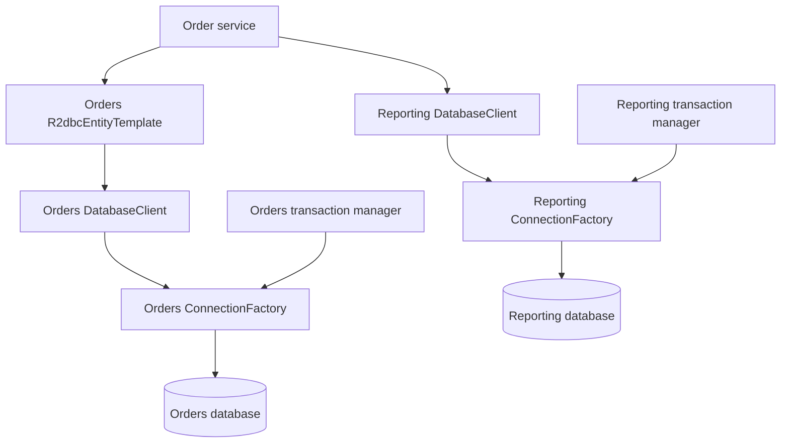
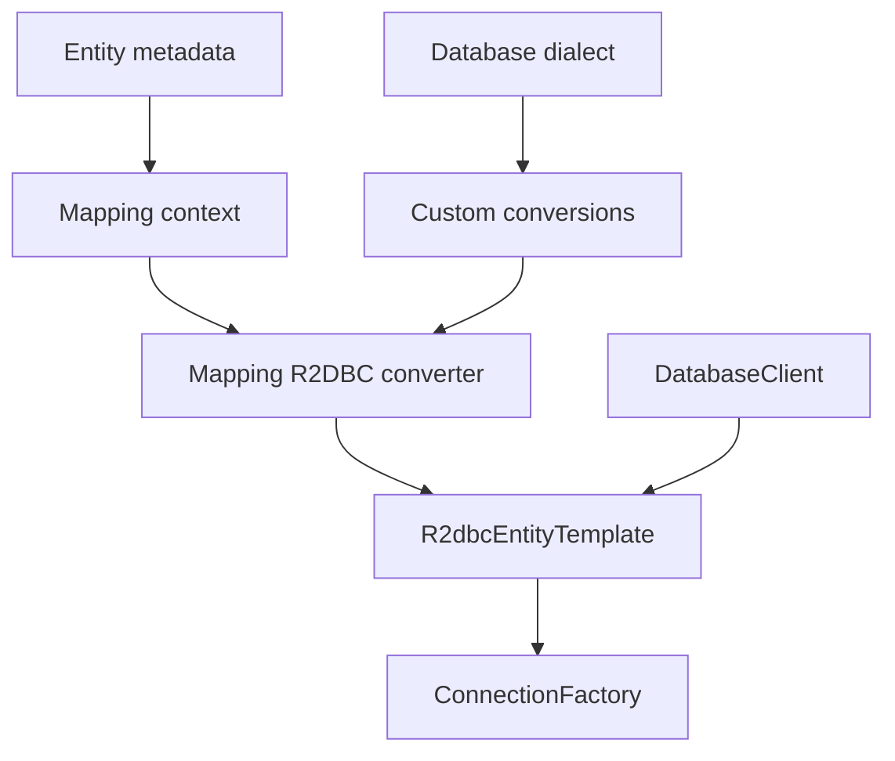

# Tách Template, DatabaseClient và bộ ánh xạ khi cần

Một ứng dụng Spring Data R2DBC có thể kết nối đến nhiều cơ sở dữ liệu, chẳng hạn database đơn hàng, database báo cáo và database lưu dữ liệu lịch sử. Khi đó, không nên xem `R2dbcEntityTemplate`, `DatabaseClient` và bộ ánh xạ entity là những bean dùng chung cho mọi kết nối. Mỗi database có thể có `ConnectionFactory`, dialect, transaction manager, schema, naming strategy và custom conversion riêng.

Thiết kế đúng là tách rõ ba lớp:

- **`R2dbcEntityTemplate`** thực hiện thao tác entity theo metadata mapping của Spring Data Relational: select, insert, update và delete.
- **`DatabaseClient`** cung cấp API SQL mức thấp hơn, bind tham số và ánh xạ từng hàng hoặc giá trị trả về theo cách ứng dụng chỉ định.
- **Bộ ánh xạ** gồm mapping context, converter, custom conversions và dialect. Nó quyết định entity/Java type được chuyển thành cột và giá trị database như thế nào.

Khi có nhiều database, mỗi bộ này phải được gắn với đúng `ConnectionFactory`. Nếu một repository ghi vào database A nhưng transaction manager lại quản lý connection của database B, thao tác có thể không nằm trong transaction mong muốn. Nếu dùng nhầm converter hoặc dialect, việc ánh xạ kiểu dữ liệu, tên cột và SQL có thể sai dù câu lệnh vẫn biên dịch.

## 1. Vai trò và ranh giới của từng thành phần

| Thành phần | Trách nhiệm chính | Khi nên dùng |
|---|---|---|
| `ConnectionFactory` | Tạo connection đến một database hoặc endpoint cụ thể | Mỗi database/nguồn kết nối cần cấu hình riêng. |
| `R2dbcTransactionManager` | Quản lý transaction trên một `ConnectionFactory` | Khi các thao tác trên cùng database cần commit/rollback cùng nhau. |
| `DatabaseClient` | Thực thi SQL, bind tham số và đọc kết quả | SQL tùy chỉnh, projection, truy vấn đặc thù hoặc thao tác không cần entity mapping. |
| `R2dbcEntityTemplate` | Thao tác entity dựa trên metadata và converter | CRUD theo entity, `Criteria`, `Query` và mapping Spring Data. |
| `R2dbcMappingContext` | Lưu metadata về entity, bảng, cột, ID và quy tắc mapping | Khi cần mapping context độc lập cho từng database hoặc schema. |
| `R2dbcCustomConversions` | Đăng ký conversion giữa kiểu domain và kiểu mà driver/database hỗ trợ | Khi database có kiểu đặc thù hoặc domain type cần chuyển đổi. |
| `R2dbcDialect` | Cung cấp khác biệt SQL và kiểu dữ liệu theo hệ quản trị | Khi dùng PostgreSQL, H2 hoặc database khác có cú pháp riêng. |

`R2dbcEntityTemplate` thường sử dụng `DatabaseClient` bên dưới để thực thi SQL. Tuy nhiên, hai abstraction phục vụ hai mức làm việc khác nhau. `DatabaseClient` không tự suy luận toàn bộ entity metadata như template; khi dùng nó, code thường tự khai báo SQL, bind giá trị và map kết quả.

Không nên tạo một `DatabaseClient` hoặc `R2dbcEntityTemplate` duy nhất rồi thay đổi `ConnectionFactory` ngầm theo từng lời gọi. Hãy tạo bean tường minh cho mỗi database để dependency injection cho biết thao tác đang đi đến đâu.

## 2. Mô hình nhiều database

Giả sử ứng dụng có hai database:

- `orders`: lưu đơn hàng và các dòng hàng.
- `reporting`: lưu dữ liệu tổng hợp phục vụ báo cáo.

Mỗi database có một nhóm bean riêng:



`orders` và `reporting` có thể dùng cùng loại database hoặc hai hệ quản trị khác nhau. Dù cùng dùng PostgreSQL, chúng vẫn là hai ranh giới kết nối và transaction riêng nếu được cấu hình bằng hai `ConnectionFactory` độc lập.

## 3. Khai báo từng ConnectionFactory

Mỗi `ConnectionFactory` cần trỏ đến đúng database và được cấu hình bằng URL/options riêng. Có thể dùng cấu hình ngoài ứng dụng, ví dụ:

```yaml
app:
  datasource:
    orders:
      url: r2dbc:postgresql://orders-db:5432/orders
      username: ${ORDERS_DB_USER}
      password: ${ORDERS_DB_PASSWORD}
    reporting:
      url: r2dbc:postgresql://reporting-db:5432/reporting
      username: ${REPORTING_DB_USER}
      password: ${REPORTING_DB_PASSWORD}
```

Đây là cấu trúc cấu hình riêng của ứng dụng; Spring Boot không tự động hiểu mọi prefix tùy chỉnh nếu chưa có class `@ConfigurationProperties` và bean tạo `ConnectionFactory` tương ứng.

Ví dụ dưới đây tập trung vào việc định danh bean. Phần tạo factory được tách thành hàm cấu hình riêng theo URL/options và driver đang sử dụng:

```java
@Configuration
public class ConnectionFactoryConfiguration {

    @Bean("ordersConnectionFactory")
    @Primary
    ConnectionFactory ordersConnectionFactory(OrdersDbProperties properties) {
        return createConnectionFactory(properties);
    }

    @Bean("reportingConnectionFactory")
    ConnectionFactory reportingConnectionFactory(
            ReportingDbProperties properties) {
        return createConnectionFactory(properties);
    }

    private ConnectionFactory createConnectionFactory(DbProperties properties) {
        // Tạo ConnectionFactory từ URL/options của database tương ứng.
        // Credentials lấy từ cấu hình bảo mật, không hard-code trong source.
        return ConnectionFactories.get(properties.getUrl());
    }
}
```

`DbProperties`, `OrdersDbProperties` và `ReportingDbProperties` là các class cấu hình do ứng dụng định nghĩa. Ví dụ dùng `ConnectionFactories.get(url)` để minh họa cách tạo factory từ R2DBC URL; trong ứng dụng thực tế có thể cần `ConnectionFactoryOptions`, SSL, pool hoặc tùy chọn riêng của driver.

`@Primary` chỉ giúp Spring chọn một bean mặc định khi injection không chỉ rõ qualifier. Nó không có nghĩa mọi thao tác sẽ tự động đi đến database chính. Với nhiều database, hãy dùng `@Qualifier` cho các dependency để tránh chọn nhầm factory.

## 4. Tạo DatabaseClient riêng cho từng database

`DatabaseClient` được tạo từ `ConnectionFactory`. Vì vậy, hai database cần hai client riêng:

```java
@Configuration
public class DatabaseClientConfiguration {

    @Bean("ordersDatabaseClient")
    DatabaseClient ordersDatabaseClient(
            @Qualifier("ordersConnectionFactory") ConnectionFactory factory) {
        return DatabaseClient.create(factory);
    }

    @Bean("reportingDatabaseClient")
    DatabaseClient reportingDatabaseClient(
            @Qualifier("reportingConnectionFactory") ConnectionFactory factory) {
        return DatabaseClient.create(factory);
    }
}
```

Khi inject vào repository adapter hoặc service, luôn chỉ rõ bean:

```java
@Repository
public class ReportingQueryRepository {

    private final DatabaseClient databaseClient;

    public ReportingQueryRepository(
            @Qualifier("reportingDatabaseClient") DatabaseClient databaseClient) {
        this.databaseClient = databaseClient;
    }
}
```

Không nên inject một `DatabaseClient` không có qualifier trong ứng dụng có nhiều bean cùng kiểu. Nếu có `@Primary`, code có thể biên dịch và chạy nhưng vô tình truy vấn nhầm database mặc định.

## 5. Tạo R2dbcEntityTemplate riêng

`R2dbcEntityTemplate` cũng phải gắn với đúng database. Với cấu hình mapping mặc định, có thể tạo template từ `ConnectionFactory` tương ứng:

```java
@Configuration
public class EntityTemplateConfiguration {

    @Bean("ordersEntityTemplate")
    R2dbcEntityTemplate ordersEntityTemplate(
            @Qualifier("ordersConnectionFactory") ConnectionFactory factory) {
        return new R2dbcEntityTemplate(factory);
    }

    @Bean("reportingEntityTemplate")
    R2dbcEntityTemplate reportingEntityTemplate(
            @Qualifier("reportingConnectionFactory") ConnectionFactory factory) {
        return new R2dbcEntityTemplate(factory);
    }
}
```

Constructor và cách tạo template có thể thay đổi theo phiên bản Spring Data Relational. Với cấu hình nâng cao, có thể tạo template từ `DatabaseClient` cùng dialect hoặc converter tương ứng. Hãy kiểm tra API của đúng phiên bản dependency đang dùng.

Trong ví dụ, hai template được tách biệt ngay từ lúc tạo bean. `ordersEntityTemplate` không được dùng cho entity cần đọc/ghi ở database báo cáo chỉ vì hai database có bảng cùng tên.

## 6. Tách transaction manager theo ConnectionFactory

Mỗi database cần transaction manager tương ứng:

```java
@Configuration
public class TransactionManagerConfiguration {

    @Bean("ordersTransactionManager")
    @Primary
    ReactiveTransactionManager ordersTransactionManager(
            @Qualifier("ordersConnectionFactory") ConnectionFactory factory) {
        return new R2dbcTransactionManager(factory);
    }

    @Bean("reportingTransactionManager")
    ReactiveTransactionManager reportingTransactionManager(
            @Qualifier("reportingConnectionFactory") ConnectionFactory factory) {
        return new R2dbcTransactionManager(factory);
    }
}
```

Khi service thao tác database đơn hàng:

```java
@Transactional(transactionManager = "ordersTransactionManager")
public Mono<Order> createOrder(CreateOrderCommand command) {
    return ordersRepository.save(Order.from(command));
}
```

Nếu một service chỉ đọc báo cáo, không cần transaction ghi có thể dùng `reportingDatabaseClient` trực tiếp. Nếu cần transaction trên database báo cáo, dùng đúng `reportingTransactionManager`.

Một transaction manager R2DBC quản lý một `ConnectionFactory`. Đặt hai thao tác ghi từ hai database trong cùng phương thức có `@Transactional(transactionManager = "ordersTransactionManager")` không làm database báo cáo tham gia transaction đơn hàng. Nếu cần phối hợp cả hai, phải thiết kế distributed transaction tương thích hoặc dùng outbox/saga và eventual consistency.

## 7. Tách repository package bằng entityOperationsRef

Nếu dùng Spring Data repository, cần cho mỗi nhóm repository biết `R2dbcEntityOperations`/template nào sẽ thực hiện truy vấn. Có thể tách package và dùng `@EnableR2dbcRepositories` riêng:

```java
@Configuration
@EnableR2dbcRepositories(
    basePackages = "com.example.orders.repository",
    entityOperationsRef = "ordersEntityTemplate"
)
public class OrdersRepositoriesConfiguration {
}

@Configuration
@EnableR2dbcRepositories(
    basePackages = "com.example.reporting.repository",
    entityOperationsRef = "reportingEntityTemplate"
)
public class ReportingRepositoriesConfiguration {
}
```

`entityOperationsRef` liên kết repository với template/operations bean tương ứng. Cần giữ package repository tách biệt để hai cấu hình không cùng scan và đăng ký trùng một interface.

Nếu ứng dụng cần chỉ định transaction manager cho service, dùng tên manager rõ ràng trong `@Transactional`. Hãy kiểm tra các thuộc tính annotation và cách chọn transaction manager của phiên bản Spring Data đang dùng; không giả định `entityOperationsRef` tự chọn đúng transaction manager cho mọi service gọi repository.

## 8. Khi nào cần tách bộ ánh xạ?

Mỗi `R2dbcEntityTemplate` sử dụng converter và mapping metadata để biến entity thành SQL parameters và biến kết quả database thành entity. Bộ ánh xạ cần tách khi database có một hoặc nhiều khác biệt sau:

- Hệ quản trị khác nhau, dẫn đến dialect và kiểu native khác nhau.
- Một domain type được lưu thành kiểu cột khác nhau, ví dụ JSONB ở PostgreSQL và text ở database khác.
- Tên bảng/cột hoặc naming strategy khác nhau.
- Schema và quy tắc mapping của cùng một entity không giống nhau.
- Một database cần custom converter riêng, chẳng hạn `Money`, enum hoặc kiểu thời gian.
- Một database cần xử lý ID/generated value hoặc kiểu array đặc thù của driver.

Nếu cả hai database có cùng dialect, cùng schema, cùng naming strategy và cùng conversions, có thể dùng cấu hình mapping tương tự. Tuy nhiên, vẫn nên liên kết từng template với đúng `ConnectionFactory` và tránh chia sẻ nhầm bean khi cấu hình thay đổi sau này.

## 9. Mapping context, converter, custom conversions và dialect

Các thành phần mapping có vai trò liên kết:



- **Mapping context:** nhận diện `@Table`, `@Column`, `@Id`, `@Transient`, embedded property và metadata entity.
- **Converter:** chuyển đổi giữa entity/property và giá trị row/bind của R2DBC.
- **Custom conversions:** đăng ký converter đọc/ghi cho domain type hoặc kiểu đặc thù.
- **Dialect:** cung cấp khác biệt của database như bind marker, kiểu dữ liệu, generated values và cách tạo SQL.

Không nên lấy dialect của database A rồi dùng để tạo template cho database B nếu hai database khác hệ quản trị. Tương tự, converter dùng kiểu JSON riêng của PostgreSQL không thể mặc nhiên dùng cho MySQL hoặc H2.

## 10. Tách custom conversions theo database

Ví dụ domain model có kiểu `Money`. Database đơn hàng lưu amount bằng `NUMERIC`, còn database báo cáo có thể lưu dữ liệu đã chuẩn hóa thành `DECIMAL` cùng cột currency riêng. Cùng một kiểu domain có thể cần conversion riêng theo schema và driver.

Ví dụ khai báo conversions gắn với dialect:

```java
@Bean("ordersCustomConversions")
R2dbcCustomConversions ordersCustomConversions(
        @Qualifier("ordersDialect") R2dbcDialect dialect) {
    return R2dbcCustomConversions.of(dialect, List.of(
        new MoneyWriteConverter(),
        new MoneyReadConverter()
    ));
}

@Bean("reportingCustomConversions")
R2dbcCustomConversions reportingCustomConversions(
        @Qualifier("reportingDialect") R2dbcDialect dialect) {
    return R2dbcCustomConversions.of(dialect, List.of(
        new ReportingMoneyWriteConverter(),
        new ReportingMoneyReadConverter()
    ));
}
```

`R2dbcCustomConversions.of(dialect, converters)` là cách khai báo thường dùng trong các phiên bản Spring Data R2DBC hỗ trợ factory method này; hãy kiểm tra chữ ký API của phiên bản dự án. Danh sách converter và dialect phải thuộc cùng database. Nếu converter cần driver-specific Java type, dependency driver đó cũng phải có trong ứng dụng.

Khi cần tự tạo converter/mapping context thay vì dựa vào mặc định của template, hãy cấu hình `R2dbcMappingContext` và `MappingR2dbcConverter` riêng cho mỗi database, sau đó đưa converter tương ứng vào `R2dbcEntityTemplate` theo constructor/API của phiên bản đang dùng. Tránh tạo một converter dùng chung rồi thay đổi dialect hoặc simple type holder sau khi ứng dụng đã chạy.

## 11. Tách mapping context khi schema hoặc naming strategy khác nhau

Giả sử cùng một domain concept được lưu trong hai schema:

```text
orders database:
  purchase_order
  order_line

reporting database:
  rpt_order
  rpt_order_item
```

Nếu hai bảng có tên khác nhau, một entity có `@Table("purchase_order")` không tự động trở thành `rpt_order` chỉ vì dùng `reportingEntityTemplate`. Annotation mapping vẫn là metadata của entity.

Các lựa chọn thiết kế:

1. Dùng các entity persistence riêng cho từng schema, ví dụ `OrderEntity` và `ReportingOrderRow`, nếu cấu trúc thực sự khác nhau.
2. Dùng `DatabaseClient` với SQL tường minh và map vào DTO chung nếu chỉ cần đọc dữ liệu báo cáo.
3. Tạo mapping context/naming strategy riêng nếu khác biệt có thể biểu diễn bằng cơ chế mapping được phiên bản Spring Data hỗ trợ.
4. Dùng view hoặc bảng trung gian có schema ổn định để giảm số biến thể mapping.

Không nên cố ép một entity dùng nhiều tên bảng khác nhau bằng cách thay đổi annotation hoặc mapping metadata toàn cục tại runtime. Metadata mapping được cache và dùng chung trong application context; thay đổi ngầm có thể làm các thao tác đồng thời đi sai bảng.

## 12. Khi nào dùng R2dbcEntityTemplate?

`R2dbcEntityTemplate` phù hợp khi muốn thao tác với entity và tận dụng metadata Spring Data:

```java
Mono<Order> findOrder(Long id) {
    Query query = Query.query(Criteria.where("id").is(id));
    return ordersEntityTemplate.selectOne(query, Order.class);
}

Mono<Order> saveOrder(Order order) {
    return ordersEntityTemplate.insert(Order.class).using(order);
}
```

Template phù hợp khi:

- CRUD theo entity đã khai báo `@Table`, `@Id`, `@Column`.
- Muốn dùng `Criteria` và `Query` thay vì tự ghép SQL.
- Muốn Spring Data xử lý mapping và conversion theo converter được cấu hình.
- Cần thao tác insert/update/delete theo entity operations.
- Muốn tái sử dụng domain mapping trong các truy vấn có điều kiện.

Template không tự tạo quan hệ ORM đầy đủ giữa các aggregate. Nó cũng không tự thực hiện join và dựng mọi object graph như JPA. SQL và mô hình aggregate vẫn cần được thiết kế rõ.

## 13. Khi nào dùng DatabaseClient?

`DatabaseClient` phù hợp khi câu SQL là trọng tâm hoặc kết quả không cần ánh xạ thành entity đầy đủ:

```java
Flux<OrderSummary> findDailySummary(LocalDate from, LocalDate to) {
    return reportingDatabaseClient.sql("""
            SELECT order_date, COUNT(*) AS order_count,
                   SUM(total_amount) AS total_amount
            FROM rpt_order
            WHERE order_date >= :fromDate
              AND order_date < :toDate
            GROUP BY order_date
            ORDER BY order_date
            """)
        .bind("fromDate", from)
        .bind("toDate", to)
        .map((row, metadata) -> new OrderSummary(
            row.get("order_date", LocalDate.class),
            row.get("order_count", Long.class),
            row.get("total_amount", BigDecimal.class)
        ))
        .all();
}
```

Ví dụ dùng client của database báo cáo và map trực tiếp sang DTO `OrderSummary`. Không cần tạo entity cho một kết quả tổng hợp chỉ phục vụ báo cáo.

`DatabaseClient` phù hợp khi:

- Cần SQL join, CTE, window function hoặc cú pháp đặc thù database.
- Truy vấn aggregate trả về DTO/projection.
- Cần kiểm soát chính xác cột được select và alias.
- Dùng SQL riêng cho từng dialect.
- Thực hiện thao tác update/delete trực tiếp với `rowsUpdated()`.

Khi dùng `DatabaseClient`, hãy bind giá trị thay vì nối input vào SQL. Tên bảng, cột và hướng sort không bind được như value; nếu cần chọn động, dùng allowlist trong code. Cũng cần tự map `Row` và xử lý kiểu null, alias, converter hoặc driver-specific type.

## 14. Kết hợp Template và DatabaseClient trong cùng ứng dụng

Một service có thể dùng template cho thao tác aggregate chính và dùng client riêng cho báo cáo hoặc SQL tùy chỉnh:

```java
@Service
public class OrderReadService {

    private final R2dbcEntityTemplate ordersTemplate;
    private final DatabaseClient reportingClient;

    public OrderReadService(
            @Qualifier("ordersEntityTemplate") R2dbcEntityTemplate ordersTemplate,
            @Qualifier("reportingDatabaseClient") DatabaseClient reportingClient) {
        this.ordersTemplate = ordersTemplate;
        this.reportingClient = reportingClient;
    }

    public Mono<Order> findOrder(Long id) {
        return ordersTemplate.selectOne(
            Query.query(Criteria.where("id").is(id)), Order.class);
    }

    public Flux<OrderSummary> findSummary(LocalDate from, LocalDate to) {
        return reportingClient.sql("""
                SELECT order_date, COUNT(*) AS order_count
                FROM rpt_order
                WHERE order_date >= :fromDate
                  AND order_date < :toDate
                GROUP BY order_date
                ORDER BY order_date
                """)
            .bind("fromDate", from)
            .bind("toDate", to)
            .map((row, metadata) -> new OrderSummary(
                row.get("order_date", LocalDate.class),
                row.get("order_count", Long.class)))
            .all();
    }
}
```

Hai phương thức trong ví dụ đọc hai nguồn độc lập. Nếu service cần kết hợp kết quả từ cả hai database, có thể compose publisher bằng `Mono.zip`, `flatMap` hoặc `Flux`, nhưng đó chỉ là phối hợp ở tầng ứng dụng. Nó không tạo một transaction chung và không bảo đảm snapshot đồng nhất giữa hai database.

Nếu cần đảm bảo dữ liệu báo cáo phản ánh một phiên bản nhất quán của database đơn hàng, hãy thiết kế đồng bộ dữ liệu, watermark/version hoặc snapshot rõ ràng thay vì giả định hai query đồng thời nhìn thấy cùng một thời điểm.

## 15. Repository cần được gắn với đúng template

Repository interface không tự biểu thị database đích nếu ứng dụng có nhiều template. Cấu hình repository package quyết định template nào được sử dụng. Vì vậy:

- Tách package theo bounded context/database.
- Đăng ký mỗi package bằng `@EnableR2dbcRepositories` riêng.
- Đặt `entityOperationsRef` đúng tên template.
- Tránh scan cùng một repository interface trong nhiều cấu hình.
- Dùng qualifier rõ ràng khi inject template hoặc client vào adapter.
- Chỉ định transaction manager ở service theo database mà use case đang ghi.

Không nên đặt tất cả repository trong một package rồi kỳ vọng Spring tự suy luận database từ entity class hoặc tên bảng. Việc route cần được khai báo tường minh.

## 16. Khác biệt dialect và SQL giữa các database

Ngay cả khi tách client, SQL vẫn cần phù hợp với database đích. Một số khác biệt thường gặp:

| Khác biệt | Ảnh hưởng |
|---|---|
| Bind marker | PostgreSQL thường dùng `$1`, driver khác có thể dùng `?`; abstraction Spring có thể chuyển named parameter theo dialect. |
| Giới hạn kết quả | `LIMIT/OFFSET`, `FETCH FIRST` hoặc cú pháp khác nhau. |
| Generated values | `RETURNING`, generated keys hoặc API driver riêng. |
| JSON | Kiểu JSON/JSONB và Java codec có thể khác nhau. |
| Boolean và kiểu số | Kiểu native, precision và cách biểu diễn khác nhau. |
| Timestamp/time zone | Semantics lưu offset/instant có thể khác nhau. |
| Upsert | `ON CONFLICT`, `ON DUPLICATE KEY` hoặc cú pháp riêng. |
| Identifier/schema | Quy tắc quote, chữ hoa/thường và schema mặc định khác nhau. |

`R2dbcDialect` hỗ trợ Spring Data tạo SQL phù hợp trong các abstraction có sử dụng dialect. Nó không tự chuyển mọi SQL viết tay trong `DatabaseClient` thành cú pháp portable. Nếu SQL tùy chỉnh dùng tính năng vendor-specific, cần giữ truy vấn riêng theo database và kiểm thử trên đúng driver.

## 17. Transaction không tự trải qua nhiều template

Giả sử một service ghi đơn hàng vào `ordersEntityTemplate` và ghi thống kê vào `reportingEntityTemplate`. Nếu phương thức được đánh dấu:

```java
@Transactional(transactionManager = "ordersTransactionManager")
public Mono<Void> createOrderAndUpdateReport(...) {
    // Ghi orders database.
    // Ghi reporting database.
    return ...;
}
```

Chỉ thao tác tham gia `ordersTransactionManager` được quản lý trong transaction đó. `reportingEntityTemplate` dùng `reportingConnectionFactory`, vì vậy thao tác báo cáo không tự tham gia transaction đơn hàng.

Các lựa chọn:

- Chấp nhận eventual consistency và cập nhật reporting bằng event/outbox sau khi đơn hàng commit.
- Dùng một database làm nguồn dữ liệu chính, sau đó xây dựng projection/reporting read model bất đồng bộ.
- Dùng distributed transaction coordinator nếu tất cả tài nguyên thực sự hỗ trợ giao thức chung và chi phí vận hành chấp nhận được.
- Nếu hai thao tác không cần cùng nguyên tử, chạy local transaction riêng và thiết kế retry/compensation phù hợp.

Không dùng `REQUIRES_NEW` như cách tự động tạo atomic commit xuyên hai database. Nó chỉ tạo hoặc tham gia transaction theo semantics của transaction manager đang được chọn, không phối hợp commit toàn cục.

## 18. Routing động và giới hạn của việc đổi database theo request

Một số hệ thống muốn chọn database theo tenant hoặc shard. Có thể xây dựng routing `ConnectionFactory` hoặc tầng routing repository, nhưng cần xác định database trước khi transaction bắt đầu.

Các nguyên tắc quan trọng:

- Xác định tenant/shard từ thông tin đã được xác thực ở server, không tin trực tiếp database key do client gửi.
- Chọn `ConnectionFactory` trước khi bắt đầu transaction và giữ nguyên lựa chọn trong toàn bộ transaction.
- Không đổi database giữa chừng trong cùng reactive transaction context.
- Đảm bảo routing context được truyền trong Reactor Context; không dựa vào `ThreadLocal` thông thường.
- Kiểm tra pool/connection của shard được chọn và giới hạn tổng số pool khi có nhiều shard.
- Mỗi repository/template phải biết rõ routing strategy hoặc được gọi qua adapter chịu trách nhiệm định tuyến.

Nếu database được chọn sau khi connection đã được acquire, thao tác có thể tiếp tục trên database cũ. Routing động vì vậy cần được thiết kế ở tầng `ConnectionFactory` và transaction boundary, không chỉ thêm một `if` trong service.

## 19. Những lỗi cấu hình thường gặp

| Lỗi | Hậu quả | Cách phòng tránh |
|---|---|---|
| Inject `ConnectionFactory` không qualifier khi có nhiều bean | Bean mặc định có thể bị chọn ngoài ý muốn hoặc ứng dụng không khởi động. | Dùng `@Qualifier` ở mọi bean cần chỉ rõ database. |
| Hai template cùng dùng một factory | Repository có thể truy vấn nhầm nguồn dữ liệu. | Tạo template riêng và kiểm tra dependency graph. |
| Repository package được scan bởi hai cấu hình | Repository bean trùng hoặc gắn sai template. | Tách package và chỉ định `basePackages`. |
| Dùng converter/dialect của database A cho B | Lỗi kiểu dữ liệu, generated values hoặc SQL. | Tách conversions và dialect theo factory. |
| `@Primary` bị coi là routing tự động | Thao tác không qualifier đi đến database mặc định. | Dùng qualifier và đặt ranh giới adapter rõ ràng. |
| Một transaction manager được kỳ vọng quản lý hai factory | Chỉ một database tham gia transaction. | Local transaction riêng hoặc cơ chế distributed coordination. |
| SQL viết tay giả định cú pháp portable | Query lỗi khi đổi hệ quản trị. | Tách SQL theo dialect và integration test. |
| Entity mapping dùng một tên bảng cho hai schema khác nhau | Template không tự đổi `@Table` theo database. | Persistence model riêng, naming strategy hoặc SQL projection. |
| Raw SQL được kỳ vọng chạy entity callbacks/auditing | Metadata có thể không được cập nhật. | Cập nhật tường minh hoặc dùng entity operations. |

## 20. Kiểm thử cấu hình nhiều database

Không chỉ kiểm tra ứng dụng khởi động thành công. Nên xác nhận từng bean thật sự trỏ đến đúng database:

1. Tạo hai database/schema test có dữ liệu nhận diện khác nhau.
2. Gọi repository được gắn với `ordersEntityTemplate` và xác nhận chỉ database đơn hàng thay đổi.
3. Gọi `reportingDatabaseClient` và xác nhận truy vấn chạy trên database báo cáo.
4. Kiểm tra custom converter đọc/ghi riêng cho từng dialect.
5. Kiểm tra `@Transactional` rollback thao tác trong database được chỉ định.
6. Gây lỗi ở thao tác thứ hai trên cùng database và xác nhận transaction rollback đúng phạm vi.
7. Xác nhận thao tác ở database khác không bị hiểu nhầm là nằm trong transaction đó.
8. Kiểm tra repository không bị scan trùng hoặc inject sai template.
9. Kiểm thử SQL native, generated values, JSON và kiểu thời gian trên driver mục tiêu.
10. Với routing tenant/shard, xác nhận lựa chọn database ổn định trong toàn bộ reactive chain.

Integration test nên sử dụng đúng loại database và R2DBC driver mà ứng dụng triển khai. H2 có thể hữu ích cho một số kiểm thử, nhưng không thay thế kiểm thử dialect, codec và transaction behavior của PostgreSQL, MySQL hoặc hệ quản trị thực tế.

## 21. Quy trình thiết kế khi cần nhiều database

Khi thêm database mới, hãy thực hiện theo trình tự:

1. Xác định bounded context và dữ liệu thuộc database mới.
2. Khai báo `ConnectionFactory` riêng với URL, credentials, pool và driver options riêng.
3. Tạo `DatabaseClient` và `R2dbcEntityTemplate` riêng, gắn đúng factory.
4. Xác định có cần `R2dbcDialect`, mapping context và custom conversions riêng không.
5. Nếu dùng repository, tách package và gắn bằng `entityOperationsRef`.
6. Tạo `R2dbcTransactionManager` cho từng factory và chọn manager tường minh ở service.
7. Giữ SQL native theo dialect khi cần, không giả định `DatabaseClient` tự chuyển đổi mọi câu SQL.
8. Xác định rõ use case có đọc/ghi nhiều database hay không và xử lý eventual consistency/distributed transaction tương ứng.
9. Kiểm thử mapping, transaction, repository routing và lỗi kết nối trên database thực tế.

Trong ứng dụng nhiều database, `R2dbcEntityTemplate`, `DatabaseClient` và bộ ánh xạ cần được tổ chức theo đúng nguồn dữ liệu. Template phù hợp với entity mapping; client phù hợp với SQL tường minh và projection; mapping context, converter và dialect xác định cách dữ liệu được chuyển đổi. Tách bean theo `ConnectionFactory`, dùng qualifier, cấu hình repository package và transaction manager rõ ràng sẽ giúp tránh truy vấn nhầm database, nhầm kiểu dữ liệu hoặc kỳ vọng sai về transaction xuyên nhiều tài nguyên.
