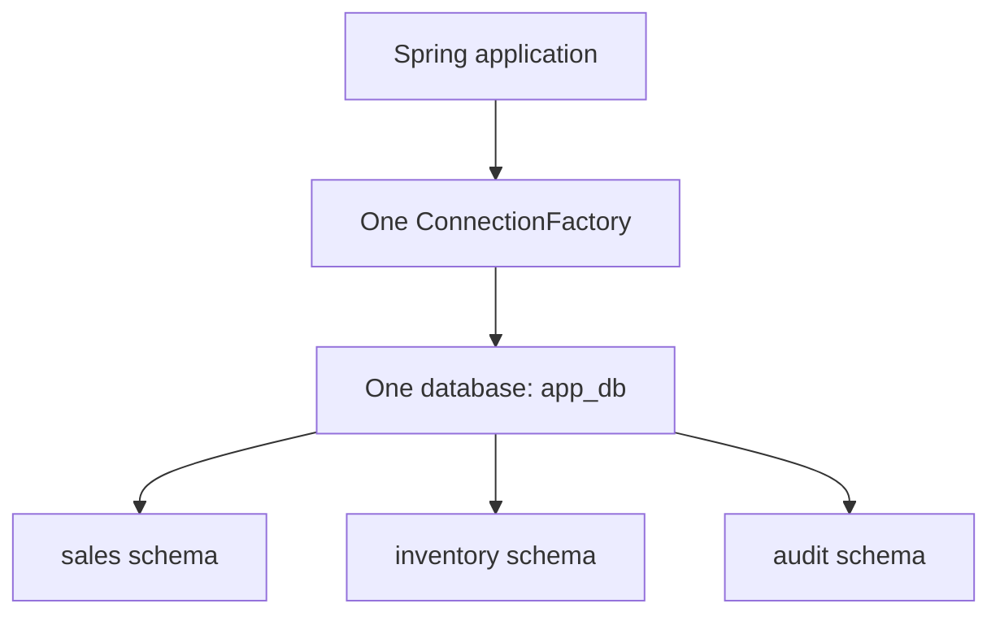
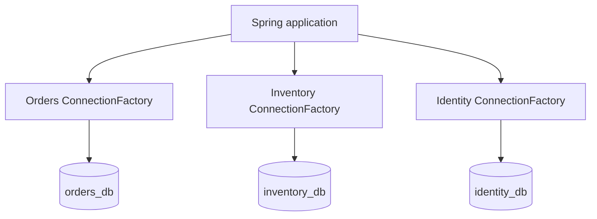

# Phân biệt nhiều cơ sở dữ liệu với nhiều schema

Khi một ứng dụng Spring Data R2DBC cần lưu dữ liệu cho nhiều nhóm nghiệp vụ hoặc nhiều tenant, có hai lựa chọn thường được nhắc tới: tạo nhiều schema trong một database, hoặc tạo nhiều database riêng. Hai cách này không tương đương. Schema thường là một namespace chứa bảng, view, sequence và các object database; database là một đơn vị lưu trữ và kết nối lớn hơn, có catalog, quyền, cấu hình và phạm vi session riêng theo hệ quản trị.

Sự khác biệt ảnh hưởng trực tiếp tới cách cấu hình `ConnectionFactory`, pool, `R2dbcEntityTemplate`, repository, transaction manager, migration và bảo mật. Nhiều schema trong cùng database thường có thể dùng chung một connection và một transaction. Nhiều database thường cần các connection factory và transaction manager riêng; một transaction R2DBC thông thường không tự trở thành transaction nguyên tử xuyên qua các database đó.

## 1. Phân biệt database, catalog và schema

Các hệ quản trị quan hệ không dùng thuật ngữ database và schema hoàn toàn giống nhau. Ở mức khái niệm:

- **Database** là đơn vị chứa dữ liệu và object database mà client kết nối tới.
- **Catalog** là tập metadata mô tả database objects; trong một số hệ quản trị, catalog gần tương đương database.
- **Schema** là namespace để nhóm và phân biệt các object như table, view, sequence, function.
- **Table** là object lưu hàng dữ liệu bên trong một schema hoặc namespace.

Ví dụ tên đầy đủ của một bảng có thể là `sales.orders`, nghĩa là bảng `orders` thuộc schema `sales` trong database hiện tại. Ở một số hệ quản trị có thể dùng tên ba phần như `database.schema.table`.

### Cách các hệ quản trị sử dụng thuật ngữ

| Hệ quản trị | Database/catalog | Schema | Ghi chú |
|---|---|---|---|
| PostgreSQL | Một database trong cluster | Namespace bên trong database | Một connection làm việc trong một database; schema thường được chọn qua tên đầy đủ hoặc `search_path` |
| SQL Server | Database trong một SQL Server instance | Namespace bên trong database | Tên object có thể có dạng `database.schema.table`; quyền và transaction còn phụ thuộc cấu hình instance |
| MySQL | `DATABASE` và `SCHEMA` là hai từ đồng nghĩa trong nhiều ngữ cảnh | Không có lớp schema namespace riêng bên trong database như PostgreSQL | Nhiều tài liệu gọi mỗi database là schema |
| Oracle | Database hoặc pluggable database tùy kiến trúc | Schema gắn với user sở hữu object | Schema không đơn giản là một thư mục bên trong database theo nghĩa PostgreSQL |

Vì thuật ngữ khác nhau, hãy đọc cách hệ quản trị cụ thể định nghĩa database/schema trước khi thiết kế. Không nên chuyển nguyên khái niệm `schema` của PostgreSQL sang MySQL hoặc Oracle mà không kiểm tra semantics.

## 2. Nhiều schema trong một database là gì?

Một database có thể chứa nhiều schema, mỗi schema giữ một nhóm object riêng. Ví dụ trong PostgreSQL:

```text
app_db
├── sales
│   ├── orders
│   ├── order_line
│   └── invoice
├── inventory
│   ├── product
│   └── stock_balance
└── audit
    ├── event_log
    └── change_record
```

Các bảng nằm trong cùng database `app_db`, nhưng tên đầy đủ khác nhau:

```sql
SELECT * FROM sales.orders;
SELECT * FROM inventory.product;
SELECT * FROM audit.event_log;
```

Ứng dụng có thể dùng cùng một `ConnectionFactory` và pool để truy cập các schema này. Một transaction trên connection đó có thể đọc/ghi nhiều schema trong cùng database, miễn là quyền và database hỗ trợ các thao tác tương ứng.

## 3. Nhiều database là gì?

Nhiều database có nghĩa ứng dụng kết nối tới các database riêng biệt. Chúng có thể nằm trên cùng một database server/cluster hoặc ở các server, vùng mạng hay nhà cung cấp khác nhau.

Ví dụ:

```text
Database server A
├── orders_db
└── inventory_db

Database server B
└── identity_db
```

Ứng dụng có thể cần ba `ConnectionFactory` hoặc ba cấu hình kết nối khác nhau. Mỗi database có thể có pool, credential, transaction manager, migration lifecycle và giới hạn connection riêng.

Một transaction được mở qua `R2dbcTransactionManager` thường quản lý connection từ một `ConnectionFactory`. Nó không tự điều phối một transaction khác tới connection factory thứ hai. Nếu ghi `orders_db` thành công nhưng ghi `inventory_db` thất bại, transaction cục bộ của database thứ nhất không tự rollback chỉ vì transaction thứ hai rollback.

## 4. Sơ đồ so sánh hai mô hình



Trong mô hình nhiều schema, một connection có thể tham chiếu các schema khác nhau bằng tên object đầy đủ. Các schema chia sẻ database engine, transaction boundary và thường dùng chung pool.



Trong mô hình nhiều database, mỗi connection factory quản lý một resource riêng. Ứng dụng phải định tuyến thao tác tới đúng repository/connection factory và thiết kế rõ cách phối hợp dữ liệu giữa các database.

## 5. Khi nào nên chọn nhiều schema?

Nhiều schema thường phù hợp khi:

- Các nhóm bảng thuộc cùng một ứng dụng và cùng vòng đời vận hành.
- Cần tách namespace để tránh trùng tên bảng hoặc phân chia module.
- Các thao tác thường xuyên cần join dữ liệu giữa các nhóm bảng.
- Nghiệp vụ cần một transaction bao trùm nhiều nhóm bảng.
- Có thể dùng chung database server, backup, monitoring và connection budget.
- Muốn cấp quyền theo schema để giới hạn object mà một role được truy cập.

Ví dụ, `sales.orders` và `inventory.stock_balance` có thể cần được cập nhật trong cùng một transaction khi xác nhận đơn hàng. Nếu hai schema nằm trong cùng PostgreSQL database, một connection có thể thực hiện các câu lệnh trên cả hai schema trong cùng transaction.

Tuy nhiên, schema không phải ranh giới cách ly hoàn toàn. Các schema vẫn chia sẻ tài nguyên database như CPU, memory, WAL, storage, giới hạn connection và một số cấu hình cấp database. Backup/restore thường cũng được quản lý ở cấp database hoặc công cụ backup cụ thể, dù có thể xuất/nhập riêng schema.

## 6. Khi nào nên chọn nhiều database?

Nhiều database có thể phù hợp khi:

- Các module cần quyền quản trị, backup, restore hoặc retention độc lập.
- Dữ liệu có yêu cầu bảo mật hoặc compliance cần ranh giới database rõ hơn.
- Các workload cần scale, cấu hình hoặc bảo trì độc lập.
- Các miền nghiệp vụ có vòng đời triển khai khác nhau.
- Dữ liệu nằm ở các server/region khác nhau vì yêu cầu địa lý hoặc độ trễ.
- Một ứng dụng tích hợp database của hệ thống legacy hoặc nhà cung cấp bên ngoài.
- Cần giới hạn tác động sự cố: database báo cáo quá tải không nên làm cạn pool của database giao dịch.

Đổi lại, ứng dụng phải xử lý nhiều kết nối, pool, credential, migration và quan sát vận hành. Việc truy vấn hoặc cập nhật xuyên database cũng phức tạp hơn, đặc biệt khi các database nằm ở server khác nhau.

## 7. Nhiều schema không đồng nghĩa nhiều tenant an toàn

Một schema riêng cho mỗi tenant có thể giúp tổ chức dữ liệu và cấp quyền, nhưng bản thân việc đổi schema không tự bảo đảm tenant isolation. Ứng dụng vẫn cần kiểm soát tenant identity, schema được phép truy cập và quyền của database role.

Ví dụ:

```text
app_db
├── tenant_001
│   ├── customer
│   └── invoice
├── tenant_002
│   ├── customer
│   └── invoice
└── tenant_003
    ├── customer
    └── invoice
```

Nếu một request của `tenant_001` có thể truyền tùy ý chuỗi `tenant_002` làm schema name, lỗi kiểm tra tenant có thể làm lộ dữ liệu. Tên schema phải được lấy từ mapping đáng tin cậy sau khi xác thực tenant, không được nối trực tiếp từ input không tin cậy.

Ngoài schema-per-tenant, các mô hình multitenancy phổ biến gồm:

| Mô hình | Cách lưu | Ưu điểm | Chi phí/giới hạn |
|---|---|---|---|
| Shared schema | Một bộ bảng, có `tenant_id` trên hàng | Dễ quản lý schema và migration; tận dụng chung pool | Phải bảo đảm mọi truy vấn lọc tenant; cần index và chính sách row-level security phù hợp |
| Schema per tenant | Mỗi tenant có schema riêng trong một database | Namespace và quyền theo schema; tên bảng không trùng giữa tenant | Quản lý nhiều schema/migration; định tuyến schema cẩn thận |
| Database per tenant | Mỗi tenant có database riêng | Cách ly database, backup và credential riêng | Nhiều pool/database; chi phí vận hành và migration lớn hơn |

Không có mô hình tốt nhất cho mọi sản phẩm. Lựa chọn phụ thuộc số tenant, kích thước dữ liệu, yêu cầu cách ly, khả năng vận hành và cách scale.

## 8. Chỉ định schema bằng tên bảng đầy đủ

Trong SQL, cách rõ ràng nhất để truy cập object ở schema cụ thể là qualify tên bảng:

```sql
SELECT id, order_no, status
FROM sales.orders
WHERE id = :orderId;
```

Hoặc join qua hai schema trong cùng database:

```sql
SELECT o.id,
       o.order_no,
       p.sku,
       l.quantity
FROM sales.orders o
JOIN sales.order_line l ON l.order_id = o.id
JOIN inventory.product p ON p.id = l.product_id
WHERE o.id = :orderId;
```

Tên schema và table là SQL identifier, không phải giá trị. Không thể bảo vệ một identifier động bằng cách bind nó như `:schemaName` hoặc `:tableName`. Nếu schema/table cần được chọn theo tenant hoặc module, hãy kiểm tra với allow-list hoặc lấy từ metadata cấu hình do server quản lý.

Giá trị như `orderId`, status và thời gian vẫn phải bind parameter. Không nối input người dùng vào phần điều kiện SQL.

## 9. Dùng schema trong mapping Spring Data Relational

Với Spring Data Relational, `@Table` có thể chỉ định tên bảng và schema trong các phiên bản hỗ trợ thuộc tính tương ứng:

```java
@Table(value = "orders", schema = "sales")
public class Order {

    @Id
    private Long id;

    @Column("order_no")
    private String orderNo;

    private String status;
}
```

Entity `Order` được ánh xạ tới bảng `sales.orders` thay vì bảng `orders` trong schema mặc định. Hãy xác nhận API `@Table` của phiên bản Spring Data Relational đang dùng; nếu phiên bản hoặc mapping cụ thể không hỗ trợ schema metadata như mong muốn, có thể dùng SQL với tên đầy đủ qua `DatabaseClient` hoặc cấu hình schema mặc định của connection.

Ví dụ repository:

```java
public interface OrderRepository extends ReactiveCrudRepository<Order, Long> {
}
```

Repository vẫn dùng cùng `ConnectionFactory` nếu các entity nằm trong cùng database. Schema được xác định từ mapping metadata hoặc SQL, không cần tạo một connection factory riêng chỉ vì bảng nằm trong schema khác.

## 10. Schema mặc định và search_path trong PostgreSQL

PostgreSQL dùng `search_path` để xác định schema nào được tìm kiếm khi câu SQL không qualify tên object. Ví dụ:

```sql
SHOW search_path;
SET search_path TO sales, public;
```

Sau khi đặt `search_path`, câu lệnh:

```sql
SELECT * FROM orders;
```

có thể tìm bảng `sales.orders` trước, rồi mới tìm trong `public`.

`search_path` là thuộc tính của session/connection. Với connection pool, không được giả định mỗi request luôn nhận một connection mới ở trạng thái mặc định. Nếu một request thay đổi `search_path` rồi connection được trả về pool mà không reset, request tiếp theo có thể chạy trong schema ngoài dự kiến.

Các cách quản lý an toàn:

- Dùng tên schema đầy đủ trong SQL khi cần xác định object rõ ràng.
- Đặt `search_path` mặc định cho database role hoặc cấu hình connection theo cách được pool quản lý.
- Nếu phải đổi schema theo request, thực hiện việc đổi và khôi phục trong cùng connection/transaction, bảo đảm reset kể cả khi có lỗi hoặc cancellation.
- Không dựa vào state của session còn sót lại từ request trước.

Không nên dùng một lệnh `SET search_path` qua publisher riêng rồi giả định query tiếp theo dùng cùng connection. Khi pool cấp connection khác, state có thể không giống nhau. Nếu cần session-level state, hãy kiểm soát connection lifecycle và reset rõ ràng.

## 11. MySQL: database và schema thường là đồng nghĩa

Trong MySQL, `CREATE DATABASE` và `CREATE SCHEMA` là các cách gọi tương đương trong nhiều ngữ cảnh. Một bảng được xác định bằng `database.table`, ví dụ:

```sql
SELECT * FROM sales_db.orders;
SELECT * FROM inventory_db.product;
```

Vì vậy, mô hình “một database có nhiều schema con như PostgreSQL” không được áp dụng trực tiếp theo cùng cách trong MySQL. Nếu cần phân vùng namespace, mỗi database thường đóng vai trò gần giống schema riêng.

MySQL có thể hỗ trợ truy vấn bảng thuộc nhiều database trên cùng server bằng tên đầy đủ, nếu connection user có đủ quyền. Nhưng các database đó vẫn là namespace database của MySQL; cần phân biệt với việc kết nối tới hai server hoặc hai instance khác nhau.

## 12. SQL Server: schema trong database và tên ba phần

SQL Server hỗ trợ nhiều schema trong một database. Có thể qualify bảng bằng `schema.table`:

```sql
SELECT * FROM sales.Orders;
SELECT * FROM inventory.Product;
```

Trong một số trường hợp cùng SQL Server instance, có thể truy cập database khác bằng tên ba phần:

```sql
SELECT * FROM InventoryDb.dbo.Product;
```

Điều này là khả năng của SQL Server và còn phụ thuộc quyền, instance, transaction và cấu hình. Không nên suy ra mọi database server đều hỗ trợ cú pháp truy cập chéo như vậy.

## 13. Oracle: schema gắn với user

Trong Oracle, schema là tập các object thuộc sở hữu của một database user. Việc tạo schema thường gắn với việc tạo user; quyền truy cập object có thể được cấp qua grants, roles và synonyms.

Ví dụ truy cập object của schema khác:

```sql
SELECT * FROM SALES.ORDERS;
```

Để chạy được, user hiện tại cần quyền phù hợp. Khái niệm schema trong Oracle vì vậy gắn chặt với owner và security model. Không nên áp dụng nguyên cách quản lý `search_path` của PostgreSQL cho Oracle.

## 14. Nhiều schema trong cùng database có thể dùng một R2DBC pool

Nếu các bảng nằm trong nhiều schema của cùng database, một `ConnectionFactory` thường đủ:

```java
@Configuration
public class MainDatabaseConfiguration {

    @Bean
    ConnectionFactory connectionFactory() {
        return ConnectionFactories.get(
            "r2dbc:postgresql://localhost:5432/app_db"
        );
    }

    @Bean
    R2dbcEntityOperations r2dbcEntityOperations(
            ConnectionFactory connectionFactory) {
        return new R2dbcEntityTemplate(connectionFactory);
    }

    @Bean
    ReactiveTransactionManager transactionManager(
            ConnectionFactory connectionFactory) {
        return new R2dbcTransactionManager(connectionFactory);
    }
}
```

Các entity có thể ánh xạ tới `sales.orders`, `inventory.product` và `audit.event_log` trong cùng database. Nếu chúng dùng chung transaction manager và connection factory, các thao tác ghi nhiều schema có thể tham gia cùng một transaction.

Trong ứng dụng thật, không hard-code credential trong URL. Hãy lấy thông tin kết nối từ cấu hình ngoài, secret manager hoặc environment phù hợp. Ví dụ trên tập trung vào cấu trúc bean.

## 15. Cấu hình nhiều database bằng nhiều ConnectionFactory

Nếu `orders_db` và `inventory_db` là hai database độc lập, tạo một connection factory cho mỗi database. Mỗi factory có thể có pool và transaction manager riêng.

Ví dụ cấu hình cho database đơn hàng:

```java
@Configuration
@EnableR2dbcRepositories(
    basePackages = "com.example.orders.repository",
    entityOperationsRef = "ordersR2dbcEntityOperations",
    transactionManagerRef = "ordersTransactionManager"
)
public class OrdersDatabaseConfiguration {

    @Bean("ordersConnectionFactory")
    ConnectionFactory ordersConnectionFactory() {
        return ConnectionFactories.get(
            "r2dbc:postgresql://localhost:5432/orders_db"
        );
    }

    @Bean("ordersR2dbcEntityOperations")
    R2dbcEntityOperations ordersR2dbcEntityOperations(
            @Qualifier("ordersConnectionFactory")
            ConnectionFactory connectionFactory) {
        return new R2dbcEntityTemplate(connectionFactory);
    }

    @Bean("ordersTransactionManager")
    ReactiveTransactionManager ordersTransactionManager(
            @Qualifier("ordersConnectionFactory")
            ConnectionFactory connectionFactory) {
        return new R2dbcTransactionManager(connectionFactory);
    }
}
```

Database inventory có cấu hình tương tự nhưng dùng package repository và tên bean riêng:

```java
@Configuration
@EnableR2dbcRepositories(
    basePackages = "com.example.inventory.repository",
    entityOperationsRef = "inventoryR2dbcEntityOperations",
    transactionManagerRef = "inventoryTransactionManager"
)
public class InventoryDatabaseConfiguration {

    @Bean("inventoryConnectionFactory")
    ConnectionFactory inventoryConnectionFactory() {
        return ConnectionFactories.get(
            "r2dbc:postgresql://localhost:5432/inventory_db"
        );
    }

    @Bean("inventoryR2dbcEntityOperations")
    R2dbcEntityOperations inventoryR2dbcEntityOperations(
            @Qualifier("inventoryConnectionFactory")
            ConnectionFactory connectionFactory) {
        return new R2dbcEntityTemplate(connectionFactory);
    }

    @Bean("inventoryTransactionManager")
    ReactiveTransactionManager inventoryTransactionManager(
            @Qualifier("inventoryConnectionFactory")
            ConnectionFactory connectionFactory) {
        return new R2dbcTransactionManager(connectionFactory);
    }
}
```

Các thuộc tính `entityOperationsRef` và `transactionManagerRef` cần được xác nhận theo phiên bản Spring Data R2DBC đang dùng. Mỗi `@EnableR2dbcRepositories` cần quét đúng package repository của database tương ứng; tránh hai cấu hình cùng quét một package khiến repository được đăng ký hai lần hoặc gắn nhầm template.

`ConnectionFactories.get(...)` ở đây minh họa cách tạo factory từ R2DBC URL. Trong production, có thể tạo pool bằng `r2dbc-pool`, cấu hình bằng Spring Boot hoặc tạo factory từ `ConnectionFactoryOptions`; điều quan trọng là mỗi bean có tên rõ và được gắn đúng entity operations/transaction manager.

## 16. Tách package repository theo database

Một cách tổ chức dễ quản lý là đặt repository theo module/database:

```text
com.example
├── orders
│   ├── domain
│   ├── repository
│   │   └── OrderRepository.java
│   └── service
├── inventory
│   ├── domain
│   ├── repository
│   │   └── ProductRepository.java
│   └── service
└── shared
    └── configuration
```

Mỗi repository package được gắn với một `R2dbcEntityOperations` cụ thể. Service có thể inject `OrderRepository` và `ProductRepository` theo interface, nhưng khi gọi hai repository trong cùng use case, cần nhớ chúng có thể dùng hai transaction manager khác nhau.

Tránh đặt tất cả repository trong một package duy nhất rồi để nhiều `@EnableR2dbcRepositories` cùng quét package đó. Việc tách package làm rõ database nào sở hữu repository và giúp cấu hình không bị chồng lấn.

## 17. Chọn đúng transaction manager cho từng repository

Với nhiều database, mỗi transaction manager quản lý một connection factory. Có thể khai báo transaction rõ trên service:

```java
@Service
public class OrderService {

    private final OrderRepository orderRepository;

    public OrderService(OrderRepository orderRepository) {
        this.orderRepository = orderRepository;
    }

    @Transactional(transactionManager = "ordersTransactionManager")
    public Mono<Order> create(CreateOrder command) {
        return orderRepository.save(toOrder(command));
    }
}
```

```java
@Service
public class InventoryService {

    private final ProductRepository productRepository;

    public InventoryService(ProductRepository productRepository) {
        this.productRepository = productRepository;
    }

    @Transactional(transactionManager = "inventoryTransactionManager")
    public Mono<Product> reserve(Long productId, int quantity) {
        return productRepository.reserve(productId, quantity);
    }
}
```

Nếu một service gọi cả hai, annotation trên service chỉ chọn một transaction manager. Nó không tự bao transaction của repository thuộc database còn lại. Hãy thiết kế orchestration và tính nhất quán rõ ràng thay vì dựa vào tên annotation.

## 18. Ghi nhiều schema trong cùng một transaction

Nếu `sales` và `inventory` là hai schema trong cùng PostgreSQL database và dùng cùng `ConnectionFactory`, có thể thực hiện nhiều thao tác trong một reactive transaction:

```java
@Transactional(transactionManager = "r2dbcTransactionManager")
public Mono<Order> createOrderAndReserveStock(CreateOrder command) {
    return orderRepository.save(toOrder(command))
        .flatMap(order -> inventoryRepository.reserveItems(command.items())
            .thenReturn(order));
}
```

Điều kiện quan trọng là cả hai repository thực sự được cấu hình trên cùng connection factory/transaction manager và các thao tác dùng cùng transaction context. Nếu `inventoryRepository` thực chất kết nối tới database khác, transaction này không tự quản lý thao tác đó.

Một transaction có thể bảo đảm rollback giữa các schema cùng database theo transaction semantics của database. Tuy nhiên, foreign key cross-schema, quyền và trigger vẫn phải được cấu hình đúng.

## 19. Ghi nhiều database: transaction độc lập

Giả sử một use case tạo đơn hàng trong `orders_db` rồi trừ tồn kho trong `inventory_db`. Có hai transaction riêng:

```java
public Mono<Order> placeOrder(CreateOrder command) {
    return orderService.create(command)
        .flatMap(order -> inventoryService.reserve(command.items())
            .thenReturn(order));
}
```

Nếu `orderService.create` đã commit ở `orders_db` rồi `inventoryService.reserve` thất bại ở `inventory_db`, đơn hàng có thể vẫn tồn tại. R2DBC transaction manager của inventory không thể rollback commit đã xảy ra ở orders.

Không nên đặt một `@Transactional` duy nhất lên `placeOrder` và cho rằng hai database cùng commit/rollback. Nếu cần phối hợp nhiều database, có thể:

- Thiết kế Saga với các bước và hành động bù.
- Dùng transactional outbox để phát sự kiện sau khi transaction nguồn commit.
- Dùng distributed transaction coordinator chỉ khi mọi resource/driver hỗ trợ giao thức cần thiết.
- Chấp nhận eventual consistency và xây dựng trạng thái trung gian như `PENDING`, `RESERVED`, `CONFIRMED`.

## 20. Cross-database join phụ thuộc hệ quản trị

Không có một cú pháp SQL portable để join mọi database ở mọi server. Khả năng phụ thuộc engine:

- PostgreSQL connection thông thường làm việc trong một database; để truy cập database khác thường cần FDW, `dblink` hoặc cơ chế tích hợp riêng.
- SQL Server có thể dùng tên ba phần để truy cập database khác trong cùng instance nếu quyền cho phép.
- MySQL có thể tham chiếu database khác trên cùng server bằng `database.table` nếu user có quyền.
- Oracle có database link để truy cập database khác theo cơ chế riêng.

Nếu dữ liệu nằm ở server khác nhau, thường cần gọi repository/service riêng rồi ghép ở tầng ứng dụng, hoặc xây dựng read model/ETL để tổng hợp. Không nên giả định một `DatabaseClient` với một `ConnectionFactory` có thể join trực tiếp mọi database.

Khi ghép dữ liệu ở tầng ứng dụng, hãy cân nhắc pagination, số round trip, kích thước dữ liệu và tính nhất quán snapshot. Nếu cần báo cáo liên database với khối lượng lớn, một read replica, data warehouse hoặc materialized read model có thể phù hợp hơn gọi nhiều repository cho mỗi request.

## 21. Routing schema động cho tenant

Nếu một connection factory được dùng chung và mỗi tenant có schema riêng, ứng dụng có thể định tuyến schema dựa trên tenant đã được xác thực. Có hai hướng phổ biến:

1. Dùng SQL identifier đã được kiểm tra từ allow-list, ví dụ chọn `tenant_001.orders`.
2. Đặt schema/session context trên connection được cấp cho request, ví dụ PostgreSQL `search_path`, rồi reset trước khi trả connection về pool.

Hướng thứ hai cần đặc biệt cẩn thận với connection pooling. State của session tồn tại trên connection, không tự gắn với HTTP request. Nếu đổi `search_path` mà không reset, request tiếp theo có thể đọc nhầm schema.

Không dùng ThreadLocal để giữ tenant schema trong ứng dụng reactive. Request có thể đổi thread; hãy truyền tenant context qua Reactor Context hoặc tham số tường minh, rồi áp dụng routing ở connection acquisition/session layer được thiết kế phù hợp.

Đối với tên schema động, bind parameter không dùng được cho identifier. Có thể dùng mapping server-side:

```java
Map<String, String> tenantSchemas = Map.of(
    "tenant-a", "tenant_a",
    "tenant-b", "tenant_b"
);

String schema = Optional.ofNullable(tenantSchemas.get(tenantId))
    .orElseThrow(() -> new IllegalArgumentException("Unknown tenant"));
```

Sau đó chỉ dùng schema đã được tra từ cấu hình tin cậy để xây dựng identifier theo dialect. Cần quote identifier đúng quy tắc của database nếu tên có ký tự đặc biệt; tốt nhất dùng tên schema chuẩn hóa, giới hạn ký tự và không cho client gửi tên tùy ý.

## 22. Schema-per-tenant và migration

Khi có nhiều schema, schema migration phải được áp dụng cho từng schema cần quản lý. Ví dụ `tenant_a` và `tenant_b` đều cần bảng `invoice`, nhưng có thể đang ở version migration khác nhau nếu rollout không đồng bộ.

Hãy xác định:

- Migration chạy một lần cho database hay một lần cho mỗi schema.
- Bảng migration history nằm ở schema nào.
- Role chạy migration có quyền tạo/alter object ở các schema nào.
- Tenant mới được provision schema và chạy migration theo quy trình nào.
- Migration thất bại ở một tenant thì job tiếp tục tenant khác hay dừng toàn bộ.
- Có cần hỗ trợ schema version khác nhau trong thời gian rollout hay không.

Flyway và Liquibase thường dùng JDBC để chạy migration ngay cả khi runtime application dùng R2DBC. Đây là hai lifecycle khác nhau: migration có thể dùng JDBC `DataSource`, còn request runtime dùng R2DBC `ConnectionFactory`. Không cần biến migration tool thành R2DBC chỉ vì repository runtime là reactive.

Nếu mỗi tenant là một database, migration cần chạy cho từng database thay vì chỉ từng schema. Cần quản lý connection credentials, retry, checkpoint và báo cáo trạng thái cho số lượng database lớn.

## 23. Quyền truy cập và bảo mật

Schema và database là hai cấp có thể dùng để tổ chức quyền, nhưng chính sách bảo mật cần được thiết kế cụ thể:

- Tạo role runtime chỉ có quyền cần thiết; không dùng owner/superuser cho ứng dụng.
- Với schema-per-tenant, cấp quyền rõ cho schema và object tương ứng.
- Hạn chế quyền `CREATE`, `ALTER`, `DROP` cho role runtime.
- Đặt `search_path` an toàn và tránh schema do người dùng không tin cậy sở hữu đứng trước schema hệ thống.
- Không để request client tự quyết định database URL, schema name hoặc credential.
- Dùng secret manager/environment để lưu credential, không commit vào source code.
- Với shared schema, mọi query phải áp dụng tenant predicate hoặc row-level security phù hợp.
- Kiểm thử truy cập chéo tenant và quyền thực tế bằng database role runtime.

Tách schema không tự thay thế authorization. Nếu một role có quyền đọc tất cả schema, lỗi routing trong ứng dụng vẫn có thể làm lộ dữ liệu. Với yêu cầu cách ly mạnh, database-per-tenant hoặc role riêng có thể là lựa chọn phù hợp hơn.

## 24. Connection pool và vận hành khi có nhiều database

Mỗi `ConnectionFactory` có thể có pool riêng. Nếu ứng dụng kết nối tới ba database, tổng connection tối đa là tổng `max-size` của cả ba pool nhân với số instance ứng dụng.

Ví dụ:

| Database | Pool max-size mỗi instance | Số instance | Tổng tối đa lý thuyết |
|---|---:|---:|---:|
| Orders | 20 | 4 | 80 |
| Inventory | 10 | 4 | 40 |
| Identity | 8 | 4 | 32 |
| **Tổng** | **38** | **4** | **152** |

Con số này chưa tính migration job, admin connection, worker và service khác. Mỗi database có connection limit riêng, nên cần tính pool budget cho từng database. Một pool chung cho nhiều schema trong cùng database thường đơn giản hơn vì cùng chia sẻ một connection budget.

Theo dõi riêng từng pool:

- Số connection acquired/idle.
- Pending acquire và acquire timeout.
- Connection creation/validation failure.
- Query latency và transaction duration.
- Connection reset/close và lỗi network.

Nếu database báo cáo chậm, pool riêng có thể ngăn workload đó chiếm hết connection của database giao dịch. Nhưng nếu nhiều pool cùng trỏ tới một server, tổng connection vẫn có thể làm server quá tải.

## 25. Kiểm thử cấu hình nhiều schema và nhiều database

Integration test nên xác nhận routing và transaction thật, không chỉ kiểm tra tên bean:

**Nhiều schema trong cùng database:**

- Repository ánh xạ đúng schema.
- Query join qua schema trả dữ liệu đúng.
- Một transaction ghi hai schema có thể rollback cả hai khi bước sau thất bại.
- `search_path` hoặc session state được reset khi connection quay về pool.
- Role runtime không đọc/ghi schema ngoài quyền.

**Nhiều database:**

- Mỗi repository package dùng đúng `R2dbcEntityOperations`.
- Mỗi service dùng đúng transaction manager.
- Một database lỗi không bị nhầm thành lỗi mapping của database khác.
- Pool và credential được cấu hình riêng.
- Migration chạy đúng database và schema.
- Workflow nhiều database xử lý partial success, retry và compensation đúng thiết kế.

Testcontainers có thể chạy nhiều container database hoặc nhiều database trong cùng container, tùy hệ quản trị. Với schema-per-tenant, có thể tạo nhiều schema trong một test database. Với database-per-tenant, cần kiểm tra mỗi connection factory thực sự kết nối tới database được chỉ định.

Đừng chỉ dùng mock `ConnectionFactory` để kết luận cross-database transaction nguyên tử. Hành vi commit/rollback phải được xác nhận trên database và driver thật.

## 26. Những lỗi thường gặp khi nhầm schema với database

| Biểu hiện | Nguyên nhân | Cách xử lý |
|---|---|---|
| Tạo nhiều `ConnectionFactory` chỉ vì có nhiều schema | Nhầm schema là database độc lập | Dùng một factory cho cùng database; qualify schema trong mapping/SQL |
| Query đọc nhầm bảng cùng tên | Dựa vào schema mặc định hoặc `search_path` không rõ | Dùng tên đầy đủ hoặc cấu hình session an toàn |
| Request tenant này đọc dữ liệu tenant khác | Schema routing dựa vào input không tin cậy hoặc connection state không reset | Xác thực tenant, allow-list và reset session state |
| Repository dùng nhầm database | Nhiều cấu hình quét cùng package hoặc gắn sai entity operations | Tách package và đặt tên bean rõ ràng |
| Một transaction không rollback database còn lại | Hai connection factory có hai transaction manager local | Dùng Saga/outbox hoặc distributed transaction được hỗ trợ |
| Pool cạn connection dù từng pool có vẻ nhỏ | Tổng pool của nhiều instance/database quá lớn | Tính connection budget toàn hệ thống |
| Migration chỉ chạy một schema/tenant | Migration lifecycle chưa bao phủ mọi namespace | Thiết kế migration theo database/schema/tenant |
| SQL không chạy trên database khác | Dùng cú pháp cross-database đặc thù một vendor | Dùng dialect-specific query hoặc ghép dữ liệu ở tầng ứng dụng |

## 27. Quy trình lựa chọn và triển khai

Khi cần phân chia dữ liệu, hãy đi theo trình tự:

**Bước 1 — Xác định mục tiêu cách ly.** Cần namespace riêng, quyền riêng, backup riêng, scale riêng hay server/region riêng?

**Bước 2 — Hiểu semantics của hệ quản trị.** Xác định database/catalog/schema được định nghĩa ra sao trong PostgreSQL, SQL Server, MySQL hoặc Oracle.

**Bước 3 — Chọn mô hình.** Dùng nhiều schema nếu cùng database và cần transaction/join thuận tiện; dùng nhiều database nếu cần ranh giới vận hành hoặc cách ly mạnh hơn.

**Bước 4 — Cấu hình kết nối.** Một database có nhiều schema thường dùng một `ConnectionFactory`; nhiều database thường có factory, pool và transaction manager riêng.

**Bước 5 — Gắn repository đúng resource.** Dùng `@Table`/SQL schema qualification hoặc `@EnableR2dbcRepositories` với package và entity operations riêng.

**Bước 6 — Xác định transaction boundary.** Một transaction R2DBC quản lý connection factory của nó; không giả định nó bao trùm database khác.

**Bước 7 — Thiết kế routing và bảo mật.** Allow-list schema/tenant, quản lý session state và cấp quyền tối thiểu.

**Bước 8 — Quản lý migration.** Chạy migration đúng phạm vi database/schema và lưu trạng thái rollout.

**Bước 9 — Tính pool budget.** Cộng tổng connection theo database và số instance, rồi theo dõi metrics từng pool.

**Bước 10 — Kiểm thử trên database thật.** Xác nhận mapping, quyền, transaction, routing, migration và partial failure.

## 28. Kết luận

Nhiều schema và nhiều database giải quyết các nhu cầu khác nhau. Nhiều schema là cách phân chia namespace bên trong một database; chúng thường dùng chung connection factory, pool và transaction boundary. Nhiều database là các resource kết nối riêng, thường cần `ConnectionFactory`, entity operations, repository configuration, pool và transaction manager riêng.

Trong Spring Data R2DBC, hãy dùng schema qualification hoặc mapping metadata khi các bảng nằm ở nhiều schema trong cùng database. Khi kết nối nhiều database, tách package repository và gắn đúng `R2dbcEntityOperations`/transaction manager cho từng nguồn. Một transaction cục bộ không tự tạo atomicity xuyên database; cần dùng outbox, Saga hoặc cơ chế distributed transaction được hỗ trợ rõ ràng nếu nghiệp vụ yêu cầu phối hợp. Kết hợp lựa chọn đúng với migration, security, pool budget và integration test giúp hệ thống dễ mở rộng mà không nhầm ranh giới dữ liệu.
