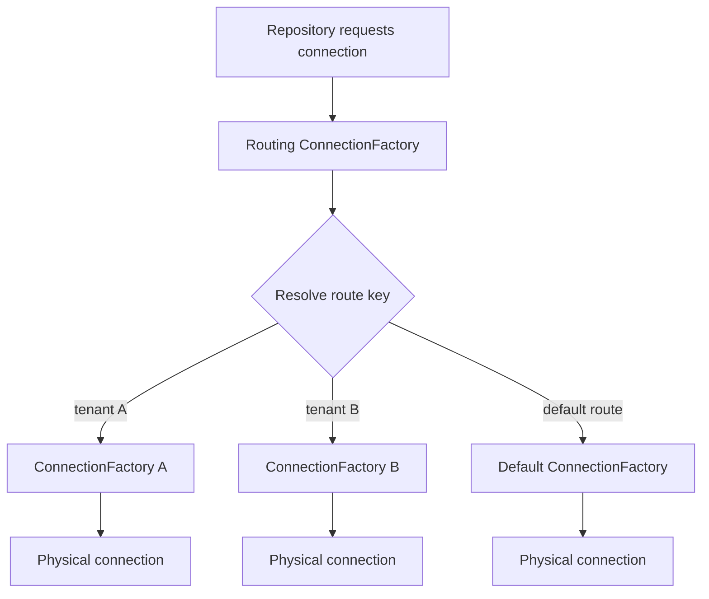
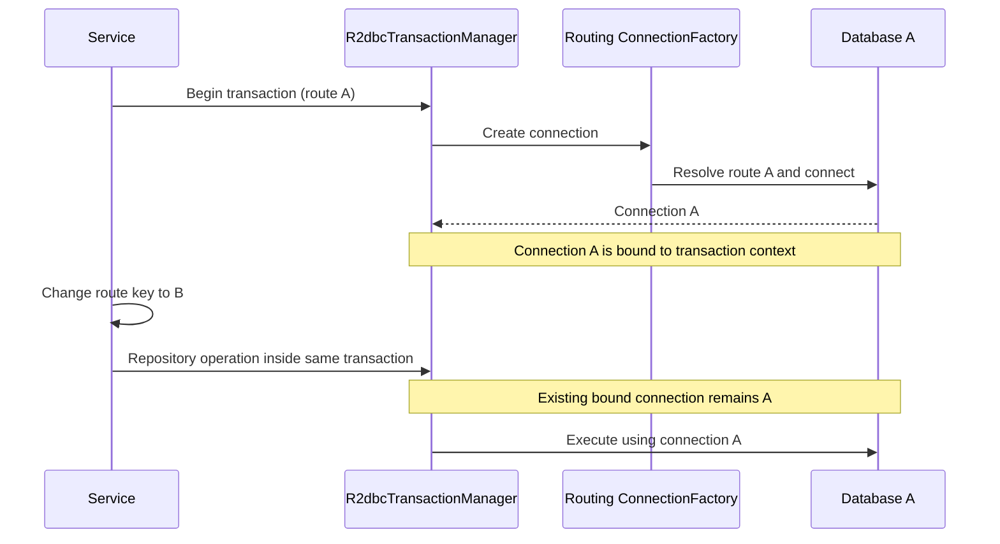
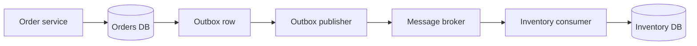

# Giới hạn giao dịch khi định tuyến hoặc truy cập nhiều nguồn

Spring Data Relational R2DBC có thể làm việc với nhiều database hoặc nhiều `ConnectionFactory`, ví dụ một nguồn cho đơn hàng, một nguồn cho kho hàng, hoặc một hệ thống định tuyến kết nối tới database theo tenant. Tuy nhiên, transaction reactive của Spring R2DBC có một ranh giới quan trọng: một `R2dbcTransactionManager` quản lý transaction trên một `ConnectionFactory`. Transaction đó không tự động bao phủ các kết nối độc lập tới nhiều database.

Khi dùng một `ConnectionFactory` có định tuyến, khóa định tuyến phải được xác định trước khi kết nối vật lý được lấy và giữ ổn định trong suốt transaction. Sau khi transaction đã lấy connection, đổi tenant hoặc đổi route trong Reactor Context không làm connection đang được transaction sử dụng chuyển sang database khác. Khi cần ghi nhiều nguồn, phải thiết kế ranh giới nhất quán dữ liệu rõ ràng bằng local transaction, outbox, saga hoặc cơ chế điều phối phân tán phù hợp.

## 1. Các khái niệm cần phân biệt

Trong ứng dụng R2DBC có nhiều nguồn, một số khái niệm dễ bị dùng lẫn nhau:

| Khái niệm | Ý nghĩa |
| --- | --- |
| `ConnectionFactory` | Factory tạo kết nối R2DBC tới một nguồn dữ liệu hoặc một nguồn định tuyến |
| Connection | Kết nối cụ thể tới database, được dùng để thực thi statement và transaction |
| `R2dbcTransactionManager` | Transaction manager reactive quản lý transaction cho một `ConnectionFactory` |
| `TransactionalOperator` | API lập trình để bao một publisher trong transaction do một transaction manager quản lý |
| Routing `ConnectionFactory` | Factory chọn một target `ConnectionFactory` dựa trên route key, tenant hoặc chế độ đọc/ghi |
| Nhiều transaction manager | Các manager độc lập, mỗi manager quản lý nguồn tương ứng của nó |
| Distributed transaction | Một giao thức điều phối commit/rollback trên nhiều resource độc lập |

Có nhiều `ConnectionFactory` không đồng nghĩa có một transaction chung. Tương tự, đặt nhiều repository trong cùng một service method có `@Transactional` cũng không tự làm cho tất cả repository tham gia cùng một transaction nếu chúng dùng các factory khác nhau.

## 2. Một `R2dbcTransactionManager` quản lý một `ConnectionFactory`

`R2dbcTransactionManager` được cấu hình với một `ConnectionFactory`. Khi bắt đầu transaction, manager lấy connection từ factory đó, bắt đầu transaction trên connection và gắn resource vào reactive transaction context. Các thao tác R2DBC tương thích trong cùng context có thể sử dụng connection đang được quản lý.

Ví dụ cấu hình cho database đơn hàng:

```java
@Configuration
public class OrderDatabaseConfiguration {

    @Bean
    @Primary
    ConnectionFactory orderConnectionFactory() {
        return ConnectionFactories.get(
                "r2dbc:postgresql://localhost:5432/orders");
    }

    @Bean("orderTransactionManager")
    R2dbcTransactionManager orderTransactionManager(
            @Qualifier("orderConnectionFactory") ConnectionFactory factory) {
        return new R2dbcTransactionManager(factory);
    }
}
```

Service có thể chọn manager cụ thể:

```java
@Service
public class OrderService {

    private final OrderRepository orderRepository;

    public OrderService(OrderRepository orderRepository) {
        this.orderRepository = orderRepository;
    }

    @Transactional(transactionManager = "orderTransactionManager")
    public Mono<Order> createOrder(Order order) {
        return orderRepository.save(order);
    }
}
```

Tên bean trong `transactionManager` phải khớp bean transaction manager đã cấu hình. Khi ứng dụng chỉ có một manager, Spring có thể tự chọn manager mặc định; với nhiều manager, nên chỉ định rõ để tránh giao dịch chạy trên nguồn không mong muốn.

Transaction manager quản lý connection của factory được truyền vào nó. Nếu một repository khác dùng factory khác, thao tác repository đó không tự động được enlist vào transaction này.

## 3. Transaction reactive được truyền qua Reactor Context

R2DBC transaction management là reactive. Transaction context được truyền theo Reactor Context, không dựa vào việc một thread cụ thể giữ transaction như mô hình ThreadLocal imperative truyền thống.

Vì vậy, các thao tác database cần tham gia cùng transaction phải được nối trong cùng reactive pipeline. Ví dụ:

```java
public Mono<Order> createOrder(Order order) {
    return orderRepository.save(order)
            .flatMap(saved -> orderAuditRepository.save(
                            OrderAudit.created(saved.getId()))
                    .thenReturn(saved));
}
```

Nếu hai repository dùng cùng `ConnectionFactory` và transaction manager, các thao tác có thể tham gia cùng transaction reactive khi service được gọi trong transaction đó.

Không gọi `subscribe()` riêng bên trong service:

```java
public Mono<Order> createOrder(Order order) {
    return orderRepository.save(order)
            .doOnNext(saved ->
                    orderAuditRepository.save(
                            OrderAudit.created(saved.getId())).subscribe());
}
```

Lời gọi `subscribe()` tạo một luồng độc lập. Service không chờ audit hoàn tất, không kết hợp lỗi audit vào kết quả chính và có thể khiến thao tác audit chạy ngoài transaction context dự kiến. Hãy nối publisher bằng `flatMap`, `then`, `zip` hoặc toán tử phù hợp.

Tương tự, không gọi `block()` trong một service reactive để chờ thao tác database khác. Điều đó có thể chặn thread, phá vỡ luồng context và làm mất các lợi ích của R2DBC.

## 4. Nhiều `ConnectionFactory` nghĩa là nhiều ranh giới kết nối

Giả sử ứng dụng có hai database:

```text
OrderService
  ├── OrderRepository  ──> orderConnectionFactory  ──> orders database
  └── StockRepository  ──> stockConnectionFactory  ──> inventory database
```

Một transaction manager được cấu hình với `orderConnectionFactory` chỉ quản lý connection tới database đơn hàng. Nếu trong cùng method gọi `stockRepository`, repository kho lấy connection từ `stockConnectionFactory`; transaction manager của đơn hàng không tự quản lý connection đó.

Hậu quả có thể xảy ra:

- Order được commit nhưng cập nhật kho thất bại.
- Cập nhật kho được commit nhưng transaction tạo order rollback.
- Một nguồn rollback trong khi nguồn khác đã commit.
- Lỗi xảy ra sau khi một nguồn đã commit khiến ứng dụng không thể rollback nguồn đó bằng transaction manager còn lại.

Đây là ranh giới nhất quán dữ liệu cần được thiết kế, không phải chỉ là vấn đề chọn annotation.

## 5. Cấu hình nhiều transaction manager

Một ứng dụng có thể khai báo nhiều `ConnectionFactory` và nhiều `R2dbcTransactionManager`, mỗi manager quản lý một nguồn:

```java
@Configuration
public class MultiDatabaseConfiguration {

    @Bean("orderTransactionManager")
    R2dbcTransactionManager orderTransactionManager(
            @Qualifier("orderConnectionFactory") ConnectionFactory factory) {
        return new R2dbcTransactionManager(factory);
    }

    @Bean("stockTransactionManager")
    R2dbcTransactionManager stockTransactionManager(
            @Qualifier("stockConnectionFactory") ConnectionFactory factory) {
        return new R2dbcTransactionManager(factory);
    }
}
```

Service chỉ định manager phù hợp cho từng transaction:

```java
@Transactional(transactionManager = "stockTransactionManager")
public Mono<Stock> reserveStock(StockReservation reservation) {
    return stockRepository.reserve(reservation);
}
```

Một method có `@Transactional(transactionManager = "orderTransactionManager")` không tự động mở transaction trên `stockTransactionManager`. Chọn một manager là chọn ranh giới transaction cục bộ. Nếu cần hai nguồn cùng tham gia một nghiệp vụ, phải điều phối hai local transaction hoặc dùng giải pháp phân tán được hỗ trợ riêng.

Không nên đặt hai annotation `@Transactional` trên cùng một method với kỳ vọng Spring sẽ tự commit cả hai như một transaction nguyên tử. Việc lồng các interceptor/manager không tự tạo ra một coordinator phân tán và có thể tạo thứ tự commit/rollback khó kiểm soát.

## 6. Dùng `TransactionalOperator` cho từng nguồn

Khi cần điều khiển transaction bằng code, tạo `TransactionalOperator` từ transaction manager tương ứng:

```java
@Configuration
public class TransactionOperatorConfiguration {

    @Bean("orderTransactionalOperator")
    TransactionalOperator orderTransactionalOperator(
            @Qualifier("orderTransactionManager")
            ReactiveTransactionManager manager) {
        return TransactionalOperator.create(manager);
    }

    @Bean("stockTransactionalOperator")
    TransactionalOperator stockTransactionalOperator(
            @Qualifier("stockTransactionManager")
            ReactiveTransactionManager manager) {
        return TransactionalOperator.create(manager);
    }
}
```

Sử dụng operator của order:

```java
public Mono<Order> saveOrder(Order order) {
    return orderTransactionalOperator.transactional(
            orderRepository.save(order));
}
```

Sử dụng operator của stock:

```java
public Mono<Stock> saveStock(Stock stock) {
    return stockTransactionalOperator.transactional(
            stockRepository.save(stock));
}
```

Mỗi operator quản lý transaction trên factory đã gắn với manager. Có thể dùng chúng để xác định ranh giới cục bộ rõ ràng trong các service reactive. Tuy nhiên, gọi lần lượt hai operator không tạo một transaction phân tán; transaction thứ nhất có thể commit trước khi transaction thứ hai thất bại.

## 7. Routing `ConnectionFactory` là gì?

Routing `ConnectionFactory` là một lớp trung gian chọn factory đích dựa trên một khóa định tuyến. Nó thường được dùng khi:

- Mỗi tenant có database riêng.
- Hệ thống sharding dữ liệu theo vùng hoặc nhóm khách hàng.
- Đọc từ replica và ghi vào primary.
- Chọn database theo loại nghiệp vụ hoặc cấu hình runtime.

Luồng kết nối khái quát:



Spring Framework cung cấp abstraction `AbstractRoutingConnectionFactory` trong package R2DBC connection lookup để hỗ trợ định tuyến. Ứng dụng cấu hình các target factory và cung cấp logic xác định route key. Chi tiết chữ ký callback và cách lấy context cần đối chiếu với phiên bản Spring Framework của dự án.

Điểm quan trọng là route được chọn khi routing factory tạo connection. Transaction manager sau đó giữ connection đã lấy cho transaction hiện tại. Routing không phải cơ chế chuyển connection đang mở sang database khác giữa chừng.

## 8. Xác định route key từ Reactor Context

Trong reactive application, route key thường được truyền qua Reactor Context để tránh dùng ThreadLocal cho luồng reactive. Ví dụ ý tưởng cho routing factory:

```java
public class TenantRoutingConnectionFactory
        extends AbstractRoutingConnectionFactory {

    public static final String ROUTE_KEY = "tenantRoute";

    @Override
    protected Mono<Object> determineCurrentLookupKey() {
        return Mono.deferContextual(context -> {
            if (!context.hasKey(ROUTE_KEY)) {
                return Mono.error(
                        new IllegalStateException("Missing tenant route"));
            }

            return Mono.just(context.get(ROUTE_KEY));
        });
    }
}
```

Đây là ví dụ theo API routing R2DBC có phương thức xác định lookup key dạng reactive; hãy kiểm tra package và chữ ký chính xác của phiên bản Spring Framework đang dùng. Có thể chọn default route thay vì phát lỗi khi thiếu key, nhưng với dữ liệu tenant nên fail closed để tránh vô tình truy cập database mặc định của tenant khác.

Gắn route key vào publisher ở ranh giới request:

```java
public Mono<Order> findOrderForTenant(String tenantRoute, Long orderId) {
    return orderRepository.findById(orderId)
            .contextWrite(context ->
                    context.put(TenantRoutingConnectionFactory.ROUTE_KEY,
                            tenantRoute));
}
```

Context phải được thiết lập trên toàn bộ publisher trước khi thao tác lấy connection được thực thi. Với transaction, route key cần có sẵn khi transaction manager yêu cầu connection. Hãy đặt `contextWrite` ở ranh giới ngoài của publisher transaction và kiểm thử thứ tự thực thi trong ứng dụng thực tế.

Không lấy tenant route trực tiếp từ header không đáng tin rồi dùng nó như quyền truy cập. Server cần xác thực người dùng, xác định tenant mà principal được phép truy cập và ánh xạ tenant đó sang route đã cấu hình.

## 9. Route phải được chọn trước khi transaction lấy connection

Giả sử transaction bắt đầu và routing factory lấy connection tới database tenant A. Connection này được gắn với transaction context. Nếu code sau đó đổi route key sang tenant B rồi gọi repository khác dùng cùng routing factory, thao tác tiếp theo vẫn có thể dùng connection đã gắn với transaction tenant A.

Sơ đồ:



Đây là lý do route key phải ổn định trong suốt transaction. Đừng viết một pipeline vừa đổi tenant A sang tenant B vừa mong cùng transaction chuyển database theo key mới.

Nếu cần thao tác tenant A và tenant B, hãy tạo hai luồng công việc có ranh giới transaction riêng và điều phối chúng như hai local transaction. Nếu nghiệp vụ yêu cầu cả hai thay đổi cùng thành công hoặc cùng thất bại, cần một giao thức phân tán hoặc thiết kế saga/outbox phù hợp.

## 10. Cấu hình transaction manager trên routing factory

Trong mô hình mỗi transaction chỉ làm việc với một tenant, có thể cấu hình một routing `ConnectionFactory` rồi tạo một `R2dbcTransactionManager` trên chính routing factory đó:

```java
@Bean
@Primary
ConnectionFactory tenantRoutingConnectionFactory() {
    TenantRoutingConnectionFactory routing =
            new TenantRoutingConnectionFactory();

    routing.setTargetConnectionFactories(Map.of(
            "tenant-a", tenantAConnectionFactory(),
            "tenant-b", tenantBConnectionFactory()
    ));

    routing.setLenientFallback(false);
    return routing;
}

@Bean
R2dbcTransactionManager tenantTransactionManager(
        @Qualifier("tenantRoutingConnectionFactory")
        ConnectionFactory routingFactory) {
    return new R2dbcTransactionManager(routingFactory);
}
```

Đoạn code chỉ minh họa cấu trúc; việc tạo target factory nên được inject từ bean riêng thay vì gọi trực tiếp phương thức factory thủ công trong cấu hình thực tế. Cấu hình `setTargetConnectionFactories`, `setLenientFallback` và `determineCurrentLookupKey` phải khớp API của Spring Framework đang dùng.

Transaction manager nhìn thấy một routing factory. Khi transaction lấy connection, routing factory chọn một target; connection đích được giữ trong transaction. Một transaction xử lý một tenant/route. Cấu hình này không tạo transaction đồng thời trên mọi target.

## 11. Định tuyến đọc/ghi và giới hạn read replica

Một hệ thống có thể định tuyến thao tác đọc tới replica và thao tác ghi tới primary. Tuy nhiên, việc đánh dấu method `@Transactional(readOnly = true)` không tự động bảo đảm Spring R2DBC chọn replica. `readOnly` là một thuộc tính/hint của transaction; logic route phải được triển khai riêng và phải được xác định trước khi connection được lấy.

Các tình huống cần chú ý:

- Ghi vào primary rồi đọc ngay từ replica có thể không thấy dữ liệu do replication lag.
- Một transaction bắt đầu với route replica không thể tự chuyển sang primary giữa chừng chỉ vì code phát sinh một thao tác ghi.
- Nếu transaction đã lấy connection primary, các thao tác tiếp theo dùng connection đó.
- Nếu cần read-after-write consistency, đọc từ primary hoặc dùng cơ chế đảm bảo replica đã bắt kịp.
- Một query read-only không nhất thiết được database cưỡng chế chỉ đọc chỉ vì transaction được đánh dấu `readOnly`.

Ví dụ luồng nghiệp vụ thường an toàn hơn:

1. Request ghi được route tới primary.
2. Transaction ghi và commit trên primary.
3. Response trả kết quả từ primary hoặc entity đã lưu.
4. Những request đọc độc lập sau đó có thể route tới replica theo chính sách eventual consistency.

Không route ngẫu nhiên từng query trong cùng một transaction. Chọn route theo use case và đảm bảo toàn bộ transaction dùng một connection nhất quán.

## 12. Một transaction không thể tự join nhiều database

SQL JOIN hoạt động trong phạm vi database connection mà câu SQL đang thực thi. Nếu `customer` nằm ở database A và `invoice` nằm ở database B với hai `ConnectionFactory` khác nhau, một repository query thông thường không thể tự JOIN hai nguồn đó.

Các hướng xử lý phổ biến:

- Đưa dữ liệu cần truy vấn chung vào cùng database hoặc cùng read model.
- Đọc từng nguồn bằng publisher riêng rồi kết hợp kết quả ở application layer theo khóa nghiệp vụ.
- Dùng tính năng database federation, foreign data wrapper hoặc database link nếu hệ quản trị hỗ trợ và kiến trúc cho phép.
- Đồng bộ dữ liệu sang kho đọc/search index bằng event hoặc pipeline ETL.

Kết hợp ở application layer cần cân nhắc số lượng ID và kích thước dữ liệu. Tránh đọc toàn bộ hai bảng rồi join trong bộ nhớ. Có thể lấy danh sách khóa cần thiết từ nguồn thứ nhất, truy vấn theo nhóm ở nguồn thứ hai và ghép các kết quả có giới hạn.

## 13. Nhiều local transaction không phải một distributed transaction

Giả sử tạo order ở database A và giữ tồn kho ở database B. Nếu service thực hiện:

```text
transaction A: insert order, commit
transaction B: reserve stock, commit
```

Nếu B thất bại sau khi A commit, order vẫn tồn tại. Transaction manager của A không thể rollback một commit đã hoàn tất chỉ vì B gặp lỗi.

Nếu đảo thứ tự:

```text
transaction B: reserve stock, commit
transaction A: insert order, commit
```

Nếu A thất bại, tồn kho có thể đã bị giữ mà không có order tương ứng. Đổi thứ tự chỉ thay đổi loại trạng thái dở dang, không tạo atomicity.

Distributed transaction cần một coordinator và giao thức được các resource hỗ trợ, ví dụ XA/2-phase commit trong hệ sinh thái tương thích. R2DBC SPI và `R2dbcTransactionManager` thông thường không cung cấp một distributed transaction manager tự động cho nhiều `ConnectionFactory`. Không giả định hai `TransactionalOperator` hoặc hai `@Transactional` có thể thay thế coordinator đó.

## 14. Transactional Outbox khi phối hợp nhiều nguồn

Một cách phổ biến là ghi thay đổi ở database sở hữu nghiệp vụ cùng một outbox event trong một local transaction. Worker đọc outbox rồi gửi event tới broker; service của nguồn khác tiêu thụ event và cập nhật database riêng trong transaction cục bộ.



Ví dụ bảng outbox:

```sql
CREATE TABLE outbox_event (
    id BIGINT GENERATED BY DEFAULT AS IDENTITY PRIMARY KEY,
    event_id UUID NOT NULL UNIQUE,
    aggregate_id BIGINT NOT NULL,
    event_type VARCHAR(100) NOT NULL,
    payload TEXT NOT NULL,
    created_at TIMESTAMPTZ NOT NULL DEFAULT CURRENT_TIMESTAMP,
    published_at TIMESTAMPTZ
);
```

Trong transaction của order:

```java
public Mono<Order> createOrder(Order order) {
    return orderTransactionOperator.transactional(
            orderRepository.save(order)
                    .flatMap(saved -> outboxRepository.save(
                                    OutboxEvent.orderCreated(saved))
                            .thenReturn(saved))
    );
}
```

Order và outbox event cùng commit hoặc cùng rollback vì chúng thuộc cùng database và transaction manager. Publisher đọc event sau commit rồi gửi broker. Nếu publisher gửi thành công nhưng chết trước khi đánh dấu đã gửi, event có thể được gửi lại; consumer phải lũy đẳng.

Outbox không tạo distributed transaction giữa hai database. Nó bảo đảm việc ghi sự kiện cùng với thay đổi ở nguồn phát và cho phép truyền thông điệp bền vững theo mô hình at-least-once.

## 15. Consumer cần idempotent

Khi consumer nhận event, nên lưu event ID đã xử lý bằng unique constraint trong cùng transaction với cập nhật dữ liệu đích:

```sql
CREATE TABLE processed_event (
    event_id UUID PRIMARY KEY,
    processed_at TIMESTAMPTZ NOT NULL DEFAULT CURRENT_TIMESTAMP
);
```

Luồng xử lý khái niệm:

1. Bắt đầu transaction trên database đích.
2. Insert `event_id` vào `processed_event`.
3. Nếu insert thành công, áp dụng thay đổi nghiệp vụ.
4. Commit cả dấu đã xử lý và thay đổi nghiệp vụ.
5. Nếu event ID đã tồn tại, bỏ qua hiệu ứng nghiệp vụ và xác nhận message theo cơ chế broker.

Nếu consumer chỉ ghi `processed_event` sau khi cập nhật inventory trong một transaction khác, crash giữa hai thao tác có thể tạo hiệu ứng trùng hoặc mất dấu. Hãy để deduplication marker và thay đổi dữ liệu đích cùng một local transaction.

Khi có hai consumer xử lý cùng event đồng thời, unique constraint vẫn là hàng rào cuối cùng. Cần xử lý duplicate claim như một trường hợp message đã được xử lý, sau khi transaction lỗi được rollback phù hợp với database.

## 16. Saga cho workflow nhiều bước

Saga chia một nghiệp vụ dài thành nhiều local transaction. Mỗi bước commit ở database riêng và có một hành động bù (compensation) nếu bước sau thất bại.

Ví dụ đặt hàng:

| Bước | Local transaction | Hành động bù có thể có |
| --- | --- | --- |
| 1 | Tạo order ở trạng thái `PENDING` | Hủy order |
| 2 | Giữ tồn kho | Giải phóng reservation |
| 3 | Xác nhận thanh toán | Hoàn tiền hoặc void authorization theo provider |
| 4 | Chuyển order thành `CONFIRMED` | Chuyển sang `CANCELLED`/`REQUIRES_REVIEW` nếu không thể bù |

Saga không rollback lịch sử database như transaction ACID. Compensation là một thao tác nghiệp vụ mới, có thể thất bại và cần retry/đối soát. Ví dụ hoàn tiền không xóa giao dịch thanh toán ban đầu; nó tạo một giao dịch hoàn tiền riêng.

Saga có thể được điều phối bởi một service trung tâm (orchestration) hoặc bằng event giữa các service (choreography). Với cả hai cách, mỗi bước cần:

- Có ID workflow/correlation để theo dõi.
- Có idempotency key cho retry.
- Có trạng thái bền vững và timeout rõ ràng.
- Có compensation hoặc trạng thái xử lý thủ công khi không thể tự phục hồi.
- Có log/event để kiểm toán và đối soát.

## 17. Ví dụ điều phối order và inventory bằng local transaction

Service có thể tạo order trước, sau đó gửi lệnh giữ hàng qua outbox. Order được tạo ở trạng thái `PENDING`:

```java
public Mono<Order> startOrder(Order order) {
    return orderTransactionalOperator.transactional(
            orderRepository.save(order.withStatus(OrderStatus.PENDING))
                    .flatMap(saved -> outboxRepository.save(
                                    OutboxEvent.reserveStockRequested(saved))
                            .thenReturn(saved))
    );
}
```

Inventory service nhận lệnh và xử lý trong transaction riêng:

```java
public Mono<Void> handleReserveStock(ReserveStockCommand command) {
    return stockTransactionalOperator.transactional(
            processedEventRepository.claim(command.eventId())
                    .then(stockRepository.reserve(
                            command.productId(), command.quantity()))
                    .then(outboxRepository.save(
                            OutboxEvent.stockReserved(command)))
                    .then()
    );
}
```

Đoạn code minh họa ranh giới cục bộ; `claim` phải dùng unique constraint, `reserve` phải kiểm tra tồn kho có điều kiện và các repository trong mỗi operator phải dùng cùng factory tương ứng. Inventory service phát event kết quả; order service tiêu thụ event rồi chuyển trạng thái order thành `CONFIRMED` hoặc xử lý thất bại.

Không gọi trực tiếp `stockRepository` trong transaction order rồi giả định hai nguồn commit cùng nhau. Giao tiếp qua outbox/message làm rõ việc mỗi database có transaction độc lập.

## 18. Khi nào dùng hai nguồn tuần tự trong cùng service?

Có trường hợp service cần đọc hai nguồn mà không cần thay đổi cả hai. Ví dụ lấy thông tin order từ database A và thông tin hồ sơ customer từ database B để tạo response.

Có thể kết hợp publisher:

```java
public Mono<OrderDetailsResponse> getOrderDetails(Long orderId) {
    return orderRepository.findById(orderId)
            .flatMap(order -> customerRepository.findById(order.getCustomerId())
                    .map(customer -> new OrderDetailsResponse(
                            order.getId(),
                            order.getTotal(),
                            customer.getDisplayName())));
}
```

Nếu không có customer, `flatMap` bên trong phát rỗng và response cũng rỗng. Nếu nghiệp vụ cần phân biệt order không tồn tại với customer reference bị thiếu, hãy dùng `switchIfEmpty` riêng cho từng bước và phát lỗi miền phù hợp.

Đây là hai lần đọc độc lập. Không có snapshot nhất quán chung giữa hai database: dữ liệu customer có thể thay đổi sau khi order được đọc. Nếu response cần một góc nhìn nhất quán, cân nhắc read model được đồng bộ, versioning hoặc một cơ chế snapshot phù hợp.

Không mở transaction trên cả hai nguồn chỉ để đọc nếu không có yêu cầu nhất quán cụ thể. Transaction dài làm giữ connection và có thể gây tải; hai nguồn vẫn không có snapshot chung nếu manager độc lập.

## 19. Không để route key thay đổi giữa các bước của cùng transaction

Với tenant routing, một request nên xác định tenant một lần từ principal đã xác thực. Đưa route key vào reactive context ở ranh giới service/controller rồi giữ nguyên suốt pipeline.

Tránh cách làm sau:

```java
return tenantAOperation()
        .contextWrite(context -> context.put(ROUTE_KEY, "tenant-a"))
        .then(tenantBOperation()
                .contextWrite(context -> context.put(ROUTE_KEY, "tenant-b")));
```

Nếu cả hai thao tác nằm trong cùng một transaction và dùng cùng routing factory, connection đã được transaction manager lấy trước đó có thể được tái sử dụng. Việc thay context ở một nhánh không chuyển connection hiện có sang target khác.

Nếu thực sự cần hai tenant, hãy chia thành hai local transaction riêng, mỗi transaction có route key được đặt trước khi transaction bắt đầu. Không dùng chung một transaction manager transaction context để xử lý nhiều tenant khác nhau.

## 20. Chọn route trước khi `@Transactional` bắt đầu

Với method dùng `@Transactional`, route key phải có trong reactive context tại thời điểm transaction manager lấy connection. Vì annotation tạo transaction quanh publisher, thứ tự context propagation cần được xác minh.

Một cách tường minh là dùng `TransactionalOperator` và đặt context ở publisher ngoài cùng:

```java
public Mono<Order> findOrder(
        String tenantRoute,
        Long orderId) {

    return tenantTransactionalOperator.transactional(
                    orderRepository.findById(orderId))
            .contextWrite(context ->
                    context.put(TenantRoutingConnectionFactory.ROUTE_KEY,
                            tenantRoute));
}
```

`contextWrite` nằm ở ranh giới ngoài để route key được truyền ngược theo subscription tới transaction operator và lúc connection factory xác định target. Cách bố trí chính xác cần được kiểm thử với phiên bản Spring/Reactor đang dùng, đặc biệt khi kết hợp `@Transactional`, `publishOn`, `subscribeOn` hoặc các publisher được ghép từ nhiều nguồn.

Không lưu route key trong mutable field của singleton service hoặc ThreadLocal thông thường. Nhiều request đồng thời có thể ghi đè giá trị của nhau, dẫn tới truy cập nhầm tenant. Dùng Reactor Context hoặc một cơ chế context-aware được hỗ trợ.

## 21. Ranh giới giữa transaction và `ConnectionFactoryUtils`

Spring R2DBC dùng các tiện ích như `ConnectionFactoryUtils` để lấy connection có xét tới connection đã được bind trong transaction context. `DatabaseClient` và các abstraction Spring Data tương thích thường tích hợp với cơ chế này.

Nếu tự gọi `connectionFactory.create()` trực tiếp ở nơi không đi qua cơ chế Spring connection lookup, có nguy cơ lấy một connection mới không tham gia transaction đang mở. Khi cần dùng SPI trực tiếp trong Spring transaction, hãy dùng cơ chế lấy connection transaction-aware theo hướng dẫn Spring Framework và bảo đảm giải phóng connection đúng cách.

Không tự đóng connection đang được transaction manager quản lý. Cũng không giữ connection trong field rồi chia sẻ giữa nhiều subscription. Connection là tài nguyên gắn với transaction/lifecycle cụ thể.

## 22. `readOnly`, isolation và timeout không mở rộng phạm vi nguồn

Các thuộc tính transaction như `readOnly`, isolation level và timeout áp dụng cho transaction do manager cụ thể quản lý. Chúng không làm cho một transaction tự bao phủ thêm `ConnectionFactory` khác.

Ví dụ:

```java
@Transactional(
        transactionManager = "orderTransactionManager",
        readOnly = true,
        timeout = 5
)
public Flux<Order> findRecentOrders() {
    return orderRepository.findRecentOrders();
}
```

Các thuộc tính này tác động theo khả năng của transaction manager và database. `readOnly` có thể là hint; timeout/isolation cũng phụ thuộc hỗ trợ driver/database. Không suy ra rằng một method `readOnly` sẽ tự route sang replica hoặc rằng manager thứ hai cũng nhận cùng cấu hình.

Nếu cần transaction trên nguồn khác, cấu hình manager/transaction riêng và chọn nó một cách rõ ràng. Nếu cần phối hợp nhiều nguồn, dùng mô hình phân tán hoặc eventual consistency.

## 23. Giới hạn khi dùng nested transaction hoặc `REQUIRES_NEW`

Propagation như `REQUIRED` hoặc `REQUIRES_NEW` điều khiển cách một transaction manager tham gia hoặc tạo transaction cục bộ. `REQUIRES_NEW` không có nghĩa là mở transaction trên tất cả datasource, và cũng không tạo distributed transaction.

Ví dụ một `REQUIRES_NEW` trên `orderTransactionManager` vẫn chỉ quản lý nguồn order. Nếu method bên trong dùng `stockTransactionManager`, đó là một transaction độc lập trên stock; thứ tự commit và lỗi giữa hai nguồn vẫn phải được xử lý.

Khả năng nested transaction/savepoint phụ thuộc transaction manager, driver và database. Không giả định một cấu hình propagation sẽ tự tạo savepoint hoặc rollback nhiều nguồn. Hãy kiểm tra tài liệu đúng phiên bản và viết integration test cho hành vi cần thiết.

## 24. Giữ dữ liệu nhất quán khi cần ghi nhiều nguồn

Trước khi chọn kiến trúc, hãy xác định mức nhất quán mà nghiệp vụ thực sự cần:

| Yêu cầu | Hướng tiếp cận |
| --- | --- |
| Tất cả thay đổi nằm trong một database phải cùng commit/rollback | Một `R2dbcTransactionManager` trên factory đó |
| Một request được route tới đúng một tenant database | Routing factory với route key cố định trước khi lấy connection |
| Ghi một nguồn rồi thông báo cho nguồn khác | Transactional Outbox và consumer idempotent |
| Workflow nhiều bước cần hành động bù | Saga với trạng thái bền vững |
| Chỉ cần tổng hợp dữ liệu đọc từ nhiều nguồn | Ghép publisher ở application layer hoặc read model |
| Cần commit nguyên tử trên nhiều resource có hỗ trợ giao thức chung | Dùng distributed transaction coordinator tương thích; xác minh driver/resource hỗ trợ trước khi chọn |

Đừng bắt đầu bằng việc thêm nhiều annotation transaction. Hãy xác định bất biến nghiệp vụ, trạng thái có thể chấp nhận khi một nguồn lỗi và cách phục hồi.

## 25. Kiểm thử routing và transaction boundaries

Kiểm thử routing cần xác minh không chỉ dữ liệu trả về mà còn database nào thực sự được truy cập. Tạo ít nhất hai database/schema với dữ liệu phân biệt rõ để phát hiện route sai.

Các test cần có:

1. Route tenant A đọc và ghi chỉ vào database A.
2. Route tenant B đọc và ghi chỉ vào database B.
3. Thiếu route key bị từ chối hoặc dùng default theo chính sách đã chọn.
4. Request đồng thời cho tenant A và B không rò route key giữa các subscription.
5. Route key được đặt trước transaction và không đổi giữa transaction.
6. Khi transaction rollback, thay đổi trên target connection được rollback.
7. Đổi route sau khi connection đã được bind không làm transaction chuyển sang target khác.
8. `@Transactional` chọn đúng transaction manager khi có nhiều manager.
9. Một thao tác dùng factory thứ hai không được giả định nằm trong transaction thứ nhất.
10. Outbox event và thay đổi nghiệp vụ ở nguồn phát cùng commit/rollback.
11. Consumer xử lý event lặp nhưng chỉ áp dụng một hiệu ứng nghiệp vụ.
12. Saga có thể phục hồi hoặc bù khi một bước sau thất bại.

Nên dùng integration test với đúng R2DBC driver/database hoặc Testcontainers phù hợp. Mock repository không thể chứng minh connection routing, transaction binding, unique constraint hoặc rollback ở database thật.

## 26. Theo dõi và chẩn đoán lỗi

Khi có nhiều nguồn, log và metric cần giúp xác định route cùng transaction boundary mà không làm lộ dữ liệu tenant:

- Tên datasource/route đã được chọn (dùng mã cấu hình, không log secret URL).
- Correlation ID và transaction/workflow ID.
- Tên transaction manager hoặc loại thao tác cục bộ.
- Thời gian lấy connection, thời gian giữ connection và thời gian transaction.
- Số lần route key thiếu hoặc không hợp lệ.
- Số lỗi commit/rollback theo từng nguồn.
- Outbox backlog, tuổi event chưa gửi và số lần retry.
- Saga đang ở bước nào, thời gian chờ và số lần compensation.
- Connection pool usage, timeout và lỗi driver theo từng factory.

Không log credential, URL có password, payload nhạy cảm hoặc tenant identifier thô nếu chính sách bảo mật không cho phép. Dùng correlation ID và route label đã được kiểm soát để nối các sự kiện.

## 27. Các lỗi thường gặp

| Lỗi | Hậu quả | Cách xử lý |
| --- | --- | --- |
| Dùng một manager cho nhiều `ConnectionFactory` khác nhau | Chỉ connection của factory được quản lý tham gia transaction | Cấu hình manager riêng và thiết kế phối hợp local transaction |
| Nghĩ hai `@Transactional` tạo transaction phân tán | Một nguồn có thể commit trong khi nguồn khác rollback | Dùng outbox/saga hoặc coordinator thực sự được hỗ trợ |
| Đổi route key giữa transaction | Connection đang bind vẫn trỏ target đã chọn ban đầu | Chọn route trước khi lấy connection và giữ cố định |
| Route key nằm trong ThreadLocal/mutable field | Request đồng thời có thể truy cập nhầm tenant | Dùng Reactor Context hoặc cơ chế context-aware |
| Lấy connection trực tiếp ngoài Spring transaction-aware lookup | Thao tác có thể chạy ngoài transaction | Dùng `ConnectionFactoryUtils`/API Spring phù hợp hoặc quản lý transaction SPI tường minh |
| Gọi `subscribe()` trong service | Công việc tách khỏi transaction và lỗi chính | Ghép publisher bằng toán tử reactive |
| Dùng `readOnly=true` để mong tự chọn replica | Không có route logic hoặc route sai | Cấu hình routing riêng và đặt key trước khi bắt đầu transaction |
| Đọc từ replica ngay sau khi ghi primary | Gặp replication lag, dữ liệu chưa xuất hiện | Đọc primary khi cần read-after-write consistency |
| JOIN trực tiếp qua hai database connection | Một câu SQL không thể tự dùng hai connection độc lập | Ghép dữ liệu ở app hoặc dùng federation/read model |
| Commit database A rồi mới ghi B mà không có recovery | Trạng thái dở dang khi B lỗi | Outbox, saga, retry và compensation |
| Cho rằng rollback ở nguồn B đảo được commit nguồn A | Dữ liệu nguồn A vẫn đã commit | Thiết kế compensation; không gọi đó là rollback ACID |
| Không test route khi nhiều request đồng thời | Lỗi rò tenant chỉ xuất hiện dưới tải | Integration test song song với hai route khác nhau |

## 28. Quy trình thiết kế ứng dụng nhiều nguồn

Khi một use case cần truy cập hoặc định tuyến tới nhiều database, thực hiện theo thứ tự:

1. Liệt kê nguồn dữ liệu, chủ sở hữu từng aggregate và bất biến nghiệp vụ cần bảo vệ.
2. Xác định thao tác nào cần cùng transaction; giữ các thay đổi nguyên tử trong một database nếu có thể.
3. Nếu route theo tenant/shard/read-write, xác định route key từ ngữ cảnh đã xác thực trước khi connection được lấy.
4. Cấu hình `ConnectionFactory` và `R2dbcTransactionManager` rõ ràng cho từng nguồn hoặc một routing factory.
5. Chỉ định transaction manager bằng qualifier khi ứng dụng có nhiều manager.
6. Giữ route key ổn định trong toàn bộ transaction; không đổi target giữa chừng.
7. Với nhiều nguồn ghi, chọn outbox/saga hoặc distributed transaction coordinator thực sự được hỗ trợ.
8. Làm consumer và thao tác retry có tính lũy đẳng.
9. Kiểm tra connection lifecycle, pool, timeout, isolation và read-after-write behavior.
10. Viết integration test chứng minh rollback cục bộ, route isolation và phục hồi khi một nguồn lỗi.
11. Theo dõi lỗi commit, backlog outbox, saga state và pool theo từng nguồn.

## 29. Nguyên tắc thực hành

- Một `R2dbcTransactionManager` quản lý transaction cho một `ConnectionFactory`.
- Nhiều repository trong cùng service không tự động có nghĩa là cùng transaction; kiểm tra chúng dùng factory nào.
- Dùng nhiều transaction manager khi cần local transaction riêng và chỉ định manager rõ ràng.
- Không kỳ vọng nhiều `@Transactional` hoặc nhiều `TransactionalOperator` tạo atomicity phân tán.
- Với routing factory, xác định tenant/route trước khi transaction lấy connection.
- Giữ route key cố định suốt transaction; connection đã bind không chuyển database khi context key đổi.
- Truyền route qua Reactor Context hoặc cơ chế reactive context-aware, không dùng mutable singleton state/ThreadLocal thông thường.
- Xác thực tenant ở server; không tin route key do client tự gửi.
- `readOnly` không tự động chọn replica; read-after-write có thể cần đọc primary.
- Không giả định một transaction JOIN hoặc commit được nhiều database độc lập.
- Dùng outbox cho event cần ghi cùng dữ liệu nguồn; làm consumer idempotent.
- Dùng saga và compensation cho workflow nhiều local transaction; compensation là nghiệp vụ mới, không phải rollback lịch sử.
- Không gọi `block()`/`subscribe()` rời rạc trong reactive service.
- Dùng connection lookup transaction-aware khi truy cập SPI trực tiếp trong Spring transaction.
- Kiểm thử route isolation, rollback, concurrency và lỗi một nguồn bằng database/driver thực tế.

## 30. Kết luận

Giới hạn giao dịch là yếu tố cốt lõi khi Spring Data Relational R2DBC định tuyến hoặc truy cập nhiều nguồn. `R2dbcTransactionManager` quản lý một `ConnectionFactory`; các thao tác dùng factory khác không tự tham gia transaction đó. Với routing factory, route được chọn khi lấy connection và connection đã gắn vào transaction không chuyển target chỉ vì route key thay đổi.

Hãy xác định route trước khi bắt đầu transaction, giữ route ổn định trong suốt pipeline và chọn transaction manager rõ ràng khi có nhiều nguồn. Khi nghiệp vụ cần ghi nhiều database, nhiều local transaction không tạo thành một commit nguyên tử. Transactional Outbox, consumer idempotent và Saga giúp xử lý nhất quán theo hướng eventual consistency; chỉ dùng distributed transaction khi toàn bộ resource và driver thực sự hỗ trợ giao thức điều phối phù hợp. Kiểm thử trên database/driver thực tế và theo dõi từng ranh giới kết nối sẽ giúp tránh lỗi commit một phần, route sai tenant và giả định sai về atomicity.
