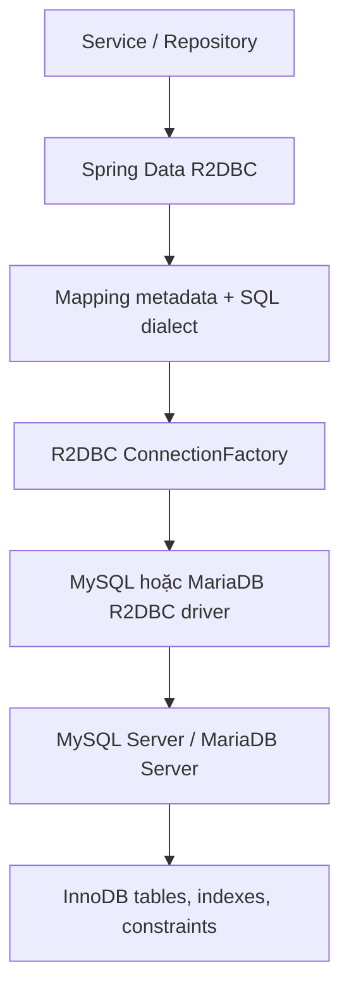

# MySQL/MariaDB: trình điều khiển, khóa sinh và khác biệt cú pháp

Spring Data Relational R2DBC có thể làm việc với MySQL và MariaDB thông qua driver R2DBC tương ứng. Ở tầng repository, nhiều thao tác trông giống nhau: khai báo entity bằng `@Table`, đánh dấu khóa bằng `@Id`, gọi `save`, dùng `DatabaseClient` hoặc viết `@Query`. Tuy nhiên, driver, metadata của database và SQL dialect quyết định cách connection được tạo, bind parameter, lấy generated key và thực thi các cú pháp riêng.

MySQL và MariaDB có nguồn gốc gần nhau nên chia sẻ nhiều cú pháp, nhưng không phải hai hệ quản trị hoàn toàn thay thế cho nhau. Phiên bản server, storage engine, SQL mode, collation và driver có thể làm thay đổi hành vi. Một câu SQL chạy trên MySQL không đương nhiên chạy giống hệt trên MariaDB, và một driver có thể hỗ trợ một tính năng mà driver còn lại chưa hỗ trợ.

Khi xây dựng ứng dụng R2DBC, cần chọn driver phù hợp với server thực tế, cấu hình `ConnectionFactory` đúng, kiểm tra dialect được Spring Data nhận diện, hiểu cơ chế `AUTO_INCREMENT` và generated values, rồi viết SQL theo khả năng của phiên bản MySQL/MariaDB đang chạy. Các ví dụ dưới đây tập trung vào InnoDB và những cú pháp phổ biến; cú pháp đặc thù cần được kiểm chứng với phiên bản server và driver của dự án.

## 1. MySQL và MariaDB trong kiến trúc R2DBC

R2DBC là API truy cập database reactive. Spring Data R2DBC sử dụng `ConnectionFactory`, driver R2DBC và dialect để thực hiện thao tác persistence. Với MySQL/MariaDB, kiến trúc khái quát:



Các thành phần có trách nhiệm riêng:

- **Spring Data R2DBC** ánh xạ entity, tạo một số câu lệnh CRUD, xử lý newness detection, versioning và repository query.
- **R2DBC dialect** cung cấp thông tin về bind marker, identifier, kiểu dữ liệu và khả năng đặc thù mà Spring Data cần khi tạo SQL.
- **R2DBC driver** triển khai giao thức kết nối, bind parameter, thực thi statement, đọc result và trả generated values theo khả năng hỗ trợ.
- **Database server** quyết định cú pháp SQL, constraint, storage engine, transaction, collation, optimizer và execution plan.

Annotation Java không thể thay thế chức năng của driver hoặc database. Ví dụ, `@Id` đánh dấu property định danh trong mapping; nó không tự tạo `AUTO_INCREMENT` nếu schema chưa có cột phù hợp.

## 2. Chọn driver R2DBC

Có các lựa chọn driver thường gặp trong hệ sinh thái:

| Database | Driver thường được dùng | Artifact tiêu biểu | Ghi chú |
| --- | --- | --- | --- |
| MySQL | Asyncer R2DBC MySQL | `io.asyncer:r2dbc-mysql` | Driver R2DBC cho MySQL; kiểm tra ma trận phiên bản server/driver |
| MariaDB | MariaDB Connector/R2DBC | `org.mariadb:r2dbc-mariadb` | Driver do MariaDB phát triển; kiểm tra phiên bản server và tính năng cần dùng |
| MariaDB qua driver MySQL | Một số bản MySQL R2DBC driver có thể kết nối MariaDB | `io.asyncer:r2dbc-mysql` | Khả năng tương thích phụ thuộc phiên bản; không giả định mọi tính năng MariaDB được hỗ trợ |

Việc MySQL và MariaDB dùng giao thức tương thích ở nhiều phần không có nghĩa mọi khác biệt của server đều được driver trừu tượng hóa. Nếu production chạy MariaDB, nên kiểm thử với MariaDB Connector/R2DBC hoặc driver MySQL đã xác nhận tương thích với đúng phiên bản MariaDB.

### Khai báo dependency

Ví dụ Gradle khi chọn driver MySQL:

```kotlin
dependencies {
    runtimeOnly("io.asyncer:r2dbc-mysql")
}
```

Ví dụ khi chọn driver MariaDB:

```kotlin
dependencies {
    runtimeOnly("org.mariadb:r2dbc-mariadb")
}
```

Ví dụ Maven:

```xml
<dependency>
    <groupId>io.asyncer</groupId>
    <artifactId>r2dbc-mysql</artifactId>
    <scope>runtime</scope>
</dependency>
```

Hoặc:

```xml
<dependency>
    <groupId>org.mariadb</groupId>
    <artifactId>r2dbc-mariadb</artifactId>
    <scope>runtime</scope>
</dependency>
```

Các ví dụ bỏ qua version để dự án có thể dùng dependency management/BOM tương thích với Spring Boot và Spring Data. Nếu không dùng BOM, phải khai báo version driver cụ thể theo tài liệu phát hành. Không thêm đồng thời nhiều driver chỉ để thử; nhiều provider có thể làm việc chọn driver/dialect khó dự đoán hơn.

### Chọn đúng driver theo server

Trước khi chọn, xác định:

- Server là MySQL hay MariaDB, và version cụ thể.
- Ứng dụng có cần TLS, authentication plugin hoặc connection option riêng không.
- Cần lấy generated key, batch statement, JSON, cursor hoặc tính năng đặc thù nào.
- Driver hỗ trợ R2DBC SPI version nào và tương thích với Spring Data/Spring Boot đang dùng không.
- Driver có hỗ trợ đúng semantics của transaction, cancellation và connection pool trong workload thực tế không.

Không nên chỉ chọn driver dựa trên việc nó có thể mở được một connection. Cần kiểm tra các thao tác ghi, generated values, transaction rollback, kiểu dữ liệu và SQL mà ứng dụng sử dụng.

## 3. Cấu hình kết nối trong Spring Boot

Spring Boot dùng cấu hình `spring.r2dbc`, không phải `spring.datasource` của JDBC:

```yaml
spring:
  r2dbc:
    url: r2dbc:mysql://localhost:3306/shop
    username: app_user
    password: ${DB_PASSWORD}
```

Với MariaDB Connector/R2DBC:

```yaml
spring:
  r2dbc:
    url: r2dbc:mariadb://localhost:3306/shop
    username: app_user
    password: ${DB_PASSWORD}
```

URL scheme phải khớp provider được cài. Không dùng tiền tố `jdbc:mysql:` hoặc `jdbc:mariadb:` cho R2DBC. Username/password có thể được truyền qua thuộc tính riêng của Spring Boot thay vì đặt trực tiếp trong URL.

### Cấu hình TLS và tùy chọn driver

Các driver có tùy chọn riêng cho SSL/TLS, timeout, timezone, socket và authentication. Tên option, giá trị mặc định và semantics có thể khác nhau. Hãy dùng đúng option của driver đang chọn, bật TLS khi kết nối qua mạng không tin cậy và tránh đặt mật khẩu dạng rõ trong file cấu hình được commit.

Không sao chép nguyên query parameter từ JDBC URL sang R2DBC URL. Driver R2DBC có parser và option set riêng. Kiểm tra tài liệu driver cho các tham số được hỗ trợ.

### Pool connection

Ứng dụng có thể dùng R2DBC Pool để quản lý số connection đồng thời. Pool không thay thế driver; nó bao bọc `ConnectionFactory`.

Các giá trị cần cân nhắc gồm:

- `initialSize`: số connection tạo ban đầu.
- `maxSize`: giới hạn connection đồng thời.
- `maxAcquireTime`: thời gian tối đa chờ connection.
- `maxCreateConnectionTime`: giới hạn thời gian tạo connection.
- `maxIdleTime`/`maxLifeTime`: vòng đời connection trong pool.

Tên cấu hình cụ thể phụ thuộc Spring Boot/R2DBC Pool version. Chọn pool size dựa trên giới hạn connection của database, số instance ứng dụng và mức độ song song; không tăng `maxSize` tùy tiện khi query đã làm database quá tải.

## 4. Kiểm tra dialect Spring Data nhận diện

Spring Data cần dialect để tạo SQL tương thích với database. Dialect có thể ảnh hưởng:

- Cách biểu diễn bind marker.
- Cách quote identifier.
- SQL cho insert/update/delete và generated values.
- Kiểu dữ liệu được hỗ trợ.
- Cách xử lý pagination và một số đặc tính query.

Với MySQL, Spring Data Relational có dialect MySQL. Với MariaDB, cách nhận diện cụ thể phụ thuộc metadata do driver cung cấp và phiên bản Spring Data. Không nên giả định mọi MariaDB driver luôn được nhận diện giống nhau chỉ vì cú pháp tương tự MySQL.

Khi khởi động ứng dụng, kiểm tra log/configuration nếu gặp lỗi dialect resolution hoặc SQL được sinh sai. Dùng đúng `ConnectionFactory` và driver provider; tránh tạo một factory tùy chỉnh không cung cấp metadata mà Spring Data mong đợi.

### Không trộn JDBC dialect và R2DBC dialect

Driver JDBC và driver R2DBC là hai thành phần khác nhau. Một ứng dụng có thể dùng JDBC cho migration tool và R2DBC cho runtime, nhưng cấu hình `DataSource` không thay thế `ConnectionFactory`. Spring Data R2DBC repository phải dùng R2DBC driver tương ứng.

## 5. Tạo bảng và khóa tự tăng `AUTO_INCREMENT`

MySQL và MariaDB thường dùng `AUTO_INCREMENT` cho khóa số tự tăng:

```sql
CREATE TABLE customer (
    id BIGINT NOT NULL AUTO_INCREMENT,
    email VARCHAR(320) NOT NULL,
    name VARCHAR(200) NOT NULL,
    PRIMARY KEY (id),
    CONSTRAINT uk_customer_email UNIQUE (email)
) ENGINE = InnoDB;
```

`AUTO_INCREMENT` là cú pháp MySQL/MariaDB; không phải cú pháp portable của mọi database quan hệ. `ENGINE = InnoDB` chỉ định storage engine có hỗ trợ transaction và foreign key phù hợp với ứng dụng R2DBC thông thường.

Entity tương ứng:

```java
@Table("customer")
public class Customer {

    @Id
    private Long id;

    private String email;

    private String name;

    public Customer(String email, String name) {
        this.email = email;
        this.name = name;
    }

    // Getter/setter hoặc constructor mapping phù hợp.
}
```

Khi tạo entity mới, để `id` là `null` nếu database cần sinh ID. Wrapper `Long` biểu diễn trạng thái chưa có ID rõ ràng hơn primitive `long`, vốn mặc định bằng `0`.

Repository:

```java
public interface CustomerRepository
        extends ReactiveCrudRepository<Customer, Long> {
}
```

Lưu và sử dụng entity kết quả:

```java
Mono<Customer> saved = customerRepository.save(
        new Customer("lan@example.test", "Lan")
);

return saved.map(customer -> customer.getId());
```

Khi Spring Data nhận diện entity là mới, nó thực hiện insert. Nếu dialect/driver hỗ trợ trả generated value cho cột ID, entity được phát ra từ `save` sẽ chứa ID do database sinh. Hãy dùng entity kết quả từ publisher; không dựa vào việc object đầu vào luôn được cập nhật tại chỗ.

## 6. Newness detection và `@Id`

Spring Data Relational quyết định `save` sẽ insert hay update dựa trên trạng thái entity. Quy tắc newness detection thường xét:

1. `Persistable.isNew()` nếu entity triển khai `Persistable`.
2. Property `@Version` nếu có.
3. Property `@Id` nếu không có hai trường hợp trên.

Với entity mới dùng auto-increment, `id == null` là cách biểu diễn tự nhiên. Nếu entity có ID được gán sẵn nhưng vẫn cần insert, cần thiết kế newness detection rõ ràng, ví dụ `Persistable`, thay vì cho rằng mọi `save` đều là insert.

Ví dụ có version:

```java
@Table("customer")
public class Customer {

    @Id
    private Long id;

    @Version
    private Long version;

    private String name;
}
```

Schema cần cột version:

```sql
version BIGINT NOT NULL DEFAULT 0
```

Với entity có `@Version`, version tham gia newness detection và optimistic locking theo semantics Spring Data. Không tự đặt version tùy tiện nếu muốn framework phân biệt entity mới/cũ đúng cách.

## 7. Generated keys qua R2DBC

R2DBC SPI có API `Statement.returnGeneratedValues(...)` để yêu cầu driver trả các giá trị do database sinh, nếu driver hỗ trợ. Spring Data R2DBC có thể dùng dialect và driver để lấy generated identifier khi insert entity.

Ví dụ khái niệm ở tầng SPI:

```java
Statement statement = connection.createStatement(
        "INSERT INTO customer (email, name) VALUES (?, ?)"
);

statement.bind(0, "lan@example.test");
statement.bind(1, "Lan");
statement.returnGeneratedValues("id");

Flux<Long> generatedIds = Flux.from(statement.execute())
        .concatMap(result -> Flux.from(result.map((row, metadata) ->
                row.get("id", Long.class)
        )));
```

Đây là ví dụ minh họa R2DBC SPI. Placeholder `?`, tên cột được trả về, cách gọi `returnGeneratedValues` và kết quả mapping cần phù hợp với driver MySQL/MariaDB cụ thể. Một số driver có thể dùng metadata hoặc quy tắc riêng để trả generated ID; không giả định mọi driver hỗ trợ giống nhau.

### `rowsUpdated()` không phải generated key

Với `DatabaseClient`:

```java
Mono<Long> count = databaseClient.sql("""
            INSERT INTO customer (email, name)
            VALUES (:email, :name)
            """)
        .bind("email", email)
        .bind("name", name)
        .fetch()
        .rowsUpdated();
```

`rowsUpdated()` trả số hàng bị tác động. Nó không trả ID tự sinh. Nếu cần generated ID, dùng entity `save`/template insert theo mapping được hỗ trợ hoặc dùng cơ chế generated values/RETURNING tương ứng với driver và database.

### `LAST_INSERT_ID()` của MySQL/MariaDB

MySQL và MariaDB cung cấp `LAST_INSERT_ID()` để đọc giá trị auto-increment gần nhất trên connection hiện tại. Đây là trạng thái gắn với connection, không phải một giá trị toàn cục an toàn để đọc từ một connection bất kỳ.

Nếu dùng cách này, câu lệnh đọc phải chạy trên đúng connection đã thực hiện insert. Không lấy một connection mới từ pool rồi gọi `SELECT LAST_INSERT_ID()` vì connection đó có thể trả giá trị của thao tác khác hoặc không có giá trị mong muốn. Khi có thể, ưu tiên generated values qua R2DBC SPI/driver hoặc entity insert của Spring Data.

### Không tự suy ra ID của các hàng insert theo lô

Không nên lấy ID đầu tiên rồi giả định các hàng tiếp theo có ID liên tiếp (`firstId + index`). Auto-increment có thể có gap do rollback, concurrent insert, reservation hoặc cấu hình increment. Với multi-row insert, hãy lấy danh sách generated values theo khả năng driver hoặc đọc lại bằng business key/ID đã biết.

## 8. Generated key và cú pháp `RETURNING`

MariaDB và MySQL khác nhau ở khả năng `RETURNING` của DML.

| Khả năng | MySQL | MariaDB |
| --- | --- | --- |
| `AUTO_INCREMENT` | Có | Có |
| `LAST_INSERT_ID()` | Có, theo connection | Có, theo connection |
| `INSERT ... RETURNING` | Không nên giả định có hỗ trợ như MariaDB | Có trên các phiên bản hỗ trợ, bắt đầu từ MariaDB 10.5 cho các dạng được tài liệu hóa |
| R2DBC `returnGeneratedValues` | Phụ thuộc driver | Phụ thuộc driver và version |

Ví dụ MariaDB có hỗ trợ `INSERT ... RETURNING`:

```sql
INSERT INTO customer (email, name)
VALUES ('lan@example.test', 'Lan')
RETURNING id, email;
```

Không dùng cú pháp này trong SQL dùng chung cho MySQL nếu server không hỗ trợ. Nếu muốn code chạy trên cả hai, ưu tiên abstraction generated values của driver/Spring Data khi đã xác nhận hỗ trợ; nếu không, tách SQL theo dialect/server.

Ngay cả khi server hỗ trợ `RETURNING`, driver phải biết cách đọc result set đó. Hỗ trợ SQL ở server không đồng nghĩa driver R2DBC tự động ánh xạ generated values theo mọi API.

## 9. Bind parameter và placeholder

Ở tầng Spring `DatabaseClient`, có thể viết named parameter:

```java
databaseClient.sql("""
        SELECT id, email, name
        FROM customer
        WHERE email = :email
        """)
    .bind("email", email)
    .map((row, metadata) -> new CustomerView(
            row.get("id", Long.class),
            row.get("email", String.class),
            row.get("name", String.class)
    ))
    .one();
```

`DatabaseClient` dùng named parameter API ở tầng Spring và chuyển đổi sang bind marker mà dialect/driver yêu cầu. Ở R2DBC SPI trực tiếp, cú pháp marker có thể là `?` hoặc dạng khác tùy driver. Không sao chép placeholder của PostgreSQL như `$1` sang MySQL/MariaDB nếu driver không hỗ trợ.

Luôn bind dữ liệu:

```java
databaseClient.sql("SELECT id FROM customer WHERE email = :email")
        .bind("email", userInput)
        .fetch()
        .all();
```

Không nối input vào SQL:

```java
// Không an toàn.
String sql = "SELECT id FROM customer WHERE email = '" + userInput + "'";
```

Bind parameter bảo vệ giá trị đầu vào khỏi bị diễn giải thành cú pháp SQL và xử lý quoting/encoding đúng hơn. Tên bảng, tên cột và hướng sort thường không thể bind như giá trị; nếu phải chọn động, hãy kiểm tra bằng whitelist.

## 10. Quote identifier và từ khóa dành riêng

MySQL và MariaDB thường dùng backtick để quote identifier:

```sql
SELECT `id`, `name`
FROM `customer`;
```

Double quote (`"identifier"`) có thể được hiểu là quote identifier khi SQL mode `ANSI_QUOTES` bật; ở mode mặc định, double quote thường được dùng cho string literal. Không nên dựa vào double quote trừ khi mode được kiểm soát.

Tốt nhất, tránh đặt tên bảng/cột trùng từ khóa SQL hoặc dùng tên mơ hồ như `order`, `rank`, `key`, `group`. Nếu buộc phải dùng tên đặc biệt, quote nhất quán và kiểm tra cách dialect tạo identifier.

Ví dụ tên bảng `order` có thể gây xung đột với `ORDER BY`; nên chọn tên `purchase_order` hoặc `orders` để giảm nhu cầu quote.

Spring Data mapping có thể quote identifier tùy dialect/cấu hình, nhưng SQL viết trong `@Query` hoặc `DatabaseClient` là SQL do ứng dụng quản lý. Không kỳ vọng framework tự sửa mọi tên cột trong raw SQL.

## 11. Khác biệt cú pháp phân trang

MySQL và MariaDB đều hỗ trợ `LIMIT` và `OFFSET` theo cú pháp phổ biến:

```sql
SELECT id, name
FROM customer
ORDER BY id
LIMIT 20 OFFSET 40;
```

MySQL cũng hỗ trợ dạng dấu phẩy:

```sql
SELECT id, name
FROM customer
ORDER BY id
LIMIT 40, 20;
```

Trong dạng dấu phẩy, tham số đầu là offset, tham số thứ hai là số hàng lấy. Cách viết `LIMIT count OFFSET offset` thường dễ đọc hơn vì thứ tự giống ý nghĩa của hai thành phần.

Luôn có `ORDER BY` ổn định, có tie-breaker duy nhất, ví dụ `ORDER BY created_at DESC, id DESC`. Không có thứ tự xác định thì các trang có thể trùng hoặc thiếu hàng ngay cả khi dữ liệu không đổi.

### Offset sâu

`LIMIT 20 OFFSET 500000` có thể khiến database phải đi qua nhiều entry trước khi trả 20 hàng. R2DBC reactive không loại bỏ chi phí này. Với feed hoặc luồng duyệt tuần tự lớn, cân nhắc keyset pagination:

```sql
SELECT id, created_at, title
FROM article
WHERE status = 'PUBLISHED'
  AND (created_at < :lastCreatedAt
       OR (created_at = :lastCreatedAt AND id < :lastId))
ORDER BY created_at DESC, id DESC
LIMIT 20;
```

Index composite `(status, created_at, id)` có thể hỗ trợ predicate và sort; xác nhận bằng `EXPLAIN` trên server thật.

## 12. Upsert: `ON DUPLICATE KEY UPDATE`

MySQL và MariaDB thường dùng `ON DUPLICATE KEY UPDATE` để insert hoặc update khi xung đột unique/primary key:

```sql
INSERT INTO customer (email, name)
VALUES (:email, :name)
ON DUPLICATE KEY UPDATE
    name = :name;
```

Đây là cú pháp khác với PostgreSQL `ON CONFLICT (...) DO UPDATE`. Không dùng `ON CONFLICT` trong MySQL/MariaDB.

### Conflict target của MySQL/MariaDB

`ON DUPLICATE KEY UPDATE` được kích hoạt khi vi phạm primary key hoặc một unique index phù hợp. Nó không có conflict target tường minh giống PostgreSQL. Nếu bảng có nhiều unique key, cần hiểu chính xác hàng nào có thể xung đột; có nguy cơ câu lệnh cập nhật một hàng theo unique key khác với business key mà ứng dụng dự định.

Không dùng upsert thay cho thiết kế unique constraint đúng. Nếu email duy nhất theo tenant, hãy tạo unique index `(tenant_id, email)` và đảm bảo dữ liệu đầu vào bind đúng tenant.

### Khác biệt hàm `VALUES()` giữa phiên bản

Trong cú pháp MySQL cũ và MariaDB, `VALUES(column)` thường được dùng trong phần update để tham chiếu giá trị đang insert. MySQL đã đánh dấu cách dùng `VALUES()` trong `ON DUPLICATE KEY UPDATE` là deprecated từ các phiên bản 8.0 mới hơn; cú pháp row alias được khuyến nghị trong MySQL mới, trong khi MariaDB có lịch sử hỗ trợ riêng. Nếu cần code portable giữa các version, kiểm tra cú pháp của cả hai server và có thể dùng bind parameter lặp lại như ví dụ `name = :name`.

### Upsert không tự trả entity Spring Data

Một lệnh `DatabaseClient` với `ON DUPLICATE KEY UPDATE` trả update count nếu gọi `.rowsUpdated()`. Nó không tự đi qua `repository.save` và không tự cập nhật object đang giữ trong bộ nhớ. Nếu cần entity sau upsert, hãy dùng khả năng `RETURNING`/generated values của server và driver khi được hỗ trợ, hoặc đọc lại theo business key trong cùng luồng phù hợp.

## 13. `INSERT IGNORE` và `REPLACE` cần thận trọng

MySQL/MariaDB có các cú pháp như `INSERT IGNORE` và `REPLACE`, nhưng semantics khác insert thông thường.

`INSERT IGNORE` có thể biến một số lỗi thành warning hoặc bỏ qua hàng, không chỉ riêng duplicate key. Điều này có thể che lỗi dữ liệu ngoài dự kiến. Không dùng nó như một cách tổng quát để “bỏ qua nếu tồn tại” nếu chưa hiểu các warning/conversion semantics.

`REPLACE` không đơn giản là update một vài cột; với xung đột unique, server có thể xóa hàng cũ rồi insert hàng mới. Điều này có thể ảnh hưởng foreign key, trigger, auto-increment, audit fields và cột không được truyền. Nếu nghiệp vụ cần update có kiểm soát, `ON DUPLICATE KEY UPDATE` thường diễn đạt rõ hơn.

## 14. Timestamp, timezone và default của database

MySQL và MariaDB có các kiểu `TIMESTAMP` và `DATETIME` với semantics khác nhau. `TIMESTAMP` thường chuyển đổi theo timezone session khi ghi/đọc; `DATETIME` lưu thành phần ngày giờ mà không tự biểu diễn timezone. Chi tiết phạm vi, precision và conversion phụ thuộc version/configuration.

Với ứng dụng Java:

- Dùng `Instant` khi cần một mốc thời gian tuyệt đối.
- Dùng `LocalDateTime` khi dữ liệu thực sự là giờ địa phương không gắn timezone.
- Chuẩn hóa timezone connection/session theo quy ước, thường là UTC.
- Kiểm tra codec của driver và round-trip của kiểu thời gian bằng integration test.
- Chọn fractional precision phù hợp, ví dụ `DATETIME(6)` hoặc `TIMESTAMP(6)` nếu cần microseconds.

Ví dụ schema:

```sql
created_at TIMESTAMP(6) NOT NULL DEFAULT CURRENT_TIMESTAMP(6),
updated_at TIMESTAMP(6) NOT NULL DEFAULT CURRENT_TIMESTAMP(6)
    ON UPDATE CURRENT_TIMESTAMP(6)
```

`ON UPDATE CURRENT_TIMESTAMP` là cơ chế phía database có thể cập nhật timestamp khi hàng thay đổi. Nếu đồng thời dùng Spring Data auditing cho cùng cột, cần chọn một nguồn sở hữu rõ ràng để tránh giá trị bị ghi đè hoặc khác clock.

Không giả định `DEFAULT CURRENT_TIMESTAMP` được áp dụng khi ứng dụng bind SQL NULL. Default thường được dùng khi bỏ cột khỏi câu INSERT hoặc chỉ định `DEFAULT`; bind NULL là một giá trị riêng.

## 15. BOOLEAN, UNSIGNED và kiểu số

Trong MySQL/MariaDB, `BOOLEAN` thường là alias của `TINYINT(1)`, không phải kiểu boolean lưu trữ độc lập giống một số hệ quản trị khác. Driver có thể ánh xạ `Boolean` theo codec, nhưng cần kiểm tra dữ liệu thực tế và giá trị ngoài 0/1.

MySQL/MariaDB hỗ trợ kiểu `UNSIGNED` cho nhiều kiểu số nguyên. Java `Integer`/`Long` là kiểu signed; nếu database lưu giá trị unsigned vượt miền signed tương ứng, mapping có thể overflow hoặc không biểu diễn được. Hãy chọn kiểu Java/SQL tương thích với miền giá trị, hoặc không dùng unsigned nếu không có nhu cầu rõ ràng.

Với tiền:

```sql
amount DECIMAL(18, 2) NOT NULL
```

Java:

```java
private BigDecimal amount;
```

Không dùng `double` cho tiền cần chính xác decimal. Kiểm tra precision/scale và rounding ở cả database lẫn domain layer.

## 16. Collation và so sánh chuỗi

MySQL/MariaDB thường dùng collation không phân biệt hoa/thường cho một số charset/cấu hình mặc định. Điều đó có thể ảnh hưởng:

- `=` và `LIKE` có phân biệt hoa/thường hay không.
- Unique constraint có coi `Lan@example.test` và `lan@example.test` là trùng hay không.
- Thứ tự sắp xếp chuỗi và accent sensitivity.
- Kết quả của query derived như `IgnoreCase`.

Ví dụ khai báo charset/collation ở bảng:

```sql
CREATE TABLE customer (
    id BIGINT NOT NULL AUTO_INCREMENT PRIMARY KEY,
    email VARCHAR(320) NOT NULL,
    UNIQUE KEY uk_customer_email (email)
) CHARACTER SET utf8mb4
  COLLATE utf8mb4_0900_ai_ci;
```

Collation `utf8mb4_0900_ai_ci` là ví dụ MySQL 8; MariaDB có bộ collation và version support riêng. Không sao chép tên collation MySQL 8 sang MariaDB nếu server không cung cấp.

Nếu email cần semantics chuẩn hóa riêng, có thể lưu một cột canonical (`email_normalized`) và tạo unique index trên cột đó. Khi dùng collation mặc định, hãy hiểu rõ cách database so sánh Unicode, chữ hoa/thường và dấu trước khi thiết kế unique constraint.

## 17. JSON giữa MySQL và MariaDB

Hai hệ quản trị có khác biệt đáng chú ý về JSON:

- MySQL có kiểu `JSON` native với lưu trữ/validation JSON riêng.
- MariaDB triển khai `JSON` theo hướng alias tương thích trên nền văn bản dài và có các cơ chế validation liên quan; cách lưu trữ và tối ưu không giống MySQL native JSON.
- Hàm JSON, đường dẫn, index và cách tạo generated column có thể khác theo version.

Ví dụ khai báo cột JSON:

```sql
CREATE TABLE event_log (
    id BIGINT NOT NULL AUTO_INCREMENT PRIMARY KEY,
    payload JSON NOT NULL
);
```

Đoạn DDL có thể được chấp nhận ở cả hai hệ quản trị nhưng không nên suy ra storage/optimizer semantics giống nhau.

Nếu thường xuyên lọc theo một field trong JSON, cân nhắc generated/computed column hoặc expression index theo khả năng server:

```sql
-- Cú pháp generated column cần điều chỉnh theo version.
ALTER TABLE event_log
ADD COLUMN event_type VARCHAR(80)
    GENERATED ALWAYS AS (JSON_UNQUOTE(JSON_EXTRACT(payload, '$.type'))) STORED;

CREATE INDEX idx_event_log_type ON event_log(event_type);
```

Hãy kiểm tra cú pháp generated column, JSON function và index support của server cụ thể. Nếu field được dùng thường xuyên trong join/filter/sort, một cột quan hệ có kiểu rõ ràng có thể phù hợp hơn việc truy vấn sâu trong JSON.

## 18. CHECK constraint và khác biệt phiên bản

MySQL và MariaDB có hỗ trợ CHECK constraint theo version, nhưng các phiên bản cũ có thể parse mà không thực thi như mong đợi. Với MySQL, CHECK constraint được thực thi từ dòng 8.0.16 trở đi; MariaDB có lịch sử hỗ trợ theo version riêng.

Ví dụ:

```sql
CREATE TABLE orders (
    id BIGINT NOT NULL AUTO_INCREMENT PRIMARY KEY,
    total_amount DECIMAL(18, 2) NOT NULL,
    CONSTRAINT ck_orders_total CHECK (total_amount >= 0)
) ENGINE = InnoDB;
```

Nếu constraint là invariant quan trọng, xác nhận server thực sự từ chối dữ liệu vi phạm bằng integration test. Không chỉ dựa vào việc migration chạy thành công.

## 19. Storage engine và transaction

Trong MySQL/MariaDB, transaction và foreign key phụ thuộc storage engine. InnoDB là lựa chọn thông dụng cho ứng dụng transactional:

```sql
CREATE TABLE account (
    id BIGINT NOT NULL AUTO_INCREMENT PRIMARY KEY,
    balance DECIMAL(18, 2) NOT NULL
) ENGINE = InnoDB;
```

Không giả định mọi engine đều hỗ trợ transaction/foreign key giống InnoDB. Nếu bảng dùng engine không hỗ trợ transaction, `@Transactional` ở tầng R2DBC không thể tạo semantics rollback đầy đủ cho bảng đó.

### Reactive transaction

Spring dùng `R2dbcTransactionManager` để liên kết connection với Reactor Context. Các thao tác repository và `DatabaseClient` cần dùng cùng `ConnectionFactory` để tham gia transaction:

```java
@Transactional
public Mono<Void> transfer(Long fromId, Long toId, BigDecimal amount) {
    return accountRepository.debit(fromId, amount)
            .then(accountRepository.credit(toId, amount))
            .then();
}
```

Nếu thao tác thứ hai lỗi, InnoDB có thể rollback cả hai thay đổi khi chúng thuộc cùng transaction. Không tự gọi `subscribe()` bên trong service và không lấy connection mới bằng `ConnectionFactory.create()` nếu cần tham gia transaction đang mở.

### Isolation và locking

Isolation level mặc định có thể khác theo server/version/configuration. MySQL InnoDB thường dùng `REPEATABLE READ` mặc định; MariaDB cũng có cấu hình mặc định thường gặp tương tự, nhưng phải kiểm tra session/server thực tế.

Các cú pháp như `SELECT ... FOR UPDATE`, `NOWAIT`, `SKIP LOCKED` và hành vi gap/next-key lock có thể khác theo version và engine. Khi dùng để điều phối worker hoặc khóa hàng, hãy xác nhận support và semantics trên database production.

## 20. Foreign key, index và InnoDB

Ví dụ quan hệ customer-order:

```sql
CREATE TABLE customer (
    id BIGINT NOT NULL AUTO_INCREMENT PRIMARY KEY,
    email VARCHAR(320) NOT NULL,
    UNIQUE KEY uk_customer_email (email)
) ENGINE = InnoDB;

CREATE TABLE orders (
    id BIGINT NOT NULL AUTO_INCREMENT PRIMARY KEY,
    customer_id BIGINT NOT NULL,
    order_number VARCHAR(40) NOT NULL,
    created_at TIMESTAMP(6) NOT NULL,
    CONSTRAINT fk_orders_customer
        FOREIGN KEY (customer_id) REFERENCES customer(id),
    UNIQUE KEY uk_orders_order_number (order_number),
    KEY idx_orders_customer_created (customer_id, created_at, id)
) ENGINE = InnoDB;
```

Index `(customer_id, created_at, id)` hỗ trợ truy vấn lấy order theo customer và sắp xếp thời gian nếu thứ tự và query phù hợp. InnoDB dùng primary key làm clustered index; secondary index của InnoDB chứa primary key như row locator. Vì vậy, kích thước và lựa chọn primary key cũng ảnh hưởng dung lượng các secondary index.

Không nên tạo index chỉ theo từng cột một cách máy móc. Xem query plan và workload ghi. Foreign key bảo vệ tính toàn vẹn; index trên cột FK giúp tìm hàng con và có thể cải thiện join/delete parent.

## 21. `AUTO_INCREMENT` và hành vi khi insert nhiều hàng

MySQL/MariaDB cấp giá trị `AUTO_INCREMENT` khi insert bỏ qua cột ID hoặc dùng `NULL` trong trường hợp được hỗ trợ:

```sql
INSERT INTO customer (email, name)
VALUES ('lan@example.test', 'Lan');
```

Không nên tự truyền `0` với kỳ vọng server sinh ID; hành vi phụ thuộc `NO_AUTO_VALUE_ON_ZERO` SQL mode. Dùng cách rõ ràng là bỏ cột ID hoặc truyền NULL theo semantics đã kiểm tra.

Với insert nhiều hàng:

```sql
INSERT INTO customer (email, name)
VALUES
    ('a@example.test', 'A'),
    ('b@example.test', 'B'),
    ('c@example.test', 'C');
```

Database có thể cấp một dãy giá trị auto-increment, nhưng không nên suy ra ID của mọi hàng bằng cách cộng từ ID đầu tiên. Concurrent insert, rollback và cấu hình increment/offset có thể tạo khoảng trống hoặc sequence khác dự kiến. Nếu cần map ID về từng input, hãy dùng API trả generated values được driver hỗ trợ hoặc business key duy nhất để đọc lại.

## 22. Batch statement và giới hạn placeholder

MySQL/MariaDB driver R2DBC có thể hỗ trợ batch statement theo mức độ của driver. Cần phân biệt:

- `Statement.add()`: nhiều bộ bind cho cùng một SQL statement.
- Multi-row `INSERT`: một câu SQL có nhiều nhóm `VALUES`.
- `Connection.createBatch()`: nhiều câu SQL được gom theo API batch của R2DBC SPI.

Không giả định mọi cách batch có cùng update count, generated key behavior hoặc transaction semantics. Số placeholder cũng bị giới hạn bởi driver/server và kích thước packet. Với batch lớn, chia chunk và đo.

Ví dụ multi-row SQL:

```sql
INSERT INTO inventory (sku, quantity)
VALUES (:sku1, :quantity1),
       (:sku2, :quantity2),
       (:sku3, :quantity3);
```

Với input có số hàng động, chỉ xây dựng cấu trúc placeholder từ số lượng đã kiểm soát; mọi giá trị vẫn phải bind. Không nối dữ liệu người dùng trực tiếp vào SQL.

## 23. SQL mode và khác biệt hành vi

SQL mode có thể thay đổi cách MySQL/MariaDB xử lý dữ liệu và cú pháp. Các mode thường cần chú ý:

- `STRICT_TRANS_TABLES`/`STRICT_ALL_TABLES`: ảnh hưởng việc từ chối dữ liệu không hợp lệ hoặc bị cắt cụt.
- `ANSI_QUOTES`: thay đổi semantics của dấu nháy kép.
- `NO_ZERO_DATE`/các mode liên quan ngày giờ: ảnh hưởng giá trị ngày không hợp lệ tùy version.
- `ONLY_FULL_GROUP_BY`: kiểm soát tính hợp lệ của cột trong `GROUP BY`.
- `NO_AUTO_VALUE_ON_ZERO`: ảnh hưởng cách xử lý giá trị 0 cho `AUTO_INCREMENT`.

Không nên phụ thuộc vào SQL mode ngầm định khác nhau giữa môi trường developer, test và production. Hãy cấu hình/kiểm tra mode một cách có chủ đích, rồi chạy integration test với cùng server version và cấu hình.

## 24. Khác biệt cú pháp SQL cần ghi nhớ

| Chủ đề | MySQL | MariaDB | Hướng xử lý |
| --- | --- | --- | --- |
| Auto-generated numeric ID | `AUTO_INCREMENT` | `AUTO_INCREMENT` | Dùng schema riêng cho MySQL/MariaDB; mapping Java có thể dùng `@Id` |
| Upsert | `ON DUPLICATE KEY UPDATE` | `ON DUPLICATE KEY UPDATE` | Không dùng PostgreSQL `ON CONFLICT` |
| Insert returning | Không nên giả định có `INSERT ... RETURNING` | Có ở version hỗ trợ, từ MariaDB 10.5 cho các dạng được tài liệu hóa | Kiểm tra server và driver; dùng generated-values API nếu phù hợp |
| Pagination | `LIMIT n OFFSET m` hoặc `LIMIT m, n` | Cả hai dạng phổ biến | Ưu tiên `LIMIT n OFFSET m` dễ đọc |
| Quote identifier | Backtick; double quote phụ thuộc `ANSI_QUOTES` | Backtick; mode ảnh hưởng double quote | Tránh reserved word, để dialect xử lý mapping |
| JSON | Kiểu JSON native | JSON tương thích theo alias/text implementation | Kiểm tra function, index và storage semantics |
| CHECK constraint | Enforced từ MySQL 8.0.16 | Theo version MariaDB | Test constraint trên đúng server |
| Collation | Bộ collation theo version MySQL | Bộ collation riêng của MariaDB | Không sao chép tên collation mà chưa kiểm tra |
| Generated columns/index | Cú pháp và giới hạn theo version | Có khác biệt theo version | Migration riêng nếu dùng tính năng đặc thù |
| Locking syntax | Hỗ trợ tùy version/engine | Hỗ trợ tùy version/engine | Kiểm thử `FOR UPDATE`, `NOWAIT`, `SKIP LOCKED` |

## 25. SQL viết trong `@Query` và `DatabaseClient`

Derived query method giúp viết điều kiện dựa trên property, nhưng không tự làm cho mọi SQL portable. Với truy vấn MySQL/MariaDB đặc thù, có thể khai báo `@Query`:

```java
public interface CustomerRepository
        extends ReactiveCrudRepository<Customer, Long> {

    @Query("""
           SELECT id, email, name
           FROM customer
           WHERE email = :email
           """)
    Mono<Customer> findByEmailAddress(String email);
}
```

Hoặc dùng `DatabaseClient` khi cần mapping DTO, join, JSON function, upsert hay cú pháp riêng:

```java
Mono<Long> upsertCustomer(String email, String name) {
    return databaseClient.sql("""
                INSERT INTO customer (email, name)
                VALUES (:email, :name)
                ON DUPLICATE KEY UPDATE name = :name
                """)
            .bind("email", email)
            .bind("name", name)
            .fetch()
            .rowsUpdated();
}
```

Query này là ví dụ MySQL/MariaDB, không phải SQL portable. Kết quả `rowsUpdated()` phụ thuộc server/driver và có thể khác giữa insert và update; không nên dùng count để suy ra ID hoặc nhánh nghiệp vụ nếu driver không cam kết semantics đó.

## 26. Migration schema và JDBC/R2DBC

Runtime data access dùng R2DBC driver, nhưng công cụ migration như Flyway thường dùng JDBC connection. Một ứng dụng có thể cần cả:

- JDBC driver cho migration hoặc công cụ quản trị schema.
- R2DBC driver cho repository/runtime reactive.

Hai driver không thay thế nhau. Cấu hình migration `DataSource` và `spring.r2dbc` phải trỏ tới cùng database/schema và được quản lý rõ ràng. Nếu dùng Liquibase/Flyway với JDBC, việc migration chạy thành công không chứng minh R2DBC driver hỗ trợ generated key hoặc kiểu dữ liệu tương ứng.

### Migration cho auto-increment và index

Ví dụ migration:

```sql
CREATE TABLE customer (
    id BIGINT NOT NULL AUTO_INCREMENT,
    tenant_id BINARY(16) NOT NULL,
    email VARCHAR(320) NOT NULL,
    name VARCHAR(200) NOT NULL,
    created_at TIMESTAMP(6) NOT NULL DEFAULT CURRENT_TIMESTAMP(6),
    PRIMARY KEY (id),
    CONSTRAINT uk_customer_tenant_email UNIQUE (tenant_id, email)
) ENGINE = InnoDB;

CREATE INDEX idx_customer_tenant_created
ON customer(tenant_id, created_at DESC, id DESC);
```

`BINARY(16)` cho UUID là một lựa chọn representation; driver/converter cần chuyển đổi `UUID` phù hợp. Một số ứng dụng dùng `CHAR(36)` hoặc kiểu UUID riêng nếu database/driver hỗ trợ. Chọn một cách thống nhất và không thay đổi representation giữa các service.

### Thêm index trên bảng lớn

Tạo index có thể ảnh hưởng lock, I/O và thời gian triển khai. MySQL/MariaDB có các tùy chọn online DDL khác nhau theo version và loại index/alter. Các từ khóa như `ALGORITHM=INPLACE`, `LOCK=NONE` hoặc cú pháp tương ứng không được hỗ trợ giống nhau trong mọi trường hợp.

Trước khi chạy migration trên bảng lớn:

1. Kiểm tra khả năng online DDL của đúng server version.
2. Ước lượng dung lượng index và disk tạm cần dùng.
3. Thử migration trên dữ liệu có kích thước gần production.
4. Theo dõi lock wait, replication lag và I/O.
5. Có kế hoạch rollback hoặc xử lý khi migration thất bại giữa chừng.

## 27. Kiểm tra query plan và index

MySQL và MariaDB đều có `EXPLAIN` để xem cách optimizer dự kiến thực thi query:

```sql
EXPLAIN
SELECT id, order_number, created_at
FROM orders
WHERE customer_id = 42
ORDER BY created_at DESC, id DESC
LIMIT 20;
```

Quan sát:

- `key`: index optimizer chọn.
- `type`/access type: cách truy cập hàng.
- `rows`: số hàng ước tính phải đọc.
- `Extra`: thông tin sort, temporary table hoặc điều kiện lọc bổ sung.
- Join order và index được chọn ở từng bảng.

Các cột và định dạng output khác nhau theo server version. MariaDB và MySQL có thêm các dạng `EXPLAIN`/analyze riêng; đọc đúng tài liệu của server.

Index ứng viên cho query trên:

```sql
CREATE INDEX idx_orders_customer_created
ON orders(customer_id, created_at DESC, id DESC);
```

Index có thể hỗ trợ equality filter theo customer và thứ tự thời gian. Tuy nhiên, optimizer có thể chọn plan khác nếu bảng nhỏ, predicate không chọn lọc hoặc statistics cho thấy cách khác rẻ hơn. Đừng kết luận index tốt chỉ vì nó tồn tại.

## 28. Kiểm thử trên đúng MySQL/MariaDB

H2 hoặc một database khác không thể thay thế hoàn toàn integration test với MySQL/MariaDB khi ứng dụng phụ thuộc cú pháp, generated key, collation hoặc JSON behavior riêng.

Nên có test profile/container cho server thực tế:

- MySQL Testcontainers với đúng major/minor version production.
- MariaDB Testcontainers nếu production dùng MariaDB.
- Chạy cùng migration với production.
- Dùng đúng R2DBC driver được triển khai.
- Kiểm tra repository insert/update và generated ID.
- Kiểm tra `DatabaseClient` raw SQL, bind parameter và upsert.
- Kiểm tra transaction rollback trên InnoDB.
- Kiểm tra timezone, decimal, UUID, JSON, collation và null handling.
- Kiểm tra foreign key, unique/check constraint và SQL mode.

Nếu ứng dụng cần hỗ trợ cả MySQL và MariaDB, chạy cùng bộ integration test trên cả hai hệ quản trị. Một test chạy trên MySQL không chứng minh MariaDB tương thích hoàn toàn, và ngược lại.

### Ví dụ kiểm thử generated ID

```java
StepVerifier.create(customerRepository.save(
                new Customer("lan@example.test", "Lan")
        ))
        .assertNext(saved -> {
            assertThat(saved.getId()).isNotNull();
            assertThat(saved.getEmail()).isEqualTo("lan@example.test");
        })
        .verifyComplete();
```

Test này cần database thật với `AUTO_INCREMENT`, driver tương ứng và mapping phù hợp. Nếu ID vẫn null, kiểm tra entity newness, schema, dialect resolution và khả năng generated values của driver.

### Ví dụ kiểm thử transaction rollback

Trong một service `@Transactional`, thực hiện insert/update rồi phát lỗi có chủ đích; sau đó query lại và xác nhận dữ liệu không tồn tại/không đổi. Bảng phải dùng InnoDB và repository/`DatabaseClient` phải cùng `ConnectionFactory` với `R2dbcTransactionManager`.

## 29. Lỗi thường gặp

| Biểu hiện | Nguyên nhân có thể | Cách xử lý |
| --- | --- | --- |
| Spring không tìm được R2DBC dialect | Driver/provider hoặc metadata không được nhận diện | Kiểm tra dependency, URL scheme và ConnectionFactory metadata |
| Ứng dụng dùng JDBC thay vì R2DBC | Cấu hình `spring.datasource` hoặc URL `jdbc:` | Cấu hình `spring.r2dbc` và R2DBC driver |
| `save` không sinh ID | ID đầu vào không null, schema thiếu AUTO_INCREMENT hoặc driver không trả generated values | Kiểm tra newness, DDL, dialect và driver |
| ID đầu vào bị update thay vì insert | Spring nhận entity là cũ | Kiểm tra `@Id`, `@Version`, `Persistable.isNew()` |
| `rowsUpdated()` không có ID | Update count không phải generated key | Dùng entity save hoặc generated-values API/RETURNING được hỗ trợ |
| `LAST_INSERT_ID()` trả sai/0 | Đọc trên connection khác với connection insert | Dùng cùng connection hoặc generated values từ driver |
| SQL `ON CONFLICT` lỗi | Đây là cú pháp PostgreSQL | Dùng `ON DUPLICATE KEY UPDATE` hoặc tách dialect |
| `INSERT ... RETURNING` lỗi trên MySQL | Server không hỗ trợ cú pháp MariaDB này | Dùng generated values API/driver hoặc query phù hợp |
| Upsert cập nhật nhầm hàng | Nhiều unique key có thể kích hoạt conflict | Thiết kế unique key và hiểu semantics `ON DUPLICATE KEY UPDATE` |
| Query phân trang lỗi | Dùng cú pháp LIMIT/OFFSET không phù hợp hoặc bind marker sai | Dùng cú pháp hỗ trợ và đúng driver dialect |
| Identifier không hợp lệ | Tên cột/bảng trùng reserved word hoặc quote sai mode | Đổi tên hoặc dùng backtick/identifier mapping phù hợp |
| Boolean/unsigned mapping sai | Kiểu MySQL/MariaDB khác giả định Java | Chọn kiểu tương thích và test codec |
| Timestamp lệch giờ | Session timezone/kiểu TIMESTAMP và DATETIME khác semantics | Chuẩn hóa UTC, kiểm tra driver codec |
| JSON query chạy khác nhau | MySQL native JSON và MariaDB JSON semantics khác | Tách SQL hoặc dùng abstraction portable |
| Transaction không rollback | Bảng không dùng InnoDB hoặc thao tác dùng connection khác | Kiểm tra engine và transaction-bound ConnectionFactory |
| Unique constraint phân biệt email sai ý muốn | Collation quyết định case/accent sensitivity | Chọn collation hoặc cột normalized rõ ràng |
| CHECK không chặn dữ liệu sai | Server version không enforce constraint như mong đợi | Kiểm tra version và test dữ liệu vi phạm |

## 30. Quy trình triển khai MySQL/MariaDB với Spring Data R2DBC

1. Xác định server và version cụ thể: MySQL hay MariaDB.
2. Chọn một R2DBC driver tương thích với server và Spring Data version.
3. Khai báo dependency và `spring.r2dbc.url` đúng scheme.
4. Kiểm tra driver provider, `ConnectionFactory` metadata và dialect Spring Data.
5. Thiết kế bảng với InnoDB, primary key và `AUTO_INCREMENT` nếu cần generated numeric ID.
6. Khai báo foreign key, unique/check/not-null constraint và index theo access pattern.
7. Ánh xạ entity bằng `@Table`, `@Column`, `@Id`, `@Version` và kiểu Java phù hợp.
8. Kiểm tra generated key qua `repository.save` và driver; không suy ra ID từ update count.
9. Dùng named bind parameter qua `DatabaseClient`; không trộn placeholder của driver khác.
10. Tách SQL đặc thù như upsert, JSON, RETURNING và online DDL theo server/dialect.
11. Quản lý schema bằng migration và đồng bộ JDBC migration config với R2DBC runtime config.
12. Chạy integration test trên đúng server/driver, kiểm tra transaction, collation, timezone, generated ID và query plan.
13. Đo hiệu năng bằng `EXPLAIN`, benchmark và theo dõi pool/database trong môi trường gần production.

## 31. Ghi nhớ

- MySQL và MariaDB tương thích nhiều cú pháp nhưng có khác biệt theo server version, SQL mode, collation, storage engine và driver.
- Chọn R2DBC driver theo database thực tế; `io.asyncer:r2dbc-mysql` và `org.mariadb:r2dbc-mariadb` là các lựa chọn phổ biến, cần kiểm tra ma trận tương thích.
- Cấu hình runtime bằng `spring.r2dbc` và URL scheme `r2dbc:mysql:` hoặc `r2dbc:mariadb:`; JDBC URL không dùng cho R2DBC.
- Spring Data dialect và driver quyết định bind marker, mapping và generated-values behavior; xác nhận dialect được nhận diện.
- MySQL/MariaDB thường dùng `AUTO_INCREMENT`; entity mới nên để `@Id` wrapper như `Long` là null và dùng entity trả về từ `save` để lấy ID.
- R2DBC `Statement.returnGeneratedValues(...)` phụ thuộc driver; `rowsUpdated()` chỉ trả update count, không phải generated ID.
- `LAST_INSERT_ID()` là giá trị theo connection; không đọc trên một connection pool khác với connection insert.
- Không giả định ID của multi-row insert liên tiếp hoặc suy ra bằng phép cộng.
- MySQL/MariaDB dùng `ON DUPLICATE KEY UPDATE`, không dùng PostgreSQL `ON CONFLICT`; semantics conflict có thể liên quan mọi unique key.
- MariaDB có `INSERT ... RETURNING` ở các version hỗ trợ; không giả định cú pháp đó chạy trên MySQL.
- Dùng `LIMIT n OFFSET m`, `AUTO_INCREMENT`, backtick và SQL option theo đúng dialect/server.
- Kiểm tra khác biệt JSON, CHECK constraint, boolean/unsigned, timestamp/timezone và collation.
- Dùng InnoDB cho transaction/foreign key; reactive transaction cần cùng `ConnectionFactory` và không tự subscribe.
- Quản lý schema bằng migration; JDBC migration driver và R2DBC runtime driver là hai thành phần riêng.
- Kiểm thử với đúng MySQL/MariaDB version và R2DBC driver production; H2 không chứng minh được tương thích cú pháp hay generated key.

Để ứng dụng Spring Data R2DBC chạy ổn định trên MySQL hoặc MariaDB, hãy coi driver và server là một cặp cần kiểm chứng. Mapping entity có thể giống nhau, nhưng khóa tự sinh, `RETURNING`, upsert, JSON, collation và transaction phụ thuộc database/driver cụ thể. Thiết kế schema bằng migration, dùng generated values theo khả năng driver và chạy integration test trên đúng hệ quản trị giúp tránh những lỗi chỉ xuất hiện khi triển khai production.
