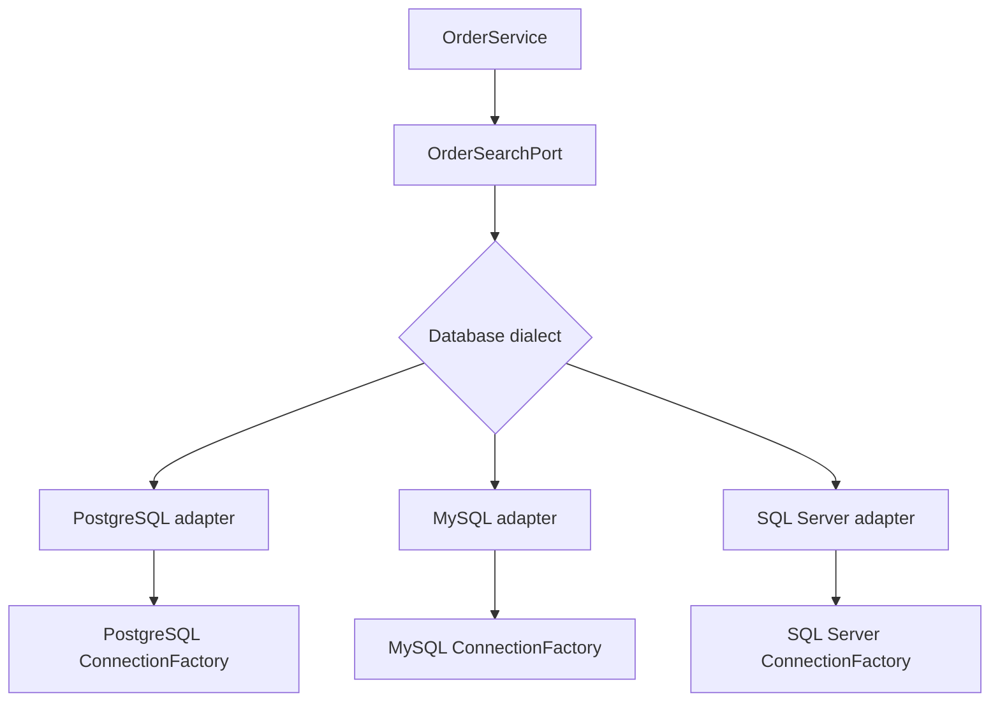

# Lập kiểm thử tương thích thay vì giả định cùng một SQL chạy mọi nơi

Spring Data R2DBC hỗ trợ nhiều hệ quản trị quan hệ, nhưng điều đó không có nghĩa mọi câu SQL đều portable. PostgreSQL, MySQL, SQL Server, Oracle và các hệ quản trị khác có khác biệt về cú pháp phân trang, generated key, upsert, kiểu dữ liệu, quoting identifier, hàm JSON, khóa và transaction. Một câu query chạy đúng trên database của môi trường phát triển chưa chứng minh nó sẽ chạy đúng trên database production.

Muốn hỗ trợ nhiều hệ quản trị một cách đáng tin cậy, cần xác định rõ những database và phiên bản thực sự được hỗ trợ, tách phần SQL phụ thuộc dialect khỏi logic nghiệp vụ, rồi kiểm thử tích hợp trên từng engine/driver trong ma trận CI. Test dùng mock hoặc H2 vẫn hữu ích cho một số mục đích, nhưng không thay thế được kiểm thử với đúng database và R2DBC driver.

## 1. Portability không chỉ là câu SQL có chạy hay không

Một truy vấn có thể chạy trên hai database nhưng trả kết quả khác nhau do semantics của kiểu dữ liệu, null, collation, timezone, isolation hoặc thứ tự sắp xếp. Vì vậy, kiểm thử tương thích cần xác nhận cả cú pháp lẫn hành vi.

Các lớp khác biệt thường gặp:

| Lớp khác biệt | Ví dụ | Rủi ro |
|---|---|---|
| Cú pháp SQL | `LIMIT`, `TOP`, `FETCH FIRST` | Query không parse được trên engine khác |
| Generated key | `RETURNING`, `OUTPUT`, generated keys của driver | Không nhận được ID hoặc cột database sinh |
| Upsert | `ON CONFLICT`, `ON DUPLICATE KEY`, `MERGE` | Hành vi conflict và concurrency khác nhau |
| Identifier | `"name"`, `` `name` ``, `[name]` | Tên bảng/cột bị hiểu sai hoặc phân biệt hoa thường |
| Kiểu dữ liệu | Boolean, UUID, JSON, array, timestamp | Mapping Java khác hoặc mất precision |
| Hàm và operator | `ILIKE`, JSON operator, string/date functions | Query chỉ chạy trên một dialect |
| Pagination/order | Tie-breaker, null ordering, collation | Trang dữ liệu trùng hoặc thiếu hàng |
| Lock/concurrency | `FOR UPDATE`, lock hints, isolation | Hành vi tranh chấp khác nhau |
| Error reporting | SQLSTATE, vendor error code | Phân loại lỗi/retry không chính xác |
| DDL/migration | Identity, sequence, index syntax | Schema không được tạo giống nhau |

Portability cần được định nghĩa theo hợp đồng ứng dụng: cùng input phải tạo ra kết quả và side effect tương đương trên mọi database được hỗ trợ, trong giới hạn semantics đã công bố.

## 2. Xác định ma trận database được hỗ trợ

Không nên tuyên bố “hỗ trợ mọi database” nếu dự án chỉ chạy test trên một engine. Hãy liệt kê cụ thể:

- Hệ quản trị và phiên bản server.
- R2DBC driver và phiên bản driver.
- Spring Boot, Spring Framework và Spring Data release train.
- Các tính năng SQL được dùng và yêu cầu phiên bản tối thiểu.
- Các phiên bản database còn nằm trong vòng đời hỗ trợ của tổ chức.

Ví dụ một ma trận dự án có thể hỗ trợ:

| Database | Server version | R2DBC driver | Mục đích |
|---|---|---|---|
| PostgreSQL | 16.x | r2dbc-postgresql phiên bản đã khóa | Production chính |
| MySQL | 8.4.x | R2DBC MySQL driver đã khóa | Khách hàng triển khai thay thế |
| SQL Server | 2022 | R2DBC SQL Server driver đã khóa | Hệ thống tích hợp enterprise |

Các phiên bản trên chỉ là ví dụ minh họa cách lập ma trận, không phải tuyên bố tương thích mặc định của Spring Data R2DBC. Dự án phải chọn phiên bản cụ thể dựa trên driver, Spring release train và môi trường triển khai, sau đó ghi vào build/dependency management.

Ma trận nên bao gồm những tổ hợp thực sự được hỗ trợ. Không cần chạy mọi phiên bản cũ không còn được duy trì, nhưng phải kiểm thử ít nhất phiên bản production và phiên bản nâng cấp mục tiêu trước khi thay đổi.

## 3. Hiểu phần nào Spring Data R2DBC đã trừu tượng hóa

Spring Data R2DBC có `R2dbcDialect` để mô tả các khác biệt mà framework cần khi tạo SQL từ mapping metadata. Dialect có thể cung cấp thông tin như bind markers, quoting, kiểu dữ liệu được hỗ trợ, generated identifier và cách tạo một số cấu trúc query.

Điều này giúp các thao tác Repository/Template phổ biến có thể hoạt động trên nhiều database mà không phải tự viết lại toàn bộ SQL. Ví dụ, khi dùng `ReactiveCrudRepository.save(...)`, Spring Data sử dụng mapping metadata và dialect để tạo câu lệnh insert/update phù hợp.

Tuy nhiên, abstraction đó không tự viết lại mọi câu SQL do ứng dụng cung cấp. Nếu dùng `DatabaseClient.sql(...)` với `LIMIT`, `RETURNING`, JSON operator hoặc hàm đặc thù PostgreSQL, câu SQL vẫn phụ thuộc PostgreSQL. `DatabaseClient` hỗ trợ bind parameter theo dialect, nhưng không biến toàn bộ cú pháp SQL vendor-specific thành portable.

| API | Mức độ trừu tượng hóa | Trách nhiệm của ứng dụng |
|---|---|---|
| `ReactiveCrudRepository` | Cao cho CRUD theo entity | Thiết kế mapping và kiểm thử hành vi của driver/dialect |
| Derived query method | Cao cho các truy vấn được Spring Data hỗ trợ | Kiểm tra semantics và giới hạn biểu thức được sinh |
| `R2dbcEntityTemplate` + `Query`/`Criteria` | Cao cho truy vấn theo mapping metadata | Kiểm thử sort, pagination, mapping và dialect |
| `DatabaseClient` với SQL đơn giản | Trung bình | Viết SQL trong tập cú pháp được các engine hỗ trợ và kiểm thử từng engine |
| `DatabaseClient` với SQL vendor-specific | Thấp | Duy trì implementation riêng theo dialect và kiểm thử trực tiếp |
| R2DBC SPI `Connection`/`Statement` | Thấp hơn nữa | Quản lý bind marker, generated values, transaction và khác biệt driver phù hợp |

Đừng bỏ qua abstraction của Spring Data khi chỉ cần CRUD thông thường. Ngược lại, đừng giả định framework có thể tự chuyển đổi một câu SQL thuần sang dialect khác.

## 4. Chọn chiến lược SQL theo mức độ phụ thuộc dialect

Có thể chia truy vấn thành ba nhóm:

**Nhóm A — SQL portable:** dùng các biểu thức phổ biến như `SELECT`, `INSERT`, `UPDATE`, `DELETE`, `JOIN`, `WHERE`, `GROUP BY`, `CASE`, `COALESCE`, `EXISTS` và bind parameter. Vẫn cần test vì kiểu dữ liệu, collation và transaction có thể khác.

**Nhóm B — SQL có khác biệt nhỏ:** pagination, generated keys, quoting, date arithmetic hoặc boolean cần một adapter nhỏ để chọn cú pháp theo dialect.

**Nhóm C — SQL đặc thù engine:** JSON operator, full-text search, array, CTE/function riêng, lock hint hoặc tối ưu hiệu năng. Nên tách implementation theo database thay vì cố ép về một câu SQL giả portable.

Ví dụ kiến trúc:



Service phụ thuộc vào hợp đồng nghiệp vụ `OrderSearchPort`. Cấu hình ứng dụng chọn adapter phù hợp với database đang triển khai. Nếu một deployment chỉ hỗ trợ một database, có thể chọn adapter bằng profile hoặc conditional bean lúc khởi động; không cần kiểm tra tên database trong từng dòng nghiệp vụ.

## 5. Ví dụ khác biệt cú pháp phân trang

Một trong những khác biệt thường gặp là giới hạn và offset:

### PostgreSQL và MySQL

```sql
SELECT id, order_no, created_at
FROM orders
WHERE status = :status
ORDER BY created_at DESC, id DESC
LIMIT :limit OFFSET :offset;
```

### SQL Server

```sql
SELECT id, order_no, created_at
FROM dbo.orders
WHERE status = @status
ORDER BY created_at DESC, id DESC
OFFSET @offset ROWS
FETCH NEXT @limit ROWS ONLY;
```

SQL Server yêu cầu `ORDER BY` khi dùng `OFFSET/FETCH`. Bind marker thực tế do `DatabaseClient`/driver quản lý theo cấu hình; ví dụ SQL Server ở trên chỉ minh họa cú pháp SQL phía server.

### Oracle hiện đại

```sql
SELECT id, order_no, created_at
FROM orders
WHERE status = :status
ORDER BY created_at DESC, id DESC
OFFSET :offset ROWS
FETCH NEXT :limit ROWS ONLY;
```

Các cú pháp trên có hình thức khác nhau. Dù vậy, hợp đồng nghiệp vụ nên giống nhau: cùng `status`, `offset` và `limit` phải trả cùng tập kết quả theo một thứ tự xác định.

### Luôn có thứ tự ổn định

Không phân trang trên một thứ tự không duy nhất:

```sql
ORDER BY created_at DESC
```

Nếu nhiều hàng có cùng timestamp, thứ tự giữa chúng có thể thay đổi. Hãy thêm khóa duy nhất làm tie-breaker:

```sql
ORDER BY created_at DESC, id DESC
```

Nếu sort key có thể null, collation khác nhau hoặc kiểu chuỗi khác nhau giữa engine, hãy xác định quy tắc null ordering và collation trong hợp đồng, rồi viết adapter hoặc chuẩn hóa dữ liệu phù hợp.

## 6. Ví dụ khác biệt generated key

Các database có cách lấy lại giá trị do insert sinh ra khác nhau:

### PostgreSQL

```sql
INSERT INTO orders (order_no, status)
VALUES (:orderNo, :status)
RETURNING id;
```

### SQL Server

```sql
INSERT INTO dbo.orders (order_no, status)
OUTPUT INSERTED.id
VALUES (@orderNo, @status);
```

### MySQL

MySQL thường trả generated key qua cơ chế generated keys của driver. Cách sử dụng `Statement.returnGeneratedValues(...)` và mức hỗ trợ cột được trả về phải được xác nhận với R2DBC driver cụ thể. Không nên giả định MySQL có cùng cú pháp `RETURNING` như PostgreSQL trên mọi phiên bản.

Nếu chỉ cần ID entity qua `ReactiveCrudRepository.save(...)`, Spring Data R2DBC có thể phối hợp dialect/driver để lấy generated ID. Nếu dùng SQL trực tiếp, cần kiểm thử riêng cơ chế generated values của từng driver.

Không dùng `SELECT MAX(id)` sau insert để lấy ID mới. Request khác có thể insert đồng thời và trả về ID của một hàng khác. Cũng không nên gọi `LAST_INSERT_ID()` qua một lần lấy connection độc lập sau khi insert nếu không bảo đảm đó là cùng session.

## 7. Upsert không có một cú pháp chung cho mọi database

Upsert là thao tác insert nếu chưa có hàng hoặc update khi khóa đã tồn tại. Cú pháp và semantics khác nhau:

### PostgreSQL

```sql
INSERT INTO customer (external_id, display_name)
VALUES (:externalId, :displayName)
ON CONFLICT (external_id)
DO UPDATE SET display_name = EXCLUDED.display_name;
```

### MySQL

```sql
INSERT INTO customer (external_id, display_name)
VALUES (:externalId, :displayName)
ON DUPLICATE KEY UPDATE
    display_name = VALUES(display_name);
```

Chi tiết cú pháp MySQL có thể thay đổi hoặc bị khuyến cáo thay thế theo phiên bản; hãy dùng dạng được phiên bản server mục tiêu hỗ trợ.

### SQL Server / Oracle

SQL Server và Oracle có các cách dùng `MERGE` hoặc mẫu update-then-insert phù hợp với phiên bản. `MERGE` có các lưu ý concurrency và lỗi riêng theo engine/version; không nên coi nó là lựa chọn portable chỉ vì hai sản phẩm cùng có cú pháp tương tự.

Nếu cần một hợp đồng upsert chung, hãy tạo interface như `CustomerUpsertPort` và cung cấp implementation theo database. Integration test phải xác nhận:

- Hàng mới được insert đúng một lần.
- Hàng đã tồn tại được cập nhật theo đúng cột cho phép.
- Unique constraint vẫn bảo vệ khi hai request đồng thời.
- Giá trị trả về là hàng mới nhất theo hợp đồng.
- Retry sau timeout không tạo tác dụng phụ trùng.

## 8. Identifier và quoting khác nhau

Các hệ quản trị có quy tắc quoting identifier khác nhau:

| Database | Ví dụ quote identifier |
|---|---|
| PostgreSQL | `"order"` |
| MySQL | `` `order` `` |
| SQL Server | `[order]` hoặc `"order"` khi cấu hình phù hợp |
| Oracle | `"ORDER"` hoặc tên không quote theo quy tắc mặc định |

Tên bảng/cột trùng reserved word như `order`, `user`, `group` có thể hoạt động khác nhau. Tốt nhất tránh reserved word và đặt tên đơn giản, nhất quán.

Quoting có thể làm thay đổi semantics hoa thường. PostgreSQL chuyển identifier không quote về chữ thường; identifier được quote giữ nguyên case. SQL Server thường phụ thuộc collation database; MySQL còn phụ thuộc hệ điều hành và cấu hình tên bảng.

Không dùng bind parameter cho identifier:

```sql
-- Không hoạt động như mong đợi: bind marker là giá trị, không phải tên bảng.
SELECT * FROM :tableName;
```

Nếu cần chọn bảng/schema động, dùng allow-list do server quản lý và quote identifier theo dialect. Không nối trực tiếp chuỗi do client gửi vào SQL.

## 9. Khác biệt kiểu dữ liệu và mapping Java

Một kiểu Java có thể được ánh xạ khác nhau tùy driver/database:

| Ý nghĩa | PostgreSQL | MySQL | SQL Server | Gợi ý Java |
|---|---|---|---|---|
| Boolean | `boolean` | `BOOLEAN` thường là alias của `TINYINT(1)` | `bit` | `Boolean` |
| UUID | `uuid` | Có thể lưu `BINARY(16)` hoặc chuỗi | `uniqueidentifier` | `UUID` với converter/driver hỗ trợ |
| JSON | `json`/`jsonb` | `JSON` | Thường dùng `nvarchar(max)` hoặc kiểu/extension phù hợp | DTO/`Json`/`String` theo driver và converter |
| Timestamp instant | `timestamptz` | `TIMESTAMP` có quy tắc timezone session | `datetimeoffset` hoặc UTC `datetime2` | `Instant`/`OffsetDateTime` theo mapping |
| Decimal | `numeric` | `DECIMAL` | `decimal`/`numeric` | `BigDecimal` |
| Array | Array type | Hỗ trợ khác nhau, không tương đương PostgreSQL | Không có kiểu array tổng quát tương đương | Collection qua converter hoặc bảng liên kết |

Không nên chỉ dựa vào tên kiểu Java để suy ra driver hỗ trợ. Hãy kiểm tra kiểu SQL thật, metadata trả về, converter và precision sau khi round-trip.

### Boolean

PostgreSQL có kiểu `boolean`; SQL Server dùng `bit`; MySQL thường coi `BOOLEAN` là alias của `TINYINT(1)`. Nếu ứng dụng cần ba trạng thái true/false/unknown, dùng kiểu nullable `Boolean` và xác định semantics null rõ ràng.

### UUID

PostgreSQL có kiểu `uuid`, SQL Server có `uniqueidentifier`, còn MySQL thường lưu UUID dưới dạng binary hoặc text. Cần kiểm tra driver map `UUID` trực tiếp hay cần converter. Cũng cần xác định cách sắp xếp/biểu diễn nếu UUID được dùng trong index.

### Decimal

Tiền và giá trị cần chính xác thập phân nên dùng `BigDecimal`, không dùng `double`. Precision/scale phải được định nghĩa trong schema và test round-trip trên mỗi database.

## 10. JSON, array và các hàm đặc thù

Các database có hỗ trợ JSON khác nhau về kiểu lưu, operator, index và hàm truy vấn. PostgreSQL có `json`/`jsonb` cùng operator; MySQL có kiểu JSON và các hàm JSON riêng; SQL Server thường thao tác JSON qua hàm trên chuỗi; Oracle có khả năng JSON theo phiên bản và kiểu cột.

Ví dụ PostgreSQL:

```sql
SELECT id, payload
FROM event_log
WHERE payload ->> 'type' = :eventType;
```

Ví dụ MySQL:

```sql
SELECT id, payload
FROM event_log
WHERE JSON_UNQUOTE(JSON_EXTRACT(payload, '$.type')) = :eventType;
```

Hai query cùng thể hiện ý nghĩa lọc event type nhưng dùng cú pháp khác. Hãy đặt chúng sau một interface truy vấn, ví dụ `findEventsByType`, và viết integration test xác nhận kết quả giống nhau.

Nếu chỉ cần lưu và đọc toàn bộ JSON document, có thể giữ payload dưới dạng kiểu dữ liệu được driver hỗ trợ hoặc converter. Nếu cần query sâu vào JSON thường xuyên, hãy cân nhắc chuẩn hóa cột/index hoặc cung cấp adapter theo database.

Array cũng không portable đồng đều. PostgreSQL hỗ trợ array native; các engine khác có thể cần JSON, bảng con hoặc bảng liên kết. Đừng để domain model phụ thuộc vào một kiểu array database nếu sản phẩm phải hỗ trợ nhiều engine mà không có converter/adapter rõ ràng.

## 11. Collation, tìm kiếm không phân biệt hoa thường và sort

Một câu query `WHERE name = :name` có thể phân biệt hoa thường trên database này nhưng không phân biệt trên database khác, tùy collation và cấu hình. Tương tự, thứ tự sort tiếng Việt, dấu, ký tự Unicode và accent có thể khác.

PostgreSQL hỗ trợ `ILIKE` cho tìm kiếm không phân biệt hoa thường; MySQL thường dựa vào collation; SQL Server cũng có collation cấp database/cột. Không nên giả định `LOWER(name) = LOWER(:name)` luôn có cùng kết quả locale ở mọi engine.

Để có hợp đồng nhất quán:

- Xác định quy tắc normalize dữ liệu khi ghi.
- Chọn collation phù hợp ở database/cột nếu engine hỗ trợ.
- Nếu cần so sánh theo Unicode normalization, chuẩn hóa ở ứng dụng hoặc lưu cột normalized riêng.
- Test ký tự có dấu, không dấu, chữ hoa/thường và ký tự Unicode ngoài ASCII.
- Test cả equality, prefix search và sort.

Nếu tìm kiếm là tính năng cốt lõi, hãy tạo adapter theo database và tập dữ liệu kiểm thử chuẩn thay vì dùng một câu SQL ngắn rồi mặc định semantics giống nhau.

## 12. Khác biệt date/time và timezone

Các hệ quản trị có semantics khác nhau cho timestamp:

- PostgreSQL `timestamp with time zone` lưu một instant và hiển thị theo timezone session; không giữ tên timezone gốc.
- MySQL `TIMESTAMP` có chuyển đổi theo timezone session, còn `DATETIME` lưu thành phần ngày giờ không gắn timezone.
- SQL Server có `datetimeoffset` giữ offset và `datetime2` không có offset.
- Precision phần thập phân và cách làm tròn/cắt có thể khác.

Với audit event, dùng `Instant` và quy ước UTC thường dễ trao đổi giữa các hệ thống. Với lịch địa phương, cần lưu thêm `ZoneId` nếu phải giữ quy tắc timezone địa lý. Integration test nên ghi rồi đọc lại timestamp để xác nhận cùng một instant, thay vì chỉ so sánh chuỗi hiển thị.

## 13. Khác biệt lock và transaction

Một số cú pháp khóa không portable:

```sql
-- PostgreSQL/MySQL có hỗ trợ FOR UPDATE theo ngữ cảnh phù hợp.
SELECT id, balance
FROM account
WHERE id = :id
FOR UPDATE;
```

SQL Server thường dùng table hints như `UPDLOCK` hoặc `ROWLOCK` theo nhu cầu và semantics riêng. Oracle có hỗ trợ `FOR UPDATE`, nhưng chi tiết wait/skip locked và cú pháp có khác biệt theo phiên bản.

Ngay cả khi câu lệnh có cú pháp tương tự, isolation mặc định, lock granularity, deadlock detection và cách timeout lock có thể khác. Hãy kiểm thử hành vi concurrency thay vì chỉ xác nhận query không báo lỗi.

Các test cần xác nhận:

- Hai transaction cập nhật cùng một hàng có kết quả đúng theo invariant.
- Optimistic locking phát hiện version cũ.
- Pessimistic lock chặn hoặc từ chối transaction cạnh tranh theo hợp đồng.
- Deadlock/serialization failure được phân loại và retry đúng.
- Transaction rollback không để lại một phần thay đổi.

Không dựa vào một lock hint vendor-specific trong logic nghiệp vụ dùng chung. Đặt chiến lược locking sau repository/adapter hoặc dùng abstraction Spring Data phù hợp khi có thể.

## 14. Bind marker và tham số trong DatabaseClient

R2DBC driver có cú pháp bind marker riêng. Ví dụ PostgreSQL native protocol thường dùng `$1`, SQL Server có dạng marker theo driver, trong khi API Spring `DatabaseClient` có thể cho phép dùng tên tham số như `:status` và chuyển đổi sang bind marker của dialect.

Ví dụ:

```java
databaseClient.sql("""
        SELECT id, order_no
        FROM orders
        WHERE status = :status
        """)
    .bind("status", status)
    .map((row, metadata) -> new OrderSummary(
        row.get("id", Long.class),
        row.get("order_no", String.class)
    ))
    .all();
```

Khi dùng `DatabaseClient`, hãy dùng bind API nhất quán và kiểm tra cách dialect chuyển named parameter sang marker thực tế. Khi dùng trực tiếp `Connection.createStatement(...)` từ R2DBC SPI, phải tuân theo bind marker mà driver yêu cầu; không sao chép nguyên SQL marker từ driver khác.

Bind parameter bảo vệ giá trị, không bảo vệ tên schema/table/cột hoặc keyword SQL. Identifier động cần allow-list và quoting theo dialect.

## 15. Tạo interface chung và adapter theo dialect

Giả sử use case cần tìm đơn hàng theo trạng thái và phân trang. Service không nên chứa `if (database == POSTGRES)` hoặc ghép SQL theo request. Hãy tạo port:

```java
public interface OrderSearchPort {
    Flux<OrderSummary> findByStatus(String status, int limit, long offset);
}
```

Implementation PostgreSQL:

```java
@Repository
@Profile("postgres")
public class PostgresOrderSearchAdapter implements OrderSearchPort {

    private final DatabaseClient databaseClient;

    public PostgresOrderSearchAdapter(DatabaseClient databaseClient) {
        this.databaseClient = databaseClient;
    }

    @Override
    public Flux<OrderSummary> findByStatus(String status, int limit, long offset) {
        return databaseClient.sql("""
                SELECT id, order_no
                FROM orders
                WHERE status = :status
                ORDER BY created_at DESC, id DESC
                LIMIT :limit OFFSET :offset
                """)
            .bind("status", status)
            .bind("limit", limit)
            .bind("offset", offset)
            .map((row, metadata) -> new OrderSummary(
                row.get("id", Long.class),
                row.get("order_no", String.class)
            ))
            .all();
    }
}
```

Implementation SQL Server dùng cú pháp phân trang tương ứng:

```java
@Repository
@Profile("sqlserver")
public class SqlServerOrderSearchAdapter implements OrderSearchPort {

    private final DatabaseClient databaseClient;

    public SqlServerOrderSearchAdapter(DatabaseClient databaseClient) {
        this.databaseClient = databaseClient;
    }

    @Override
    public Flux<OrderSummary> findByStatus(String status, int limit, long offset) {
        return databaseClient.sql("""
                SELECT id, order_no
                FROM dbo.orders
                WHERE status = :status
                ORDER BY created_at DESC, id DESC
                OFFSET :offset ROWS FETCH NEXT :limit ROWS ONLY
                """)
            .bind("status", status)
            .bind("limit", limit)
            .bind("offset", offset)
            .map((row, metadata) -> new OrderSummary(
                row.get("id", Long.class),
                row.get("order_no", String.class)
            ))
            .all();
    }
}
```

Đây là ví dụ cấu trúc adapter; cần bảo đảm mỗi profile chỉ tạo đúng một implementation và `DatabaseClient` được gắn với connection factory tương ứng. Trong ứng dụng nhiều database cùng lúc, có thể dùng `@Qualifier`/bean name rõ thay cho profile.

Service dùng hợp đồng chung:

```java
@Service
public class OrderSearchService {

    private final OrderSearchPort searchPort;

    public OrderSearchService(OrderSearchPort searchPort) {
        this.searchPort = searchPort;
    }

    public Flux<OrderSummary> search(String status, int limit, long offset) {
        int safeLimit = Math.max(1, Math.min(limit, 100));
        long safeOffset = Math.max(0, offset);
        return searchPort.findByStatus(status, safeLimit, safeOffset);
    }
}
```

Logic nghiệp vụ không phải biết database đang dùng cú pháp nào. Mỗi adapter được kiểm thử trên engine của nó.

## 16. Không cần tạo adapter riêng cho mọi câu CRUD

Không nên nhân đôi toàn bộ repository chỉ vì cần hỗ trợ hai database. Hãy ưu tiên:

- `ReactiveCrudRepository` cho CRUD thông thường.
- Derived query hoặc `@Query` cho truy vấn có thể diễn đạt portable.
- `R2dbcEntityTemplate` cho query theo `Criteria`/`Query` mà Spring Data có thể dịch theo dialect.
- Adapter riêng cho những truy vấn thực sự vendor-specific.

Tách adapter khi có khác biệt thật sự về SQL hoặc semantics. Nếu hai database đều chạy được một query portable và kết quả giống nhau, có thể giữ một implementation chung rồi kiểm thử trên cả hai engine.

## 17. Migration cũng phải được kiểm thử theo database

SQL migration thường chứa nhiều khác biệt hơn câu query runtime: identity/sequence, type, index, constraint, function, trigger, generated column và DDL transaction semantics.

Ví dụ identity:

```sql
-- PostgreSQL hiện đại
id BIGINT GENERATED BY DEFAULT AS IDENTITY PRIMARY KEY
```

```sql
-- MySQL
id BIGINT AUTO_INCREMENT PRIMARY KEY
```

```sql
-- SQL Server
id BIGINT IDENTITY(1,1) PRIMARY KEY
```

Không nên dùng một file migration duy nhất nếu cú pháp không portable. Có thể tổ chức migration chung và migration theo engine, ví dụ với Flyway:

```text
src/main/resources/db/migration/
├── common/
│   ├── V001__create_reference_tables.sql
│   └── V002__add_common_indexes.sql
├── postgresql/
│   └── V003__postgres_json_index.sql
├── mysql/
│   └── V003__mysql_json_index.sql
└── sqlserver/
    └── V003__sqlserver_computed_column.sql
```

Đây là cách tổ chức minh họa; Flyway location/versioning thực tế cần được cấu hình để chỉ chạy migration phù hợp cho database đang triển khai. Nếu dùng Liquibase, có thể dùng changelog, context hoặc precondition theo database.

Ứng dụng runtime dùng R2DBC không bắt buộc migration tool cũng phải dùng R2DBC. Flyway/Liquibase thường dùng JDBC; migration là công việc triển khai schema riêng với transaction runtime của request.

## 18. Dùng Testcontainers để kiểm thử database thật

Testcontainers giúp chạy database engine thật trong CI hoặc máy phát triển. Điều này quan trọng vì H2 không mô phỏng đầy đủ cú pháp, kiểu dữ liệu, lock, JSON, generated key hoặc transaction semantics của PostgreSQL/MySQL/SQL Server.

Ví dụ integration test với PostgreSQL:

```java
@SpringBootTest
@Testcontainers
class OrderRepositoryPostgresTest {

    @Container
    static final PostgreSQLContainer<?> POSTGRES =
        new PostgreSQLContainer<>("postgres:16-alpine");

    @DynamicPropertySource
    static void databaseProperties(DynamicPropertyRegistry registry) {
        registry.add("spring.r2dbc.url", () ->
            "r2dbc:postgresql://" + POSTGRES.getHost() + ":"
                + POSTGRES.getMappedPort(5432) + "/"
                + POSTGRES.getDatabaseName());
        registry.add("spring.r2dbc.username", POSTGRES::getUsername);
        registry.add("spring.r2dbc.password", POSTGRES::getPassword);
    }

    @Autowired
    OrderRepository orderRepository;

    @Test
    void savesAndReadsOrder() {
        Order order = new Order(null, "ORD-100", "NEW");

        StepVerifier.create(orderRepository.save(order)
                .flatMap(saved -> orderRepository.findById(saved.getId())))
            .assertNext(saved -> {
                assertThat(saved.getOrderNo()).isEqualTo("ORD-100");
                assertThat(saved.getId()).isNotNull();
            })
            .verifyComplete();
    }
}
```

Ví dụ cần dependency Testcontainers PostgreSQL, JUnit integration và R2DBC PostgreSQL driver tương thích với dự án. Container phải khởi động trước khi Spring context tạo connection. Cấu hình migration của test cũng cần chạy đúng schema trước khi Repository được sử dụng.

Với database khác, thay container image, port, R2DBC URL scheme và driver. Không chỉ đổi image mà giữ nguyên URL/driver PostgreSQL.

## 19. Testcontainers không thay thế kiểm thử driver

Testcontainers chạy server database thật, nhưng ứng dụng vẫn kết nối thông qua driver cụ thể. Vì vậy, một integration test tương thích phải kiểm tra cả:

1. Database server/version.
2. R2DBC driver/version.
3. Spring Data/Spring Framework version.
4. Schema được tạo từ migration thật.
5. Query và mapping thực tế qua connection factory production-like.

Ví dụ, `RETURNING` có thể được database hỗ trợ nhưng cách R2DBC driver cung cấp generated values cho một batch statement vẫn có giới hạn riêng. Một kiểu JSON có thể lưu được nhưng driver trả về `String`, `Json` hoặc kiểu khác tùy implementation. Test phải đi qua đúng driver, không chỉ chạy SQL bằng JDBC console.

## 20. Xây dựng contract test dùng chung cho mọi database

Một cách hiệu quả là định nghĩa một bộ test contract cho repository port. Cùng bộ hành vi được chạy trên từng implementation/database.

Ví dụ contract:

```java
abstract class OrderRepositoryContract {

    protected abstract OrderSearchPort searchPort();
    protected abstract OrderRepositoryFixture fixture();

    @Test
    void filtersByStatus() {
        OrderRepositoryFixture data = fixture();
        data.insertOrder("A-1", "NEW");
        data.insertOrder("A-2", "PAID");

        StepVerifier.create(searchPort().findByStatus("NEW", 20, 0))
            .expectNextMatches(order -> order.orderNo().equals("A-1"))
            .verifyComplete();
    }

    @Test
    void returnsStablePages() {
        // Tạo nhiều hàng có cùng created_at và xác nhận id tie-breaker.
    }
}
```

Mỗi database test class cung cấp adapter và fixture tương ứng:

```java
class PostgresOrderRepositoryTest extends OrderRepositoryContract {
    // Khởi tạo PostgreSQL Testcontainer, adapter và fixture.
}

class MySqlOrderRepositoryTest extends OrderRepositoryContract {
    // Khởi tạo MySQL Testcontainer, adapter và fixture.
}
```

Đây là khung thiết kế test; cách khởi tạo context/fixture có thể dùng Spring Boot test, Testcontainers hoặc extension riêng. Mục tiêu là cùng một hợp đồng được kiểm tra trên mỗi database, không phải sao chép assertions khác nhau rồi vô tình kiểm tra các hành vi không tương đương.

## 21. Bộ test tương thích nên bao phủ những gì?

Ít nhất hãy kiểm thử các nhóm hành vi sau trên từng database được hỗ trợ:

| Nhóm | Test cần có |
|---|---|
| CRUD | Insert, generated ID, select, update, delete |
| Null/default | Null binding, default value, nullable column, `COALESCE` |
| Type mapping | Decimal precision, Boolean, UUID, timestamp, JSON và enum nếu dùng |
| Pagination | Limit/offset, thứ tự ổn định, tie-breaker, trang cuối |
| Sorting/filter | Case sensitivity, collation, null ordering, filter tùy chọn |
| Aggregate/join | `COUNT`, `SUM`, join cardinality, không nhân bản dữ liệu |
| Concurrency | Unique constraint, optimistic locking, lock timeout, deadlock |
| Transaction | Commit, rollback, nhiều statement, cancellation và timeout |
| Generated values | Identity/sequence, default, trigger, generated column |
| Error mapping | SQLSTATE/vendor code, constraint violation, lỗi transient |
| Migration | Tạo schema mới, upgrade từ version trước, index và constraint |
| Pool/driver | Acquire timeout, connection validation, cancellation, connection reuse |

Không phải dự án nào cũng dùng JSON, array hoặc pessimistic lock. Chỉ cần kiểm thử những tính năng nằm trong hợp đồng hỗ trợ của ứng dụng; không cần tạo test cho feature không dùng.

## 22. Kiểm thử semantics, không chỉ kiểm tra query trả hàng

Một test kiểu `expectNextCount(1)` có thể bỏ qua khác biệt quan trọng. Ví dụ:

- Query tìm tên không phân biệt hoa thường trả kết quả khác nhau.
- Pagination trả trùng hàng giữa hai trang.
- `NULL` được sort ở đầu trên engine này nhưng ở cuối trên engine khác.
- Decimal bị làm tròn khác nhau.
- Timestamp bị giảm precision.
- `COUNT` sau `LEFT JOIN` đếm hàng mở rộng thay vì hàng con.
- Upsert cập nhật cột ngoài dự kiến.
- Lock query không thực sự khóa như mong muốn.

Hãy tạo dữ liệu fixture có các trường hợp biên: nhiều hàng cùng sort key, null, chuỗi Unicode có dấu, decimal ở ranh giới precision, timestamp sát biên ngày, bản ghi thiếu quan hệ và các request đồng thời.

## 23. Kiểm thử error mapping theo SQLSTATE và vendor code

Không nên viết code xử lý lỗi chỉ dựa trên message text. Database và driver có thể cung cấp SQLSTATE hoặc vendor error code khác nhau.

Ví dụ PostgreSQL:

| SQLSTATE | Ý nghĩa |
|---|---|
| `23505` | Unique violation |
| `23503` | Foreign key violation |
| `23502` | Not-null violation |
| `23514` | Check constraint violation |
| `40001` | Serialization failure |
| `40P01` | Deadlock detected |

Các engine khác có mã lỗi riêng. Nên tạo lớp chuyển đổi lỗi theo dialect hoặc dựa trên exception abstraction của Spring khi đủ thông tin:

```java
public interface DatabaseErrorClassifier {
    boolean isUniqueViolation(Throwable error);
    boolean isTransientFailure(Throwable error);
    boolean isDeadlock(Throwable error);
}
```

Mỗi database có classifier phù hợp nếu mã lỗi khác nhau. Test phải gây ra lỗi constraint/deadlock thật trên engine để xác nhận driver đưa thông tin nào vào exception chain.

Không retry mọi `DataAccessException`. Unique violation thường không thể sửa bằng retry; deadlock hoặc serialization failure có thể retry toàn bộ transaction nếu thao tác idempotent và có giới hạn.

## 24. Kiểm thử migration như một phần của tương thích

Một database có thể chạy query runtime tốt nhưng migration thất bại khi nâng cấp từ schema cũ. CI nên chạy:

1. Tạo database trống.
2. Chạy toàn bộ migration từ đầu.
3. Kiểm tra bảng, index, constraint, sequence và trigger.
4. Chạy contract/integration test.
5. Tạo database ở phiên bản migration trước đó.
6. Chạy migration upgrade và xác nhận dữ liệu cũ vẫn hợp lệ.

Nếu migration có destructive change, cần test dữ liệu cũ và chiến lược rollout nhiều bước. Không chỉ test schema mới hoàn toàn.

Với Flyway/Liquibase chạy qua JDBC, dùng cùng database server image nhưng kết nối bằng JDBC datasource của migration tool. Sau migration, repository test kết nối bằng R2DBC driver. Điều đó xác nhận cả migration engine lẫn runtime driver.

## 25. Tổ chức CI matrix cho nhiều database

Có thể chia job CI theo database:

```yaml
strategy:
  fail-fast: false
  matrix:
    database:
      - postgres
      - mysql
      - sqlserver
```

Mỗi job:

- Khởi động đúng container/database version.
- Cài đúng R2DBC driver.
- Áp dụng migration dành cho engine đó.
- Chạy cùng contract test.
- Chạy test đặc thù dialect.
- Lưu log database/driver khi thất bại.

Đây là khung ý tưởng cho CI; cú pháp workflow và cách quản lý secret tùy nền tảng GitHub Actions, GitLab CI, Jenkins hoặc hệ thống nội bộ.

Nếu thời gian CI hạn chế, có thể chạy test portable trên mọi commit và chạy full matrix định kỳ hoặc trước release. Tuy nhiên, mọi thay đổi SQL, mapping, migration, driver hoặc Spring Data version cần chạy ít nhất matrix đầy đủ trước khi phát hành.

## 26. Kiểm thử trên H2 có vai trò gì?

H2 hữu ích cho một số test nhanh về logic hoặc SQL đơn giản, nhưng không phải bản thay thế cho PostgreSQL, MySQL, SQL Server hoặc Oracle. Dù H2 có chế độ tương thích cú pháp, nó không tái tạo đầy đủ:

- Query planner và index behavior.
- Locking, isolation và deadlock semantics.
- JSON/array/native types.
- Generated key, identity và sequence behavior.
- Collation, timezone và precision.
- Error code và exception của driver.
- Pool/cancellation/network behavior.
- DDL và migration vendor-specific.

Hãy dùng H2 cho test phù hợp với phạm vi của nó, nhưng không dùng kết quả H2 làm bằng chứng SQL portable. Test tương thích phải chạy trên engine thực tế.

## 27. Không mock quá sâu phần SQL cần kiểm chứng

Mock `DatabaseClient`, `ConnectionFactory` hoặc repository có thể giúp kiểm tra orchestration của service, nhưng không xác nhận câu SQL có chạy được. Một mock có thể trả DTO hoàn hảo dù SQL sai cú pháp, alias không tồn tại hoặc driver không hỗ trợ generated key.

Phân chia test:

| Loại test | Mục đích | Công cụ thường dùng |
|---|---|---|
| Unit test domain/service | Kiểm tra quy tắc nghiệp vụ và orchestration | JUnit, Mockito, Reactor Test |
| Repository integration test | Kiểm tra SQL, mapping và transaction | Testcontainers + R2DBC driver thật |
| Migration test | Kiểm tra DDL và upgrade schema | Flyway/Liquibase + database container |
| Contract test | Cùng một hành vi trên nhiều database | Abstract test suite + container theo engine |
| Performance test | Kiểm tra latency, throughput và query plan | Dataset gần thực tế, benchmark và database metrics |

Không cần bỏ unit test mock; chỉ cần không dùng nó thay thế integration test cho SQL.

## 28. Quản lý version driver và database

Tương thích phụ thuộc cả server và driver. Một phiên bản server có thể hỗ trợ feature mới, nhưng R2DBC driver cũ có thể chưa ánh xạ kiểu dữ liệu hoặc generated values đúng. Ngược lại, driver mới có thể bỏ hỗ trợ một phiên bản server đã cũ.

Hãy khóa version trong dependency management và cập nhật có kiểm soát:

- Nâng driver độc lập có thể làm thay đổi bind marker, type conversion hoặc cancellation.
- Nâng Spring Data có thể thay đổi dialect, mapping hoặc query generation.
- Nâng database có thể thay đổi optimizer, default, collation hoặc semantics feature.
- Nâng JDK có thể ảnh hưởng TLS và thư viện network.

Khi thay đổi một thành phần, chạy matrix trên các database được hỗ trợ và lưu version matrix cùng release artifact. Không dựa vào version “latest” không cố định trong CI production.

## 29. Phân biệt test portable và test đặc thù dialect

Không phải mọi test cần chạy trên mọi database. Có thể tổ chức:

**Portable contract suite:** CRUD, filter, pagination contract, mapping kiểu chung, transaction behavior mà ứng dụng cam kết.

**Dialect-specific suite:** JSON search, full-text, upsert, generated key nhiều hàng, lock hints, stored procedure hoặc query tối ưu riêng.

Ví dụ cấu trúc:

```text
src/test/java/com/example/data/
├── contract/
│   ├── OrderRepositoryContract.java
│   └── CustomerRepositoryContract.java
├── postgres/
│   ├── PostgresOrderSearchTest.java
│   └── PostgresJsonQueryTest.java
├── mysql/
│   ├── MySqlOrderSearchTest.java
│   └── MySqlJsonQueryTest.java
└── sqlserver/
    ├── SqlServerOrderSearchTest.java
    └── SqlServerPaginationTest.java
```

Tập test portable bảo đảm các database giữ cùng hợp đồng; test đặc thù xác nhận adapter tận dụng đúng khả năng của engine. Khi một database không hỗ trợ một feature, hãy công bố feature đó không nằm trong hợp đồng chung hoặc cung cấp implementation thay thế.

## 30. Checklist lập kiểm thử tương thích

Trước khi tuyên bố một truy vấn hoặc module hỗ trợ nhiều database, hãy xác nhận:

1. Danh sách database, server version và R2DBC driver version được ghi rõ.
2. SQL được phân loại portable hay vendor-specific.
3. CRUD dùng Spring Data abstraction khi phù hợp.
4. Bind marker và mapping kiểu dữ liệu được kiểm thử trên driver thật.
5. Pagination có thứ tự ổn định và tie-breaker duy nhất.
6. Generated key và generated values được kiểm thử theo từng engine.
7. Upsert/concurrency có cùng hợp đồng nghiệp vụ.
8. Identifier, quoting, collation và null ordering được kiểm thử.
9. Timestamp, timezone, precision và decimal được round-trip đúng.
10. Lock, isolation, deadlock và rollback được kiểm thử.
11. SQLSTATE/vendor error code được phân loại đúng.
12. Migration chạy từ database trống và upgrade từ version cũ.
13. Testcontainers dùng server thật và đúng R2DBC driver.
14. CI chạy contract suite trên toàn bộ database được hỗ trợ.
15. Version matrix được khóa và kiểm tra lại trước release.

## 31. Quy trình triển khai hỗ trợ nhiều hệ quản trị

Một quy trình có thể áp dụng cho module Spring Data R2DBC:

**Bước 1 — Công bố database được hỗ trợ.** Ghi rõ server version, driver và phiên bản framework.

**Bước 2 — Tận dụng dialect của Spring Data.** Dùng Repository/Template cho CRUD và query có thể được framework dịch.

**Bước 3 — Phân loại SQL tùy chỉnh.** Giữ query portable ở lớp chung; tách query vendor-specific thành adapter.

**Bước 4 — Chuẩn hóa hợp đồng nghiệp vụ.** Xác định semantics của pagination, null, sorting, upsert, generated key, thời gian và locking.

**Bước 5 — Tạo migration theo engine.** Dùng migration chung khi thực sự portable và migration riêng khi DDL khác nhau.

**Bước 6 — Tạo contract test.** Viết một bộ test hành vi dùng chung cho từng database adapter.

**Bước 7 — Chạy Testcontainers matrix.** Dùng đúng database image, driver và Spring Data version.

**Bước 8 — Thêm test đặc thù.** Kiểm tra JSON, full-text, lock, upsert hoặc generated values riêng của từng engine.

**Bước 9 — Chạy CI trước release.** Không phát hành thay đổi SQL/driver/migration nếu matrix hỗ trợ chưa được xác nhận.

## 32. Kết luận

Spring Data R2DBC cung cấp dialect abstraction để các thao tác Repository và Template phổ biến thích nghi với hệ quản trị, nhưng SQL do ứng dụng viết vẫn có thể phụ thuộc engine. Khác biệt không chỉ nằm ở `LIMIT`, `RETURNING` hay upsert mà còn ở identifier, kiểu dữ liệu, collation, timezone, locking, transaction, error code và migration.

Hãy công bố rõ database/version/driver được hỗ trợ, tận dụng abstraction của Spring Data cho CRUD, tách adapter cho SQL đặc thù và định nghĩa hợp đồng hành vi chung. Testcontainers cùng contract/integration tests trên từng database thực tế giúp xác nhận cú pháp, mapping và semantics. H2 hoặc mock vẫn có ích cho test nhanh, nhưng không thay thế ma trận tương thích với đúng server và R2DBC driver mà ứng dụng sẽ vận hành.
