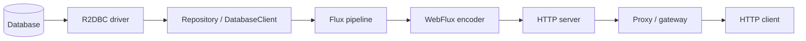
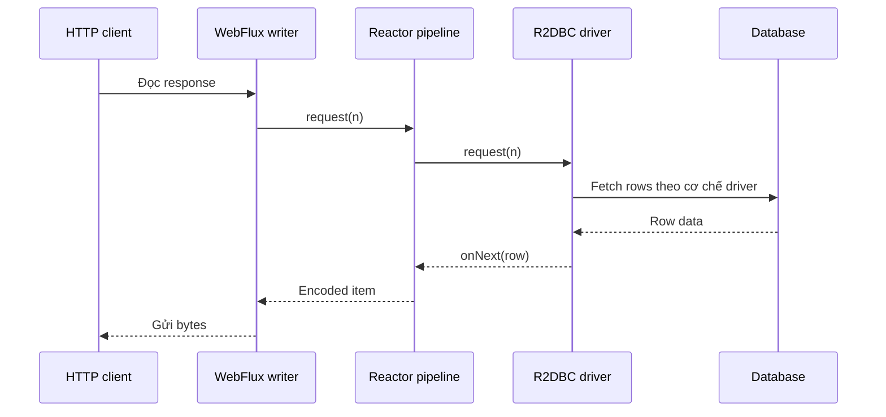

# Phân biệt streaming HTTP với streaming kết quả cơ sở dữ liệu

Trong ứng dụng Spring WebFlux kết hợp Spring Data Relational R2DBC, dữ liệu có thể được xử lý theo luồng từ database tới HTTP client. Tuy nhiên, việc repository trả về `Flux<T>` chỉ cho biết kết quả được biểu diễn bằng reactive stream ở tầng ứng dụng. Nó không tự bảo đảm client nhận được từng bản ghi ngay khi database đọc xong bản ghi đó.

Để có streaming end-to-end, cần xem xét cả hai phía: R2DBC driver có phát các hàng theo nhu cầu hay đang buffer dữ liệu; WebFlux có encode và flush từng phần tử hay gom thành một JSON array; HTTP server, reverse proxy và client có giữ hoặc buffer dữ liệu hay không. Hai kiểu streaming có liên quan nhưng là hai cơ chế khác nhau.

## 1. Hai khái niệm streaming ở hai tầng

**Streaming kết quả cơ sở dữ liệu** là việc đọc các hàng từ query qua R2DBC theo dạng `Publisher`, thường là `Flux<T>`. Ứng dụng có thể xử lý từng hàng khi nó được phát ra thay vì phải chờ toàn bộ kết quả được tải vào một collection.

**Streaming HTTP** là việc gửi response thành nhiều phần qua kết nối HTTP để client có thể xử lý dữ liệu trước khi toàn bộ response hoàn tất. Định dạng response, codec, flush, transport và các thành phần trung gian đều ảnh hưởng đến khả năng này.

| Tầng | Streaming có nghĩa là | Ví dụ |
| --- | --- | --- |
| Database/R2DBC | Hàng được phát qua reactive publisher theo từng phần tử hoặc nhóm | `Flux<Order>` từ repository |
| Application pipeline | Toán tử xử lý từng phần tử và duy trì publisher | `map`, `filter`, `flatMap` |
| WebFlux encoder | Giá trị được encode thành các đơn vị response có thể gửi dần | NDJSON hoặc Server-Sent Events |
| HTTP transport | Byte được chuyển qua kết nối khi có dữ liệu | HTTP/1.1 chunked transfer hoặc HTTP/2 DATA frames |
| Client | Client đọc và xử lý phần response đã nhận | Đọc từng dòng NDJSON hoặc từng SSE event |

Một pipeline có thể streaming ở tầng database nhưng không streaming ở tầng HTTP. Ví dụ, repository phát `Flux<Order>`, service gọi `collectList()`, rồi controller trả một `List<Order>`; database result có thể được tiêu thụ reactive nhưng HTTP chỉ nhận response sau khi danh sách đã được gom. Ngược lại, controller có thể phát NDJSON từ một nguồn không phải database; khi đó HTTP streaming vẫn có thể xảy ra dù không có R2DBC.

## 2. Luồng dữ liệu từ database tới HTTP client

Một luồng streaming điển hình có các thành phần sau:



Mỗi tầng có thể tạo buffer hoặc thay đổi tốc độ dữ liệu. Database có thể trả kết quả theo cursor/fetch batch; driver có thể buffer; Reactor operators có thể prefetch; WebFlux codec có thể gom dữ liệu; HTTP server hoặc proxy có thể đợi đủ byte; client có thể chờ hoàn tất body trước khi parse.

Vì vậy, cần kiểm tra toàn bộ đường đi. Chỉ nhìn chữ ký `Flux<T>` ở controller hoặc repository là chưa đủ để kết luận API thực sự streaming.

## 3. Streaming kết quả từ Spring Data R2DBC

Reactive repository có thể trả `Flux<T>` khi query trả về nhiều hàng:

```java
public interface OrderRepository
        extends ReactiveCrudRepository<Order, Long> {

    Flux<Order> findByStatus(OrderStatus status);
}
```

Service có thể xử lý từng entity mà không gom toàn bộ kết quả:

```java
public Flux<OrderSummary> streamOpenOrders() {
    return orderRepository.findByStatus(OrderStatus.OPEN)
            .map(OrderSummary::from);
}
```

Khi subscriber yêu cầu dữ liệu, publisher được subscribe và query được thực thi theo cơ chế của Spring Data R2DBC. Kết quả được ánh xạ thành các entity rồi phát qua `Flux`.

Với `R2dbcEntityTemplate`, phương thức `all()` cũng trả `Flux`:

```java
public Flux<Order> findRecentOrders() {
    Query query = Query.query(where("status").is(OrderStatus.OPEN))
            .sort(Sort.by(Sort.Order.desc("createdAt")))
            .limit(500);

    return template.select(Order.class)
            .matching(query)
            .all();
}
```

Với `DatabaseClient`, có thể map từng row thành DTO:

```java
public Flux<OrderSummary> findOrderSummaries() {
    return databaseClient.sql("""
            SELECT id, order_number, total
            FROM orders
            WHERE status = :status
            ORDER BY id
            """)
            .bind("status", "OPEN")
            .map((row, metadata) -> new OrderSummary(
                    row.get("id", Long.class),
                    row.get("order_number", String.class),
                    row.get("total", BigDecimal.class)))
            .all();
}
```

`all()` phát các kết quả được map thành `Flux<OrderSummary>`. Mapping row không nên trả null; nếu cột nullable, hãy tạo DTO khác null có thuộc tính nullable hoặc dùng wrapper phù hợp.

## 4. `Flux` không đồng nghĩa database luôn gửi từng hàng một

`Flux<T>` là abstraction reactive của ứng dụng. R2DBC driver có thể dùng cursor, fetch theo lô hoặc cơ chế giao thức riêng. Một số driver có thể buffer một lượng dữ liệu đáng kể trước khi phát; hành vi thực tế phụ thuộc database, driver, transaction và cấu hình.

R2DBC SPI có thể cung cấp gợi ý fetch size thông qua `Statement.fetchSize(int)` ở những phiên bản SPI hỗ trợ. Đây là hint cho driver, không phải cam kết rằng mọi driver sẽ mở cursor hoặc fetch đúng số hàng đã chỉ định.

Ví dụ sử dụng SPI trực tiếp:

```java
Statement statement = connection.createStatement("""
        SELECT id, order_number
        FROM orders
        ORDER BY id
        """);

statement.fetchSize(200);

Flux<OrderRow> rows = Flux.from(statement.execute())
        .flatMap(result -> Flux.from(result.map((row, metadata) ->
                new OrderRow(
                        row.get("id", Long.class),
                        row.get("order_number", String.class)))));
```

Đoạn code minh họa khả năng đặt fetch size ở SPI. Hãy xác minh phiên bản R2DBC SPI và driver có hỗ trợ/áp dụng hint này hay không. Với `DatabaseClient` hoặc repository, cách cấu hình fetch size có thể phụ thuộc API và driver; không giả định mọi query tự động dùng cursor chỉ vì trả `Flux`.

## 5. `Result` và việc tiêu thụ hàng trong R2DBC

Ở tầng SPI, `Statement.execute()` trả publisher của `Result`. Một `Result` có thể chứa hàng truy vấn hoặc số hàng bị ảnh hưởng. Với kết quả dạng row, ứng dụng tiêu thụ qua `Result.map(...)` hoặc API tương ứng.

Ví dụ khái niệm:

```java
Flux<OrderRow> rows = Flux.from(statement.execute())
        .concatMap(result -> Flux.from(result.map((row, metadata) ->
                new OrderRow(
                        row.get("id", Long.class),
                        row.get("order_number", String.class)))));
```

Kết quả `Result` cần được tiêu thụ theo hợp đồng SPI/driver. Không giả định có thể đọc lại cùng một result nhiều lần hoặc giữ `Row` rồi sử dụng sau khi mapper đã hoàn tất. Hãy chuyển dữ liệu cần thiết thành DTO/entity trong mapper.

Khi dùng repository hoặc `DatabaseClient`, Spring Data/Spring Framework xử lý phần lớn chi tiết tiêu thụ result. Tuy nhiên, ứng dụng vẫn phải giữ publisher trong pipeline và tránh gom không giới hạn nếu mục tiêu là xử lý streaming.

## 6. Những thao tác làm mất lợi ích streaming ở tầng ứng dụng

Một số toán tử hợp lệ nhưng thay đổi cách tiêu thụ dữ liệu:

```java
Mono<List<Order>> allOrders = orderRepository.findAll()
        .collectList();
```

`collectList()` chờ nguồn hoàn tất rồi mới phát một `List`. Toàn bộ kết quả phải được giữ trong bộ nhớ. Nếu bảng lớn, điều này có thể làm tăng memory pressure hoặc gây `OutOfMemoryError`.

Các thao tác khác cần chú ý:

| Toán tử/cách viết | Ảnh hưởng |
| --- | --- |
| `collectList()` | Gom mọi phần tử thành một list và chỉ phát sau khi nguồn hoàn tất |
| `collectMap()` / `collectMultimap()` | Gom kết quả vào cấu trúc map trong bộ nhớ |
| `sort(...)` trên `Flux` | Cần thu thập dữ liệu để sắp xếp toàn bộ trước khi phát kết quả |
| `reduce(...)` | Phát một kết quả tổng hợp sau khi nguồn hoàn tất |
| `buffer(n)` | Gom theo nhóm tối đa n phần tử; vẫn có thể stream từng nhóm nếu downstream xử lý ngay |
| `limitRate(n)` | Điều chỉnh lượng demand theo nhóm; không tự tạo cursor database |
| `onBackpressureBuffer()` | Có thể tích lũy phần tử nếu downstream chậm; cần giới hạn buffer |

Không phải lúc nào cũng cần tránh `collectList()`. Nếu endpoint chỉ trả vài chục bản ghi và cần một JSON array hoàn chỉnh, gom dữ liệu có thể là lựa chọn hợp lý. Vấn đề là hiểu rõ bộ nhớ, độ trễ và semantics mà thao tác đó tạo ra.

## 7. Streaming HTTP phụ thuộc media type

Trong Spring WebFlux, controller có thể trả `Flux<T>`, nhưng codec chọn cách encode dựa trên media type. Với media type không streaming như `application/json`, một `Flux` thường được encode thành một JSON array như một giá trị tổng thể. Với media type streaming như NDJSON hoặc Server-Sent Events, từng phần tử có thể được encode và flush riêng.

Ví dụ:

```java
@RestController
@RequestMapping("/api/orders")
public class OrderController {

    private final OrderService orderService;

    public OrderController(OrderService orderService) {
        this.orderService = orderService;
    }

    @GetMapping(produces = MediaType.APPLICATION_JSON_VALUE)
    public Flux<OrderSummary> list() {
        return orderService.streamOpenOrders();
    }

    @GetMapping(value = "/stream", produces = MediaType.APPLICATION_NDJSON_VALUE)
    public Flux<OrderSummary> stream() {
        return orderService.streamOpenOrders();
    }
}
```

Hai method cùng trả `Flux`, nhưng hợp đồng HTTP khác nhau. `list()` trả JSON array thông thường; WebFlux có thể phải thu thập các phần tử trước khi ghi một JSON document hoàn chỉnh. `stream()` dùng NDJSON để biểu diễn từng phần tử thành một JSON value trên một dòng, phù hợp với việc nhận dữ liệu tăng dần.

Hãy xác minh behavior của codec theo phiên bản Spring Framework và cấu hình message converter/encoder của ứng dụng. Không kết luận streaming chỉ từ return type.

## 8. NDJSON: một JSON value trên mỗi dòng

NDJSON (Newline Delimited JSON) là định dạng mỗi dòng chứa một JSON object độc lập, kết thúc bằng newline. Spring WebFlux thường dùng media type `application/x-ndjson`, được biểu diễn bằng `MediaType.APPLICATION_NDJSON_VALUE`.

Ví dụ response:

```text
{"id":101,"orderNumber":"PO-101","total":125.50}
{"id":102,"orderNumber":"PO-102","total":80.00}
{"id":103,"orderNumber":"PO-103","total":210.00}
```

Mỗi dòng có thể được parse độc lập khi client nhận được, không cần chờ dấu `]` kết thúc một JSON array. NDJSON phù hợp với export, log, kết quả tìm kiếm lớn hoặc API tải dần các record.

Controller:

```java
@GetMapping(value = "/export", produces = MediaType.APPLICATION_NDJSON_VALUE)
public Flux<OrderSummary> exportOrders() {
    return orderService.streamOpenOrders();
}
```

Client có thể đọc từng dòng:

```bash
curl -N -H "Accept: application/x-ndjson" \
  http://localhost:8080/api/orders/export
```

Tùy chọn `-N` của curl tắt output buffering phía curl để dễ quan sát dữ liệu đến theo từng phần. Nó không ép server hoặc proxy phải flush nếu các thành phần đó đang buffer.

## 9. Server-Sent Events (SSE)

SSE là định dạng streaming một chiều từ server tới client, thường dùng khi server phát các sự kiện theo thời gian. HTTP response có media type `text/event-stream`; mỗi event được phân tách bằng dòng trống.

Spring WebFlux hỗ trợ `ServerSentEvent<T>`:

```java
@GetMapping(value = "/events", produces = MediaType.TEXT_EVENT_STREAM_VALUE)
public Flux<ServerSentEvent<OrderEvent>> events() {
    return orderEventService.streamEvents()
            .map(event -> ServerSentEvent.builder(event)
                    .id(event.id())
                    .event("order-update")
                    .build());
}
```

Một event SSE trên wire có thể trông như sau:

```text
id: 501
event: order-update
data: {"orderId":101,"status":"SHIPPED"}

```

Client trình duyệt có thể dùng `EventSource` để nhận sự kiện. SSE hỗ trợ event ID và reconnect; server/client cần thiết kế cách replay hoặc tiếp tục từ `Last-Event-ID` nếu không muốn mất event trong khoảng mất kết nối.

SSE phù hợp với thông báo trạng thái hoặc event liên tục. Với export dữ liệu hữu hạn, NDJSON thường đơn giản hơn. Không dùng SSE chỉ vì endpoint trả `Flux`; hãy chọn media type theo giao thức client cần.

## 10. JSON array thông thường khác NDJSON

`application/json` biểu diễn một JSON document. Với nhiều kết quả, hình dạng phổ biến là một array:

```json
[
  {"id": 101, "status": "OPEN"},
  {"id": 102, "status": "OPEN"}
]
```

Client thường parse array như một document hoàn chỉnh. WebFlux có thể phải buffer/collect các phần tử để encode một JSON array hợp lệ, vì vậy client không nhất thiết nhận từng object ngay khi query phát ra.

NDJSON không có dấu ngoặc array:

```text
{"id":101,"status":"OPEN"}
{"id":102,"status":"OPEN"}
```

Client có thể parse từng dòng độc lập. Nếu yêu cầu là hiển thị từng kết quả ngay khi có, chọn một media type streaming và client parser tương ứng. Nếu yêu cầu là một response JSON tiêu chuẩn để deserialize thành `List<T>`, dùng `application/json` là hợp lý.

Không cố tạo một JSON array bằng cách tự nối chuỗi từng object vào response. Cách đó dễ tạo JSON không hợp lệ khi có lỗi, escape sai hoặc kết thúc đột ngột. Hãy dùng codec WebFlux hoặc định dạng streaming được thiết kế cho từng record.

## 11. HTTP chunked transfer không phải định dạng record

HTTP/1.1 có thể dùng `Transfer-Encoding: chunked` khi server gửi response mà không biết trước `Content-Length`. Dữ liệu được chia thành các HTTP chunks ở tầng transport. HTTP/2 dùng DATA frames và cơ chế flow control riêng; không dùng header chunked theo cách HTTP/1.1.

Chunk ở tầng HTTP không đồng nghĩa một chunk là một row database hoặc một JSON object. Một HTTP chunk có thể chứa một phần dòng NDJSON, nhiều dòng, hoặc một phần byte của một JSON document. Client cần parse theo định dạng nội dung, không dựa vào ranh giới packet/chunk.

Tương tự, việc response có `Transfer-Encoding: chunked` không chứng minh ứng dụng đang phát từng bản ghi database. Server có thể gửi một JSON array lớn thành nhiều chunk sau khi đã gom toàn bộ kết quả. Ngược lại, một body streaming ở HTTP/2 có thể không có header `Transfer-Encoding: chunked` nhưng vẫn được truyền theo nhiều frame.

## 12. Backpressure giữa WebFlux và R2DBC

Reactive Streams cho phép subscriber yêu cầu số phần tử bằng `request(n)`. Khi WebFlux ghi response, tốc độ tiêu thụ của encoder/server có thể tác động tới demand upstream; demand có thể truyền ngược qua Reactor pipeline tới publisher R2DBC.

Luồng khái quát:



Đây là mô hình khái niệm. Các operator có thể prefetch, driver có thể fetch theo batch và server có thể có buffer nội bộ. Backpressure là tín hiệu điều tiết demand trong pipeline, không phải cam kết database chỉ đọc đúng một hàng mỗi lần hoặc network luôn truyền một row mỗi frame.

Nếu client chậm, downstream có thể giảm tốc độ request. Điều này giúp tránh một số dạng tích lũy không giới hạn, nhưng chỉ hiệu quả nếu các tầng phía trước tôn trọng demand hoặc có buffer được giới hạn.

## 13. Hạn chế buffer và prefetch

Một số toán tử Reactor giữ phần tử trong buffer để tăng throughput. Ví dụ `flatMap` có thể subscribe nhiều publisher con đồng thời và prefetch phần tử. `publishOn` cũng dùng hàng đợi để chuyển tín hiệu qua scheduler.

Với luồng lớn, hãy chọn concurrency và prefetch có chủ đích:

```java
return orderRepository.findAll()
        .flatMap(this::enrichOrder, 8, 16);
```

Ví dụ này giới hạn số tác vụ `enrichOrder` đồng thời và prefetch theo cấu hình. Giá trị 8 và 16 chỉ là ví dụ; phải đo theo độ nặng của thao tác và giới hạn connection pool nếu enrichment gọi database.

Nếu chỉ cần biến đổi đồng bộ nhẹ, `map` thường dễ kiểm soát hơn:

```java
return orderRepository.findAll()
        .map(OrderSummary::from);
```

Tránh `onBackpressureBuffer()` không giới hạn cho luồng dài. Nếu downstream chậm hơn upstream, buffer có thể tăng tới khi cạn bộ nhớ. Nếu cần buffer, đặt giới hạn và quy định rõ hành vi khi đầy: lỗi, drop hoặc chiến lược khác phù hợp với nghiệp vụ.

## 14. Cancellation khi client ngắt kết nối

Khi client đóng kết nối trước khi stream hoàn tất, WebFlux có thể hủy subscription response. Cancellation có thể truyền ngược qua Reactor tới publisher R2DBC. Driver/database có thể hủy statement hoặc dừng fetch theo khả năng hỗ trợ.

Không nên giả định cancellation luôn dừng ngay lập tức mọi công việc ở database. Hành vi phụ thuộc driver, server và thời điểm query đã gửi. Với query lớn, hãy kiểm thử việc client disconnect và quan sát query/session trên database.

Có thể ghi nhận cancellation để quan sát:

```java
public Flux<OrderSummary> streamOrders() {
    return orderRepository.findAll()
            .map(OrderSummary::from)
            .doOnCancel(() -> log.info("Order stream was cancelled"));
}
```

`doOnCancel` chỉ phục vụ quan sát; không thay thế việc giải phóng tài nguyên do Spring/driver quản lý. Nếu ứng dụng mở resource thủ công, cần dùng cơ chế quản lý lifecycle reactive như `usingWhen` để cleanup khi complete, error hoặc cancel.

## 15. Transaction và connection có thể bị giữ trong suốt stream

Nếu query streaming chạy trong reactive transaction, connection có thể được giữ cho tới khi publisher hoàn tất, lỗi hoặc bị hủy. Với một response dài, client chậm có thể khiến connection và transaction tồn tại lâu hơn dự kiến.

Điều này có thể dẫn đến:

- Connection pool bị chiếm dụng bởi các response tải lâu.
- Transaction mở lâu làm tăng nguy cơ giữ snapshot/lock hoặc ảnh hưởng vacuum tùy database/isolation.
- Các request khác chờ connection và tăng latency.
- Client ngắt kết nối nhưng driver mất thời gian mới dừng query.

Không đặt một stream vô hạn như SSE trong transaction database dài. Với event stream liên tục, nên lấy dữ liệu từ broker hoặc hệ thống event chuyên dụng; nếu cần đọc database, thực hiện query ngắn theo batch rồi đóng transaction/connection trước khi chờ event tiếp theo.

Với export hữu hạn, giới hạn phạm vi dữ liệu, số hàng, thời gian chạy và timeout. Cân nhắc phân trang theo keyset nếu cần export rất lớn để không giữ một cursor/transaction trong thời gian quá dài.

## 16. Định dạng streaming phải phù hợp với client

Client cần biết cách phân tách đơn vị dữ liệu:

| Media type | Cách phân tách | Client thường dùng |
| --- | --- | --- |
| `application/json` | Một JSON document, thường là array nếu có nhiều item | JSON parser đọc toàn body |
| `application/x-ndjson` | Mỗi dòng là một JSON value | Line reader + JSON parser cho từng dòng |
| `text/event-stream` | Event SSE kết thúc bằng dòng trống | Browser `EventSource` hoặc SSE client |
| `text/plain` | Phụ thuộc hợp đồng ứng dụng, thường là text stream | Text/line reader |
| `application/octet-stream` | Byte stream; ranh giới record do ứng dụng định nghĩa | Binary stream reader |

Đừng trả NDJSON nhưng khai báo `application/json`, hoặc trả SSE nhưng client dùng parser JSON array. Content-Type là một phần của API contract và cần được kiểm thử.

## 17. Ví dụ endpoint NDJSON hoàn chỉnh

DTO:

```java
public record OrderLine(
        Long id,
        String orderNumber,
        BigDecimal total
) {
}
```

Service:

```java
@Service
public class OrderExportService {

    private final OrderRepository repository;

    public OrderExportService(OrderRepository repository) {
        this.repository = repository;
    }

    public Flux<OrderLine> exportOpenOrders() {
        return repository.findByStatus(OrderStatus.OPEN)
                .map(order -> new OrderLine(
                        order.getId(),
                        order.getOrderNumber(),
                        order.getTotal()));
    }
}
```

Controller:

```java
@RestController
@RequestMapping("/exports")
public class OrderExportController {

    private final OrderExportService service;

    public OrderExportController(OrderExportService service) {
        this.service = service;
    }

    @GetMapping(value = "/open-orders", produces = MediaType.APPLICATION_NDJSON_VALUE)
    public Flux<OrderLine> exportOpenOrders() {
        return service.exportOpenOrders();
    }
}
```

Với cách này, WebFlux có thể encode từng `OrderLine` thành một dòng NDJSON và flush theo đơn vị streaming. R2DBC repository phát dữ liệu theo `Flux`; việc database driver có fetch theo cursor hay buffer ra sao vẫn cần xác minh theo driver. Endpoint không gọi `collectList()`, nên không gom toàn bộ danh sách ở service.

Trong ứng dụng thực tế, thêm filter/tenant scope, giới hạn export, timeout, authorization và xử lý audit. Không cung cấp endpoint export không giới hạn cho mọi người dùng.

## 18. Ví dụ SSE cho sự kiện thay đổi trạng thái

SSE phù hợp khi client cần nhận event theo thời gian thay vì tải một danh sách hữu hạn:

```java
@RestController
@RequestMapping("/orders")
public class OrderEventController {

    private final OrderEventService eventService;

    public OrderEventController(OrderEventService eventService) {
        this.eventService = eventService;
    }

    @GetMapping(value = "/events", produces = MediaType.TEXT_EVENT_STREAM_VALUE)
    public Flux<ServerSentEvent<OrderEvent>> events() {
        return eventService.events()
                .map(event -> ServerSentEvent.builder(event)
                        .id(event.id())
                        .event("order-status")
                        .build());
    }
}
```

`eventService.events()` có thể lấy event từ broker, sink hoặc nguồn reactive khác. Không nên giữ một query database mở vô hạn chỉ để tạo SSE. Nếu cần gửi heartbeat để giữ kết nối qua proxy, thiết kế comment event hoặc heartbeat theo khả năng của SSE/client và tránh làm tăng tải database.

SSE một chiều từ server tới client. Nếu client cần gửi lệnh hoặc cập nhật, dùng endpoint HTTP riêng hoặc giao thức hai chiều phù hợp như WebSocket.

## 19. Client ngắt kết nối và reconnect

Với NDJSON, client thường đọc từng dòng và xử lý. Nếu kết nối bị ngắt, dòng cuối có thể chưa hoàn chỉnh; client cần bỏ phần chưa kết thúc hoặc dùng protocol có sequence ID để tiếp tục an toàn.

Với SSE, client `EventSource` có cơ chế reconnect và có thể gửi `Last-Event-ID`. Server cần xác định:

- Event ID có tăng đơn điệu và duy nhất trong phạm vi stream không.
- Có thể replay event từ ID đó không.
- Event đã quá cũ hoặc đã bị xóa thì trả hành vi gì.
- Quyền truy cập có được kiểm tra lại khi reconnect không.
- Một event có thể được gửi lại và client có xử lý idempotent không.

Reconnect không đồng nghĩa exactly-once delivery. Client có thể nhận lại event nếu server không biết chắc client đã xử lý event cuối trước khi kết nối đứt. Dùng event ID và consumer/client idempotency khi việc xử lý lặp có hậu quả.

## 20. Lỗi xảy ra sau khi response đã bắt đầu

HTTP status và header được gửi ở giai đoạn đầu response. Khi server đã commit response và gửi một số byte, không thể đổi status thành `500` một cách bình thường nếu query database phát lỗi ở giữa stream.

Ví dụ: server đã gửi 50 dòng NDJSON rồi database mất kết nối. Response có thể kết thúc bất thường hoặc connection bị đóng. Client không nên giả định một stream đã bắt đầu sẽ luôn hoàn tất hợp lệ.

Các cách thiết kế:

- Với NDJSON, có thể định nghĩa một record cuối dạng error nếu hợp đồng API cho phép và client hiểu rõ record đó không phải dữ liệu nghiệp vụ bình thường.
- Với SSE, phát event lỗi có cấu trúc nếu stream còn khả năng gửi và sau đó kết thúc theo chính sách.
- Dùng sequence ID/checkpoint để client có thể tiếp tục từ vị trí cuối đã xử lý.
- Ghi log/correlation ID để hỗ trợ điều tra.
- Không gửi stack trace hoặc thông tin database nội bộ cho client.

`onErrorResume` có thể chuyển lỗi thành một phần tử khác trong stream, nhưng chỉ làm vậy khi protocol đã định nghĩa cách biểu diễn lỗi. Không biến lỗi database thành một DTO rỗng mà client hiểu nhầm là dữ liệu hợp lệ.

## 21. Timeout ở database, WebFlux và proxy

Một stream có thể bị ngắt bởi nhiều loại timeout:

- Query timeout hoặc statement timeout ở database/driver.
- Timeout lấy connection từ pool.
- Timeout của server hoặc tầng reactive pipeline.
- Idle timeout của load balancer, reverse proxy hoặc API gateway.
- Timeout do client tự đặt.

Các timeout này có phạm vi khác nhau. Ví dụ timeout của query database không nhất thiết giới hạn thời gian toàn bộ HTTP response nếu query đã đọc xong nhưng server còn gửi buffer; idle timeout của proxy có thể đóng một SSE connection nếu không có byte nào được gửi trong thời gian dài.

Hãy xác định timeout theo use case. Với export hữu hạn, đặt deadline hợp lý và giới hạn số hàng. Với SSE dài hạn, dùng heartbeat nếu cần và cấu hình idle timeout tương thích ở các tầng mạng. Không tăng timeout vô hạn để che một query hoặc stream không được kiểm soát.

## 22. Reverse proxy và compression có thể buffer response

Ngay cả khi WebFlux encode và flush từng phần tử, reverse proxy hoặc compression layer có thể gom nhiều byte trước khi chuyển tới client. Một số gateway buffer response theo mặc định hoặc chỉ flush khi đạt kích thước nhất định.

Khi triển khai streaming:

- Kiểm tra cấu hình response buffering của Nginx/API gateway/ingress.
- Xác minh compression middleware có giữ buffer lớn không.
- Đảm bảo proxy timeout phù hợp với stream dài.
- Kiểm tra header `Content-Type` và các header liên quan.
- Dùng client quan sát dữ liệu từng phần qua mạng thật, không chỉ gọi controller trong unit test.

Một header riêng như `X-Accel-Buffering: no` có thể được một số cấu hình Nginx hiểu, nhưng không phải header chuẩn bảo đảm mọi proxy ngừng buffer. Chỉ dùng khi hạ tầng cụ thể hỗ trợ và đã được kiểm thử.

## 23. Giới hạn bộ nhớ và kích thước dữ liệu

Streaming giúp giảm nhu cầu giữ toàn bộ response trong bộ nhớ, nhưng mỗi phần tử vẫn cần được đọc, map, encode và có thể được buffer ở nhiều tầng. Một record rất lớn hoặc một field BLOB có thể làm tăng memory đáng kể.

Các biện pháp:

- Chọn đúng các cột cần trả về thay vì `SELECT *`.
- Dùng DTO nhỏ thay vì serialize entity graph không cần thiết.
- Giới hạn số hàng hoặc khoảng thời gian export.
- Dùng fetch size phù hợp nếu driver hỗ trợ.
- Giới hạn concurrency/prefetch và mọi buffer trong pipeline.
- Tránh `collectList`, `sort` hoặc cache toàn bộ dữ liệu lớn.
- Dùng phân trang keyset hoặc job export nền cho dữ liệu rất lớn.
- Theo dõi heap, direct memory, connection pool và tốc độ gửi response.

Nếu file export có thể mất nhiều phút, cân nhắc tạo file bất đồng bộ, lưu ở object storage rồi cho client tải bằng URL có thời hạn. Đây thường dễ vận hành hơn việc giữ một HTTP connection và database connection mở trong thời gian dài.

## 24. Bảo mật khi stream dữ liệu database

Streaming không làm giảm yêu cầu bảo mật. Vì dữ liệu được gửi dần, một lỗi authorization hoặc filter có thể làm lộ dữ liệu ngay từ những phần tử đầu tiên trước khi server phát hiện sai phạm.

Hãy:

- Xác thực và xác định tenant trước khi query bắt đầu.
- Đưa tenant/ownership filter vào query database, không chỉ filter sau khi đọc.
- Chỉ select các cột mà client được phép xem.
- Không serialize entity có trường nội bộ hoặc bí mật.
- Kiểm tra quyền trước khi bắt đầu response; không trì hoãn kiểm tra tới giữa stream.
- Giới hạn thời gian, số lượng hàng và tốc độ export.
- Xử lý client disconnect và cleanup tài nguyên.
- Không đưa SQL, stack trace hoặc credential vào record lỗi.

Nếu stream chứa dữ liệu tenant, route key và transaction context phải ổn định trong suốt query. Không đổi tenant giữa một stream đang chạy.

## 25. Khi nào chọn NDJSON, SSE hay JSON thông thường?

| Nhu cầu | Định dạng phù hợp | Lý do |
| --- | --- | --- |
| API CRUD trả danh sách nhỏ/vừa | `application/json` | Client deserialize thành array đơn giản |
| Export nhiều record, muốn xử lý từng dòng | `application/x-ndjson` | Mỗi JSON value độc lập, có thể parse tăng dần |
| Server phát event trạng thái liên tục tới browser | `text/event-stream` | SSE có event ID, event type và reconnect |
| Tải file nhị phân | `application/octet-stream` hoặc media type file | Nội dung là byte stream, không phải object JSON |
| Client cần gửi và nhận hai chiều liên tục | WebSocket hoặc giao thức hai chiều | SSE chỉ truyền server-to-client |
| Dữ liệu quá lớn hoặc cần tạo file lâu | Background export + object storage | Không giữ kết nối/transaction lâu |

Đừng chọn streaming chỉ vì có thể. Streaming làm API phức tạp hơn ở phần lỗi giữa chừng, reconnect, client parsing, proxy và tài nguyên. Với danh sách nhỏ, JSON thông thường dễ sử dụng và dễ cache hơn.

## 26. Kiểm thử streaming ở nhiều tầng

Unit test service bằng `StepVerifier` xác minh publisher phát đúng phần tử và không gom sai:

```java
StepVerifier.create(orderService.streamOpenOrders())
        .expectNextMatches(order -> order.status() == OrderStatus.OPEN)
        .expectNextMatches(order -> order.status() == OrderStatus.OPEN)
        .verifyComplete();
```

WebFlux integration test có thể xác minh status, content type và body:

```java
webTestClient.get()
        .uri("/exports/open-orders")
        .accept(MediaType.APPLICATION_NDJSON)
        .exchange()
        .expectStatus().isOk()
        .expectHeader().contentTypeCompatibleWith(MediaType.APPLICATION_NDJSON)
        .expectBody()
        .consumeWith(result -> {
            String body = new String(
                    result.getResponseBody(), StandardCharsets.UTF_8);
            assertThat(body).contains("PO-");
        });
```

Test trên xác minh media type và nội dung cuối cùng, nhưng chưa chứng minh từng dòng được gửi trước khi publisher hoàn tất. Để xác minh streaming thật, cần kiểm thử thời gian phát:

1. Tạo publisher phát phần tử đầu ngay, phần tử thứ hai sau một khoảng trễ có kiểm soát.
2. Dùng HTTP client đọc response body theo từng buffer/dòng.
3. Xác nhận phần tử đầu tới client trước khi phần tử thứ hai được phát.
4. Xác nhận header/content type và newline/event delimiter đúng.
5. Ngắt client giữa stream và kiểm tra cancellation/cleanup.
6. Mô phỏng lỗi database giữa stream và xác minh client nhận hành vi lỗi theo hợp đồng.

Để kiểm tra database streaming, dùng integration test với đúng R2DBC driver/database và quan sát fetch/query behavior. Một mock repository phát `Flux` không thể chứng minh driver không buffer toàn bộ result.

## 27. Kiểm tra streaming qua proxy và môi trường triển khai

Unit test và WebTestClient thường không đi qua toàn bộ reverse proxy, load balancer và compression middleware production. Cần thêm kiểm thử hệ thống:

- Gọi endpoint qua đúng ingress/gateway.
- Dùng curl với `-N` hoặc client đọc body theo từng dòng.
- Ghi nhận thời điểm byte đầu tiên (time to first byte) và khoảng cách giữa các record.
- Kiểm tra proxy có buffer response hay không.
- Kiểm tra idle timeout với SSE hoặc stream dài.
- Ngắt kết nối client và quan sát query/connection ở database.
- Đo memory và connection pool khi nhiều client stream đồng thời.

Nếu dữ liệu chỉ xuất hiện sau khi query hoàn tất dù controller dùng NDJSON, kiểm tra `collectList`, codec, proxy buffering, compression, server write buffer và cách client đọc response. Không mặc định nguyên nhân nằm ở R2DBC.

## 28. Các lỗi thường gặp

| Lỗi | Hậu quả | Cách khắc phục |
| --- | --- | --- |
| Cho rằng `Flux` ở controller luôn streaming HTTP | Client có thể chỉ nhận array sau khi nguồn hoàn tất | Chọn media type streaming và kiểm tra codec |
| Dùng `application/json` cho export cần từng dòng ngay | Response có thể được gom thành JSON array | Dùng NDJSON hoặc SSE theo hợp đồng |
| Gọi `collectList()` trên query lớn | Tăng memory và trì hoãn response | Xử lý từng phần tử hoặc buffer theo nhóm nhỏ |
| Nghĩ `Transfer-Encoding: chunked` đồng nghĩa mỗi chunk là một row | Parse sai ranh giới dữ liệu | Parse theo NDJSON/SSE/JSON, không theo HTTP chunk |
| Nghĩ `Flux` bảo đảm driver không buffer | Có thể dùng nhiều memory hơn dự kiến | Kiểm tra driver, fetch size và execution behavior |
| Bỏ qua backpressure và prefetch | Buffer tăng khi client chậm | Giới hạn concurrency, prefetch và buffer |
| Giữ transaction cho SSE vô hạn | Giữ connection lâu, cạn pool | Dùng event source chuyên dụng và query ngắn |
| Bỏ qua cancellation | Query/tài nguyên có thể tiếp tục sau khi client rời đi | Theo dõi cancel và kiểm tra driver cleanup |
| Không xử lý lỗi sau khi response bắt đầu | Client nhận stream dở dang mà không hiểu trạng thái | Định nghĩa error record/event hoặc resume protocol |
| Không kiểm tra proxy buffering | Server flush nhưng client vẫn nhận muộn | Kiểm thử qua gateway và cấu hình proxy |
| Dùng `subscribe()` bên trong controller/service | Tách query khỏi HTTP lifecycle | Trả `Flux`/`Mono` để WebFlux quản lý subscription |
| Stream không giới hạn hoặc thiếu authorization filter | Tải database lớn hoặc lộ dữ liệu | Giới hạn query, filter ở DB và kiểm tra quyền trước response |

## 29. Quy trình thiết kế một endpoint streaming

Khi xây dựng endpoint cần phát dữ liệu tăng dần, thực hiện theo thứ tự:

1. Xác định client cần một JSON document hoàn chỉnh, từng dòng record hay event liên tục.
2. Chọn media type và giao thức tương ứng: JSON, NDJSON hoặc SSE.
3. Thiết kế query R2DBC chỉ lấy các cột cần thiết và có filter/ordering ổn định.
4. Trả `Flux` từ repository/template/DatabaseClient; tránh gom toàn bộ nếu dữ liệu lớn.
5. Kiểm tra driver có fetch theo cursor/batch hay buffer; dùng fetch-size hint nếu được hỗ trợ.
6. Giới hạn concurrency, prefetch, buffer, số hàng và thời gian query.
7. Xem xét transaction/connection lifetime và hành vi khi client cancel.
8. Định nghĩa lỗi giữa stream, reconnect, checkpoint và idempotency nếu client cần tiếp tục.
9. Kiểm thử content type, từng phần response, lỗi/cancellation và database driver thật.
10. Kiểm thử qua proxy/ingress, đo time-to-first-byte, throughput, memory và connection pool.

## 30. Nguyên tắc thực hành

- Phân biệt streaming result ở R2DBC với streaming response ở HTTP; hai tầng cần cấu hình và kiểm thử riêng.
- Dùng `Flux<T>` để xử lý nhiều hàng reactive, nhưng không coi nó là bằng chứng driver không buffer.
- Tránh `collectList`, `sort` và các thao tác gom toàn bộ khi dữ liệu lớn và cần phát sớm.
- Dùng `application/x-ndjson` cho từng JSON record và `text/event-stream` cho SSE event.
- Dùng `application/json` khi client cần một JSON document/array hoàn chỉnh.
- Không nhầm HTTP chunk hoặc HTTP/2 frame với ranh giới record.
- Kiểm tra `Statement.fetchSize` và hành vi fetch theo tài liệu driver; đây là hint phụ thuộc driver.
- Duy trì backpressure bằng cách giới hạn prefetch, concurrency và buffer.
- Không giữ transaction/connection database cho stream vô hạn hoặc chờ client quá lâu.
- Xử lý cancellation, timeout và lỗi xảy ra sau khi response đã commit.
- Kiểm tra proxy, gateway, compression và client buffering trong môi trường triển khai thật.
- Áp dụng authorization/filter ở database trước khi bắt đầu stream; giới hạn lượng dữ liệu có thể tải.
- Dùng NDJSON/SSE parser đúng giao thức và thiết kế resume/idempotency nếu cần reconnect.
- Kiểm thử cả reactive publisher, HTTP streaming và driver/database thực tế.

## 31. Kết luận

Streaming kết quả cơ sở dữ liệu và streaming HTTP là hai cơ chế khác nhau. R2DBC repository trả `Flux<T>` cho phép ứng dụng nhận và xử lý kết quả theo reactive publisher; việc driver có fetch theo cursor hay buffer vẫn phụ thuộc driver. WebFlux chỉ gửi dữ liệu tăng dần khi codec và media type hỗ trợ streaming, ví dụ NDJSON hoặc SSE, đồng thời các tầng transport, proxy và client không gom response trước khi chuyển tiếp.

Để có luồng end-to-end, tránh gom toàn bộ kết quả, chọn đúng media type, duy trì backpressure, giới hạn buffer và kiểm soát vòng đời connection/transaction. Hãy kiểm thử từng tầng và cả đường đi qua proxy thực tế. `Flux` là nền tảng cho xử lý reactive, còn streaming HTTP là một hợp đồng truyền tải cần được thiết kế rõ ràng cho client.
