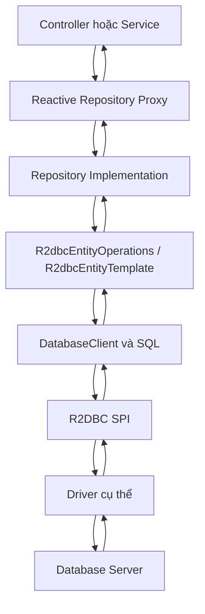
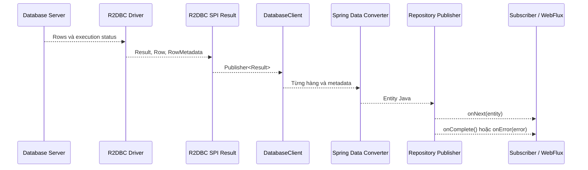

# Đường đi từ Repository đến trình điều khiển và cơ sở dữ liệu

## 1. Nhìn toàn bộ đường đi của một thao tác dữ liệu

Trong Spring Data R2DBC, ứng dụng thường làm việc với repository và các kiểu reactive như `Mono<T>` hoặc `Flux<T>`. Ở phía dưới, lời gọi đó đi qua các thành phần của Spring Data Relational, Spring Framework và R2DBC SPI trước khi tới trình điều khiển (driver) cụ thể của hệ quản trị cơ sở dữ liệu.

Mỗi tầng có một trách nhiệm riêng:

| Tầng | Thành phần tiêu biểu | Trách nhiệm |
| --- | --- | --- |
| Ứng dụng | Controller, service | Mô tả nghiệp vụ và kết hợp các publisher |
| Repository | `ReactiveCrudRepository`, repository proxy | Cung cấp API truy cập dữ liệu theo mô hình domain |
| Spring Data Relational | Repository implementation, mapping metadata, converter | Phân tích phương thức, xây dựng thao tác và ánh xạ entity |
| Spring Framework R2DBC | `R2dbcEntityTemplate`, `DatabaseClient` | Chuẩn bị SQL, lấy connection, bind tham số, thực thi và đọc kết quả |
| R2DBC SPI | `ConnectionFactory`, `Connection`, `Statement`, `Result`, `Row` | Hợp đồng chuẩn giữa framework và driver |
| R2DBC driver | Driver PostgreSQL, H2, MySQL hoặc driver tương ứng | Chuyển thao tác SPI thành giao thức riêng của database |
| Hệ quản trị cơ sở dữ liệu | PostgreSQL, H2, MySQL, SQL Server... | Phân tích SQL, thực thi câu lệnh và trả kết quả |

Đường đi này có thể hình dung như sau:



Sơ đồ thể hiện đường đi logic. Tùy API được sử dụng, một số thành phần có thể được gọi trực tiếp hoặc được kết hợp bên trong một thành phần khác. Ví dụ, ứng dụng có thể dùng `R2dbcEntityTemplate` mà không khai báo repository; khi đó phần repository được bỏ qua nhưng các tầng `DatabaseClient`, SPI và driver vẫn giữ vai trò tương ứng.

Điểm quan trọng là repository không tự mở socket và không tự hiểu giao thức mạng của PostgreSQL hay MySQL. Repository biểu diễn ý định truy cập dữ liệu ở mức domain. Các tầng phía dưới chuyển ý định đó thành câu lệnh, thực thi qua SPI và driver, rồi chuyển kết quả trở lại thành object Java.

## 2. Ứng dụng gọi Repository

Một repository reactive thường kế thừa `ReactiveCrudRepository`:

```java
@Table("customer")
public class Customer {

    @Id
    private Long id;

    @Column("email_address")
    private String email;

    private String status;

    // Constructors, getters and setters
}
```

```java
public interface CustomerRepository
        extends ReactiveCrudRepository<Customer, Long> {

    Flux<Customer> findByStatus(String status);
}
```

Ứng dụng có thể gọi repository từ service:

```java
@Service
public class CustomerService {

    private final CustomerRepository repository;

    public CustomerService(CustomerRepository repository) {
        this.repository = repository;
    }

    public Flux<Customer> findActiveCustomers() {
        return repository.findByStatus("ACTIVE");
    }
}
```

Phương thức trả về `Flux<Customer>` biểu diễn một nguồn có thể phát nhiều khách hàng. Lúc này service đang xây dựng và trả về pipeline. Với repository reactive chuẩn, SQL được thực thi khi publisher được subscribe, thường là khi framework web hoặc thành phần ở tầng trên tiêu thụ kết quả.

### 2.1. Repository là một proxy

Interface repository không chứa phần thân triển khai các phương thức CRUD. Spring Data tạo bean repository tại thời điểm khởi tạo ứng dụng. Repository factory tạo proxy để xử lý lời gọi phương thức và ủy quyền đến phần triển khai phù hợp.

Với repository reactive, Spring Data R2DBC cung cấp phần triển khai CRUD mặc định, thường được biểu diễn bởi `SimpleR2dbcRepository`. Phần triển khai này sử dụng abstraction thao tác dữ liệu của Spring Data R2DBC để thực hiện các thao tác đọc, lưu và xóa.

Proxy cũng xử lý các phương thức truy vấn được khai báo trong interface. Tùy loại phương thức, Spring Data có thể:

- Nhận diện phương thức CRUD đã được cung cấp sẵn.
- Phân tích tên phương thức như `findByStatus` để tạo truy vấn theo quy ước.
- Dùng câu SQL được khai báo với `@Query`.
- Chuyển lời gọi đến phần triển khai tùy chỉnh nếu repository có custom fragment.

Ví dụ với truy vấn khai báo bằng annotation:

```java
public interface CustomerRepository
        extends ReactiveCrudRepository<Customer, Long> {

    @Query("SELECT id, email_address, status FROM customer WHERE status = :status")
    Flux<Customer> searchByStatus(@Param("status") String status);
}
```

Tên phương thức, annotation và kiểu trả về cho Spring Data biết ứng dụng muốn thực hiện thao tác gì. Repository không cần chứa mã mở connection hay gọi API của driver.

### 2.2. Repository factory và mapping metadata

Khi tạo repository, Spring Data cần biết entity nào được quản lý, thuộc tính nào là ID, tên bảng và tên cột tương ứng. Thông tin đó được xây dựng từ mapping metadata và các annotation như `@Table`, `@Id`, `@Column`, kết hợp với quy tắc đặt tên và cấu hình mapping.

Metadata này giúp framework hiểu rằng:

- `Customer` tương ứng với bảng `customer`.
- Thuộc tính `id` là định danh của entity.
- Thuộc tính `email` ánh xạ tới cột `email_address`.
- Những thuộc tính nào cần tham gia vào câu lệnh insert, update hoặc select.

Thông tin mapping cũng được sử dụng khi chuyển các giá trị Java thành tham số SQL và khi chuyển giá trị của một hàng kết quả thành entity.

## 3. Repository chuyển thao tác tới tầng Entity Operations

Phần triển khai repository không nên tự xử lý mọi chi tiết SQL và mapping. Spring Data R2DBC cung cấp abstraction thao tác entity, tiêu biểu là `R2dbcEntityOperations`; implementation phổ biến là `R2dbcEntityTemplate`.

`R2dbcEntityTemplate` là API mức cao để làm việc với entity. Nó hỗ trợ các thao tác như select, insert, update và delete. Template sử dụng metadata, chiến lược truy cập dữ liệu và converter để tạo câu lệnh phù hợp với entity.

Có thể dùng template trực tiếp mà không cần repository:

```java
public Flux<Customer> findActiveCustomers(R2dbcEntityTemplate template) {
    return template.select(Customer.class)
            .matching(query(where("status").is("ACTIVE")))
            .all();
}
```

Đoạn mã trên vẫn trả về publisher. Template nhận kiểu entity và điều kiện truy vấn, sau đó phối hợp với các thành phần bên dưới để tạo và thực thi SQL.

### 3.1. Tạo SQL và xác định tham số

Với truy vấn dẫn xuất từ tên phương thức hoặc từ API template, Spring Data phân tích điều kiện và tạo câu SQL. Với `@Query`, câu SQL được khai báo trực tiếp nhưng các tham số vẫn cần được bind an toàn.

Khi tạo câu lệnh, framework phải xác định:

- Bảng và các cột cần truy cập.
- Điều kiện `WHERE`, sắp xếp và giới hạn kết quả nếu có.
- Vị trí hoặc tên placeholder cho các tham số.
- Cách chuyển kiểu dữ liệu Java sang kiểu mà driver/database chấp nhận.
- Cách chuyển cột trả về sang thuộc tính của entity.

Dialect của database cung cấp những khác biệt giữa các hệ quản trị, chẳng hạn cú pháp placeholder hoặc đặc điểm SQL. Vì vậy, một câu truy vấn có thể được biểu diễn theo cách độc lập tương đối ở tầng Spring Data, sau đó được điều chỉnh theo dialect và driver đang cấu hình.

Ví dụ, một giá trị đầu vào như `status` cần được truyền dưới dạng tham số bind. Không nên nối chuỗi đầu vào trực tiếp vào SQL:

```java
// Dạng tham số hóa: giá trị được bind riêng với câu SQL.
databaseClient.sql(
        "SELECT id, email_address, status FROM customer WHERE status = :status"
    )
    .bind("status", status)
    .map((row, metadata) -> /* chuyển row thành Customer */)
    .all();
```

Bind tham số giúp driver gửi giá trị theo cơ chế tham số của nó, đồng thời tránh việc dữ liệu đầu vào bị hiểu nhầm là một phần cú pháp SQL. Tên marker cụ thể có thể khác nhau theo dialect; API `DatabaseClient` giúp ứng dụng làm việc với marker phù hợp.

### 3.2. Converter và kiểu dữ liệu

Spring Data R2DBC sử dụng converter để chuyển đổi giữa kiểu Java và kiểu dữ liệu của database. Các kiểu phổ biến có thể được xử lý sẵn; ứng dụng cũng có thể đăng ký converter tùy chỉnh khi cần biểu diễn một kiểu domain đặc biệt.

Ví dụ, một enum `CustomerStatus` có thể được lưu dưới dạng chuỗi hoặc một dạng khác tùy cấu hình converter. Nếu kiểu Java không được driver hỗ trợ trực tiếp hoặc cần quy tắc biểu diễn riêng, converter đảm nhiệm việc chuyển đổi trước khi bind hoặc sau khi đọc kết quả.

Converter và mapping metadata giúp repository giữ được API theo entity, trong khi câu lệnh SQL vẫn làm việc với bảng, cột và kiểu dữ liệu của hệ quản trị.

## 4. DatabaseClient chuẩn bị và thực thi câu lệnh

`DatabaseClient` thuộc Spring Framework R2DBC, cung cấp API thực thi SQL theo hướng reactive. Nó nằm gần R2DBC SPI hơn so với repository và entity template.

Một thao tác thông qua `DatabaseClient` thường cần thực hiện các việc sau:

1. Nhận SQL và các giá trị bind.
2. Lấy connection từ `ConnectionFactory` hoặc sử dụng connection đã được quản lý trong transaction hiện tại.
3. Tạo `Statement` trên connection.
4. Bind các tham số vào statement.
5. Gọi thực thi và nhận publisher chứa các `Result`.
6. Đọc từng hàng kết quả hoặc số hàng bị ảnh hưởng.
7. Đóng hoặc trả connection về cơ chế quản lý tài nguyên khi thao tác hoàn tất, nếu connection không thuộc transaction đang quản lý.

Ví dụ dùng trực tiếp `DatabaseClient`:

```java
public Flux<Customer> findByEmail(DatabaseClient databaseClient, String email) {
    return databaseClient.sql(
                    "SELECT id, email_address, status " +
                    "FROM customer WHERE email_address = :email")
            .bind("email", email)
            .map((row, metadata) -> new Customer(
                    row.get("id", Long.class),
                    row.get("email_address", String.class),
                    row.get("status", String.class)))
            .all();
}
```

Ví dụ minh họa đường đi ở tầng SQL. Khi dùng Spring Data repository hoặc `R2dbcEntityTemplate`, phần mapping thường được cấu hình tập trung và thực hiện qua converter thay vì phải tự tạo từng entity trong callback.

### 4.1. Lấy connection

`DatabaseClient` cần một `ConnectionFactory`. Đây là factory của R2DBC SPI dùng để tạo hoặc cung cấp connection tới database. Factory thường được cấu hình bằng URL kết nối, thông tin xác thực và các tùy chọn riêng của driver.

Trong ứng dụng Spring, `ConnectionFactory` thường được khai báo thành bean. Spring Boot có thể tự cấu hình bean này dựa trên cấu hình datasource R2DBC và driver hiện diện trong classpath.

Connection không nhất thiết tương ứng với một socket mới cho mỗi câu SQL. Driver có thể sử dụng pool để tái sử dụng connection. Nếu có connection pool, `ConnectionFactory` mà ứng dụng nhìn thấy có thể là factory bọc quanh factory do driver cung cấp; việc lấy connection sẽ mượn một connection từ pool và khi đóng sẽ trả nó về pool.

Nếu đang ở trong reactive transaction, framework có thể tìm và tái sử dụng connection đã gắn với transaction hiện tại thay vì lấy connection độc lập mới. Cơ chế này giúp các câu lệnh trong cùng transaction cùng tham gia một đơn vị giao dịch.

## 5. R2DBC SPI: hợp đồng giữa framework và driver

R2DBC SPI định nghĩa API chuẩn để framework giao tiếp với driver mà không phụ thuộc trực tiếp vào giao thức riêng của từng database.

Các thành phần quan trọng gồm:

| Thành phần SPI | Vai trò |
| --- | --- |
| `ConnectionFactory` | Tạo hoặc cung cấp connection |
| `Connection` | Đại diện cho một kết nối và cung cấp API tạo statement, transaction, metadata hoặc đóng kết nối |
| `Statement` | Đại diện cho câu SQL chuẩn bị thực thi và các giá trị bind |
| `Result` | Đại diện cho kết quả thực thi statement; có thể chứa hàng dữ liệu hoặc số hàng bị ảnh hưởng |
| `Row` | Đại diện cho một hàng dữ liệu trong kết quả truy vấn |
| `RowMetadata` | Cung cấp metadata về các cột trong hàng |
| `Batch` | Cho phép gom nhiều câu SQL để thực thi theo khả năng SPI/driver |

### 5.1. ConnectionFactory và Connection

`ConnectionFactory` là điểm bắt đầu của kết nối. Framework yêu cầu factory cung cấp connection theo giao thức reactive. Sau khi có connection, framework có thể tạo statement, bắt đầu transaction hoặc đọc metadata tùy nhu cầu.

`Connection` cung cấp các thao tác như:

- `createStatement(sql)` để tạo câu lệnh.
- `beginTransaction()` để bắt đầu transaction.
- `commitTransaction()` để commit.
- `rollbackTransaction()` để rollback.
- `close()` để giải phóng hoặc trả connection về pool.

Các thao tác SPI này được thiết kế theo hướng reactive. Việc lấy connection, thực thi statement và đóng connection được biểu diễn bằng publisher để có thể kết hợp trong pipeline.

### 5.2. Statement và bind tham số

`Statement` đại diện cho một câu lệnh SQL trên connection. Framework hoặc ứng dụng cung cấp giá trị tham số qua các phương thức bind theo marker mà driver hỗ trợ.

Ví dụ về ý nghĩa của thao tác bind:

```text
SQL:       SELECT * FROM customer WHERE id = $1
Parameter: $1 <- giá trị 42
```

Đây chỉ là cách minh họa placeholder; cú pháp marker thực tế phụ thuộc driver và database. Ứng dụng nên dùng API bind của `DatabaseClient` hoặc SPI, tránh tự giả định marker của một hệ quản trị có thể dùng cho mọi hệ quản trị khác.

Một statement có thể được thực thi nhiều lần với các bộ tham số khác nhau tùy khả năng SPI và driver. Driver chịu trách nhiệm chuyển statement và các giá trị đã bind thành thông điệp phù hợp với giao thức của database.

### 5.3. Result, Row và RowMetadata

Khi statement được thực thi, driver phát ra các `Result`. Với truy vấn `SELECT`, result có thể cung cấp các hàng thông qua `Row`. Với câu lệnh `INSERT`, `UPDATE` hoặc `DELETE`, result có thể cung cấp thông tin số hàng bị ảnh hưởng và các giá trị trả về nếu database hỗ trợ.

`Row` cung cấp giá trị của từng cột; `RowMetadata` mô tả tên cột, kiểu dữ liệu và thông tin metadata tương ứng. Framework sử dụng hai thành phần này để tìm cột cần đọc và chuyển đổi giá trị sang kiểu Java.

Một điểm cần lưu ý là vòng đời của `Row` và các giá trị phụ thuộc vào driver. Ứng dụng nên đọc hoặc chuyển đổi dữ liệu trong callback mapping mà API cung cấp, thay vì giữ `Row` để dùng tùy ý sau khi callback đã kết thúc. Với kiểu dữ liệu lớn hoặc đặc biệt như LOB, cần tuân thủ quy tắc tiêu thụ và giải phóng tài nguyên mà driver yêu cầu.

## 6. Driver chuyển SPI thành giao thức của database

R2DBC SPI là hợp đồng chung. Driver cụ thể triển khai hợp đồng đó cho một hệ quản trị cơ sở dữ liệu. Ví dụ, driver PostgreSQL hiểu giao thức wire protocol của PostgreSQL; driver H2 hiểu cách giao tiếp với H2; driver của hệ quản trị khác triển khai các chi tiết tương ứng.

Khi nhận yêu cầu thực thi statement, driver thường phải:

- Chuẩn bị hoặc mã hóa câu SQL theo giao thức database.
- Mã hóa các giá trị tham số theo kiểu dữ liệu mà database hỗ trợ.
- Gửi thông điệp qua kết nối mạng hoặc kênh kết nối mà database cung cấp.
- Nhận phản hồi từ server.
- Giải mã trạng thái thực thi, metadata và các hàng kết quả.
- Chuyển kết quả thành các đối tượng SPI như `Result`, `Row` và `RowMetadata`.

Driver cũng chịu trách nhiệm về những khác biệt riêng như xác thực, kiểu dữ liệu, bind marker, xử lý lỗi giao thức, timeout và hủy thao tác theo khả năng của database.

Đây là lý do ứng dụng thường chỉ phụ thuộc vào R2DBC SPI và Spring Data R2DBC. Nếu đổi database, ứng dụng có thể cần đổi driver, cấu hình, dialect và điều chỉnh những câu SQL đặc thù, nhưng không nhất thiết phải viết lại toàn bộ tầng repository.

Reactive không có nghĩa driver sẽ tự động tạo một thread mới cho mỗi câu SQL. Driver có thể dùng I/O non-blocking, event loop và các cơ chế nội bộ khác nhau. Điều mà SPI đảm bảo ở mức API là các thao tác được biểu diễn bằng publisher và có thể phối hợp theo giao thức reactive.

## 7. Database Server thực thi câu lệnh

Khi nhận thông điệp từ driver, database server xử lý câu lệnh theo cơ chế của hệ quản trị. Tùy câu lệnh và hệ quản trị, quá trình có thể gồm:

1. Phân tích cú pháp SQL và kiểm tra quyền truy cập.
2. Xác định bảng, cột, kiểu dữ liệu và các đối tượng liên quan.
3. Lập hoặc chọn execution plan.
4. Đọc hoặc thay đổi dữ liệu, sử dụng index và các cấu trúc lưu trữ cần thiết.
5. Áp dụng quy tắc transaction, khóa và tính nhất quán.
6. Trả về trạng thái thực thi, số hàng bị ảnh hưởng hoặc các hàng kết quả.

Những bước cụ thể phụ thuộc vào hệ quản trị, câu lệnh, execution plan, cấu hình và trạng thái dữ liệu. Spring Data R2DBC không trực tiếp thực hiện các bước này; nó gửi yêu cầu thông qua driver và nhận kết quả do driver chuyển tiếp.

Với một truy vấn đọc, database có thể trả nhiều hàng theo từng đợt. Driver nhận các phần dữ liệu đó và chuyển chúng thành kết quả SPI. Các tầng reactive phía trên tiêu thụ các hàng theo nhu cầu của subscriber, tùy cơ chế buffering và prefetch của driver cùng các toán tử trong pipeline.

Với thao tác ghi, database trả trạng thái hoặc số hàng bị ảnh hưởng. Nếu entity được lưu và database sinh ID, giá trị được trả về có thể được dùng để cập nhật entity mà publisher phát ra, tùy cách lưu và khả năng trả về của hệ quản trị.

## 8. Đường đi ngược: từ Row trở lại Entity

Khi database trả kết quả, dữ liệu đi ngược qua các tầng:



Các bước chính:

1. Database gửi hàng dữ liệu hoặc trạng thái thực thi về driver.
2. Driver giải mã phản hồi và cung cấp các đối tượng R2DBC SPI.
3. `DatabaseClient` tiêu thụ các result và cung cấp API đọc hàng.
4. Spring Data converter đọc cột, chuyển kiểu và tạo entity.
5. Repository publisher phát entity về phía service hoặc controller.
6. Subscriber cuối nhận các phần tử, hoặc nhận tín hiệu hoàn tất hay lỗi.

Ví dụ với `Customer`, hàng dữ liệu có các cột `id`, `email_address` và `status`. Mapping metadata giúp Spring Data biết `email_address` tương ứng với thuộc tính Java `email`. Converter chuyển từng giá trị sang kiểu Java tương ứng rồi tạo hoặc điền dữ liệu vào đối tượng `Customer`.

Việc ánh xạ có thể sử dụng constructor phù hợp, property access hoặc quy tắc mapping khác tùy entity và cấu hình. Nếu tên cột không khớp quy tắc đặt tên mặc định, annotation như `@Column` hoặc cấu hình naming strategy giúp xác định ánh xạ chính xác.

Nếu kiểu dữ liệu từ database không thể chuyển đổi sang kiểu Java đích, quá trình mapping có thể phát sinh lỗi. Lỗi đó được truyền ngược dưới dạng tín hiệu lỗi của publisher, sau đó có thể được xử lý bằng các toán tử Reactor như `onErrorResume`.

## 9. Ví dụ xuyên suốt: tìm khách hàng theo trạng thái

Giả sử ứng dụng cần tìm tất cả khách hàng đang hoạt động. Repository khai báo:

```java
public interface CustomerRepository
        extends ReactiveCrudRepository<Customer, Long> {

    Flux<Customer> findByStatus(String status);
}
```

Service sử dụng repository:

```java
public Flux<Customer> findActiveCustomers() {
    return customerRepository.findByStatus("ACTIVE");
}
```

Khi request HTTP gọi đến endpoint tương ứng, WebFlux nhận `Flux<Customer>` và subscribe để ghi dữ liệu ra response. Đường đi của lời gọi diễn ra như sau:

| Bước | Thành phần | Công việc |
| ---: | --- | --- |
| 1 | WebFlux | Subscribe publisher do controller trả về |
| 2 | Repository proxy | Nhận lời gọi `findByStatus("ACTIVE")` |
| 3 | Query execution | Phân tích truy vấn dẫn xuất và tham số `status` |
| 4 | Entity operations | Chuẩn bị truy vấn theo mapping metadata của `Customer` |
| 5 | DatabaseClient | Tạo SQL và bind giá trị `ACTIVE` |
| 6 | ConnectionFactory | Cung cấp connection, có thể thông qua pool hoặc transaction hiện tại |
| 7 | R2DBC SPI | Tạo statement, bind tham số và thực thi |
| 8 | Driver | Chuyển statement thành thông điệp giao thức của database |
| 9 | Database Server | Thực thi truy vấn và trả các hàng phù hợp |
| 10 | Driver và SPI | Giải mã phản hồi thành `Result` và `Row` |
| 11 | Converter | Ánh xạ từng hàng thành `Customer` |
| 12 | Publisher | Phát từng `Customer` về WebFlux |
| 13 | WebFlux | Ghi dữ liệu ra response và hoàn tất hoặc truyền lỗi |

SQL được tạo có thể có dạng tương tự sau; cú pháp placeholder thực tế phụ thuộc dialect và driver:

```sql
SELECT id, email_address, status
FROM customer
WHERE status = ?
```

Điều quan trọng là giá trị `ACTIVE` được bind như tham số. Framework và driver chịu trách nhiệm xử lý marker, kiểu dữ liệu và giao thức gửi tới database.

## 10. Transaction nằm ở đâu trong đường đi?

Transaction bao quanh một hoặc nhiều thao tác dữ liệu. Với Spring Data R2DBC, transaction reactive thường được quản lý bởi `R2dbcTransactionManager` hoặc `TransactionalOperator`.

Ví dụ dùng annotation:

```java
@Service
public class CustomerService {

    private final CustomerRepository customerRepository;
    private final AuditRepository auditRepository;

    @Transactional
    public Mono<Void> deactivateCustomer(Long id) {
        return customerRepository.findById(id)
                .flatMap(customer -> {
                    customer.setStatus("INACTIVE");
                    return customerRepository.save(customer);
                })
                .flatMap(customer -> auditRepository
                        .save(new AuditEntry("CUSTOMER_DEACTIVATED", customer.getId())))
                .then();
    }
}
```

Phương thức trả về publisher để transaction interceptor có thể gắn vòng đời transaction với quá trình subscribe và kết thúc của publisher. Khi transaction bắt đầu, transaction manager lấy connection và gắn tài nguyên đó với reactive context. Những thao tác database tham gia cùng transaction sẽ sử dụng connection đã được quản lý.

Khi publisher hoàn tất bình thường, transaction manager commit. Khi publisher kết thúc bằng lỗi, transaction manager rollback theo quy tắc transaction. Sau đó connection được giải phóng hoặc trả về pool.

Trong reactive transaction, việc gắn connection dựa trên Reactor Context và cơ chế quản lý tài nguyên reactive, không dựa đơn thuần vào `ThreadLocal` như nhiều luồng transaction imperative. Vì vậy, pipeline cần được giữ trong cùng chuỗi reactive để transaction context được truyền đúng.

Không nên gọi `subscribe()` độc lập bên trong một phương thức transaction rồi trả về một publisher khác. Subscription độc lập có thể chạy ngoài vòng đời transaction của caller. Hãy trả publisher đã kết hợp đầy đủ để framework quản lý subscribe, commit, rollback và cleanup.

## 11. Backpressure và quản lý tài nguyên trên đường đi

Khi repository trả `Flux<T>`, subscriber ở cuối pipeline yêu cầu dữ liệu theo giao thức Reactive Streams. Nhu cầu đó có thể được truyền qua các toán tử về phía nguồn. Driver và framework phối hợp để đọc, đệm và phát dữ liệu theo khả năng triển khai.

Tuy nhiên, không nên hiểu rằng mỗi lần subscriber gọi `request(1)` thì database server chỉ gửi đúng một hàng. Driver có thể lấy dữ liệu theo batch, prefetch hoặc buffer để tận dụng giao thức mạng. Một số toán tử Reactor cũng có chiến lược prefetch riêng. Backpressure điều tiết việc phát phần tử qua publisher; chi tiết fetch từ server phụ thuộc driver và hệ quản trị.

Vòng đời connection cũng gắn với quá trình tiêu thụ publisher. Với thao tác độc lập, framework phải giải phóng connection khi luồng kết thúc hoặc bị hủy. Với transaction, connection được giữ trong phạm vi transaction rồi mới được giải phóng. Khi client hủy request, tín hiệu hủy có thể truyền ngược để dừng truy vấn hoặc giải phóng tài nguyên theo khả năng của driver.

Điều này có ý nghĩa với truy vấn trả nhiều hàng. Nếu ứng dụng đọc toàn bộ kết quả vào một collection bằng cách thu thập tất cả phần tử, bộ nhớ vẫn có thể tăng theo kích thước kết quả. Reactive API không tự làm cho một truy vấn rất lớn trở nên ít tốn bộ nhớ; ứng dụng cần chọn cách phân trang, giới hạn truy vấn, xử lý theo dòng hoặc batch phù hợp với nghiệp vụ.

## 12. Xử lý lỗi trên đường đi

Lỗi có thể phát sinh ở nhiều tầng:

| Nơi phát sinh | Ví dụ |
| --- | --- |
| Repository/query parsing | Tên thuộc tính không hợp lệ hoặc truy vấn khai báo sai |
| Mapping/conversion | Không chuyển đổi được kiểu dữ liệu hoặc thiếu cột cần thiết |
| ConnectionFactory | Không lấy được connection, pool cạn hoặc thông tin kết nối sai |
| Driver | Timeout, mất kết nối hoặc lỗi giao thức |
| Database Server | SQL sai, vi phạm constraint, thiếu quyền hoặc deadlock |
| Transaction manager | Lỗi khi bắt đầu, commit hoặc rollback transaction |

Ở tầng `DatabaseClient`, lỗi từ R2DBC thường được chuyển thành hệ thống exception của Spring, tiêu biểu là `DataAccessException`, để ứng dụng có cách xử lý nhất quán hơn giữa các driver. Tùy vị trí phát sinh, một số lỗi mapping hoặc lỗi ở tầng ứng dụng có thể giữ nguyên loại exception riêng.

Vì publisher kết thúc bằng `onError` khi có lỗi, lỗi được truyền theo pipeline đến subscriber cuối nếu không có toán tử xử lý. Ứng dụng có thể dùng `onErrorResume` để thay thế luồng, `onErrorMap` để chuyển loại lỗi hoặc `retryWhen` để thử lại theo chính sách phù hợp.

Retry cần được cân nhắc cẩn thận. Nếu mất kết nối xảy ra sau khi database đã thực hiện thao tác ghi nhưng trước khi ứng dụng nhận được xác nhận, ứng dụng có thể không biết thao tác đã commit hay chưa. Thử lại một thao tác không idempotent có thể gây ghi trùng hoặc tạo tác dụng phụ lặp lại.

## 13. Những cách quan sát để tìm đúng tầng có vấn đề

Khi một thao tác repository chậm hoặc thất bại, nên xác định vấn đề xuất hiện ở tầng nào thay vì chỉ nhìn vào phương thức repository.

- **Repository và query:** Kiểm tra phương thức dẫn xuất, `@Query`, tên thuộc tính và SQL thực tế được tạo.
- **Mapping:** Kiểm tra annotation `@Table`, `@Column`, kiểu dữ liệu, converter và các cột mà truy vấn trả về.
- **DatabaseClient:** Kiểm tra giá trị bind, thứ tự tham số, timeout và lỗi được chuyển đổi.
- **ConnectionFactory/pool:** Kiểm tra URL, xác thực, số connection đang dùng, thời gian chờ lấy connection và cấu hình pool.
- **Driver:** Kiểm tra phiên bản driver, hỗ trợ kiểu dữ liệu, lỗi giao thức và khả năng tương thích với database.
- **Database:** Kiểm tra log server, execution plan, index, khóa, transaction và thời gian thực thi SQL.
- **Reactive pipeline:** Kiểm tra nơi subscribe, các toán tử chặn, việc hủy subscription và cách xử lý lỗi.

Log SQL và bind parameter có thể giúp xác định câu lệnh thực tế, nhưng cần thận trọng với dữ liệu nhạy cảm trong tham số. Khi bật log ở môi trường phát triển, hãy giới hạn phạm vi và tránh để thông tin cá nhân hoặc bí mật truy cập xuất hiện trong log sản xuất.

Một dấu hiệu hữu ích là phân biệt thời gian chờ lấy connection với thời gian database thực thi câu SQL. Nếu chờ connection lâu, vấn đề có thể nằm ở pool hoặc số lượng tác vụ đồng thời. Nếu connection được cấp nhanh nhưng truy vấn chậm, cần xem SQL, execution plan và tải của database. Nếu SQL hoàn tất nhanh nhưng response vẫn chậm, hãy xem mapping, xử lý phía ứng dụng và tốc độ tiêu thụ của subscriber.

## 14. Các nhầm lẫn thường gặp

### Repository gọi trực tiếp database

Repository là abstraction ở tầng domain. Lời gọi thường đi qua repository proxy, phần triển khai Spring Data, entity operations, `DatabaseClient`, R2DBC SPI và driver. Mỗi tầng chuyển đổi thông tin sang mức trừu tượng mà tầng tiếp theo hiểu được.

### R2DBC SPI là driver

SPI định nghĩa hợp đồng và kiểu API chung. Driver là phần triển khai hợp đồng đó cho một hệ quản trị cụ thể. Có SPI không có nghĩa ứng dụng đã có driver để kết nối database.

### DatabaseClient thay thế Repository

`DatabaseClient` cho phép thực thi SQL trực tiếp ở mức thấp hơn repository. Repository cung cấp API theo domain và thường dùng lại entity mapping. `R2dbcEntityTemplate` nằm giữa hai mức này, cung cấp thao tác entity linh hoạt mà không cần tự xây dựng repository interface cho mọi truy vấn.

### Reactive có nghĩa mọi thứ đều chạy trên một thread khác

Reactive API mô tả quá trình xử lý và truyền tín hiệu bất đồng bộ. Nó không quy định mỗi thao tác phải tạo thread riêng. Driver có thể sử dụng event loop hoặc cơ chế I/O khác; việc chuyển scheduler cần có chủ đích và không tự động làm cho một thao tác blocking trở thành non-blocking.

### `Flux` luôn tải từng hàng trực tiếp từ database theo yêu cầu

`Flux` biểu diễn một dòng dữ liệu và tuân thủ giao thức Reactive Streams. Driver có thể đọc theo batch hoặc buffer. Backpressure giới hạn lượng phần tử được phát theo nhu cầu, nhưng không khẳng định cách database hoặc driver fetch dữ liệu.

### Mọi thao tác repository đều tạo connection mới

Connection có thể được tái sử dụng qua pool. Trong transaction, nhiều thao tác có thể dùng chung connection được transaction manager quản lý. Vòng đời connection phụ thuộc cấu hình pool, transaction và cách framework thực thi thao tác.

## 15. Cách lần theo một lời gọi Repository trong dự án

Khi đọc một ứng dụng Spring Data R2DBC, có thể lần theo đường đi theo thứ tự sau:

1. Tìm interface repository và kiểu trả về của phương thức (`Mono`, `Flux` hoặc kiểu khác được hỗ trợ).
2. Tìm service hoặc controller gọi phương thức đó, xác định publisher được trả về hay được subscribe tại chỗ.
3. Xác định phương thức là CRUD mặc định, derived query, `@Query` hay custom repository fragment.
4. Tìm entity liên quan và mapping metadata: `@Table`, `@Id`, `@Column`, converter và naming strategy.
5. Xác định cấu hình `R2dbcEntityTemplate`, `DatabaseClient` và `ConnectionFactory`.
6. Kiểm tra driver R2DBC đang có trong classpath và cấu hình kết nối.
7. Quan sát SQL, bind parameter, thời gian lấy connection và thời gian database thực thi.
8. Theo dõi cách `Result` được ánh xạ thành entity và cách publisher kết thúc.
9. Nếu có transaction, xác định transaction manager, phạm vi publisher và nơi commit/rollback.

Nắm được đường đi này giúp phân biệt lỗi do khai báo repository, mapping entity, tạo SQL, lấy connection, driver hay chính database. Nó cũng giải thích vì sao Spring Data R2DBC có thể cung cấp API repository tương đối ổn định trong khi vẫn hỗ trợ nhiều hệ quản trị thông qua R2DBC SPI và các driver tương ứng.
