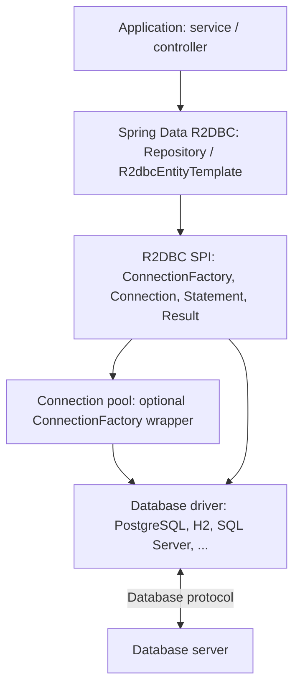
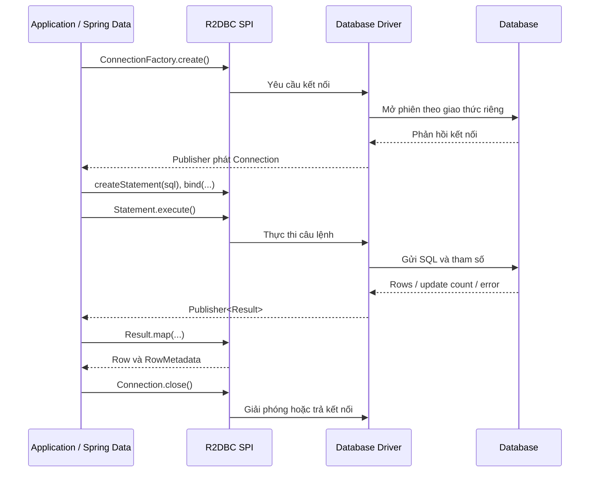

# R2DBC SPI và trách nhiệm của trình điều khiển

R2DBC là một đặc tả truy cập cơ sở dữ liệu quan hệ theo mô hình reactive dành cho Java. Ở lớp nền tảng của R2DBC là **R2DBC SPI (Service Provider Interface)**: một tập hợp interface quy định cách ứng dụng yêu cầu kết nối, tạo câu lệnh SQL, truyền tham số, nhận kết quả và điều khiển giao dịch. Trình điều khiển (driver) của từng hệ quản trị cơ sở dữ liệu triển khai các interface này để chuyển lời gọi Java thành thao tác giao tiếp thực tế với cơ sở dữ liệu.

Spring Data R2DBC nằm ở lớp cao hơn. Nó dùng SPI để thực hiện truy vấn, ánh xạ hàng dữ liệu thành entity và cung cấp repository reactive. Hiểu ranh giới giữa SPI, driver và Spring Data giúp xác định đúng thành phần chịu trách nhiệm khi cấu hình kết nối, xử lý kiểu dữ liệu, thực thi SQL hoặc điều tra lỗi.

## 1. R2DBC SPI đứng ở đâu trong kiến trúc?

R2DBC SPI là hợp đồng chung giữa mã Java truy cập dữ liệu và driver của cơ sở dữ liệu. Nhờ hợp đồng này, lớp ứng dụng có thể làm việc với những interface chuẩn mà không cần tự triển khai giao thức mạng riêng cho PostgreSQL, H2, Microsoft SQL Server hay một hệ quản trị khác.

Kiến trúc tổng quát có thể hình dung như sau:



Các thành phần có vai trò khác nhau:

- **Ứng dụng** quyết định nghiệp vụ cần đọc hoặc ghi dữ liệu nào.
- **Spring Data R2DBC** cung cấp repository, truy vấn dẫn xuất, ánh xạ entity và các API truy cập dữ liệu ở mức cao hơn.
- **R2DBC SPI** định nghĩa các thao tác kết nối và thực thi SQL theo một hợp đồng thống nhất.
- **Driver** hiện thực hợp đồng SPI cho một hệ quản trị cụ thể, giao tiếp với máy chủ cơ sở dữ liệu và chuyển đổi dữ liệu giữa giao thức của máy chủ với kiểu Java.
- **Connection pool** là thành phần tùy chọn quản lý và tái sử dụng kết nối. Nó thường được cung cấp bằng một `ConnectionFactory` bao quanh factory của driver, ví dụ R2DBC Pool.
- **Database server** phân tích và thực thi SQL, quản lý dữ liệu, khóa và giao dịch theo khả năng của hệ quản trị.

Driver là cầu nối kỹ thuật giữa SPI và giao thức của database. SPI không chứa toàn bộ mã giao tiếp riêng cho từng nhà cung cấp; driver mới là nơi thực hiện phần đó.

## 2. SPI là hợp đồng, driver là phần triển khai

SPI khai báo những interface mà driver cần cung cấp. Các interface không mô tả chi tiết cách một driver mở socket, mã hóa gói tin, đọc phản hồi hay quản lý trạng thái giao thức. Những quyết định đó thuộc về triển khai của driver.

Ví dụ, mã gọi `ConnectionFactory.create()` chỉ yêu cầu tạo một kết nối và nhận kết quả dưới dạng reactive publisher. Với PostgreSQL, driver PostgreSQL chịu trách nhiệm thiết lập phiên giao tiếp và sử dụng giao thức PostgreSQL. Với một database khác, driver tương ứng thực hiện quy trình kết nối và giao thức riêng.

Nhờ cách phân lớp này, mã ở tầng trên có thể phụ thuộc vào `io.r2dbc.spi.ConnectionFactory` thay vì một lớp kết nối chỉ dành riêng cho một nhà cung cấp. Tuy vậy, tính di động không có nghĩa mọi database hỗ trợ cùng một cú pháp SQL hoặc cùng một tính năng. SQL, kiểu dữ liệu, tham số, generated values và một số khả năng giao dịch vẫn có thể khác nhau theo hệ quản trị và driver.

Một điểm quan trọng khác là R2DBC SPI trả về các kiểu `org.reactivestreams.Publisher`. SPI không yêu cầu driver phải trả trực tiếp `Mono` hoặc `Flux`. Spring Data R2DBC dùng Project Reactor và chuyển đổi publisher của SPI thành `Mono` hoặc `Flux` khi cần. Đây là lý do có thể gặp `Publisher` trong chữ ký API của SPI và `Mono`/`Flux` trong mã Spring.

Mục tiêu của SPI là truy cập database theo hướng không chặn. Driver cần triển khai việc giao tiếp bất đồng bộ phù hợp với hợp đồng reactive; chỉ bọc một lời gọi JDBC đang chặn bên trong `Publisher` không làm cho thao tác đó trở thành I/O không chặn. Nếu thao tác database vẫn chặn thread, ứng dụng có thể mất lợi ích về khả năng phục vụ nhiều request đồng thời của mô hình reactive.

## 3. Những interface cốt lõi của R2DBC SPI

### 3.1 ConnectionFactory

`ConnectionFactory` là điểm bắt đầu để lấy kết nối. Nó cung cấp phương thức `create()` trả về một publisher chứa `Connection`, cùng metadata mô tả factory.

```java
Publisher<? extends Connection> publisher = connectionFactory.create();
```

Lời gọi trên chưa cung cấp một đối tượng `Connection` đồng bộ. Ứng dụng đăng ký tiêu thụ publisher để nhận kết nối hoặc nhận lỗi nếu quá trình tạo kết nối thất bại.

Factory có thể được tạo trực tiếp bởi driver hoặc được bọc bởi một thành phần khác như connection pool. Khi dùng pool, mã phía trên vẫn có thể phụ thuộc vào interface `ConnectionFactory`; pool lấy kết nối vật lý từ driver và quản lý việc cấp phát, thu hồi theo cấu hình của nó.

### 3.2 Connection

`Connection` đại diện cho một kết nối tới database. Đây là nơi tạo câu lệnh, tạo batch, điều khiển giao dịch và đóng hoặc xác thực kết nối.

Những thao tác thường gặp gồm:

- `createStatement(sql)`: tạo câu lệnh SQL có thể bind tham số.
- `createBatch()`: tạo batch gồm nhiều câu lệnh SQL.
- `beginTransaction()`: bắt đầu giao dịch.
- `commitTransaction()`: xác nhận giao dịch.
- `rollbackTransaction()`: hoàn tác giao dịch.
- `close()`: giải phóng kết nối hoặc trả kết nối về pool.
- `setAutoCommit(...)` và các thao tác cấu hình giao dịch khác: điều khiển chế độ giao dịch trong phạm vi khả năng của driver.

Các thao tác có tính bất đồng bộ đều trả publisher. Vì thế, thứ tự thao tác cần được nối trong pipeline reactive. Không nên gọi một phương thức rồi giả định lệnh SQL đã hoàn thành ngay tại thời điểm nhận publisher.

### 3.3 Statement

`Statement` đại diện cho một câu lệnh SQL sẽ được thực thi. Nó cho phép bind giá trị, thêm lần thực thi tiếp theo cho cùng mẫu câu lệnh và gọi `execute()`.

Ví dụ:

```java
Statement statement = connection
        .createStatement("SELECT id, name FROM customer WHERE id = $1")
        .bind(0, customerId);

Publisher<? extends Result> results = statement.execute();
```

Trong ví dụ này, cú pháp `$1` là placeholder của PostgreSQL. Cú pháp placeholder trong chuỗi SQL phụ thuộc driver và hệ quản trị, trong khi chỉ số truyền cho `bind(0, customerId)` là vị trí tham số theo API SPI, bắt đầu từ 0.

Với tham số có giá trị null, SPI cung cấp `bindNull(index, type)` để khai báo kiểu cần bind:

```java
Statement statement = connection
        .createStatement("INSERT INTO customer (name, nickname) VALUES ($1, $2)")
        .bind(0, "An")
        .bindNull(1, String.class);
```

Bind tham số giúp driver truyền dữ liệu theo cơ chế tham số của nó. Hãy dùng bind cho giá trị đầu vào thay vì nối chuỗi dữ liệu trực tiếp vào SQL. Tên bảng, tên cột hoặc đoạn SQL động cần được kiểm soát riêng vì tham số bind thường đại diện cho giá trị, không phải mọi thành phần cú pháp SQL.

### 3.4 Batch

`Batch` cho phép thêm nhiều câu lệnh SQL độc lập rồi thực thi chúng:

```java
Batch batch = connection.createBatch()
        .add("DELETE FROM expired_session WHERE expires_at < CURRENT_TIMESTAMP")
        .add("UPDATE system_status SET last_cleanup = CURRENT_TIMESTAMP");

Publisher<? extends Result> results = batch.execute();
```

Batch phù hợp với những câu lệnh SQL được tạo sẵn. Nếu cần truyền nhiều bộ tham số cho cùng một mẫu câu lệnh, hãy xem xét `Statement` và thao tác `add()` của nó; `Batch.add(String)` không phải API bind tham số. Việc gom câu lệnh thành batch cũng không tự động có nghĩa mọi câu lệnh được bảo đảm nguyên tử. Muốn có tính nguyên tử, cần dùng giao dịch phù hợp.

### 3.5 Result

`Result` biểu diễn kết quả thực thi một câu lệnh. Tùy câu lệnh, kết quả có thể chứa các hàng dữ liệu hoặc số hàng được cập nhật.

Các thao tác thường dùng:

- `map(...)`: ánh xạ hàng dữ liệu thành đối tượng Java.
- `getRowsUpdated()`: lấy số hàng bị ảnh hưởng đối với thao tác cập nhật khi driver cung cấp thông tin đó.
- `flatMap(...)`: xử lý các phần kết quả theo publisher.

Không phải kết quả của mọi câu SQL đều là danh sách entity. Một câu `UPDATE` thường được quan tâm qua số hàng cập nhật; một câu `SELECT` được quan tâm qua các hàng dữ liệu. Cần chọn cách tiêu thụ tương ứng với loại kết quả.

### 3.6 Row và metadata

`Row` đại diện cho một hàng được trả về. Ứng dụng có thể đọc cột theo chỉ số hoặc tên và yêu cầu kiểu Java:

```java
Long id = row.get("id", Long.class);
String name = row.get("name", String.class);
```

`RowMetadata` cung cấp metadata của các cột trong hàng, chẳng hạn tên cột và metadata riêng do driver cung cấp. Metadata hữu ích khi ánh xạ kết quả linh hoạt hoặc kiểm tra cấu trúc kết quả truy vấn.

Đối tượng `Row` thuộc vòng đời xử lý hàng do driver quản lý. Hãy đọc và chuyển dữ liệu cần thiết thành đối tượng ứng dụng ngay trong callback ánh xạ; không giữ `Row` để dùng sau khi callback kết thúc. Driver có thể tái sử dụng vùng đệm hoặc tài nguyên nội bộ khi chuyển sang hàng tiếp theo.

### 3.7 Metadata của kết nối và driver

SPI còn có các interface metadata như `ConnectionFactoryMetadata`, `ConnectionMetadata` và `ColumnMetadata`. Chúng cung cấp thông tin về factory, database, phiên bản hoặc cột kết quả. Metadata giúp thư viện và ứng dụng nhận biết môi trường đang kết nối, nhưng không thay thế tài liệu về những tính năng cụ thể của driver.

## 4. Luồng thực thi một truy vấn qua SPI

Một truy vấn đọc dữ liệu thường đi qua các bước sau:

1. Ứng dụng hoặc Spring Data gọi `ConnectionFactory.create()`.
2. Driver tạo hoặc lấy một kết nối database và phát kết nối qua publisher.
3. Mã gọi `Connection.createStatement(sql)` để tạo câu lệnh.
4. Mã bind các tham số đầu vào bằng `bind(...)` hoặc `bindNull(...)`.
5. Mã gọi `Statement.execute()`; driver chuyển SQL và tham số thành yêu cầu theo giao thức database.
6. Database thực thi câu lệnh và gửi kết quả về.
7. Driver giải mã phản hồi, cung cấp `Result`, `Row` và metadata qua publisher.
8. Lớp ánh xạ chuyển hàng dữ liệu thành kiểu mà ứng dụng cần.
9. Khi xử lý hoàn tất, kết nối được đóng hoặc trả về pool; khi xảy ra lỗi hay hủy subscription, tài nguyên cũng cần được giải phóng đúng cách.

Sơ đồ dưới đây cho thấy luồng dữ liệu và vị trí driver tham gia:



Các bước được nối bằng publisher. Việc tạo publisher và việc tiêu thụ publisher là hai thời điểm khác nhau; truy vấn thường bắt đầu khi có subscription. Do đó, chỉ tạo biến `Mono` hoặc `Flux` chưa có nghĩa là database đã trả kết quả.

## 5. Trách nhiệm chính của driver R2DBC

Driver triển khai hợp đồng SPI và chịu trách nhiệm cho những chi tiết cần thiết để làm việc với một hệ quản trị cụ thể.

### 5.1 Tạo và quản lý kết nối

Driver cung cấp `ConnectionFactory` và `Connection`. Nó thực hiện việc thiết lập phiên kết nối, xác thực theo cấu hình, theo dõi trạng thái kết nối và phản ánh lỗi kết nối qua publisher. Driver cũng cần xử lý việc đóng kết nối và các tình huống kết nối bị hỏng theo đặc tả cùng khả năng của mình.

Driver không nhất thiết phải tự cung cấp connection pool. Một pool có thể bọc factory của driver để tái sử dụng kết nối, giới hạn số kết nối đồng thời, kiểm tra kết nối và quản lý thời gian chờ. Khi dùng pool, cần phân biệt việc `close()` một kết nối logic thường trả nó về pool với việc đóng hẳn socket kết nối vật lý.

### 5.2 Chuyển lời gọi SPI thành giao thức database

Mỗi hệ quản trị có giao thức giao tiếp, định dạng thông điệp và quy tắc trạng thái riêng. Driver chuyển thao tác như tạo statement, bind tham số, thực thi và lấy kết quả thành các thông điệp mà máy chủ hiểu được. Driver cũng đọc phản hồi và chuyển chúng thành các publisher theo SPI.

Đây là phần khiến driver của các database khác nhau có thể có độ trưởng thành và hành vi khác nhau dù cùng triển khai một bộ interface chuẩn.

### 5.3 Bind tham số và chuyển đổi kiểu dữ liệu

Driver chuyển giá trị Java được bind thành kiểu dữ liệu và định dạng phù hợp với database. Khi đọc kết quả, driver giải mã dữ liệu của database thành kiểu Java mà SPI cho phép truy xuất.

Ví dụ, một cột số nguyên, timestamp, binary hoặc kiểu dữ liệu đặc thù của nhà cung cấp có thể cần cách mã hóa và giải mã khác nhau. Driver chịu trách nhiệm phần chuyển đổi ở ranh giới giao thức. Spring Data có thể thực hiện thêm chuyển đổi giữa giá trị đọc được và thuộc tính entity, nhưng không thay thế codec hay khả năng hỗ trợ kiểu dữ liệu của driver.

Không nên giả định mọi driver ánh xạ mọi kiểu database sang cùng một kiểu Java hoặc hỗ trợ cùng các kiểu mở rộng. Với JSON, array, enum, UUID, LOB hoặc kiểu riêng của nhà cung cấp, cần xem tài liệu driver đang dùng.

### 5.4 Trả kết quả và metadata

Driver tạo các đối tượng triển khai `Result`, `Row`, `RowMetadata` và metadata liên quan. Nó chịu trách nhiệm giải mã các hàng, cung cấp giá trị cột theo kiểu được yêu cầu, báo số hàng cập nhật khi có thể và truyền lỗi trong quá trình đọc dữ liệu.

Driver cũng phải xử lý các kết quả đặc thù mà database hỗ trợ, ví dụ giá trị sinh tự động hoặc nhiều phần kết quả. Cách yêu cầu và mức độ hỗ trợ có thể khác nhau giữa các driver.

### 5.5 Giao dịch và trạng thái kết nối

SPI cung cấp thao tác bắt đầu, commit và rollback giao dịch. Driver chuyển các thao tác này thành lệnh hoặc thông điệp phù hợp với database, đồng thời phản ánh lỗi nếu trạng thái giao dịch không hợp lệ hoặc kết nối đã mất.

Driver thực hiện thao tác giao dịch ở mức kết nối. Việc xác định một nghiệp vụ gồm những bước nào, khi nào bắt đầu giao dịch và khi nào commit thuộc về ứng dụng hoặc transaction manager ở tầng cao hơn. Spring Data R2DBC phối hợp với Spring transaction infrastructure để quản lý vòng đời giao dịch reactive.

### 5.6 Reactive Streams, demand và cancellation

Driver triển khai SPI theo mô hình reactive và phải tôn trọng quy tắc Reactive Streams đối với publisher mà nó cung cấp. Nó cần phối hợp việc phát dữ liệu, tín hiệu hoàn tất, tín hiệu lỗi và hủy subscription. Khi subscription bị hủy, driver cần dừng hoặc giải phóng công việc và tài nguyên liên quan theo khả năng của giao thức database.

Backpressure cho phép subscriber thể hiện nhu cầu nhận phần tử. Tuy nhiên, điều đó không có nghĩa mọi database đều gửi từng hàng theo đúng số lượng demand. Một giao thức hoặc driver có thể cần đọc theo lô, dùng bộ đệm hoặc có giới hạn riêng. Cần xem tài liệu driver và kiểm thử với loại truy vấn thực tế; không nên suy ra rằng dùng `Flux` tự động tạo ra luồng dữ liệu có bộ nhớ cố định.

### 5.7 Truyền lỗi và trạng thái không hợp lệ

Driver chuyển lỗi từ kết nối, giao thức, SQL hoặc thao tác chuyển đổi thành các ngoại lệ thuộc hệ phân cấp `R2dbcException`. Thông tin lỗi có thể bao gồm trạng thái SQL hoặc mã lỗi tùy database. Lớp trên có thể dùng các ngoại lệ này để quyết định xử lý, nhưng không nên dựa vào chuỗi thông báo lỗi để phân loại nếu có thông tin cấu trúc ổn định hơn.

## 6. Những việc không thuộc trách nhiệm của driver

Ranh giới trách nhiệm giúp tránh đặt logic sai tầng:

| Công việc | Thành phần thường chịu trách nhiệm |
| --- | --- |
| Giao tiếp giao thức riêng với database | Driver |
| Tạo kết nối theo SPI | Driver và/hoặc ConnectionFactory được bọc |
| Tái sử dụng, giới hạn và kiểm tra pool kết nối | Connection pool |
| Thực thi SQL và trả Result/Row | Driver phối hợp với database |
| Ánh xạ hàng thành entity theo metadata Spring | Spring Data R2DBC |
| Tạo truy vấn từ tên phương thức repository | Spring Data R2DBC |
| Quyết định nghiệp vụ cần đọc hoặc ghi gì | Application/service |
| Xác định phạm vi giao dịch của nghiệp vụ | Application và transaction manager |
| Kiểm tra quyền truy cập nghiệp vụ và xác thực dữ liệu đầu vào | Application |

Driver không phải ORM. Nó không tự hiểu quan hệ aggregate của domain, không quyết định entity nào cần cascade, không tự tạo repository theo tên phương thức và không thực hiện validation nghiệp vụ. Nó cung cấp khả năng truy cập database ở mức SPI để các thư viện cao hơn xây dựng chức năng đó.

Tương tự, connection pool không đồng nghĩa với driver. Pool quản lý việc cấp phát và tái sử dụng kết nối; driver chịu trách nhiệm tạo và vận hành kết nối theo giao thức database. Một ứng dụng có thể dùng driver mà không có pool, hoặc dùng một pool bọc driver.

## 7. Cách Spring Data R2DBC sử dụng SPI

Trong ứng dụng Spring, thông thường không cần tự gọi từng phương thức SPI. Spring Data R2DBC dùng `ConnectionFactory` làm đầu vào cho các thành phần truy cập dữ liệu. `DatabaseClient` cung cấp API thực thi SQL; `R2dbcEntityTemplate` và repository bổ sung thao tác ở mức entity.

Có thể hình dung các tầng như sau:

```text
CustomerService
    |
    v
ReactiveCrudRepository<Customer, Long>
    |
    v
Spring Data R2DBC mapping / repository infrastructure
    |
    v
DatabaseClient / R2dbcEntityTemplate
    |
    v
R2DBC SPI (ConnectionFactory, Connection, Statement, Result)
    |
    v
Database driver
    |
    v
Relational database
```

Ví dụ repository:

```java
public interface CustomerRepository
        extends ReactiveCrudRepository<Customer, Long> {

    Mono<Customer> findByEmail(String email);

    Flux<Customer> findByStatus(String status);
}
```

Spring Data phân tích khai báo repository, tạo truy vấn phù hợp và dùng hạ tầng R2DBC để thực thi. Driver tiếp nhận thao tác ở tầng SPI và giao tiếp với database. Kết quả sau đó đi ngược lên các tầng, được ánh xạ thành entity và phát qua `Mono` hoặc `Flux`.

Nếu cần SQL rõ ràng hơn, ứng dụng có thể dùng `DatabaseClient`:

```java
public Mono<Customer> findCustomer(Long id) {
    return databaseClient.sql("SELECT id, name FROM customer WHERE id = :id")
            .bind("id", id)
            .map((row, metadata) -> new Customer(
                    row.get("id", Long.class),
                    row.get("name", String.class)
            ))
            .one();
}
```

Ở đây, `DatabaseClient` cung cấp cách bind theo tên và API ánh xạ thuận tiện. Phía dưới, Spring chuyển thao tác đó thành các lệnh SPI tương ứng. Driver vẫn chịu trách nhiệm giao tiếp với database. Placeholder `:id` trong ví dụ là cú pháp bind của `DatabaseClient`; không nên nhầm nó với cú pháp placeholder SQL mà driver cụ thể sử dụng ở tầng SPI.

## 8. Ví dụ truy cập SPI trực tiếp

Đa số ứng dụng Spring nên dùng repository, `DatabaseClient` hoặc `R2dbcEntityTemplate`. Tuy nhiên, một ví dụ SPI trực tiếp giúp thấy rõ driver được gọi ở đâu và ai phải quản lý tài nguyên.

Ví dụ sau dùng cú pháp placeholder PostgreSQL:

```java
import io.r2dbc.spi.ConnectionFactory;
import reactor.core.publisher.Flux;
import reactor.core.publisher.Mono;

public record Customer(Long id, String name) {}

public Mono<Customer> findCustomer(ConnectionFactory factory, Long id) {
    return Mono.usingWhen(
            Mono.from(factory.create()),
            connection -> Flux.from(
                            connection.createStatement(
                                            "SELECT id, name FROM customer WHERE id = $1")
                                    .bind(0, id)
                                    .execute()
                    )
                    .flatMap(result -> Flux.from(
                            result.map((row, metadata) ->
                                    new Customer(
                                            row.get("id", Long.class),
                                            row.get("name", String.class)
                                    )
                            )
                    ))
                    .singleOrEmpty(),
            connection -> Mono.from(connection.close()),
            (connection, error) -> Mono.from(connection.close()),
            connection -> Mono.from(connection.close())
    );
}
```

Trong ví dụ:

1. `factory.create()` yêu cầu SPI cấp một kết nối. Publisher được chuyển thành `Mono` để dùng với Reactor.
2. `createStatement(...)` tạo câu lệnh; `bind(0, id)` gắn giá trị cho tham số đầu tiên.
3. `execute()` trả publisher chứa kết quả thực thi.
4. `Result.map(...)` đọc cột từ từng `Row` và tạo `Customer` ngay trong callback ánh xạ.
5. `singleOrEmpty()` phù hợp với truy vấn theo khóa chính: không có hàng thì trả publisher rỗng; một hàng thì trả entity; nếu có nhiều hàng thì báo lỗi.
6. `Mono.usingWhen(...)` quản lý việc đóng kết nối khi hoàn tất, khi lỗi và khi subscription bị hủy.

Đoạn mã minh họa việc nối các API SPI với Reactor. Trong dự án thực tế, cần dùng đúng placeholder, kiểu dữ liệu và tính năng mà driver đang chọn hỗ trợ. Nếu dùng pool, thao tác `close()` thường trả kết nối logic về pool.

## 9. Cấu hình driver và ConnectionFactory

Một ứng dụng cần có driver tương ứng với hệ quản trị đang sử dụng. Ví dụ, ứng dụng kết nối PostgreSQL cần dependency của R2DBC PostgreSQL; ứng dụng dùng H2 cần driver R2DBC H2. Dependency driver cung cấp phần triển khai SPI và cơ chế đăng ký để thư viện có thể tìm driver thích hợp.

Ở tầng SPI, việc tìm và tạo factory có thể được thực hiện thông qua `ConnectionFactories` và `ConnectionFactoryOptions`. Với Spring Boot, thông thường cấu hình URL và thông tin xác thực trong application configuration để auto-configuration tạo `ConnectionFactory`.

Ví dụ cấu hình minh họa:

```yaml
spring:
  r2dbc:
    url: r2dbc:postgresql://localhost:5432/customer_db
    username: app_user
    password: ${DB_PASSWORD}
```

URL bắt đầu bằng `r2dbc:` và chứa tên driver. Cấu hình cụ thể, tùy chọn SSL, timeout, schema và các tham số khác phụ thuộc driver. Không nên sao chép nguyên cấu hình của một driver sang driver khác rồi giả định tất cả thuộc tính đều có cùng ý nghĩa.

Khi thêm connection pool, ứng dụng cần cấu hình pool riêng theo thư viện đang dùng, chẳng hạn giới hạn kết nối tối đa, thời gian chờ lấy kết nối, thời gian sống và kiểm tra kết nối. Các giá trị này là cấu hình vận hành của pool, không phải trách nhiệm chung được SPI áp đặt cho mọi driver.

## 10. Tính di động và khác biệt giữa các driver

SPI tạo một giao diện chung, nhưng ứng dụng vẫn cần chú ý các khác biệt:

- **SQL dialect:** hàm SQL, kiểu dữ liệu, cú pháp phân trang, cú pháp khóa và placeholder có thể khác nhau.
- **Kiểu dữ liệu:** cách ánh xạ timestamp, JSON, array, enum, UUID, binary hoặc LOB có thể khác nhau.
- **Generated values:** khả năng và cách lấy khóa tự sinh phụ thuộc database và driver.
- **Transaction:** isolation level, savepoint, auto-commit và một số hành vi giao dịch phụ thuộc hệ quản trị.
- **Batch và result:** hỗ trợ batch, nhiều kết quả, số hàng cập nhật hoặc metadata có thể khác nhau.
- **Hiệu năng và tài nguyên:** cách driver đọc theo lô, buffering, giới hạn kết nối và xử lý cancellation có thể khác nhau.

Nếu một ứng dụng cần chạy trên nhiều hệ quản trị, nên giữ SQL và mapping ở mức phù hợp, kiểm thử trên từng driver mục tiêu và tránh phụ thuộc ngầm vào tính năng riêng mà chưa có phương án thay thế. Việc một driver biên dịch được với SPI không bảo đảm nó hỗ trợ mọi tính năng mà ứng dụng mong đợi.

## 11. Điều tra lỗi theo đúng tầng

Khi một truy vấn R2DBC thất bại, hãy xác định lỗi xuất hiện ở tầng nào:

| Triệu chứng | Thành phần nên kiểm tra trước |
| --- | --- |
| Không tìm thấy driver hoặc không tạo được ConnectionFactory | Dependency driver, URL và cơ chế discovery |
| Không thể mở kết nối hoặc xác thực | Driver, cấu hình mạng, thông tin đăng nhập và database server |
| SQL không hợp lệ hoặc placeholder sai | Câu SQL, dialect và cách bind của driver |
| Không chuyển đổi được kiểu cột | Kiểu dữ liệu database, mapping và hỗ trợ của driver |
| Kết nối bị giữ quá lâu hoặc hết connection | Vòng đời subscription, đóng kết nối và cấu hình pool |
| Lỗi khi commit hoặc rollback | Transaction manager, trạng thái kết nối và hỗ trợ giao dịch của database |
| Hủy request nhưng tài nguyên vẫn bị giữ | Cách hủy pipeline, cleanup và hành vi driver |

Nên đọc nguyên nhân gốc và loại ngoại lệ thay vì chỉ nhìn thông báo ở controller. Một lỗi SQL có thể được chuyển thành ngoại lệ Spring ở tầng trên, trong khi nguyên nhân gốc đến từ driver hoặc database. Khi điều tra, hãy ghi nhận driver và phiên bản, loại database, câu SQL đã loại bỏ dữ liệu nhạy cảm, loại thao tác và trạng thái giao dịch.

Không ghi mật khẩu, token hoặc dữ liệu cá nhân vào log. Khi bật log giao thức hoặc log SQL chi tiết để điều tra, cần cân nhắc dữ liệu nhạy cảm có thể xuất hiện trong thông tin bind.

## 12. Các nhầm lẫn thường gặp

1. **Coi R2DBC SPI là driver.** SPI chỉ định nghĩa hợp đồng; driver triển khai hợp đồng cho một database cụ thể.
2. **Cho rằng SPI trả về Mono và Flux.** SPI sử dụng Reactive Streams `Publisher`; Reactor cung cấp `Mono` và `Flux` ở lớp ứng dụng/Spring.
3. **Nghĩ Spring Data R2DBC trực tiếp nói chuyện với giao thức database.** Spring Data gọi SPI; driver mới xử lý giao thức riêng.
4. **Coi connection pool là một phần bắt buộc của driver.** Pool là thành phần tùy chọn thường bọc `ConnectionFactory`.
5. **Cho rằng mọi driver có cùng tính năng.** Cùng triển khai SPI không đồng nghĩa cùng hỗ trợ mọi kiểu dữ liệu, generated values, transaction hoặc batch.
6. **Giữ Row để dùng sau callback.** Hãy ánh xạ dữ liệu trong callback vì vòng đời Row do driver quản lý.
7. **Nối giá trị đầu vào vào SQL.** Dùng bind tham số để truyền giá trị; kiểm soát riêng những phần SQL động như tên bảng hoặc cột.
8. **Quên đóng kết nối khi dùng SPI trực tiếp.** Cần quản lý cleanup cho cả hoàn tất, lỗi và cancellation; dùng Spring abstraction khi có thể để giảm việc tự quản lý tài nguyên.
9. **Giả định Flux luôn đồng nghĩa với streaming không giới hạn bộ nhớ.** Driver có thể buffer hoặc đọc theo lô; cần kiểm tra hành vi thực tế.
10. **Cho rằng driver quyết định phạm vi giao dịch nghiệp vụ.** Driver thực hiện thao tác transaction ở mức kết nối; ứng dụng hoặc transaction manager quyết định ranh giới nghiệp vụ.

## 13. Khi nào cần làm việc trực tiếp với SPI?

Trong ứng dụng Spring Data R2DBC thông thường, repository hoặc `DatabaseClient` đã đủ cho phần lớn nhu cầu. Làm việc trực tiếp với SPI có thể phù hợp khi:

- Xây dựng một thư viện truy cập dữ liệu độc lập với Spring.
- Tìm hiểu hoặc phát triển một R2DBC driver.
- Cần thao tác cấp thấp chưa được abstraction hiện tại cung cấp.
- Muốn hiểu rõ vòng đời kết nối, statement, result và cancellation.
- Đang điều tra hành vi driver hoặc lỗi ở ranh giới SPI.

Khi gọi SPI trực tiếp, mã ứng dụng phải quan tâm nhiều hơn đến quản lý kết nối, thứ tự thao tác, tiêu thụ Result và giải phóng tài nguyên. Với code nghiệp vụ Spring, nên ưu tiên abstraction cao hơn nếu chúng đáp ứng yêu cầu.

## Ghi nhớ

R2DBC SPI định nghĩa hợp đồng reactive để Java làm việc với cơ sở dữ liệu quan hệ. Driver hiện thực hợp đồng đó, xử lý giao thức riêng của database, kết nối, statement, tham số, kết quả, kiểu dữ liệu, giao dịch và lỗi. Spring Data R2DBC sử dụng SPI để cung cấp repository và ánh xạ entity; connection pool có thể bọc factory của driver để quản lý việc tái sử dụng kết nối.

Khi gặp một vấn đề R2DBC, hãy xác định nó thuộc hợp đồng SPI, phần triển khai của driver, connection pool, database hay abstraction Spring. Đặt đúng trách nhiệm ở đúng tầng giúp cấu hình và xử lý lỗi chính xác hơn, đồng thời tránh phụ thuộc sai vào tính năng riêng của một driver.
