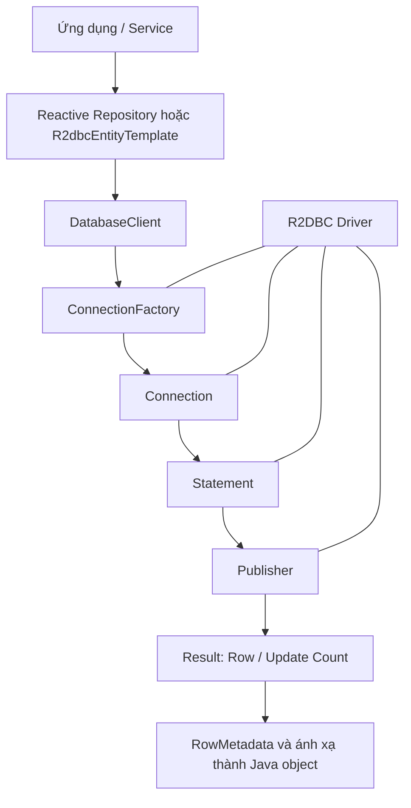

# ConnectionFactory, Connection, Statement và Result

Trong kiến trúc Spring Data Relational R2DBC, bốn khái niệm `ConnectionFactory`, `Connection`, `Statement` và `Result` tạo thành đường đi chính của một thao tác SQL. Chúng thuộc R2DBC SPI (Service Provider Interface), là lớp giao tiếp chuẩn giữa ứng dụng reactive và driver của từng hệ quản trị cơ sở dữ liệu.

`ConnectionFactory` tạo kết nối; `Connection` đại diện cho một phiên làm việc với cơ sở dữ liệu; `Statement` mô tả câu SQL cùng các tham số; `Result` biểu diễn kết quả thực thi. Spring Data R2DBC xây dựng các abstraction cấp cao hơn trên chuỗi SPI này để ánh xạ hàng dữ liệu thành entity và tích hợp với repository, transaction cùng hệ sinh thái Spring.

## 1. Vị trí của bốn thành phần trong kiến trúc

Một ứng dụng Spring Data R2DBC thường không cần thao tác trực tiếp với từng đối tượng SPI. Repository hoặc `R2dbcEntityTemplate` gọi qua các abstraction của Spring, tiêu biểu là `DatabaseClient`. `DatabaseClient` sử dụng `ConnectionFactory` để lấy kết nối và phối hợp việc thực thi câu lệnh.



Có thể đọc luồng này theo hai hướng:

- **Đường đi xuống:** ứng dụng yêu cầu đọc hoặc ghi dữ liệu; Spring tạo câu lệnh, lấy connection, tạo statement và thực thi SQL thông qua driver.
- **Đường đi lên:** driver phát các result; ứng dụng tiêu thụ result, đọc hàng hoặc số bản ghi cập nhật, sau đó ánh xạ thành kiểu dữ liệu mà tầng trên cần.

Các thao tác R2DBC thường được biểu diễn bằng Reactive Streams `Publisher` và Reactor `Mono`/`Flux`. Việc tạo publisher và việc thực thi I/O được tách biệt: thao tác cơ sở dữ liệu thường bắt đầu khi pipeline được subscribe. Vì vậy, việc có một `ConnectionFactory` hoặc một `Statement` trong biến Java chưa có nghĩa truy vấn đã chạy.

## 2. `ConnectionFactory`: nhà máy tạo kết nối

`io.r2dbc.spi.ConnectionFactory` là điểm vào để ứng dụng lấy một `Connection`. Giao diện này cung cấp hai khả năng cốt lõi:

- `create()` trả về một `Publisher` phát ra connection mới hoặc connection được cấp từ pool.
- `getMetadata()` trả về metadata về factory, chẳng hạn tên driver.

`ConnectionFactory` che giấu cách driver thiết lập kết nối vật lý. Ứng dụng làm việc với SPI chung, còn driver PostgreSQL, H2, MariaDB hoặc hệ quản trị khác xử lý giao thức và đặc điểm riêng của hệ thống tương ứng.

### Tạo factory

Một cách tạo factory ở mức R2DBC SPI là dùng `ConnectionFactories` cùng `ConnectionFactoryOptions`:

```java
ConnectionFactoryOptions options = ConnectionFactoryOptions.builder()
        .option(ConnectionFactoryOptions.DRIVER, "postgresql")
        .option(ConnectionFactoryOptions.HOST, "localhost")
        .option(ConnectionFactoryOptions.PORT, 5432)
        .option(ConnectionFactoryOptions.DATABASE, "appdb")
        .option(ConnectionFactoryOptions.USER, "appuser")
        .option(ConnectionFactoryOptions.PASSWORD, "secret")
        .build();

ConnectionFactory connectionFactory = ConnectionFactories.get(options);
```

Đây là ví dụ minh họa cách cấu hình; trong ứng dụng thực tế, thông tin xác thực nên được lấy từ cấu hình bảo mật hoặc biến môi trường, không hard-code trong mã nguồn. Driver tương ứng phải có mặt trên classpath để SPI tìm được implementation.

Một số ứng dụng cấu hình bằng R2DBC URL, ví dụ `r2dbc:postgresql://...`, rồi dùng `ConnectionFactories.get(url)`. URL và các option cụ thể phụ thuộc driver. Spring Boot thường tự cấu hình bean `ConnectionFactory` từ thuộc tính `spring.r2dbc.*`, do đó service và repository chỉ cần nhận bean qua dependency injection.

Ví dụ nhận bean do Spring quản lý:

```java
@Repository
public class CustomerReader {

    private final DatabaseClient databaseClient;

    public CustomerReader(DatabaseClient databaseClient) {
        this.databaseClient = databaseClient;
    }
}
```

Trong ứng dụng Spring Boot có cấu hình R2DBC phù hợp, `DatabaseClient` có thể được cấu hình tự động từ `ConnectionFactory`. Nếu tự cấu hình, có thể tạo `DatabaseClient` bằng `DatabaseClient.create(connectionFactory)`.

### ConnectionFactory không đồng nghĩa với Connection

`ConnectionFactory` là đối tượng dùng chung để yêu cầu cấp kết nối. `Connection` là một phiên làm việc cụ thể được cấp từ factory. Thông thường ứng dụng giữ factory lâu dài, còn connection được mượn trong phạm vi một thao tác hoặc transaction rồi được đóng/trả lại.

Factory có thể tạo kết nối trực tiếp từ driver hoặc bọc một pool. Tầng ứng dụng vẫn gọi `create()` như nhau; chi tiết lấy kết nối vật lý mới hay mượn kết nối sẵn có được factory xử lý.

## 3. `Connection`: phiên làm việc với cơ sở dữ liệu

`io.r2dbc.spi.Connection` đại diện cho một kết nối đang được cấp cho ứng dụng. Nó cung cấp các thao tác để tạo statement, quản lý transaction và đóng kết nối.

Những phương thức thường gặp gồm:

| Phương thức | Vai trò |
| --- | --- |
| `createStatement(sql)` | Tạo `Statement` để thực thi SQL |
| `createBatch()` | Tạo batch chứa nhiều câu lệnh SQL không tham số theo API batch của SPI |
| `beginTransaction()` | Bắt đầu transaction |
| `commitTransaction()` | Commit transaction hiện tại |
| `rollbackTransaction()` | Rollback transaction hiện tại |
| `setAutoCommit(boolean)` | Bật hoặc tắt chế độ auto-commit |
| `setTransactionIsolationLevel(...)` | Thiết lập mức cô lập transaction |
| `getMetadata()` | Lấy metadata về connection |
| `close()` | Đóng hoặc giải phóng connection theo implementation |

Các thao tác thay đổi trạng thái connection thường trả về `Publisher<Void>`. Vì vậy, muốn transaction bắt đầu hoặc connection được đóng thì publisher tương ứng cũng phải được tiêu thụ trong pipeline.

### Connection có vòng đời riêng

Vòng đời khái quát của một connection:

1. Ứng dụng yêu cầu connection qua `ConnectionFactory.create()`.
2. Publisher phát connection khi việc cấp kết nối hoàn tất.
3. Ứng dụng tạo statement và thực hiện các thao tác cần thiết.
4. Ứng dụng hoàn tất hoặc rollback transaction nếu có.
5. Ứng dụng gọi `close()` khi không còn cần connection.

Nếu không dùng pool, `close()` thường giải phóng kết nối vật lý theo driver. Nếu dùng connection pool, `close()` thường trả connection về pool để lần sau tái sử dụng. Vì vậy, trong ứng dụng có pool, không nên hiểu `close()` luôn đồng nghĩa với việc đóng socket tới database.

Connection là tài nguyên có trạng thái: transaction, auto-commit, isolation level và các thuộc tính phiên có thể ảnh hưởng đến câu lệnh tiếp theo. Không nên dùng chung một connection cho nhiều luồng xử lý độc lập hoặc truy cập đồng thời tùy tiện. Hãy để framework quản lý phạm vi sử dụng và bảo đảm giải phóng connection khi hoàn tất, lỗi hoặc hủy subscription.

### Đóng connection an toàn trong pipeline reactive

Khi thao tác trực tiếp với SPI, cần bảo đảm `close()` chạy trên cả ba đường: hoàn tất bình thường, lỗi và hủy subscription. Reactor cung cấp `usingWhen` để quản lý tài nguyên bất đồng bộ:

```java
Flux<Customer> findActiveCustomers(ConnectionFactory connectionFactory) {
    return Flux.usingWhen(
            Mono.from(connectionFactory.create()),
            connection -> Flux.from(
                    connection.createStatement(
                            "SELECT id, name FROM customer WHERE status = $1"
                    )
                    .bind(0, "ACTIVE")
                    .execute()
            ).concatMap(result -> Flux.from(result.map((row, metadata) ->
                    new Customer(
                            row.get("id", Long.class),
                            row.get("name", String.class)
                    )
            ))),
            connection -> Mono.from(connection.close()),
            (connection, error) -> Mono.from(connection.close()),
            connection -> Mono.from(connection.close())
    );
}
```

Ví dụ dùng marker `$1` và index bind `0` theo kiểu PostgreSQL. Cú pháp placeholder và khả năng bind phụ thuộc driver; không phải hệ quản trị nào cũng dùng marker `$1`. `usingWhen` giữ connection trong suốt quá trình tiêu thụ kết quả và gọi cleanup tương ứng khi pipeline hoàn tất, phát lỗi hoặc bị hủy.

Trong ứng dụng Spring Data R2DBC thông thường, nên dùng `DatabaseClient`, `R2dbcEntityTemplate` hoặc repository để Spring quản lý việc lấy và giải phóng connection. Chỉ thao tác trực tiếp với SPI khi có nhu cầu cụ thể ở mức thấp hơn.

## 4. `Statement`: câu lệnh SQL và tham số

`io.r2dbc.spi.Statement` đại diện cho một câu SQL được tạo từ `Connection`. Statement cho phép truyền tham số, thêm tập tham số cho batch và thực thi câu lệnh.

Các thao tác thường gặp:

| Phương thức | Vai trò |
| --- | --- |
| `bind(index, value)` | Gắn giá trị vào tham số theo vị trí |
| `bind(name, value)` | Gắn giá trị theo tên nếu driver hỗ trợ kiểu tham số đó |
| `bindNull(index, type)` | Gắn giá trị SQL `NULL` cùng kiểu Java tương ứng |
| `bindNull(name, type)` | Gắn `NULL` theo tên tham số nếu được hỗ trợ |
| `add()` | Thêm tập giá trị hiện tại để thực thi nhiều bộ tham số |
| `returnGeneratedValues(columns...)` | Yêu cầu trả về giá trị được sinh, nếu driver hỗ trợ |
| `fetchSize(size)` | Đưa ra gợi ý kích thước fetch cho driver |
| `execute()` | Thực thi statement và trả publisher của `Result` |

### Bind tham số thay vì nối chuỗi SQL

Ví dụ dùng tham số vị trí với PostgreSQL:

```java
Statement statement = connection.createStatement(
        "SELECT id, name FROM customer WHERE status = $1 AND age >= $2"
);

statement.bind(0, "ACTIVE");
statement.bind(1, 18);

Publisher<? extends Result> results = statement.execute();
```

Index trong SPI bắt đầu từ `0`. Marker SQL phải theo quy ước của driver. Dùng bind giúp driver xử lý giá trị như tham số, tránh phải tự escape dữ liệu và giảm nguy cơ SQL injection do nối dữ liệu người dùng vào chuỗi SQL.

Không thể dùng bind parameter cho tên bảng, tên cột, từ khóa hoặc phần cú pháp SQL tùy ý. Nếu cần chọn cột sắp xếp hoặc tên bảng theo đầu vào, hãy kiểm tra đầu vào với danh sách cho phép rồi mới xây dựng phần cấu trúc SQL.

### Bind giá trị NULL

Không nên truyền Java `null` vào `bind`. Dùng `bindNull` và khai báo kiểu Java tương ứng để driver biết kiểu SQL cần truyền:

```java
Statement statement = connection.createStatement(
        "INSERT INTO customer (name, nickname) VALUES ($1, $2)"
);

statement.bind(0, "Lan");
statement.bindNull(1, String.class);
```

Kiểu Java truyền vào `bindNull` phải phù hợp với kiểu cột và khả năng chuyển đổi của driver. Khi làm việc qua `DatabaseClient`, có thể dùng API bind tương ứng của Spring; nếu giá trị là null, cần cung cấp kiểu dữ liệu phù hợp theo overload của API.

### Batch nhiều bộ tham số

`Statement.add()` thêm bộ tham số hiện tại vào danh sách thực thi. Ví dụ:

```java
Statement statement = connection.createStatement(
        "INSERT INTO customer (id, name) VALUES ($1, $2)"
);

statement.bind(0, 101L).bind(1, "An").add();
statement.bind(0, 102L).bind(1, "Binh").add();
statement.bind(0, 103L).bind(1, "Chi");

Publisher<? extends Result> results = statement.execute();
```

Ở đây hai bộ đầu được thêm bằng `add()`, còn bộ cuối là bộ tham số hiện tại. Chi tiết batch, số result phát ra và hiệu năng thực tế phụ thuộc driver/database. Nếu cần batch nhiều lệnh SQL không tham số, SPI còn có `Connection.createBatch()`; batch này khác với batch tham số của `Statement.add()`.

### Giá trị sinh tự động và fetch size

Một số database hỗ trợ trả lại khóa được sinh sau thao tác insert. Có thể yêu cầu driver trả về cột mong muốn:

```java
Statement statement = connection.createStatement(
        "INSERT INTO customer (name) VALUES ($1)"
).bind(0, "Mai");

statement.returnGeneratedValues("id");
```

Sau đó tiêu thụ `Result` như một kết quả có hàng dữ liệu nếu driver hỗ trợ tính năng này. Tên cột, cú pháp SQL và khả năng trả generated values khác nhau giữa các hệ quản trị.

`fetchSize` là gợi ý cho driver về số hàng nên lấy trong một lần fetch. Đây không phải bảo đảm rằng database luôn trả đúng số hàng đó, cũng không thay thế `LIMIT` hoặc phân trang ở SQL. Có driver có thể bỏ qua gợi ý này.

## 5. `execute()` và `Result`: tiêu thụ kết quả câu lệnh

`Statement.execute()` trả về `Publisher<? extends Result>`. Publisher này phát ra một hoặc nhiều `Result` tùy loại statement, batch và hành vi của driver. `Result` không phải là một danh sách Java đã được tải sẵn; nó là đối tượng cung cấp API để tiêu thụ kết quả bất đồng bộ.

Một result có thể biểu diễn dữ liệu hàng (row data), số lượng hàng được cập nhật (update count), hoặc các segment kết quả tùy câu lệnh và driver. Hai cách tiêu thụ phổ biến là:

| API của `Result` | Dùng khi |
| --- | --- |
| `map((row, metadata) -> value)` | Đọc các hàng và ánh xạ mỗi `Row` thành giá trị Java |
| `getRowsUpdated()` | Đọc số lượng hàng bị tác động bởi thao tác ghi |
| `flatMap(segment -> ...)` | Xử lý từng segment kết quả khi cần phân biệt loại segment |

Các phương thức tiêu thụ trả về publisher. Vì thế cần nối chúng vào pipeline hoặc subscribe ở ranh giới phù hợp để driver đọc dữ liệu và giải phóng tài nguyên.

### Đọc hàng với `Result.map`

Ví dụ đọc customer:

```java
Flux<Customer> customers = Flux.from(
        connection.createStatement(
                "SELECT id, name FROM customer WHERE status = $1"
        )
        .bind(0, "ACTIVE")
        .execute()
).concatMap(result -> Flux.from(result.map((row, metadata) ->
        new Customer(
                row.get("id", Long.class),
                row.get("name", String.class)
        )
)));
```

`Row` cung cấp giá trị theo tên cột hoặc vị trí cột. `RowMetadata` mô tả cấu trúc hàng, chẳng hạn metadata của các cột. Kiểu Java yêu cầu khi gọi `row.get(...)` phải tương thích với kiểu dữ liệu mà driver trả về hoặc kiểu chuyển đổi được driver hỗ trợ.

Tên cột có thể trùng hoặc bị thay đổi do alias, vì vậy truy vấn nên đặt alias rõ ràng khi cần phân biệt:

```sql
SELECT c.id AS customer_id, c.name AS customer_name
FROM customer c
```

Khi cần kiểm tra cấu trúc kết quả động, có thể đọc `RowMetadata` và `ColumnMetadata` thay vì giả định tên hoặc kiểu cột cố định.

### Đọc số hàng được cập nhật

Với câu lệnh `UPDATE`, `DELETE` hoặc `INSERT` không cần đọc hàng trả về, có thể lấy update count:

```java
Mono<Long> updatedRows = Mono.from(
        connection.createStatement(
                "UPDATE customer SET status = $1 WHERE id = $2"
        )
        .bind(0, "INACTIVE")
        .bind(1, 101L)
        .execute()
).flatMap(result -> Mono.from(result.getRowsUpdated()));
```

`getRowsUpdated()` trả publisher của số hàng được cập nhật. Với batch hoặc publisher phát nhiều `Result`, cần tiêu thụ từng result và tổng hợp nếu nghiệp vụ cần tổng số hàng:

```java
Mono<Long> totalUpdated = Flux.from(statement.execute())
        .concatMap(result -> Flux.from(result.getRowsUpdated()))
        .reduce(0L, Long::sum);
```

Không phải câu lệnh nào cũng có cùng loại kết quả. Nếu dùng `RETURNING` hoặc `returnGeneratedValues`, kết quả có thể chứa hàng dữ liệu cần đọc bằng API mapping thay vì chỉ lấy update count.

### Result có thể chỉ được tiêu thụ một lần

Một điểm quan trọng của R2DBC SPI là một `Result` chỉ được tiêu thụ một lần. Hãy chọn cách tiêu thụ phù hợp với loại kết quả. Không nên gọi `getRowsUpdated()` rồi tiếp tục gọi `map()` trên cùng một result với kỳ vọng cả hai sẽ đọc lại cùng dữ liệu.

Nếu cần xử lý nhiều loại segment trong cùng một result, API `flatMap` cho phép xử lý từng `Segment`, ví dụ phân biệt segment chứa hàng với segment chứa update count. Cách này phù hợp hơn khi driver phát kết quả hỗn hợp hoặc khi cần giữ nguyên thông tin loại segment.

## 6. Nối bốn thành phần thành một truy vấn hoàn chỉnh

Ví dụ sau cho thấy quan hệ giữa factory, connection, statement và result ở mức SPI. Phương thức trả về `Flux<Customer>`; caller hoặc framework sẽ subscribe để bắt đầu truy vấn:

```java
public Flux<Customer> findActiveCustomers(ConnectionFactory factory) {
    return Flux.usingWhen(
            Mono.from(factory.create()),
            connection -> Flux.from(
                    connection.createStatement(
                            "SELECT id, name FROM customer WHERE status = $1"
                    )
                    .bind(0, "ACTIVE")
                    .execute()
            ).concatMap(result -> Flux.from(result.map((row, metadata) ->
                    new Customer(
                            row.get("id", Long.class),
                            row.get("name", String.class)
                    )
            ))),
            connection -> Mono.from(connection.close()),
            (connection, error) -> Mono.from(connection.close()),
            connection -> Mono.from(connection.close())
    );
}
```

Trình tự khi có subscription:

1. `factory.create()` cấp một connection.
2. `connection.createStatement(...)` tạo statement với SQL.
3. `bind(0, "ACTIVE")` gắn tham số cho câu lệnh.
4. `execute()` bắt đầu thực thi và phát `Result`.
5. `result.map(...)` đọc từng hàng và tạo `Customer`.
6. Khi luồng hoàn tất, lỗi hoặc bị hủy, `usingWhen` gọi `connection.close()`.

Đây là ví dụ dùng SPI trực tiếp để làm rõ trách nhiệm của từng tầng. Trong ứng dụng Spring Data R2DBC, phần lớn mã quản lý tài nguyên này được abstraction của Spring đảm nhiệm.

## 7. Dùng `DatabaseClient` ở tầng Spring

`DatabaseClient` là abstraction của Spring Framework cho việc thực thi SQL reactive. Nó dùng `ConnectionFactory` ở bên dưới, đồng thời cung cấp API bind, mapping hàng và quản lý connection phù hợp với hệ sinh thái Spring.

Ví dụ tương đương ở tầng ứng dụng:

```java
Flux<Customer> customers = databaseClient.sql(
            "SELECT id, name FROM customer WHERE status = :status"
        )
        .bind("status", "ACTIVE")
        .map((row, metadata) -> new Customer(
                row.get("id", Long.class),
                row.get("name", String.class)
        ))
        .all();
```

Ở đây `:status` là tên tham số trong API `DatabaseClient`; Spring chuyển đổi tham số theo dialect và driver tương ứng. Điều này khác với việc tự viết marker `$1` hoặc `?` khi gọi trực tiếp R2DBC SPI.

Một số phương thức tiêu thụ thường dùng:

- `all()` trả `Flux<T>` cho các hàng kết quả.
- `first()` trả `Mono<T>` cho hàng đầu tiên nếu có.
- `one()` trả `Mono<T>` và kỳ vọng tối đa một hàng; nếu có nhiều hơn một hàng, publisher báo lỗi.
- `rowsUpdated()` trả `Mono<Long>` cho số hàng bị tác động.

Spring Data R2DBC dùng các abstraction này để xây dựng `R2dbcEntityTemplate` và reactive repository. Khi cần thao tác CRUD theo entity, repository thường là lựa chọn thuận tiện. Khi cần SQL tùy chỉnh, `DatabaseClient` cho phép kiểm soát câu truy vấn và mapping. Chỉ dùng SPI trực tiếp khi cần khả năng ở mức connection hoặc driver mà abstraction cấp cao không cung cấp.

## 8. Connection pool và transaction

### Connection pool

Tạo kết nối vật lý mới cho mọi thao tác có thể tốn chi phí. Connection pool quản lý một tập kết nối để tái sử dụng. Trong R2DBC, pool có thể được cung cấp bởi `r2dbc-pool` và được cấu hình như một `ConnectionFactory` bao quanh factory của driver.

Về mặt sử dụng, code vẫn gọi `ConnectionFactory.create()`. Pool chọn connection có sẵn hoặc tạo connection mới trong giới hạn cấu hình. Khi code gọi `Connection.close()`, connection được trả về pool để tái sử dụng sau khi pool thực hiện các bước cleanup cần thiết.

Một số cấu hình pool thường cần quan tâm:

- Số connection tối đa và tối thiểu.
- Thời gian chờ lấy connection khi pool đã đầy.
- Thời gian connection không được sử dụng trước khi bị loại bỏ.
- Kiểm tra tính hợp lệ của connection trước khi cấp lại, theo khả năng driver.
- Thời gian tối đa một connection được giữ trong pool.

Pool quá nhỏ có thể khiến nhiều request phải chờ. Pool quá lớn có thể làm database chịu quá nhiều phiên đồng thời. Nên điều chỉnh theo giới hạn kết nối của database, tải thực tế và thời gian mỗi transaction giữ connection.

### Transaction dùng cùng connection

Transaction được thực hiện trên connection. Ở mức SPI, ứng dụng có thể gọi `beginTransaction()`, sau đó thực thi các statement trên connection đó, rồi gọi `commitTransaction()` hoặc `rollbackTransaction()`.

Trong ứng dụng Spring, `R2dbcTransactionManager` phối hợp transaction với `ConnectionFactory`. Với phương thức reactive có `@Transactional`, Spring quản lý connection trong reactive context của subscription. Các thao tác database nằm trong cùng pipeline transaction có thể tham gia cùng transaction và sử dụng connection tương ứng.

Ví dụ ở tầng service:

```java
@Transactional
public Mono<Void> transfer(Long fromId, Long toId, BigDecimal amount) {
    return accountRepository.debit(fromId, amount)
            .then(accountRepository.credit(toId, amount));
}
```

Điều quan trọng là nối các thao tác thành cùng publisher và trả publisher cho framework quản lý. Nếu tự gọi `subscribe()` bên trong service, thao tác đó tạo subscription độc lập và có thể tách khỏi transaction context do Spring quản lý. Tương tự, không nên tự lấy một connection khác cho từng câu lệnh nếu nghiệp vụ yêu cầu tất cả câu lệnh thuộc cùng transaction.

## 9. Phân biệt trách nhiệm và lỗi thường gặp

| Thành phần | Trách nhiệm chính | Nhầm lẫn thường gặp |
| --- | --- | --- |
| `ConnectionFactory` | Cấp connection | Cho rằng factory chính là một phiên database đang mở |
| `Connection` | Đại diện phiên làm việc, trạng thái và transaction | Giữ connection quá lâu hoặc không đóng sau khi dùng |
| `Statement` | Giữ SQL và giá trị bind để thực thi | Nối dữ liệu người dùng vào SQL hoặc dùng sai marker của driver |
| `Result` | Cho phép tiêu thụ hàng, update count hoặc segment | Coi result là collection đã materialize hoặc tiêu thụ cùng result nhiều lần |

Một số tình huống chẩn đoán:

**Không thấy SQL được thực thi.** Kiểm tra publisher từ `ConnectionFactory.create()` và `Statement.execute()` đã được subscribe hay chưa. Tạo `Statement` hoặc nhận publisher từ `execute()` chưa tự khởi động I/O.

**Pool hết connection.** Kiểm tra mọi đường hoàn tất, lỗi và hủy có giải phóng connection không; kiểm tra transaction có giữ connection quá lâu hoặc có publisher bị bỏ quên subscription không.

**Lỗi bind tham số.** Kiểm tra marker SQL có đúng driver, index có bắt đầu từ `0`, số lượng tham số có khớp và giá trị null có dùng `bindNull` hay không.

**Không đọc được dữ liệu trả về.** Xác định câu lệnh trả row hay update count. Với row, dùng `Result.map` và đọc đúng tên cột/kiểu Java; với update count, dùng `getRowsUpdated()`.

**Connection bị dùng sau khi đóng.** Đảm bảo pipeline chỉ tiêu thụ result trong thời gian connection còn được giữ. Dùng `usingWhen` khi thao tác trực tiếp SPI hoặc để `DatabaseClient` quản lý vòng đời.

**Transaction không bao trùm tất cả câu lệnh.** Đảm bảo mọi thao tác tham gia cùng reactive pipeline và cùng transaction context. Không tự subscribe ở giữa pipeline.

## 10. Ghi nhớ

- `ConnectionFactory` là điểm vào để cấp `Connection`; nó thường được cấu hình một lần và dùng chung trong ứng dụng.
- `Connection` là tài nguyên có trạng thái, dùng để tạo statement và quản lý transaction; phải được giải phóng sau khi hoàn tất.
- `Statement` chứa SQL và tham số. Dùng `bind`/`bindNull` để truyền dữ liệu, chú ý marker và khả năng hỗ trợ của driver.
- `Statement.execute()` phát publisher của `Result`; truy vấn được thực thi khi publisher được subscribe.
- `Result` cung cấp API tiêu thụ hàng, update count hoặc segment. Một result chỉ được tiêu thụ một lần.
- Connection pool là một implementation/wrapper của `ConnectionFactory`; gọi `close()` thường trả connection về pool.
- `DatabaseClient`, `R2dbcEntityTemplate` và repository xây dựng trên SPI để giảm việc quản lý tài nguyên thủ công.
- Trong transaction reactive, giữ các thao tác liên quan trong cùng pipeline và để Spring quản lý subscription cùng connection.

Khi lần theo một truy vấn R2DBC, hãy bắt đầu từ `ConnectionFactory`, xác định connection được cấp ở đâu, statement được tạo và bind thế nào, rồi xem result được tiêu thụ bằng API nào. Bốn trách nhiệm này tạo thành nền tảng để hiểu cách Spring Data R2DBC giao tiếp với database và giúp chọn đúng abstraction cho từng loại công việc.
