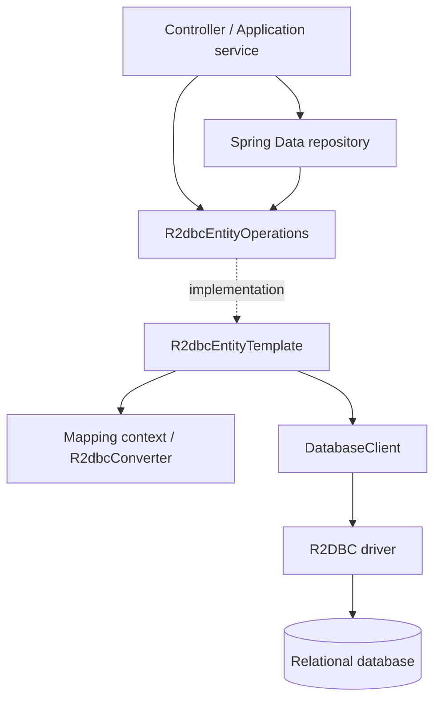
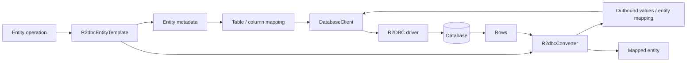

# Vai trò của R2dbcEntityTemplate và R2dbcEntityOperations

Trong Spring Data Relational R2DBC, `R2dbcEntityTemplate` và `R2dbcEntityOperations` là lớp API trung tâm để thao tác với thực thể (entity) trên cơ sở dữ liệu quan hệ theo mô hình reactive. Chúng cung cấp một mức trừu tượng cao hơn việc tự viết SQL và gọi trực tiếp driver: ứng dụng có thể truy vấn, thêm, cập nhật và xóa entity bằng các kiểu `Mono` và `Flux`, đồng thời tận dụng cơ chế ánh xạ của Spring Data.

Hai tên này có quan hệ trực tiếp nhưng không đồng nghĩa. `R2dbcEntityOperations` là interface mô tả hợp đồng thao tác entity; `R2dbcEntityTemplate` là lớp triển khai cụ thể của hợp đồng đó. Hiểu đúng vai trò của từng thành phần giúp chọn đúng mức API cho repository, service và những truy vấn nghiệp vụ tùy biến.

## 1. Vị trí trong kiến trúc Spring Data R2DBC

Một ứng dụng thường có nhiều cách truy cập dữ liệu. Repository phù hợp với các thao tác CRUD và truy vấn được khai báo theo phương thức. `R2dbcEntityTemplate` phù hợp khi cần điều khiển truy vấn linh hoạt hơn bằng `Query`, `Criteria` và `Update`. Ở mức thấp hơn, `DatabaseClient` cho phép làm việc trực tiếp với câu lệnh SQL và kết quả của driver.



Sơ đồ thể hiện các vai trò ở mức kiến trúc. Repository có thể được dùng trực tiếp cho các thao tác phổ biến; khi cần truy vấn động hoặc thao tác entity chi tiết, service có thể dùng `R2dbcEntityOperations`. Template phối hợp bộ ánh xạ và `DatabaseClient`, sau đó driver R2DBC thực hiện I/O với cơ sở dữ liệu.

| Thành phần | Vai trò chính | Khi nào nên dùng |
| --- | --- | --- |
| Spring Data repository | Cung cấp CRUD và truy vấn theo quy ước tên phương thức hoặc khai báo truy vấn | Nghiệp vụ có tập thao tác rõ ràng, thường gặp và dễ biểu diễn bằng repository |
| `R2dbcEntityOperations` | Hợp đồng API cho các thao tác entity reactive | Khi muốn service phụ thuộc vào abstraction thay vì lớp triển khai cụ thể |
| `R2dbcEntityTemplate` | Triển khai hợp đồng entity operations, xây dựng và thực thi thao tác dựa trên metadata ánh xạ | Truy vấn động, cập nhật theo điều kiện, thao tác CRUD tùy biến hoặc khi cần API template |
| `DatabaseClient` | API cấp thấp hơn để thực thi SQL và đọc kết quả | SQL đặc thù, truy vấn phức tạp hoặc trường hợp cần kiểm soát trực tiếp câu lệnh và ánh xạ kết quả |
| R2DBC driver | Giao tiếp với hệ quản trị cơ sở dữ liệu bằng giao thức R2DBC | Tầng kết nối và thực thi I/O; thông thường ứng dụng không gọi driver trực tiếp |

`R2dbcEntityTemplate` không thay thế repository trong mọi trường hợp. Hai cách tiếp cận có thể cùng tồn tại: repository xử lý các thao tác ổn định, còn template giải quyết phần truy vấn linh hoạt mà repository khó diễn đạt.

## 2. `R2dbcEntityOperations` là gì?

`R2dbcEntityOperations` là interface của Spring Data R2DBC định nghĩa các thao tác làm việc với entity. Hợp đồng này bao gồm các nhóm thao tác như đọc, chèn, cập nhật, xóa, đếm và kiểm tra sự tồn tại của dữ liệu. Các thao tác trả về publisher reactive, thường là `Mono<T>`, `Flux<T>` hoặc `Mono<Long>` tùy loại kết quả.

Vì là interface, `R2dbcEntityOperations` cho phép tầng nghiệp vụ phụ thuộc vào khả năng cần dùng thay vì gắn chặt với một lớp cụ thể. Trong ứng dụng thông thường, Spring Boot hoặc cấu hình Spring Data cung cấp bean triển khai tương ứng; service có thể nhận interface qua constructor injection.

```java
import org.springframework.data.r2dbc.core.R2dbcEntityOperations;
import org.springframework.stereotype.Service;

@Service
public class CustomerService {

    private final R2dbcEntityOperations entityOperations;

    public CustomerService(R2dbcEntityOperations entityOperations) {
        this.entityOperations = entityOperations;
    }
}
```

Ví dụ trên cho thấy cách phụ thuộc vào abstraction. Service không cần tự tạo kết nối, quản lý `Connection` hoặc biết chi tiết cách template chuyển entity thành câu lệnh SQL.

### Lợi ích của interface

- **Giảm phụ thuộc vào triển khai:** service thể hiện rõ rằng nó cần các thao tác entity reactive, không cần biết lớp cụ thể được dùng để thực hiện chúng.
- **Dễ kiểm thử:** có thể thay thế dependency bằng test double hoặc mock khi kiểm thử đơn vị service. Với kiểm thử tích hợp, nên dùng cơ sở dữ liệu phù hợp để xác minh cả ánh xạ và SQL thực tế.
- **Dễ tổ chức kiến trúc:** nhiều service có thể dùng chung hợp đồng thao tác dữ liệu mà không phải truyền `DatabaseClient` hoặc chi tiết cấu hình kết nối vào tầng nghiệp vụ.
- **Giữ tính reactive:** các phương thức của hợp đồng trả publisher, giúp service ghép thao tác dữ liệu với các bước xử lý khác bằng Reactor.

Interface không tự thực thi truy vấn và cũng không tự tạo transaction. Nó mô tả cách ứng dụng yêu cầu thao tác; bean triển khai và các thành phần hạ tầng mới đảm nhiệm việc ánh xạ, gửi lệnh và quản lý kết nối.

## 3. `R2dbcEntityTemplate` là gì?

`R2dbcEntityTemplate` là implementation tiêu chuẩn của `R2dbcEntityOperations`. Đây là lớp template cung cấp API hướng entity để làm việc với cơ sở dữ liệu R2DBC. Nó phối hợp các thành phần như `DatabaseClient`, `R2dbcConverter`, metadata ánh xạ quan hệ và các callback của Spring Data.

Khi ứng dụng yêu cầu đọc một `Customer`, template sử dụng metadata của entity để xác định bảng và cột, thực hiện truy vấn qua `DatabaseClient`, rồi chuyển các hàng kết quả thành đối tượng Java. Khi chèn một entity, template chuyển các giá trị thuộc tính thành dữ liệu ghi phù hợp và xử lý giá trị do cơ sở dữ liệu sinh ra theo cấu hình ánh xạ.



Template giúp ứng dụng làm việc với entity và thuộc tính Java. Trong nhiều tình huống, lập trình viên không cần tự ghép tên bảng, chuyển đổi từng kiểu dữ liệu hoặc đọc từng cột từ `Row`.

### Template chịu trách nhiệm những gì?

1. **Tạo thao tác entity:** cung cấp API đọc, chèn, cập nhật và xóa theo kiểu entity.
2. **Xây dựng truy vấn:** chuyển các đối tượng `Query`, `Criteria` và `Update` thành câu lệnh phù hợp với cơ sở dữ liệu và metadata ánh xạ.
3. **Ánh xạ dữ liệu:** phối hợp converter để chuyển entity thành giá trị ghi và chuyển kết quả truy vấn thành entity.
4. **Tích hợp với Spring Data:** tham gia các bước mở rộng như entity callbacks và cơ chế transaction reactive do Spring quản lý.
5. **Giữ luồng xử lý reactive:** trả publisher để tầng gọi ghép tiếp các thao tác mà không cần chờ đồng bộ.

Template là lớp điều phối ở tầng entity. Nó không phải cơ sở dữ liệu, không tự quyết định quy tắc nghiệp vụ và không làm cho câu SQL kém hiệu quả trở nên nhanh hơn.

## 4. Ánh xạ entity trước khi thao tác

Template dựa trên metadata của Spring Data Relational để biết một lớp Java tương ứng với bảng và cột nào. Các annotation thường dùng gồm `@Table`, `@Id` và `@Column`.

```java
import org.springframework.data.annotation.Id;
import org.springframework.data.relational.core.mapping.Column;
import org.springframework.data.relational.core.mapping.Table;

@Table("customer_account")
public class Customer {

    @Id
    private Long id;

    @Column("given_name")
    private String firstName;

    @Column("family_name")
    private String lastName;

    private String email;

    // Constructor, getters và các phương thức cần thiết.
}
```

Trong ví dụ này, `Customer` được ánh xạ tới bảng `customer_account`; thuộc tính `firstName` được ánh xạ tới cột `given_name`; thuộc tính `lastName` được ánh xạ tới `family_name`. Các quy tắc đặt tên mặc định và metadata có thể được điều chỉnh bằng annotation hoặc cấu hình mapping tương ứng.

`R2dbcEntityTemplate` sử dụng metadata này khi xây dựng truy vấn và chuyển kết quả. Do đó, khi viết điều kiện bằng query DSL, hãy dùng tên thuộc tính của entity theo quy ước API đang sử dụng và để Spring Data thực hiện ánh xạ sang tên cột. Với SQL viết tay ở `DatabaseClient`, lập trình viên chịu trách nhiệm chỉ rõ tên bảng, tên cột và cách ánh xạ kết quả.

## 5. Đọc dữ liệu bằng template

Một truy vấn đọc thường bắt đầu từ `select`, xác định kiểu entity, thêm điều kiện bằng `Query` và `Criteria`, sau đó chọn cách lấy một hay nhiều kết quả.

```java
import static org.springframework.data.relational.core.query.Criteria.where;
import static org.springframework.data.relational.core.query.Query.query;

import reactor.core.publisher.Flux;
import reactor.core.publisher.Mono;

public Flux<Customer> findCustomersByLastName(String lastName) {
    return entityOperations.select(Customer.class)
            .matching(query(where("lastName").is(lastName)))
            .all();
}

public Mono<Customer> findCustomerByEmail(String email) {
    return entityOperations.select(Customer.class)
            .matching(query(where("email").is(email)))
            .one();
}
```

`all()` trả về `Flux<Customer>` để phát các entity tìm được. `one()` trả về `Mono<Customer>` và phù hợp khi điều kiện dự kiến xác định tối đa một bản ghi. Nếu truy vấn có thể trả nhiều bản ghi mà code chỉ cần phần tử đầu tiên, hãy chọn toán tử có ngữ nghĩa phù hợp với yêu cầu thay vì giả định dữ liệu luôn duy nhất.

Có thể ghép nhiều điều kiện để tạo truy vấn động:

```java
import org.springframework.data.relational.core.query.Criteria;
import org.springframework.data.relational.core.query.Query;

public Flux<Customer> search(String lastName, String email) {
    Criteria criteria = Criteria.where("lastName").is(lastName);

    if (email != null && !email.isBlank()) {
        criteria = criteria.and("email").is(email);
    }

    return entityOperations.select(Customer.class)
            .matching(Query.query(criteria))
            .all();
}
```

Đây là ví dụ minh họa cách xây dựng điều kiện tùy chọn. Cần xác định rõ hành vi khi không có điều kiện tìm kiếm: trả toàn bộ dữ liệu, từ chối yêu cầu hoặc áp dụng điều kiện mặc định. Với endpoint tìm kiếm, nên giới hạn kết quả hoặc phân trang để tránh truy vấn không giới hạn.

### Chọn kết quả và số lượng bản ghi

| Nhu cầu | Kiểu kết quả thường dùng | Ý nghĩa |
| --- | --- | --- |
| Lấy một entity theo điều kiện duy nhất | `Mono<Entity>` | Không có kết quả thì publisher hoàn tất rỗng; nhiều kết quả trái với giả định duy nhất cần được xử lý rõ |
| Lấy nhiều entity | `Flux<Entity>` | Phát từng entity theo luồng reactive |
| Đếm bản ghi | `Mono<Long>` | Trả về số lượng bản ghi thỏa điều kiện |
| Kiểm tra có bản ghi hay không | `Mono<Boolean>` | Trả về kết quả tồn tại |

Template cũng cung cấp các thao tác như `count` và `exists` để diễn đạt mục đích truy vấn rõ ràng, tránh tải toàn bộ entity chỉ để đếm hoặc kiểm tra sự tồn tại.

## 6. Thêm entity

Với thao tác insert, ứng dụng cung cấp kiểu entity và đối tượng cần lưu. Template xây dựng lệnh insert theo metadata ánh xạ.

```java
public Mono<Customer> createCustomer(Customer customer) {
    return entityOperations.insert(Customer.class)
            .using(customer);
}
```

Kết quả là `Mono<Customer>`. Hãy sử dụng entity được phát ra từ publisher làm kết quả của thao tác. Điều này đặc biệt quan trọng khi cơ sở dữ liệu sinh khóa chính hoặc có giá trị mặc định do database tạo ra; đối tượng trả về phản ánh kết quả lưu theo cơ chế mapping của Spring Data.

Với entity có ID tự sinh, cấu hình cột khóa chính và chiến lược sinh giá trị phải phù hợp với hệ quản trị cơ sở dữ liệu. Không nên tự giả định ID đã có ngay trên đối tượng đầu vào trước khi thao tác hoàn tất.

## 7. Cập nhật entity

Template hỗ trợ cập nhật theo điều kiện mà không bắt buộc phải tải entity về trước. Cách này hữu ích khi chỉ cần thay đổi một vài cột và điều kiện cập nhật có thể biểu diễn bằng query DSL.

```java
import static org.springframework.data.relational.core.query.Update.update;

public Mono<Long> changeCustomerLastName(Long id, String newLastName) {
    return entityOperations.update(Customer.class)
            .matching(query(where("id").is(id)))
            .apply(update("lastName", newLastName));
}
```

`matching(...)` xác định các bản ghi mục tiêu; `apply(...)` chỉ định giá trị cần cập nhật. Kết quả `Mono<Long>` biểu diễn số hàng bị ảnh hưởng theo kết quả thực thi. Tầng nghiệp vụ có thể dùng số lượng này để phân biệt trường hợp có bản ghi được cập nhật với trường hợp không có bản ghi phù hợp.

Nếu nghiệp vụ cần đọc entity, kiểm tra trạng thái hiện tại, áp dụng quy tắc và lưu lại, có thể đọc entity rồi ghép bước cập nhật tiếp theo trong pipeline. Cần cân nhắc tính nhất quán khi có nhiều request đồng thời; nếu điều kiện cập nhật phụ thuộc vào trạng thái, nên đưa điều kiện trạng thái vào chính câu lệnh cập nhật hoặc sử dụng cơ chế khóa/transaction thích hợp.

## 8. Xóa entity

Xóa theo điều kiện có cách diễn đạt tương tự cập nhật:

```java
public Mono<Long> deleteCustomer(Long id) {
    return entityOperations.delete(Customer.class)
            .matching(query(where("id").is(id)))
            .all();
}
```

Kết quả cho biết số hàng bị ảnh hưởng. Nếu cần xóa dựa trên một entity cụ thể, template cũng có các thao tác nhận entity; lựa chọn API phụ thuộc việc ứng dụng đã có đối tượng hay chỉ có điều kiện truy vấn.

Không nên nhận một chuỗi điều kiện tùy ý từ người dùng rồi ghép trực tiếp vào SQL. Hãy xây dựng `Criteria` từ các tham số đã kiểm tra, xác định rõ các trường được phép lọc và giới hạn phạm vi xóa. Với thao tác xóa hàng loạt, cần có quy tắc nghiệp vụ và kiểm soát quyền rõ ràng.

## 9. Khi nào dùng `R2dbcEntityTemplate` thay cho repository?

Repository là lựa chọn tự nhiên cho các thao tác nghiệp vụ ổn định như tìm theo ID, lưu một aggregate hoặc truy vấn theo một tập điều kiện đã biết. Template phát huy tác dụng khi cần điều khiển truy vấn ở mức linh hoạt hơn.

| Tình huống | Lựa chọn thường phù hợp | Lý do |
| --- | --- | --- |
| CRUD thông thường trên aggregate | Reactive repository | API ngắn gọn, dễ đọc và phù hợp quy ước Spring Data |
| Tìm kiếm có nhiều bộ lọc tùy chọn | `R2dbcEntityTemplate` qua `R2dbcEntityOperations` | Có thể ghép `Criteria` theo điều kiện thực tế |
| Cập nhật một số cột theo điều kiện | Template | Biểu diễn trực tiếp `Query` và `Update`, tránh đọc entity nếu không cần |
| Đếm hoặc kiểm tra tồn tại theo điều kiện phức tạp | Repository hoặc template | Chọn API nào diễn đạt truy vấn rõ nhất và phù hợp phiên bản đang dùng |
| SQL đặc thù, CTE hoặc truy vấn phụ thuộc mạnh vào tính năng riêng của database | `DatabaseClient` hoặc API SQL phù hợp | Cần kiểm soát trực tiếp câu lệnh SQL và cách đọc kết quả |
| Nhiều thao tác entity cần ghép với dịch vụ reactive khác | Repository hoặc template | Cả hai đều có thể trả publisher để ghép pipeline |

Không có quy tắc rằng service chỉ được dùng một trong hai cách. Một service có thể nhận repository cho CRUD chính và nhận `R2dbcEntityOperations` cho truy vấn tìm kiếm động. Tuy nhiên, nên giữ ranh giới trách nhiệm rõ ràng để logic truy cập dữ liệu không bị phân tán tùy tiện.

## 10. Quan hệ với `DatabaseClient`

`DatabaseClient` là API ở mức thấp hơn. Nó giúp thực thi SQL, bind tham số và đọc kết quả từ driver. `R2dbcEntityTemplate` sử dụng `DatabaseClient` bên dưới và bổ sung cách làm việc dựa trên entity cùng metadata ánh xạ.

Ví dụ với `DatabaseClient`, lập trình viên chỉ rõ câu SQL và cách lấy cột:

```java
public Flux<String> findEmails() {
    return databaseClient.sql("SELECT email FROM customer_account")
            .map((row, metadata) -> row.get("email", String.class))
            .all();
}
```

Trong khi đó, template cho phép truy vấn theo kiểu entity:

```java
public Flux<Customer> findAllCustomers() {
    return entityOperations.select(Customer.class).all();
}
```

Sự khác biệt nằm ở mức trừu tượng và trách nhiệm ánh xạ. Với template, Spring Data dựa vào metadata để ánh xạ entity. Với `DatabaseClient`, ứng dụng kiểm soát câu SQL và cách chuyển `Row` thành kiểu kết quả. Khi dùng SQL động, vẫn phải bind giá trị bằng API tham số; không nối chuỗi dữ liệu người dùng vào câu SQL.

Chọn `DatabaseClient` khi SQL rõ ràng là công cụ phù hợp nhất, chẳng hạn truy vấn dùng cú pháp đặc thù hoặc kết quả không tương ứng trực tiếp với một entity. Chọn template khi thao tác chủ yếu xoay quanh entity đã được Spring Data quản lý.

## 11. Entity callbacks và chuyển đổi dữ liệu

Trong vòng đời lưu và đọc entity, Spring Data R2DBC có thể phối hợp các callback để ứng dụng can thiệp vào những thời điểm nhất định. Các callback phổ biến gồm nhóm trước khi chuyển entity thành dữ liệu ghi, trước khi lưu, sau khi lưu và sau khi chuyển hàng dữ liệu thành entity. Tên và chữ ký cụ thể phụ thuộc phiên bản Spring Data đang dùng.

Callback hữu ích cho các tác vụ kỹ thuật gắn với vòng đời persistence, ví dụ chuẩn hóa giá trị, gán metadata hoặc ghi nhận thông tin cần thiết trước khi lưu. Quy tắc nghiệp vụ lớn vẫn nên nằm trong service hoặc domain model để có thể kiểm soát và kiểm thử độc lập.

Spring Data R2DBC cũng hỗ trợ custom conversions khi kiểu Java không thể ánh xạ trực tiếp sang kiểu cột. Converter cho phép định nghĩa cách chuyển đổi giữa kiểu miền và kiểu dữ liệu mà driver/database hiểu. Ví dụ, ứng dụng có thể lưu một value object thành chuỗi hoặc chuyển một kiểu enum theo quy ước riêng. Cấu hình conversion cần nhất quán khi đọc và ghi.

Một lưu ý quan trọng: thao tác cập nhật hàng loạt theo `Query` và `Update` thường được thực hiện trực tiếp ở mức câu lệnh. Vì không nhất thiết tải từng entity lên bộ nhớ, không nên mặc định rằng các callback theo từng entity sẽ chạy giống hệt luồng insert hoặc update một đối tượng. Nếu nghiệp vụ phụ thuộc callback, hãy xác minh hành vi của API và phiên bản cụ thể bằng kiểm thử tích hợp.

## 12. Transaction reactive khi dùng template

`R2dbcEntityTemplate` trả về publisher reactive và có thể tham gia transaction do Spring quản lý. Với R2DBC, transaction manager thường là `R2dbcTransactionManager`, được cấu hình với `ConnectionFactory`. Ở tầng ứng dụng, có thể dùng `@Transactional` trên phương thức reactive hoặc `TransactionalOperator` để bao quanh một pipeline.

Ví dụ dùng `TransactionalOperator`:

```java
public Mono<Customer> registerCustomer(Customer customer) {
    return transactionalOperator.transactional(
            entityOperations.insert(Customer.class)
                    .using(customer)
                    .flatMap(saved ->
                            auditRepository.save(AuditEntry.forCustomer(saved))
                                    .thenReturn(saved)
                    )
    );
}
```

Thao tác insert và ghi audit được ghép trong cùng publisher được bọc bởi transaction operator. Khi publisher hoàn tất thành công, transaction có thể commit; khi phát sinh lỗi, transaction manager xử lý rollback theo quy tắc transaction.

Với transaction reactive, ngữ cảnh transaction được truyền qua Reactor Context. Vì vậy, không gọi `block()` hoặc tự `subscribe()` giữa pipeline. Làm như vậy có thể tách thao tác khỏi ngữ cảnh transaction, khiến việc truyền lỗi, hủy và commit/rollback không còn được điều phối như mong đợi.

Transaction chỉ bao phủ các thao tác tham gia cùng transaction context và transaction manager. Một lời gọi đến hệ thống bên ngoài như HTTP service không tự động trở thành một phần của transaction cơ sở dữ liệu R2DBC.

## 13. Tính reactive và vòng đời thực thi

Các phương thức template trả `Mono` hoặc `Flux`, do đó thao tác thường được thực thi khi có subscriber đăng ký. Việc gọi phương thức và nhận publisher không đồng nghĩa truy vấn đã hoàn tất.

```java
public Mono<Customer> findAndUpdate(Long id, String newEmail) {
    return entityOperations.select(Customer.class)
            .matching(query(where("id").is(id)))
            .one()
            .flatMap(customer -> entityOperations.update(Customer.class)
                    .matching(query(where("id").is(customer.getId())))
                    .apply(update("email", newEmail))
                    .then(entityOperations.select(Customer.class)
                            .matching(query(where("id").is(customer.getId())))
                            .one()));
}
```

Ví dụ đọc entity rồi cập nhật một thuộc tính và đọc lại kết quả. Nếu chỉ cần biết số hàng được cập nhật, không cần đọc entity trước và sau; có thể dùng trực tiếp fluent update như ví dụ ở phần trước. Trong ứng dụng có cập nhật đồng thời, hãy cân nhắc đưa điều kiện trạng thái vào câu lệnh cập nhật để tránh ghi đè thay đổi mới hơn.

Không nên gọi `subscribe()` bên trong service chỉ để “bắt đầu” thao tác. Hãy trả publisher cho tầng gọi, chẳng hạn WebFlux controller, để framework quản lý subscription, lỗi và tín hiệu hủy. Cũng không nên gọi `block()` trong đường xử lý reactive vì nó biến thao tác không chặn thành lời gọi đồng bộ và có thể làm nghẽn event loop.

## 14. Kiểm thử các thao tác template

Kiểm thử với `R2dbcEntityOperations` có thể chia thành hai mức:

- **Unit test cho service:** thay dependency bằng mock hoặc test double để xác minh service ghép publisher, xử lý trường hợp rỗng và truyền lỗi đúng cách. Unit test không chứng minh SQL, mapping hoặc hành vi của database là chính xác.
- **Integration test:** chạy với cơ sở dữ liệu tương thích R2DBC để xác minh schema, tên bảng/cột, chuyển đổi kiểu, truy vấn, giá trị ID sinh tự động và transaction. Nên kiểm thử trên cùng hệ quản trị hoặc cấu hình tương thích với môi trường triển khai vì cú pháp SQL và kiểu dữ liệu có thể khác nhau.

Khi kiểm thử publisher bằng Reactor Test, `StepVerifier` giúp xác minh các tín hiệu phát ra:

```java
StepVerifier.create(customerService.findCustomerByEmail("a@example.com"))
        .expectNextMatches(customer ->
                customer.getEmail().equals("a@example.com"))
        .verifyComplete();
```

Với trường hợp không có dữ liệu, hãy xác minh publisher hoàn tất rỗng hoặc service chuyển đổi thành lỗi nghiệp vụ theo đúng hợp đồng. Với update và delete, kiểm tra số hàng bị ảnh hưởng và trường hợp ID không tồn tại.

## 15. Những lỗi thiết kế thường gặp

### Dùng template cho mọi truy vấn

Template linh hoạt nhưng có thể làm service dài và lặp lại điều kiện truy vấn. Với CRUD đơn giản hoặc truy vấn ổn định, repository thường dễ đọc hơn. Hãy chọn abstraction dựa trên hình dạng truy vấn và trách nhiệm của lớp.

### Đưa SQL thô vào nơi có thể dùng query DSL

SQL thô không sai, nhưng nếu thao tác chỉ là tìm, cập nhật hoặc xóa entity theo điều kiện thông thường, template giúp tận dụng mapping metadata và giảm phần mã chuyển đổi thủ công. Dùng `DatabaseClient` khi cần mức kiểm soát SQL thấp hơn.

### Nối dữ liệu đầu vào vào SQL

Không nối trực tiếp chuỗi do người dùng cung cấp vào câu SQL. Với template, dùng `Criteria` và các giá trị tham số. Với `DatabaseClient`, dùng bind parameters. Đồng thời, chỉ cho phép các trường lọc và sắp xếp nằm trong danh sách đã được ứng dụng kiểm soát.

### Bỏ qua entity được trả về sau insert

Entity trả về có thể chứa ID hoặc giá trị được database sinh. Với entity bất biến, mapping có thể tạo instance mới thay vì thay đổi object đầu vào. Hãy tiếp tục pipeline bằng giá trị được phát ra từ `insert`.

### Tải tất cả dữ liệu chỉ để lấy một thông tin nhỏ

Không lấy toàn bộ entity rồi đếm hoặc kiểm tra có phần tử. Dùng thao tác `count` hoặc `exists` phù hợp. Với danh sách lớn, thêm điều kiện và phân trang theo nhu cầu.

### Tự subscribe hoặc block trong tầng nghiệp vụ

Tự subscribe tách công việc khỏi pipeline do tầng trên quản lý; block giữ luồng chờ kết quả. Hãy trả `Mono` hoặc `Flux` để duy trì cách truyền lỗi, hủy và transaction reactive.

### Giả định mọi phiên bản có API hoàn toàn giống nhau

Các fluent operation và overload có thể thay đổi theo phiên bản Spring Data Relational. Khi viết code, hãy đối chiếu Javadoc và tài liệu đúng phiên bản dependency của dự án, đặc biệt với constructor, callback, phương thức update entity và kiểu trả về của operation.

## 16. Nguyên tắc lựa chọn và sử dụng

- Xem `R2dbcEntityOperations` là hợp đồng thao tác entity reactive; xem `R2dbcEntityTemplate` là implementation cung cấp API template.
- Ưu tiên inject interface vào service nếu service chỉ cần hợp đồng thao tác entity.
- Dùng repository cho CRUD và truy vấn ổn định, dễ biểu diễn bằng phương thức repository.
- Dùng template cho truy vấn động, điều kiện phức hợp và cập nhật theo tập bản ghi.
- Dùng `DatabaseClient` khi cần SQL trực tiếp hoặc kết quả không ánh xạ tự nhiên thành entity.
- Khai báo metadata entity chính xác để template ánh xạ bảng, cột và kiểu dữ liệu đúng.
- Dùng `Criteria`, `Query` và `Update` để biểu diễn điều kiện, đồng thời kiểm soát các trường đầu vào được phép truy vấn.
- Tiếp tục pipeline bằng publisher được trả về; không block hoặc tự subscribe trong tầng nghiệp vụ reactive.
- Dùng transaction reactive khi nhiều thao tác cần cùng tính nguyên tử và bảo đảm chúng tham gia cùng transaction context.
- Kiểm thử tích hợp với hệ quản trị cơ sở dữ liệu phù hợp để xác nhận mapping và hành vi SQL.

## 17. Kết luận

`R2dbcEntityOperations` định nghĩa hợp đồng cho các thao tác entity reactive trong Spring Data R2DBC, còn `R2dbcEntityTemplate` là lớp triển khai chính cung cấp API fluent để đọc, thêm, cập nhật và xóa dữ liệu. Template kết hợp metadata ánh xạ, converter và `DatabaseClient`, giúp ứng dụng thao tác bằng entity và query DSL thay vì phải tự xử lý mọi chi tiết SQL.

Repository vẫn phù hợp với CRUD và truy vấn ổn định; template phù hợp với truy vấn động và thao tác tùy biến; `DatabaseClient` phù hợp khi cần kiểm soát SQL trực tiếp. Khi đặt đúng thành phần vào đúng tầng, giữ publisher reactive xuyên suốt và quản lý transaction nhất quán, ứng dụng có thể tận dụng Spring Data R2DBC mà vẫn giữ code truy cập dữ liệu rõ ràng, dễ kiểm thử và dễ bảo trì.
