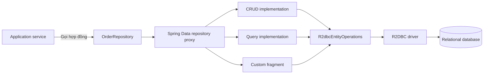
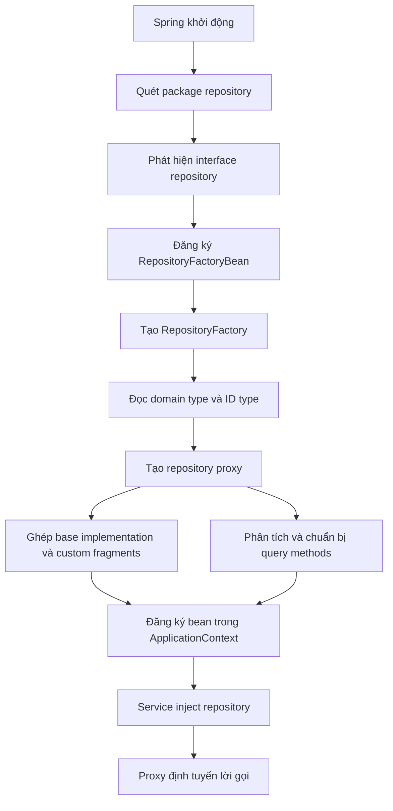

# Vai trò của Repository và cơ chế tạo triển khai

Trong Spring Data Relational R2DBC, Repository là điểm truy cập dữ liệu ở mức nghiệp vụ. Ứng dụng khai báo những thao tác cần có thông qua một interface; Spring Data xây dựng bean có thể thực thi interface đó khi khởi động ứng dụng. Nhờ vậy, phần lớn repository không cần viết lớp triển khai CRUD bằng tay.

Cơ chế này có hai phần cần hiểu rõ. **Vai trò của Repository** là định nghĩa hợp đồng truy cập dữ liệu ổn định giữa service và tầng lưu trữ. **Cơ chế tạo triển khai** là quá trình Spring phát hiện interface, phân tích kiểu miền và phương thức, tạo đối tượng proxy, rồi định tuyến mỗi lời gọi đến phần CRUD có sẵn, truy vấn được khai báo hoặc phần mở rộng tùy chỉnh.

Bài học đi từ hợp đồng Repository đến cách Spring Data tạo và sử dụng triển khai trong một ứng dụng R2DBC.

## 1. Repository giải quyết vấn đề gì?

Một service nghiệp vụ cần đọc và ghi dữ liệu, nhưng không nên phải biết chi tiết cách tạo kết nối, bind tham số SQL, ánh xạ từng hàng hay quản lý statement. Nếu service tự thực hiện tất cả những việc đó, logic nghiệp vụ sẽ gắn chặt với cơ chế truy cập của một hệ quản trị cụ thể.

Repository tạo ra một ranh giới rõ ràng:

- Service yêu cầu một hành động theo ngôn ngữ của miền nghiệp vụ, chẳng hạn tìm đơn hàng theo khách hàng hoặc lưu một đơn hàng.
- Repository cung cấp hợp đồng cho những hành động đó.
- Spring Data thực hiện các thao tác thông thường dựa trên metadata của entity và phương thức repository.
- Khi cần truy vấn đặc thù, repository có thể khai báo SQL hoặc kết hợp một thành phần triển khai tùy chỉnh.

Ví dụ, service chỉ cần biết `findById` trả về `Mono<Order>` và `findByCustomerId` trả về `Flux<Order>`. Service không cần tự quản lý `Connection`, `Statement` hay `Row`.



Repository vì thế không đơn thuần là một lớp bọc quanh từng câu SQL. Nó thể hiện cách một phần nghiệp vụ cần truy cập aggregate và tạo một điểm thay đổi có kiểm soát khi cách lưu trữ thay đổi.

## 2. Hợp đồng Repository trong Spring Data

Spring Data cung cấp một hệ thống interface chung để định nghĩa repository. Interface gốc `Repository<T, ID>` đánh dấu một kiểu là repository và khai báo kiểu miền `T` cùng kiểu định danh `ID`. Các interface cấp cao hơn bổ sung nhóm thao tác phổ biến.

Với R2DBC, lựa chọn thường gặp là `ReactiveCrudRepository<T, ID>`:

```java
import org.springframework.data.repository.reactive.ReactiveCrudRepository;
import reactor.core.publisher.Flux;
import reactor.core.publisher.Mono;

public interface OrderRepository
        extends ReactiveCrudRepository<Order, Long> {

    Flux<Order> findByCustomerId(Long customerId);
}
```

Hai tham số generic có ý nghĩa cụ thể:

- `Order` là kiểu entity mà repository quản lý.
- `Long` là kiểu của khóa chính được đánh dấu bằng `@Id`.

`ReactiveCrudRepository` cung cấp sẵn các thao tác CRUD với kiểu trả về reactive. Một số phương thức thường dùng:

| Phương thức | Kiểu trả về điển hình | Ý nghĩa |
| --- | --- | --- |
| `save(entity)` | `Mono<S>` | Lưu entity và phát entity kết quả. |
| `findById(id)` | `Mono<T>` | Tìm một entity theo ID; có thể hoàn tất rỗng. |
| `findAll()` | `Flux<T>` | Phát các entity tìm được. |
| `existsById(id)` | `Mono<Boolean>` | Kiểm tra entity có tồn tại hay không. |
| `count()` | `Mono<Long>` | Đếm số entity. |
| `deleteById(id)` | `Mono<Void>` | Xóa entity theo ID và biểu thị hoàn tất. |
| `delete(entity)` | `Mono<Void>` | Xóa entity được cung cấp. |

Các thao tác trả về `Mono` hoặc `Flux`, vì vậy lời gọi repository tạo ra một publisher để mô tả công việc. Truy vấn thường chỉ được thực thi khi publisher có subscriber. Controller WebFlux hoặc một thành phần ở biên ứng dụng sẽ đăng ký vào publisher trong quá trình xử lý request.

Không gọi `block()` trong đường xử lý reactive chỉ để lấy một entity đồng bộ. Cũng không gọi `subscribe()` bên trong service để tự chạy repository rồi bỏ kết quả; cách đó làm mất mối liên hệ giữa lỗi, trạng thái hoàn tất và vòng đời request.

### Repository chỉ công khai thao tác cần thiết

Không phải mọi phương thức CRUD đều phải được cung cấp cho mọi nghiệp vụ. Có thể dùng `@RepositoryDefinition` để khai báo repository dựa trên một interface tùy chỉnh hoặc chỉ kế thừa những interface phù hợp. Với cách thông dụng, interface có thể kế thừa `ReactiveCrudRepository` rồi bổ sung các phương thức theo nhu cầu.

Hãy giữ hợp đồng ngắn và có ý nghĩa. Ví dụ, `findOpenOrdersForCustomer` có thể diễn đạt rõ một nhu cầu nghiệp vụ hơn một phương thức tổng quát nhận nhiều cờ boolean để điều khiển mọi kiểu tìm kiếm.

Một repository thường gắn với aggregate root. Nó không nhất thiết phải tương ứng một-một với mọi bảng vật lý. Nếu một aggregate gồm nhiều bảng được lưu cùng nhau, repository vẫn có thể đại diện cho aggregate đó; Spring Data Relational sẽ áp dụng mapping theo mô hình quan hệ của nó.

## 3. Khai báo query method bằng tên phương thức

Một trong những tính năng quan trọng của Spring Data là khả năng suy ra truy vấn từ tên phương thức. Ví dụ:

```java
import reactor.core.publisher.Flux;
import reactor.core.publisher.Mono;

public interface OrderRepository
        extends ReactiveCrudRepository<Order, Long> {

    Flux<Order> findByCustomerId(Long customerId);

    Flux<Order> findByStatusAndCustomerIdOrderByCreatedAtDesc(
            OrderStatus status,
            Long customerId);

    Mono<Order> findFirstByCustomerIdOrderByCreatedAtDesc(
            Long customerId);

    Mono<Boolean> existsByCustomerIdAndStatus(
            Long customerId,
            OrderStatus status);
}
```

Spring Data phân tích tên phương thức để nhận diện:

1. **Phần mở đầu:** hành động như `find`, `read`, `get`, `exists` hoặc `count`.
2. **Phần điều kiện:** các thuộc tính được nối bằng `And`, `Or` và những toán tử truy vấn được hỗ trợ.
3. **Phần sắp xếp hoặc giới hạn:** ví dụ `OrderByCreatedAtDesc`, `First` hoặc `Top`.

Tên thuộc tính phải tương ứng với property trong entity, chẳng hạn `customerId`, chứ không phải lúc nào cũng là tên cột `customer_id` trong bảng. Việc ánh xạ property sang cột do metadata mapping của Spring Data Relational đảm nhiệm.

Một số dạng tên dễ đọc:

| Tên phương thức | Ý nghĩa dự kiến |
| --- | --- |
| `findByStatus(status)` | Tìm các đơn hàng theo trạng thái. |
| `findByCustomerIdAndStatus(id, status)` | Kết hợp hai điều kiện bằng AND. |
| `findByTotalGreaterThan(amount)` | Lọc theo điều kiện lớn hơn. |
| `findByCreatedAtAfter(time)` | Lọc các bản ghi sau một mốc thời gian. |
| `findFirstByCustomerIdOrderByCreatedAtDesc(id)` | Lấy bản ghi đầu tiên theo thứ tự mới nhất. |
| `existsByCustomerId(id)` | Kiểm tra có bản ghi phù hợp. |

Các toán tử và kiểu truy vấn cụ thể được hỗ trợ phụ thuộc phiên bản Spring Data Relational và khả năng biểu diễn của R2DBC. Khi tên phương thức trở nên dài, khó hiểu hoặc không thể diễn đạt chính xác truy vấn, hãy chuyển sang `@Query` hoặc custom repository fragment thay vì cố ghép thêm từ khóa.

### Cách đọc một query method

Với phương thức:

```java
Flux<Order> findByStatusAndCustomerIdOrderByCreatedAtDesc(
        OrderStatus status,
        Long customerId);
```

Có thể đọc như sau:

- `findBy`: một truy vấn tìm kiếm.
- `StatusAndCustomerId`: lọc theo trạng thái và ID khách hàng.
- `OrderByCreatedAtDesc`: sắp xếp thời gian tạo theo thứ tự giảm dần.
- `Flux<Order>`: kết quả có thể gồm nhiều đơn hàng.

Spring Data biết kiểu entity và kiểu tham số từ interface. Nó kết hợp thông tin này với mapping metadata để tạo câu lệnh truy vấn phù hợp với dialect của cơ sở dữ liệu đang dùng.

## 4. Khi nào cần @Query?

Tên phương thức phù hợp với các truy vấn đơn giản, có cấu trúc dễ diễn đạt. Với SQL cần join, biểu thức đặc thù của hệ quản trị, phép tổng hợp hoặc cách sắp xếp phức tạp, có thể khai báo truy vấn tường minh bằng `@Query`.

```java
import org.springframework.data.r2dbc.repository.Query;
import org.springframework.data.repository.query.Param;
import reactor.core.publisher.Flux;

public interface OrderRepository
        extends ReactiveCrudRepository<Order, Long> {

    @Query("""
        SELECT id, customer_id, total, status, created_at
        FROM orders
        WHERE customer_id = :customerId
        ORDER BY created_at DESC
        """)
    Flux<Order> findRecentOrders(
            @Param("customerId") Long customerId);
}
```

`@Query` đặt SQL gần với hợp đồng phương thức. Spring Data sử dụng câu SQL này để thực hiện truy vấn và ánh xạ các hàng về kiểu kết quả tương ứng. Dùng `@Param` làm rõ mối liên hệ giữa tên tham số Java và placeholder trong SQL, nhất là khi việc biên dịch không giữ metadata tên tham số.

Với câu lệnh thay đổi dữ liệu, có thể kết hợp `@Modifying`:

```java
import org.springframework.data.r2dbc.repository.Modifying;
import org.springframework.data.r2dbc.repository.Query;
import org.springframework.data.repository.query.Param;
import reactor.core.publisher.Mono;

@Modifying
@Query("""
    UPDATE orders
    SET status = :status
    WHERE id = :id
    """)
Mono<Integer> updateStatus(
        @Param("id") Long id,
        @Param("status") String status);
```

Giá trị trả về có thể biểu thị số hàng bị ảnh hưởng. Hãy chọn kiểu trả về phù hợp với loại lệnh và API của phiên bản đang sử dụng.

Các giá trị đầu vào cần được bind như tham số. Không nối trực tiếp dữ liệu người dùng vào chuỗi SQL. Những phần cấu trúc như tên cột hay hướng sắp xếp thường không thể bind như giá trị; nếu cần lựa chọn động, hãy kiểm tra đầu vào bằng danh sách cho phép trước khi tạo câu lệnh.

## 5. Spring Data tạo triển khai như thế nào?

Ứng dụng thường chỉ khai báo interface, nhưng khi inject `OrderRepository`, Spring vẫn cung cấp được một bean thực thi interface đó. Bean này thường là một đối tượng proxy được tạo bởi hạ tầng repository của Spring Data.

Quá trình có thể chia thành các giai đoạn:



### Giai đoạn 1: Phát hiện interface

Spring Data cần biết package nào chứa repository. Trong ứng dụng Spring Boot có starter R2DBC và cấu hình phù hợp, auto-configuration thường thiết lập việc quét repository. Nếu cần kiểm soát rõ ràng, có thể dùng `@EnableR2dbcRepositories`:

```java
import org.springframework.context.annotation.Configuration;
import org.springframework.data.r2dbc.repository.config.EnableR2dbcRepositories;

@Configuration
@EnableR2dbcRepositories(
    basePackageClasses = OrderRepository.class
)
class R2dbcRepositoryConfiguration {
}
```

`basePackageClasses` giúp xác định package dựa trên một class hoặc interface cụ thể, tránh phụ thuộc vào chuỗi tên package dễ sai khi refactor.

Khi quét, Spring Data tìm các interface repository hợp lệ và đăng ký định nghĩa bean tương ứng. Một interface generic dùng làm nền tảng cho repository khác thường cần `@NoRepositoryBean`, để Spring không cố tạo repository độc lập cho kiểu miền chưa được xác định.

```java
import org.springframework.data.repository.NoRepositoryBean;
import org.springframework.data.repository.reactive.ReactiveCrudRepository;

@NoRepositoryBean
public interface BaseRepository<T, ID>
        extends ReactiveCrudRepository<T, ID> {
}
```

Repository cụ thể có thể kế thừa interface nền này:

```java
public interface OrderRepository
        extends BaseRepository<Order, Long> {
}
```

### Giai đoạn 2: RepositoryFactoryBean và RepositoryFactory

Với mỗi interface được phát hiện, hạ tầng Spring Data đăng ký một `RepositoryFactoryBean` chuyên tạo repository. Factory bean phối hợp với một `RepositoryFactory` phù hợp cho công nghệ lưu trữ.

Trong R2DBC, factory biết cách tạo repository dựa trên các thành phần của Spring Data Relational và R2DBC. Ở tầng kiến trúc chung, `RepositoryFactorySupport` cung cấp cơ chế tạo proxy, kết hợp các fragment và chuẩn bị phương thức truy vấn. Factory dành cho R2DBC bổ sung cách tạo phần triển khai và truy vấn phù hợp với R2DBC.

Có thể hiểu trách nhiệm theo cách sau:

| Thành phần | Trách nhiệm |
| --- | --- |
| Repository interface | Khai báo kiểu entity, ID và các thao tác ứng dụng cần gọi. |
| `RepositoryFactoryBean` | Tham gia vòng đời bean của Spring và yêu cầu factory tạo repository. |
| Repository factory | Tạo proxy, xác định phần triển khai cơ sở và ghép các fragment. |
| Mapping context | Cung cấp metadata về entity, ID, property và mapping quan hệ. |
| Query lookup strategy | Xác định cách tìm hoặc tạo truy vấn cho từng query method. |
| Repository proxy | Nhận lời gọi từ ứng dụng và chuyển đến thành phần thực thi tương ứng. |

Tên lớp nội bộ và chi tiết triển khai có thể thay đổi theo phiên bản Spring Data. Điều quan trọng ở mức sử dụng là interface được xử lý bởi hạ tầng repository, không phải được Spring tự động biến thành một lớp Java thông thường chứa code CRUD được sinh ra tại thời điểm biên dịch.

### Giai đoạn 3: Xác định metadata của repository

Factory đọc generic type để biết repository quản lý entity nào và ID có kiểu gì. Nó cũng sử dụng mapping context để tìm metadata của entity: bảng, cột, khóa chính, kiểu dữ liệu và cách chuyển đổi.

Ví dụ, từ:

```java
public interface OrderRepository
        extends ReactiveCrudRepository<Order, Long> {
}
```

Spring Data xác định:

- Domain type là `Order`.
- ID type là `Long`.
- Metadata ánh xạ `Order` đến bảng quan hệ.
- Các thao tác CRUD phải sử dụng hạ tầng R2DBC đã được cấu hình.

Nếu generic type không xác định được, ID type không phù hợp hoặc entity không có mapping hợp lệ, repository có thể không được tạo hoặc truy vấn có thể thất bại khi thực thi. Vì thế, kiểu generic của interface là một phần của cấu hình, không chỉ là thông tin giúp IDE kiểm tra kiểu.

### Giai đoạn 4: Tạo proxy và ghép phần triển khai

Repository proxy là đối tượng được inject vào service. Proxy triển khai interface repository và nhận các lời gọi phương thức. Nó phối hợp các thành phần đã được tạo trước đó để xử lý từng loại phương thức.

Một lời gọi như `save(order)` được chuyển đến phần triển khai CRUD cơ sở. Một lời gọi `findByStatus(status)` được chuyển đến phần xử lý query method. Một phương thức thuộc custom fragment được chuyển đến implementation tương ứng.

Nhờ proxy, interface có thể kết hợp nhiều nguồn triển khai mà caller vẫn nhìn thấy một hợp đồng thống nhất. Service không cần biết phương thức được thực hiện bởi lớp CRUD cơ sở, query executor hay custom fragment.

## 6. Phân biệt ba loại phương thức trên repository proxy

Một repository thường kết hợp ba nhóm phương thức:

| Nhóm phương thức | Nguồn triển khai | Ví dụ |
| --- | --- | --- |
| Phương thức cơ sở | Lớp triển khai CRUD mặc định của Spring Data R2DBC. | `save`, `findById`, `deleteById`. |
| Query method | Câu truy vấn được suy ra từ tên hoặc khai báo bằng annotation. | `findByStatus`, `findRecentOrders`. |
| Custom fragment | Lớp do ứng dụng cung cấp để thực hiện hành vi đặc thù. | `searchWithComplexFilter`. |

### Phương thức cơ sở

Các phương thức CRUD được cung cấp bởi implementation cơ sở của Spring Data R2DBC. Implementation sử dụng các thành phần thao tác entity của Spring Data Relational để tạo câu lệnh, bind giá trị và ánh xạ kết quả.

Ứng dụng không cần tự viết một lớp `OrderRepositoryImpl` chỉ để thực hiện `save`, `findById` hoặc `deleteById`. Nếu viết lại những phương thức này mà không có nhu cầu rõ ràng, nhóm phát triển sẽ phải tự chịu trách nhiệm cho nhiều chi tiết mà Spring Data đã xử lý.

### Query method

Query method được chuẩn bị dựa trên metadata của interface và cấu hình truy vấn. Spring Data xác định truy vấn từ tên phương thức hoặc từ khai báo như `@Query`, sau đó tạo thành phần thực thi tương ứng.

### Custom fragment

Khi nghiệp vụ cần truy vấn động, thuật toán truy cập đặc biệt hoặc phối hợp nhiều thao tác mà các phương thức có sẵn không diễn đạt tốt, có thể mở rộng repository bằng fragment. Đây là cách mở rộng theo hợp đồng, giúp giữ phần truy cập đặc thù trong tầng repository.

## 7. Query lookup strategy: tìm hay tạo truy vấn

Khi Spring Data gặp một query method, nó cần quyết định cách lấy câu truy vấn. Cơ chế này được gọi là query lookup strategy. Các lựa chọn tổng quát thường gồm:

| Strategy | Cách hoạt động |
| --- | --- |
| `CREATE` | Tạo truy vấn từ tên phương thức. |
| `USE_DECLARED_QUERY` | Yêu cầu có truy vấn được khai báo sẵn; không tự suy ra từ tên nếu không tìm thấy. |
| `CREATE_IF_NOT_FOUND` | Ưu tiên truy vấn được khai báo; nếu không có thì tạo từ tên phương thức. |

`CREATE_IF_NOT_FOUND` là lựa chọn mặc định phổ biến trong hạ tầng Spring Data. Với R2DBC, truy vấn khai báo có thể đến từ `@Query` hoặc cơ chế named query được hỗ trợ trong cấu hình tương ứng.

Có thể hình dung quy trình:

1. Factory lấy danh sách query methods trên repository interface.
2. Query lookup strategy kiểm tra phương thức có truy vấn khai báo hay không.
3. Nếu chiến lược cho phép suy ra truy vấn, Spring Data phân tích tên phương thức.
4. Thành phần query được tạo và gắn với repository proxy.
5. Khi ứng dụng gọi phương thức, proxy thực thi query bằng hạ tầng R2DBC.

Việc chuẩn bị query method thường diễn ra trong quá trình tạo repository, nhờ đó nhiều lỗi về tên thuộc tính hoặc cú pháp khai báo có thể được phát hiện khi khởi động thay vì đợi đến request đầu tiên. Tuy nhiên, lỗi SQL phụ thuộc cơ sở dữ liệu, quyền truy cập, schema hoặc dữ liệu thực tế vẫn có thể chỉ xuất hiện khi truy vấn chạy.

## 8. Mở rộng Repository bằng custom fragment

Custom fragment là cách phù hợp để thêm hành vi mà CRUD hoặc query method thông thường không đáp ứng tốt. Fragment gồm một interface mô tả hành vi và một lớp triển khai interface đó.

Ví dụ, yêu cầu tìm kiếm đơn hàng theo trạng thái có thể cần thêm logic truy vấn:

```java
import reactor.core.publisher.Flux;

public interface OrderSearch {
    Flux<Order> findByStatusWithNewestFirst(OrderStatus status);
}
```

Repository chính kết hợp fragment này:

```java
import org.springframework.data.repository.reactive.ReactiveCrudRepository;

public interface OrderRepository
        extends ReactiveCrudRepository<Order, Long>, OrderSearch {
}
```

Lớp triển khai fragment sử dụng `R2dbcEntityTemplate`:

```java
import org.springframework.data.r2dbc.core.R2dbcEntityTemplate;
import org.springframework.data.relational.core.query.Criteria;
import org.springframework.data.relational.core.query.Query;
import org.springframework.data.domain.Sort;
import reactor.core.publisher.Flux;

public class OrderSearchImpl implements OrderSearch {

    private final R2dbcEntityTemplate template;

    public OrderSearchImpl(R2dbcEntityTemplate template) {
        this.template = template;
    }

    @Override
    public Flux<Order> findByStatusWithNewestFirst(OrderStatus status) {
        Query query = Query.query(Criteria.where("status").is(status))
            .sort(Sort.by(Sort.Direction.DESC, "createdAt"));

        return template.select(query, Order.class);
    }
}
```

Spring Data tìm implementation theo quy ước tên fragment và hậu tố implementation mặc định. Trong ví dụ, `OrderSearch` được triển khai bởi `OrderSearchImpl`. Có thể cấu hình hậu tố khác trong trường hợp dự án có quy ước đặt tên riêng.

Khi Spring ghép fragment vào repository, service có thể gọi phương thức như một phần của `OrderRepository`:

```java
Flux<Order> orders = orderRepository
    .findByStatusWithNewestFirst(OrderStatus.NEW);
```

Custom fragment có thể dùng `R2dbcEntityTemplate`, `DatabaseClient` hoặc một thành phần truy cập dữ liệu phù hợp. Chọn công cụ theo độ phức tạp của truy vấn và giữ logic nghiệp vụ ở service/domain khi logic đó không phải trách nhiệm truy cập dữ liệu.

### Khi nào nên dùng fragment?

Nên cân nhắc fragment khi:

- Truy vấn có nhiều điều kiện tùy chọn và khó biểu diễn bằng tên phương thức.
- Cần kết hợp nhiều truy vấn hoặc thao tác dữ liệu thành một hành vi có tên rõ ràng.
- Cần dùng API cấp thấp hơn để kiểm soát SQL hoặc mapping.
- Một nhóm repository cần chia sẻ hành vi có cấu trúc riêng.

Không cần tạo fragment chỉ để chuyển tiếp một lời gọi `findById` sang `ReactiveCrudRepository`. Mỗi lớp mở rộng nên có trách nhiệm cụ thể và mang lại lợi ích rõ ràng.

## 9. Tái sử dụng repository bằng interface nền

Một dự án có thể có nhiều repository cần chung một nhóm phương thức hoặc quy ước. Có thể khai báo interface generic nền:

```java
import org.springframework.data.repository.NoRepositoryBean;
import org.springframework.data.repository.reactive.ReactiveCrudRepository;
import reactor.core.publisher.Mono;

@NoRepositoryBean
public interface ApplicationRepository<T, ID>
        extends ReactiveCrudRepository<T, ID> {

    default Mono<Boolean> isPresent(ID id) {
        return existsById(id);
    }
}
```

Các repository cụ thể kế thừa interface nền:

```java
import org.springframework.data.repository.NoRepositoryBean;

@NoRepositoryBean
public interface AuditedRepository<T, ID>
        extends ApplicationRepository<T, ID> {
}

public interface OrderRepository
        extends AuditedRepository<Order, Long> {
}
```

`@NoRepositoryBean` báo cho Spring Data rằng interface generic này là nền tảng để kế thừa, không phải một repository độc lập cần khởi tạo bean. Nếu bỏ annotation trong một cấu trúc generic chưa có domain type cụ thể, Spring Data có thể cố tạo repository không đủ thông tin.

Với nhu cầu sâu hơn, Spring Data cho phép tùy chỉnh repository base class thông qua cấu hình repository. Cách này phù hợp khi muốn thay đổi hành vi nền tảng áp dụng đồng nhất cho nhiều repository. Tuy nhiên, custom fragment thường dễ giới hạn phạm vi và dễ kiểm thử hơn; chỉ dùng base class tùy chỉnh khi thay đổi thực sự thuộc hành vi chung.

## 10. Repository và ranh giới transaction

Repository mô tả thao tác truy cập dữ liệu. Ranh giới giao dịch thường nên được đặt ở service/application layer, nơi có đủ ngữ cảnh để biết nhiều thao tác nào phải thành công hoặc thất bại cùng nhau.

Ví dụ, một nghiệp vụ có thể gọi nhiều repository:

```java
import org.springframework.stereotype.Service;
import org.springframework.transaction.annotation.Transactional;
import reactor.core.publisher.Mono;

@Service
public class CheckoutService {

    private final OrderRepository orders;
    private final InventoryRepository inventory;

    public CheckoutService(
            OrderRepository orders,
            InventoryRepository inventory) {
        this.orders = orders;
        this.inventory = inventory;
    }

    @Transactional
    public Mono<Order> checkout(Order order) {
        return inventory.reserve(order)
            .then(orders.save(order));
    }
}
```

Đoạn code mô tả ý định: giữ việc đặt chỗ tồn kho và lưu đơn hàng trong cùng một reactive transaction nếu cả hai thao tác cùng tham gia transaction manager và hạ tầng kết nối phù hợp. Khi bước sau thất bại, transaction có thể rollback thay đổi trước đó.

Không nên tự gọi `subscribe()` trong phương thức repository hoặc service để chạy một thao tác phụ. Khi một publisher bị tách khỏi chuỗi mà transaction manager quản lý, hành vi giao dịch có thể không còn như dự kiến. Reactive transaction sử dụng Reactor Context để truyền trạng thái giao dịch qua chuỗi xử lý.

## 11. Kiểm thử Repository

Kiểm thử repository cần xác minh hai nhóm vấn đề:

- **Hợp đồng và định tuyến:** service gọi đúng phương thức, publisher được ghép đúng và kết quả được xử lý đúng.
- **Tích hợp dữ liệu:** query method tạo câu lệnh phù hợp, SQL khai báo chạy được, mapping đúng kiểu dữ liệu và driver tham gia transaction đúng cách.

Mock repository hữu ích cho kiểm thử service. Ví dụ, có thể mock `OrderRepository` để xác minh service xử lý `Mono.empty()`, kết quả thành công hoặc lỗi. Nhưng mock không xác nhận query method, SQL hay mapping với cơ sở dữ liệu thật.

Với kiểm thử tích hợp, Spring Boot cung cấp test slice `@DataR2dbcTest` để cấu hình phần truy cập dữ liệu cần thiết. Có thể dùng Testcontainers để chạy đúng loại cơ sở dữ liệu mà ứng dụng triển khai.

```java
import org.junit.jupiter.api.Test;
import org.springframework.beans.factory.annotation.Autowired;
import org.springframework.boot.test.autoconfigure.data.r2dbc.DataR2dbcTest;
import reactor.test.StepVerifier;

@DataR2dbcTest
class OrderRepositoryTest {

    @Autowired
    OrderRepository orders;

    @Test
    void findsOrdersForCustomer() {
        StepVerifier.create(orders.findByCustomerId(42L))
            .expectNextMatches(order ->
                order.customerId().equals(42L))
            .verifyComplete();
    }
}
```

Ví dụ giả định dữ liệu kiểm thử đã được nạp và có ít nhất một đơn hàng của khách hàng `42`. Trong test thực tế, cần tạo schema và dữ liệu ban đầu rõ ràng, sau đó xác minh cả trường hợp có dữ liệu lẫn kết quả rỗng.

Với custom fragment, hãy kiểm thử trực tiếp hành vi truy vấn động và xác minh fragment được ghép vào repository bean. Với `@Query`, cần chạy truy vấn trên đúng hệ quản trị vì cú pháp SQL và cách ánh xạ kiểu có thể khác nhau giữa các driver.

## 12. Các lỗi thường gặp khi dùng Repository

| Vấn đề | Nguyên nhân | Hướng xử lý |
| --- | --- | --- |
| Không tìm thấy bean repository | Package chưa được quét hoặc cấu hình repository chưa được kích hoạt. | Kiểm tra package của `@EnableR2dbcRepositories` và auto-configuration. |
| Repository không khởi tạo được | Generic type, entity metadata hoặc query method không hợp lệ. | Kiểm tra domain type, ID type, tên property và khai báo query. |
| Query method không tìm thấy property | Tên phương thức dùng tên cột thay cho tên property Java hoặc sai chính tả. | Dùng đúng property của entity. |
| Custom fragment không được ghép | Tên implementation không khớp quy ước hoặc fragment interface chưa được kế thừa. | Kiểm tra tên interface, hậu tố implementation và cấu hình quét. |
| SQL trong `@Query` thất bại | Câu SQL không tương thích dialect hoặc schema hiện tại. | Kiểm thử trên hệ quản trị thực tế và kiểm tra tên cột, bind parameter. |
| Service bị chặn khi truy cập repository | Gọi `block()` hoặc dùng thành phần JDBC đồng bộ trong luồng reactive. | Giữ publisher xuyên suốt và xác định rõ ranh giới blocking. |
| Kỳ vọng có hành vi JPA | Cho rằng R2DBC tự lazy-load, dirty-check hoặc quản lý persistence context. | Thiết kế truy vấn và lưu aggregate một cách tường minh. |
| Retry làm lặp thao tác ghi | Lệnh ghi không idempotent được thực hiện lại sau lỗi. | Phân loại lỗi và thiết kế idempotency trước khi retry. |

## 13. Quy trình thiết kế một Repository mới

Khi thêm một repository cho tính năng mới, có thể thực hiện theo trình tự sau:

1. **Xác định aggregate:** entity nào là gốc và dữ liệu nào thuộc phạm vi lưu trữ của nó?
2. **Xác định hợp đồng:** service cần những thao tác đọc, ghi hoặc kiểm tra nào?
3. **Chọn kiểu reactive:** dùng `Mono` cho kết quả tối đa một phần tử hoặc trạng thái hoàn tất; dùng `Flux` cho tập kết quả.
4. **Khai báo repository interface:** kế thừa `ReactiveCrudRepository` hoặc một interface nền phù hợp.
5. **Chọn cách định nghĩa truy vấn:** dùng tên phương thức cho truy vấn đơn giản; `@Query` cho SQL tường minh; custom fragment cho hành vi truy vấn đặc thù.
6. **Xác nhận cơ chế quét:** bảo đảm package repository được Spring Data R2DBC phát hiện.
7. **Kiểm thử:** dùng mock cho logic service và cơ sở dữ liệu thật cho query, mapping, transaction.
8. **Quan sát khi chạy:** theo dõi thời gian truy vấn, lỗi, connection pool và số lượng kết quả.

Khi thiết kế đúng, Repository giữ vai trò hợp đồng ổn định giữa service và cơ chế lưu trữ. Spring Data R2DBC phát hiện interface, đọc metadata, tạo proxy và định tuyến lời gọi đến implementation phù hợp. CRUD được cung cấp bởi phần triển khai cơ sở; query method được tạo từ tên hoặc SQL khai báo; custom fragment mở rộng hành vi khi cần. Hiểu rõ các thành phần này giúp ứng dụng tận dụng được tự động hóa của Spring Data mà vẫn kiểm soát được ranh giới, truy vấn và trách nhiệm của từng lớp.

