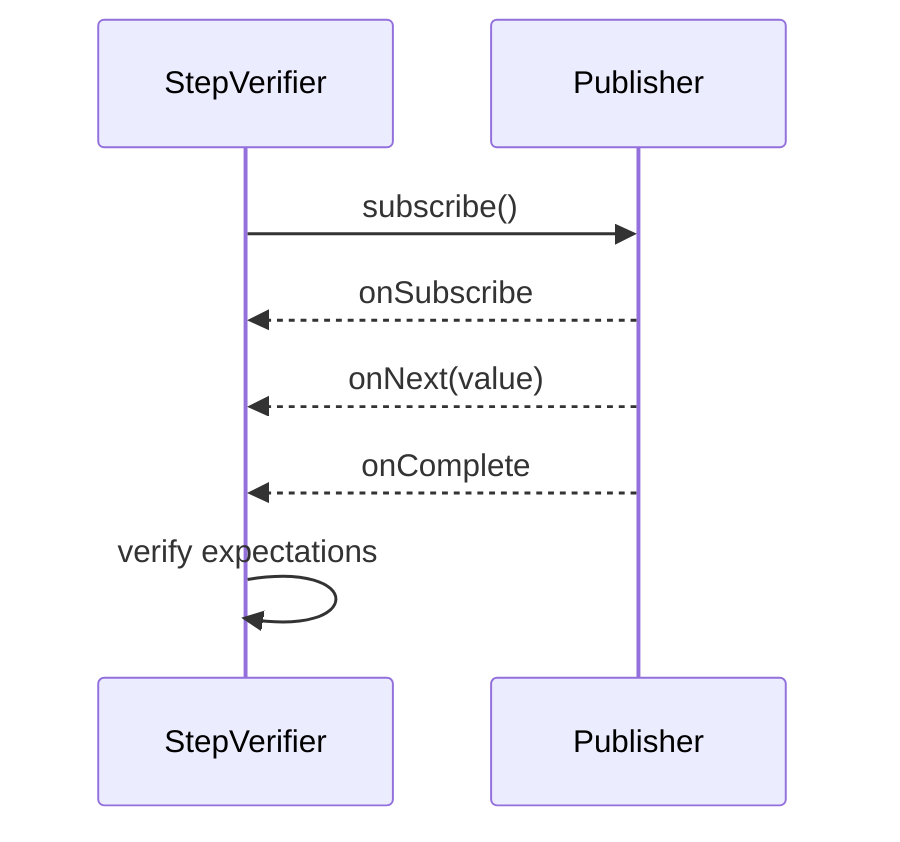

# Kiểm tra kết quả, hoàn thành và lỗi bằng StepVerifier

Spring Data R2DBC trả về `Mono<T>` và `Flux<T>` thay vì kết quả đồng bộ. Một phương thức repository có thể phát một entity, hoàn tất rỗng, phát nhiều entity hoặc kết thúc bằng lỗi. Khi kiểm thử, chỉ gọi `subscribe()` rồi chờ bằng mắt thường không cho biết chính xác publisher đã phát tín hiệu nào, có hoàn tất đúng hay không và lỗi có đúng loại hay không.

Reactor cung cấp `StepVerifier` trong module `reactor-test` để kiểm tra một publisher theo trình tự tín hiệu Reactive Streams. Test mô tả những gì mong đợi: subscription, các phần tử `onNext`, tín hiệu hoàn tất `onComplete`, tín hiệu lỗi `onError`, yêu cầu backpressure và hủy subscription. Khi gọi `verify()` hoặc một phương thức verify chuyên biệt, StepVerifier mới thực sự subscribe publisher và thực hiện kịch bản kiểm thử.

Với Spring Data R2DBC, StepVerifier giúp xác nhận hợp đồng của repository, `R2dbcEntityTemplate`, `DatabaseClient` và service reactive: dữ liệu trả về đúng, publisher hoàn tất bình thường khi thành công, trường hợp không tìm thấy được biểu diễn đúng và lỗi persistence không bị che giấu.

## 1. Thêm reactor-test vào dự án

Nếu dự án dùng Maven, dependency thường được khai báo ở scope test:

```xml
<dependency>
    <groupId>io.projectreactor</groupId>
    <artifactId>reactor-test</artifactId>
    <scope>test</scope>
</dependency>
```

Với Gradle:

```groovy
testImplementation 'io.projectreactor:reactor-test'
```

Trong dự án Spring Boot, nên để dependency management/BOM quản lý phiên bản Reactor tương thích với Spring Framework và Reactor Core đang dùng. Không tự chọn một phiên bản `reactor-test` khác dòng với `reactor-core` nếu không có lý do rõ ràng.

Import thường gặp:

```java
import org.junit.jupiter.api.Test;
import reactor.test.StepVerifier;
import java.time.Duration;
```

## 2. StepVerifier kiểm tra tín hiệu như thế nào?

Một publisher reactive có thể phát các tín hiệu sau:

- `onSubscribe`: consumer nhận subscription.
- `onNext(value)`: publisher phát một phần tử.
- `onComplete`: publisher hoàn tất bình thường.
- `onError(error)`: publisher kết thúc bằng lỗi.
- `cancel`: consumer hủy subscription; đây là thao tác điều khiển subscription, không phải tín hiệu terminal do publisher phát.

StepVerifier cho phép khai báo một chuỗi kỳ vọng tương ứng. Ví dụ:

```java
StepVerifier.create(Flux.just("A", "B"))
    .expectNext("A")
    .expectNext("B")
    .verifyComplete();
```

Kịch bản yêu cầu publisher phát đúng `A`, sau đó `B`, rồi hoàn tất. Nếu publisher phát `C`, phát lỗi hoặc không hoàn tất, test sẽ thất bại theo điều kiện verify.

Sơ đồ một kịch bản đơn giản:



`StepVerifier.create(publisher)` tạo kịch bản kiểm tra. Các lệnh `expect...` mô tả tín hiệu mong đợi. Lệnh cuối như `verifyComplete()`, `verifyError()` hoặc `verify()` kích hoạt subscription và chờ kết quả.

## 3. Kiểm tra một kết quả thành công bằng expectNext

Với `Mono<T>` có một giá trị, dùng `expectNext` nếu object có phép so sánh bằng phù hợp:

```java
@Test
void findsCustomer() {
    Mono<String> result = Mono.just("an@example.com");

    StepVerifier.create(result)
        .expectNext("an@example.com")
        .verifyComplete();
}
```

`expectNext` so sánh phần tử phát ra với giá trị mong đợi. Sau đó `verifyComplete()` xác nhận publisher hoàn tất bình thường và không có thêm phần tử ngoài dự kiến.

Với entity, phép `equals` có thể không được cài đặt hoặc có thể so sánh cả những field không liên quan. Trong trường hợp đó, dùng `assertNext` để kiểm tra thuộc tính:

```java
@Test
void readsCustomerFromRepository() {
    StepVerifier.create(customerRepository.findById(10L))
        .assertNext(customer -> {
            assertThat(customer.getId()).isEqualTo(10L);
            assertThat(customer.getEmail()).isEqualTo("an@example.com");
            assertThat(customer.getDisplayName()).isEqualTo("An");
        })
        .verifyComplete();
}
```

`assertNext` nhận một consumer để thực hiện assertion trên phần tử tiếp theo. Nếu assertion ném lỗi, test thất bại. Dùng cách này để kiểm tra nhiều thuộc tính mà không cần tạo object expected đầy đủ.

## 4. Kiểm tra phần tử bằng expectNextMatches

`expectNextMatches(predicate)` phù hợp khi chỉ cần kiểm tra một điều kiện:

```java
StepVerifier.create(customerRepository.findById(10L))
    .expectNextMatches(customer ->
        customer.getId().equals(10L)
            && customer.getEmail().endsWith("@example.com"))
    .verifyComplete();
```

Predicate trả về `true` nếu phần tử đáp ứng điều kiện. Nếu trả về `false`, StepVerifier đánh dấu test thất bại.

Không nên nhồi quá nhiều assertion vào predicate. Khi cần thông báo lỗi rõ ràng, dùng `assertNext` cùng AssertJ/JUnit để test report chỉ ra thuộc tính nào sai.

## 5. Kiểm tra nhiều kết quả từ Flux

Với truy vấn danh sách, dùng `expectNext` cho từng giá trị hoặc `expectNextSequence` cho một chuỗi:

```java
@Test
void listsCustomersInExpectedOrder() {
    StepVerifier.create(customerRepository.findByStatusOrderByIdAsc(Status.ACTIVE))
        .expectNextSequence(List.of(customerA, customerB, customerC))
        .verifyComplete();
}
```

Ví dụ giả định repository có quy tắc sắp xếp rõ ràng. Nếu query không có `ORDER BY`, không nên kiểm tra một thứ tự cố định vì database không bảo đảm thứ tự hàng.

Nếu chỉ quan tâm số lượng phần tử, có thể dùng `expectNextCount`:

```java
StepVerifier.create(customerRepository.findByStatus(Status.ACTIVE))
    .expectNextCount(3)
    .verifyComplete();
```

`expectNextCount(3)` kiểm tra đúng ba phần tử kế tiếp nhưng không kiểm tra nội dung. Kết hợp nó với `verifyComplete()` để bảo đảm publisher không phát thêm hàng thứ tư.

Khi cần kiểm tra một phần tử cụ thể rồi bỏ qua các phần tử tiếp theo:

```java
StepVerifier.create(customerRepository.findAll())
    .assertNext(first -> assertThat(first.getId()).isNotNull())
    .expectNextCount(2)
    .verifyComplete();
```

Nếu cần thu thập các phần tử đã phát để assertion sau cùng, có thể dùng `recordWith` và `expectRecordedMatches`:

```java
StepVerifier.create(customerRepository.findByStatus(Status.ACTIVE))
    .recordWith(ArrayList::new)
    .expectNextCount(3)
    .expectRecordedMatches(customers ->
        customers.stream().allMatch(c -> c.getStatus() == Status.ACTIVE))
    .verifyComplete();
```

Chỉ ghi vào bộ nhớ khi tập kết quả nhỏ và có giới hạn. Với kết quả lớn, nên assertion từng phần tử hoặc kiểm tra bằng query có giới hạn để tránh làm test tiêu thụ quá nhiều bộ nhớ.

## 6. Kiểm tra trường hợp không tìm thấy

Một truy vấn đơn kết quả không tìm thấy hàng thường trả `Mono.empty()`. Đây là hoàn tất bình thường, không phải lỗi:

```java
@Test
void returnsEmptyWhenCustomerDoesNotExist() {
    StepVerifier.create(customerRepository.findById(-1L))
        .verifyComplete();
}
```

Không cần `expectNext()` vì publisher không phát giá trị. `verifyComplete()` xác nhận publisher kết thúc bằng `onComplete` mà không phát phần tử.

Với service chuyển kết quả rỗng thành lỗi nghiệp vụ:

```java
@Test
void convertsMissingCustomerToNotFound() {
    StepVerifier.create(customerService.getRequiredCustomer(-1L))
        .expectError(CustomerNotFoundException.class)
        .verify();
}
```

Hai test này kiểm tra hai hợp đồng khác nhau:

- Repository: không có hàng thì publisher hoàn tất rỗng.
- Service: không có hàng là lỗi nghiệp vụ theo yêu cầu use case.

Không nên bắt repository trả `Mono.error(NotFoundException)` nếu tầng persistence được thiết kế để biểu diễn không có hàng bằng empty; hãy đặt quyết định not found ở tầng service/API nếu phù hợp với kiến trúc.

## 7. Kiểm tra lỗi bằng expectError

Khi publisher kết thúc bằng lỗi, dùng `expectError` để kiểm tra loại exception:

```java
StepVerifier.create(customerService.getRequiredCustomer(-1L))
    .expectError(CustomerNotFoundException.class)
    .verify();
```

Nếu cần kiểm tra message:

```java
StepVerifier.create(customerService.getRequiredCustomer(-1L))
    .expectErrorMessage("Customer was not found")
    .verify();
```

Nếu cần kiểm tra nhiều thuộc tính của exception, dùng `expectErrorSatisfies`:

```java
StepVerifier.create(customerService.getRequiredCustomer(-1L))
    .expectErrorSatisfies(error -> {
        assertThat(error).isInstanceOf(CustomerNotFoundException.class);
        CustomerNotFoundException notFound =
            (CustomerNotFoundException) error;
        assertThat(notFound.getCustomerId()).isEqualTo(-1L);
    })
    .verify();
```

`expectErrorMatches` phù hợp với predicate:

```java
StepVerifier.create(service.loadCustomer(-1L))
    .expectErrorMatches(error ->
        error instanceof CustomerNotFoundException
            && ((CustomerNotFoundException) error).getCustomerId().equals(-1L))
    .verify();
```

Chọn cách kiểm tra theo nhu cầu: class khi chỉ cần loại lỗi, message khi message là một phần của hợp đồng, `expectErrorSatisfies` khi cần assertion chi tiết. Tránh phụ thuộc quá chặt vào message do driver tạo ra vì message có thể thay đổi theo database và phiên bản.

## 8. Kiểm tra lỗi database và exception translation

Spring thường chuyển lỗi R2DBC thành các kiểu `DataAccessException` phù hợp khi thao tác đi qua Spring Data/`DatabaseClient`. Kiểu lỗi cụ thể phụ thuộc loại lỗi, driver và exception translation.

Ví dụ test một thao tác vi phạm unique constraint:

```java
@Test
void duplicateEmailFails() {
    Mono<Customer> duplicate = customerRepository.save(
        new Customer(null, "existing@example.com"));

    StepVerifier.create(duplicate)
        .expectError(DataIntegrityViolationException.class)
        .verify();
}
```

Test giả định dữ liệu `existing@example.com` đã tồn tại và schema có unique constraint. Trong test thực tế, cần tạo fixture trước bằng reactive setup hoặc repository, rồi mới thực hiện thao tác trùng. Một số phiên bản driver có thể phân loại lỗi khác; khi cần kiểm tra chính xác, xác nhận exception type và cause mà ứng dụng thực sự nhận.

Để xác minh service không biến lỗi database thành kết quả rỗng:

```java
StepVerifier.create(customerService.loadCustomerFromDatabase(id))
    .expectError(DataAccessException.class)
    .verify();
```

Không viết `onErrorResume(error -> Mono.empty())` chỉ để test qua. Test nên xác nhận lỗi persistence tiếp tục được truyền lên, trừ khi service có chính sách fallback cụ thể cho một loại lỗi đã biết.

## 9. Kiểm tra rowsUpdated và Mono<Void>

Với `DatabaseClient`, thao tác update/delete thường trả publisher chứa số hàng bị ảnh hưởng:

```java
Mono<Long> updateCount = databaseClient.sql("""
        UPDATE customer
        SET display_name = :name
        WHERE id = :id
        """)
    .bind("name", "An Nguyen")
    .bind("id", 10L)
    .fetch()
    .rowsUpdated();
```

Kiểm tra có đúng một hàng được cập nhật:

```java
StepVerifier.create(updateCount)
    .expectNext(1L)
    .verifyComplete();
```

Nếu không có hàng phù hợp, `rowsUpdated()` thường phát `0`, chứ không hoàn tất rỗng:

```java
StepVerifier.create(updateCustomerWithUnknownId())
    .expectNext(0L)
    .verifyComplete();
```

Với phương thức trả `Mono<Void>`, hoàn tất bình thường không phát giá trị:

```java
StepVerifier.create(customerRepository.deleteById(10L))
    .verifyComplete();
```

Không dùng `expectNextCount(1)` cho `Mono<Void>`. Publisher không có phần tử `onNext` để kiểm tra; điều cần xác nhận là `onComplete` hoặc `onError`.

## 10. Kiểm tra thứ tự tín hiệu và không có phần tử thừa

Một test tốt thường xác nhận cả dữ liệu và tín hiệu terminal. Ví dụ:

```java
StepVerifier.create(Flux.just("first", "second"))
    .expectNext("first")
    .expectNext("second")
    .verifyComplete();
```

Nếu chỉ kiểm tra hai `expectNext` mà không có lệnh terminal, kịch bản chưa xác nhận publisher kết thúc đúng. `verifyComplete()` làm rõ rằng sau hai giá trị phải là hoàn tất bình thường.

Nếu publisher phát đúng các phần tử nhưng sau đó phát lỗi, test với `verifyComplete()` sẽ thất bại. Nếu publisher phát thêm một phần tử không mong đợi, test cũng thất bại khi đang chờ terminal signal.

Khi publisher cần kết thúc bằng lỗi sau một số phần tử:

```java
StepVerifier.create(service.streamThenFail())
    .expectNext("A", "B")
    .expectError(ImportFailedException.class)
    .verify();
```

Kịch bản xác nhận hai giá trị đầu được phát trước khi publisher báo lỗi. Điều này hữu ích với `Flux` streaming, trong đó một số phần tử có thể đã được gửi trước khi database hoặc xử lý phía sau gặp lỗi.

## 11. Giới hạn thời gian để tránh test treo

Các phương thức `verify...` có thể chờ publisher kết thúc. Nếu publisher không hoàn tất, test có thể chờ rất lâu. Có thể đặt timeout cho từng test:

```java
StepVerifier.create(customerRepository.findById(10L))
    .expectNextMatches(customer -> customer.getId().equals(10L))
    .verifyComplete(Duration.ofSeconds(5));
```

Hoặc gọi `verify(Duration)` sau khi mô tả kịch bản:

```java
StepVerifier.create(customerRepository.findAll())
    .expectNextCount(3)
    .verify(Duration.ofSeconds(5));
```

Có thể đặt timeout mặc định cho StepVerifier trong suite test:

```java
@BeforeAll
static void configureStepVerifierTimeout() {
    StepVerifier.setDefaultTimeout(Duration.ofSeconds(10));
}
```

Timeout của StepVerifier là giới hạn thời gian test chờ tín hiệu. Nó không giống query timeout ở database hoặc connection-acquire timeout của pool. Nếu query vượt timeout, cần xác định lớp nào thực sự phát lỗi và kiểm tra chính sách timeout ở đúng tầng.

Không đặt timeout quá ngắn khiến test database chập chờn thất bại ngẫu nhiên. Chọn thời gian phù hợp môi trường CI và giữ timeout hữu hạn để phát hiện publisher bị treo.

## 12. Phân biệt thenAwait và expectNoEvent

`thenAwait(duration)` yêu cầu StepVerifier chờ một khoảng thời gian trước khi tiếp tục kiểm tra. Nó không tự khẳng định trong khoảng đó không có tín hiệu.

`expectNoEvent(duration)` xác nhận không có tín hiệu nào xảy ra trong khoảng thời gian đó. Lưu ý subscription cũng được tính là một event; nếu cần kiểm tra không có event sau khi subscribe, hãy dùng `expectSubscription()` trước:

```java
StepVerifier.withVirtualTime(() -> delayedPublisher())
    .expectSubscription()
    .expectNoEvent(Duration.ofSeconds(4))
    .thenAwait(Duration.ofSeconds(1))
    .expectNext("ready")
    .verifyComplete();
```

Không dùng `expectNoEvent` để kiểm tra một query database “không phát gì trong vài giây” nếu mục tiêu thực sự là timeout truy vấn. Test database nên kiểm tra kết quả hoặc lỗi theo timeout được cấu hình rõ, thay vì dựa vào thời gian ngủ tùy ý.

## 13. Kiểm tra backpressure và request

Reactive Streams cho phép subscriber yêu cầu số phần tử mà nó sẵn sàng nhận. StepVerifier có thể bắt đầu với request bằng 0 để kiểm tra publisher không phát dữ liệu trước khi có demand:

```java
StepVerifier.create(Flux.range(1, 3), 0)
    .expectSubscription()
    .thenRequest(1)
    .expectNext(1)
    .thenRequest(2)
    .expectNext(2, 3)
    .verifyComplete();
```

Ví dụ bắt đầu với initial request bằng 0, sau đó yêu cầu một phần tử rồi hai phần tử. Đây là cách kiểm tra publisher và operator của ứng dụng tuân thủ demand. Driver database có thể có cơ chế fetch/buffer riêng, nên test này không chứng minh database server chỉ gửi đúng từng hàng theo demand; nó kiểm tra tín hiệu ở reactive boundary.

## 14. Kiểm tra cancellation

Consumer có thể hủy subscription khi không cần đọc thêm dữ liệu. Với truy vấn R2DBC, cancellation có thể khiến pipeline dừng và driver có thể gửi tín hiệu hủy xuống database tùy khả năng hỗ trợ.

Có thể kiểm tra một publisher có nhận cancellation:

```java
@Test
void cancelsSubscription() {
    AtomicBoolean cancelled = new AtomicBoolean();

    Flux<Integer> source = Flux.<Integer>never()
        .doOnCancel(() -> cancelled.set(true));

    StepVerifier.create(source)
        .thenCancel()
        .verify();

    assertThat(cancelled).isTrue();
}
```

`thenCancel()` hủy subscription và `verify()` thực hiện kịch bản. Với repository thật, có thể dùng cancellation test để xác nhận service không tiếp tục xử lý các phần tử sau khi caller dừng. Tuy nhiên, không khẳng định cancellation luôn rollback thao tác ghi hoặc database dừng query ngay lập tức; điều đó phụ thuộc transaction, driver và database.

## 15. Kiểm tra thời gian với virtual time

Một số reactive flow có `delay`, `timeout`, `retryWhen` với backoff hoặc scheduler theo thời gian. Chờ thời gian thực trong test làm suite chậm. `StepVerifier.withVirtualTime` cho phép tiến đồng hồ ảo để kiểm tra các operator dựa trên scheduler được hỗ trợ.

Ví dụ kiểm tra `Mono.delay`:

```java
@Test
void emitsAfterOneHourWithoutWaitingAnHour() {
    StepVerifier.withVirtualTime(
            () -> Mono.delay(Duration.ofHours(1)))
        .expectSubscription()
        .expectNoEvent(Duration.ofMinutes(59))
        .thenAwait(Duration.ofMinutes(1))
        .expectNext(0L)
        .verifyComplete();
}
```

Publisher phải được tạo bên trong supplier truyền cho `withVirtualTime`. Nếu tạo publisher trước rồi mới truyền vào, operator có thể đã giữ scheduler thật và không dùng virtual scheduler.

Virtual time phù hợp để test retry/backoff hoặc delay trong service. Nó không làm thời gian thực thi SQL Server/PostgreSQL ảo đi; không dùng virtual time để thay thế integration test truy vấn database, network timeout hoặc driver scheduling.

## 16. Kiểm tra retry và fallback

Giả sử service retry một lỗi tạm thời rồi thành công. Có thể tạo publisher test rõ số lần gọi:

```java
AtomicInteger attempts = new AtomicInteger();

StepVerifier.withVirtualTime(() -> Mono.defer(() -> {
        int attempt = attempts.incrementAndGet();
        if (attempt < 3) {
            return Mono.error(new TransientStoreException());
        }
        return Mono.just("loaded");
    }).retryWhen(Retry.fixedDelay(2, Duration.ofSeconds(1))))
    .thenAwait(Duration.ofSeconds(2))
    .expectNext("loaded")
    .verifyComplete();

assertThat(attempts).hasValue(3);
```

Publisher retry được tạo bên trong supplier truyền cho `withVirtualTime`, vì vậy scheduler ảo có thể được áp dụng cho delay. Nếu tạo publisher trước rồi mới truyền biến đã tạo vào supplier, operator có thể đã giữ scheduler thật và test sẽ chờ thời gian thực.

Với fallback `switchIfEmpty`, kiểm tra publisher thay thế chỉ chạy khi nguồn rỗng. Với `onErrorResume`, kiểm tra fallback chỉ chạy cho loại lỗi được chọn và các lỗi khác vẫn truyền lên. Không chỉ kiểm tra giá trị cuối; hãy kiểm tra số lần gọi hoặc trạng thái của publisher phụ nếu điều đó là một phần quan trọng của hợp đồng.

## 17. Kết hợp StepVerifier với repository R2DBC

StepVerifier kiểm tra tín hiệu reactive, nhưng không tự tạo database hoặc fixture. Integration test nên chuẩn bị schema và dữ liệu bằng migration/test fixture, rồi kiểm tra repository qua driver thực tế.

Ví dụ kiểm tra insert và đọc lại:

```java
@Test
void savesAndReadsCustomer() {
    Customer input = new Customer(null, "an@example.com", "An");

    StepVerifier.create(customerRepository.save(input)
            .flatMap(saved -> customerRepository.findById(saved.getId())))
        .assertNext(found -> {
            assertThat(found.getId()).isNotNull();
            assertThat(found.getEmail()).isEqualTo("an@example.com");
            assertThat(found.getDisplayName()).isEqualTo("An");
        })
        .verifyComplete();
}
```

Ví dụ giả định entity được lưu có ID do database sinh và repository trả về entity chứa ID. Nếu ID được cấp bởi ứng dụng, fixture cần phù hợp với chiến lược đó.

Với truy vấn nhiều hàng, kiểm tra thứ tự chỉ khi SQL có `ORDER BY`:

```java
StepVerifier.create(orderRepository
        .findByTenantIdOrderByCreatedAtDescIdDesc(tenantId))
    .assertNext(order -> assertThat(order.getId()).isEqualTo(newestId))
    .assertNext(order -> assertThat(order.getId()).isEqualTo(previousId))
    .verifyComplete();
```

Nếu repository không cam kết thứ tự, hãy kiểm tra tập ID hoặc điều kiện trên từng phần tử mà không giả định thứ tự phát.

## 18. Kết hợp StepVerifier với DatabaseClient

`DatabaseClient` trả về publisher, nên có thể kiểm tra tương tự:

```java
@Test
void updateReturnsAffectedRowCount() {
    Mono<Long> rowsUpdated = databaseClient.sql("""
            UPDATE customer
            SET display_name = :name
            WHERE id = :id
            """)
        .bind("name", "An Nguyen")
        .bind("id", 10L)
        .fetch()
        .rowsUpdated();

    StepVerifier.create(rowsUpdated)
        .expectNext(1L)
        .verifyComplete();
}
```

Với truy vấn không tìm thấy:

```java
StepVerifier.create(databaseClient.sql(
        "SELECT id FROM customer WHERE id = :id")
        .bind("id", -1L)
        .map((row, metadata) -> row.get("id", Long.class))
        .one())
    .verifyComplete();
```

Ví dụ xác nhận `.one()` hoàn tất rỗng khi không có hàng. Nếu query có thể trả nhiều hàng ngoài dự kiến, test riêng để xác nhận lỗi cardinality hoặc thay đổi query/hợp đồng cho đúng.

## 19. Kiểm tra lỗi sau khi đã phát một phần Flux

Một `Flux` có thể phát một số hàng rồi gặp lỗi ở bước đọc tiếp theo, ví dụ lỗi driver, mapping hoặc xử lý downstream. Khi đó consumer đã nhận một phần dữ liệu trước khi nhận `onError`.

Có thể mô tả hợp đồng này bằng test:

```java
Flux<Integer> source = Flux.just(1, 2)
    .concatWith(Mono.error(new IllegalStateException("read failed")));

StepVerifier.create(source)
    .expectNext(1, 2)
    .expectErrorMessage("read failed")
    .verify();
```

Với thao tác streaming dữ liệu từ database, điều này có ý nghĩa thực tế: việc đã nhận một số hàng không có nghĩa toàn bộ truy vấn hoàn tất thành công. Nếu consumer đã ghi các hàng nhận được sang hệ thống khác, cần có chiến lược transaction/batch hoặc staging để tránh công bố một tập dữ liệu một phần ngoài ý muốn.

## 20. Kiểm tra transaction rollback khi publisher lỗi

Một service có thể lưu nhiều entity trong reactive transaction. Nếu thao tác sau phát lỗi, transaction cần rollback theo cấu hình transaction manager:

```java
@Transactional
public Mono<Void> createOrderWithLines(Order order, List<OrderLine> lines) {
    return orderRepository.save(order)
        .flatMap(saved -> Flux.fromIterable(lines)
            .map(line -> line.withOrderId(saved.getId()))
            .concatMap(orderLineRepository::save)
            .then())
        .then();
}
```

Trong integration test, có thể tạo một dòng hàng vi phạm constraint để publisher phát lỗi, sau đó truy vấn lại database để xác nhận đơn hàng và các dòng trước đó đã rollback. Phần xác nhận rollback nên được thực hiện sau khi publisher transactional đã kết thúc lỗi, bằng một transaction/query độc lập phù hợp.

Không chỉ mock repository để kiểm tra `expectError` rồi kết luận database rollback đúng. Mock không thực thi transaction thật. Cần chạy test trên database và R2DBC driver tương ứng để xác nhận transaction boundary, connection binding và constraint behavior.

## 21. Kiểm tra cancellation trong pipeline persistence

Nếu service hỗ trợ streaming hoặc caller có thể ngừng đọc sớm, hãy cân nhắc cancellation. Ví dụ một pipeline có cleanup khi bị hủy:

```java
AtomicBoolean cancelled = new AtomicBoolean();

Flux<Customer> result = customerRepository.findAll()
    .doOnCancel(() -> cancelled.set(true));

StepVerifier.create(result)
    .expectNextCount(1)
    .thenCancel()
    .verify();

assertThat(cancelled).isTrue();
```

Đoạn test kiểm tra cancellation được truyền đến operator trong pipeline. Với database thật, driver có thể xử lý cancellation khác nhau; không suy ra rằng câu SQL chắc chắn đã bị hủy ở server chỉ từ việc `doOnCancel` chạy.

## 22. Kiểm tra publisher được subscribe đúng số lần

Reactor publisher thường là lazy. Mỗi lần subscribe có thể thực thi lại query hoặc thao tác ghi. Vì vậy, không nên gọi `subscribe()` để “kiểm tra nhanh” trước rồi đưa cùng publisher vào StepVerifier:

```java
// Không nên: có thể thực thi thao tác hai lần.
Mono<Customer> result = customerRepository.save(customer);
result.subscribe();
StepVerifier.create(result).expectNextCount(1).verifyComplete();
```

Thay vào đó, để StepVerifier là subscriber kiểm thử:

```java
StepVerifier.create(customerRepository.save(customer))
    .assertNext(saved -> assertThat(saved.getId()).isNotNull())
    .verifyComplete();
```

Nếu cần dùng kết quả của một publisher trong nhiều assertion, hãy ghi nhận giá trị bằng `assertNext`, `recordWith` hoặc `expectRecordedMatches` trong cùng kịch bản. Không subscribe nhiều lần vào một lệnh ghi nếu không chủ ý kiểm tra semantics thực thi lại.

## 23. Sử dụng TestPublisher khi cần điều khiển tín hiệu

`TestPublisher` thuộc `reactor-test` và cho phép test chủ động phát giá trị, hoàn tất hoặc lỗi. Nó hữu ích khi kiểm tra service xử lý một publisher phụ mà không cần database thật:

```java
TestPublisher<String> source = TestPublisher.create();

StepVerifier.create(service.transform(source.flux()))
    .then(() -> source.next("customer-1"))
    .expectNext("CUSTOMER-1")
    .then(source::complete)
    .verifyComplete();
```

Có thể điều khiển lỗi:

```java
TestPublisher<String> source = TestPublisher.create();

StepVerifier.create(service.transform(source.flux()))
    .then(() -> source.error(new IllegalStateException("source failed")))
    .expectError(IllegalStateException.class)
    .verify();
```

`TestPublisher` giúp kiểm tra logic reactive của service, nhưng không thay thế integration test repository. Nó không xác nhận SQL, mapping, transaction hoặc driver.

## 24. Gắn tên kịch bản để dễ đọc lỗi test

Khi suite có nhiều test reactive, có thể gắn tên kịch bản bằng `as(...)` hoặc `StepVerifierOptions`:

```java
StepVerifier.create(customerRepository.findById(10L))
    .as("load existing customer")
    .assertNext(customer -> assertThat(customer.getId()).isEqualTo(10L))
    .verifyComplete();
```

Hoặc:

```java
StepVerifier.create(
        customerRepository.findById(10L),
        StepVerifierOptions.create().scenarioName("load customer by id"))
    .expectNextMatches(customer -> customer.getId().equals(10L))
    .verifyComplete();
```

Tên scenario giúp failure report dễ nhận diện hơn trong suite có nhiều assertion. Không cần đặt tên dài; chọn tên mô tả hành vi được kiểm tra.

## 25. Những lỗi thường gặp khi dùng StepVerifier

| Lỗi | Hệ quả | Cách sửa |
|---|---|---|
| Quên gọi `verify...()` | Kịch bản không subscribe publisher nên test không thực sự chạy. | Kết thúc bằng `verifyComplete`, `verify`, `verifyError` hoặc phương thức phù hợp. |
| Dùng `expectNext` cho `Mono.empty()` | Test chờ một phần tử không tồn tại. | Dùng `verifyComplete()` để kiểm tra hoàn tất rỗng. |
| Chỉ kiểm tra phần tử, không kiểm tra terminal signal | Bỏ sót phần tử thừa hoặc lỗi xảy ra sau phần tử cuối. | Kết thúc bằng `verifyComplete()` hoặc `expectError...().verify()`. |
| Dùng `verifyComplete()` khi publisher cần phát lỗi | Test mong đợi sai terminal signal. | Dùng `expectError`/`expectErrorSatisfies`. |
| Giả định thứ tự Flux khi SQL không có `ORDER BY` | Test không ổn định giữa các lần chạy/database. | Thêm thứ tự xác định hoặc kiểm tra theo tập kết quả. |
| Gọi `subscribe()` trước StepVerifier | Có thể thực thi query/ghi hai lần. | Để StepVerifier quản lý subscription. |
| Dùng virtual time cho query database thật | Đồng hồ ảo không điều khiển thời gian driver/server. | Dùng virtual time cho operator theo scheduler; integration test dùng thời gian thực có timeout. |
| Không đặt timeout cho publisher có thể treo | Test suite có thể chờ vô hạn. | Dùng `verify(Duration)` hoặc default timeout phù hợp. |
| Dùng mock để kết luận transaction rollback | Mock không thực thi transaction database. | Viết integration test trên R2DBC driver/database thật. |
| Kiểm tra exception message vendor-specific quá chặt | Test dễ vỡ khi nâng driver/database. | Ưu tiên exception type, SQL state hoặc mã lỗi ổn định theo hợp đồng. |

## 26. Mẫu kiểm thử theo hợp đồng repository

Với một phương thức repository trả `Mono<Customer>`, nên có các kịch bản riêng:

| Kịch bản | Cách kiểm tra | Hành vi mong đợi |
|---|---|---|
| Tìm thấy một hàng | `assertNext(...)` + `verifyComplete()` | Phát đúng entity và hoàn tất. |
| Không tìm thấy | `verifyComplete()` | Hoàn tất rỗng. |
| Lỗi kết nối hoặc SQL | `expectError(...)` + `verify()` | Phát lỗi, không chuyển thành empty. |
| Nhiều hàng ngoài dự kiến | `expectError(...)` nếu API yêu cầu tối đa một | Phát lỗi cardinality. |
| Một cột SQL NULL | `assertNext(...)` | Entity tồn tại, thuộc tính nullable được ánh xạ đúng. |

Với phương thức `Flux<Customer>`:

- Kiểm tra từng phần tử hoặc số lượng bằng `expectNextCount`.
- Kiểm tra thứ tự chỉ khi query có `ORDER BY`.
- Dùng `verifyComplete()` để xác nhận kết thúc bình thường.
- Dùng `expectError...` nếu luồng có thể lỗi sau khi đã phát một số hàng.
- Kiểm tra cancellation/backpressure khi service có hợp đồng streaming cần bảo vệ.

Với phương thức ghi:

- `Mono<Long>` từ `rowsUpdated()` nên kiểm tra số hàng bị ảnh hưởng.
- `Mono<Void>` nên kiểm tra hoàn tất hoặc lỗi, không chờ `onNext`.
- Thao tác trong transaction cần integration test xác nhận commit/rollback thật.

## 27. Quy trình viết một StepVerifier test

Khi bắt đầu một test reactive, hãy làm theo trình tự:

1. Xác định publisher là `Mono` hay `Flux` và hợp đồng số lượng kết quả.
2. Xác định trường hợp thành công, rỗng và lỗi cần kiểm tra.
3. Chuẩn bị dữ liệu database bằng fixture/migration hoặc setup reactive rõ ràng.
4. Tạo publisher mà không tự gọi `subscribe()` hoặc `block()` trước test.
5. Dùng `expectNext`, `assertNext`, `expectNextMatches` hoặc `expectNextCount` để kiểm tra dữ liệu.
6. Dùng `verifyComplete()` cho hoàn tất bình thường; dùng `expectError...().verify()` cho lỗi.
7. Đặt timeout hữu hạn để tránh test treo.
8. Với delay/retry/backoff, dùng `withVirtualTime` và tạo publisher bên trong supplier.
9. Với SQL, mapping và transaction, chạy integration test trên đúng database/R2DBC driver.
10. Kiểm tra test không vô tình subscribe nhiều lần vào publisher ghi dữ liệu.

`StepVerifier` là test subscriber giúp mô tả chính xác chuỗi tín hiệu của `Mono` và `Flux`. Dùng `expectNext`/`assertNext` để kiểm tra giá trị, `verifyComplete()` để xác nhận hoàn tất, `expectError...` để xác nhận lỗi, và các bước request/cancel/virtual time khi hợp đồng yêu cầu. Với Spring Data R2DBC, kết hợp StepVerifier với integration test trên database thật để kiểm tra cả reactive signal lẫn SQL, mapping và transaction. Khi test kiểm tra đầy đủ dữ liệu và terminal signal, các lỗi như publisher rỗng ngoài dự kiến, lỗi bị che giấu, phần tử thừa hoặc transaction không rollback sẽ dễ được phát hiện hơn.
