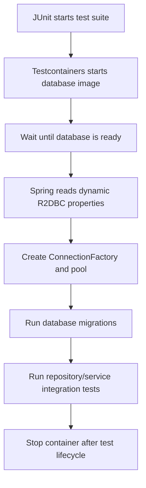

# Dùng Testcontainers với đúng hệ quản trị mục tiêu

Spring Data R2DBC có thể làm việc với nhiều hệ quản trị quan hệ, nhưng repository chạy đúng trên H2 hoặc mock chưa chứng minh ứng dụng sẽ chạy đúng trên PostgreSQL, MySQL, SQL Server hay Oracle. Mỗi database có cú pháp, kiểu dữ liệu, transaction, locking, generated key và hành vi driver riêng. Integration test cần sử dụng chính hệ quản trị mà ứng dụng sẽ triển khai, hoặc từng engine nằm trong danh sách được hỗ trợ.

Testcontainers giúp khởi chạy database thật trong container cho mỗi test suite hoặc test run. Ứng dụng kết nối tới container bằng R2DBC driver thực tế, chạy migration thật và kiểm tra repository/service qua database engine thật. Nhờ vậy, test có thể phát hiện lỗi SQL, mapping, constraint, transaction và driver mà mock hoặc database thay thế không thể tái hiện đầy đủ.

## 1. Vì sao cần Testcontainers cho Spring Data R2DBC?

Unit test rất hữu ích để kiểm tra quy tắc nghiệp vụ, mapping thuần Java và cách service kết hợp publisher. Nhưng khi test cần xác nhận SQL thực sự chạy trên database, phải có database engine và driver tương ứng.

Một số khác biệt chỉ xuất hiện khi chạy với database thật:

- Identity, sequence, generated columns và cách trả generated key.
- Kiểu dữ liệu `UUID`, `JSON`, `JSONB`, `BOOLEAN`, `NUMERIC`, timestamp và array.
- Cú pháp phân trang, upsert, JSON operator, quoting identifier và function.
- Unique constraint, foreign key, check constraint và default value.
- Isolation level, row lock, deadlock, lock timeout và optimistic locking.
- Cách driver bind parameter, map kiểu Java, hủy statement và trả exception.
- Migration DDL, index, trigger, extension và generated column.

Ví dụ, một câu SQL dùng `RETURNING` có thể chạy trên PostgreSQL nhưng không chạy nguyên văn trên SQL Server. H2 có thể chấp nhận một phần cú pháp gần giống, nhưng không có nghĩa semantics generated key, lock hoặc kiểu dữ liệu giống PostgreSQL.

Testcontainers giải quyết vấn đề này bằng cách cung cấp database engine thực trong môi trường test có thể tạo và hủy tự động. R2DBC driver trong ứng dụng vẫn là driver thật, vì vậy test kiểm tra được cả hai phía: server và cách ứng dụng giao tiếp với server.

## 2. Testcontainers hoạt động như thế nào?

Testcontainers dùng container runtime, thường là Docker, để khởi chạy dependency phục vụ test. Test khai báo loại container và image cần dùng; thư viện khởi động container, chờ service sẵn sàng, cấp cổng truy cập động và dừng container theo lifecycle đã cấu hình.

Luồng kiểm thử điển hình:



Test không cần cài database riêng trên máy lập trình viên. Mỗi lần chạy có thể dùng một container sạch, giúp kết quả ít phụ thuộc trạng thái database còn sót từ lần test trước.

Testcontainers không thay thế database server; nó chạy chính image database mà test chỉ định. Do đó, chọn đúng image/version là điều quan trọng. Nếu production dùng PostgreSQL 16, test nên chạy PostgreSQL 16 với driver tương ứng, không chỉ chạy H2 hoặc một database khác.

## 3. Chọn đúng database image và version

Hãy chọn image gần với production nhất:

| Production | Container module/image thường dùng | Điều cần khớp |
|---|---|---|
| PostgreSQL | `PostgreSQLContainer` / `postgres` | Major version, extension, collation, timezone và cấu hình server |
| MySQL | `MySQLContainer` / `mysql` | Version, character set, collation, SQL mode và timezone |
| MariaDB | `MariaDBContainer` / `mariadb` | Version và semantics riêng của MariaDB; không coi hoàn toàn giống MySQL |
| SQL Server | `MSSQLServerContainer` / SQL Server image | Version, edition/license acceptance, collation và compatibility level |
| Oracle | Oracle container image phù hợp | Image, edition, license/registry access, version và driver |

Không dùng tag `latest` trong test quan trọng. Khi tag trôi theo thời gian, cùng một commit có thể chạy trên database version khác nhau vào tuần sau. Hãy pin một tag cụ thể hoặc digest đã được dự án phê duyệt, rồi nâng cấp có chủ đích.

Ví dụ PostgreSQL:

```java
static final PostgreSQLContainer<?> POSTGRES =
    new PostgreSQLContainer<>("postgres:16.4-alpine")
        .withDatabaseName("app_test")
        .withUsername("app_test")
        .withPassword("app_test");
```

Tag `16.4-alpine` chỉ là ví dụ. Dự án cần chọn patch version và image tương ứng với production/CI policy. Nếu production dùng extension, collation hoặc cấu hình server riêng, hãy thêm chúng vào container setup hoặc image test tùy chỉnh.

## 4. Dependencies cần thiết

Với Gradle Kotlin DSL, một bộ dependency test PostgreSQL cơ bản có thể gồm:

```kotlin
dependencies {
    implementation("org.springframework.boot:spring-boot-starter-data-r2dbc")

    runtimeOnly("org.postgresql:r2dbc-postgresql")

    testImplementation("org.springframework.boot:spring-boot-starter-test")
    testImplementation("io.projectreactor:reactor-test")
    testImplementation("org.testcontainers:junit-jupiter")
    testImplementation("org.testcontainers:postgresql")

    // Chỉ cần nếu migration chạy bằng Flyway/JDBC.
    testImplementation("org.flywaydb:flyway-core")
    testRuntimeOnly("org.postgresql:postgresql")
}
```

Version của Spring Boot, Testcontainers, R2DBC driver và Flyway nên được quản lý bằng BOM hoặc dependency management tương ứng của dự án. Không trộn tùy ý các version không tương thích chỉ để có dependency mới nhất.

Các dependency có vai trò khác nhau:

- `spring-boot-starter-data-r2dbc`: Repository, template và cấu hình Spring Data R2DBC.
- `r2dbc-postgresql`: driver R2DBC dùng khi ứng dụng kết nối container.
- `testcontainers:junit-jupiter`: tích hợp container lifecycle với JUnit 5.
- `testcontainers:postgresql`: module container PostgreSQL.
- `reactor-test`: `StepVerifier` để kiểm tra `Mono`/`Flux`.
- `flyway-core` và JDBC driver: cần nếu migration được chạy qua Flyway/JDBC.

Nếu dùng MySQL, MariaDB hoặc SQL Server, thay module Testcontainers và R2DBC driver tương ứng. Không giữ R2DBC PostgreSQL driver rồi chỉ thay image container.

## 5. Khởi chạy PostgreSQL container bằng JUnit 5

Testcontainers cung cấp `@Testcontainers` và `@Container` để quản lý vòng đời container:

```java
import org.testcontainers.containers.PostgreSQLContainer;
import org.testcontainers.junit.jupiter.Container;
import org.testcontainers.junit.jupiter.Testcontainers;

@Testcontainers
class PostgreSqlContainerSmokeTest {

    @Container
    static final PostgreSQLContainer<?> POSTGRES =
        new PostgreSQLContainer<>("postgres:16.4-alpine")
            .withDatabaseName("app_test")
            .withUsername("app_test")
            .withPassword("app_test");

    @Test
    void containerIsRunning() {
        assertThat(POSTGRES.isRunning()).isTrue();
    }
}
```

Khai báo `static @Container` giúp container được chia sẻ giữa các test method trong cùng class. Container được Testcontainers JUnit extension khởi động trước các test và dừng sau lifecycle của class.

Nếu dùng `@Container` trên field không static, Testcontainers có thể tạo và dừng container cho từng test method. Cách này cách ly mạnh hơn nhưng tốn thời gian khởi động. Hãy chọn lifecycle theo mục tiêu test.

Container chỉ chạy được khi máy hoặc CI runner có Docker/compatible container runtime và quyền truy cập phù hợp. Nếu container runtime không khả dụng, test sẽ không thể khởi động database; đây là lỗi môi trường test, không phải lỗi repository.

## 6. Cấu hình R2DBC URL bằng DynamicPropertySource

`PostgreSQLContainer.getJdbcUrl()` trả JDBC URL. Spring Data R2DBC cần URL có scheme R2DBC và driver tương ứng. Vì vậy, hãy xây dựng URL từ host và mapped port do Testcontainers cung cấp:

```java
@SpringBootTest
@Testcontainers
class PersonRepositoryIntegrationTest {

    @Container
    static final PostgreSQLContainer<?> POSTGRES =
        new PostgreSQLContainer<>("postgres:16.4-alpine")
            .withDatabaseName("app_test")
            .withUsername("app_test")
            .withPassword("app_test");

    @DynamicPropertySource
    static void registerDatabaseProperties(DynamicPropertyRegistry registry) {
        registry.add("spring.r2dbc.url", () ->
            "r2dbc:postgresql://" + POSTGRES.getHost() + ":"
                + POSTGRES.getMappedPort(5432) + "/"
                + POSTGRES.getDatabaseName());
        registry.add("spring.r2dbc.username", POSTGRES::getUsername);
        registry.add("spring.r2dbc.password", POSTGRES::getPassword);
    }
}
```

`getMappedPort(5432)` lấy cổng host mà container runtime ánh xạ cho cổng PostgreSQL bên trong container. Không hard-code `localhost:5432`, vì Testcontainers thường cấp cổng ngẫu nhiên để tránh xung đột với database đang chạy trên máy.

Tách username/password thành property riêng giúp URL dễ đọc và tránh phải encode credential trong URI. Nếu dùng cấu hình pool, có thể thêm các property `spring.r2dbc.pool.*` theo phiên bản Spring Boot.

`@DynamicPropertySource` đăng ký property có giá trị động để Spring đọc khi tạo ApplicationContext. Phương thức phải là static và được khai báo trên test class hoặc một superclass phù hợp.

## 7. Ví dụ integration test hoàn chỉnh với Repository

Giả sử có entity và repository:

```java
@Table("person")
public record Person(
    @Id Long id,
    String name,
    String email
) {}
```

```java
public interface PersonRepository extends ReactiveCrudRepository<Person, Long> {
    Mono<Person> findByEmail(String email);
}
```

Test:

```java
@SpringBootTest
@Testcontainers
class PersonRepositoryIntegrationTest {

    @Container
    static final PostgreSQLContainer<?> POSTGRES =
        new PostgreSQLContainer<>("postgres:16.4-alpine")
            .withDatabaseName("app_test")
            .withUsername("app_test")
            .withPassword("app_test");

    @DynamicPropertySource
    static void databaseProperties(DynamicPropertyRegistry registry) {
        registry.add("spring.r2dbc.url", () ->
            "r2dbc:postgresql://" + POSTGRES.getHost() + ":"
                + POSTGRES.getMappedPort(5432) + "/"
                + POSTGRES.getDatabaseName());
        registry.add("spring.r2dbc.username", POSTGRES::getUsername);
        registry.add("spring.r2dbc.password", POSTGRES::getPassword);
    }

    @Autowired
    PersonRepository personRepository;

    @Test
    void savesAndReadsPersonUsingRealPostgres() {
        String email = "person-" + UUID.randomUUID() + "@example.test";
        Person input = new Person(null, "An", email);

        StepVerifier.create(personRepository.save(input)
                .flatMap(saved -> personRepository.findById(saved.id())))
            .assertNext(saved -> {
                assertThat(saved.id()).isNotNull();
                assertThat(saved.name()).isEqualTo("An");
                assertThat(saved.email()).isEqualTo(email);
            })
            .verifyComplete();
    }
}
```

Test xác nhận một số điều trên PostgreSQL thật:

1. Spring tạo được `ConnectionFactory` từ R2DBC URL.
2. R2DBC PostgreSQL driver kết nối được container.
3. Schema migration đã tạo bảng `person`.
4. Repository thực hiện insert và nhận generated ID.
5. Query theo ID đọc lại đúng dữ liệu.
6. `StepVerifier` kiểm tra publisher hoàn tất và phát kết quả như mong đợi.

Trong ví dụ, email được tạo ngẫu nhiên để tránh xung đột unique constraint giữa các lần chạy. Dự án có thể dùng fixture/factory riêng để tạo dữ liệu test.

## 8. Chạy migration trước khi kiểm thử repository

Integration test cần schema giống production. Không nên dựa vào việc tạo bảng thủ công từ một script cũ hoặc để test tự tạo schema khác với migration thật.

Nếu dùng Flyway, có thể cấu hình Flyway kết nối cùng container bằng JDBC URL:

```java
@DynamicPropertySource
static void databaseProperties(DynamicPropertyRegistry registry) {
    registry.add("spring.r2dbc.url", () ->
        "r2dbc:postgresql://" + POSTGRES.getHost() + ":"
            + POSTGRES.getMappedPort(5432) + "/"
            + POSTGRES.getDatabaseName());
    registry.add("spring.r2dbc.username", POSTGRES::getUsername);
    registry.add("spring.r2dbc.password", POSTGRES::getPassword);

    registry.add("spring.flyway.url", POSTGRES::getJdbcUrl);
    registry.add("spring.flyway.user", POSTGRES::getUsername);
    registry.add("spring.flyway.password", POSTGRES::getPassword);
    registry.add("spring.flyway.locations", () ->
        "classpath:db/migration/postgresql");
}
```

Flyway thường dùng JDBC, nên test cần JDBC driver PostgreSQL bên cạnh R2DBC driver. Migration và runtime repository có thể dùng hai driver khác nhau nhưng kết nối cùng database container.

Điều này không có nghĩa ứng dụng runtime phải dùng JDBC. Migration là bước khởi tạo/cập nhật schema; thao tác repository trong test vẫn dùng R2DBC driver.

Nếu dự án dùng Liquibase, cấu hình Liquibase datasource/URL theo JDBC và bảo đảm migration chạy trước khi repository test bắt đầu. Nếu dùng cơ chế SQL initialization của Spring Boot/R2DBC, hãy xác nhận script được chạy trên đúng engine và cùng schema với production.

### Migration theo database

Nếu mỗi engine có DDL khác nhau, tách location hoặc changelog theo dialect:

```text
src/main/resources/db/migration/
├── common/
├── postgresql/
├── mysql/
└── sqlserver/
```

Test PostgreSQL chỉ chạy migration PostgreSQL cùng phần migration chung; test MySQL chạy migration MySQL tương ứng. Không chạy file DDL của engine khác chỉ vì tên bảng giống nhau.

## 9. Kiểm tra lifecycle container và Spring ApplicationContext

Một điểm dễ gặp khi dùng `@SpringBootTest` là Spring TestContext cache ApplicationContext giữa các test class, trong khi Testcontainers JUnit extension có thể dừng static container sau khi một class hoàn tất. Nếu context được tái sử dụng nhưng container đã dừng, test sau có thể dùng connection URL trỏ tới cổng không còn hoạt động.

Một số cách tổ chức:

**Một container cho một test class:** dùng `@Container static` và giữ test class/context độc lập. Nếu context có thể được cache và tái sử dụng ngoài lifecycle container, cần bảo đảm lifecycle tương thích.

**Singleton container cho cả JVM test:** khai báo container static và tự start một lần, không để JUnit extension dừng sau từng class. Container sống tới khi test JVM kết thúc. Cần bảo đảm mọi test dùng chung cùng container và dữ liệu được cô lập.

**Context riêng cho test:** dùng context configuration/property khác nhau hoặc `@DirtiesContext` khi thực sự cần đóng context và tài nguyên đi kèm. Cách này có thể làm test chậm hơn.

Ví dụ singleton pattern đơn giản:

```java
abstract class SharedPostgresTest {

    static final PostgreSQLContainer<?> POSTGRES =
        new PostgreSQLContainer<>("postgres:16.4-alpine")
            .withDatabaseName("app_test")
            .withUsername("app_test")
            .withPassword("app_test");

    static {
        POSTGRES.start();
    }

    @DynamicPropertySource
    static void databaseProperties(DynamicPropertyRegistry registry) {
        registry.add("spring.r2dbc.url", () ->
            "r2dbc:postgresql://" + POSTGRES.getHost() + ":"
                + POSTGRES.getMappedPort(5432) + "/"
                + POSTGRES.getDatabaseName());
        registry.add("spring.r2dbc.username", POSTGRES::getUsername);
        registry.add("spring.r2dbc.password", POSTGRES::getPassword);
    }
}
```

Các test class kế thừa `SharedPostgresTest` có thể dùng chung container. Trong pattern này, không gắn `@Container`/`@Testcontainers` để JUnit extension dừng container sau class; container được khởi động một lần cho JVM và runtime sẽ dọn dẹp khi process kết thúc. Cần quản lý cẩn thận khi chạy nhiều test suite song song hoặc nhiều context với cấu hình khác nhau.

Không trộn tùy tiện singleton manual start với lifecycle tự động của `@Container`, vì hai cơ chế có thể cùng cố khởi động/dừng một resource.

## 10. Không hard-code cổng và credential

Testcontainers cấp mapped port động. Hãy dùng `getHost()` và `getMappedPort(...)` thay vì giả định container luôn ở `localhost:5432`.

Tương tự, không dùng credential production trong test. Container nên có user/database riêng, quyền tối thiểu phù hợp với test. Nếu cần test migration, có thể tạo user migration có quyền DDL riêng và user runtime chỉ có quyền DML để kiểm tra chính sách quyền.

Không commit mật khẩu thật vào source code. Credential giả cho container local có thể nằm trong test fixture; CI secret chỉ cần thiết khi image registry hoặc môi trường test yêu cầu xác thực.

## 11. Testcontainers với MySQL

Nếu production dùng MySQL, hãy chạy MySQL thật và dùng R2DBC MySQL driver:

```java
@Container
static final MySQLContainer<?> MYSQL =
    new MySQLContainer<>("mysql:8.4")
        .withDatabaseName("app_test")
        .withUsername("app_test")
        .withPassword("app_test");
```

R2DBC URL có dạng:

```text
r2dbc:mysql://<host>:<mapped-port>/<database>
```

Dynamic property:

```java
registry.add("spring.r2dbc.url", () ->
    "r2dbc:mysql://" + MYSQL.getHost() + ":"
        + MYSQL.getMappedPort(3306) + "/"
        + MYSQL.getDatabaseName());
registry.add("spring.r2dbc.username", MYSQL::getUsername);
registry.add("spring.r2dbc.password", MYSQL::getPassword);
```

Thêm module Testcontainers MySQL và R2DBC MySQL driver tương ứng. Nếu production phụ thuộc collation, character set, SQL mode hoặc timezone cụ thể, hãy cấu hình container/session giống production; MySQL mặc định trong container có thể khác môi trường thật.

MariaDB có container module và driver riêng. Không mặc định MySQL test thay thế được MariaDB test, kể cả khi một số cú pháp tương tự.

## 12. Testcontainers với SQL Server

Với SQL Server, dùng `MSSQLServerContainer` và R2DBC SQL Server driver tương ứng. Image SQL Server có yêu cầu license/acceptance và điều kiện runtime riêng; hãy dùng image được Testcontainers và nhà cung cấp hỗ trợ cho mục tiêu test.

R2DBC URL của driver thường có dạng:

```text
r2dbc:mssql://<host>:<mapped-port>/<database>
```

Kiểm tra đúng scheme và option trong tài liệu của driver đang sử dụng. Không dùng JDBC URL từ `getJdbcUrl()` làm R2DBC URL. Cũng cần xác nhận SQL Server container đã khởi động hoàn tất trước khi Spring tạo connection; image có thể mất nhiều thời gian hơn PostgreSQL để sẵn sàng.

Các test SQL Server nên bao gồm identifier/schema, `OUTPUT INSERTED`, `OFFSET/FETCH`, `datetimeoffset`, `bit`, transaction isolation và lock hints nếu ứng dụng dùng chúng.

## 13. Dùng đúng R2DBC driver, không chỉ đúng container

Testcontainers cung cấp database server; nó không thay thế driver. Test phải chạy qua driver mà ứng dụng production sử dụng.

Ví dụ với PostgreSQL:

- Container: PostgreSQL server image.
- Runtime connection: `io.r2dbc:r2dbc-postgresql`.
- Spring Data: `R2dbcEntityTemplate`/Repository.
- Migration: có thể dùng Flyway JDBC với `org.postgresql:postgresql`.

Nếu test query bằng JDBC `JdbcTemplate` rồi kết luận R2DBC Repository hoạt động, test chưa xác nhận R2DBC mapping, bind marker, generated values hoặc cancellation. JDBC migration/setup được phép dùng riêng, nhưng phần cần kiểm thử R2DBC phải đi qua R2DBC driver.

## 14. Kiểm thử generated ID và database defaults

Một test quan trọng là xác nhận ID do database sinh được gán lại cho entity:

```java
@Test
void insertReturnsGeneratedId() {
    Person person = new Person(null, "An", "an-" + UUID.randomUUID() + "@example.test");

    StepVerifier.create(personRepository.save(person))
        .assertNext(saved -> assertThat(saved.id()).isNotNull())
        .verifyComplete();
}
```

Nếu bảng có default `created_at`, hãy insert mà không truyền cột đó rồi đọc lại và xác nhận database đã sinh giá trị. Nếu dùng `@ReadOnlyProperty`, kiểm tra mapping không cố ghi vào cột chỉ do database quản lý.

Nếu ứng dụng dùng `DatabaseClient` với `RETURNING` hoặc `Statement.returnGeneratedValues`, kiểm thử trực tiếp qua driver mục tiêu. Generated values có thể khác nhau giữa engine và driver; không giả định một API trả cùng tập cột trên mọi database.

## 15. Kiểm thử mapping kiểu dữ liệu

Hãy tạo integration test cho các kiểu mà domain thực sự sử dụng:

- `BigDecimal`: xác nhận precision/scale và round-trip.
- `UUID`: ghi, đọc và query theo UUID.
- `Instant`/`OffsetDateTime`: xác nhận timezone và precision.
- Boolean nullable: phân biệt `true`, `false` và `null` nếu schema cho phép.
- JSON/JSONB: ghi và đọc document, kiểm tra query operator nếu có.
- Enum: xác nhận quy tắc lưu chuỗi hoặc mã số.
- Binary/LOB: kiểm tra dữ liệu lớn theo cách driver hỗ trợ.

Ví dụ test decimal:

```java
@Test
void preservesDecimalScaleAndValue() {
    BigDecimal amount = new BigDecimal("123456.7800");
    Invoice invoice = new Invoice(null, amount);

    StepVerifier.create(invoiceRepository.save(invoice)
            .flatMap(saved -> invoiceRepository.findById(saved.id())))
        .assertNext(saved -> {
            assertThat(saved.amount()).isEqualByComparingTo(amount);
        })
        .verifyComplete();
}
```

Nếu scale là một phần của hợp đồng, kiểm tra cả `scale()` và schema column definition; `isEqualByComparingTo` chỉ so sánh giá trị số, không yêu cầu scale giống hệt.

## 16. Kiểm thử transaction commit và rollback

Không nên chỉ kiểm tra repository trả kết quả. Cần xác nhận nhiều thao tác trong một reactive transaction có cùng commit/rollback.

Ví dụ với `TransactionalOperator`:

```java
@Autowired
ReactiveTransactionManager transactionManager;

@Test
void rollsBackWhenPublisherFails() {
    String email = "rollback-" + UUID.randomUUID() + "@example.test";
    AtomicReference<Long> generatedId = new AtomicReference<>();
    TransactionalOperator transactionalOperator =
        TransactionalOperator.create(transactionManager);

    Mono<Person> work = transactionalOperator.transactional(
        personRepository.save(new Person(null, "Rollback", email))
            .doOnNext(saved -> generatedId.set(saved.id()))
            .flatMap(saved -> Mono.<Person>error(
                new IllegalStateException("force rollback")))
    );

    StepVerifier.create(work)
        .expectErrorMessage("force rollback")
        .verify();

    StepVerifier.create(personRepository.findByEmail(email))
        .verifyComplete();
}
```

Test ghi một hàng rồi phát lỗi trong cùng transaction. Sau rollback, truy vấn theo email phải hoàn tất rỗng. Test dùng unique email để không bị ảnh hưởng bởi dữ liệu của test khác.

Transaction test cần dùng đúng `ReactiveTransactionManager` và cùng `ConnectionFactory` với repository. Không giả định `@Transactional` imperative của test framework tự bao bọc reactive publisher theo cách mong muốn; dùng `TransactionalOperator` trong test giúp ranh giới reactive rõ ràng.

## 17. Kiểm thử constraint và exception từ driver

Database thật giúp xác nhận constraint hoạt động:

- Unique key từ chối dữ liệu trùng.
- Foreign key từ chối tham chiếu không tồn tại.
- Check constraint từ chối giá trị ngoài miền.
- Not-null constraint từ chối giá trị thiếu.

Không nên chỉ kiểm tra rằng “có exception”. Nếu ứng dụng phân loại lỗi theo SQLSTATE hoặc vendor code, hãy kiểm tra exception chain mà R2DBC driver thực tế trả về và xác nhận classifier ánh xạ đúng nhóm lỗi.

Ví dụ PostgreSQL có SQLSTATE `23505` cho unique violation, `23503` cho foreign key violation và `23514` cho check violation. Các mã này không portable; database khác có mã riêng. Test nên xác nhận adapter theo engine.

## 18. Kiểm thử locking và concurrency

Locking là một trong những lý do quan trọng để dùng database thật. Mock không thể mô phỏng chính xác lock manager, isolation và deadlock.

Các test hữu ích:

- Hai transaction cùng cập nhật một hàng và xác nhận invariant số dư không bị vi phạm.
- Optimistic locking với `@Version` phát hiện entity cũ.
- Pessimistic locking chặn transaction cạnh tranh theo đúng timeout.
- Unique constraint bảo vệ hai request đồng thời tạo cùng business key.
- Deadlock hoặc serialization failure được phân loại và retry theo chính sách.

Test concurrency cần đồng bộ thời điểm bắt đầu và kết thúc bằng latch/reactive sink hoặc công cụ phù hợp, không dùng `Thread.sleep()` để đoán thời điểm transaction đã giữ lock. Dùng timeout trong test để tránh suite treo vô hạn.

Không giả định lock semantics của PostgreSQL và MySQL giống hệt nhau. Chạy test riêng trên từng database được hỗ trợ.

## 19. Kiểm thử pagination, sorting và collation

Hãy tạo fixture có nhiều hàng cùng sort key, null và chuỗi Unicode để phát hiện khác biệt giữa engine.

Ví dụ test pagination:

1. Insert nhiều hàng có cùng `created_at`.
2. Query trang đầu với `ORDER BY created_at DESC, id DESC`.
3. Query trang tiếp theo.
4. Ghép hai trang và xác nhận không có ID trùng hoặc bị thiếu.
5. Xác nhận tổng thứ tự ổn định giữa các lần chạy.

Nếu ứng dụng tìm kiếm không phân biệt hoa thường hoặc không phân biệt dấu, hãy kiểm tra trên collation thực tế. Một query `LOWER(name)` có thể không có cùng semantics Unicode trên mọi engine.

## 20. Kiểm thử timeout và cancellation

Testcontainers cho phép kiểm tra query timeout hoặc lock timeout trên server thật. Ví dụ PostgreSQL có thể dùng `pg_sleep` trong test để tạo truy vấn chậm có kiểm soát:

```sql
SELECT pg_sleep(3);
```

Kết hợp `statement_timeout` hoặc Reactor `timeout` rồi xác nhận publisher phát lỗi đúng. `pg_sleep` là hàm PostgreSQL-specific; test MySQL/SQL Server cần cách tạo delay tương ứng.

Khi test cancellation, cần kiểm tra cả phía ứng dụng và database/driver nếu có thể: publisher đã bị hủy, connection được trả về pool, statement có bị server dừng hay không. Không suy ra database đã dừng SQL chỉ vì `StepVerifier` nhận timeout.

## 21. Dọn dữ liệu giữa các test

Container mới tạo giúp có database sạch khi bắt đầu suite, nhưng nhiều test method trong cùng container vẫn chia sẻ dữ liệu. Cần có chiến lược cô lập:

**Dữ liệu duy nhất:** dùng UUID trong email, external ID hoặc business key để test không đụng nhau.

**Cleanup tường minh:** xóa dữ liệu của test sau khi hoàn tất bằng Repository/`DatabaseClient` hoặc fixture helper.

**Schema riêng:** mỗi test class hoặc test worker có schema riêng nếu database hỗ trợ và migration cho phép.

**Container riêng:** dùng container per class/test khi cần isolation mạnh, chấp nhận thời gian khởi động cao hơn.

Không giả định mọi test reactive đều tự rollback nhờ `@Transactional` trên test method. Spring TestContext transaction management truyền thống thường gắn với `PlatformTransactionManager`; reactive transaction cần được quản lý theo reactive context. Dùng `TransactionalOperator` hoặc cleanup rõ ràng cho test R2DBC.

Nếu dùng `deleteAll()` trước mỗi test, không chạy các test cùng bảng song song trên cùng database mà không có cơ chế cô lập. Một test có thể xóa dữ liệu test khác đang dùng.

## 22. Chạy nhiều database trong cùng test suite

Nếu ứng dụng hỗ trợ nhiều engine, hãy tạo một bộ contract test dùng chung và chạy trên từng container:

```text
DatabaseIntegrationTests
├── PostgreSQLRepositoryTests
├── MySqlRepositoryTests
└── SqlServerRepositoryTests
```

Mỗi test suite cần:

- Container image/version riêng.
- R2DBC driver riêng.
- R2DBC URL/credentials riêng.
- Migration phù hợp engine.
- Repository/adapter implementation tương ứng.
- Cùng bộ assertions cho hợp đồng nghiệp vụ portable.
- Test đặc thù cho tính năng vendor-specific.

Không cần chạy mọi database nếu sản phẩm chỉ hỗ trợ một engine. Nhưng nếu công bố hỗ trợ ba engine, ít nhất CI trước release phải chạy trên cả ba engine ở phiên bản đã công bố.

## 23. Ma trận CI

Có thể cấu hình job matrix theo database:

```yaml
strategy:
  fail-fast: false
  matrix:
    database:
      - postgres
      - mysql
      - sqlserver
```

Mỗi job thực hiện:

1. Chuẩn bị Docker/container runtime.
2. Khởi động image database đúng version.
3. Chờ health/readiness.
4. Cấu hình R2DBC URL và credential động.
5. Chạy migration.
6. Chạy repository/service integration tests.
7. Chạy test đặc thù dialect.
8. Lưu log container và report khi thất bại.

Đây là khung ý tưởng; workflow syntax, secret và image registry phụ thuộc nền tảng CI. Với SQL Server hoặc Oracle, có thể cần license acceptance, image pull credential hoặc runner có tài nguyên lớn hơn.

Nếu suite tốn thời gian, có thể chạy một database chính trên mỗi pull request và full matrix theo lịch hoặc trước release. Tuy nhiên, thay đổi SQL, migration, driver hoặc Spring Data version cần chạy full matrix trước khi phát hành.

## 24. Testcontainers trong CI và môi trường không có Docker

Testcontainers cần quyền truy cập container runtime. Trên CI, runner phải cung cấp Docker daemon hoặc môi trường tương thích mà Testcontainers hỗ trợ. Một số runner cần cấu hình privileged mode, socket hoặc remote Docker endpoint.

Nếu test không chạy được do không tìm thấy Docker, đó là lỗi môi trường. Không nên tự động bỏ qua integration tests rồi coi build là đã xác nhận database compatibility. Hãy cấu hình runner phù hợp hoặc chạy một job chuyên biệt có container runtime.

Có thể dùng Testcontainers Cloud hoặc remote container service nếu tổ chức đã cấu hình; khi đó cần kiểm tra network access, credentials và lifecycle. Test vẫn phải dùng đúng image/version và R2DBC driver.

## 25. Log và debug khi integration test thất bại

Khi test thất bại, thu thập:

- Database image tag/digest và server version.
- R2DBC driver version và Spring Data version.
- R2DBC URL đã loại credential.
- Log khởi động database container.
- Migration version và lỗi migration.
- SQLSTATE/vendor error code.
- SQL statement/operation name (không log dữ liệu nhạy cảm).
- Stack trace đầy đủ của exception chain.
- Pool metrics nếu lỗi liên quan connection acquire hoặc validation.

Phân biệt lỗi container chưa sẵn sàng, lỗi cấu hình URL, lỗi authentication, lỗi migration, lỗi SQL và lỗi mapping. Một lỗi `Connection refused` lúc startup không giống lỗi query syntax; không nên sửa repository khi database container chưa mở cổng.

Không bật log toàn bộ bind parameter nhạy cảm trong CI công khai. Nếu cần debug, dùng dữ liệu fixture giả và redaction.

## 26. Testcontainers không tự làm test deterministic

Container sạch không có nghĩa test luôn deterministic. Test vẫn có thể phụ thuộc:

- Thứ tự test và dữ liệu dùng chung.
- Thời gian hệ thống/timezone của container.
- Random ID hoặc UUID không được kiểm soát.
- Collation/locale mặc định của image.
- Parallel execution và race condition.
- Transaction chưa hoàn tất khi test kết thúc.
- Container startup timing và healthcheck.

Hãy tạo fixture rõ ràng, inject `Clock` khi cần kiểm soát thời gian, dùng unique key, chờ publisher hoàn tất bằng `StepVerifier` và dọn tài nguyên sau test. Không dùng `Thread.sleep()` để chờ database khởi động; Testcontainers có wait strategy và container lifecycle riêng.

## 27. Phân biệt Testcontainers với embedded database

| Tiêu chí | Embedded/in-memory database | Testcontainers database thật |
|---|---|---|
| Tốc độ khởi động | Thường nhanh | Chậm hơn vì cần container |
| Cài đặt môi trường | Có thể không cần Docker | Cần container runtime |
| Cú pháp SQL vendor-specific | Chỉ mô phỏng một phần hoặc không hỗ trợ | Dùng đúng engine |
| Driver production | Có thể khác | Dùng R2DBC driver production |
| Lock/transaction semantics | Có thể khác đáng kể | Gần production hơn nếu version/config khớp |
| Generated values/types | Có thể khác | Kiểm tra được behavior thật |
| Phù hợp | Unit/fast tests và logic đơn giản | Repository, migration, transaction và compatibility integration tests |

Không cần loại bỏ hoàn toàn embedded database. Dùng nó cho test nhanh phù hợp, nhưng dùng Testcontainers cho những hành vi phụ thuộc engine.

## 28. Những lỗi thường gặp khi dùng Testcontainers với R2DBC

| Triệu chứng | Nguyên nhân thường gặp | Cách xử lý |
|---|---|---|
| Spring báo không tìm thấy driver | Thiếu R2DBC driver hoặc URL scheme sai | Thêm đúng driver và dùng `r2dbc:postgresql://`, `r2dbc:mysql://`... |
| Kết nối tới `localhost:5432` thất bại | Container dùng mapped port động | Dùng `getHost()` và `getMappedPort()` |
| Container chạy nhưng repository báo thiếu bảng | Migration chưa chạy hoặc sai location | Chạy migration trước test và kiểm tra schema |
| JDBC migration thành công nhưng R2DBC không kết nối | Chỉ có JDBC driver hoặc URL JDBC được dùng cho R2DBC | Cấu hình cả R2DBC driver và R2DBC URL |
| Test class sau không kết nối được | JUnit đã dừng container nhưng Spring context cache còn giữ URL | Dùng singleton lifecycle hoặc context lifecycle phù hợp |
| Test pass trên H2 nhưng fail PostgreSQL | SQL/type/lock semantics khác | Chạy Testcontainers đúng engine |
| Generated ID không có | Driver/SQL path không trả generated value hoặc entity mapping sai | Test bằng repository hoặc cơ chế generated values phù hợp driver |
| Test chạy song song bị xóa dữ liệu | Cleanup toàn bảng trong khi test khác đang chạy | Dùng dữ liệu unique, schema hoặc container riêng |
| CI không start container | Runner thiếu Docker/runtime permission | Cấu hình container runtime cho CI |
| Test timeout ngẫu nhiên lúc startup | Wait strategy hoặc tài nguyên CI chưa phù hợp | Kiểm tra container logs, readiness và giới hạn tài nguyên |

## 29. Checklist integration test với database mục tiêu

Trước khi coi test suite đã đại diện cho production, xác nhận:

1. Container image dùng đúng engine và version đã công bố.
2. R2DBC driver là driver thực tế của ứng dụng.
3. R2DBC URL được tạo từ host/mapped port động.
4. Username/password test riêng, không dùng credential production.
5. Migration thật chạy trước repository test.
6. Schema, extension, collation, timezone và SQL mode cần thiết được cấu hình.
7. Generated ID/default/generated column được kiểm tra.
8. Mapping kiểu dữ liệu và precision được round-trip.
9. Constraint, transaction rollback và concurrency được kiểm tra.
10. Pagination, sorting, JSON và query vendor-specific được kiểm tra nếu ứng dụng dùng.
11. Test data được cô lập và cleanup an toàn.
12. Container lifecycle tương thích với Spring ApplicationContext cache.
13. CI runner có container runtime và lưu log khi lỗi.
14. Ma trận test bao phủ mọi database/version được sản phẩm hỗ trợ.

## 30. Quy trình triển khai Testcontainers cho một module R2DBC

Một quy trình có thể áp dụng:

**Bước 1 — Xác định database production.** Ghi rõ engine, version, driver và tính năng database mà module sử dụng.

**Bước 2 — Thêm dependency.** Cài Testcontainers JUnit module, module database, R2DBC driver và `reactor-test`; thêm JDBC driver nếu migration dùng JDBC.

**Bước 3 — Khai báo container.** Pin image version, database name, user và password dành cho test.

**Bước 4 — Cấp R2DBC properties.** Dùng `@DynamicPropertySource` với host và mapped port do container cung cấp.

**Bước 5 — Chạy migration.** Dùng Flyway/Liquibase hoặc SQL initialization trên đúng engine trước khi repository hoạt động.

**Bước 6 — Viết repository integration test.** Dùng `StepVerifier` để kiểm tra insert, generated ID, select, update, delete và mapping.

**Bước 7 — Kiểm tra semantics quan trọng.** Test transaction, constraint, lock, pagination, timezone và query đặc thù.

**Bước 8 — Cô lập dữ liệu và lifecycle.** Chọn container per class hoặc singleton, xử lý context cache và cleanup.

**Bước 9 — Đưa vào CI.** Cấu hình runner có Docker/runtime, pin image và chạy matrix theo database được hỗ trợ.

**Bước 10 — Lưu bằng chứng khi thất bại.** Giữ container logs, migration logs, driver version và exception chain để điều tra.

## 31. Kết luận

Testcontainers giúp kiểm thử Spring Data R2DBC trên đúng hệ quản trị mục tiêu bằng cách khởi chạy database engine thật trong môi trường test. Khi kết hợp container đúng version, R2DBC driver production, `@DynamicPropertySource`, migration thật và `StepVerifier`, integration test có thể xác nhận SQL, mapping, generated values, constraint, transaction và locking gần với môi trường triển khai.

Hãy pin image, dùng mapped port động, quản lý lifecycle tương thích với Spring context cache, cô lập dữ liệu test và chạy ma trận CI cho mọi database mà sản phẩm tuyên bố hỗ trợ. Embedded database và mock vẫn hữu ích cho test nhanh, nhưng chỉ database engine cùng driver mục tiêu mới xác nhận được những khác biệt thực tế của hệ quản trị mà ứng dụng sẽ vận hành.
