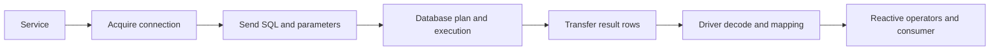

# Giảm số truy vấn, số cột và số bản ghi phải truyền

Hiệu năng truy cập dữ liệu trong Spring Data R2DBC không chỉ phụ thuộc vào tốc độ thực thi một câu SQL. Một request có thể chậm vì ứng dụng gửi quá nhiều câu truy vấn nhỏ, lấy nhiều cột không cần thiết hoặc chuyển một tập bản ghi lớn qua mạng rồi mới lọc ở Java. Mỗi round-trip đều có độ trễ; mỗi cột và mỗi hàng đều tạo thêm dữ liệu cần database đọc, driver truyền, ứng dụng decode và mapping.

Khi tối ưu, hãy tập trung vào ba lượng dữ liệu:

1. **Số truy vấn:** giảm số lần trao đổi giữa ứng dụng và database, đặc biệt là truy vấn lặp trong vòng lặp (N+1).
2. **Số cột:** chỉ lấy những trường mà use case thực sự cần, tránh `SELECT *` và tránh tải payload lớn không dùng đến.
3. **Số bản ghi:** để database lọc, tổng hợp và giới hạn kết quả trước khi truyền; dùng pagination hoặc cursor khi tập dữ liệu lớn.

Mục tiêu là giảm tổng công việc từ database đến consumer mà vẫn giữ đúng semantics nghiệp vụ. Một câu query lớn không tự động nhanh hơn nhiều query nhỏ; cần xem execution plan, index, kích thước kết quả, tính nhất quán và khả năng mapping trước khi quyết định.

## 1. Chi phí của một truy vấn R2DBC

Một lần truy cập database thường có các phần chi phí sau:



- **Acquire connection:** lấy connection từ pool; khi pool cạn, request có thể phải chờ.
- **Round-trip:** gửi câu lệnh và nhận phản hồi qua mạng. Ngay cả query rất nhỏ cũng phải chịu độ trễ này.
- **Database work:** parse/plan, đọc index hoặc table, join, sort, aggregate và kiểm tra constraint.
- **Data transfer:** truyền các cột và hàng trong result set về ứng dụng.
- **Decode/mapping:** driver chuyển kiểu dữ liệu database sang kiểu Java; Spring Data có thể tiếp tục map thành entity/DTO.
- **Downstream processing:** Reactor operators và logic service xử lý dữ liệu được phát ra.

Vì vậy, một request thực hiện 100 query nhỏ tuần tự có thể chậm hơn một query được thiết kế tốt, dù tổng số hàng trả về không đổi. Ngược lại, gom mọi dữ liệu vào một query khổng lồ có thể tạo join phức tạp, nhân bản hàng, đọc quá nhiều cột và làm database tốn tài nguyên hơn.

## 2. Nhận diện N+1 queries

N+1 là tình huống ứng dụng chạy một query để lấy N bản ghi cha, sau đó chạy thêm một query cho từng bản ghi cha để lấy dữ liệu liên quan. Tổng số query là `1 + N`.

Ví dụ lấy 50 đơn hàng rồi lần lượt lấy các dòng hàng:

```java
Flux<OrderView> loadOrders(UUID tenantId) {
    return orderRepository.findByTenantId(tenantId)
        .concatMap(order ->
            orderLineRepository.findByOrderId(order.getId())
                .collectList()
                .map(lines -> OrderView.from(order, lines))
        );
}
```

Nếu có 50 đơn hàng, code trên thường phát một query lấy danh sách đơn hàng và 50 query lấy dòng hàng. `concatMap` giữ thứ tự và chạy tuần tự, nhưng không giảm số query. Đổi sang `flatMap` có thể chạy nhiều query đồng thời, song vẫn là N+1 và có thể làm tăng áp lực lên connection pool/database.

### 2.1 Dấu hiệu nhận biết

- Log SQL cho thấy cùng một câu query chạy lặp lại với các ID khác nhau.
- Thời gian request tăng gần tuyến tính theo số entity cha.
- Số query trên mỗi request cao bất thường dù màn hình chỉ hiển thị một danh sách nhỏ.
- Database có nhiều query ngắn nhưng số lần thực thi lớn.
- Trong code có repository call hoặc `DatabaseClient` call nằm bên trong `map`, `flatMap` hay vòng lặp theo từng hàng.

Không phải mọi query lặp đều là N+1. Có thể đó là các thao tác độc lập thực sự. Hãy xác định query nào có thể lấy theo nhóm hoặc kết hợp mà không làm thay đổi quy tắc nghiệp vụ.

## 3. Thay N+1 bằng một truy vấn JOIN

Nếu use case cần đơn hàng cùng các dòng hàng, có thể dùng `JOIN` để lấy dữ liệu liên quan trong một lần truy vấn:

```sql
SELECT
    o.id AS order_id,
    o.order_number,
    o.created_at,
    l.id AS line_id,
    l.product_code,
    l.quantity
FROM purchase_order o
LEFT JOIN order_line l ON l.order_id = o.id
WHERE o.tenant_id = :tenantId
ORDER BY o.created_at DESC, o.id DESC, l.id;
```

Query trả một hàng cho mỗi dòng hàng; đơn hàng không có dòng hàng vẫn xuất hiện một lần nhờ `LEFT JOIN`, với các cột `line_*` là SQL `NULL`.

Với `DatabaseClient`, có thể map kết quả thành projection phẳng:

```java
Flux<OrderLineView> loadOrderLines(UUID tenantId) {
    return databaseClient.sql("""
            SELECT
                o.id AS order_id,
                o.order_number,
                l.id AS line_id,
                l.product_code,
                l.quantity
            FROM purchase_order o
            LEFT JOIN order_line l ON l.order_id = o.id
            WHERE o.tenant_id = :tenantId
            ORDER BY o.created_at DESC, o.id DESC, l.id
            """)
        .bind("tenantId", tenantId)
        .map((row, metadata) -> new OrderLineView(
            row.get("order_id", Long.class),
            row.get("order_number", String.class),
            row.get("line_id", Long.class),
            row.get("product_code", String.class),
            row.get("quantity", Integer.class)))
        .all();
}
```

`OrderLineView` là DTO minh họa. Vì `LEFT JOIN` có thể không tìm thấy dòng hàng, `line_id` và các thuộc tính phía `order_line` cần cho phép null. Không tạo một dòng hàng giả chỉ vì các cột đó null.

### 3.1 Join có thể nhân số hàng

JOIN giảm số round-trip nhưng có thể nhân bản dữ liệu cha. Nếu một đơn hàng có 10 dòng, các cột của đơn hàng xuất hiện 10 lần trong result set. Với nhiều quan hệ one-to-many, số hàng có thể tăng theo tích số lượng phần tử của từng quan hệ.

Ví dụ một đơn có 5 dòng hàng và 3 ghi chú; join đồng thời hai collection có thể tạo 15 hàng cho cùng đơn hàng. Vì vậy:

- Chỉ join những quan hệ cần trong use case.
- Tránh join nhiều collection lớn vào cùng một result set nếu có thể tạo Cartesian multiplication.
- Map theo khóa cha nếu cần dựng object graph, và xử lý duplicate một cách có chủ đích.
- Cân nhắc query theo nhóm cho từng collection nếu nó giảm payload tổng thể và vẫn giữ số round-trip hợp lý.
- Dùng aggregate hoặc projection khi màn hình chỉ cần số lượng/tổng tiền, không cần từng hàng con.

Một query có ít round-trip nhưng truyền hàng trùng lặp rất lớn vẫn có thể chậm và tốn bộ nhớ.

## 4. Thay N+1 bằng truy vấn theo nhóm

Không phải lúc nào JOIN cũng là lựa chọn tốt nhất. Có thể lấy danh sách cha trước, sau đó lấy tất cả hàng con của các ID đó bằng một query theo nhóm:

```sql
SELECT id, order_id, product_code, quantity
FROM order_line
WHERE order_id IN (:orderIds)
ORDER BY order_id, id;
```

Sau đó nhóm kết quả theo `order_id` trong Java và ghép vào các đơn hàng. Cách này thường cần hai query thay vì `1 + N`, đồng thời tránh lặp lại các cột của đơn hàng cho mỗi dòng hàng.

Khả năng mở rộng collection parameter và cú pháp bind phụ thuộc API Spring/driver. Với `DatabaseClient`, kiểm tra cách phiên bản đang dùng mở rộng named parameter cho collection; nếu driver không hỗ trợ cách đó, có thể tạo số placeholder an toàn theo kích thước danh sách hoặc dùng giải pháp database-specific như table-valued parameter khi được hỗ trợ. Không nối trực tiếp giá trị đầu vào vào SQL.

Nếu danh sách ID quá lớn, chia thành các nhóm có giới hạn. Một câu `IN` với hàng chục nghìn phần tử có thể vượt giới hạn bind parameter, tạo SQL rất dài hoặc làm query planner khó tối ưu. Kích thước nhóm nên dựa trên giới hạn driver/database và đo đạc thực tế.

## 5. Dùng EXISTS khi chỉ cần biết có hàng liên quan

Nếu màn hình chỉ cần danh sách đơn hàng có ít nhất một dòng hàng đang chờ, không cần join toàn bộ dòng hàng. Dùng `EXISTS` để lọc cha:

```sql
SELECT o.id, o.order_number, o.created_at
FROM purchase_order o
WHERE o.tenant_id = :tenantId
  AND EXISTS (
      SELECT 1
      FROM order_line l
      WHERE l.order_id = o.id
        AND l.status = 'PENDING'
  )
ORDER BY o.created_at DESC, o.id DESC;
```

`EXISTS` chỉ kiểm tra có ít nhất một hàng phù hợp. Nó tránh tạo một hàng kết quả cho mỗi dòng hàng như join thông thường, do đó không cần `DISTINCT` chỉ để loại bản sao của đơn hàng.

Nếu cần thông tin tổng hợp như số dòng đang chờ, có thể dùng correlated subquery hoặc query aggregate tùy database và execution plan. Chọn cách có kế hoạch thực thi tốt trên dữ liệu thực tế.

## 6. Chỉ SELECT những cột cần dùng

`SELECT *` thường lấy mọi cột được phép truy vấn, kể cả cột mà use case không dùng. Một entity có thể chứa mô tả dài, JSON lớn, binary hoặc nhiều metadata; truyền chúng cho một màn hình chỉ cần ID và tên sẽ làm tăng payload và mapping work.

Ví dụ không cần thiết:

```sql
SELECT *
FROM customer
WHERE tenant_id = :tenantId;
```

Nếu danh sách chỉ hiển thị ID, email và tên:

```sql
SELECT id, email, display_name
FROM customer
WHERE tenant_id = :tenantId
ORDER BY display_name, id;
```

Với `DatabaseClient`, map thẳng sang DTO nhỏ:

```java
Flux<CustomerListItem> findCustomerList(UUID tenantId) {
    return databaseClient.sql("""
            SELECT id, email, display_name
            FROM customer
            WHERE tenant_id = :tenantId
            ORDER BY display_name, id
            """)
        .bind("tenantId", tenantId)
        .map((row, metadata) -> new CustomerListItem(
            row.get("id", UUID.class),
            row.get("email", String.class),
            row.get("display_name", String.class)))
        .all();
}
```

DTO giúp thể hiện rõ dữ liệu mà use case cần. Nó cũng tránh vô tình đưa các trường nội bộ như password hash, token, dữ liệu cá nhân hoặc payload lớn vào response.

## 7. Projection và DTO trong Spring Data Relational

Projection cho phép một truy vấn chỉ lấy dữ liệu cần thiết thay vì luôn trả về toàn bộ aggregate/entity. Với Spring Data R2DBC, có thể dùng query tùy chỉnh và kiểu trả về projection/DTO theo khả năng repository của phiên bản đang dùng, hoặc map tường minh bằng `DatabaseClient`.

Ví dụ một DTO cho danh sách đơn hàng:

```java
public record OrderSummary(
    Long id,
    String orderNumber,
    String status,
    BigDecimal totalAmount
) {}
```

Truy vấn chỉ chọn bốn cột cần thiết:

```java
@Query("""
    SELECT id, order_number, status, total_amount
    FROM purchase_order
    WHERE tenant_id = :tenantId
    ORDER BY created_at DESC, id DESC
    """)
Flux<OrderSummary> findOrderSummaries(UUID tenantId);
```

Ví dụ minh họa DTO projection qua repository; cách constructor mapping và hỗ trợ projection cụ thể phụ thuộc phiên bản Spring Data Relational. Nếu kiểu DTO hoặc mapping không được hỗ trợ trực tiếp, dùng `DatabaseClient.map(...)` để ánh xạ tường minh.

Không nên tạo entity đầy đủ chỉ để trả một bảng dữ liệu tổng hợp. Ngược lại, nếu service cần cập nhật entity, hãy dùng aggregate/entity phù hợp để giữ đúng mapping và semantics persistence.

## 8. Không tải cột lớn khi chưa cần

Các cột như `nvarchar(max)`, JSON, XML, `varbinary(max)` hoặc nội dung tài liệu có thể chiếm phần lớn payload. Một danh sách thường chỉ cần metadata; nội dung lớn có thể được tải khi người dùng mở chi tiết.

Ví dụ tách metadata và nội dung:

```sql
-- Danh sách: payload nhỏ
SELECT id, title, content_type, created_at
FROM document
WHERE tenant_id = :tenantId
ORDER BY created_at DESC, id DESC;

-- Chi tiết: tải nội dung khi cần
SELECT id, title, content_type, content
FROM document
WHERE id = :documentId
  AND tenant_id = :tenantId;
```

Đây là hai query theo hai use case khác nhau, không phải N+1 nếu danh sách không tự động gọi query chi tiết cho từng tài liệu. Tránh tải tất cả payload rồi bỏ đi ở Java.

Nếu payload cực lớn, cân nhắc streaming hoặc object storage. Khi lưu file ngoài database, metadata và file có ranh giới tài nguyên riêng; cần workflow xử lý lỗi/cleanup phù hợp.

## 9. Lọc dữ liệu ở database thay vì trong Java

Một anti-pattern phổ biến là đọc toàn bộ bảng rồi lọc ở ứng dụng:

```java
return customerRepository.findAll()
    .filter(customer -> customer.getStatus() == Status.ACTIVE)
    .filter(customer -> customer.getTenantId().equals(tenantId));
```

Nếu bảng có một triệu hàng, pipeline có thể phải truyền và decode rất nhiều hàng để giữ lại một tập nhỏ. Hãy đẩy điều kiện xuống SQL:

```java
return customerRepository.findByTenantIdAndStatus(
    tenantId, Status.ACTIVE);
```

Hoặc dùng `DatabaseClient`/`R2dbcEntityTemplate` với điều kiện `WHERE`. Database có thể tận dụng index, chỉ đọc hàng phù hợp và chỉ truyền kết quả cần thiết.

Các phép lọc, sort và aggregate nên được thực hiện ở database khi chúng có semantics rõ và query planner có thể tối ưu. Java vẫn phù hợp cho quy tắc domain phức tạp không thể biểu diễn hợp lý bằng SQL, nhưng tránh chuyển dữ liệu thừa chỉ để lọc một điều kiện đơn giản.

## 10. Giới hạn số bản ghi bằng pagination

Danh sách lớn không nên được tải toàn bộ chỉ vì repository trả `Flux<T>`. `Flux` cho phép tiêu thụ reactive, nhưng không tự giới hạn tổng số hàng mà SQL trả về. Nếu caller dùng `collectList()`, toàn bộ kết quả vẫn có thể được giữ trong bộ nhớ.

Với `R2dbcEntityTemplate`, có thể đặt `limit` và `offset` trong `Query`:

```java
public Flux<CustomerListItem> findPage(
        UUID tenantId, long offset, int pageSize) {

    Query query = Query.query(Criteria.where("tenantId").is(tenantId))
        .sort(Sort.by(
            Sort.Order.asc("displayName"),
            Sort.Order.asc("id")))
        .offset(offset)
        .limit(pageSize);

    return entityTemplate.select(query, Customer.class)
        .map(CustomerListItem::from);
}
```

Tên thuộc tính trong `Criteria`/`Sort` được mapping theo metadata entity. Hãy xác nhận dialect của database tạo SQL phân trang hợp lệ. Với `DatabaseClient`, viết cú pháp pagination phù hợp database và bind offset/page size.

### 10.1 Thứ tự phải xác định

Pagination cần `ORDER BY` ổn định. Nếu sort theo cột có giá trị trùng, thêm khóa duy nhất làm tie-breaker, ví dụ `created_at DESC, id DESC`. Nếu không có thứ tự duy nhất, một hàng có thể xuất hiện ở trang khác nhau giữa các lần request.

### 10.2 Offset và keyset

Offset pagination thuận tiện khi người dùng cần nhảy đến trang số bất kỳ. Với offset rất lớn, database có thể phải đọc qua nhiều hàng trước khi trả trang. Keyset pagination dùng giá trị của hàng cuối trang trước làm cursor, thường hiệu quả hơn cho feed hoặc lịch sử lớn.

Ví dụ keyset theo `(created_at, id)` giảm dần:

```sql
SELECT id, title, created_at
FROM document
WHERE tenant_id = :tenantId
  AND (
       created_at < :lastCreatedAt
       OR (created_at = :lastCreatedAt AND id < :lastId)
  )
ORDER BY created_at DESC, id DESC
FETCH FIRST :pageSize ROWS ONLY;
```

Cú pháp giới hạn hàng ở cuối phụ thuộc dialect; ví dụ trên cần điều chỉnh cho database mục tiêu. Điều kiện cursor phải khớp chính xác thứ tự sort và xử lý cột nullable rõ ràng.

## 11. Chỉ đếm tổng số khi use case cần

Một giao diện có thể cần hiển thị tổng số kết quả, nhưng `COUNT(*)` trên tập lớn có thể tốn tài nguyên, nhất là khi điều kiện lọc phức tạp. Nếu giao diện chỉ cần nút “xem thêm”, có thể lấy `pageSize + 1` hàng để xác định còn dữ liệu hay không, thay vì chạy count chính xác trên toàn tập.

Ví dụ:

```sql
SELECT id, title, created_at
FROM document
WHERE tenant_id = :tenantId
ORDER BY created_at DESC, id DESC
OFFSET :offset ROWS
FETCH NEXT :fetchSize ROWS ONLY;
```

Trong đó `fetchSize = pageSize + 1`. Nếu query trả nhiều hơn `pageSize`, ứng dụng biết còn trang tiếp theo; bỏ phần tử thừa khỏi response và tạo cursor/offset tiếp theo.

Nếu nghiệp vụ cần tổng số chính xác, hãy dùng count query và đo chi phí. Có thể cache count hoặc cập nhật số liệu tổng hợp nếu dữ liệu thay đổi thường xuyên và chấp nhận độ trễ nhất định. Không chạy count chỉ vì framework hoặc UI có một trường `totalElements` mà người dùng không thực sự cần.

## 12. Tổng hợp dữ liệu ở database

Nếu cần tổng số đơn hàng, tổng doanh thu hoặc số khách hàng theo trạng thái, không cần lấy từng entity rồi cộng ở Java:

```sql
SELECT
    status,
    COUNT_BIG(*) AS order_count,
    SUM(total_amount) AS total_amount
FROM purchase_order
WHERE tenant_id = :tenantId
  AND created_at >= :fromDate
  AND created_at < :toDate
GROUP BY status;
```

Database trả một hàng cho mỗi nhóm trạng thái thay vì toàn bộ đơn hàng. `COUNT_BIG` phù hợp với SQL Server khi số lượng có thể vượt `int`; với database khác, chọn kiểu aggregate tương ứng.

Map kết quả vào DTO nhỏ:

```java
Flux<OrderStatusSummary> summarize(UUID tenantId,
                                   LocalDateTime from,
                                   LocalDateTime to) {
    return databaseClient.sql("""
            SELECT status, COUNT(*) AS order_count,
                   SUM(total_amount) AS total_amount
            FROM purchase_order
            WHERE tenant_id = :tenantId
              AND created_at >= :fromDate
              AND created_at < :toDate
            GROUP BY status
            """)
        .bind("tenantId", tenantId)
        .bind("fromDate", from)
        .bind("toDate", to)
        .map((row, metadata) -> new OrderStatusSummary(
            row.get("status", String.class),
            row.get("order_count", Long.class),
            row.get("total_amount", BigDecimal.class)))
        .all();
}
```

Nếu `SUM` không có giá trị đầu vào phù hợp, SQL có thể trả `NULL`; DTO cần cho phép null hoặc query dùng `COALESCE` theo semantics nghiệp vụ. Không mặc định null luôn đồng nghĩa 0 nếu sự khác biệt có ý nghĩa.

## 13. Giảm round-trip khi ghi nhiều bản ghi

Khi ghi nhiều hàng, tránh gọi `save` tuần tự cho từng phần tử nếu có thể dùng một thao tác set-based hoặc batch phù hợp:

```java
return Flux.fromIterable(rows)
    .concatMap(repository::save)
    .then();
```

Đoạn code này dễ hiểu và giữ thứ tự, nhưng thường vẫn tạo một thao tác save cho mỗi entity. `saveAll` cũng không nên được mặc định hiểu là một câu `INSERT` duy nhất hoặc một JDBC-style batch; cách triển khai phụ thuộc Spring Data, driver và loại entity.

Với các hàng cùng cấu trúc, cân nhắc:

- Một câu `INSERT` nhiều bộ giá trị nếu database và giới hạn bind parameter cho phép.
- `Statement.add()` của R2DBC SPI để thêm nhiều bộ tham số cho cùng statement khi driver hỗ trợ batch semantics.
- Một thao tác `UPDATE` set-based cho nhiều hàng thỏa điều kiện thay vì update từng ID.
- Bảng staging/bulk import khi tập dữ liệu rất lớn.

Ví dụ set-based update:

```sql
UPDATE customer
SET status = :newStatus,
    last_modified_at = :modifiedAt
WHERE tenant_id = :tenantId
  AND status = :oldStatus;
```

Một câu lệnh có thể cập nhật nhiều hàng phù hợp, thay vì query từng customer rồi save lại. Cần kiểm tra `rowsUpdated()` và bảo đảm thao tác set-based phù hợp quy tắc nghiệp vụ cho mọi hàng được chọn.

### 13.1 Chia batch có giới hạn

Batch quá lớn có thể làm tăng bộ nhớ, thời gian transaction, số bind marker và chi phí rollback. Có thể chia nguồn thành các nhóm:

```java
return source
    .buffer(500)
    .concatMap(batch -> persistBatch(batch))
    .then();
```

`buffer(500)` chỉ gom 500 phần tử ở reactive pipeline; nó không tự tạo SQL batch và không tự xác định transaction. `persistBatch` phải thực hiện batch/set-based SQL nếu muốn giảm số câu lệnh thực sự.

Khi batch cần atomicity, đặt các thao tác của batch trong transaction phù hợp. Nếu mỗi batch commit riêng, thiết kế checkpoint, retry và idempotency để xử lý trạng thái hoàn thành một phần.

## 14. Tránh truy vấn từng bản ghi trong callback

`AfterConvertCallback`, mapper hoặc service helper có thể vô tình tạo N+1 nếu mỗi entity được convert lại truy vấn repository để lấy dữ liệu phụ. Ví dụ callback nhận từng customer rồi query thêm profile riêng sẽ tạo một query cho mỗi customer.

Callback nên tập trung vào xử lý object cục bộ như chuẩn hóa chuỗi hoặc tính thuộc tính dẫn xuất từ dữ liệu đã có. Nếu cần dữ liệu từ bảng khác:

- Dùng JOIN/projection nếu cần một result set kết hợp.
- Dùng query theo nhóm cho tập ID nếu JOIN làm nhân bản quá nhiều hàng.
- Dùng aggregate query nếu chỉ cần số lượng hoặc tổng hợp.
- Đưa logic truy vấn phụ vào service có thể nhìn thấy rõ số query và ranh giới dữ liệu.

Reactive callback không làm N+1 biến mất. Một nghìn query bất đồng bộ vẫn là một nghìn query; chạy song song có thể làm tải đỉnh cao hơn.

## 15. Index hỗ trợ lọc và phân trang

Giảm số hàng truyền cần bắt đầu từ việc database tìm được đúng hàng. Index phù hợp với điều kiện lọc, join và sort có thể giảm số page/row phải đọc:

```sql
CREATE INDEX ix_customer_tenant_status
ON customer (tenant_id, status, id);
```

Ví dụ index hỗ trợ query lọc theo `tenant_id` và `status`, đồng thời có `id` làm cột sắp xếp phụ. Thứ tự cột index cần dựa trên selectivity, mẫu query và kế hoạch thực thi; không sao chép index ví dụ cho mọi bảng.

Với query join, kiểm tra index trên khóa ngoại hoặc cột join như `order_line.order_id`. Với keyset pagination, index có thể cần chứa các cột lọc và sort theo cùng thứ tự. Với projection, covering index có thể giúp query đọc dữ liệu từ index mà ít phải lookup bảng hơn, nhưng tăng dung lượng và chi phí ghi.

Index không phải lúc nào cũng tốt. Quá nhiều index làm insert/update/delete chậm hơn và tốn storage. Hãy xem execution plan, logical reads và thống kê query trước khi thêm hoặc thay index.

## 16. Chọn JOIN, batch query hay nhiều query riêng?

Không có một chiến lược duy nhất phù hợp mọi trường hợp:

| Chiến lược | Ưu điểm | Rủi ro/giới hạn | Phù hợp |
|---|---|---|---|
| N+1 query | Code đơn giản ở lần đầu | Nhiều round-trip, độ trễ tăng theo số hàng cha | Tránh cho danh sách nhiều entity. |
| JOIN và projection | Ít round-trip, lọc ở database | Nhân bản cột cha; nhiều collection có thể tạo nhiều hàng trùng | Dữ liệu quan hệ nhỏ/vừa và cần hiển thị cùng nhau. |
| Query theo nhóm ID | Ít query mà giảm lặp cột cha | Cần nhóm dữ liệu trong Java và quản lý kích thước danh sách ID | One-to-many có nhiều hàng con hoặc join làm payload lớn. |
| Aggregate SQL | Trả ít hàng, ít cột | Logic aggregate gắn với SQL/dialect và cần hiểu null semantics | Báo cáo, count, sum, min/max. |
| Cache | Tránh query lặp cho dữ liệu ổn định | Invalidation, stale data và bộ nhớ | Lookup tham chiếu ít thay đổi, có chính sách cache rõ. |

Đánh giá cả số query lẫn số byte và số hàng trả về. Hai query lấy hai tập nhỏ có thể tốt hơn một query join tạo hàng triệu tổ hợp. Một query aggregate có thể tốt hơn tải hàng nghìn entity để cộng ở Java.

## 17. Cẩn thận với DISTINCT và join pagination

Khi join one-to-many, kết quả có thể lặp lại ID cha. Thêm `DISTINCT` đôi khi loại được hàng trùng nhưng database có thể phải sort/hash một tập lớn; nó cũng không sửa nguyên nhân payload bị nhân bản nếu vẫn chọn cột con khác nhau.

Nếu cần phân trang cha trước rồi mới lấy con, có thể dùng CTE/subquery chọn ID cha trước:

```sql
WITH page_orders AS (
    SELECT id, created_at
    FROM purchase_order
    WHERE tenant_id = :tenantId
    ORDER BY created_at DESC, id DESC
    OFFSET :offset ROWS FETCH NEXT :pageSize ROWS ONLY
)
SELECT
    o.id AS order_id,
    o.order_number,
    l.id AS line_id,
    l.product_code,
    l.quantity
FROM page_orders p
JOIN purchase_order o ON o.id = p.id
LEFT JOIN order_line l ON l.order_id = o.id
ORDER BY p.created_at DESC, p.id DESC, l.id;
```

Nếu phân trang trực tiếp trên kết quả join, giới hạn có thể áp dụng lên hàng kết hợp thay vì số đơn hàng, làm một đơn hàng bị chia giữa hai trang. Chọn page cha trước giúp giới hạn đúng số aggregate, sau đó lấy các hàng con của trang đó.

Cú pháp `OFFSET/FETCH` ở ví dụ phù hợp SQL Server và một số dialect tương tự; database khác cần cú pháp tương ứng. Query planner và index vẫn phải được kiểm tra.

## 18. Backpressure không thay thế giới hạn SQL

`Flux` và Reactive Streams giúp consumer yêu cầu dữ liệu theo nhu cầu, nhưng backpressure không tự bảo đảm database chỉ đọc đúng số hàng cần thiết. Driver có thể fetch theo batch/cursor, buffer một phần dữ liệu hoặc có hành vi phụ thuộc cấu hình.

Nếu service phát `Flux<Customer>` từ query không có `WHERE` hoặc limit, tổng số hàng vẫn có thể rất lớn. Consumer yêu cầu từng phần tử không thay thế pagination, filter hoặc giới hạn nghiệp vụ.

Không dùng `collectList()` trên một truy vấn không giới hạn chỉ vì code reactive. `collectList()` giữ toàn bộ phần tử trong bộ nhớ. Nếu phải xử lý toàn bộ dữ liệu lớn, dùng streaming có giới hạn tài nguyên, xử lý theo batch và checkpoint phù hợp.

## 19. Cache cho lookup lặp lại

Với dữ liệu tham chiếu ít thay đổi như loại sản phẩm, cấu hình vùng hoặc danh mục, cache có thể giảm query lặp giữa nhiều request. Tuy nhiên, cache không nên được dùng để che một query kém hoặc thay thế index.

Khi cache:

- Xác định key có chứa tenant/permission context nếu dữ liệu phân tách theo tenant hoặc quyền.
- Đặt TTL hoặc cơ chế invalidation phù hợp với tần suất thay đổi.
- Không cache lỗi database thành kết quả rỗng.
- Tránh cache object entity mutable dùng chung giữa request.
- Đo hit rate, miss rate và chi phí serialization/network của cache.
- Nếu cập nhật database và phát invalidation event, cân nhắc outbox để không mất sự kiện sau commit.

Cache có thể giảm số truy vấn database, nhưng thêm một hệ thống cần vận hành và có thể trả dữ liệu cũ. Chỉ dùng khi có lợi ích đo được và chính sách nhất quán rõ ràng.

## 20. Đo số truy vấn, số hàng và kích thước payload

Không thể tối ưu có căn cứ nếu không biết request thực tế đang phát bao nhiêu query và truyền bao nhiêu dữ liệu. Có thể theo dõi:

| Chỉ số | Câu hỏi cần trả lời |
|---|---|
| Query count/request | Một request gọi database bao nhiêu lần? |
| Query duration | Query nào chiếm phần lớn thời gian? |
| Rows returned/affected | Query trả hoặc thay đổi bao nhiêu hàng? |
| Columns/row width | Có cột lớn hoặc cột không cần thiết không? |
| Bytes received | Bao nhiêu dữ liệu đi từ database về ứng dụng? |
| Connection acquire latency | Request có chờ pool không? |
| Mapping/CPU time | Thời gian decode và chuyển đổi entity/DTO là bao nhiêu? |
| Pool active/pending | Tăng concurrency có làm pool cạn không? |
| Database logical reads | Query phải đọc bao nhiêu page/row để tạo kết quả? |

Các công cụ có thể gồm SQL logging có kiểm soát, datasource/driver metrics, connection pool metrics, tracing, database query store hoặc execution plan. Không bật log toàn bộ bind values trong production nếu có nguy cơ ghi thông tin nhạy cảm.

Nên đo ở cùng điều kiện dữ liệu và tải trước/sau khi thay đổi. So sánh p50/p95 latency, query count, payload và database CPU/reads; một query nhanh hơn trong dataset nhỏ chưa chắc tốt hơn ở quy mô production.

## 21. Viết test để phát hiện N+1 và truy vấn thừa

Một integration test có thể chuẩn bị N entity cha rồi gọi use case, sau đó kiểm tra số query bằng cơ chế instrumentation phù hợp với driver hoặc lớp truy cập dữ liệu của ứng dụng. Không nên chỉ kiểm tra kết quả cuối vì cả N+1 và query theo nhóm đều có thể trả cùng dữ liệu.

Ví dụ mục tiêu kiểm thử:

- Với một trang có 20 đơn hàng, số query không tăng từ 2 lên 21 khi thêm hàng cha.
- Danh sách DTO không chứa payload lớn hoặc field không cần thiết.
- Query trả tối đa page size đã cấu hình.
- Count query chỉ chạy khi endpoint cần tổng số chính xác.
- Query con theo nhóm chỉ lấy các ID thuộc trang hiện tại.
- Các query có thứ tự ổn định khi kết quả được phân trang.

Có thể dùng wrapper quanh `ConnectionFactory`/`Connection` hoặc proxy ở tầng client để đếm lệnh trong test. Cách instrumentation phải phù hợp driver và không làm thay đổi semantics reactive. Nếu không có query counter, có thể kiểm tra SQL log/test spy ở adapter nhưng nên giữ test tập trung vào hợp đồng hiệu năng quan trọng thay vì phụ thuộc chi tiết nội bộ quá mong manh.

## 22. Ví dụ tổng hợp: từ N+1 sang projection theo trang

Giả sử màn hình quản trị hiển thị danh sách đơn hàng với số dòng hàng và tổng số lượng. Cách dễ viết nhưng tốn query:

```java
Flux<OrderDashboardRow> loadDashboard(UUID tenantId) {
    return orderRepository.findByTenantId(tenantId)
        .concatMap(order -> orderLineRepository.findByOrderId(order.getId())
            .collectList()
            .map(lines -> new OrderDashboardRow(
                order.getId(),
                order.getOrderNumber(),
                lines.size(),
                lines.stream().mapToInt(OrderLine::getQuantity).sum()
            )));
}
```

Với N đơn hàng, đây là một query cha và N query con; đồng thời tải từng entity dòng hàng chỉ để tính count/sum.

Có thể chuyển phép tổng hợp xuống database và chỉ lấy một hàng cho mỗi đơn:

```sql
SELECT
    o.id,
    o.order_number,
    COUNT(l.id) AS line_count,
    COALESCE(SUM(l.quantity), 0) AS total_quantity
FROM purchase_order o
LEFT JOIN order_line l ON l.order_id = o.id
WHERE o.tenant_id = :tenantId
GROUP BY o.id, o.order_number, o.created_at
ORDER BY o.created_at DESC, o.id DESC
OFFSET :offset ROWS FETCH NEXT :pageSize ROWS ONLY;
```

Map trực tiếp sang DTO:

```java
Flux<OrderDashboardRow> loadDashboard(
        UUID tenantId, long offset, int pageSize) {

    return databaseClient.sql("""
            SELECT
                o.id,
                o.order_number,
                COUNT(l.id) AS line_count,
                COALESCE(SUM(l.quantity), 0) AS total_quantity
            FROM purchase_order o
            LEFT JOIN order_line l ON l.order_id = o.id
            WHERE o.tenant_id = :tenantId
            GROUP BY o.id, o.order_number, o.created_at
            ORDER BY o.created_at DESC, o.id DESC
            OFFSET :offset ROWS FETCH NEXT :pageSize ROWS ONLY
            """)
        .bind("tenantId", tenantId)
        .bind("offset", offset)
        .bind("pageSize", pageSize)
        .map((row, metadata) -> new OrderDashboardRow(
            row.get("id", Long.class),
            row.get("order_number", String.class),
            row.get("line_count", Long.class),
            row.get("total_quantity", Integer.class)))
        .all();
}
```

Ví dụ SQL dùng cú pháp phân trang của SQL Server; thay đổi phần giới hạn hàng theo dialect nếu ứng dụng dùng database khác. `COUNT(l.id)` trả số dòng con và `COALESCE` biến tổng null thành 0 theo yêu cầu hiển thị. Nếu `quantity` có thể vượt miền `Integer`, chọn kiểu Java/SQL rộng hơn.

Phiên bản mới chỉ truyền các cột cần hiển thị, không tải toàn bộ `OrderLine`, và database thực hiện count/sum. Cần kiểm tra index trên `purchase_order.tenant_id`, `order_line.order_id`, execution plan và chi phí group-by trước khi kết luận query mới tốt hơn.

## 23. Các anti-pattern làm tăng dữ liệu truyền

| Anti-pattern | Tác động | Hướng thay thế |
|---|---|---|
| Repository call trong vòng lặp entity | N+1 round-trip | JOIN, `EXISTS` hoặc query theo nhóm ID. |
| Đổi `concatMap` thành `flatMap` để “sửa” N+1 | Vẫn N+1, tăng tải đồng thời | Giảm số query trước khi cân nhắc concurrency. |
| `SELECT *` cho danh sách | Truyền cột lớn/không dùng | Projection hoặc DTO với danh sách cột cụ thể. |
| Lấy tất cả rồi `.filter()` ở Java | Truyền nhiều hàng không cần | Đẩy predicate vào `WHERE`. |
| `.collectList()` trên tập không giới hạn | Giữ toàn bộ dữ liệu trong heap | Pagination hoặc xử lý streaming/batch. |
| JOIN nhiều collection lớn | Nhân bản hàng và cột cha | Query theo nhóm hoặc aggregate riêng. |
| `DISTINCT` để che join sai | Sort/hash tốn kém, không giải quyết payload gốc | Sửa query shape và chọn đúng projection. |
| Count toàn bộ cho mọi trang | Thêm query có thể đắt | Lấy `pageSize + 1` nếu chỉ cần biết còn trang. |
| Lấy payload lớn trong danh sách | Tăng network và mapping | Tách endpoint/query chi tiết. |
| `save` từng entity khi có thể set-based | Nhiều round-trip | Bulk SQL, `Statement.add()` hoặc staging phù hợp. |

## 24. Quy trình tối ưu một use case

Khi một endpoint hoặc job R2DBC chậm, hãy thực hiện theo trình tự:

1. Đo query count/request và xác định các câu SQL lặp lại.
2. Tìm repository/client call nằm trong vòng lặp hoặc callback.
3. Xác định dữ liệu thực sự cần cho response: loại entity, cột và số hàng.
4. Thay N+1 bằng JOIN, `EXISTS`, aggregate hoặc query theo nhóm ID phù hợp.
5. Chuyển filter, sort, limit và aggregate xuống database khi semantics cho phép.
6. Dùng projection/DTO và bỏ các cột lớn không cần thiết khỏi query danh sách.
7. Giới hạn tập kết quả bằng pagination hoặc cursor có thứ tự ổn định.
8. Kiểm tra index, execution plan, logical reads và chi phí join/group-by.
9. Đo lại payload, query count, latency và pool metrics dưới dữ liệu/tải tương đương.
10. Viết integration test bảo vệ các hợp đồng quan trọng như giới hạn hàng, thứ tự và số query.

Giảm số truy vấn, số cột và số bản ghi phải truyền là ba hướng tối ưu bổ sung cho nhau. Giảm N+1 làm ít round-trip hơn; projection giảm payload và mapping; filter, aggregate và pagination giảm số hàng database phải trả. Hãy chọn query shape theo dữ liệu và use case thực tế, kiểm tra execution plan và đo trước/sau. Reactive giúp xử lý luồng dữ liệu hiệu quả, nhưng không tự sửa query thừa hoặc giới hạn kết quả; SQL, projection và ranh giới batch vẫn phải được thiết kế có chủ đích.
