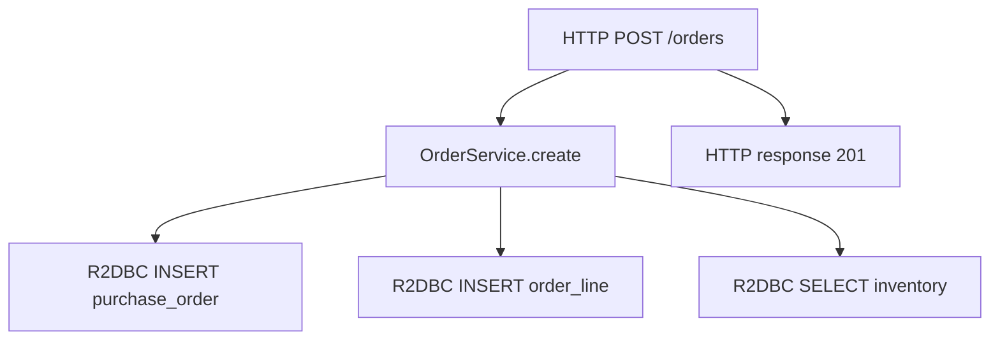
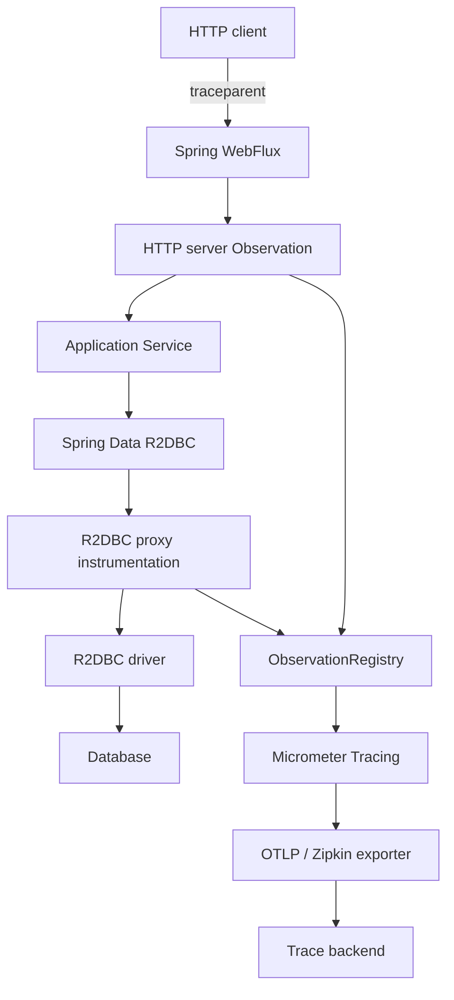

# Liên kết dấu vết HTTP với thao tác truy cập dữ liệu

## 1. Vì sao cần liên kết HTTP trace với R2DBC?

Một request HTTP thường đi qua nhiều lớp trước khi trả response:

1. Web server nhận request.
2. Controller gọi application service.
3. Service thực hiện quy tắc nghiệp vụ.
4. Repository hoặc DatabaseClient truy cập database bằng R2DBC.
5. Ứng dụng ánh xạ kết quả và trả response.

Khi request chậm hoặc lỗi, log ở controller thường chưa đủ để tìm nguyên nhân. Request có thể chờ connection pool, query database chậm, gọi dịch vụ HTTP khác hoặc xử lý dữ liệu trong service.

Distributed tracing biểu diễn các thao tác này thành một cây trace. Mỗi thao tác có một span với thời gian bắt đầu/kết thúc, trạng thái, thuộc tính và quan hệ cha-con. Nếu instrumentation của HTTP server và R2DBC cùng dùng một tracing context, truy vấn database sẽ xuất hiện dưới trace của request đã khởi tạo nó.

Ví dụ một request tạo đơn hàng:



Trong trace viewer, các span có thể được hiển thị theo thời gian:

```text
HTTP POST /orders                 180 ms
  OrderService.create             165 ms
    r2dbc.query INSERT order        24 ms
    r2dbc.query INSERT order_line   41 ms
    r2dbc.query SELECT inventory    72 ms
```

Các con số chỉ minh họa. Mục tiêu là nhìn được request nào tạo ra query nào, query mất bao lâu và lỗi xuất hiện ở span nào.

## 2. Ba trụ cột observability

Spring Boot dùng Micrometer Observation để kết nối instrumentation với metrics và traces. Ba trụ cột thường được sử dụng cùng nhau:

| Thành phần | Trả lời câu hỏi | Ví dụ |
| --- | --- | --- |
| Logs | Điều gì đã xảy ra và có thông tin chi tiết nào? | Exception, SQL state, operation name |
| Metrics | Hệ thống đang hoạt động thế nào theo thời gian? | Request rate, latency histogram, pool usage |
| Traces | Một request đã đi qua những thao tác nào? | HTTP span có các R2DBC query span con |

Metrics phù hợp để phát hiện xu hướng và cảnh báo; trace phù hợp để lần theo một request cụ thể; log chứa chi tiết lỗi và ngữ cảnh cần thiết.

### 2.1. Observation là lớp instrumentation

Micrometer Observation là abstraction bao quanh một thao tác. Khi Observation được tạo, ObservationHandler đã đăng ký trong ObservationRegistry có thể tạo timer, span hoặc log tùy cấu hình.

Điều này cho phép cùng một instrumentation tạo ra nhiều dạng telemetry:

- Nếu chỉ có metrics handler, thao tác có thể tạo metric.
- Nếu có tracing handler, thao tác có thể tạo span.
- Nếu có cả hai, thao tác có thể tạo metric và span.

Spring Boot tự cấu hình nhiều Observation cho web request và các tích hợp được hỗ trợ. Ứng dụng có thể bổ sung Observation cho các bước nghiệp vụ riêng.

## 3. Trace, span và quan hệ cha-con

**Trace** đại diện cho toàn bộ hành trình của một request hoặc một công việc phân tán. Trace có một trace ID duy nhất để liên kết các span.

**Span** đại diện cho một thao tác có thời gian bắt đầu và kết thúc, chẳng hạn:

- Nhận HTTP request.
- Gọi application service.
- Thực thi một query R2DBC.
- Gọi HTTP tới dịch vụ khác.
- Xử lý message từ broker.

Một span có thể chứa trace ID, span ID, parent span ID, tên thao tác, thời gian, trạng thái, attributes và events.

Quan hệ cha-con giúp trace viewer hiển thị thứ tự và thời gian lồng nhau. Một query span thuộc trace của HTTP request khi query được thực thi trong cùng execution context được propagate từ request.

### 3.1. Ví dụ cây span

```text
Trace: 4bf92f3577b34da6a3ce929d0e0e4736
|
+-- HTTP POST /orders
    |
    +-- order.create
    |   |
    |   +-- r2dbc.query INSERT purchase_order
    |   |
    |   +-- r2dbc.query INSERT order_line
    |   |
    |   +-- r2dbc.query SELECT inventory
    |
    +-- HTTP POST inventory-service/reserve
```

Các span con có cùng trace ID nhưng span ID khác nhau. Parent ID xác định span cha trực tiếp. Nếu request gọi sang dịch vụ khác, tracing instrumentation có thể truyền trace context qua HTTP header để dịch vụ nhận tạo span thuộc cùng trace.

### 3.2. Không tự tạo trace ID cho mỗi query

Không tạo trace ID mới trong repository hoặc trước từng câu SQL. Làm vậy sẽ tách query khỏi request gốc và mất quan hệ cha-con.

HTTP server instrumentation tạo hoặc tiếp nhận trace context. R2DBC instrumentation tạo span con dựa trên context hiện tại. Ứng dụng chỉ cần giữ nguyên reactive pipeline và context propagation hoạt động đúng.

## 4. Kiến trúc tổng thể trong Spring Boot

Một ứng dụng Spring Boot WebFlux và Spring Data R2DBC thường có các thành phần:



Các phần chính:

- Spring WebFlux tạo Observation cho HTTP server request.
- Micrometer Tracing chuyển Observation thành span khi tracing bridge được cấu hình.
- R2DBC proxy instrumentation quan sát query và tạo Observation cho thao tác database.
- Reactor Context giữ Observation hiện tại xuyên suốt reactive chain.
- Exporter gửi span tới trace backend như OpenTelemetry Collector, Jaeger, Tempo hoặc Zipkin tùy hệ thống.

Nếu thiếu một thành phần, trace có thể chỉ hiển thị HTTP request mà không có query span, hoặc có span nhưng không được export tới backend.

## 5. Dependencies cần thiết

Trong Spring Boot, bắt đầu với Actuator và một tracing bridge. Ví dụ dùng OpenTelemetry:

Gradle:

```groovy
dependencies {
    implementation("org.springframework.boot:spring-boot-starter-actuator")

    runtimeOnly("io.micrometer:micrometer-tracing-bridge-otel")
    runtimeOnly("io.opentelemetry:opentelemetry-exporter-otlp")

    runtimeOnly("io.r2dbc:r2dbc-proxy")
}
```

Spring Boot dependency management nên quản lý phiên bản tương thích. Không tự chọn phiên bản Micrometer, OpenTelemetry và R2DBC proxy rời rạc nếu project đã dùng Spring Boot BOM.

Các vai trò:

- spring-boot-starter-actuator: cung cấp hạ tầng observability và Actuator.
- micrometer-tracing-bridge-otel: kết nối Micrometer Tracing với OpenTelemetry.
- opentelemetry-exporter-otlp: export trace qua OTLP khi dùng collector tương ứng.
- r2dbc-proxy: cho phép Spring Boot kích hoạt observability cho R2DBC query theo cơ chế được hỗ trợ.

Nếu hệ thống dùng Brave/Zipkin, có thể chọn tracing bridge và exporter tương ứng thay cho OpenTelemetry. Không cần cài đồng thời nhiều bridge cho cùng một ứng dụng nếu không có thiết kế rõ ràng.

### 5.1. R2DBC observability trong Spring Boot

Spring Boot hỗ trợ observability cho R2DBC. Với các phiên bản Spring Boot có auto-configuration R2DBC observation, thêm dependency io.r2dbc:r2dbc-proxy để bật instrumentation query.

Điều này giúp theo dõi query thực thi qua R2DBC mà không cần tự viết một span cho từng repository method. Khả năng và cách cấu hình chi tiết phụ thuộc Spring Boot version, R2DBC proxy version và driver.

Không nhầm tính năng này với JDBC datasource instrumentation. JDBC dùng một integration khác; R2DBC cần instrumentation tương thích R2DBC.

### 5.2. Kiểm tra dependency runtime

Nếu ứng dụng đã thêm r2dbc-proxy nhưng không thấy query span:

- Kiểm tra dependency có nằm trên runtime classpath không.
- Kiểm tra Spring Boot version có auto-configuration R2DBC observation không.
- Kiểm tra ConnectionFactory mà repository sử dụng có đi qua proxy instrumentation không.
- Kiểm tra tracing bridge và exporter có hoạt động không.
- Kiểm tra sampling không loại bỏ trace.

## 6. Cấu hình service name và sampling

Một cấu hình cơ bản:

```yaml
spring:
  application:
    name: order-service
  reactor:
    context-propagation: auto

management:
  tracing:
    sampling:
      probability: 1.0
```

Ý nghĩa:

- spring.application.name cung cấp tên service để phân biệt nguồn span trong trace backend.
- spring.reactor.context-propagation: auto bật cơ chế tự động propagate context qua Reactor theo hỗ trợ của Spring Boot và Context Propagation.
- management.tracing.sampling.probability điều khiển tỷ lệ trace được sample theo cấu hình tracing.

Sampling 1.0 phù hợp local development hoặc test vì muốn quan sát mọi request. Không nên mặc định dùng 100% ở production có lưu lượng lớn.

Ví dụ cấu hình production:

```yaml
management:
  tracing:
    sampling:
      probability: 0.1
```

Giá trị 0.1 chỉ là ví dụ. Chọn sampling dựa trên lưu lượng, chi phí lưu trữ, nhu cầu điều tra và chính sách của hệ thống tracing.

### 6.1. Sampling không giống log level

Sampling quyết định trace/span nào được ghi nhận và export. Nó không phải cơ chế bật/tắt SQL log.

- SQL DEBUG điều khiển log statement ở logger.
- Trace sampling điều khiển tỷ lệ trace được ghi nhận.
- Metrics thường được thu thập độc lập với trace sampling.

Vì vậy, bật SQL DEBUG không đồng nghĩa mọi query xuất hiện trong trace backend; đặt sampling 100% cũng không tự bật parameter logging.

## 7. HTTP server instrumentation

Spring Boot tự động instrument các request HTTP khi ứng dụng dùng stack web được hỗ trợ và observability được cấu hình.

Với WebFlux, một HTTP request có thể tạo server Observation/span. Span bao quanh thời gian xử lý request, bao gồm thời gian chờ các publisher reactive được hoàn tất trước khi response kết thúc.

Ví dụ controller:

```java
@RestController
@RequestMapping("/orders")
public class OrderController {

    private final OrderService orderService;

    public OrderController(OrderService orderService) {
        this.orderService = orderService;
    }

    @PostMapping
    public Mono<ResponseEntity<OrderResponse>> create(
            @RequestBody CreateOrderRequest request) {

        return orderService.create(request)
                .map(order -> ResponseEntity
                        .status(HttpStatus.CREATED)
                        .body(OrderResponse.from(order)));
    }
}
```

Không cần tự tạo trace ID trong controller. HTTP instrumentation và tracing bridge quản lý span gốc của request.

### 7.1. Server span bao trùm reactive response

Controller trả về Mono hoặc Flux; server instrumentation theo dõi request trong thời gian publisher được xử lý. Vì vậy:

- Không gọi block() để chờ repository trong controller.
- Không gọi subscribe() để tách truy vấn khỏi response.
- Trả publisher cho WebFlux quản lý.
- Nối các thao tác bằng Reactor operators.

Nếu tự tạo subscription độc lập, query có thể chạy ngoài trace context của HTTP request và lỗi cũng không còn được phản ánh đúng trong response lifecycle.

### 7.2. HTTP request đến từ service khác

Khi request có trace context hợp lệ trong header chuẩn như W3C traceparent, tracing instrumentation có thể tiếp nhận context đó và tạo server span con trong trace đã có.

Nếu request không có trace context, server instrumentation tạo trace mới. Không nên tự đọc header rồi đặt một trace ID tùy ý vào Reactor Context; hãy để tracing propagator xác thực và xử lý định dạng header.

## 8. R2DBC query instrumentation

Spring Data R2DBC thường sử dụng R2dbcEntityTemplate và DatabaseClient để thực hiện SQL. Khi R2DBC observability được bật, query execution có thể tạo Observation/span riêng.

Ví dụ repository:

```java
public interface OrderRepository
        extends ReactiveCrudRepository<Order, Long> {

    Flux<Order> findByCustomerIdOrderByCreatedAtDesc(UUID customerId);
}
```

Service:

```java
@Service
public class OrderService {

    private final OrderRepository orderRepository;

    public OrderService(OrderRepository orderRepository) {
        this.orderRepository = orderRepository;
    }

    public Flux<Order> findForCustomer(UUID customerId) {
        return orderRepository.findByCustomerIdOrderByCreatedAtDesc(customerId);
    }
}
```

Khi repository thực thi SQL qua R2DBC path đã được instrument, query span có thể trở thành span con của HTTP server span hiện tại.

### 8.1. Một request có thể tạo nhiều query span

Một service method có thể thực hiện:

- Query kiểm tra dữ liệu.
- INSERT bản ghi chính.
- INSERT collection thuộc aggregate.
- UPDATE trạng thái.
- SELECT dữ liệu trả về.

Mỗi lần thực thi statement có thể tạo span riêng. Không nên giả định một repository method luôn tương ứng với đúng một query hoặc một span.

### 8.2. Database span không nhất thiết là một span cho toàn transaction

Transaction có thể chứa nhiều statement. Instrumentation query thường quan sát từng lần thực thi statement; transaction manager quản lý connection và transaction lifecycle.

Do đó, trace có thể hiển thị nhiều query span dưới cùng HTTP request. Nếu cần quan sát transaction boundary, có thể bổ sung một business Observation riêng ở tầng service, nhưng không nên tạo span trùng cho từng repository method đã được instrument tự động.

## 9. Giữ trace context qua Reactor pipeline

Reactive pipeline không gắn với một thread cố định. Một request có thể chuyển qua nhiều scheduler hoặc thread khi xử lý.

Reactor Context là nơi truyền metadata theo subscription. Micrometer Context Propagation giúp kết nối context này với các thành phần dựa trên ThreadLocal khi cần.

Trong Spring Boot, có thể bật:

```yaml
spring:
  reactor:
    context-propagation: auto
```

Chế độ auto cho phép cơ chế context propagation tích hợp hoạt động qua Reactor operators theo phiên bản Spring Boot/Reactor tương ứng.

### 9.1. Không dùng ThreadLocal tự quản lý trace

Không làm như sau để liên kết query với request:

```java
TraceHolder.setCurrentTraceId(traceId);
return orderRepository.findAll();
```

Nếu TraceHolder dùng ThreadLocal, giá trị có thể không còn ở thread thực thi query hoặc có nguy cơ rò giữa các request khi thread được tái sử dụng.

Hãy để tracing instrumentation quản lý Observation/Span và Reactor Context. Nếu cần truy cập metadata trong code, dùng API Micrometer Tracing hoặc Reactor Context theo cách được framework hỗ trợ.

### 9.2. Không tự subscribe

Đoạn sau tạo một subscription độc lập:

```java
public Mono<Void> processOrder(Order order) {
    auditRepository.save(toAudit(order)).subscribe();
    return orderRepository.save(order).then();
}
```

Subscription của audit không nhất thiết chia sẻ lifecycle/context với publisher được trả về. Trace của HTTP request có thể kết thúc trước khi audit query hoàn tất.

Nên nối hai thao tác:

```java
public Mono<Void> processOrder(Order order) {
    return orderRepository.save(order)
            .flatMap(saved -> auditRepository.save(toAudit(saved)))
            .then();
}
```

Publisher kết quả duy nhất giữ luồng thực thi và context xuyên suốt.

### 9.3. Không block trong reactive flow

block() tạo ranh giới đồng bộ và có thể làm mất các lợi ích cũng như context của reactive pipeline. Trong WebFlux, hãy trả Mono/Flux và nối thao tác thay vì chặn thread để lấy kết quả.

Nếu phải gọi thư viện blocking, chuyển nó sang scheduler phù hợp và bảo đảm context propagation được cấu hình. Không dùng blocking JDBC hoặc một thread tự tạo như cách thay thế instrumentation R2DBC.

## 10. Liên kết với HTTP client span

Một request có thể gọi sang service khác trước hoặc sau khi truy cập database. Nếu dùng WebClient do Spring Boot cấu hình, HTTP client instrumentation có thể tạo client span và propagate trace context qua header.

Ví dụ:

```java
@Service
public class InventoryClient {

    private final WebClient webClient;

    public InventoryClient(WebClient.Builder builder) {
        this.webClient = builder
                .baseUrl("http://inventory-service")
                .build();
    }

    public Mono<InventoryResponse> reserve(ReserveRequest request) {
        return webClient.post()
                .uri("/reservations")
                .bodyValue(request)
                .retrieve()
                .bodyToMono(InventoryResponse.class);
    }
}
```

Ưu tiên inject WebClient.Builder do Spring Boot quản lý. Tạo WebClient bằng cách tự khởi tạo không qua builder đã được cấu hình có thể bỏ qua một số customization hoặc instrumentation của ứng dụng.

Khi dịch vụ đích cũng bật tracing và nhận trace header, server span ở dịch vụ đó có thể tiếp tục cùng trace. Trace viewer sẽ thể hiện cả database query lẫn HTTP call trong một hành trình.

## 11. Thêm Observation cho bước nghiệp vụ

HTTP span và R2DBC query span cho biết request và database hoạt động thế nào. Đôi khi cần một span ở giữa để đo một bước nghiệp vụ có nhiều thao tác:

- Tạo đơn hàng.
- Tính giá.
- Giữ chỗ tồn kho.
- Xác nhận thanh toán.

Micrometer Observation cho phép tạo instrumentation tùy chỉnh.

### 11.1. Observation cho thao tác đồng bộ

Với code đồng bộ, có thể dùng:

```java
Observation.createNotStarted("order.calculate", observationRegistry)
        .lowCardinalityKeyValue("operation", "calculate")
        .observe(() -> pricingService.calculate(order));
```

observe(...) quản lý vòng đời Observation quanh đoạn code đồng bộ. Khi có tracing handler, Observation có thể trở thành span con của Observation hiện tại.

### 11.2. Observation cho Reactor publisher

Với Mono hoặc Flux, không dùng Observation.observe(() -> publisher) một cách máy móc rồi cho rằng span sẽ kéo dài tới khi publisher hoàn tất. Phương thức có thể chỉ bao quanh việc tạo publisher, trong khi công việc thực sự chạy lúc subscribe.

Reactor có module reactor-core-micrometer, cung cấp Micrometer.observation(...) để quan sát reactive chain bằng tap:

```java
return orderRepository.save(order)
        .name("order.persist")
        .tap(Micrometer.observation(observationRegistry));
```

Đảm bảo project có dependency io.projectreactor:reactor-core-micrometer tương thích với Reactor version đang dùng. name(...) đặt tên cho pipeline được quan sát; tap(...) quản lý Observation theo lifecycle của subscription.

### 11.3. Chỉ thêm span khi nó mang thông tin hữu ích

Không thêm một span mới cho mọi method getter hoặc mọi method repository. Span nên đại diện cho một thao tác có ý nghĩa khi điều tra:

- Có thời lượng đáng quan tâm.
- Có thể lỗi độc lập.
- Có một ranh giới nghiệp vụ rõ.
- Cần so sánh latency giữa các bước.

Nếu một controller hoặc repository đã được tự động instrument, gắn thêm @Observed vào cùng method có thể tạo observation trùng. Hãy kiểm tra instrumentation hiện có trước khi thêm.

## 12. Phân biệt trace context và correlation ID

Trace ID là định danh của một distributed trace. Correlation ID là định danh do ứng dụng hoặc hệ thống tích hợp tạo để liên kết các sự kiện nghiệp vụ/log.

| Định danh | Mục đích | Phạm vi |
| --- | --- | --- |
| Trace ID | Liên kết các span trong distributed trace | Một trace |
| Span ID | Xác định một thao tác cụ thể | Một span |
| Parent Span ID | Liên kết span với span cha | Cây span |
| Correlation ID | Tìm log/sự kiện thuộc cùng một công việc nghiệp vụ | Theo quy ước ứng dụng |
| Request ID | Nhận diện một HTTP request ở một hệ thống | Một request |

Trace ID và correlation ID có thể khác nhau. Không nên tự coi correlation ID do client gửi là trace ID hợp lệ hoặc ghi đè trace context đã được propagator xác thực.

Nếu ứng dụng cần correlation ID riêng, lưu nó trong context/log metadata theo chính sách và không dùng nó thay thế tracing propagation.

## 13. Log correlation với trace ID và span ID

Trace viewer giúp xem span; log thường chứa chi tiết lỗi. Nếu log có trace ID và span ID, người vận hành có thể mở đúng trace từ một dòng log.

Với Spring Boot và Micrometer Tracing, trace context có thể được đưa vào MDC để logging pattern hiển thị trace ID/span ID. Ví dụ format minh họa:

```text
2026-11-15 10:30:12.420 INFO
[order-service,4bf92f3577b34da6a3ce929d0e0e4736,00f067aa0ba902b7]
Order created
```

Format chính xác phụ thuộc Spring Boot version và logging configuration. Hãy kiểm tra log output thực tế thay vì giả định mọi starter hoặc pattern đều có cùng format.

### 13.1. MDC trong reactive ứng dụng

MDC của nhiều logging framework dựa trên ThreadLocal. Trong reactive pipeline, ThreadLocal không tự động theo request qua mọi thread.

Để correlation ổn định:

- Giữ trace context trong Reactor Context.
- Bật context propagation theo cấu hình Spring Boot phù hợp.
- Dùng Micrometer Tracing integration để đồng bộ context với MDC.
- Không tự MDC.put() rồi quên xóa.
- Kiểm thử hai request đồng thời và pipeline có đổi scheduler.

### 13.2. Không log toàn bộ trace context

Chỉ log các trường cần thiết như trace ID, span ID, operation và outcome. Không log baggage, authentication header hoặc toàn bộ request context nếu chứa thông tin nhạy cảm.

## 14. Attributes, tags và cardinality

Span attributes giúp phân tích trace theo service, database, operation hoặc loại lỗi. Tuy nhiên, cần phân biệt low-cardinality và high-cardinality.

| Loại | Ví dụ | Nơi phù hợp |
| --- | --- | --- |
| Low cardinality | operation=create-order, db.system=postgresql, outcome=success | Metrics và traces |
| High cardinality | Order ID, customer ID, request ID | Traces khi được phép |
| Sensitive | Email, token, password, dữ liệu thanh toán | Không ghi giá trị |

Low-cardinality tags có số lượng giá trị hữu hạn và ổn định, phù hợp làm dimension của metrics. High-cardinality values có thể khác nhau ở mỗi request; nếu đưa vào metric tag, số time series có thể tăng rất lớn.

Không dùng các giá trị sau làm metric tag:

- Trace ID.
- Span ID.
- Order ID hoặc customer ID.
- URL có path parameter thay đổi theo request.
- Raw SQL có literal hoặc giá trị động.

Có thể đặt giá trị định danh high-cardinality trong span attribute nếu có lý do điều tra và chính sách dữ liệu cho phép, nhưng không nên thu thập hàng loạt chỉ vì tracing backend hỗ trợ.

## 15. Không đưa dữ liệu nhạy cảm vào span

Database query có thể bind email, địa chỉ, token, số tài khoản hoặc nội dung nghiệp vụ. Một số instrumentation có khả năng ghi query/parameter vào span attribute.

Trước khi bật R2DBC observation, hãy kiểm tra convention và attributes của đúng phiên bản proxy/instrumentation:

- SQL statement có được lưu không?
- Parameter value có được đưa vào span không?
- Có cơ chế bỏ hoặc mask parameter không?
- Query string có thể chứa literal do code nối chuỗi không?
- Trace backend có retention và access control phù hợp không?

Không giả định rằng trace metadata luôn an toàn hơn log. Span cũng được export, lưu trữ và chia sẻ với hệ thống quan sát.

Nếu instrumentation mặc định ghi parameter value, hãy cấu hình convention/filter hoặc listener để bỏ/mask dữ liệu trước khi export. Nếu không thể kiểm soát, không bật thu thập giá trị parameter.

## 16. Theo dõi thời gian database và connection pool

Một query span dài chưa chắc database server đang thực thi SQL lâu. Thời gian quan sát có thể bao gồm:

- Chờ acquire connection từ pool.
- Chuẩn bị statement và bind parameter.
- Thời gian network.
- Thời gian database thực thi.
- Đọc và giải mã result.
- Backpressure do subscriber tiêu thụ chậm.

Để phân biệt nguyên nhân, theo dõi thêm:

- Connection pool active/idle connections.
- Pending acquire và acquire duration.
- Query duration.
- Database server slow query log.
- Execution plan của query.
- Application processing time.

Nếu query span chậm nhưng database server báo thời gian thực thi ngắn, có thể vấn đề nằm ở pool, network hoặc tiêu thụ kết quả.

## 17. Sampling và chi phí trace

Trace có thể tạo nhiều span. Với request có hàng chục query, số span tăng theo lưu lượng và độ phức tạp nghiệp vụ.

Một số chiến lược:

- Dev/test: sample 100% để dễ quan sát.
- Staging: sample đủ cao để kiểm tra hành vi nhưng giới hạn theo tải.
- Production: sample một tỷ lệ phù hợp; có thể dùng collector hỗ trợ tail-based sampling nếu cần ưu tiên trace lỗi hoặc chậm.

Không giảm sampling quá thấp mà không có metrics và logs bổ sung. Nếu chỉ dựa vào trace, request không được sample sẽ không có dữ liệu để điều tra.

### 17.1. Sampling ở ứng dụng và tail sampling

Head-based sampling quyết định ở đầu trace, trước khi biết toàn bộ kết quả. Tail-based sampling quyết định sau khi collector đã nhận đủ span của trace, nên có thể ưu tiên trace có lỗi hoặc latency cao.

Tail sampling cần hạ tầng collector và cấu hình phù hợp; không tự xuất hiện chỉ bằng cách đặt sampling probability trong Spring Boot.

## 18. HTTP trace qua nhiều service

Khi một service gọi service khác bằng HTTP, tracing instrumentation dùng propagator để inject trace context vào request header. Dịch vụ đích extract context và tạo server span thuộc trace đó.

W3C Trace Context thường dùng header:

- traceparent: trace ID, parent span ID và trace flags.
- tracestate: dữ liệu vendor-specific tùy hệ thống.

Không tự ghép header traceparent bằng chuỗi hoặc chuyển trace ID qua query parameter. Dùng HTTP client instrumentation và propagator của Micrometer Tracing.

Ví dụ:

```text
API Gateway
  |
  +-- order-service HTTP server span
        |
        +-- order-service R2DBC query span
        |
        +-- HTTP client span
              |
              +-- inventory-service HTTP server span
                    |
                    +-- inventory-service R2DBC query span
```

Nếu mỗi service dùng cùng một trace propagation standard và không làm đứt context, trace backend có thể hiển thị toàn bộ hành trình.

## 19. Transaction và trace

Transaction R2DBC và trace span là hai khái niệm độc lập:

- Transaction xác định phạm vi commit/rollback của database.
- Trace span đo một thao tác và quan hệ của nó trong request.

Một transaction có thể chứa nhiều query span. Một request cũng có thể có nhiều transaction hoặc nhiều database operation không nằm trong cùng transaction.

Nếu transaction rollback:

- Query span vẫn có thể đã được ghi nhận.
- Span có thể đánh dấu lỗi nếu instrumentation nhận được exception.
- Rollback không xóa trace đã export.

Không coi span thành công đồng nghĩa transaction đã commit. Hãy quan sát transaction outcome và exception ở đúng tầng.

## 20. Background task và message processing

Một số công việc truy cập R2DBC không xuất phát từ HTTP request:

- Scheduled job.
- Message consumer.
- Retry job.
- Batch import.

Khi một message mang trace context từ producer, consumer instrumentation có thể tiếp tục trace qua message header. Nếu không có context từ bên ngoài, ứng dụng tạo trace mới cho công việc.

Với task được khởi chạy từ HTTP request nhưng chạy bất đồng bộ sau response, không nên giữ child span mở vô thời hạn dưới HTTP span đã kết thúc. Hãy xác định semantics:

- Nếu công việc là một phần của response, giữ publisher trong HTTP lifecycle.
- Nếu công việc chạy nền độc lập, tạo một trace/span mới hoặc liên kết bằng span link theo mô hình messaging phù hợp.

Không gọi subscribe() trong controller để chạy job nền rồi mong span R2DBC luôn là con của HTTP request. Hãy dùng cơ chế queue/executor có context propagation và lifecycle rõ ràng.

## 21. Context propagation qua @Async và executor

Reactor Context không tự động truyền qua mọi ranh giới sang executor hoặc @Async.

Nếu dùng Spring Boot auto-configured AsyncTaskExecutor, cấu hình propagate-context theo thuộc tính hỗ trợ của phiên bản Boot. Với executor tự tạo, đăng ký ContextPropagatingTaskDecorator khi phù hợp:

```java
@Configuration(proxyBeanMethods = false)
public class AsyncConfiguration {

    @Bean
    ContextPropagatingTaskDecorator contextPropagatingTaskDecorator() {
        return new ContextPropagatingTaskDecorator();
    }
}
```

Sau đó bảo đảm executor thực sự dùng decorator này. Chỉ khai báo bean không có nghĩa mọi executor tùy chỉnh tự động sử dụng nó.

Với tác vụ reactive thuần, ưu tiên tiếp tục dùng Reactor operators và context propagation tích hợp thay vì chuyển sang imperative executor không cần thiết.

## 22. Tạo Observation thủ công có chủ đích

Khi cần thêm một bước nghiệp vụ vào trace, có thể inject ObservationRegistry:

```java
@Component
public class PricingService {

    private final ObservationRegistry observationRegistry;

    public PricingService(ObservationRegistry observationRegistry) {
        this.observationRegistry = observationRegistry;
    }

    public Price calculateSynchronously(Order order) {
        return Observation.createNotStarted(
                        "order.price.calculate",
                        observationRegistry)
                .lowCardinalityKeyValue("operation", "price-calculate")
                .observe(() -> calculate(order));
    }

    private Price calculate(Order order) {
        // Synchronous calculation
        return new Price(order.total());
    }
}
```

Observation có thể tạo metric/span tùy handler được đăng ký. Không đưa order ID vào low-cardinality tag.

Với reactive code, dùng Reactor Micrometer tap(Micrometer.observation(...)) hoặc instrumentation reactive được framework hỗ trợ để Observation kéo dài đúng lifecycle subscription.

## 23. Kiểm thử liên kết HTTP và R2DBC trace

Một integration test nên kiểm tra toàn bộ đường đi:

1. Khởi động Spring Boot application với tracing bridge và R2DBC observation.
2. Khởi động database test, ví dụ PostgreSQL Testcontainers.
3. Gửi HTTP request bằng WebTestClient.
4. Để controller gọi service và repository theo reactive chain.
5. Thu thập spans bằng in-memory exporter hoặc test observation handler.
6. Xác nhận HTTP span và query span cùng trace ID.
7. Xác nhận query span có parent phù hợp trong trace.
8. Xác nhận lỗi database được thể hiện đúng outcome.

### 23.1. Kiểm tra Observation bằng TestObservationRegistry

Với code tạo Observation tùy chỉnh, có thể dùng TestObservationRegistry từ Micrometer observation test support để kiểm tra lifecycle, tên và key-values.

Ví dụ ý tưởng:

```java
TestObservationRegistry registry = TestObservationRegistry.create();

Observation.createNotStarted("order.calculate", registry)
        .lowCardinalityKeyValue("operation", "calculate")
        .observe(() -> calculatePrice());

// Assert observation was started and stopped with expected context.
```

API assertion cụ thể phụ thuộc Micrometer version. Với trace export thực tế, dùng in-memory span exporter phù hợp tracing bridge để kiểm tra parent/child relationship.

### 23.2. Test bằng WebTestClient

Ví dụ khung test:

```java
@SpringBootTest(webEnvironment = SpringBootTest.WebEnvironment.RANDOM_PORT)
class OrderTraceIntegrationTest {

    @Autowired
    WebTestClient webTestClient;

    @Test
    void shouldCreateOrderAndAccessDatabase() {
        webTestClient.post()
                .uri("/orders")
                .bodyValue(new CreateOrderRequest(/* test data */))
                .exchange()
                .expectStatus().isCreated();

        // Inspect captured spans from the configured in-memory exporter.
        // Assert HTTP and R2DBC spans share the same trace.
    }
}
```

Đây là khung minh họa. Cần cấu hình test database, tracing exporter và fixture phù hợp. Không nên phụ thuộc cứng vào tên span nội bộ nếu tên đó thay đổi giữa Spring Boot hoặc proxy versions; ưu tiên kiểm tra trace ID, parent relation và span attributes ổn định theo convention đang dùng.

## 24. Chẩn đoán khi HTTP span có nhưng R2DBC span không có

Nếu trace backend chỉ hiển thị HTTP server span:

| Nguyên nhân có thể có | Cách kiểm tra |
| --- | --- |
| Thiếu r2dbc-proxy | Kiểm tra runtime dependency |
| Boot version không có auto-configuration tương ứng | Kiểm tra tài liệu đúng version |
| ConnectionFactory không đi qua instrumentation | Kiểm tra bean thực tế repository/template sử dụng |
| Tracing bridge hoặc exporter thiếu | Kiểm tra dependency và exporter health |
| Query chạy qua một đường truy cập khác | Kiểm tra có dùng JDBC, native driver hoặc factory khác không |
| Trace không được sample | Kiểm tra sampling probability và collector |
| Query chạy trong subscription độc lập | Tìm subscribe() hoặc fire-and-forget publisher |
| Context propagation bị mất | Kiểm tra Reactor Context và scheduler/executor boundary |
| Query hoàn tất sau HTTP response | Kiểm tra publisher lifecycle và tác vụ nền |

## 25. Chẩn đoán khi query span có nhưng không cùng trace

Nếu query span tồn tại nhưng có trace ID khác:

- Kiểm tra có tự tạo span mới không gắn parent observation không.
- Kiểm tra query có chạy trong một subscription mới không.
- Kiểm tra có gọi block() hoặc subscribe() ở giữa pipeline không.
- Kiểm tra executor, @Async hoặc message boundary có propagate context không.
- Kiểm tra Observation registry/tracing bridge được dùng bởi R2DBC instrumentation có cùng application context không.
- Kiểm tra custom ConnectionFactory hoặc DatabaseClient có bỏ qua proxy/auto-configuration không.

Đừng sửa bằng cách copy trace ID thủ công vào query span. Hãy khôi phục đúng context propagation và quan hệ parent-child.

## 26. Những lỗi thiết kế thường gặp

| Triệu chứng | Nguyên nhân | Cách xử lý |
| --- | --- | --- |
| HTTP span kết thúc trước query | Tự subscribe() hoặc chạy tác vụ nền tách khỏi response | Trả và nối publisher trong request lifecycle |
| Query span có trace ID khác | Context không được truyền hoặc tự tạo span độc lập | Dùng Reactor Context và tracing instrumentation |
| Không có query span | Thiếu R2DBC proxy instrumentation | Thêm dependency và kiểm tra auto-configuration |
| Có quá nhiều span | Instrument cả method đã được instrument tự động | Tránh observation trùng, chỉ thêm span có ý nghĩa |
| Trace không có service name rõ ràng | Thiếu application name/resource service name | Cấu hình spring.application.name/resource attributes |
| Log không có trace ID | MDC/context propagation chưa được cấu hình | Kiểm tra Micrometer tracing và Reactor propagation |
| Query span lộ email/token | Instrumentation ghi parameter value | Mask hoặc bỏ parameter attributes |
| Metrics tăng cardinality | Dùng ID hoặc SQL động làm tag | Chuyển giá trị high-cardinality ra khỏi metric tags |
| Trace bị thiếu ngẫu nhiên | Sampling hoặc exporter/collector | Kiểm tra sampling và pipeline export |
| Span duration không giống DB duration | Span bao gồm pool/network/row consumption | Kết hợp query metrics, pool metrics và database slow log |
| HTTP call downstream không cùng trace | WebClient không dùng instrumentation hoặc propagation | Dùng WebClient.Builder được cấu hình và W3C propagator |
| @Async mất parent span | Executor không propagate context | Cấu hình ContextPropagatingTaskDecorator hoặc propagation tương ứng |

## 27. Quy trình triển khai theo từng bước

Để liên kết HTTP trace với thao tác R2DBC:

1. Thêm Spring Boot Actuator.
2. Chọn một tracing bridge và exporter tương thích.
3. Đặt service name rõ ràng.
4. Cấu hình sampling phù hợp từng môi trường.
5. Thêm io.r2dbc:r2dbc-proxy nếu Spring Boot version dùng cơ chế R2DBC observation này.
6. Kiểm tra HTTP server instrumentation đã tạo trace.
7. Gửi một request thực tế có truy cập repository.
8. Kiểm tra query span xuất hiện trong cùng trace.
9. Bật Reactor context propagation nếu stack cần và kiểm tra các ranh giới async.
10. Dùng WebClient instrumentation cho HTTP call downstream.
11. Bổ sung business Observation chỉ cho bước cần phân tích riêng.
12. Kiểm tra trace attributes và masking trước khi export.
13. Kiểm tra logs có trace ID/span ID.
14. Chạy integration test với database thật và xác nhận quan hệ cha-con.
15. Điều chỉnh sampling, retention và cardinality cho production.

## 28. Tài liệu tham khảo

- [Spring Boot Observability](https://docs.spring.io/spring-boot/reference/actuator/observability.html) — Observation, tracing, context propagation và R2DBC observability.
- [Spring Framework Data Access with R2DBC](https://docs.spring.io/spring-framework/reference/data-access/r2dbc.html) — DatabaseClient và R2DBC integration.
- [Micrometer Observation](https://docs.micrometer.io/micrometer/reference/observation.html) — ObservationRegistry, Observation và handlers.
- [Micrometer Tracing](https://docs.micrometer.io/tracing/reference/) — tracing bridge, span và context propagation.
- [Reactor Reference Guide](https://projectreactor.io/docs/core/release/reference/) — Reactor Context và Micrometer integration.
- [R2DBC Proxy](https://r2dbc.io/r2dbc-proxy/docs/current/docs/html/) — R2DBC query instrumentation và observations.

Liên kết dấu vết HTTP với thao tác truy cập dữ liệu dựa trên việc HTTP server instrumentation và R2DBC instrumentation cùng tham gia một tracing context. Spring Boot/Micrometer tạo Observation cho request; R2DBC proxy tạo Observation cho query; Reactor Context giữ quan hệ này xuyên suốt pipeline reactive. Khi dependencies, exporter và context propagation được cấu hình đúng, trace viewer có thể hiển thị từng query như span con của request, giúp xác định chính xác request nào gây truy vấn chậm hoặc lỗi.
